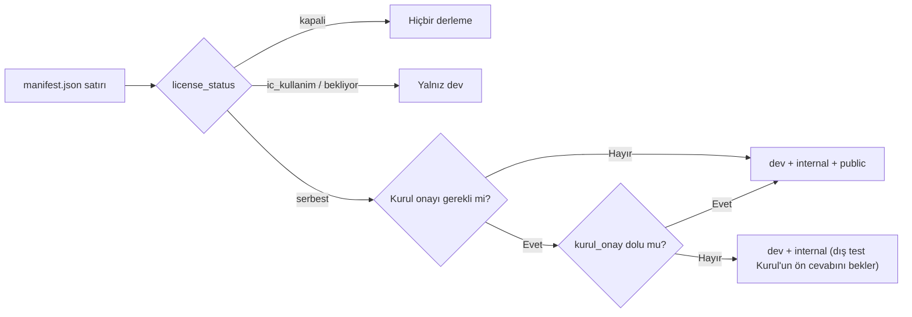

# Kapsam ve Fazlar

> **Sürüm:** 1.2 · **Tarih:** 20 Ekim 2026 · **Durum:** Taslak
> **Bağlı kararlar:** [K-02](../00-ozet/02-karar-defteri.md#k-02--i̇lk-içerik-seti) · [K-03](../00-ozet/02-karar-defteri.md#k-03--tefsir-önce-elmalılı-meali) · [K-04](../00-ozet/02-karar-defteri.md#k-04--hadis-kaynakları) · [K-05](../00-ozet/02-karar-defteri.md#k-05--risale-i-nur-ve-lisansı-bekleyen-içerik) · [K-06](../00-ozet/02-karar-defteri.md#k-06--yayın-kapısı) · [K-07](../00-ozet/02-karar-defteri.md#k-07--mushaf-görünümü-üç-seçenek) · [K-08](../00-ozet/02-karar-defteri.md#k-08--platform-sırası) · [K-15](../00-ozet/02-karar-defteri.md#k-15--hesap-ve-senkron-v1xte) · [K-17](../00-ozet/02-karar-defteri.md#k-17--arama-sqlite-fts5) · [K-18](../00-ozet/02-karar-defteri.md#k-18--depolama-yöneticisi-v1de) · [K-19](../00-ozet/02-karar-defteri.md#k-19--kuran-kelime-anlamları) · [K-22](../00-ozet/02-karar-defteri.md#k-22--gelir-modeli) · [K-25](../00-ozet/02-karar-defteri.md#k-25--i̇lkeler) · [K-30](../00-ozet/02-karar-defteri.md#k-30--eski-plandan-çıkarılanlar)

Bu dosya mobil v1'in neyi kapsadığını, her özelliğin hangi faza ait olduğunu ve neyin bilerek yapılmadığını tanımlar. Bu dosyada yer almayan bir özellik v1 kapsamında sayılmaz. Kararların tek kaynağı [karar defteridir](../00-ozet/02-karar-defteri.md); bu dosya kararları özellik düzeyine indirir.

Bu dosyadaki sayısal hedeflerin bir kısmı karar defterinde yazılı değildir. Bu değerler "öneri" diye işaretlidir ve proje sahibinin onayını bekler.

---

## 1. Etiketler ve fazlar

| Etiket | Anlamı | Faz |
|---|---|---|
| **v1** | Mobil v1'de yapılır. İçerik her derlemede o derlemenin lisans kuralına göre görünür (bölüm 2.1); mağazaya yalnız lisans kapısından geçen içerik girer. | Faz 2 · Mobil v1 (iç test), Faz 3 · Mağaza v1 |
| **v1.x** | Mağaza v1'den sonraki küçük sürümlerde gelir. | Faz 4 · v1.x |
| **Web** | Next.js web uygulamasıyla gelir. | Faz 5 · Web |
| **Takvime bağlı** | Telif süresinin dolmasına ya da bir lisans görüşmesine bağlıdır. | Faz 6 · Takvime bağlı |
| **Bilerek yok** | İlke ya da kapsam kararı gereği yapılmaz. | Yok |

Faz sırası [Fazlar](../08-yol-haritasi/01-fazlar.md) dosyasıyla aynıdır: Faz 0 · Hazırlık → Faz 1 · İçerik hattı → Faz 2 · Mobil v1 (iç test) → Faz 3 · Mağaza v1 → Faz 4 · v1.x → Faz 5 · Web → Faz 6 · Takvime bağlı.

"v1" etiketli bir özelliğin içeriği lisans kapısına takılabilir. Bu durumda kod v1'de yazılır; `bekliyor` ve `ic_kullanim` içerik yalnız ekip içi `dev` derlemesinde görünür, `kapali` içerik hiçbir derlemeye girmez. Tablolarda bu durum "Not" sütununda yazılıdır.

---

## 2. Mobil v1'in tanımı

Mobil v1, iOS ve Android için tek bir Expo uygulamasıdır ([K-08](../00-ozet/02-karar-defteri.md#k-08--platform-sırası), [K-09](../00-ozet/02-karar-defteri.md#k-09--mobil-teknoloji)). Kullanıcı hesap açmadan Kur'an'ı mushaf sayfası ve Elmalılı meali ile okur. Bir kelimeye dokunup kökünü, anlamını ve Kur'an'daki öteki geçişlerini görür, sonra okuduğu yere tek dokunuşla döner. Seçtiği hafızı dinler, not ve vurgu bırakır, hatim tutar. Hadis okuyucusu Tecrîd-i Sarîh'in Arapçasını Ahmed Naim Türkçesiyle yan yana gösterir. Tefsir paketi hazırlandıkça aynı akışa katılır. Risale-i Nur metni hukukçu görüşü gelene kadar hiçbir derlemede yoktur ([K-05](../00-ozet/02-karar-defteri.md#k-05--risale-i-nur-ve-lisansı-bekleyen-içerik), [K-06](../00-ozet/02-karar-defteri.md#k-06--yayın-kapısı)).

| Sınır | v1'deki durum | Dayanak |
|---|---|---|
| Platform | iOS ve Android. Expo SDK 56'dan beri asgari iOS sürümü 16.4; iPhone 7, 6s ve ilk SE desteklenmez ([Expo SDK 56](https://expo.dev/changelog/sdk-56)). Android asgari sürümü Doğrulanacak. | K-08, K-09 |
| Hesap | Yok. Notlar, vurgular, yer imleri ve ilerleme cihazda kalır. Yerel şema senkrona hazır kurulur. | [K-15](../00-ozet/02-karar-defteri.md#k-15--hesap-ve-senkron-v1xte) |
| Ağ | Yalnız isteğe bağlı paket ve ses indirmek için gerekir. `core` paketi uygulamaya gömülüdür. | [K-21](../00-ozet/02-karar-defteri.md#k-21--i̇çerik-dağıtımı) |
| Arama | Cihazda SQLite FTS5. | [K-17](../00-ozet/02-karar-defteri.md#k-17--arama-sqlite-fts5) |
| Gelir | Reklam yok, ücret duvarı yok, gelir modeli yok. | [K-22](../00-ozet/02-karar-defteri.md#k-22--gelir-modeli), [K-25](../00-ozet/02-karar-defteri.md#k-25--i̇lkeler) |
| Yayın | Mağaza derlemesi yalnız `serbest` ve gerekiyorsa Kurul onaylı paketleri görür. | [K-06](../00-ozet/02-karar-defteri.md#k-06--yayın-kapısı) |
| Arayüz dili | Türkçe. | Bu dosya |

### 2.1 Derleme türleri

| Derleme | Kullanan | Görebildiği paketler |
|---|---|---|
| `dev` | Yalnız ekip | `serbest`, `bekliyor`, `ic_kullanim` |
| `internal` | Davetli test kullanıcıları, EAS iç dağıtım (Faz 2) | Yalnız `serbest`. Kurul onayı bekleyen Kur'an metni, meal ve sesin kapalı testte gösterilip gösterilemeyeceği Kurul'a sorulur (Açık soru); cevap gelene kadar dış test kullanıcısı alınmaz. |
| `public` | Mağaza kullanıcıları (Faz 3 ve sonrası) | Yalnız `serbest`; Kur'an metni, meal ve ses paketlerinde ayrıca Kurul onaylı sürüm |

`kapali` durumundaki bir paket hiçbir derlemeye girmez ve işlenmez. Kural [K-06](../00-ozet/02-karar-defteri.md#k-06--yayın-kapısı) ile sabittir; manifest paket başına `kurul_gerekli` bilgisi ve imza taşır.

### 2.2 Kurul onayı ve sürüm dondurma

*Bu bölüm hukuki görüş değildir.*

633 sayılı Kanun'un 7549 sayılı Kanunla değişen 6. maddesi, Mushafları İnceleme ve Kıraat Kurulu onayı olmayan elektronik ve sesli Kur'an ile mealli mushafın yayımlanmasını yasaklar ([Lexpera, 633](https://www.lexpera.com.tr/mevzuat/kanunlar/diyanet-isleri-baskanligi-kurulus-ve-gorevleri-hakkinda-kanun-633)). Değişiklik 4 Haziran 2025'te yürürlüğe girdi ([Yeni Akit](https://www.yeniakit.com.tr/haber/diyanete-yeni-yetki-yururluge-girdi-sakincali-kuran-meallerini-toplayip-imha-edebilecek-1937002.html)). 2022 tarihli yönetmelik onaylanmış eserlerin içeriğinin değiştirilemeyeceğini söyler ([Memurlar.net, 2022](https://www.memurlar.net/haber/1045766/kur-an-i-kerim-basim-ve-yayim-kriterleri-hakkinda-yonetmelik-resmi-gazete-de-yayimlandi.html)).

Bu dosya için sonuçlar:
- Mağaza v1 (Faz 3), `core` paketindeki Kur'an metni ve meal için Kurul onayı gelmeden yayımlanmaz. Onay gelmezse mağaza sürümü çıkmaz. Faz 2'de dış test kullanıcısı, Kurul onayı bekleyen içeriğin kapalı testte gösterilip gösterilemeyeceğine Kurul ön cevap verince alınır; o zamana kadar test ekip içi `dev` derlemesiyle yapılır (K-06).
- Onaylı içerik sürümleri dondurulur. Metinde, mealde ya da seste yapılan her değişiklik yeniden onay gerektirebilecek bir olay sayılır ([Yayın kapısı ve Kurul](../07-yayin/01-yayin-kapisi-ve-kurul.md)).
- Başvuru usulü, ücret ve süre bilinmiyor (Açık soru).

---

## 3. İçerik seti

Lisans durumları Ekim 2026 itibarıyladır. Ayrıntı ve güncel kayıt [Kaynaklar ve lisans defteri](../04-icerik/01-kaynaklar-ve-lisans-defteri.md) dosyasındadır; çelişki olursa o dosya geçerlidir. Paket yapısı [İçerik paketleri](../03-veri/03-icerik-paketleri.md) dosyasında tanımlıdır.

| İçerik | Paket | Kaynak ve lisans | `license_status` | Kurul onayı | Faz |
|---|---|---|---|---|---|
| Kur'an metni (Uthmani + Simple Clean) | `core` | Tanzil. Dosya başlığı CC BY 3.0 der; şartlar metni değiştirmeyi yasaklar, atıf ve tanzil.net bağlantısı ister ([Tanzil metni](https://raw.githubusercontent.com/OpenITI/0025AH/master/data/0001Quran/0001Quran.Mushaf/0001Quran.Mushaf.Tanzil001-ara1.mARkdown)) | `serbest` | Gerekli | v1 |
| Elmalılı meali | `core` | Özgün baskıdan (İstanbul: Matbaai Ebüzziya, 1935–1938) kendi sayısallaştırmamız. Türkçe metin büyük olasılıkla Latin harfli, âyetler Arapça harflidir. İş, 1930'ların dizgisine ve imlasına uygun OCR ve düzeltmedir; harf çevirisi gerekmez (K-03; [Princeton kaydı](https://catalog.princeton.edu/catalog/SCSB-3946972); tarama nüshasında Doğrulanacak). Yazar 1942'de vefat etti; eser 1 Ocak 2013'ten beri serbest ([MKÜ kaydı](https://openaccess.mku.edu.tr/items/1b02bae2-408d-43ea-920d-6c26605c442a)). Sadeleştirilmiş baskılar kullanılmaz (K-03). | `serbest` | Gerekli (mealli mushaf) | v1 |
| Kelime kök ve lemma etiketleri (QAC kaynaklı) | `kelime-kok` (ayrı paket) | QAC v0.4. İndirme sayfası GPL ve atıf şartıyla izin verir; SSS "ticari amaçla kullanmamak" der ([QAC indirme](https://corpus.quran.com/download/), [QAC SSS](https://corpus.quran.com/faq.jsp)) | `bekliyor` | Açık soru | v1 hedefi. QAC'den yazılı açıklama gelene kadar yalnız `dev`. |
| Türkçe kelime anlamları (`lemma_gloss`) | `kelime-kok` | Kendi yazımımız: yapay zekâ taslağı ve insan onayı (K-19). Yalnız onaylı satırlar yayına girer. Anlam kelimeye QAC lemma eşlemesiyle bağlandığı için QAC verisiyle aynı pakete girer ([Kaynaklar ve lisans defteri](../04-icerik/01-kaynaklar-ve-lisans-defteri.md) §3.2). | Anlam metni kendi verimiz; paket `bekliyor` | Açık soru | v1 hedefi. QAC'den yazılı açıklama gelene kadar yalnız `dev`. |
| Kur'an içi ve meal bağlantı indeksleri | `core` | Kendi üretimimiz. Her `xref` satırı dayandığı verinin lisansını `license` sütununda taşır (K-27). | Satır başına | Uygulanmaz | v1 |
| Medine 604 sayfa sınırları, sayfa eşlemeleri | `core` | Kaynak Doğrulanacak | Doğrulanacak | Açık soru | v1 |
| Mushaf C yazı tipi: Amiri Quran | Uygulamaya gömülü | OFL ([google/fonts: Amiri Quran](https://github.com/google/fonts/tree/main/ofl/amiriquran)) | `serbest` | Açık soru: Kurul'un yazı tipi şartı ([Cumhuriyet](https://www.cumhuriyet.com.tr/turkiye/resmi-gazetede-yayimlandi-diyanetten-kuran-karari-1998786)) | v1 |
| KFGQPC Uthmanic Hafs yazı tipi (C için tercih) | Uygulamaya gömülü | Ücretsiz dağıtıma izin verir; satışı, değiştirmeyi ve yazılı onaysız çoğaltmayı yasaklar ([yazı tipi dosyası](https://raw.githubusercontent.com/mustafa0x/qpc-fonts/f93bf5f3/various-woff2/UthmanicHafs1%20Ver09.woff2)) | `bekliyor` | Açık soru | Yazılı izin gelince |
| Mushaf A: QPC V2 sayfa yazı tipleri (tecvid için V4) ve satır düzeni | `mushaf-a-cuz-{01..30}` | Yazı tipi meta verisi yalnız "All rights reserved" der ([QCF_P001](https://raw.githubusercontent.com/mustafa0x/qpc-fonts/f93bf5f3/mushaf-woff2/QCF_P001.woff2)). QF geliştirici şartları, aktif Developer Console hesabı ve atıfla yazı tiplerini "cache or bundle" etmeye izin verir, ama yalnız uygulamanın bütünleşik parçası olarak ([QF şartları](https://api-docs.quran.foundation/legal/developer-terms/); AS-02). Satır düzeni verisinin kaynağı ve lisansı Doğrulanacak. | `bekliyor` | Gerekli. Kurul'un Medine yazı tiplerine bakışı Açık soru. | v1 hedefi. Koşullar sağlanmazsa mağaza v1 Mushaf C ile çıkar. |
| Mushaf B: Türk hattı sayfa görselleri ve `ayah_box` | `mushaf-b` | Açık veri yok. Modern hat ve tezhip FSEK m. 4 kapsamında korunur ([FSEK](https://www.wipo.int/wipolex/en/text/499171)). Yol telifsiz bir Osmanlı mushafını sayısallaştırmak ya da lisans almaktır ([Küre: âyet berkenar](https://kureansiklopedi.com/tr/detay/ayet-berkenar-a2f19)). | `kapali` (lisans gelene kadar) | Gerekli | Takvime bağlı (lisans) |
| Elmalılı tefsiri (Hak Dini Kur'an Dili, özgün baskı) | `tefsir-elmalili` | 2013'ten beri serbest. Güvenilir dijital özgün baskı bulunamadı; OCR ve düzeltme gerekiyor ([Küre](https://kureansiklopedi.com/tr/detay/hak-dini-kuran-dili-2)). | `serbest` | Açık soru | v1.x (K-03: önce meal, tefsir metni ikinci aşamada) |
| Tecrîd-i Sarîh: Arapça ve Ahmed Naim Türkçesi | `hadis-tecrid` | Arapça serbest. Naim (ö. 1934) kısmı serbest. Kâmil Miras (ö. 30 Nisan 1957) ciltleri 1 Ocak 2028'de serbest kalır ([Küre: Miras](https://kureansiklopedi.com/tr/detay/miras-kamil)). | Naim kısmı `serbest`; Miras kısmı 1 Ocak 2028'e kadar `kapali` | Kapsam dışı görünüyor (Doğrulanacak) | Naim kısmı v1; tamamı Takvime bağlı (2028) |
| Kütüb-i Sitte Arapça metni | `hadis-kutub-i-sitte` | Arapça metinler serbest. Açık veri setlerinin kaynak belgeleri zayıf ([hadith-api editions.json](https://raw.githubusercontent.com/fawazahmed0/hadith-api/1/editions.json), [Sunnah.com](https://sunnah.com/developers)). Kaynak seçimi [Hadis hazırlığı](../04-icerik/04-hadis-hazirligi.md) dosyasında. | `bekliyor` | Kapsam dışı görünüyor (Doğrulanacak) | v1 (kaynak seçimine bağlı) |
| Risale-i Nur metni | `risale-{kitap}` | 31 Aralık 2030'a kadar korunuyor, 1 Ocak 2031'de serbest kalıyor; hakları bugün kimin kullandığı belirsiz ([TDV İA](https://islamansiklopedisi.org.tr/risale-i-nur-kulliyati)) | Hukukçu görüşüne kadar `kapali`; görüş olumluysa `ic_kullanim`; izinle ya da 1 Ocak 2031'de `serbest` (K-06) | Uygulanmaz | Görüş olumluysa yalnız `dev` derlemesinde v1; `internal` ve mağazada Takvime bağlı (1 Ocak 2031 ya da lisans) |
| Risale atıf dizini (metinsiz: âyet ↔ Risale yeri, baskı sayfası) | Açık soru: ayrı paket ya da `core` | Olgusal bilgi. Raporun çıkarımına göre risk düşük görünüyor; fikri haklar avukatıyla doğrulanmalı. Dizin üretimi metnin işlenmesini gerektirir; ekip içi işlemenin uygunluğu da hukukçuya sorulur (K-05). | Metinle birlikte, hukukçu görüşüne kadar `kapali` | Uygulanmaz | v1 hedefi (hukukçu görüşüne bağlı) |
| Risale lügati | `risale-{kitap}` ile birlikte | Redhouse 1890 sözlüğü kamu malı ([HathiTrust](https://catalog.hathitrust.org/Record/001771732)) ve özgün tanımlar. Kelime-Frekans deposunun CC0 frekansları kullanılabilir; anlam sütunu kopyalanmaz ([Kelime-Frekans](https://github.com/alitekdemir/Risale-i-Nur-Kelime-Frekans)). | `serbest` | Uygulanmaz | Risale metniyle aynı |
| Hafız sesleri | `ses-{hafiz}` | everyayah ve quranicaudio kayıtları için açık lisans yok; telif okuyucuda ([AlQuran Cloud şartları](https://alquran.cloud/terms-and-conditions)). Hafız başına yazılı izin gerekir; QF ses API'si ayrı kayıttır (`ses-qf-api`, `bekliyor`, yalnız akış). | `ses-everyayah`, `ses-quranicaudio` ve `ses-turk-hafiz-*` `kapali` (hafız başına yazılı izin gelene kadar; lisans defteri geçerlidir) | Gerekli (sesli Kur'an) | v1 hedefi: izinli 3–5 okuyucu |
| Kelime zamanlamaları | `ses-{hafiz}` ile birlikte | quran-align CC BY 4.0; yalnız hizalandığı EveryAyah dosyalarıyla geçerli ([quran-align](https://raw.githubusercontent.com/cpfair/quran-align/master/README.md)) | `serbest` | Ses paketiyle birlikte | v1 (eşleşen ses varsa) |
| Diğer mealler | Kaynak alınmadı | Çantay 1 Ocak 2035'te, Bilmen 1 Ocak 2042'de serbest kalır ([Küre: Çantay](https://kureansiklopedi.com/tr/detay/cantay-hasan-basri), [Küre: Bilmen](https://kureansiklopedi.com/tr/detay/bilmen-omer-nasuhi)). Diyanet mealleri korunuyor. | Uygulanmaz | Gerekli | Takvime bağlı |
| Kitaplar (Kısas-ı Enbiyâ, Mevlid) | `k:` adresleri, sonra | Özgün metinler serbest. Mahir İz sadeleştirmesi korunuyor ([KTB](https://www.ktb.gov.tr/EN-118064/ahmed-cevdet-pasa.html)). Latin harfli Mevlid baskılarının çoğu güvenilir değil ([TDV İA](https://islamansiklopedisi.org.tr/mevlid--suleyman-celebi)). | Uygulanmaz | Uygulanmaz | Faz atanmadı (K-02) |

Not: QAC kaynaklı kök ve lemma verisi, kendi lisans durumunu taşıyan ayrı `kelime-kok` paketinde durur; `core` bu veriyi içermez (K-06 uygulama notu). QAC'den yazılı açıklama gelene kadar paket `bekliyor` durumundadır ve yalnız `dev` derlemesinde görünür. `kelime-kok` kurulu değilse ya da derlemede görünmüyorsa kelime kartı Arapça kelimeyi, âyeti ve aramayı gösterir; Türkçe anlam, kök ve lemma bu paketle gelir ([Okuma deneyimi §7](./02-okuma-deneyimi.md#7-kelime-kartı)). Bu yüzden QAC'den açıklama gelene kadar mağaza ve iç test derlemesinde kelime kartında Türkçe anlam yoktur. Anlamların QAC'den bağımsız olarak `core`'a taşınması IP-6'dır (Açık soru; [İçerik paketleri](../03-veri/03-icerik-paketleri.md) §10).

---

## 4. Modül bazında özellikler

### 4.1 Kur'an okuyucu

| Özellik | Etiket | Not |
|---|---|---|
| Mushaf C: akan Unicode metin, Medine sayfa sınırları korunur | v1 | Varsayılan çizim. Lisanstan bağımsız çalışır. |
| Mushaf A: QPC V2 sayfa yazı tipleri, cüz başına indirme | v1 | Mağazaya QF şartları ve Kurul görüşüne bağlı girer. |
| Mushaf B: Türk hattı görselleri, âyet koordinatları | Takvime bağlı | Lisans gelince açılır. |
| Tecvid renkleri (QPC V4) | v1.x | Ek yazı tipi seti ve tema başına kontrast denetimi gerekir. |
| Okuma biçimleri: Mushaf, Mushaf + Meal, Âyet âyet | v1 | [Okuma deneyimi](./02-okuma-deneyimi.md#2-okuma-biçimleri) |
| Sağdan sola sayfa çevirme, yön ayarı, etiketli ‹ › düğmeleri | v1 | |
| Telefonda tek bölme; tablet yatayda açık kitap (sağda mushaf, solda meal) | v1 | |
| Tablet yatayda çift mushaf sayfası [s2][s1] | v1.x | |
| Sure başlığı, besmele kuralları, cüz ve secde işaretleri | v1 | Hizb işaretinin veri kaynağı Doğrulanacak. |
| Git: sure, âyet, sayfa, cüz | v1 | |
| Kaldığın yerden devam (cihaz başına) | v1 | `reading_position` |
| Kelime kartı (A, C ve Âyet âyet) | v1 | |
| Seçim: C'de yerel seçim, A'da kelime aralığı, B'de âyet | v1 | |
| Odak modu, ekranı açık tutma | v1 | |
| Erişilebilir metin modu | v1 | Ekran okuyucu açıkken önerilir. |
| Âyet sabitleme ve karşılaştırma | v1.x | Quran.com "Pin & Compare" karşılığı ([Quran.com güncellemeleri](https://quran.com/tr/product-updates)) |
| Günün Âyeti tipografik kartı | v1.x | |
| Hıfz yardımcıları (metni gizleme vb.) | v1.x | Aday; faz kesinleşmedi. |

### 4.2 Meal ve tefsir

| Özellik | Etiket | Not |
|---|---|---|
| Elmalılı meali (`core`) | v1 | |
| Meal gösterimi: karşı sayfa (tablet), sekme ve etkin âyet altyazısı (telefon), uzun basışla âyet meali (B) | v1 | Tanzil'in üç gösterimine karşılık gelir ([Tanzil](https://tanzil.net:443/docs/quran_navigator)). |
| Mushaf ile mealin âyet çapasıyla eşzamanlanması, "Panelleri bağla/ayır" | v1 | |
| Tefsir görünümü (etkin âyeti izler) | v1 | Kod v1'de; içerik `tefsir-elmalili` paketiyle gelir. |
| Elmalılı tefsir metni | v1.x | K-03 |
| Tefsir mukaddimesi ve âyete bağlı olmayan bölümler | v1.x | `tf:elmalili:mukaddime:p4` |
| Diğer mealler, çoklu meal karşılaştırma | Takvime bağlı | Lisans ve telif takvimi |
| Arapça klasik tefsir | Faz atanmadı | K-03'te sonraya bırakıldı. |

### 4.3 Hadis

| Özellik | Etiket | Not |
|---|---|---|
| Tecrîd-i Sarîh okuyucu: Arapça ve Ahmed Naim Türkçesi yan yana | v1 | Naim tercümesinin sayısallaştırılmasına bağlı ([Hadis hazırlığı](../04-icerik/04-hadis-hazirligi.md)) |
| Kâmil Miras ciltlerinin Türkçesi | Takvime bağlı | 1 Ocak 2028 |
| Kütüb-i Sitte Arapça okuyucu | v1 | Kaynak seçimine bağlı; seçim kapanmazsa yalnız `dev` |
| Tecrîd ↔ Buhârî numara eşlemesi (`h:tecrid:15` ↔ `h:buhari:52`) | v1 | |
| Hadis ↔ âyet bağlantıları (hadis içindeki âyet iktibasları, insan onaylı) | v1 | |
| Yapay zekâ ile hadis çevirisi | Faz atanmadı | Rapor erteleme önerir; gelirse "doğrulanmamış" rozeti taşır (K-25). |

### 4.4 Risale-i Nur

| Özellik | Etiket | Not |
|---|---|---|
| Risale okuyucu: kitap › bölüm › paragraf | v1 | Kod v1'de yazılır. Metin hukukçu görüşüne kadar `kapali`; görüş olumluysa yalnız `dev` derlemesinde görünür. `internal` ve mağazada Takvime bağlı (2031 ya da lisans). |
| Dizin-önce görünüm (metinsiz atıf dizini) | v1 | Dizinin üretimi ve yayını hukukçu görüşüne bağlı. |
| Lügat yoğunluğu (Kapalı / Az / Orta / Çok) ve lügat kartı | v1 | Metinle birlikte görünür. |
| Arapça ibarenin satır içi meali (iktibas kartı) | v1 | Metinle birlikte görünür. |
| Risale → âyet ve âyet → Risale atıfları | v1 | Mağazada dizin olarak. |
| Baskılar arası sayfa eşlemesi (`page_map`) | v1 | Dizinle birlikte. Baskı listesi [Risale hazırlığı](../04-icerik/05-risale-hazirligi.md) dosyasında. |
| Kitap başına ilerleme ve kaldığın yer | v1 | Metinle birlikte görünür. |
| Konkordans (KWIC) | v1.x | Metnin kendisinden hesaplanır. |
| Sesli ve eşzamanlı Risale | Takvime bağlı | Açık kaynak yok, lisans gerekir. |
| Yapay zekâ özetleri | Bilerek yok | K-30 |
| Sadeleştirme, kısaltma | Bilerek yok | K-25 |

### 4.5 Dinleme

| Özellik | Etiket | Not |
|---|---|---|
| Mini oynatıcı ve Dinleme sayfası | v1 | [Ses sistemi](../06-mobil/02-ses-sistemi.md) |
| Hafız seçimi, 5 saniyelik ön dinleme | v1 | Mağazada izin ve Kurul onayına bağlı |
| Âyet vurgusu; zamanlama verisi olan okuyucuda kelime vurgusu | v1 | |
| Her âyeti ×N, aralığı ×N tekrar; âyet arası bekleme çarpanı | v1 | Quran.com `delayMultiplier` ([repeatMachine](https://github.com/quran/quran.com-frontend-next/blob/production/src/xstate/actors/repeatMachine/repeatMachine.ts)) |
| Hız 0,75–1,5, perde düzeltmeli; uyku zamanlayıcısı | v1 | |
| Arka planda ve kilit ekranında çalma | v1 | Android'de kilit ekranı kontrolü etkin değilse ses yaklaşık 3 dakika sonra kesilir ([expo-audio](https://docs.expo.dev/versions/latest/sdk/audio/)). |
| Takip et ve "Okunan âyete dön" | v1 | |
| Sure ve cüz bazında indirme, hafız başına silme | v1 | K-18 |
| Kur'an + meal dönüşümlü dinleme | v1.x | Sesli meal kaydı gerekir; açık kaynak yok. |
| Türk hafızlar | Takvime bağlı | İzin görüşmesi ([Sonra yapılacaklar](../08-yol-haritasi/02-sonra-yapilacaklar.md)) |

### 4.6 Bağlantılar

| Özellik | Etiket | Not |
|---|---|---|
| Bağlantılar paneli: esere göre gruplar, gerekçe çipleri, güven etiketleri, katlı düşük güven | v1 | [Okuma deneyimi](./02-okuma-deneyimi.md#8-bağlantılar-paneli) |
| Âyet ↔ meal hizası | v1 | |
| Âyet ↔ tefsir aralığı | v1.x | Tefsir paketiyle |
| Açık atıf ve iktibas (Risale ve tefsir → âyet), insan onaylı | v1 | Risale tarafı mağazada dizin |
| Kök ve lemma (Kur'an içi) | v1 | `kelime-kok` paketiyle; QAC açıklamasına bağlı |
| Türkçe kelime → Arapça kök (meal, tefsir, Risale) | v1 | Onaylı yüksek frekanslı lemmalarla başlar, v1.x'te genişler ([Kök ve lemma](../05-capraz-referans/03-kok-ve-lemma.md)). |
| İfade eşleşmesi (FTS5 ifade sorgusu) | v1 | |
| Benzer âyet | v1 | Kaynak lisansı temizse |
| Konu bağlantıları | v1.x | |
| Anlamsal komşular | Faz atanmadı | Sonra yapılacaklar listesinde |
| Geri dönüş yığını, kırıntı izi, "↩ Okuduğun yere dön" | v1 | |
| Bağlantı oyu (👍/👎) ve hata bildirimi | v1.x | Sunucu gerekir |
| Bağlantıyı derin bağlantıyla paylaşma | v1 | |

### 4.7 Arama

| Özellik | Etiket | Not |
|---|---|---|
| Cihazda FTS5; Türkçe ve Arapça normalizasyon, önek indeksi, trigram, bm25 | v1 | [Arama](../03-veri/05-arama-fts5.md) |
| Paketler arası birleşik arama (`ATTACH`) | v1 | |
| Kapsam süzgeci: Kur'an, Meal, Tefsir, Hadis, Risale | v1 | |
| Tırnakla tam ifade araması | v1 | |
| Arapça kök harfleriyle arama | v1 | `kelime-kok` paketiyle; QAC açıklamasına bağlı |
| "Bakara 255", "2:255" gibi adresle doğrudan gitme | v1 | |
| Son aramalar (cihazda) | v1 | Açık Kuran kullanıcı isteği ([Google Play](https://play.google.com/store/apps/details?id=com.acikkuranrn)) |
| Sonuçlarda Arapça âyet ve meal yan yana | v1 | |
| Anlamsal arama, "kaynaklara sor" | Faz atanmadı | Sonra yapılacaklar listesinde |
| Web'de arama (sunucu ya da Orama) | Web | expo-sqlite web derlemesinde FTS yok ([Expo SQLite](https://docs.expo.dev/versions/v58.0.0/sdk/sqlite.md)). |

### 4.8 Kişisel çalışma

| Özellik | Etiket | Not |
|---|---|---|
| İsimli yer imleri | v1 | `bookmark` |
| Beş renkli, adlı ve işaretli vurgular | v1 | `highlight`; renkler [Tasarım sistemi](./04-tasarim-sistemi.md#23-vurgu-renkleri) |
| Notlar: Markdown, `[[q:2:255]]` bağlantıları; kelime aralığına, âyete, paragrafa ya da hadise bağlı | v1 | `note` |
| Karışık kaynaklı koleksiyonlar | v1 | `collection` |
| "Kaynak kopyala (İSNAD)" | v1 | Biçim kuralı Doğrulanacak |
| Yedek dışa ve içe aktarma (dosya) | v1 | Hesapsız sürümde cihaz değişiminde veri kaybını önler (öneri). |
| Kelime defteri | v1.x | `vocab` |
| Görsel içerik kartıyla paylaşma (âyet, vecize) | v1.x | v1'de metin ve derin bağlantı paylaşılır. |
| Okuma planları ("40 günde Sözler" gibi) | v1.x | |
| PDF dışa aktarma | Faz atanmadı | |

### 4.9 İlerleme

| Özellik | Etiket | Not |
|---|---|---|
| Hatim: 30 cüz ızgarası, 604 sayfa çubuğu, aynı anda birden çok hatim | v1 | `hatim`, `hatim_page` |
| Risale kitap başına ilerleme | v1 | Metinle birlikte |
| Okuma geçmişi (cihazda) | v1 | |
| Yumuşak seri gösterimi ("Bu hafta 4 gün okudun"), varsayılan kapalı | v1 | |
| Gizli mod: bütün takibi kapatır | v1 | |
| Okuma hedefi ve tempo planlayıcı | v1.x | |
| Hatırlatıcı bildirimler (isteğe bağlı) | v1.x | |
| Liderlik tablosu, sosyal karşılaştırma, kırılan seri uyarısı, okunan sayfa sayısını paylaşma | Bilerek yok | K-25 |
| Ortak hatim | Bilerek yok | K-30 |

### 4.10 Erişilebilirlik ve ayarlar

| Özellik | Etiket | Not |
|---|---|---|
| Temalar: Kâğıt, Âhar, Gece, Sistem | v1 | K-24 |
| Ayrı Arapça ve Türkçe yazı boyutu, %200 büyütme | v1 | |
| Türkçe gövde yazı tipi seçimi (Source Serif 4, Noto Serif) | v1.x | v1'de yalnız Literata |
| Hareketi azalt (sistem ayarını izler) | v1 | |
| Ekran okuyucu: glif ve görsel sayfaların arkasında Unicode katmanı | v1 | |
| Her kaydırma jestinin görünür düğme karşılığı, 44×44 pt dokunma hedefi | v1 | [Apple HIG Erişilebilirlik](https://developer.apple.com/design/human-interface-guidelines/accessibility) |
| Ayarların sürümden sürüme korunması (ayar göç testleri) | v1 | Diyanet kullanıcılarının şikâyeti ([İslam ve İhsan](https://www.islamveihsan.com/diyanet-kuran-portali.html)) |
| Artırılmış kontrast desteği | v1.x | |
| Başka arayüz dilleri | Faz atanmadı | |

### 4.11 Depolama

| Özellik | Etiket | Not |
|---|---|---|
| Paket listesi: boyut, sürüm, lisans durumu | v1 | K-18; [Depolama yöneticisi](../06-mobil/03-depolama-yoneticisi.md) |
| Tek dokunuşla paket silme, hafız başına ses silme | v1 | |
| Yalnız Wi-Fi ile indirme | v1 | |
| Duraklatılabilir indirme kuyruğu, `sha256` doğrulama, atomik değiştirme | v1 | |
| Paket güncellemesi bildirimi (manifest sürümü) | v1 | |
| Uygulama kapalıyken arka planda indirme | v1.x | Platform desteği Doğrulanacak |

### 4.12 Hesap ve senkron

| Özellik | Etiket | Not |
|---|---|---|
| Hesapsız tam kullanım | v1 | K-15 |
| Senkrona hazır yerel şema (UUIDv7, HLC, `deleted_at`, `base_version`, `device_id`) | v1 | [Kullanıcı verisi ve senkron](../03-veri/04-kullanici-verisi-ve-senkron.md) |
| Hesap (ASP.NET Core Identity; Google sunulursa Apple ile Giriş de) | v1.x | |
| Cihazlar arası senkron (HLC ve veri türüne göre birleştirme) | v1.x | K-16 |
| Not çakışmasında iki sürümü gösterip kullanıcıya seçtirme | v1.x | |
| Hesap silme, aydınlatma metni | v1.x | [KVKK ve gizlilik](../07-yayin/02-kvkk-ve-gizlilik.md) |
| Web'de aynı hesapla okuma | Web | |
| Metin CRDT ile ortak düzenleme | Faz atanmadı | Yalnız ortak düzenleme gelirse |

---

## 5. Faz atanmamış işler

Bu işlerin sahibi [Sonra yapılacaklar](../08-yol-haritasi/02-sonra-yapilacaklar.md) dosyasıdır. Burada yalnız v1 kapsamında olmadıklarını kaydeder:

- Fiyatlandırma ve gelir modeli (K-22).
- Kitaplar: Kısas-ı Enbiyâ, Mevlid (K-02).
- Canlı barındırma seçimi (K-20).
- Türk hattı lisansı (Mushaf B), Diyanet meali görüşmesi, Risale hak sahipleriyle görüşme, hafız izinleri.
- Mağaza adı ve alan adı kontrolü (K-01).
- Diğer tefsir ve mealler, Arapça klasik tefsir.
- Anlamsal katman ve "kaynaklara sor".
- PDF dışa aktarma, yapay zekâ ile hadis çevirisi.

---

## 6. Kapsam dışı

### 6.1 Karar gereği yapılmayanlar

| Konu | Dayanak |
|---|---|
| Zekât hesaplayıcı, çocuk modu, aile hesabı, LMS, mukabele, ortak hatim, kıraat-i seb'a, hac ve umre rehberi, AR, akıllı saat, botlar, açık API | [K-30](../00-ozet/02-karar-defteri.md#k-30--eski-plandan-çıkarılanlar) |
| Reklam | [K-25](../00-ozet/02-karar-defteri.md#k-25--i̇lkeler) |
| Liderlik tablosu ve riyâya teşvik eden sıralama | K-25 |
| Fetva | K-25 |
| Bir cemaate ya da yayınevine bağlılık | K-25 |
| Said Nursî metnini kısaltmak, sadeleştirmek | K-25 |
| Risale için yapay zekâ özetleri, gönüllü liderlik tablosu | K-30 |
| Yapay zekâ metnini rozetsiz göstermek | K-25: her yapay zekâ metni "doğrulanmamış" rozeti taşır |

### 6.2 v1'de bulunmayanlar

- Web uygulaması (K-08; Faz 5).
- Hesap, senkron, sunucuya kullanıcı verisi gönderimi (K-15).
- Sunucu tarafı arama, canlı yapay zekâ servisi.
- Ücret duvarı ve premium katman (K-22). Ses ücretli bir katmana konmaz. Okuyucular ücretsiz ve ticari olmayan dağıtıma izin veriyor; ücretli katman telif sorununa yol açabilir ([AlQuran Cloud](https://alquran.cloud/terms-and-conditions)).
- Namaz vakti, kıble, zikirmatik gibi ibadet araçları. Ürün okuma ve öğrenmeye odaklanır (öneri; karar defterine işlenmesi önerilir).

### 6.3 Lisans gereği kullanılmayan kaynaklar

| Kaynak | Neden | Kaynakça |
|---|---|---|
| QPC yazı tiplerinin GitHub aynalarından toplu kopyası | Meta veri "All rights reserved"; yol QF şartlarıdır | [QCF_P001](https://raw.githubusercontent.com/mustafa0x/qpc-fonts/f93bf5f3/mushaf-woff2/QCF_P001.woff2) |
| OpenITI külliyatı | CC BY-NC-SA | [Zenodo](https://zenodo.org/records/3082463) |
| Tanzil çeviri dosyaları | Yalnız ticari olmayan amaçlar | [OPUS: Tanzil](https://opus.nlpl.eu/Tanzil/corpus/version/Tanzil) |
| QuranWBW ve hablullah/data-quran kelime mealleri | Kopyalama yasağı; CC BY-NC-ND | [QuranWBW](https://legacy.quranwbw.com/2), [data-quran](https://github.com/hablullah/data-quran) |
| Sadeleştirilmiş Elmalılı baskıları | Sadeleştirenin hakkı sürer | K-03 |
| eRisale ve yayınevlerinin lügatleri | Korunan derlemeler | Araştırma raporu, Risale bölümü |
| Kaynağı belgesiz hadis veri setleri | Lisans dosyası yok ya da Türkçe metnin kaynağı belgesiz | [hadith-json](https://raw.githubusercontent.com/AhmedBaset/hadith-json/main/README.md), [hadith-api](https://raw.githubusercontent.com/fawazahmed0/hadith-api/1/editions.json) |
| `alitekdemir/Risale-i-Nur-Diyanet` deposu, "lisans açık" varsayımıyla | Hak sahibi olmayan yükleyici lisans veremez | [README](https://raw.githubusercontent.com/alitekdemir/Risale-i-Nur-Diyanet/master/README.md) |

---

## 7. Hedef kullanıcılar

| Kullanıcı | Kimdir | İhtiyaçları | v1'de karşılayan | Sınır |
|---|---|---|---|---|
| Genel okur | Telefonda düzenli okuyan, hatim yapan, meali birlikte okumak isteyen kişi | Tek dokunuşla kaldığı yerden devam ([vavtv](https://www.vavtv.com.tr/kurani-kerim)); okunaklı mushaf ve yanında meal; hafız dinleme; güvenilir çevrimdışı okuma ve yer imi ([Açık Kuran yorumları](https://mwm.ai/es/apps/a-k-kuran/1561649944)); reklamsızlık; isteğe bağlı okuma hedefi ([e-Diyanet yorumu](https://play.google.com/store/apps/details?id=tr.gov.diyanet.mobileapp.dib&hl=tr)) | Oku sekmesi kaldığın yerde açılır; Mushaf + Meal; mini oynatıcı; hatim; Gizli mod | Okuma hedefi ve hatırlatıcı v1.x |
| Risale ders halkası okuyucusu | Ders halkasında birlikte okuyan, farklı baskılardan verilen sayfa numaralarıyla çalışan kişi | Baskılar arası sayfa eşlemesi; lügat; âyet ve hadis atıflarına atlayıp dönme; metnin kelimesi kelimesine korunması; yayınevinden ve cemaatten bağımsız bir araç | Tam okuyucu, hukukçu görüşü olumluysa yalnız ekip içi `dev` derlemesinde. Mağazada dizin görünümü ve Kur'an tarafında "Bu âyet Risale'de nerede geçiyor?" (hukukçu görüşüne bağlı) | Mağazada metin 1 Ocak 2031'de ya da lisansla |
| İlahiyat öğrencisi | Kur'an'ı kelime ve kök düzeyinde, tefsirle birlikte çalışan kişi | Kök, lemma, morfoloji ve kelime anlamı; tefsirle paralel okuma; kesin adresli alıntı; bağlantılı notlar; kök ve ifade araması. Açık Kuran'ın kelime-kök tablosu çıtayı koyar ([Google Play](https://play.google.com/store/apps/details?id=com.acikkuranrn)). | Kelime kartı, "Kökü incele", Bağlantılar paneli, tam ifade araması, İSNAD kopyalama, `[[q:2:255]]` not bağlantıları | Tefsir v1.x; konkordans v1.x |
| Yaşlı okur | Uzun metni büyük yazıyla okuyan, karmaşık jestlerde zorlanan kişi | Büyük ve kullanıcı denetimli yazı, yüksek kontrast, büyük dokunma hedefi ([NN/g](https://www.nngroup.com/articles/usability-for-senior-citizens/)); sürümden sürüme değişmeyen kontroller ([İslam ve İhsan](https://www.islamveihsan.com/diyanet-kuran-portali.html)); yakınlaştırmanın kapatılmaması ([eRisale](https://www.erisale.com/)); her jestin düğme karşılığı ([Apple HIG](https://developer.apple.com/design/human-interface-guidelines/accessibility)) | Ayrı Arapça ve Türkçe boyut, %200 büyütme, Kâğıt/Âhar/Gece, etiketli ‹ › düğmeleri, Erişilebilir metin modu | iOS 16.4 asgarisi eski iPhone'ları dışarıda bırakır |
| Ekran okuyucu kullanan okur (kesişen grup) | Görme engelli ya da az gören kişi | Glif ve görsel sayfaların gerçek metinle okunması; Arapça ve Türkçe etiketler; kıraat sesi | Unicode katmanı, âyet başına erişilebilir öğe, Erişilebilir metin modu | Arapça metin seslendirmesinin kalitesi Doğrulanacak |

---

## 8. v1 başarı ölçütleri

Faz 3 · Mağaza v1'e geçiş için bu ölçütlerin tamamı sağlanır. "Öneri" işaretli hedefler karar defterinde yazılı değildir.

| No | Ölçüt | Hedef | Nasıl ölçülür | Dayanak |
|---|---|---|---|---|
| B-01 | Hesapsız tam çevrimdışı kullanım | Uçak modunda temiz kurulumdan sonra okuma, arama, kelime kartı, `core` içi bağlantılar, not, vurgu, yer imi ve hatim senaryolarının %100'ü geçer. Bu akışlarda tek bir ağ isteği yapılmaz. | Uçtan uca test paketi, ağ izleyiciyle ([Test stratejisi](../07-yayin/03-test-stratejisi.md)) | K-15 |
| B-02 | Arama hızı | `core` ve üç isteğe bağlı paket bağlıyken p95 < 50 ms | Orta seviye Android referans cihazında 200 sorguluk set (Türkçe, Arapça, önek, tam ifade). Referans cihaz Açık soru. | K-17 |
| B-03 | Atıf ve iktibas kesinliği | Altın sette görünür (orta ve üstü) bağlantılarda âyet düzeyi kesinlik ≥ %95; "kesin" etiketlilerde ≥ %99; uzun iktibas (≥ 4 kelime) ≥ %95; kısa iktibas ≥ %85; açık atıf duyarlılığı ≥ %90 (öneri) | Sözler, Mektubat, Lem'alar, Şuâlar, Mesnevî-i Nuriye ve İşârâtü'l-İ'câz'dan tabakalı seçilmiş 300–500 paragraflık altın set. Uzun ve kısa iktibas ayrı raporlanır ([İktibas tespiti](../05-capraz-referans/02-iktibas-tespiti.md)). | Araştırma raporu |
| B-04 | Kök etiketi kesinliği | Türkçe lemma → kök altın setinde kesinlik ≥ %95 (öneri). Otomatik etiketleme, model ile insan uyumu (Cohen κ) insanlar arası düzeye (~0,6) ulaşmadan denetimsiz çalışmaz ([protocols.io](https://www.protocols.io/view/llm-assisted-expert-annotation-for-systematic-lite-4r3l2dw5jg1y/v1.pdf)). | Sıklık bandına ve kaynağa göre tabakalı 300–500 çift | K-19 |
| B-05 | Lisanssız içerik | `public` ve `internal` derlemede `license_status` değeri `serbest` olmayan paket sayısı 0; `public` derlemede gerekli Kurul onayı eksik paket sayısı 0 | Yayınlayıcı ve CI manifest denetimi derlemeyi durdurur | K-06 |
| B-06 | Kurul onay görünürlüğü | `public` derlemedeki Kur'an metni, meal ve ses paketlerinin %100'ü `kurul_onay` taşır ve Ayarlar › Kurul onay bilgisi ekranında görünür | Manifest denetimi ve ekran testi | K-06 |
| B-07 | Atıf ekranı | Her kaynağın şartlarındaki atıf (örneğin Tanzil bağlantısı, QF atfı, yazı tipi lisansları) Ayarlar › Kaynaklar ve lisanslar ekranında eksiksiz | Kaynak defterine karşı kontrol listesi | K-06 |
| B-08 | Çapa kararlılığı | İçerik paketi güncellemesinden sonra vurgu, not ve yer imlerinin %100'ü çapasına bağlı kalır ya da "metin değişti" durumuna düşer; hiçbiri sessizce kaybolmaz | `content_hash` göç testi ([Çapa şeması](../03-veri/01-capa-semasi.md)) | K-26 |
| B-09 | Okuduğun yere dönüş | "↩ Okuduğun yere dön" testlerin %100'ünde başlangıç çapasına ve kaydırma ofsetine döner | Uçtan uca test: 5 adımlı atlama zincirleri, döndürme ve tema değişimiyle | Bu dosya |
| B-10 | Erişilebilirlik | Bütün metin jetonları ≥ 4,5:1; dokunma hedefleri ≥ 44×44 pt; %200 büyütmede kesilen metin yok; VoiceOver ve TalkBack ile Fâtiha ve Bakara 255 üç çizim yolunda da okunur | [Tasarım sistemi](./04-tasarim-sistemi.md#9-erişilebilirlik-kontrol-listesi) kontrol listesi | K-24 |
| B-11 | Kararlılık | Faz 2 iç testinin son dört haftasında çökmesiz oturum oranı ≥ %99,5 (öneri) | Sentry | Bu dosya |
| B-12 | Gizlilik | v1 kişisel veri toplamaz; analitik yok; hata raporları kullanıcı tanımlayıcısı taşımaz | [KVKK ve gizlilik](../07-yayin/02-kvkk-ve-gizlilik.md) denetimi | K-15 |
| B-13 | Açılış | Kaldığın yere soğuk açılış, orta seviye Android'de ≤ 2,5 sn (öneri) | Ölçüm betiği, referans cihaz | Bu dosya |

---

## 9. Açık sorular

| No | Soru | Etkisi | Sahibi dosya |
|---|---|---|---|
| AS-01 | QAC kök ve lemma verisini ücretsiz bir uygulamada kullanmaya yazılı izin verir mi? | Kelime kartının kök satırı ve kök bağlantıları mağazaya girer mi | [Kaynaklar ve lisans defteri](../04-icerik/01-kaynaklar-ve-lisans-defteri.md) |
| AS-02 | QPC cüz paketlerini kendi depomuzdan dağıtmak QF şartlarındaki izin kapsamına girer mi? Şartlar yazı tipleri için "cache or bundle" der ve dosyaların "only as an integrated part of the Application" dağıtılabileceğini, "the Developer's own API, asset package, or standalone download" ile ayrıca sunulamayacağını söyler; cüz paketinin kendi depodan indirilmesinin bu yasağa girip girmediği bilinmiyor. Satır düzeni verisi Content Sync'in "mushafs" kaynağındadır; çevrimdışı kopya için tek izinli yol Content Sync'tir ve en az 7 günde bir eşitleme ister, Content Sync istisnası "prepackaged database or build-time bundle" dağıtımına izin vermez. Verinin nereden, hangi lisansla geleceği açık. Karar yok; QF'ye sorulur ([QF soruları](../yazismalar/qf-developer-console.md); 20 Ekim 2026 okuması). | Mushaf A mağazaya girer mi | [Kaynaklar ve lisans defteri](../04-icerik/01-kaynaklar-ve-lisans-defteri.md) |
| AS-03 | Kurul'un dijital başvuru usulü, ücreti, süresi; Medine yazı tiplerine bakışı; kelime anlamlarını ve tefsir paketini onay kapsamında sayıp saymadığı (hukuki görüş değildir) | Faz 3'ün tarihi ve içeriği | [Yayın kapısı ve Kurul](../07-yayin/01-yayin-kapisi-ve-kurul.md) |
| AS-04 | Risale metninin ekip içinde işlenmesi (dizin üretimi dahil) ve metinsiz atıf dizininin yayını için hukukçu görüşü | Metin `dev` derlemesinde işlenebilir mi; mağazada Risale bölümü görünür mü | [Risale hazırlığı](../04-icerik/05-risale-hazirligi.md) |
| AS-05 | Bu dosya, Ürün özeti ile aynı şekilde tefsir paketini v1.x'e, hadis paketlerini v1'e koyar. Hadis veri kaynağı seçimi ya da Naim tercümesinin sayısallaştırılması Faz 2'ye yetişmezse hadis v1.x'e kayar; Fazlar dosyası buna göre eşlenmeli. | Faz planı | [Fazlar](../08-yol-haritasi/01-fazlar.md) |
| AS-06 | Risale atıf dizini hangi pakette taşınır? | Paket ve manifest yapısı | [İçerik paketleri](../03-veri/03-icerik-paketleri.md) |
| AS-07 | Türk okurun, özellikle Risale çevrelerinde, tevafuklu mushafa bağlılığı ne ölçüde? Rapor bunun kullanıcı araştırmasıyla ölçülmesini önerir. | Mushaf B'nin önceliği | [Riskler](../08-yol-haritasi/03-riskler.md) |
| AS-08 | "Orta seviye Android" referans cihazı hangisi? | B-02 ve B-13 ölçümleri | [Test stratejisi](../07-yayin/03-test-stratejisi.md) |
| AS-09 | "Öneri" işaretli başarı hedefleri (B-03, B-04, B-11, B-13) onaylanacak mı? | Faz 3 geçiş kapısı | Proje sahibi |
| AS-10 | Medine 604 sayfa sınırlarının kaynağı ve lisansı | Sayfa eşlemesi | [Kaynaklar ve lisans defteri](../04-icerik/01-kaynaklar-ve-lisans-defteri.md) |
| AS-11 | Kurul onayı bekleyen Kur'an metni, meal ve ses kapalı testte gösterilebilir mi? (K-06) | Faz 2'de dış test kullanıcısı alınması | [Yayın kapısı ve Kurul](../07-yayin/01-yayin-kapisi-ve-kurul.md) |

---

## İlgili dosyalar

- [Ürün özeti](../00-ozet/01-urun-ozeti.md) · [Karar defteri](../00-ozet/02-karar-defteri.md) · [Sözlük](../00-ozet/03-sozluk.md)
- [Okuma deneyimi](./02-okuma-deneyimi.md) · [Mobil ekranlar](./03-mobil-ekranlar.md) · [Tasarım sistemi](./04-tasarim-sistemi.md)
- [İçerik paketleri](../03-veri/03-icerik-paketleri.md) · [Kullanıcı verisi ve senkron](../03-veri/04-kullanici-verisi-ve-senkron.md) · [Arama](../03-veri/05-arama-fts5.md)
- [Kaynaklar ve lisans defteri](../04-icerik/01-kaynaklar-ve-lisans-defteri.md) · [Elmalılı hazırlığı](../04-icerik/03-elmalili-hazirligi.md) · [Hadis hazırlığı](../04-icerik/04-hadis-hazirligi.md) · [Risale hazırlığı](../04-icerik/05-risale-hazirligi.md) · [Kelime anlamları](../04-icerik/06-kelime-anlamlari.md)
- [Bağlantı modeli](../05-capraz-referans/01-baglanti-modeli.md) · [İktibas tespiti](../05-capraz-referans/02-iktibas-tespiti.md)
- [Ses sistemi](../06-mobil/02-ses-sistemi.md) · [Depolama yöneticisi](../06-mobil/03-depolama-yoneticisi.md)
- [Yayın kapısı ve Kurul](../07-yayin/01-yayin-kapisi-ve-kurul.md) · [Test stratejisi](../07-yayin/03-test-stratejisi.md)
- [Fazlar](../08-yol-haritasi/01-fazlar.md) · [Sonra yapılacaklar](../08-yol-haritasi/02-sonra-yapilacaklar.md) · [Riskler](../08-yol-haritasi/03-riskler.md)
- [Kaynakça](../09-kaynakca.md)
