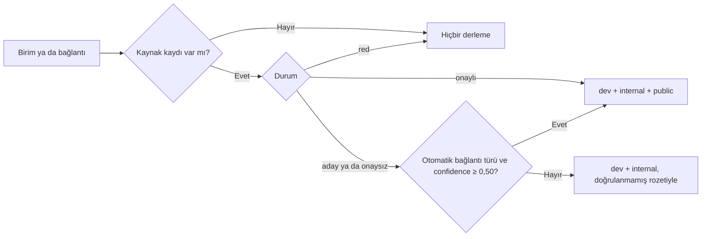

# Kapsam ve Fazlar

> **Sürüm:** 1.4 · **Tarih:** 1 Kasım 2026 · **Durum:** Taslak
> **Bağlı kararlar:** [K-41](../00-ozet/02-karar-defteri.md#k-41--ses-sistemi-hazır-kayıtlar-ayna-ve-çevrimiçi-öncelikli-dinleme) · [K-02](../00-ozet/02-karar-defteri.md#k-02--i̇lk-içerik-seti) · [K-03](../00-ozet/02-karar-defteri.md#k-03--tefsir-önce-elmalılı-meali) · [K-04](../00-ozet/02-karar-defteri.md#k-04--hadis-kaynakları) · [K-42](../00-ozet/02-karar-defteri.md#k-42--kaynak-ilkesi-ve-kalite-temelli-görünürlük) · [K-07](../00-ozet/02-karar-defteri.md#k-07--mushaf-görünümü-üç-seçenek) · [K-08](../00-ozet/02-karar-defteri.md#k-08--platform-sırası) · [K-15](../00-ozet/02-karar-defteri.md#k-15--hesap-ve-senkron-v1xte) · [K-17](../00-ozet/02-karar-defteri.md#k-17--arama-sqlite-fts5) · [K-18](../00-ozet/02-karar-defteri.md#k-18--depolama-yöneticisi-v1de) · [K-19](../00-ozet/02-karar-defteri.md#k-19--kuran-kelime-anlamları) · [K-22](../00-ozet/02-karar-defteri.md#k-22--gelir-modeli) · [K-25](../00-ozet/02-karar-defteri.md#k-25--i̇lkeler) · [K-30](../00-ozet/02-karar-defteri.md#k-30--eski-plandan-çıkarılanlar) · [K-38](../00-ozet/02-karar-defteri.md#k-38--kaynak-edinimi-dijital-öncelikli-kanıtla-yükseltme)

Bu dosya mobil v1'in neyi kapsadığını, her özelliğin hangi faza ait olduğunu ve neyin bilerek yapılmadığını tanımlar. Bu dosyada yer almayan bir özellik v1 kapsamında sayılmaz. Kararların tek kaynağı [karar defteridir](../00-ozet/02-karar-defteri.md); bu dosya kararları özellik düzeyine indirir.

Bu dosyadaki sayısal hedeflerin bir kısmı karar defterinde yazılı değildir. Bu değerler "öneri" diye işaretlidir; proje sahibi onaylayana kadar öneri sayılır (AS-09).

---

## 1. Etiketler ve fazlar

| Etiket | Anlamı | Faz |
|---|---|---|
| **v1** | Mobil v1'de yapılır. İçerik her derlemede o derlemenin görünürlük kuralına göre görünür (bölüm 2.1); mağazaya yalnız editör onayından ve kalite kapısından geçen içerik girer. | Faz 2 · Mobil v1 (iç test), Faz 3 · Mağaza v1 |
| **v1.x** | Mağaza v1'den sonraki küçük sürümlerde gelir. | Faz 4 · v1.x |
| **Web** | Next.js web uygulamasıyla gelir. | Faz 5 · Web |
| **Ek içerik** | Çekirdek v1'e ve v1.x'e girmeyen ek içerik ve görünümler (ör. Mushaf B); yeni paket sürümleriyle gelir. | Faz 6 · Ek içerik |
| **Bilerek yok** | İlke ya da kapsam kararı gereği yapılmaz. | Yok |

Faz sırası [Fazlar](../08-yol-haritasi/01-fazlar.md) dosyasıyla aynıdır: Faz 0 · Hazırlık → Faz 1 · İçerik hattı → Faz 2 · Mobil v1 (iç test) → Faz 3 · Mağaza v1 → Faz 4 · v1.x → Faz 5 · Web → Faz 6 · Ek içerik.

"v1" etiketli bir özelliğin içeriği henüz editör onayından geçmemiş olabilir. Bu durumda kod v1'de yazılır; onaysız içerik `dev` ve `internal` derlemelerinde "doğrulanmamış" rozetiyle görünür, `public` derlemeye girmez (bölüm 2.1). Ayrı bir koşul varsa tablolarda "Not" sütununda yazılıdır.

---

## 2. Mobil v1'in tanımı

Mobil v1, iOS ve Android için tek bir Expo uygulamasıdır ([K-08](../00-ozet/02-karar-defteri.md#k-08--platform-sırası), [K-09](../00-ozet/02-karar-defteri.md#k-09--mobil-teknoloji)). Kullanıcı hesap açmadan Kur'an'ı mushaf sayfası ve Elmalılı meali ile okur. Bir kelimeye dokunup kökünü, anlamını ve Kur'an'daki öteki geçişlerini görür, sonra okuduğu yere tek dokunuşla döner. Seçtiği hafızı dinler, not ve vurgu bırakır, hatim tutar. Hadis okuyucusu Tecrîd-i Sarîh'in Arapçasını Ahmed Naim ve Kâmil Miras Türkçesiyle yan yana gösterir. Risale-i Nur okuyucusu metni, âyet atıf dizini ve lügatiyle gelir. Tefsir paketi hazırlandıkça aynı akışa katılır ([K-02](../00-ozet/02-karar-defteri.md#k-02--i̇lk-içerik-seti), [K-42](../00-ozet/02-karar-defteri.md#k-42--kaynak-ilkesi-ve-kalite-temelli-görünürlük)).

| Sınır | v1'deki durum | Dayanak |
|---|---|---|
| Platform | iOS ve Android. Expo SDK 56'dan beri asgari iOS sürümü 16.4; iPhone 7, 6s ve ilk SE desteklenmez ([Expo SDK 56](https://expo.dev/changelog/sdk-56)). Android asgari sürümü Doğrulanacak. | K-08, K-09 |
| Hesap | Yok. Notlar, vurgular, yer imleri ve ilerleme cihazda kalır. Yerel şema senkrona hazır kurulur. | [K-15](../00-ozet/02-karar-defteri.md#k-15--hesap-ve-senkron-v1xte) |
| Ağ | Yalnız isteğe bağlı paket ve ses indirmek ile çevrimiçi ses dinlemek için gerekir. `core` paketi uygulamaya gömülüdür. | [K-21](../00-ozet/02-karar-defteri.md#k-21--i̇çerik-dağıtımı) |
| Arama | Cihazda SQLite FTS5. | [K-17](../00-ozet/02-karar-defteri.md#k-17--arama-sqlite-fts5) |
| Gelir | Reklam yok, ücret duvarı yok, gelir modeli yok. | [K-22](../00-ozet/02-karar-defteri.md#k-22--gelir-modeli), [K-25](../00-ozet/02-karar-defteri.md#k-25--i̇lkeler) |
| Yayın | Mağaza derlemesi yalnız editör onaylı içeriği taşır ve Yayınlayıcının kalite kapısından geçer (bölüm 2.1). | [K-42](../00-ozet/02-karar-defteri.md#k-42--kaynak-ilkesi-ve-kalite-temelli-görünürlük) |
| Arayüz dili | Türkçe. | Bu dosya |

### 2.1 Derleme türleri

Görünürlük editoryal kaliteye bağlıdır; süzme kaynak ve birim düzeyinde yapılır ([Yayın süreci](../07-yayin/01-yayin-sureci.md) §3).

| Derleme | Kullanan | Görünen içerik |
|---|---|---|
| `dev` | Yalnız ekip | Onaylı birim ve bağlantı; onaysız birim ve yapay zekâ taslağı "doğrulanmamış" rozetiyle; aday bağlantı (her tür); `test-` önekli kaynaklar |
| `internal` | Davetli test kullanıcıları, EAS iç dağıtım (Faz 2) | Onaylı birim ve bağlantı; onaysız birim ve yapay zekâ taslağı "doğrulanmamış" rozetiyle; aday bağlantı (her tür); `test-` önekli kaynaklardan yalnız uçtan uca fikstürler (`test-kucuk`, `test-ses`) |
| `public` | Mağaza kullanıcıları (Faz 3 ve sonrası) | Onaylı birim ve onaylı bağlantı; otomatik türdeki bağlantı (`kok`, `lemma`, `benzer_ayet`, `anlamsal`) `confidence ≥ 0,50` ile |

`red` durumundaki bağlantı hiçbir derlemeye girmez; kaynak kaydı olmayan içerik hiçbir pakete girmez (P-01). İnsan onayı isteyen türdeki (`atif`, `iktibas`, `ima`, `konu`) `aday` bağlantı yalnız `dev` ve `internal`'dadır; otomatik türler güven eşiğiyle her derlemeye girer ([Bağlantı modeli](../05-capraz-referans/01-baglanti-modeli.md) §8). `test-` önekli kaynak `public`'e girmez; `internal`'a yalnız `test-kucuk` ve `test-ses` girer (P-12). Kural [K-42](../00-ozet/02-karar-defteri.md#k-42--kaynak-ilkesi-ve-kalite-temelli-görünürlük) madde 5 ile sabittir; manifest her derlemede imzalıdır.

---

## 3. İçerik seti

Her kaynağın adı, adresi, sürümü ve atıf satırı [Kaynaklar](../04-icerik/01-kaynaklar.md) dosyasındaki kaynak kartlarında ve `pipeline/sources/` kayıtlarındadır; çelişki olursa o dosya geçerlidir. Kaynak seçimi tedarikle yapılır; ölçüt göreve uygunluk, eksiksizlik, kalite, biçim ve sürümün sabitlenebilmesidir ([K-42](../00-ozet/02-karar-defteri.md#k-42--kaynak-ilkesi-ve-kalite-temelli-görünürlük) madde 1). Paket yapısı [İçerik paketleri](../03-veri/03-icerik-paketleri.md) dosyasında tanımlıdır.

| İçerik | Paket | Kaynak | Faz |
|---|---|---|---|
| Kur'an metni (Uthmani + Simple Clean) | `core` | Tanzil ([indirme sayfası](https://tanzil.net/download/)). Metin bayt bayt saklanır (K-26); kaynağın kendi bildirimi kaynak kaydına yazılır ve Ayarlar › Kaynaklar'da atıf olarak gösterilir. Kayıtlar `tanzil-uthmani`, `tanzil-simple-clean`. | v1 |
| Elmalılı meali | `core` | Özgün baskı (İstanbul: Matbaai Ebüzziya, 1935–1938). Önce hazır dijital metin aranır ve A09 pilotunda OCR ile aynı örneklemde ölçülür; eşik geçilmezse özgün baskının OCR'ı ve düzeltmesi yapılır (K-03, K-38; [Elmalılı hazırlığı](../04-icerik/03-elmalili-hazirligi.md)). Türkçe metin büyük olasılıkla Latin harfli, âyetler Arapça harflidir; harf çevirisi gerekmez ([Princeton kaydı](https://catalog.princeton.edu/catalog/SCSB-3946972); tarama nüshasında Doğrulanacak). Sadeleştirilmiş baskılar temel metin olmaz (K-03). Meal için ikinci editör onayı gerekir. | v1 |
| Kelime kök ve lemma etiketleri (QAC kaynaklı) | `kelime-kok` (ayrı paket) | Quranic Arabic Corpus (QAC) v0.4, kayıt `qac-morfoloji` ([QAC indirme](https://corpus.quran.com/download/)); atıf satırı Ayarlar › Kaynaklar'da. Boyutu yüzünden `core`'dan ayrı ve isteğe bağlı pakettir; bütün derlemelerde yer alır ([Kök ve lemma](../05-capraz-referans/03-kok-ve-lemma.md)). | v1 |
| Türkçe kelime anlamları (`lemma_gloss`) | `kelime-kok` | Önce hazır Türkçe kelime anlamı kaynağı aranır; bulunamazsa yapay zekâ taslağı ve insan onayı (K-19). Yalnız onaylı satırlar `public`'e girer. Anlam kelimeye QAC lemma eşlemesiyle bağlandığı için QAC verisiyle aynı pakete girer ([Kaynaklar](../04-icerik/01-kaynaklar.md) §3.2). | v1 |
| Kur'an içi ve meal bağlantı indeksleri | `core` | Kendi üretimimiz. Her `xref` satırı türünü, güvenini, kanıtını ve onay durumunu taşır (K-27). | v1 |
| Medine 604 sayfa sınırları, sayfa eşlemeleri | `core` | Adaylar Tanzil üst verisi ve `medine-604-duzen`; kaynak A11'de tedarikle seçilir ve sürümü sabitlenir (AS-10). | v1 |
| Mushaf C yazı tipi: KFGQPC Uthmanic Hafs ya da Amiri Quran | Uygulamaya gömülü | İki aday da kaynak kaydındadır (`kfgqpc-hafs-font`, `amiri-quran-font`); seçim görsel kaliteye dayanır, ötekisi yedek kalır ([google/fonts: Amiri Quran](https://github.com/google/fonts/tree/main/ofl/amiriquran), [KFGQPC Uthmanic Hafs yazı tipi dosyası](https://raw.githubusercontent.com/mustafa0x/qpc-fonts/f93bf5f3/various-woff2/UthmanicHafs1%20Ver09.woff2)). | v1 |
| Mushaf A: QPC V2 sayfa yazı tipleri (tecvid için V4) ve satır düzeni | `mushaf-a-cuz-{01..30}` | Yazı tipleri ve düzen verisi GitHub ya da QUL'dan alınır; kayıtlar `qpc-v1-font`, `qpc-v2-font`, `qpc-v4-font`, `medine-604-duzen`. Kaynak ve sürüm A26'da tedarikle sabitlenir ([QCF_P001](https://raw.githubusercontent.com/mustafa0x/qpc-fonts/f93bf5f3/mushaf-woff2/QCF_P001.woff2) örnek yazı tipi dosyası). | v1 |
| Mushaf B: Türk hattı sayfa görselleri ve `ayah_box` | `mushaf-b` | Hazır açık veri bulunamadı; görseller kaynak araştırmasıyla A40'ta bulunur ve sayfa başına âyet koordinatı üretilir (K-07; [Küre: âyet berkenar](https://kureansiklopedi.com/tr/detay/ayet-berkenar-a2f19)). | Ek içerik (A40; önkoşulu A24) |
| Elmalılı tefsiri (Hak Dini Kur'an Dili, özgün baskı) | `tefsir-elmalili` | Güvenilir dijital özgün baskı bulunamadı; hazır metin adayı (archive.org metin katmanı) A09 pilotunda ölçülür, eşik geçilmezse OCR ve düzeltme gerekir (K-38; [Küre](https://kureansiklopedi.com/tr/detay/hak-dini-kuran-dili-2)). Tefsir için ikinci editör onayı gerekir. | v1.x (K-03: önce meal, tefsir metni ikinci aşamada) |
| Tecrîd-i Sarîh: Arapça, Ahmed Naim ve Kâmil Miras Türkçesi | `hadis-tecrid` | Kayıtlar `tecrid-ar`, `tecrid-naim`, `tecrid-miras`. Önce hazır dijital metin aranır; kaynak ve baskı esası ölçümle belirlenir (K-04, K-38; [Hadis hazırlığı](../04-icerik/04-hadis-hazirligi.md)). | v1 |
| Kütüb-i Sitte Arapça metni | `hadis-kutub-i-sitte` | Açık veri setlerinin baskı esası çoğu zaman belirsizdir; kaynak, eksiksizlik ve numaralandırma ölçümüyle seçilir. Aday kayıt `hadis-fawaz-ar` ([hadith-api editions.json](https://raw.githubusercontent.com/fawazahmed0/hadith-api/1/editions.json)). Ayrıntı [Hadis hazırlığı](../04-icerik/04-hadis-hazirligi.md) dosyasında. | v1 |
| Risale-i Nur metni | `risale-{kitap}` | Kaynak A20'de araştırmayla seçilir; kayıtlar `risale-1956-1960` (müellif tashihli baskılar) ve `risale-asil-nusha`. Metin kelimesi kelimesine, kısaltmasız ve sadeleştirmesiz yayımlanır (K-25) ve editör onayından geçtikçe mağazaya girer ([Risale hazırlığı](../04-icerik/05-risale-hazirligi.md)). | v1 |
| Risale atıf dizini (âyet ↔ Risale yeri, baskı sayfası) | Açık soru: ayrı paket ya da `core` (AS-06) | Risale metninden üretilir ve insan onayından geçer; kayıt `risale-atif-dizini`. | v1 |
| Risale lügati | `risale-{kitap}` ile birlikte | Redhouse 1890 sözlüğü ([HathiTrust](https://catalog.hathitrust.org/Record/001771732)), Kâmûs-ı Türkî, Lugat-ı Nâci ve özgün tanımlar; maddeler editör onayından geçer. Kelime sıklığı Kelime-Frekans deposundan alınır, anlam sütunu kullanılmaz ([Kelime-Frekans](https://github.com/alitekdemir/Risale-i-Nur-Kelime-Frekans)). Ayrıntı [Kaynaklar](../04-icerik/01-kaynaklar.md) §3.6. | Risale metniyle aynı |
| Okuyucu sesleri | `ses-katalog`, `ses-zaman-{kayit}`; dosyalar aynada | Hazır dijital kayıtlar kullanılır (K-40, K-41). Sure dosyaları MP3Quran ve Tarteel CDN'inden alınır ve kendi içerik depomuzdan sunulur; kayıtlar A27'de açılır ([Ses sistemi](../06-mobil/02-ses-sistemi.md)). | v1 hedefi: 7 popüler okuyucu, 9 kayıt |
| Kelime zamanlamaları | `ses-zaman-{kayit}` ile birlikte | QUD v4.0.0 (âyet ve kelime); yedek MP3Quran âyet zamanlaması | Âyet vurgusu v1; kelime takibi `kelimeTakibi` bayrağıyla sonra |
| Diğer mealler | Kaynak alınmadı | İlk içerik setinde Elmalılı'dan başka meal yoktur (K-02). | Faz atanmadı |
| Kitaplar (Kısas-ı Enbiyâ, Mevlid) | `k:` adresleri, sonra | Özgün metinler esas alınır. Latin harfli Mevlid baskılarının çoğu güvenilir değil ([TDV İA](https://islamansiklopedisi.org.tr/mevlid--suleyman-celebi)). | Faz atanmadı (K-02) |

Not: Her kitapta, Elmalılı dahil, önce hazır dijital metin aranır ve ölçülür, tarama ve OCR yedek yoldur ([K-38](../00-ozet/02-karar-defteri.md#k-38--kaynak-edinimi-dijital-öncelikli-kanıtla-yükseltme)); bu tablodaki fazlar değişmez.

Not: QAC kaynaklı kök ve lemma verisi boyutu yüzünden `core`'dan ayrı, isteğe bağlı `kelime-kok` paketinde durur; paket bütün derlemelerde yer alır. `kelime-kok` kurulu değilse ya da manifestte yoksa kelime kartı Arapça kelimeyi, âyeti ve aramayı gösterir; Türkçe anlam, kök ve lemma bu paketle gelir ([Okuma deneyimi §7](./02-okuma-deneyimi.md#7-kelime-kartı)). Mağaza derlemesinde Türkçe anlam yalnız onaylı satırlarla görünür.

---

## 4. Modül bazında özellikler

### 4.1 Kur'an okuyucu

| Özellik | Etiket | Not |
|---|---|---|
| Mushaf C: akan Unicode metin, Medine sayfa sınırları korunur | v1 | Varsayılan çizim. İndirme gerektirmez. |
| Mushaf A: QPC V2 sayfa yazı tipleri, cüz başına indirme | v1 | Cüz paketleriyle gelir (`mushaf-a-cuz-{01..30}`); kaynak A26'da tedarikle sabitlenir. |
| Mushaf B: Türk hattı görselleri, âyet koordinatları | Ek içerik | A40; görseller kaynak araştırmasıyla bulunur (K-07). |
| Tecvid renkleri (QPC V4) | v1.x | Ek yazı tipi seti ve tema başına kontrast denetimi gerekir. |
| Okuma biçimleri: Mushaf, Mushaf + Meal, Âyet âyet | v1 | [Okuma deneyimi](./02-okuma-deneyimi.md#2-okuma-biçimleri) |
| Sağdan sola sayfa çevirme, yön ayarı, etiketli ‹ › düğmeleri | v1 | |
| Telefonda tek bölme; tablet yatayda açık kitap (sağda mushaf, solda meal) | v1 | |
| Tablet yatayda çift mushaf sayfası [s2][s1] | v1.x | |
| Sure başlığı, besmele kuralları, cüz ve secde işaretleri | v1 | Hizb işaretinin veri kaynağı Doğrulanacak. |
| Git: sure, âyet, sayfa, cüz | v1 | |
| Kaldığın yerden devam (cihaz başına) | v1 | `reading_position` |
| Kelime kartı (A, C ve Âyet âyet) | v1 | |
| Seçim: C'de yerel seçim, A'da kelime aralığı, B'de âyet | v1 | |
| Odak modu, ekranı açık tutma | v1 | |
| Erişilebilir metin modu | v1 | Ekran okuyucu açıkken önerilir. |
| Âyet sabitleme ve karşılaştırma | v1.x | Quran.com "Pin & Compare" karşılığı ([Quran.com güncellemeleri](https://quran.com/tr/product-updates)) |
| Günün Âyeti tipografik kartı | v1.x | |
| Hıfz yardımcıları (metni gizleme vb.) | v1.x | Aday; faz kesinleşmedi. |

### 4.2 Meal ve tefsir

| Özellik | Etiket | Not |
|---|---|---|
| Elmalılı meali (`core`) | v1 | |
| Meal gösterimi: karşı sayfa (tablet), sekme ve etkin âyet altyazısı (telefon), uzun basışla âyet meali (B) | v1 | Tanzil'in üç gösterimine karşılık gelir ([Tanzil](https://tanzil.net:443/docs/quran_navigator)). |
| Mushaf ile mealin âyet çapasıyla eşzamanlanması, "Panelleri bağla/ayır" | v1 | |
| Tefsir görünümü (etkin âyeti izler) | v1 | Kod v1'de; içerik `tefsir-elmalili` paketiyle gelir. |
| Elmalılı tefsir metni | v1.x | K-03 |
| Tefsir mukaddimesi ve âyete bağlı olmayan bölümler | v1.x | `tf:elmalili:mukaddime:p4` |
| Diğer mealler, çoklu meal karşılaştırma | Faz atanmadı | Elmalılı dışında meal ilk içerik setinde yok (K-02). |
| Arapça klasik tefsir | Faz atanmadı | K-03'te sonraya bırakıldı. |

### 4.3 Hadis

| Özellik | Etiket | Not |
|---|---|---|
| Tecrîd-i Sarîh okuyucu: Arapça ve Türkçe (Ahmed Naim, Kâmil Miras) yan yana | v1 | Türkçe metin hazır dijital kaynaktan ya da sayısallaştırmadan gelir ([Hadis hazırlığı](../04-icerik/04-hadis-hazirligi.md)) |
| Kütüb-i Sitte Arapça okuyucu | v1 | Kaynak, eksiksizlik ve numaralandırma ölçümüyle seçilir; metin editör onayından geçmeden mağazaya girmez |
| Tecrîd ↔ Buhârî numara eşlemesi (`h:tecrid:15` ↔ `h:buhari:52`) | v1 | |
| Hadis ↔ âyet bağlantıları (hadis içindeki âyet iktibasları, insan onaylı) | v1 | |

### 4.4 Risale-i Nur

| Özellik | Etiket | Not |
|---|---|---|
| Risale okuyucu: kitap › bölüm › paragraf | v1 | Metin kelimesi kelimesine gösterilir; editör onayından geçen paragraflar `public`'e girer. |
| Lügat yoğunluğu (Kapalı / Az / Orta / Çok) ve lügat kartı | v1 | Lügat Risale paketiyle gelir. |
| Arapça ibarenin satır içi meali (iktibas kartı) | v1 | [İktibas tespiti](../05-capraz-referans/02-iktibas-tespiti.md) |
| Risale → âyet ve âyet → Risale atıfları | v1 | İnsan onaylı atıf dizini (`risale-atif-dizini`). |
| Baskılar arası sayfa eşlemesi (`page_map`) | v1 | Baskı listesi [Risale hazırlığı](../04-icerik/05-risale-hazirligi.md) dosyasındadır. |
| Kitap başına ilerleme ve kaldığın yer | v1 | |
| Konkordans (KWIC) | v1.x | Metnin kendisinden hesaplanır. |
| Sesli ve eşzamanlı Risale | Faz atanmadı | Hazır dijital kayıt bulunamadı. |
| Yapay zekâ özetleri | Bilerek yok | K-30 |
| Sadeleştirme, kısaltma | Bilerek yok | K-25 |

### 4.5 Dinleme

| Özellik | Etiket | Not |
|---|---|---|
| Mini oynatıcı ve Dinleme sayfası | v1 | [Ses sistemi](../06-mobil/02-ses-sistemi.md) |
| Hafız seçimi, 5 saniyelik ön dinleme | v1 | Katalog: 7 okuyucu, 9 kayıt (K-41) |
| Âyet vurgusu; zamanlama verisi olan okuyucuda kelime vurgusu | v1 | |
| Her âyeti ×N, aralığı ×N tekrar; âyet arası bekleme çarpanı | v1 | Quran.com `delayMultiplier` ([repeatMachine](https://github.com/quran/quran.com-frontend-next/blob/production/src/xstate/actors/repeatMachine/repeatMachine.ts)) |
| Hız 0,75–1,5, perde düzeltmeli; uyku zamanlayıcısı | v1 | |
| Arka planda ve kilit ekranında çalma | v1 | Android'de kilit ekranı kontrolü etkin değilse ses yaklaşık 3 dakika sonra kesilir ([expo-audio](https://docs.expo.dev/versions/latest/sdk/audio/)). |
| Takip et ve "Okunan âyete dön" | v1 | |
| Sure ve cüz bazında indirme, hafız başına silme | v1 | K-18 |
| Kur'an + meal dönüşümlü dinleme | v1.x | Sesli meal kaydı gerekir; hazır kayıt tedarikle aranır (aday `ses-kfgqpc-meal`; [Ses sistemi](../06-mobil/02-ses-sistemi.md)). |
| Türk hafızlar | Faz atanmadı | Hafız sesi alınmaz; ses hazır dijital kayıtlardan gelir (K-40, K-41). |

### 4.6 Bağlantılar

| Özellik | Etiket | Not |
|---|---|---|
| Bağlantılar paneli: esere göre gruplar, gerekçe çipleri, güven etiketleri, katlı düşük güven | v1 | [Okuma deneyimi](./02-okuma-deneyimi.md#8-bağlantılar-paneli) |
| Âyet ↔ meal hizası | v1 | |
| Âyet ↔ tefsir aralığı | v1.x | Tefsir paketiyle |
| Açık atıf ve iktibas (Risale ve tefsir → âyet), insan onaylı | v1 | Risale tarafı atıf dizininden gelir (`risale-atif-dizini`) |
| Kök ve lemma (Kur'an içi) | v1 | `kelime-kok` paketiyle |
| Türkçe kelime → Arapça kök (meal, tefsir, Risale) | v1 | Onaylı yüksek frekanslı lemmalarla başlar, v1.x'te genişler ([Kök ve lemma](../05-capraz-referans/03-kok-ve-lemma.md)). |
| İfade eşleşmesi (FTS5 ifade sorgusu) | v1 | |
| Benzer âyet | v1 | Sözlüksel satırlar kendi indeksimizden, âlim kaynaklı ilişkiler QurSim'den (yedek: `arriqaaq/ilm` GitHub kopyası; [Bağlantı modeli](../05-capraz-referans/01-baglanti-modeli.md) §5) |
| Konu bağlantıları | v1.x | |
| Anlamsal komşular | Faz atanmadı | Sonra yapılacaklar listesinde |
| Geri dönüş yığını, kırıntı izi, "↩ Okuduğun yere dön" | v1 | |
| Bağlantı oyu (beğen, beğenme) ve hata bildirimi | v1.x | Sunucu gerekir |
| Bağlantıyı derin bağlantıyla paylaşma | v1 | |

### 4.7 Arama

| Özellik | Etiket | Not |
|---|---|---|
| Cihazda FTS5; Türkçe ve Arapça normalizasyon, önek indeksi, trigram, bm25 | v1 | [Arama](../03-veri/05-arama-fts5.md) |
| Paketler arası birleşik arama (`ATTACH`) | v1 | |
| Kapsam süzgeci: Kur'an, Meal, Tefsir, Hadis, Risale | v1 | |
| Tırnakla tam ifade araması | v1 | |
| Arapça kök harfleriyle arama | v1 | `kelime-kok` paketiyle |
| "Bakara 255", "2:255" gibi adresle doğrudan gitme | v1 | |
| Son aramalar (cihazda) | v1 | Açık Kuran kullanıcı isteği ([Google Play](https://play.google.com/store/apps/details?id=com.acikkuranrn)) |
| Sonuçlarda Arapça âyet ve meal yan yana | v1 | |
| Anlamsal arama, "kaynaklara sor" | Faz atanmadı | Sonra yapılacaklar listesinde |
| Web'de arama (sunucu ya da Orama) | Web | expo-sqlite web derlemesinde FTS yok ([Expo SQLite](https://docs.expo.dev/versions/v58.0.0/sdk/sqlite.md)). |

### 4.8 Kişisel çalışma

| Özellik | Etiket | Not |
|---|---|---|
| İsimli yer imleri | v1 | `bookmark` |
| Beş renkli, adlı ve işaretli vurgular | v1 | `highlight`; renkler [Tasarım sistemi](./04-tasarim-sistemi.md#23-vurgu-renkleri) |
| Notlar: Markdown, `[[q:2:255]]` bağlantıları; kelime aralığına, âyete, paragrafa ya da hadise bağlı | v1 | `note` |
| Karışık kaynaklı koleksiyonlar | v1 | `collection` |
| "Kaynak kopyala (İSNAD)" | v1 | Biçim kuralı Doğrulanacak |
| Yedek dışa ve içe aktarma (dosya) | v1 | Hesapsız sürümde cihaz değişiminde veri kaybını önler (öneri). |
| Kelime defteri | v1.x | `vocab` |
| Görsel içerik kartıyla paylaşma (âyet, vecize) | v1.x | v1'de metin ve derin bağlantı paylaşılır. |
| Okuma planları ("40 günde Sözler" gibi) | v1.x | |
| PDF dışa aktarma | Faz atanmadı | |

### 4.9 İlerleme

| Özellik | Etiket | Not |
|---|---|---|
| Hatim: 30 cüz ızgarası, 604 sayfa çubuğu, aynı anda birden çok hatim | v1 | `hatim`, `hatim_page` |
| Risale kitap başına ilerleme | v1 | Risale paketiyle |
| Okuma geçmişi (cihazda) | v1 | |
| Yumuşak seri gösterimi ("Bu hafta 4 gün okudun"), varsayılan kapalı | v1 | |
| Gizli mod: bütün takibi kapatır | v1 | |
| Okuma hedefi ve tempo planlayıcı | v1.x | |
| Hatırlatıcı bildirimler (isteğe bağlı) | v1.x | |
| Liderlik tablosu, sosyal karşılaştırma, kırılan seri uyarısı, okunan sayfa sayısını paylaşma | Bilerek yok | K-25 |
| Ortak hatim | Bilerek yok | K-30 |

### 4.10 Erişilebilirlik ve ayarlar

| Özellik | Etiket | Not |
|---|---|---|
| Temalar: Kâğıt, Âhar, Gece, Sistem | v1 | K-24 |
| Ayrı Arapça ve Türkçe yazı boyutu, %200 büyütme | v1 | |
| Türkçe gövde yazı tipi seçimi (Source Serif 4, Noto Serif) | v1.x | v1'de yalnız Literata |
| Hareketi azalt (sistem ayarını izler) | v1 | |
| Ekran okuyucu: glif ve görsel sayfaların arkasında Unicode katmanı | v1 | |
| Her kaydırma jestinin görünür düğme karşılığı, 44×44 pt dokunma hedefi | v1 | [Apple HIG Erişilebilirlik](https://developer.apple.com/design/human-interface-guidelines/accessibility) |
| Ayarların sürümden sürüme korunması (ayar göç testleri) | v1 | Diyanet kullanıcılarının şikâyeti ([İslam ve İhsan](https://www.islamveihsan.com/diyanet-kuran-portali.html)) |
| Artırılmış kontrast desteği | v1.x | |
| Başka arayüz dilleri | Faz atanmadı | |

### 4.11 Depolama

| Özellik | Etiket | Not |
|---|---|---|
| Paket listesi: boyut, sürüm | v1 | K-18; [Depolama yöneticisi](../06-mobil/03-depolama-yoneticisi.md) |
| Tek dokunuşla paket silme, hafız başına ses silme | v1 | |
| Yalnız Wi-Fi ile indirme | v1 | |
| Duraklatılabilir indirme kuyruğu, `sha256` doğrulama, atomik değiştirme | v1 | |
| Paket güncellemesi bildirimi (manifest sürümü) | v1 | |
| Uygulama kapalıyken arka planda indirme | v1.x | Platform desteği Doğrulanacak |

### 4.12 Hesap ve senkron

| Özellik | Etiket | Not |
|---|---|---|
| Hesapsız tam kullanım | v1 | K-15 |
| Gizlilik metni ve mağaza gizlilik beyanları (App Privacy, Veri güvenliği) | v1 | [Gizlilik](../07-yayin/02-gizlilik.md) §2.5 ve §2.6 |
| Senkrona hazır yerel şema (UUIDv7, HLC, `deleted_at`, `base_version`, `device_id`) | v1 | [Kullanıcı verisi ve senkron](../03-veri/04-kullanici-verisi-ve-senkron.md) |
| Hesap (ASP.NET Core Identity; Google sunulursa Apple ile Giriş de) | v1.x | |
| Cihazlar arası senkron (HLC ve veri türüne göre birleştirme) | v1.x | K-16 |
| Not çakışmasında iki sürümü gösterip kullanıcıya seçtirme | v1.x | |
| Hesap silme, hesaplı sürümün gizlilik metni | v1.x | [Gizlilik](../07-yayin/02-gizlilik.md) §3 |
| Web'de aynı hesapla okuma | Web | |
| Metin CRDT ile ortak düzenleme | Faz atanmadı | Yalnız ortak düzenleme gelirse |

---

## 5. Faz atanmamış işler

Bu işlerin sahibi [Sonra yapılacaklar](../08-yol-haritasi/02-sonra-yapilacaklar.md) dosyasıdır. Burada yalnız v1 kapsamında olmadıklarını kaydeder:

- Fiyatlandırma ve gelir modeli (K-22).
- Kitaplar: Kısas-ı Enbiyâ, Mevlid (K-02).
- Canlı barındırma seçimi (K-20).
- Mağaza adı ve alan adı kontrolü (K-01).
- Diğer tefsir ve mealler, Arapça klasik tefsir.
- Anlamsal katman ve "kaynaklara sor".
- PDF dışa aktarma.

---

## 6. Kapsam dışı

### 6.1 Karar gereği yapılmayanlar

| Konu | Dayanak |
|---|---|
| Zekât hesaplayıcı, çocuk modu, aile hesabı, LMS, mukabele, ortak hatim, kıraat-i seb'a, hac ve umre rehberi, AR, akıllı saat, botlar, açık API | [K-30](../00-ozet/02-karar-defteri.md#k-30--eski-plandan-çıkarılanlar) |
| Reklam | [K-25](../00-ozet/02-karar-defteri.md#k-25--i̇lkeler) |
| Liderlik tablosu ve riyâya teşvik eden sıralama | K-25 |
| Fetva | K-25 |
| Bir cemaate ya da yayınevine bağlılık | K-25 |
| Said Nursî metnini kısaltmak, sadeleştirmek | K-25 |
| Risale için yapay zekâ özetleri, gönüllü liderlik tablosu | K-30 |
| Yapay zekâ metnini rozetsiz göstermek | K-25: her yapay zekâ metni "doğrulanmamış" rozeti taşır |

### 6.2 v1'de bulunmayanlar

- Web uygulaması (K-08; Faz 5).
- Hesap, senkron, sunucuya kullanıcı verisi gönderimi (K-15).
- Sunucu tarafı arama, canlı yapay zekâ servisi.
- Ücret duvarı ve premium katman (K-22).
- Namaz vakti, kıble, zikirmatik gibi ibadet araçları. Ürün okuma ve öğrenmeye odaklanır (öneri; karar defterine işlenmesi önerilir).

### 6.3 Kullanılmayan kaynaklar

Seçilmeyen adayların listesi ve gerekçeleri (kalite ve erişim) [Kaynaklar](../04-icerik/01-kaynaklar.md) §4 bölümündedir. Genel ilkeler:

| Kaynak | Neden | Dayanak |
|---|---|---|
| Sadeleştirilmiş Elmalılı baskıları | Özgün metne sadakat: sadeleştirilmiş baskı temel metin olmaz | K-03, K-38 |
| Başvuru, onay ya da API anahtarı isteyen içerik kaynakları | Kaynak adresi doğrudan dosya, GitHub ya da herkese açık uç olmalıdır | K-42 madde 2 |
| Baskı esası belgelenmemiş metin veri setleri | Temel metin olmaz; baskı esası belgelenirse ve ölçüm eşiği geçilirse yükseltilir | K-38 |

---

## 7. Hedef kullanıcılar

| Kullanıcı | Kimdir | İhtiyaçları | v1'de karşılayan | Sınır |
|---|---|---|---|---|
| Genel okur | Telefonda düzenli okuyan, hatim yapan, meali birlikte okumak isteyen kişi | Tek dokunuşla kaldığı yerden devam ([vavtv](https://www.vavtv.com.tr/kurani-kerim)); okunaklı mushaf ve yanında meal; hafız dinleme; güvenilir çevrimdışı okuma ve yer imi ([Açık Kuran yorumları](https://mwm.ai/es/apps/a-k-kuran/1561649944)); reklamsızlık; isteğe bağlı okuma hedefi ([e-Diyanet yorumu](https://play.google.com/store/apps/details?id=tr.gov.diyanet.mobileapp.dib&hl=tr)) | Oku sekmesi kaldığın yerde açılır; Mushaf + Meal; mini oynatıcı; hatim; Gizli mod | Okuma hedefi ve hatırlatıcı v1.x |
| Risale ders halkası okuyucusu | Ders halkasında birlikte okuyan, farklı baskılardan verilen sayfa numaralarıyla çalışan kişi | Baskılar arası sayfa eşlemesi; lügat; âyet ve hadis atıflarına atlayıp dönme; metnin kelimesi kelimesine korunması; yayınevinden ve cemaatten bağımsız bir araç | Tam okuyucu (kitap › bölüm › paragraf, lügat, ibare kartı), baskı sayfa eşlemesi ve Kur'an tarafında "Bu âyet Risale'de nerede geçiyor?" | Metin editör onayından geçtikçe mağazaya girer |
| İlahiyat öğrencisi | Kur'an'ı kelime ve kök düzeyinde, tefsirle birlikte çalışan kişi | Kök, lemma, morfoloji ve kelime anlamı; tefsirle paralel okuma; kesin adresli alıntı; bağlantılı notlar; kök ve ifade araması. Açık Kuran'ın kelime-kök tablosu çıtayı koyar ([Google Play](https://play.google.com/store/apps/details?id=com.acikkuranrn)). | Kelime kartı, "Kökü incele", Bağlantılar paneli, tam ifade araması, İSNAD kopyalama, `[[q:2:255]]` not bağlantıları | Tefsir v1.x; konkordans v1.x |
| Yaşlı okur | Uzun metni büyük yazıyla okuyan, karmaşık jestlerde zorlanan kişi | Büyük ve kullanıcı denetimli yazı, yüksek kontrast, büyük dokunma hedefi ([NN/g](https://www.nngroup.com/articles/usability-for-senior-citizens/)); sürümden sürüme değişmeyen kontroller ([İslam ve İhsan](https://www.islamveihsan.com/diyanet-kuran-portali.html)); yakınlaştırmanın kapatılmaması ([eRisale](https://www.erisale.com/)); her jestin düğme karşılığı ([Apple HIG](https://developer.apple.com/design/human-interface-guidelines/accessibility)) | Ayrı Arapça ve Türkçe boyut, %200 büyütme, Kâğıt/Âhar/Gece, etiketli ‹ › düğmeleri, Erişilebilir metin modu | iOS 16.4 asgarisi eski iPhone'ları dışarıda bırakır |
| Ekran okuyucu kullanan okur (kesişen grup) | Görme engelli ya da az gören kişi | Glif ve görsel sayfaların gerçek metinle okunması; Arapça ve Türkçe etiketler; kıraat sesi | Unicode katmanı, âyet başına erişilebilir öğe, Erişilebilir metin modu | Arapça metin seslendirmesinin kalitesi Doğrulanacak |

---

## 8. v1 başarı ölçütleri

Faz 3 · Mağaza v1'e geçiş için bu ölçütlerin tamamı sağlanır. "Öneri" işaretli hedefler karar defterinde yazılı değildir.

| No | Ölçüt | Hedef | Nasıl ölçülür | Dayanak |
|---|---|---|---|---|
| B-01 | Hesapsız tam çevrimdışı kullanım | Uçak modunda temiz kurulumdan sonra okuma, arama, kelime kartı, `core` içi bağlantılar, not, vurgu, yer imi ve hatim senaryolarının %100'ü geçer. Bu akışlarda tek bir ağ isteği yapılmaz. | Uçtan uca test paketi, ağ izleyiciyle ([Test stratejisi](../07-yayin/03-test-stratejisi.md)) | K-15 |
| B-02 | Arama hızı | `core` ve üç isteğe bağlı paket bağlıyken p95 < 50 ms | Orta seviye Android referans cihazında 200 sorguluk set (Türkçe, Arapça, önek, tam ifade). Referans cihaz Açık soru. | K-17 |
| B-03 | Atıf ve iktibas kesinliği | Altın sette görünür (orta ve üstü) bağlantılarda âyet düzeyi kesinlik ≥ %95; "kesin" etiketlilerde ≥ %99; uzun iktibas (≥ 4 kelime) ≥ %95; kısa iktibas ≥ %85; açık atıf duyarlılığı ≥ %90 (öneri) | Sözler, Mektubat, Lem'alar, Şuâlar, Mesnevî-i Nuriye ve İşârâtü'l-İ'câz'dan tabakalı seçilmiş 300–500 paragraflık altın set. Uzun ve kısa iktibas ayrı raporlanır ([İktibas tespiti](../05-capraz-referans/02-iktibas-tespiti.md)). | Araştırma raporu |
| B-04 | Kök etiketi kesinliği | Türkçe lemma → kök altın setinde kesinlik ≥ %95 (öneri). Otomatik etiketleme, model ile insan uyumu (Cohen κ) insanlar arası düzeye (~0,6) ulaşmadan denetimsiz çalışmaz ([protocols.io](https://www.protocols.io/view/llm-assisted-expert-annotation-for-systematic-lite-4r3l2dw5jg1y/v1.pdf)). | Sıklık bandına ve kaynağa göre tabakalı 300–500 çift | K-19 |
| B-07 | Atıf ekranı | Her kaynak kaydının atıf satırı Ayarlar › Kaynaklar ekranında eksiksiz; kaynağın kendi bildirimi (`notice_text`) değiştirilmeden gösterilir | `pipeline/sources/` kayıtlarına karşı kontrol listesi | K-42 |
| B-08 | Çapa kararlılığı | İçerik paketi güncellemesinden sonra vurgu, not ve yer imlerinin %100'ü çapasına bağlı kalır ya da "metin değişti" durumuna düşer; hiçbiri sessizce kaybolmaz | `content_hash` göç testi ([Çapa şeması](../03-veri/01-capa-semasi.md)) | K-26 |
| B-09 | Okuduğun yere dönüş | "↩ Okuduğun yere dön" testlerin %100'ünde başlangıç çapasına ve kaydırma ofsetine döner | Uçtan uca test: 5 adımlı atlama zincirleri, döndürme ve tema değişimiyle | Bu dosya |
| B-10 | Erişilebilirlik | Bütün metin jetonları ≥ 4,5:1; dokunma hedefleri ≥ 44×44 pt; %200 büyütmede kesilen metin yok; VoiceOver ve TalkBack ile Fâtiha ve Bakara 255 üç çizim yolunda da okunur | [Tasarım sistemi](./04-tasarim-sistemi.md#9-erişilebilirlik-kontrol-listesi) kontrol listesi | K-24 |
| B-11 | Kararlılık | Faz 2 iç testinin son dört haftasında çökmesiz oturum oranı ≥ %99,5 (öneri) | Sentry | Bu dosya |
| B-12 | Gizlilik | v1 kişisel veri toplamaz; analitik yok; hata raporları kullanıcı tanımlayıcısı taşımaz | [Gizlilik](../07-yayin/02-gizlilik.md) denetimi | K-15 |
| B-13 | Açılış | Kaldığın yere soğuk açılış, orta seviye Android'de ≤ 2,5 sn (öneri) | Ölçüm betiği, referans cihaz | Bu dosya |

---

## 9. Açık sorular

| No | Soru | Etkisi | Sahibi dosya |
|---|---|---|---|
| AS-05 | Bu dosya, Ürün özeti ile aynı şekilde tefsir paketini v1.x'e, hadis paketlerini v1'e koyar. Hadis veri kaynağı seçimi ya da Türkçe tercümelerin (Naim, Miras) sayısallaştırılması Faz 2'ye yetişmezse hadis v1.x'e kayar; Fazlar dosyası buna göre eşlenmeli. | Faz planı | [Fazlar](../08-yol-haritasi/01-fazlar.md) |
| AS-06 | Risale atıf dizini hangi pakette taşınır? | Paket ve manifest yapısı | [İçerik paketleri](../03-veri/03-icerik-paketleri.md) |
| AS-07 | Türk okurun, özellikle Risale çevrelerinde, tevafuklu mushafa bağlılığı ne ölçüde? Rapor bunun kullanıcı araştırmasıyla ölçülmesini önerir. | Mushaf B'nin önceliği | [Riskler](../08-yol-haritasi/03-riskler.md) |
| AS-08 | "Orta seviye Android" referans cihazı hangisi? | B-02 ve B-13 ölçümleri | [Test stratejisi](../07-yayin/03-test-stratejisi.md) |
| AS-09 | "Öneri" işaretli başarı hedefleri (B-03, B-04, B-11, B-13) onaylanacak mı? | Faz 3 geçiş kapısı | Proje sahibi |
| AS-10 | Medine 604 sayfa sınırlarının kaynağı | Sayfa eşlemesi | [Kaynaklar](../04-icerik/01-kaynaklar.md) |

---

## İlgili dosyalar

- [Ürün özeti](../00-ozet/01-urun-ozeti.md) · [Karar defteri](../00-ozet/02-karar-defteri.md) · [Sözlük](../00-ozet/03-sozluk.md)
- [Okuma deneyimi](./02-okuma-deneyimi.md) · [Mobil ekranlar](./03-mobil-ekranlar.md) · [Tasarım sistemi](./04-tasarim-sistemi.md)
- [İçerik paketleri](../03-veri/03-icerik-paketleri.md) · [Kullanıcı verisi ve senkron](../03-veri/04-kullanici-verisi-ve-senkron.md) · [Arama](../03-veri/05-arama-fts5.md)
- [Kaynaklar](../04-icerik/01-kaynaklar.md) · [Elmalılı hazırlığı](../04-icerik/03-elmalili-hazirligi.md) · [Hadis hazırlığı](../04-icerik/04-hadis-hazirligi.md) · [Risale hazırlığı](../04-icerik/05-risale-hazirligi.md) · [Kelime anlamları](../04-icerik/06-kelime-anlamlari.md)
- [Bağlantı modeli](../05-capraz-referans/01-baglanti-modeli.md) · [İktibas tespiti](../05-capraz-referans/02-iktibas-tespiti.md)
- [Ses sistemi](../06-mobil/02-ses-sistemi.md) · [Depolama yöneticisi](../06-mobil/03-depolama-yoneticisi.md)
- [Yayın süreci](../07-yayin/01-yayin-sureci.md) · [Gizlilik](../07-yayin/02-gizlilik.md) · [Test stratejisi](../07-yayin/03-test-stratejisi.md)
- [Fazlar](../08-yol-haritasi/01-fazlar.md) · [Sonra yapılacaklar](../08-yol-haritasi/02-sonra-yapilacaklar.md) · [Riskler](../08-yol-haritasi/03-riskler.md)
- [Kaynakça](../09-kaynakca.md)
