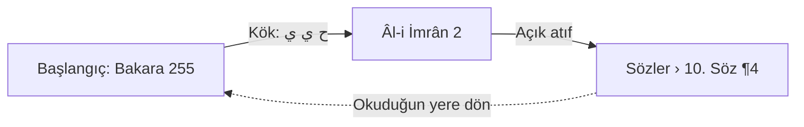

# Okuma Deneyimi

> **Sürüm:** 1.1 · **Tarih:** 19 Ekim 2026 · **Durum:** Taslak
> **Bağlı kararlar:** [K-03](../00-ozet/02-karar-defteri.md#k-03--tefsir-önce-elmalılı-meali) · [K-04](../00-ozet/02-karar-defteri.md#k-04--hadis-kaynakları) · [K-05](../00-ozet/02-karar-defteri.md#k-05--risale-i-nur-ve-lisansı-bekleyen-içerik) · [K-07](../00-ozet/02-karar-defteri.md#k-07--mushaf-görünümü-üç-seçenek) · [K-16](../00-ozet/02-karar-defteri.md#k-16--senkron-çakışma-çözümü) · [K-25](../00-ozet/02-karar-defteri.md#k-25--i̇lkeler) · [K-26](../00-ozet/02-karar-defteri.md#k-26--kalıcı-adresler-çapa-şeması) · [K-27](../00-ozet/02-karar-defteri.md#k-27--tek-bağlantı-tablosu) · [K-28](../00-ozet/02-karar-defteri.md#k-28--ses)

Bu dosya okurun gördüğünü ve yaptığını tanımlar. Uygulama ayrıntısı [Mobil mimari](../06-mobil/01-mobil-mimari.md), rota ve ekran listesi [Mobil ekranlar](./03-mobil-ekranlar.md), görsel kurallar [Tasarım sistemi](./04-tasarim-sistemi.md) dosyasındadır.

## 1. İlkeler

1. Lügat, seçim, vurgu ve ses metni değiştirmez; metnin üstünde ayrı katman olarak durur.
2. Her konum bir çapadır (K-26). Biçim, çizim yolu, tema ya da ekran yönü değişince aynı âyet ya da paragraf görünür kalır. Feyzü'l-Furkân okurlarının en belirgin şikâyeti yerin kaybolmasıdır ([App Store](https://apps.apple.com/app/id378448713)).
3. Uzun okuma tam sayfada yapılır. Kelime, lügat ve dipnot modal olmayan alt sayfada açılır. Alt sayfalar üst üste binmez ve "Kapat" düğmesi taşır ([NN/g](https://www.nngroup.com/articles/bottom-sheet/)).
4. Her jestin görünür bir düğme karşılığı vardır ([Apple HIG Erişilebilirlik](https://developer.apple.com/design/human-interface-guidelines/accessibility)).
5. Yazı boyutu, kopyalama ve okuma kontrolleri sürümden sürüme korunur ([İslam ve İhsan](https://www.islamveihsan.com/diyanet-kuran-portali.html)).

## 2. Okuma biçimleri

Biçimler Quran.com'un üç okuma tercihine karşılık gelir ([QuranReader.ts](https://github.com/quran/quran.com-frontend-next/blob/production/types/QuranReader.ts)). Biçim, mushaf çizim yolundan (A, B, C) ayrı bir eksendir.

| Biçim | Gösterdiği | Arapça | Meal | Uygun olduğu iş |
|---|---|---|---|---|
| **Mushaf** | Yalnız Arapça sayfa | A, B ya da C | Âyete dokununca eylem çubuğunda | Basılı mushaf gibi okuma, hatim |
| **Mushaf + Meal** | Sayfa ve o sayfanın meali | A, B ya da C | Telefonda sekme ya da altyazı, tablette karşı sayfa | Anlayarak okuma |
| **Âyet âyet** | Dikey âyet listesi | Her zaman Unicode (Mod C yazı tipi) | Her âyetin altında | Kelime çalışması, ekran okuyucu |

Çizim yollarının yetenekleri ve uygulaması [Mobil mimari §7](../06-mobil/01-mobil-mimari.md#7-mushaf-çizimi) dosyasındadır. A'da kelime seçimi ve kelime kartı vardır, B'de yalnız âyet seçimi vardır, C her zaman kullanılabilir ve büyütünce yeniden akar. Glif "metni" kelimeyle ilgisiz kod noktalarıdır ([sample-verse.json](https://github.com/quran/quran.com-frontend-next/blob/production/src/utils/sample-verse.json)); bu yüzden kopyalama, arama ve ekran okuyucu her zaman Tanzil Unicode metnini kullanır.

**Varsayılanlar** ([Mobil mimari](../06-mobil/01-mobil-mimari.md#15-açık-sorular-ve-doğrulanacaklar) MM-13 sorusunu kapatır):
- Çizim yolu C'dir: indirme gerektirmez ve lisanstan bağımsızdır. Tanıtım ekranı, paket bu derlemede görünüyorsa Mod A'yı Wi-Fi ile indirmeyi önerir.
- Okuma biçimi Mushaf + Meal'dir; ürünün temel vaadi budur. Mobil mimarideki `readingLayout` varsayılanı `mushaf_meal` olur.
- Telefonda meal gösterimi "Sayfa | Meal" sekmesidir.

**Biçim değiştirme.** Üst çubuktaki "Aa" düğmesi Okuma ayarları alt sayfasını açar: biçim, çizim yolu, tema, Arapça ve Türkçe boyut. Değişiklik arkada anında görünür; ekrandaki ilk âyetin çapası korunur. Cüzü inmemiş Mod A ve derlemede görünmeyen Mod B için davranış [Mobil mimari §7.4](../06-mobil/01-mobil-mimari.md#74-mod-seçimi-ve-eksik-paket) dosyasındadır; okuma hiçbir zaman beklemez.

## 3. Seçim

Seçim her zaman çapaya çevrilir ([Çapa şeması](../03-veri/01-capa-semasi.md)).

| Metin | Seçim birimi | Örnek çapa |
|---|---|---|
| Kur'an Arapçası (A, C, Âyet âyet) | Kelime aralığı | `q:2:255:3-7` |
| Kur'an Arapçası (B) | Âyet ya da âyet aralığı | `q:2:255` |
| Türkçe metin (meal, tefsir, hadis çevirisi, Risale) | Kelime sınırına genişletilmiş karakter aralığı | `meal:elmalili:2:255@12-40` |
| Hadis Arapçası | Aynı | `h:tecrid:15@30-58` |

Kur'an vurguları kelime aralığıyla saklanır; aynı vurgu A'da ve C'de aynı kelimelerde, B'de âyet kutusunun kenarında işaret olarak görünür (K-07). İki âyete yayılan seçimin çapası gramerde tanımlı değil (Açık soru OD-1; öneri: âyet başına bir parça). Kayıtlarda böyle bir seçim birim başına satıra bölünür ve `group_id` ile bağlanır ([Kullanıcı verisi §2](../03-veri/04-kullanici-verisi-ve-senkron.md#2-şema-userdb)).

**Mod C ve Türkçe metinler: yerel seçim.** Uzun basış işletim sisteminin seçim tutamaçlarını açar; sistemin "Kopyala" menüsü her durumda çalışır. Seçim bitince uygulamanın eylem çubuğu açılır ve aralık kelime sınırına genişletilir. React Native `Text` seçilen aralığın ofsetini bildirmez (Doğrulanacak); eylem çubuğu için yerel bir seçim köprüsü ya da salt okunur metin alanı gerekir. Köprü hazır olana kadar aralık "Seç" düğmesiyle kurulur: başlangıç kelimesine, sonra bitiş kelimesine dokunulur ([Mobil mimari §7.3](../06-mobil/01-mobil-mimari.md#73-mod-c--akan-unicode)). Kısa dokunuş Kur'an kelimesinde kelime kartını, Risale kelimesinde lügat kartını açar.

**Mod A: kelime aralığı.** Her glif bölünmez bir kelimedir.
1. İlk kelimeye uzun basılır (350 ms). Kelime vurgulanır, kelime sınırlarında tutamaçlar belirir.
2. Son kelimeye dokunulur ya da parmak sürüklenir. Aralık okuma yönünde (sağdan sola, yukarıdan aşağı) uzar.
3. Eylem çubuğu açılır.

Jest gerektirmeyen yol üst çubuktaki **"Seç"** düğmesidir: "Başlangıç kelimesine dokun" → "Bitiş kelimesine dokun". Her adımda "Vazgeç" görünür. Glif isabet alanı satır yüksekliğine ve en az 44 pt genişliğe büyütülür.

**Mod B: yalnız âyet.** Âyet kutusuna dokunmak âyeti seçer, kutuları tonlar ve eylem çubuğunu açar. "Seç" âyet aralığı kurar. Kelime kartı yoktur; "Kelimeler" düğmesi âyeti Âyet âyet biçiminde açar.

**Eylem çubuğu** seçimin yanında yüzer; alt sayfa sayılmaz. Eylemler: Bağlantılar · Vurgula (beş adlı renk, [Tasarım sistemi](./04-tasarim-sistemi.md#23-vurgu-renkleri)) · Not · Kopyala (Unicode metin ve adres; glif kodu asla kopyalanmaz) · Paylaş (metin ve `mutalaa://q/2/255`) · Kaynak kopyala (İSNAD; biçim kuralı Doğrulanacak) · Dinle · Tefsir · Kelimeler (yalnız B). Âyet sonu işaretine dokunmak âyeti seçip aynı çubuğu açar; âyetin bütün araçlarına tek dokunuşla ulaşılır.

## 4. Ekran düzenleri

| Genişlik | Düzen |
|---|---|
| < 600 dp (telefon) | Tek bölme |
| 600–899 dp (tablet dikey) | Tek bölme; metin sütunu satır başına 60–75 karakter, ortalı |
| ≥ 900 dp (tablet yatay) | Açık kitap: sağda mushaf sayfası, solda o sayfanın meali ya da tefsiri |

Ekran döndüğünde ya da panel kapandığında çapa ve ofset geri yüklenir. Sistem erişilebilirlik boyutlarında çok sütunlu düzen tek sütuna iner.

```
+--------------------------------------+
| Bakara · Cüz 3 · s. 42     Aa  Seç  ... |  Odak modunda gizlenir
| [ Sayfa | Meal ]                     |  yalnız Mushaf + Meal
|          (mushaf sayfası)            |
| < Sonraki sayfa    42   Önceki >     |  sağdan sola düzende "Sonraki" solda
| [ <- Okuduğun yere dön (Bakara 255) ]|  tek çip yuvası (bölüm 9, kural 9)
| > Bakara · 255 · Hafız adı           |  mini oynatıcı
| Oku | Kütüphane | Ara | Defterim | Ayarlar |
+--------------------------------------+
```

**Telefonda meal** Tanzil'in üç gösterimine karşılık gelen üç yolla görünür ([Tanzil](https://tanzil.net:443/docs/quran_navigator)): "Sayfa | Meal" sekmesi (vavtv'nin Kur'an ve Meal sekmeleri, [vavtv](https://www.vavtv.com.tr/kurani-kerim)); sayfanın altında etkin âyetin meali altyazı şeridi (dinlerken kullanışlı); Mushaf biçiminde âyete dokununca eylem çubuğunun üstünde mealin ilk satırları.

**Tablet yatay.** Sol sayfanın başında "Meal | Tefsir" sekmesi vardır; ikisi de etkin âyeti izler. Mushaf biçiminde iki sayfa [s2][s1] düzeninde gösterilebilir (v1.x; [QuranInfo.kt](https://github.com/quran/quran_android/blob/main/common/data/src/main/java/com/quran/data/core/QuranInfo.kt)).

**Odak modu.** Kaydırınca ya da sayfanın ortasına dokununca çubuklar gizlenir; tek dokunuş geri getirir. Ekran açık kalır.

**Sayfa çevirme yönü.** Mushafta varsayılan sağdan soladır: sonraki sayfa soldan gelir. Diyanet ise sağ ok tuşunu "sonraki sayfa"ya bağlar ([Diyanet](https://kuran.diyanet.gov.tr/mushaf)); bu yüzden Ayarlar › Mushaf'ta yön ayarı bulunur. Risale ve meal kitaplarında yön soldan sağadır. Etiketli "Önceki sayfa" ve "Sonraki sayfa" düğmeleri her zaman görünür ([Apple HIG RTL](https://developer.apple.com/design/human-interface-guidelines/right-to-left)). Uygulama: [Mobil mimari §8](../06-mobil/01-mobil-mimari.md#8-sağdan-sola-sayfalayıcı).

## 5. Meal hizalama

- **Birim âyettir.** Meal bölmesi açık sayfadaki âyetleri sırasıyla, "2:255" etiketiyle listeler (`meal:elmalili:2:255`).
- **İki yönlü eşleme.** Sayfadaki âyete dokunmak meal paragrafını işaretler ve görünür kılar. Meal paragrafına dokunmak âyeti sayfada tonlar: A'da kelime glifleri, B'de âyet kutuları, C'de metin zemini.
- **Panelleri bağla** (varsayılan açık): bölmeler âyet çapasına göre birlikte kayar. Kapalıyken bağımsız kayar; etkin âyet işareti iki tarafta kalır.
- **Bölünmüş âyet.** Bir âyet iki sayfaya yayılırsa meali başladığı sayfada tam verilir; sonraki sayfa "2:282 (önceki sayfadan)" satırıyla başlar. Medine düzeninde bölünen âyet olup olmadığı Doğrulanacak.
- **Âyet âyet öğesi:** âyet numarası, Arapça, meal ve yer imi, not, vurgu, secde işaretleri.

## 6. Tefsir görünümü

Elmalılı tefsiri `tf:elmalili:{sure}-{ilk}-{son}:p{n}` paragraflarından oluşur; her bölüm bir âyet aralığını kapsar. Âyete bağlı olmayan bölümler `tf:elmalili:mukaddime:p4` biçimindedir. İçerik v1.x'te gelir (K-03); görünüm v1'de yazılır.

- **Telefon:** Eylem çubuğundaki "Tefsir" tam ekran bir sayfa açar. Başlıkta "Elmalılı · Bakara 255–257" ve kapsanan âyetlerin çipleri durur; etkin âyetin çipi işaretlidir.
- **Tablet:** Sol sayfadaki "Tefsir" sekmesi.
- **Takip et** (varsayılan açık): Etkin âyet sesle ya da meal dokunuşuyla değişince görünüm onu kapsayan bölüme geçer. Elle kaydırınca takip kapanır ve çip yuvasında "Etkin âyete git (Bakara 256)" çıkar (bölüm 9, kural 9).
- **Paket yok:** "Elmalılı tefsiri indirilmedi · İndir (boyut)". Derlemede yoksa: "Tefsir hazırlanıyor".
- Tefsirdeki Arapça âyet alıntıları iktibas kartını açar (bölüm 12).

Rapor telefonda tefsirin uzun basışla açılmasını önerir. A ve C'de uzun basış seçime ayrıldığı için tefsir eylem çubuğundan açılır.

## 7. Kelime kartı

Kısa dokunuş A'da, C'de ve Âyet âyet biçiminde kelime kartını açar. Kart modal olmayan bir alt sayfadır ve tek `SheetHost` içinde açılır ([Mobil mimari §4](../06-mobil/01-mobil-mimari.md#4-rotalar-expo-router)). Okuyucu, kelime kartın üstünde görünür kalacak biçimde kayar. Açılış bütçesi 100 ms'dir (öneri).

| Satır | İçerik | Kaynak | Veri yoksa |
|---|---|---|---|
| 1 | Arapça kelime (büyük, Unicode), "Bakara 255 · 3. kelime" | Tanzil | Uygulanmaz |
| 2 | Türkçe kelime anlamı | Onaylı lemma anlamı ([K-19](../00-ozet/02-karar-defteri.md#k-19--kuran-kelime-anlamları)); `kelime-kok` paketi | Paket var, anlam onaysızsa "Anlam henüz onaylanmadı"; `dev` derlemesinde taslak "doğrulanmamış" rozetiyle (K-25). Paket yoksa satır gösterilmez |
| 3 | Kök harfleri (ح ي ي), "Bu kök Kur'an'da N yerde geçer" | `kelime-kok` paketi (QAC) | Satır gösterilmez. Paket QAC'nin yazılı açıklamasına kadar yalnız `dev` derlemesindedir; mağaza ve iç test derlemesinde kart Arapça kelimeyi, konumunu ve eylemleri gösterir ([Kapsam ve fazlar §3](./01-kapsam-ve-fazlar.md#3-i̇çerik-seti)). Anlamların QAC'den bağımsız olarak `core`'a taşınması [İçerik paketleri](../03-veri/03-icerik-paketleri.md#10-açık-sorular) IP-6'dır (Açık soru) |
| 4 | Lemma ve kısa morfoloji satırı | `kelime-kok` paketi (QAC) | Satır gösterilmez |
| 5 | ▶ Kelimenin sesi | Ses paketi ve kelime zamanlaması | Satır gizlenir |

**Eylemler:** Kökü incele (`kelime-kok` varsa) · Bu kelime nerede geçiyor? · Âyetin tefsiri · Kopyala · Not/Vurgu ekle.

Kart yukarı çekilince ya da "Bu kelime nerede geçiyor?" seçilince aynı alt sayfa Bağlantılar paneline dönüşür; ikinci sayfa açılmaz. "Kökü incele" paneli Kur'an grubu ve kök süzgeciyle açar. Başka kelimeye dokunmak içeriği değiştirir. "Kapat" ve Android geri tuşu kartı kapatır.

## 8. Bağlantılar paneli

**Giriş ve çözümleyici.** Panel eylem çubuğundan, kelime kartından, lügat ve iktibas kartından açılır. Bağlantılar cihaza önceden hesaplanmış gelir; model çalıştırılmaz. Seçim nereden yapılırsa yapılsın aynı çözümleyici çalışır: Arapça kelime kök ve lemmaya, Kur'an ifadesi iktibas tablosuna, Türkçe kelime Türkçe → kök sözlüğüne, Türkçe ifade FTS5 ifade sorgusuna, Risale'deki Arapça ibare iktibas tespitiyle âyete gider ([Bağlantı modeli](../05-capraz-referans/01-baglanti-modeli.md)).

**Yerleşim.** Telefonda alt sayfanın büyük konumu (ekranın yaklaşık %90'ı), tablette sol sayfa. Başlıkta seçimin özeti ("sabr · kök ص ب ر · Bakara 2:153"), zincir varsa kırıntı izi ve "Kapat" durur.
- Gruplar sabit sırayla gelir: **Kur'an, Meal, Tefsir, Hadis, Risale-i Nur, Kitaplar.** Boş grup gizlenir; Kitaplar kitaplar gelene kadar görünmez. Kur'an grubunda kök sonuçları lemma çipleriyle süzülür; `kelime-kok` paketi yoksa kök sonuçları gelmez.
- Paket cihazda yoksa grup başlığında "Paketi indir (boyut)" durur. Risale metni derlemede yoksa grup metinsiz dizin satırları verir (bölüm 12); dizin de yoksa grup gizlenir.
- Grup içinde sıra: güven etiketi, puan, metin sırası. "Metin sırası" düğmesi mushaf ya da kitap sırasına geçirir. Puanları birleştiren "Önerilen" listesi (RRF) v1.x'tedir; gelince grupların başında durur ([Bağlantı modeli §7](../05-capraz-referans/01-baglanti-modeli.md#7-önerilen-listesi)).
- Boş sonuç: "Bu seçim için bağlantı bulunamadı · Tam ifadeyi ara" (Ara sekmesini açar).

**Sonuç satırı** okunabilir adres ("Sözler › 10. Söz › 3. Hakikat ¶4"), eşleşen aralığı vurgulanmış kısa alıntı, gerekçe çipi ve güven etiketi taşır; Risale satırı seçili baskının sayfasını da verir. Dokunuş hedefe atlar (bölüm 9); uzun basış satırı yerinde genişletip önizler.

**Gerekçe çipleri:** `atif` "açık atıf" · `iktibas` "doğrudan iktibas %100" (kapsama oranı) · `ima` "îmâ (metin verilmeden)" · `kok` "aynı kök ص ب ر" · `lemma` "aynı kelime" · `konu` "konu: Haşir" · `benzer_ayet` "benzer âyet" · `anlamsal` "anlamca yakın · makine önerisi" (faz atanmadı) · âyet ↔ meal ve tefsir aralığı "bu âyetin tefsiri (255–257)" · FTS5 eşleşmesi "aynı ifade".

**Güven etiketleri** metin olarak yazılır. Koşulların ve eşiklerin tek kaynağı [Bağlantı modeli §6](../05-capraz-referans/01-baglanti-modeli.md#6-puanlama) tablosudur; aşağıdaki tablo oradaki sınıfları ekranda yazılan etiketlere bağlar.

| Etiket | Anlamı | Koşul (Bağlantı modeli §6 sınıfı) | Görünüm |
|---|---|---|---|
| **kesin** | İnsan onaylı ya da çapadan türetilen | Onaylı: `status = 'onayli'`; ayrıca âyet ↔ meal ve tefsir aralığı | Dolu rozet |
| **yüksek** | Güçlü kanıtlı otomatik | Yüksek güven: otomatik, `confidence ≥ 0,90` | Çerçeveli rozet |
| **orta** | Makul kanıtlı otomatik | Orta güven: otomatik, `0,70 ≤ confidence < 0,90` | İnce çerçeve, "otomatik" |
| **düşük** | Zayıf kanıt: kısa ifade, kalıp söz | Düşük güven: otomatik, `0,50 ≤ confidence < 0,70` | Kesik çizgi; "Daha fazla (otomatik) · N" altında katlı |

`anlamsal` satırlar "Makine önerisi" rozetiyle her zaman katlıdır. İç derlemede onay isteyen türdeki `aday` satır "Aday" rozetiyle açık görünür. `red` ve `confidence < 0,50` satırlar gösterilmez. Eski plan 0,6 altını gizliyordu (`quran-app-docs/04-okuma/03-risale-i-nur-okuyucu.md`); bu tasarım 0,50–0,70 arasını katlar ve okura bırakır. Yapay zekâ kaynaklı bağlantı "doğrulanmamış" rozeti taşır (K-25). Bağlantı oyu (👍/👎) ve hata bildirimi sunucu gerektirdiği için v1.x'tedir.

## 9. Atla ve dön

İncelenen araçların hiçbirinde açık bir geri dönüş yığını yok ([araştırma raporu](../09-kaynakca.md)). Yığın uygulama düzeyindedir ve `useReader` deposunda durur ([Mobil mimari §5](../06-mobil/01-mobil-mimari.md#5-durum-yönetimi)). Kayıt: `{ rota, çapa, ofset, seçim, biçim, gerekçe }`; gerekçe atlamanın nedenidir ("Kök: ح ي ي", "Açık atıf").



1. Her atlamadan önce bulunulan konum yığına yazılır.
2. **Kırıntı izi** panelin başında ve zincir açıkken okuyucunun üst çubuğu altında görünür: "Bakara 255 › Kök: ح ي ي › Âl-i İmrân 2". Konuma dokunmak oraya döner ve üstündeki kayıtları siler; gerekçeye dokunmak o konumdaki paneli aynı durumla açar.
3. **"↩ Okuduğun yere dön (Bakara 255)" çipi** konum başlangıçtan farklı olduğu sürece her okuyucu ekranında durur. Dokunuş başlangıç çapasına, ofsetine ve biçimine döner, yığını temizler.
4. Çipin yanındaki **"Burada kal"** zinciri bitirir ve bulunulan yeri yeni okuma konumu yapar.
5. Zincir açıkken `reading_position` yazılmaz. Bu kural mobil mimarideki "sayfa durduktan 1 saniye sonra yaz" kuralını sınırlar.
6. Android geri tuşu zincirde bir adım geri gider. iOS kenar kaydırması yönlendiricinin yığınını izler; geri dönüş yığını etkilenmez, çip görünür kalır.
7. Derinlik sınırı 12 adımdır (öneri); aşılınca başlangıç korunur, en eski ara kayıt düşer.
8. Derin bağlantı da bir atlamadır; açılmadan önce bulunulan konum başlangıç olarak yazılır ([Mobil ekranlar §7](./03-mobil-ekranlar.md#7-derin-bağlantılar)).
9. **Tek çip yuvası.** Okuyucu ekranının altında, mini oynatıcının hemen üstünde tek bir çip yuvası vardır. Öncelik sırası:
   1. Atlama zinciri açıkken "↩ Okuduğun yere dön" ve "Burada kal".
   2. Zincir yokken ve takip kapalıyken, çalan âyet ekranda değilse "Okunan âyete dön"; tefsir görünümünde "Etkin âyete git".

   İki çip hiçbir zaman üst üste ya da yan yana gösterilmez. Zincir açıkken çalan âyete Dinleme sayfasındaki "Okunan âyete git" düğmesiyle gidilir; bu geçiş bir atlama sayılır ve yığına yazılır. Zincir bitince yuva ses çipine geçer.

## 10. Sesli takip

Durum makinesi [Ses sistemi](../06-mobil/02-ses-sistemi.md) dosyasındadır.

**Mini oynatıcı** sekme çubuğunun üstünde durur: ▶/❚❚, "Bakara · 255", hafız adı, aralık ilerleme halkası. Dokunuş Dinleme sayfasını (modal olmayan alt sayfa) açar; çalma yoksa gizlenir.

| Denetim | Seçenekler |
|---|---|
| Hafız | Liste, 5 saniyelik ön dinleme, sık kullanılanlar |
| Kapsam | Bu âyet · âyet aralığı · sayfa · sure · cüz (Tanzil "Play Scope") |
| Tekrar | Her âyeti ×1, 2, 3, 5, 10 · aralığı ×1, 2, 3, 5, 10 |
| Âyet arası bekleme | Kapalı · 0,5× · 1× · 1,5× · 2× âyet süresi ([Ses sistemi §5.1](../06-mobil/02-ses-sistemi.md#51-bağlam); [Quran.com `delayMultiplier`](https://github.com/quran/quran.com-frontend-next/blob/production/src/xstate/actors/repeatMachine/repeatMachine.ts)) |
| Hız | 0,75–1,5, perde düzeltmeli ([expo-audio](https://docs.expo.dev/versions/latest/sdk/audio/)) |
| Kur'an + meal | Âyet, sure ya da sayfa sonunda meal ([Diyanet](https://kuran.diyanet.gov.tr/mushaf)); v1.x, sesli meal kaydı gerekir |
| Uyku zamanlayıcısı | 15 · 30 · 60 dk · aralık bitince |

- **Vurgu.** Çalan âyet zemin tonu ve kenar çizgisiyle, çalan kelime alt çizgiyle işaretlenir. Kelime vurgusu yalnız kelime zamanlaması olan okuyucularda yapılır ([quran-align](https://raw.githubusercontent.com/cpfair/quran-align/master/README.md)). A'da glifler, B'de âyet kutuları, C'de metin parçaları, Âyet âyet'te âyet öğesi işaretlenir.
- **Takip et.** Çalan âyet sayfadan çıkınca sayfa çevrilir ya da liste kayar. Elle kaydırınca takip kapanır ve çip yuvasında "Okunan âyete dön" çıkar; atlama zinciri açıksa yuvayı geri dönüş çipi tutar (bölüm 9, kural 9). Hareketi Azalt açıkken doğrudan atlanır.
- **Oynatma birimi.** v1 Expo SDK 57 üzerinde her âyet dosyasını ayrı çalar. Kesintisiz oynatma listeleri SDK 58 ile gelir ([Expo SDK 58 beta](https://expo.dev/changelog/sdk-58-beta)). Âyet geçişindeki boşluk prototipte ölçülür (Doğrulanacak); ayrıntı [Ses sistemi](../06-mobil/02-ses-sistemi.md).
- **Arka plan ve kilit ekranı.** Kilit ekranında âyet ve hafız adı görünür; ileri ve geri âyet atlar. Android'de kilit ekranı kontrolü etkin değilse ses yaklaşık 3 dakika sonra kesilir ([expo-audio](https://docs.expo.dev/versions/latest/sdk/audio/)). Telefon görüşmesi ve kulaklık çıkarılması çalmayı duraklatır.
- **Ses yoksa.** İndirilmemiş surede "Bu sure indirilmedi · İndir". Derlemede izinli hafız yoksa Dinleme sayfası "Bu sürümde izinli hafız sesi yok" der ve mini oynatıcı görünmez. Sesli Kur'an Kurul onayına tabidir ([K-06](../00-ozet/02-karar-defteri.md#k-06--yayın-kapısı)).

## 11. Hadis okuyucu

Kütüphane › Hadis › Tecrîd-i Sarîh › kitap › bâb › hadis. Adresler: `h:tecrid:15`, `ht:naim:tecrid:15`, `h:buhari:52`.

- **Telefon dikey:** Arapça üstte (sağdan sola, Amiri ya da Noto Naskh Arabic), Türkçe altta (Literata). Üst çubukta "Arapça | Türkçe | İkisi".
- **Yatay ve tablet:** İki sütun; Arapça sağda, Türkçe solda, satırlar hadis başında hizalı. Düzen mushaf ve meal açık kitabıyla aynıdır.
- **Başlık:** "Tecrîd-i Sarîh · 15", "Buhârî · 52" çipi, "Tercüme: Babanzâde Ahmed Naim".
- **Kâmil Miras kısmı:** Bu ciltlerin Türkçesi de aynı ciltlerdeki Arapçası da 1 Ocak 2028'e kadar hatta alınmaz ([Hadis hazırlığı §2](../04-icerik/04-hadis-hazirligi.md#2-kapsam-ve-takvim)). Okuyucu Arapça birim varsa onu gösterir; Türkçe sütunda "Bu hadisin Türkçesi 1 Ocak 2028'de serbest kalıyor" yazar ([Küre: Miras](https://kureansiklopedi.com/tr/detay/miras-kamil)).
- **Kütüb-i Sitte:** Yalnız Arapça; Tecrîd'de karşılığı olan hadiste "Tecrîd'deki tercümesine git".
- Arapça metindeki âyet iktibasları çini mavisi alt çizgiyle işaretlidir ve iktibas kartını açar. v1'de yapay zekâ çevirisi yoktur. Hadis derecesi gösterimi Açık soru.

## 12. Risale-i Nur okuyucu

Kütüphane › Risale-i Nur › kitap › bölüm ağacı › paragraf. Adres `rn:sozler:soz-10:hakikat-3:p4`, cümle düzeyinde `:s2`. Metin kelimesi kelimesine gösterilir; kısaltma, sadeleştirme ve yapay zekâ özeti yoktur (K-25, K-30). Metin hukukçu görüşüne kadar `kapali` durumundadır ve hiçbir derlemede görünmez; görüş olumluysa yalnız ekip içi `dev` derlemesinde görünür (K-05, K-06).

**Metin.** Paragraflar soldan sağa akar (Literata). Her Arapça dizi ayrı parça olarak sağdan sola yazılır, Amiri ya da Noto Naskh Arabic ile çizilir ([W3C](https://www.w3.org/International/articles/inline-bidi-markup/)) ve Türkçe boyuttan %10–20 büyük tutulur; bu, Apple'ın "sağdan sola metni yaklaşık 2 punto büyütme" notuna dayanan bir çıkarımdır ([Apple HIG RTL](https://developer.apple.com/design/human-interface-guidelines/right-to-left)). Haşiye işaretleri lâl rengindedir ve kısa bir alt sayfa açar. "(Bakara Sûresi, 255)" gibi açık atıflar dokunulabilir. Ayarlar › Okuma'da baskı seçilirse kenarda "s. 61" işaretleri görünür (`page_map`); "Sayfaya git" o baskının sayfa numarasını kabul eder. Baskı listesi [Risale hazırlığı](../04-icerik/05-risale-hazirligi.md) dosyasındadır.

**Lügat yoğunluğu.** Kindle Word Wise zor kelimelerin yanına kısa tanım koyar, yoğunluğu kaydırıcıyla ayarlatır ve dokunulan kelimede tam kart açar ([Amazon](https://press.aboutamazon.com/2014/11/new-features-for-kindle-e-readers-now-available)).

| Ayar | Kısa anlam gösterilen kelimeler |
|---|---|
| Kapalı | Hiçbiri; dokunuş kartı açar |
| Az | Yalnız en zor kelimeler |
| Orta | Zor ve orta zorluktaki kelimeler |
| Çok | Lügatte karşılığı olan bütün kelimeler |

- Zorluk, Külliyat'taki sıklıktan ve lügatte karşılık olup olmamasından hesaplanır. Sıklık Kelime-Frekans deposunun CC0 verisinden gelir; anlam sütunu kullanılmaz ([Kelime-Frekans](https://github.com/alitekdemir/Risale-i-Nur-Kelime-Frekans)). Kademe eşikleri öneridir, okur testiyle ayarlanır.
- Kısa anlam kelimeden hemen sonra küçük punto ve ikincil renkle yazılır. Kelimenin üstüne yerleştirme (ruby) Doğrulanacak. Kısa anlam metne eklenmez, kopyalanmaz, çapa ofsetini değiştirmez.
- **Lügat kartı:** baş kelime, anlam, köken (Arapça, Farsça, Türkçe), varsa Arapça kök ve "Kur'an'da bu kök", Külliyat'tan bir örnek. Anlamlar kamu malı sözlüklerden (Redhouse 1890, [HathiTrust](https://catalog.hathitrust.org/Record/001771732)) ve özgün tanımlardan gelir.

**İbare kartı.** Arapça diziye dokunmak iktibas kartını açar; eski planın "Tam âyete git / Karşılaştır" penceresi korunur. Âyet iktibasında âyet adresi, Unicode metin, Elmalılı meali, "Âyete git" ve "Karşılaştır" görünür. Hadiste `h:` adresi ve varsa Türkçesi görünür. Eşleşme yoksa "Kaynak bulunamadı" ve Bağlantılar paneline geçiş.

**Dizin-önce görünüm.** `internal` ve mağaza derlemelerinde Risale metni yoktur. Metinsiz atıf dizini, üretimi ve yayını için hukukçu görüşü olumlu çıkarsa görünür ([Kapsam ve fazlar §9](./01-kapsam-ve-fazlar.md#9-açık-sorular), AS-04).
- Kitap ve bölüm listesi yalnız yapısal adlarla verilir ("10. Söz", "3. Hakikat"). Bölüm başlıklarının metin sayılıp sayılmadığı Doğrulanacak.
- Bölüm ekranı "Bu bölümde geçen âyetler" listesini verir: âyet adresi, Unicode metin, Elmalılı meali, Risale'deki yer (¶) ve seçili baskının sayfası. Dokunuş Kur'an okuyucusunu o âyette açar.
- Kur'an tarafında Bağlantılar › Risale-i Nur grubu aynı yer bilgisini metinsiz verir.
- Bilgi şeridi: "Risale-i Nur metni telif nedeniyle bu sürümde yok. Dizin âyet atıflarını ve baskı sayfalarını gösterir." "Neden?" bağlantısı Kaynaklar ve lisanslar ekranını açar.

## 13. Erişilebilirlik

Kurallar [Tasarım sistemi §9](./04-tasarim-sistemi.md#9-erişilebilirlik-kontrol-listesi), uygulama [Mobil mimari §13](../06-mobil/01-mobil-mimari.md#13-erişilebilirlik-uygulaması) dosyasındadır.

- **Unicode katmanı.** A'da glif katmanı, B'de görsel ekran okuyucudan gizlenir. Her âyet tek erişilebilir öğedir: Türkçe etiket ("Bakara Sûresi, 255. âyet") ve Arapça Unicode metin. Öğe eylemleri: Dinle, Meali oku, Tefsir, Vurgula, Bağlantılar; Tefsir yalnız tefsir paketi kuruluyken görünür.
- **Erişilebilir metin modu** (Âyet âyet + Unicode) ekran okuyucu açıkken bir kez önerilir. Kıraat sesi Arapçayı duymanın birincil yoludur.
- **Yazı boyutu.** Arapça ve Türkçe ayrı ayarlanır ([Quran.com styles.ts](https://github.com/quran/quran.com-frontend-next/blob/production/src/redux/slices/QuranReader/styles.ts)); okuma metni en az %200 büyür. A'nın glif sayfası yakınlaştırılır; Arapça boyut üst kademelere çıkınca C ya da Âyet âyet önerilir.
- **Hareket, hedef, renk.** Hareketi Azalt açıkken geçişler animasyonsuzdur. Dokunma hedefi 44×44 pt'dir ve her jestin düğmesi vardır. Yakınlaştırma hiçbir ekranda kapatılmaz ([eRisale](https://www.erisale.com/) kapatır). Renk tek başına anlam taşımaz.

## 14. Riyâsız ilerleme

İlerleme varsayılan olarak kişisel ve gizlidir; liderlik tablosu yoktur (K-25). Okuma hedefine talep vardır ([e-Diyanet yorumu](https://play.google.com/store/apps/details?id=tr.gov.diyanet.mobileapp.dib&hl=tr)), ama hedefler yumuşak ve isteğe bağlı kalır.

- **Hatim.** Aynı anda birden çok hatim (kişisel, Ramazan ya da okurun verdiği adla). Her hatimde 30 cüzlük ızgara ve 604 sayfalık çubuk. Sayfa ekranda 20 saniye kaldıktan sonra çevrilince okunmuş işaretlenir (öneri); okur otomatik işaretlemeyi kapatıp elle işaretleyebilir. Senkronda okunan sayfalar küme birleşimiyle birleşir ([K-16](../00-ozet/02-karar-defteri.md#k-16--senkron-çakışma-çözümü)). Tamamlama ekranında ince tezhip çerçevesi bulunur; ekran sayı paylaşmayı önermez.
- **Risale.** Kitap başına yüzde ve kaldığın yer.
- **Seri** varsayılan kapalıdır. Açılırsa "Bu hafta 4 gün okudun." gibi yumuşak dille gösterilir. "Serini kaybetmek üzeresin!" gibi uyarı, kayıp korkusuna dayanan bildirim ve karşılaştırma ("Arkadaşlarından öndesin") yoktur.
- **Gizli mod** açıkken okuma geçmişi, otomatik hatim işaretlemesi ve seri kaydı tutulmaz; mevcut kayıtlar gizlenir, silinmez.
- **Paylaşım** içerik kartıdır (âyet ya da vecize); okunan sayfa sayısı paylaşılmaz.

## 15. Açık sorular

| No | Soru | Sahibi |
|---|---|---|
| OD-1 | İki âyete yayılan seçimin çapası | [Çapa şeması](../03-veri/01-capa-semasi.md) |
| OD-2 | Mod C ve Türkçe metinde yerel seçimin ofsetini almak | [Mobil mimari](../06-mobil/01-mobil-mimari.md) |
| OD-3 | Medine düzeninde iki sayfaya bölünen âyet var mı | [Kaynaklar ve lisans defteri](../04-icerik/01-kaynaklar-ve-lisans-defteri.md) |
| OD-4 | ~~Güven etiketlerinin kesin eşikleri~~ **Çözüldü (19 Ekim 2026):** koşullar ve eşikler Bağlantı modeli §6'dakilerdir; bölüm 8 onları ekrandaki etiketlere bağlar. | [Bağlantı modeli](../05-capraz-referans/01-baglanti-modeli.md#6-puanlama) |
| OD-5 | Lügat kısa anlamının kelime üstünde (ruby) gösterimi | Prototip |
| OD-6 | Dizin görünümünde bölüm başlıkları | [Risale hazırlığı](../04-icerik/05-risale-hazirligi.md) |
| OD-7 | Hadis derecesi verisi | [Hadis hazırlığı](../04-icerik/04-hadis-hazirligi.md) |
| OD-8 | "Kaynak kopyala" için İSNAD biçim kuralı | Sonraki sürüm |
| OD-9 | Hatim otomatik işaretleme süresi | Okur testi |

## İlgili dosyalar

- [Kapsam ve fazlar](./01-kapsam-ve-fazlar.md) · [Mobil ekranlar](./03-mobil-ekranlar.md) · [Tasarım sistemi](./04-tasarim-sistemi.md)
- [Mobil mimari](../06-mobil/01-mobil-mimari.md) · [Ses sistemi](../06-mobil/02-ses-sistemi.md) · [Depolama yöneticisi](../06-mobil/03-depolama-yoneticisi.md)
- [Çapa şeması](../03-veri/01-capa-semasi.md) · [Kullanıcı verisi ve senkron](../03-veri/04-kullanici-verisi-ve-senkron.md) · [Arama](../03-veri/05-arama-fts5.md)
- [Bağlantı modeli](../05-capraz-referans/01-baglanti-modeli.md) · [İktibas tespiti](../05-capraz-referans/02-iktibas-tespiti.md) · [Kök ve lemma](../05-capraz-referans/03-kok-ve-lemma.md)
- [Hadis hazırlığı](../04-icerik/04-hadis-hazirligi.md) · [Risale hazırlığı](../04-icerik/05-risale-hazirligi.md) · [Kelime anlamları](../04-icerik/06-kelime-anlamlari.md)
- [Karar defteri](../00-ozet/02-karar-defteri.md) · [Sözlük](../00-ozet/03-sozluk.md) · [Kaynakça](../09-kaynakca.md)
