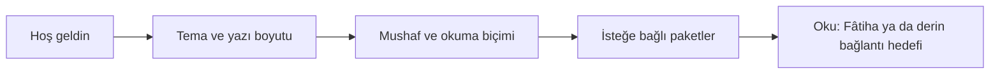

# Mobil Ekranlar

> **Sürüm:** 1.1 · **Tarih:** 19 Ekim 2026 · **Durum:** Taslak
> **Bağlı kararlar:** [K-06](../00-ozet/02-karar-defteri.md#k-06--yayın-kapısı) · [K-07](../00-ozet/02-karar-defteri.md#k-07--mushaf-görünümü-üç-seçenek) · [K-09](../00-ozet/02-karar-defteri.md#k-09--mobil-teknoloji) · [K-15](../00-ozet/02-karar-defteri.md#k-15--hesap-ve-senkron-v1xte) · [K-18](../00-ozet/02-karar-defteri.md#k-18--depolama-yöneticisi-v1de) · [K-26](../00-ozet/02-karar-defteri.md#k-26--kalıcı-adresler-çapa-şeması) · [K-29](../00-ozet/02-karar-defteri.md#k-29--mobil-arayüz-kitaplıkları)

Bu dosya mobil uygulamanın sekmelerini, rotalarını, ekranlarını, alt sayfalarını, ilk açılışını, ayarlarını, derin bağlantılarını ve gezinme kurallarını tanımlar. Rota ağacının temeli [Mobil mimari §4](../06-mobil/01-mobil-mimari.md#4-rotalar-expo-router) dosyasıdır; bu dosya o ağaca yalnız ekleme yapar ve eklemeleri işaretler. Okuma davranışı [Okuma deneyimi](./02-okuma-deneyimi.md), görünüş [Tasarım sistemi](./04-tasarim-sistemi.md) dosyasındadır.

## 1. Alt sekmeler

| Sekme | Kök ekran | İçerik |
|---|---|---|
| **Oku** | Kaldığın yerdeki Kur'an okuyucusu | Mushaf A/B/C, üç okuma biçimi, kelime kartı, Bağlantılar paneli, geri dönüş yığını, Fihrist |
| **Kütüphane** | Eser kataloğu | Elmalılı tefsiri, Hadis (Tecrîd-i Sarîh, Kütüb-i Sitte), Risale-i Nur; paket görünürlüğüne göre |
| **Ara** | Birleşik arama | Kapsam süzgeci, son aramalar, sonuçlar |
| **Defterim** | Kişisel çalışma | Yer imleri, vurgular, notlar, koleksiyonlar, hatim ve ilerleme |
| **Ayarlar** | Ayar listesi | Görünüm, okuma, mushaf, hafız, depolama, ilerleme ve gizlilik, erişilebilirlik, kaynaklar ve lisanslar, Kurul onay bilgisi |

- Sekme simgeleri her zaman yazılı etiketle birlikte görünür.
- Mini oynatıcı sekme çubuğunun üstünde durur ([Mobil mimari §4](../06-mobil/01-mobil-mimari.md#4-rotalar-expo-router)).
- Odak modunda sekme çubuğu gizlenir; sayfanın ortasına tek dokunuş geri getirir.
- Etkin sekmenin simgesine yeniden dokunmak o sekmenin kök ekranına döner. Oku sekmesinde bu, geri dönüş zincirini bitirmeden kaldığın yere dönmektir (bölüm 8).

## 2. Rota ağacı

`+` ile işaretli satırlar bu dosyanın mobil mimari ağacına eklediği rotalardır. Rota dosyası yalnız bir özellik bileşenini çağırır; iş mantığı `src/features/*` içindedir.

```
apps/mobile/app/
├─ _layout.tsx                              kök Stack: sağlayıcılar, açılış kapısı, hata sınırı
├─ +not-found.tsx                           çözülemeyen rota ya da derin bağlantı
├─ onboarding/index.tsx                     ilk açılış; dört adım tek ekranda (bölüm 5)
├─ (tabs)/
│  ├─ _layout.tsx                           beş sekme + mini oynatıcı
│  ├─ oku/_layout.tsx                    +  Stack
│  ├─ oku/index.tsx                         Kur'an okuyucu (kaldığın yer)
│  ├─ oku/fihrist.tsx                    +  sure, cüz, sayfa listesi; "2:255" ile git
│  ├─ oku/tefsir/[sure]/[ayet].tsx       +  telefonda tam ekran tefsir; Kütüphane'dekiyle aynı bileşen
│  ├─ kutuphane/_layout.tsx              +  Stack
│  ├─ kutuphane/index.tsx                   eser kataloğu
│  ├─ kutuphane/tefsir/index.tsx         +  tefsir içindekiler (sureler, mukaddime)
│  ├─ kutuphane/tefsir/[sure]/[ayet].tsx    tefsir okuyucu
│  ├─ kutuphane/hadis/index.tsx          +  koleksiyonlar
│  ├─ kutuphane/hadis/[koleksiyon]/index.tsx +  kitap ve bâb listesi
│  ├─ kutuphane/hadis/[koleksiyon]/[no].tsx hadis okuyucu
│  ├─ kutuphane/risale/index.tsx         +  kitaplar
│  ├─ kutuphane/risale/[kitap]/index.tsx +  bölüm ağacı
│  ├─ kutuphane/risale/[kitap]/[...bolum].tsx  Risale okuyucu ya da dizin görünümü
│  ├─ ara/index.tsx                         arama
│  ├─ defterim/_layout.tsx               +  Stack
│  ├─ defterim/index.tsx                    bölümlü liste: yer imi, vurgu, not, koleksiyon, hatim
│  ├─ defterim/koleksiyon/[id].tsx       +  koleksiyon ayrıntısı
│  ├─ defterim/hatim/[id].tsx            +  hatim ayrıntısı: 30 cüz ızgarası, 604 sayfa çubuğu
│  ├─ ayarlar/_layout.tsx                +  Stack
│  ├─ ayarlar/index.tsx
│  ├─ ayarlar/gorunum.tsx                   tema, yazı boyutları, yazı tipi
│  ├─ ayarlar/okuma.tsx                  +  biçim, meal gösterimi, takip, odak, Risale ayarları
│  ├─ ayarlar/mushaf.tsx                    çizim yolu, sayfa çevirme yönü
│  ├─ ayarlar/hafiz.tsx                     hafız ve dinleme varsayılanları
│  ├─ ayarlar/depolama/index.tsx            Depolama yöneticisi
│  ├─ ayarlar/depolama/[packId].tsx         paket ya da hafız ayrıntısı
│  ├─ ayarlar/ilerleme.tsx               +  ilerleme ve gizlilik, yedek
│  ├─ ayarlar/erisilebilirlik.tsx        +
│  ├─ ayarlar/kaynaklar.tsx                 kaynaklar ve lisanslar
│  ├─ ayarlar/kurul.tsx                     Kurul onay bilgisi
│  ├─ ayarlar/hakkinda.tsx               +  sürüm, derleme türü, ilkeler
│  ├─ ayarlar/gelistirici/index.tsx      +  yalnız dev ve internal
│  ├─ ayarlar/gelistirici/vitrin.tsx     +  Tasarım vitrini
│  ├─ ayarlar/gelistirici/arama-olcumu.tsx + arama süresi ölçer (öneri; A28)
│  └─ ayarlar/gelistirici/oz-test.tsx    +  öz test, yalnız dev (öneri; A32)
├─ not/[id].tsx                          +  not düzenleyici, tam ekran modal (id = "yeni" ya da UUIDv7)
├─ hatim/yeni.tsx                        +  hatim oluştur, modal
├─ [...capa].tsx                            derin bağlantı: bütün çapa türleri için tek yakalayıcı rota (bölüm 7)
└─ sayfa/[no].tsx                        +  mushaf sayfası; çapa değildir (bölüm 7)
```

Hizalama notları:
- **Çözüldü (19 Ekim 2026):** not düzenleyici kök düzeyinde modal `not/[id].tsx`'tir ([Mobil mimari §4](../06-mobil/01-mobil-mimari.md#4-rotalar-expo-router)). Not okuyucudan açıldığında sekme değişmez; uzun yazı alt sayfaya konmaz ([NN/g](https://www.nngroup.com/articles/bottom-sheet/)).
- Derin bağlantı çapa türü başına ayrı rota değildir. Kök düzeyindeki tek yakalayıcı rota (`[...capa].tsx`) yolu `fromRoute` ile çapaya çevirir ([Çapa şeması §11](../03-veri/01-capa-semasi.md#11-packagesanchors-api)).
- Bağlantılar paneli, kelime kartı, lügat kartı, Okuma ayarları ve Dinleme sayfası rota değildir. Tek `SheetHost` içinde açılan alt sayfalardır (bölüm 4).

## 3. Ekran envanteri

### 3.1 Ortak durum kuralları

Her ekran bu kuralları izler; tabloda yalnız ekrana özgü durum yazılıdır.

| Durum | Davranış |
|---|---|
| Yükleniyor | İçerik yerel SQLite'tan gelir. 150 ms'den kısa sürerse bir şey gösterilmez, uzarsa iskelet satırlar görünür (öneri). Dönen çark yalnız indirme ve dışa aktarma gibi uzun işlerde kullanılır. |
| Boş | Boş durum kartı: tek cümle ve tek eylem. Ebru motifi yalnız burada ve tanıtımda kullanılır. |
| Hata | Satır içi kart: "Bir sorun oluştu" ve "Yeniden dene". Kullanıcının yazdığı kaybolmaz. Hata türleri [Mobil mimari §11](../06-mobil/01-mobil-mimari.md#11-hata-ve-çevrimdışı-davranış). |
| Çevrimdışı | Cihazdaki içerik tam çalışır. Ağ isteyen eylem "İnternet bağlantısı yok. İndirilen içerik okunabilir." der; indirme kuyruğa alınır. |
| Lisans kapısı | Lisans paneli nedeni (lisans durumu, varsa serbest kalma tarihi) ve "Kaynaklar ve lisanslar" bağlantısını gösterir. İçeriğin hiçbir parçası gösterilmez. Derlemede görünmeyen paketin bölümü Kütüphane'de yer almaz. |

### 3.2 Ekranlar

| Ekran (rota) | Amaç | Ana bileşenler | Ekrana özgü durumlar |
|---|---|---|---|
| Tanıtım (`onboarding`) | Tema, okuma biçimi, isteğe bağlı paketler | Adım göstergesi, tema kartları, mushaf kartları, StorageRow listesi | Çevrimdışı: paket adımı "Sonra indir" der; tanıtım yine biter |
| Kur'an okuyucu (`oku`) | Kaldığın yerden okuma | ReaderTopBar, SegmentedControl "Sayfa · Meal", PageView, AyahMarker, SelectionToolbar, PageNavButtons, BackChip | Mod A cüzü yoksa C ile çizim ve indirme şeridi; B derlemede yoksa seçenek yok |
| Fihrist (`oku/fihrist`) | Sure, cüz, sayfa ya da "2:255" ile gitme | SearchField, SurahRow listesi, cüz ızgarası | Geçersiz adres: "Bu adres bulunamadı" |
| Tefsir (`oku/tefsir/…`, `kutuphane/tefsir/…`) | Etkin âyeti izleyen Elmalılı tefsiri | Âyet çipleri, paragraf listesi, FollowChip | Paket yok: "İndir (boyut)". Derlemede yok: "Tefsir hazırlanıyor" |
| Kütüphane (`kutuphane`) | Eserlere giriş | Eser kartları, paket durum rozeti | Hiç isteğe bağlı paket yoksa: "Paketleri Depolama'dan indirebilirsin" |
| Tefsir içindekiler (`kutuphane/tefsir`) | Sure ve mukaddime listesi | Liste, okuma ilerlemesi | Paket yok: indirme kartı |
| Hadis koleksiyonları, kitap ve bâb listesi | Tecrîd-i Sarîh ve Kütüb-i Sitte gezinmesi | Liste, arama alanı | Koleksiyon paketi yok: indirme kartı |
| Hadis okuyucu (`kutuphane/hadis/[koleksiyon]/[no]`) | Arapça ve Türkçe yan yana | HadithPair, başlık çipleri, "Arapça · Türkçe · İkisi" | Miras kısmı: Türkçe sütunda 2028 notu |
| Risale kitapları ve bölüm ağacı | Kitap › bölüm gezinmesi | Kitap kartları, bölüm ağacı, kitap ilerlemesi | Metin derlemede yoksa yapısal adlar ve dizin |
| Risale okuyucu (`kutuphane/risale/[kitap]/[...bolum]`) | Paragraf okuma, lügat, ibare kartı | Paragraf listesi, LugatGloss, CitationLink, FootnoteMarker | Lisans kapısı: dizin görünümü ([Okuma deneyimi §12](./02-okuma-deneyimi.md#12-risale-i-nur-okuyucu)); dizin de görünmüyorsa lisans paneli |
| Ara (`ara`) | Bütün paketlerde arama | SearchField, ScopeChips, SearchResultRow, son aramalar | Boş sorgu: son aramalar. Sonuç yok: "Tam ifade için tırnak kullan". Paket eksik: "Bu kapsamın paketi yok · İndir" |
| Defterim (`defterim`) | Kişisel kayıtlar | SegmentedControl, kayıt listeleri, HatimBar | Boş: "Bir âyete dokun, Vurgula'yı seç" |
| Koleksiyon, hatim ayrıntısı | Kaydı görüntüleme ve düzenleme | Liste, HatimGrid, HatimBar | Silinmiş kayıt: "Bu kayıt silindi · Geri al" |
| Not düzenleyici (`not/[id]`) | Not yazma ve `[[q:2:255]]` bağlantısı | Metin alanı, NoteLinkChip, bağlı çapa başlığı | Kapatırken taslak kendiliğinden kaydedilir |
| Hatim oluştur (`hatim/yeni`) | Ad ve isteğe bağlı bitiş tarihi | Form | Aynı adla hatim varsa uyarı |
| Ayarlar ve alt ekranları | Bölüm 6 | SettingsRow, Switch, SegmentedControl, Slider | Değişiklik önizleme bölgesinde anında görünür |
| Depolama (`ayarlar/depolama`) | Paketler, sesler, kuyruk ([Depolama yöneticisi](../06-mobil/03-depolama-yoneticisi.md)) | Alan özeti, StorageRow, DownloadQueue | Yer yetersiz: temizlik önerisi; hücresel ağ ve "Yalnız Wi-Fi": indirme bekler |
| Kaynaklar ve lisanslar | Her kaynağın lisansı ve atfı (Tanzil bağlantısı, QF atfı, yazı tipi lisansları) | Kaynak listesi, LicenseBadge | Uygulanmaz |
| Kurul onay bilgisi | Paket başına onay numarası ve onaylı içerik sürümü | Liste | Onay bekleyen paket bu derlemede listelenmez |
| Tasarım vitrini (`ayarlar/gelistirici/vitrin`) | Bileşenleri üç tema ve üç boyutta gösterir | [Tasarım sistemi §11](./04-tasarim-sistemi.md#11-tasarım-vitrini) | `public` derlemede rota yönlendirilir |
| Bulunamadı (`+not-found`) | Çözülemeyen adres | Açıklama, "Ara'da dene", "Okumaya dön" | Uygulanmaz |

## 4. Alt sayfalar ve pencereler

Tek `SheetHost` aynı anda tek alt sayfa açar. Yeni sayfa eskisinin yerini alır, üst üste yığılmaz; her sayfada "Kapat" düğmesi vardır ([Mobil mimari §4](../06-mobil/01-mobil-mimari.md#4-rotalar-expo-router)). Android geri tuşu önce alt sayfayı kapatır.

| Ad | Tür | Açan | Yükseklik | Not |
|---|---|---|---|---|
| Kelime kartı → Bağlantılar | Modal olmayan alt sayfa | Kelimeye dokunuş, "Bağlantılar" | %40 → %90 | Aynı sayfa büyür; panelin kendi iç geri yığını vardır |
| Lügat, ibare, haşiye kartı | Modal olmayan alt sayfa | Risale'de dokunuş | İçerik kadar, en çok %50 | Genişleyince Bağlantılar'a döner |
| Okuma ayarları | Modal olmayan alt sayfa | Üst çubuktaki "Aa" | %60 | Değişiklik arkada anında görünür |
| Dinleme | Modal olmayan alt sayfa | Mini oynatıcı | %90 | Hafız listesi ve aralık seçici aynı sayfanın iç görünümleridir |
| Seçim eylem çubuğu | Yüzen araç çubuğu | Seçim | Uygulanmaz | Alt sayfa sayılmaz; alt sayfayla birlikte görünebilir |
| Not düzenleyici | Tam ekran modal rota | Eylem çubuğu, Defterim | Tam ekran | Uzun yazı alt sayfaya konmaz |
| Hatim oluştur | Modal rota | Defterim | Form sayfası | |
| Paket indirme onayı | İletişim kutusu | Paket gerektiren eylem | Uygulanmaz | Boyut, ağ türü, "Yalnız Wi-Fi" durumu |
| Silme onayı | İletişim kutusu ya da "Geri al" çubuğu | Silme | Uygulanmaz | Kullanıcı kaydı yumuşak silinir ve "Geri al" sunulur. Paket tek dokunuşla silinir; satır ekrandan çıkılana kadar "Silindi · Geri al" gösterir ([K-18](../00-ozet/02-karar-defteri.md#k-18--depolama-yöneticisi-v1de)). İletişim kutusu yalnız toplu silmede ve başka paketi etkileyen silmede çıkar ([Depolama yöneticisi §1.1](../06-mobil/03-depolama-yoneticisi.md#11-tek-dokunuşla-silme)) |

## 5. İlk açılış

`core` uygulamaya gömülü olduğu için okuma ilk saniyeden çalışır. Tanıtım dört adımdır ve her adımda "Atla" vardır. "Atla, varsayılanlarla aç" bütün adımları geçer. Tanıtım tamamlandı bilgisi MMKV'de durur; Ayarlar › Hakkında › "Tanıtımı yeniden göster" onu yeniden açar.



1. **Hoş geldin.** Uygulamanın adı ve tek cümlelik tanımı. Üç söz: "Reklam yok. Hesap gerekmez. Notların cihazında kalır."
2. **Tema ve yazı boyutu.** Kâğıt, Âhar, Gece ve Sistem kartları canlı örnekle görünür: Fâtiha'nın ilk âyeti ve Elmalılı meali. Altında Arapça ve Türkçe boyut kaydırıcıları vardır; yaşlı okur boyutu ilk dakikada ayarlar.
3. **Mushaf ve okuma biçimi.** Çizim kartları: A "Medine düzeni · cüz başına indirilir" (yalnız paket bu derlemede görünüyorsa), C "Akan metin · büyütünce yeniden akar · en erişilebilir" (önceden seçili). B paketi derlemede yoksa gösterilmez. Altında okuma biçimi seçimi; Mushaf + Meal önceden seçilidir ([Okuma deneyimi §2](./02-okuma-deneyimi.md#2-okuma-biçimleri)). Ekran okuyucu açıksa bu adım "Erişilebilir metin modu"nu önerir.
4. **İsteğe bağlı paketler.** Bu derlemede görünen paketler boyut ve lisans rozetiyle listelenir: Mod A cüzleri (A seçildiyse; "Hepsi" ya da "İlk cüz"), hadis, tefsir ve Risale paketleri (görünüyorsa), bir hafızın sesi. "Yalnız Wi-Fi ile indir" varsayılan açıktır. "Şimdi değil" geçerli bir seçimdir; seçilen paketler tanıtımdan sonra kuyrukta iner.

Tanıtım bitince Oku sekmesi Fâtiha'da açılır. Uygulama bir derin bağlantıyla ilk kez açıldıysa tanıtım kısa yoldan (yalnız 1. adım) geçer ve hedef açılır (öneri).

## 6. Ayarlar ağacı

`(c)` işaretli ayarlar cihaza özgüdür ve yalnız MMKV'de durur. Diğerlerinin senkrona girip girmediği [Kullanıcı verisi ve senkron](../03-veri/04-kullanici-verisi-ve-senkron.md) dosyasında belirlenir ([Mobil mimari §5](../06-mobil/01-mobil-mimari.md#5-durum-yönetimi)). Varsayılanlar öneridir.

```
Ayarlar
├─ Görünüm (ayarlar/gorunum)
│  ├─ Tema: Sistem* | Kâğıt | Âhar | Gece          * açıkta Kâğıt, koyuda Gece
│  ├─ Arapça yazı boyutu: 10 kademe (varsayılan 5)  (c)
│  ├─ Türkçe yazı boyutu: 10 kademe (varsayılan 5)  (c)
│  └─ Türkçe yazı tipi: Literata (v1.x: Source Serif 4, Noto Serif)
├─ Okuma (ayarlar/okuma)
│  ├─ Okuma biçimi: Mushaf | Mushaf + Meal* | Âyet âyet
│  ├─ Telefonda meal: Sekme* | Etkin âyet altyazısı
│  ├─ Panelleri bağla: Açık
│  ├─ Tefsir etkin âyeti izlesin: Açık
│  ├─ Odak modu: kaydırınca çubukları gizle: Açık
│  ├─ Ekranı açık tut: Açık  (c)
│  └─ Risale: Lügat yoğunluğu Kapalı | Az* | Orta | Çok · Baskı sayfa numaraları Kapalı* | [baskı]
├─ Mushaf (ayarlar/mushaf)
│  ├─ Çizim yolu: A | B | C*                        görünmeyen seçenek listelenmez
│  ├─ Sayfa çevirme yönü: Sağdan sola* | Soldan sağa
│  ├─ Secde âyetlerini işaretle: Açık
│  └─ Tecvid renkleri (v1.x)
├─ Hafız ve dinleme (ayarlar/hafiz)
│  ├─ Varsayılan hafız · Tekrar · Âyet arası bekleme · Hız
│  ├─ Takip et: Açık · Kelime vurgusu (zamanlama varsa): Açık
│  └─ Kur'an + meal (v1.x)
├─ Depolama (ayarlar/depolama)  (c)
│  ├─ Alan özeti · Paketler · Hafız sesleri · İndirme kuyruğu (duraklat/sürdür)
│  └─ Yalnız Wi-Fi ile indir: Açık · Güncellemeleri denetle
├─ İlerleme ve gizlilik (ayarlar/ilerleme)
│  ├─ Hatim sayfalarını otomatik işaretle: Açık · Seri gösterimi: Kapalı
│  ├─ Okuma geçmişi: Açık · Gizli mod: Kapalı
│  ├─ Hata raporları (Sentry, kişisel veri yok): varsayılan Açık soru
│  ├─ Verilerimi dışa aktar · İçe aktar (dosya)
│  └─ Verilerimi sil: kullanıcı veritabanı, ayarlar ve son aramalar; paketlere dokunmaz (KVKK §2.7)
├─ Erişilebilirlik (ayarlar/erisilebilirlik)
│  ├─ Erişilebilir metin modu · Büyük dokunma alanları (Mod A)
│  └─ Hareketi azalt: Sistem* | Açık | Kapalı · Dokunsal geri bildirim: Açık
├─ Kaynaklar ve lisanslar (ayarlar/kaynaklar)
├─ Kurul onay bilgisi (ayarlar/kurul)
├─ Hakkında (ayarlar/hakkinda): sürüm, derleme türü, içerik sürümleri, ilkeler (K-25), tanıtımı yeniden göster
└─ Geliştirici (yalnız dev ve internal): Tasarım vitrini, çapa denetleyici, arama süresi ölçer, güven eşiklerini göster, öz test (yalnız dev; Test stratejisi §2)
```

Hizalama notları:
- **Çözüldü (19 Ekim 2026):** `theme` tipi `sistem` değerini taşır ([Mobil mimari §5](../06-mobil/01-mobil-mimari.md#5-durum-yönetimi)).
- **Çözüldü (19 Ekim 2026):** yazı boyutu deposu çarpan tutar (`arabicScale`, `turkishScale`); kaydırıcı kademeleri bu çarpanlara eşlenir ([Tasarım sistemi §3.2](./04-tasarim-sistemi.md#32-roller-ve-boyutlar), Mobil mimari §5).
- Hata raporlarının varsayılan açık olup olamayacağı KVKK incelemesine bağlıdır ([KVKK ve gizlilik](../07-yayin/02-kvkk-ve-gizlilik.md)).

## 7. Derin bağlantılar

Şema derleme türüne göre değişir: `mutalaa` (public), `mutalaa-internal`, `mutalaa-dev` ([Mobil mimari §10](../06-mobil/01-mobil-mimari.md#10-derleme-türleri-ve-özellik-bayrakları)).

**Biçim kuralı:** [Çapa şeması §11](../03-veri/01-capa-semasi.md#11-packagesanchors-api) `toRoute` kuralı geçerlidir: yol, çapadaki `:` ayraçlarının `/` ile yazılmış hâlidir; karakter aralığı (`@120-184`) `?aralik=` sorgusuna gider. Çapa bölümleri küçük harf ASCII ve tire taşıdığı için dönüşüm iki yönlüdür. Bütün türleri kök düzeyindeki tek yakalayıcı rota (`[...capa].tsx`) çözer. Biçim Çapa şemasının önerisidir ve mobil mimarideki MM-14 kapanınca kesinleşir. Arayüz durumu sorgu parametresiyle verilir.

| Bağlantı | Açılan |
|---|---|
| `mutalaa://q/2/255` | Oku, Bakara 255, geçerli biçim |
| `mutalaa://q/2/255/3` | Kelime seçili, kelime kartı açık |
| `mutalaa://q/2/255/3-7` | Kelime aralığı seçili |
| `mutalaa://q/2/255?panel=baglantilar` | Bağlantılar paneli açık |
| `mutalaa://sayfa/42` | Mushaf sayfası 42 |
| `mutalaa://meal/elmalili/2/255` | Mushaf + Meal, meal paragrafı işaretli |
| `mutalaa://tf/elmalili/2-255-257/p3` | Tefsir paragrafı |
| `mutalaa://rn/sozler/soz-10/hakikat-3/p4?aralik=120-184` | Risale paragrafı, aralık işaretli; mağazada dizin ya da lisans paneli |
| `mutalaa://h/tecrid/15` · `mutalaa://ht/naim/tecrid/15` | Hadis okuyucu, Arapça ya da Türkçe odaklı |
| `mutalaa://ara?q=sabır&kapsam=kuran` | Ara, sorgu dolu |

Çözüm kuralları:
1. Bağlantı `packages/anchors` ile doğrulanır.
2. Geçerli hedef bir atlamadır. Bulunulan konum önce geri dönüş yığınına başlangıç olarak yazılır, sonra hedef açılır; "↩ Okuduğun yere dön" çipi görünür ([Okuma deneyimi §9](./02-okuma-deneyimi.md#9-atla-ve-dön)). Mobil mimarideki işleyici `router.replace('/oku')` öncesinde bu kaydı yazacak biçimde genişler.
3. Geçersiz ya da aralık dışı adres (`q/2/300`) en yakın âyete yuvarlanmaz. Oku açılır ve "Bağlantı geçersiz" uyarısı görünür.
4. Hedefin paketi cihazda yoksa indirme önerisi, derlemede yoksa lisans paneli açılır.
5. Web gelince `https://…/kuran/2/255` aynı çözücüye bağlanır. Evrensel bağlantılar alan adı seçilince kurulur ([Sonra yapılacaklar](../08-yol-haritasi/02-sonra-yapilacaklar.md)).

## 8. Gezinme kuralları

Geri dönüş yığını uygulama düzeyindedir ve `useReader` deposunda durur. Yönlendirici yalnız doğru ekranı gösterir. Davranışın okura görünen tarafı [Okuma deneyimi §9](./02-okuma-deneyimi.md#9-atla-ve-dön) dosyasındadır.

1. **Hedefin açıldığı yer.** Kur'an hedefi Oku sekmesinde açılır: konum `useReader`'a yazılır, `router.navigate('/oku')` çağrılır. Tefsir, hadis ve Risale hedefleri Kütüphane rotalarında açılır. Telefonda okuyucudan açılan tefsir Oku yığınına itilir (`oku/tefsir/…`); sekme değişmez.
2. **Atlama kaydı.** Her atlamadan önce `{ rota, çapa, ofset, seçim, biçim, gerekçe }` yığına yazılır. Sayfa çevirme, kaydırma ve biçim değişimi atlama sayılmaz.
3. **Geri tuşu sırası (Android):** alt sayfayı kapat → seçimi temizle → geri dönüş yığınında bir adım geri git → yönlendiricide geri git → Oku kökünde uygulamayı arka plana al.
4. **iOS kenar kaydırması** yönlendiricinin yığınını izler. Geri dönüş yığını etkilenmez ve çip görünür kalır.
5. **"↩ Okuduğun yere dön"** başlangıç kaydının rotasına gider, çapa ve ofseti geri yükler, yığını temizler. Zincir başka sekmede başladıysa o sekmeye geçer.
6. **"Burada kal"** zinciri bitirir. Bulunulan yer Kur'an ise `reading_position` olur; Risale ya da hadis ise o kitabın kaldığın yeri olur.
7. **Zincir açıkken** `reading_position` yazılmaz.
8. **Sekme değişimi** her sekmenin yönlendirici yığınını korur. Geri dönüş çipi bütün okuyucu ekranlarında görünür; Ara, Defterim ve Ayarlar ekranlarında görünmez. Çip, okuyucunun tek çip yuvasında ses çipinden önce gelir; iki çip birlikte görünmez ([Okuma deneyimi §9](./02-okuma-deneyimi.md#9-atla-ve-dön)).
9. **Derinlik sınırı** 12 adımdır (öneri). Aşılınca başlangıç korunur, en eski ara kayıt düşer.
10. **Alt sayfalar rota değildir.** Bağlantılar panelinin iç adımları (kelime → kök → lemma) panelin kendi yığınındadır. Panel kapanınca bu iç yığın silinir; atlama yığını kalır.
11. **Paketi olmayan hedefe** atlanmaz. Sonuç satırında "paket gerekli" etiketi ve indirme önerisi görünür.

```mermaid
sequenceDiagram
  participant U as Okur
  participant P as Bağlantılar paneli
  participant S as useReader yığını
  participant R as Yönlendirici
  U->>P: Âl-i İmrân 2 sonucuna dokun
  P->>S: push {/oku, q:2:255, ofset, "Kök: ح ي ي"}
  P->>R: navigate('/oku') ve konum q:3:2
  U->>R: Risale atfına dokun
  R->>S: push {/oku, q:3:2, ofset, "Açık atıf"}
  R->>R: navigate('/kutuphane/risale/sozler/soz-10/hakikat-3/p4')
  U->>S: "Okuduğun yere dön"
  S->>R: navigate('/oku') ve q:2:255 ofsetiyle; yığın temizlenir
```

## 9. Açık sorular

| No | Soru | Sahibi |
|---|---|---|
| ME-1 | Diğer çapa türlerinin derin bağlantı biçimi (öneri: Çapa şeması §11 `toRoute`; bölüm 7 ona uyar; MM-14) | [Çapa şeması](../03-veri/01-capa-semasi.md#11-packagesanchors-api) |
| ME-2 | Mini oynatıcının Expo Router sekmeleriyle yerleşimi (SDK 57 ve 58) | [Mobil mimari](../06-mobil/01-mobil-mimari.md) (MM-9) |
| ME-3 | `public` derlemede geliştirici rotalarının pakete hiç girmemesi | Mobil mimari, bayraklar |
| ME-4 | Hata raporlarının varsayılanı ve rıza metni | [KVKK ve gizlilik](../07-yayin/02-kvkk-ve-gizlilik.md) |
| ME-5 | İlk açılışı derin bağlantıyla yapan okurun tanıtımı | Okur testi |
| ME-6 | Mağaza derlemesinde Risale bölümü yokken Kütüphane'de bilgi satırı gösterilsin mi | Proje sahibi |

## İlgili dosyalar

- [Kapsam ve fazlar](./01-kapsam-ve-fazlar.md) · [Okuma deneyimi](./02-okuma-deneyimi.md) · [Tasarım sistemi](./04-tasarim-sistemi.md)
- [Mobil mimari](../06-mobil/01-mobil-mimari.md) · [Ses sistemi](../06-mobil/02-ses-sistemi.md) · [Depolama yöneticisi](../06-mobil/03-depolama-yoneticisi.md)
- [Çapa şeması](../03-veri/01-capa-semasi.md) · [Kullanıcı verisi ve senkron](../03-veri/04-kullanici-verisi-ve-senkron.md) · [İçerik paketleri](../03-veri/03-icerik-paketleri.md)
- [Yayın kapısı ve Kurul](../07-yayin/01-yayin-kapisi-ve-kurul.md) · [KVKK ve gizlilik](../07-yayin/02-kvkk-ve-gizlilik.md) · [Test stratejisi](../07-yayin/03-test-stratejisi.md)
- [Karar defteri](../00-ozet/02-karar-defteri.md) · [Sözlük](../00-ozet/03-sozluk.md)
