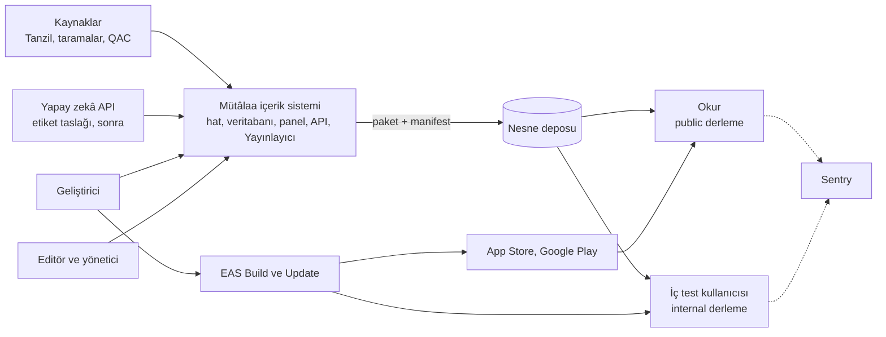
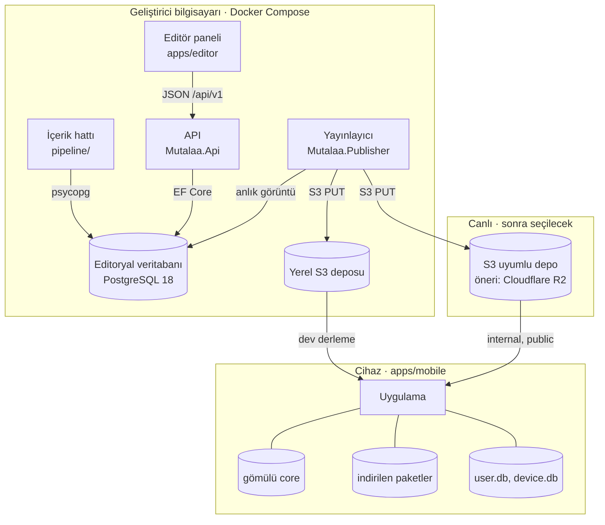
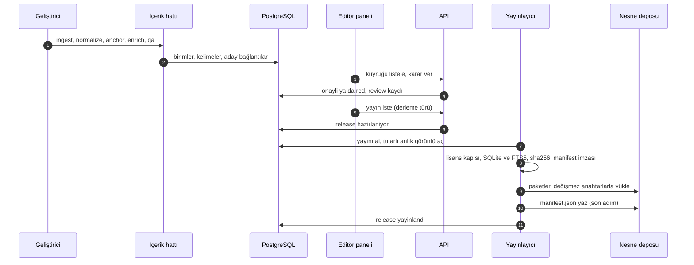
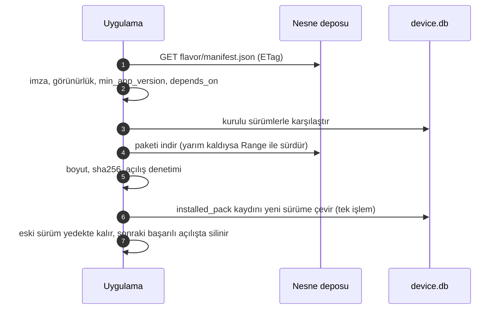
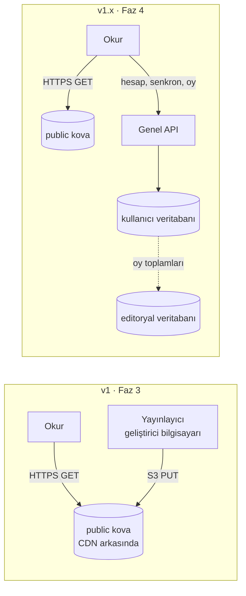
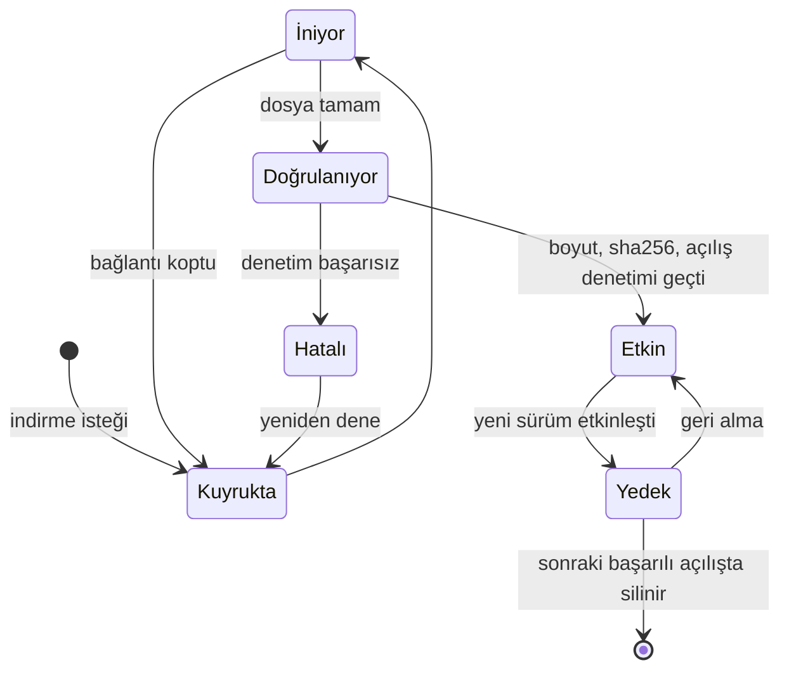

# Genel mimari

> **Sürüm:** 1.1 · **Tarih:** 19 Ekim 2026 · **Durum:** Taslak
> **Bağlı kararlar:** [K-06](../00-ozet/02-karar-defteri.md#k-06--yayın-kapısı) · [K-08](../00-ozet/02-karar-defteri.md#k-08--platform-sırası) · [K-10](../00-ozet/02-karar-defteri.md#k-10--arka-uç) · [K-11](../00-ozet/02-karar-defteri.md#k-11--veritabanı-postgresql-18) · [K-12](../00-ozet/02-karar-defteri.md#k-12--i̇çerik-hattı-python) · [K-13](../00-ozet/02-karar-defteri.md#k-13--editör-paneli) · [K-15](../00-ozet/02-karar-defteri.md#k-15--hesap-ve-senkron-v1xte) · [K-20](../00-ozet/02-karar-defteri.md#k-20--barındırma) · [K-21](../00-ozet/02-karar-defteri.md#k-21--i̇çerik-dağıtımı) · [K-26](../00-ozet/02-karar-defteri.md#k-26--kalıcı-adresler-çapa-şeması)

Bu dosya sistemin bileşenlerini, veri akışını, ortamları, derleme türlerini ve hata durumlarında kurtarmayı tanımlar. Sürümler [Teknoloji yığını](./02-teknoloji-yigini.md), klasörler [Proje yapısı](./03-proje-yapisi.md), uygulamanın iç yapısı [Mobil mimari](../06-mobil/01-mobil-mimari.md) dosyasındadır.

---

## 1. İlkeler

1. **İçerik önceden derlenir.** v1 verisinin neredeyse tamamı salt okunur ve sürümlüdür; sunucuya yalnız kullanıcı verisi kalır ([araştırma raporu](../09-kaynakca.md)). Metin hatta işlenir, editör panelinde onaylanır, Yayınlayıcıda SQLite paketine dönüşür.
2. **Okuma çevrimdışı çalışır.** Uygulama gömülü `core` paketiyle açılır. Ağ manifest, paket ve ses indirmek için kullanılır.
3. **Tek doğruluk kaynağı editoryal veritabanıdır.** Paketler ondan türetilir ve her an yeniden üretilebilir.
4. **Yayın kapısı yayın anında uygulanır.** Yayınlayıcı her derleme türüne ayrı manifest yazar. Uygulama aynı kuralı ikinci kez denetler ([K-06](../00-ozet/02-karar-defteri.md#k-06--yayın-kapısı)).
5. **Bütün katmanlar çapa kullanır.** Paket, bağlantı, not ve derin bağlantı aynı adresle çalışır; adresler yeniden numaralanmaz ([K-26](../00-ozet/02-karar-defteri.md#k-26--kalıcı-adresler-çapa-şeması)).
6. **Arka uç incedir.** v1'de API yalnız editör paneline ve yayın akışına hizmet eder. Okur uygulaması v1'de API'ye bağlanmaz ([K-10](../00-ozet/02-karar-defteri.md#k-10--arka-uç), [K-15](../00-ozet/02-karar-defteri.md#k-15--hesap-ve-senkron-v1xte)).
7. **Aynı kural üç dilde aynı sonucu verir.** Normalizasyon, çapa ayrıştırma ve `content_hash` Python, TypeScript ve C# ile yazılır. `shared/test-vectors/` üçünü aynı girdi ve çıktıya bağlar.

## 2. Sistem bağlamı

Okurun cihazı v1'de nesne deposuna (manifest, paket, ses), EAS Update sunucusuna ve Sentry'ye bağlanır. Sentry'ye kişisel veri ve okuma içeriği gitmez ([Mobil mimari](../06-mobil/01-mobil-mimari.md), bölüm 12).

## 3. Bileşenler

| Bileşen | Klasör | Teknoloji | Sorumluluk | Yapmaz |
|---|---|---|---|---|
| İçerik hattı | `pipeline/` | Python 3.13 + uv | Kaynakları alır. Hazır kaynak metnini dağıtıldığı gibi saklar (Tanzil'e NFC bile uygulanmaz); NFC'yi yalnız kendi ürettiğimiz metinlere uygular ([K-26](../00-ozet/02-karar-defteri.md#k-26--kalıcı-adresler-çapa-şeması)). Ayrı `search_text` sütununu üretir, çapa ve `content_hash` atar, kök, lemma ve iktibas adaylarını çıkarır, nitelik denetimi yapar, PostgreSQL'e yazar | Onay vermez; adaylar `aday` ya da `taslak` durumunda yazılır. `source.embed_ok = false` olan kaynağı gömme hattına ve dış yapay zekâ API'sine göndermez ([Anlamsal katman](../05-capraz-referans/04-anlamsal-katman.md)). Üretim sunucusunda çalışmaz ([K-12](../00-ozet/02-karar-defteri.md#k-12--i̇çerik-hattı-python)) |
| Editoryal veritabanı | Docker `postgres:18` | PostgreSQL 18 | `source`, `unit`, `quran_word`, `lemma`, `root`, `xref`, `page_map`, `ayah_box`, `audio_timing`, `review`, `release` tablolarının ana kopyası | Okur uygulamasına açılmaz |
| Editör paneli | `apps/editor` | React, TypeScript, Vite, shadcn/ui | İnceleme kuyrukları, metin düzeltme, lisans durumu, yayın başlatma ([K-13](../00-ozet/02-karar-defteri.md#k-13--editör-paneli)) | Veritabanına doğrudan bağlanmaz |
| API | `server/Mutalaa.Api` | ASP.NET Core 10 Minimal API, EF Core 10 | Editör uçları, editör kimliği, yayın talebi; v1.x'te hesap, senkron, bağlantı oyu ([Backend API](./05-backend-api.md)) | v1'de okur trafiği almaz; paket üretmez |
| Yayınlayıcı | `server/Mutalaa.Publisher` | .NET 10 konsol | Metinlere ve veri setlerine lisans kapısı, SQLite paketi ve FTS5 dizini, sha256, imzalı manifest, yükleme, terfi, geri alma | İçerik verisini değiştirmez; yalnız `release` kaydını günceller |
| Nesne deposu | Yerelde Docker; canlıda bulut | S3 API | Paket, manifest ve ses dosyalarını sunar ([K-21](../00-ozet/02-karar-defteri.md#k-21--i̇çerik-dağıtımı)) | Mantık çalıştırmaz |
| Mobil uygulama | `apps/mobile` | Expo SDK 57 | Okuma, FTS5 arama, ses, kullanıcı verisi, paket yöneticisi | v1'de hesap ve API çağrısı yok |
| Web (Faz 5) | `apps/web` | Next.js 16 | Arama motorunda görünen statik sayfalar | v1'de yok |
| Paylaşılan paketler | `packages/*` | TypeScript | Çapa, arama normalizasyonu, okuma çekirdeği, oynatıcı, tasarım jetonları | Arayüz bileşeni taşımaz |
| Test vektörleri | `shared/test-vectors/` | JSONL | Python, TypeScript ve C# uygulamalarını aynı sonuca kilitler | — |

**Yerel S3 deposu notu.** K-21'in ilk sürümü yerelde MinIO diyordu; karar SeaweedFS olarak güncellendi. MinIO topluluk sürümü Ekim 2025'te Docker imajı yayımlamayı bıraktı ve Aralık 2025'ten beri bakım kipindedir ([linuxiac](https://linuxiac.com/minio-ends-active-development/), [ayedo](https://ayedo.de/en/posts/minio-im-maintenance-mode/); bu bilgi araştırma raporunda yok, 18 Ekim 2026'da kontrol edildi). Yerel örnek bu yüzden SeaweedFS kullanır (Doğrulanacak; [Yerel geliştirme](./04-yerel-gelistirme.md)). Kod yalnız S3 API'sini kullanır; depo değişimi yapılandırma işidir. Karar metninin güncellenmesi Açık soru.

## 4. Bileşen diyagramı

## 5. Derleme zamanı ve çalışma zamanı

| Aşama | Ne olur | Çalıştıran | Yer | Çıktı |
|---|---|---|---|---|
| Hat | ingest → normalize → anchor → enrich → qa | Geliştirici | Geliştirici bilgisayarı | PostgreSQL'de birimler ve aday kayıtlar |
| Onay | İnceleme, metin düzeltme, lisans durumu | Editör | Editör paneli + API | `onayli` ya da `red` kayıtlar, güncel lisans durumu |
| Yayın | Kapı, paket, sha256, imzalı manifest, yükleme | Yayınlayıcı | Geliştirici bilgisayarı | Derleme türü başına paketler ve `manifest.json` |
| Uygulama derlemesi | Gömülü `core` ve fontlar eklenir, derleme türü sabitlenir | EAS Build | Bulut | APK/AAB, IPA |
| Uygulama güncellemesi | Yalnız JavaScript | EAS Update | Bulut | Güncelleme paketi |
| Okuma | Okuma, arama, ses, not; manifest kontrolü ve paket indirme | Uygulama | Cihaz | — |
| Senkron (v1.x) | Hesap, senkron, bağlantı oyu | Uygulama + genel API | Cihaz + canlı sunucu | — |

Kurallar:
- İçerik okura iki yoldan ulaşır: yeni uygulama ikilisindeki gömülü `core` ya da kanal manifesti. EAS Update içerik taşımaz, çünkü Kurul onayı içerik sürümüne bağlıdır ([Mobil mimari](../06-mobil/01-mobil-mimari.md), bölüm 10).
- Arama dizini yayın sırasında kurulur. Cihaz kullanıcının sorgusunu aynı kuralla normalize eder ([Arama](../03-veri/05-arama-fts5.md)).
- Bağlantılar hatta önceden hesaplanır ve editörde onaylanır; cihazda hesaplanmaz ([Bağlantı modeli](../05-capraz-referans/01-baglanti-modeli.md)).

## 6. Veri akışı

### 6.1 Kaynaktan yayına

Manifest en son yazılır. Okur ya eski manifesti ya yeni manifesti görür; yarım yayın görmez. Komutlar ve kapı kuralları [Backend API](./05-backend-api.md) dosyasının Yayınlayıcı bölümündedir.

### 6.2 Cihazda paket güncelleme

Ayrıntılı yaşam döngüsü [İçerik paketleri](../03-veri/03-icerik-paketleri.md) §8, kuyruk ve silme [Depolama yöneticisi](../06-mobil/03-depolama-yoneticisi.md) dosyasındadır.

### 6.3 v1.x ekleri

Hesap, senkron ve bağlantı oyu genel kipte çalışan API'ye gider ([K-15](../00-ozet/02-karar-defteri.md#k-15--hesap-ve-senkron-v1xte), [K-16](../00-ozet/02-karar-defteri.md#k-16--senkron-çakışma-çözümü)). Senkron giden kutusu, `server_seq` imleci ve idempotent işlem kimlikleriyle çalışır ([Kullanıcı verisi ve senkron](../03-veri/04-kullanici-verisi-ve-senkron.md)). Oylar ayrı `xref_vote` tablosunda tutulur ([K-27](../00-ozet/02-karar-defteri.md#k-27--tek-bağlantı-tablosu)). Gece işi toplamları editoryal veritabanındaki `xref.votes_up` ve `xref.votes_down` sütunlarına işler; eşiği geçen bağlantılar inceleme kuyruğuna düşer ([Bağlantı modeli](../05-capraz-referans/01-baglanti-modeli.md) §12). Öneri: `xref_vote` canlıdaki kullanıcı veritabanında durur ve editoryal veritabanına yalnız toplamlar aktarılır.

## 7. Ortamlar

| Ortam | Durum | İçerik | Barındırma |
|---|---|---|---|
| Yerel geliştirme | Şimdi | PostgreSQL, S3 deposu, API, editör, Yayınlayıcı, hat | Geliştiricinin Windows bilgisayarı, Docker Compose ([K-20](../00-ozet/02-karar-defteri.md#k-20--barındırma); [Yerel geliştirme](./04-yerel-gelistirme.md)) |
| İç test kanalı (Faz 2) | Açık soru | `internal` manifesti ve paketleri | Aşağıdaki seçeneklerden biri |
| Canlı içerik (Faz 3) | Sonra seçilecek | `public` manifesti, paketler, ses | S3 uyumlu depo; öneri Cloudflare R2: depolama 0,015 $/GB-ay, veri çıkışı ücretsiz ([R2 fiyatlandırma](https://developers.cloudflare.com/r2/pricing)) |
| Canlı API (Faz 4 · v1.x) | Sonra seçilecek | Hesap, senkron, oy | Düşük maliyetli yöntem (K-20); KVKK veri konumu kararı yeniden ele alınır |

**v1 canlı topolojisi (öneri).** v1'de okur yalnız nesne deposuna bağlanır. Editoryal yığın geliştirici bilgisayarında kalabilir ve Yayınlayıcı paketleri oradan yükler. Böylece v1'in canlı gideri depo ücretine iner. Raporun tahminine göre ASP.NET Core 10 ve PostgreSQL'in Hetzner'de, paketlerin R2'de durduğu yığın 1 bin aylık kullanıcıda ayda yaklaşık 6–7 € tutar; işletme emeği buna dahil değildir ([araştırma raporu](../09-kaynakca.md)).

**İç test kanalı seçenekleri.** İç test kullanıcıları geliştiricinin yerel ağında değildir.

| Seçenek | Artı | Eksi |
|---|---|---|
| A. R2'de herkese kapalı ikinci kova ve bir erişim katmanı (Cloudflare Access ya da imzalı adres üreten küçük bir uç) | Paket akışı canlıyla aynıdır | Kurulum gerekir; imza ucu için sunucu gerekir |
| B. `internal` paketlerini iç test ikilisine gömmek | Barındırma gerekmez | İkili büyür; her içerik değişikliği yeni derleme ister |
| C. Yerel depoya tünel | Ek hesap gerekmez | Bilgisayar açık kalmalı; dışarıya açılan yerel servis risk taşır |

İç test derlemesi yalnız `serbest` içerik alır (K-06). Kurul onayı bekleyen Kur'an metni, meal ve sesin kapalı testte gösterilip gösterilemeyeceği Kurul'la ön görüşmede sorulur; cevap gelene kadar dış test kullanıcısı alınmaz (Açık soru; hukuki görüş değildir; [Yayın kapısı ve Kurul](../07-yayin/01-yayin-kapisi-ve-kurul.md)).

## 8. Derleme türleri

Görünürlük [K-06](../00-ozet/02-karar-defteri.md#k-06--yayın-kapısı) kararının 18 Ekim 2026 güncellemesine göredir. Profil, kimlik ve şema adları [Mobil mimari](../06-mobil/01-mobil-mimari.md) bölüm 10 ile aynıdır.

| | `dev` | `internal` | `public` |
|---|---|---|---|
| Kullanan | Yalnız ekip | Davetli test kullanıcıları | Herkes |
| EAS profili | `development` | `internal` | `production` |
| Uygulama kimliği (yer tutucu) | `app.mutalaa.dev` | `app.mutalaa.internal` | `app.mutalaa` |
| Derin bağlantı şeması | `mutalaa-dev` | `mutalaa-internal` | `mutalaa` |
| Manifest | `dev/manifest.json` | `internal/manifest.json` | `public/manifest.json` |
| Paket kaynağı | Yerel S3 deposu (bilgisayarın LAN IP adresi) | İç test kanalı (Açık soru) | Canlı depo |
| Görünen lisans durumları | `serbest`, `bekliyor`, `ic_kullanim` | Yalnız `serbest` | Yalnız `serbest`; Kur'an metni, meal ve seste Kurul onayı |
| `aday` bağlantılar | Var, "doğrulanmamış" işaretli | Var, "doğrulanmamış" işaretli | Yok |

Kurallar:
- `kapali` kaynak hiçbir derlemeye yazılmaz. `bekliyor` ve `ic_kullanim` içerik yalnız ekip içi `dev` derlemesinde görünür; Risale metni de buna dahildir ([K-05](../00-ozet/02-karar-defteri.md#k-05--risale-i-nur-ve-lisansı-bekleyen-içerik)).
- Kapı iki katmanlıdır. Yayınlayıcı manifesti derleme türü başına süzer; uygulama `isPackVisible` ile yeniden denetler.
- Kapı veri setlerine de uygulanır. QAC kaynaklı kök ve lemma verisi `core` içinde durmaz; kendi lisans durumunu taşıyan ayrı pakettedir, öneri `kelime-kok` ([K-06](../00-ozet/02-karar-defteri.md#k-06--yayın-kapısı) uygulama notu).
- Manifest her derleme türünde imzalıdır ve paket başına `kurul_gerekli` bilgisi taşır. Yayınlayıcı onu derleme türüne özgü anahtarla imzalar. Uygulama imzasız ya da imzası tutmayan manifesti reddeder; `public` derlemede bu kural gevşetilmez ([İçerik paketleri](../03-veri/03-icerik-paketleri.md) §5). Algoritma ve anahtar yönetimi Doğrulanacak.
- Her derleme türünün dosyaları kendi önekindedir (`{flavor}/manifest.json`, `packs/{flavor}/…`). `public` öneki başka türün dosyasını içermez.
- `public` derlemeye gömülen `core`, `public` manifestindeki sha256 ile aynı olmalıdır; derleme betiği bunu doğrulamadan durur ([Proje yapısı](./03-proje-yapisi.md)).

## 9. Hata durumları ve kurtarma

| Durum | Algılama | Kurtarma |
|---|---|---|
| Yarım indirme | `.part` dosyası, eksik boyut | Range ile sürdürülür ya da baştan indirilir; etkin sürüm değişmez |
| Bozuk paket | Boyut ya da sha256 manifestle uyuşmaz | Dosya silinir, bir kez baştan indirilir ([Mobil mimari](../06-mobil/01-mobil-mimari.md) `integrity` hatası). Tekrarında Sentry kaydı açılır ve sonraki manifest kontrolü beklenir |
| Açılmayan ya da uyumsuz paket | `PRAGMA quick_check`, `PRAGMA user_version`, beklenen tablolar | Hatalı sayılır; önceki sürüm etkin kalır |
| Yeni sürümde sorgu hatası | İçerik sorgusu hata verir | Sürüm kötü işaretlenir; yedek sürüme dönülür |
| Yer yetmiyor | İndirmeden önce boş alan `size_bytes` değerinin iki katından az | İndirme başlamaz; Depolama ekranı açılır |
| Uygulama eski | `min_app_version` kurulu sürümden büyük | Paket indirilmez; uygulama güncellemesi önerilir |
| Manifest alınamıyor ya da şemaya uymuyor | Ağ hatası, şema doğrulama hatası | Son geçerli manifest ve kurulu paketlerle devam edilir; sonra yeniden denenir |
| Manifest imzası doğrulanmıyor | `signature` derleme türünün açık anahtarıyla tutmuyor | Manifest yok sayılır; kurulu paketlerle devam edilir; kişisel veri içermeyen hata kaydı gönderilir |
| Yanlış yayın | Editör ya da test kullanıcısı bildirir | Yayınlayıcı `rollback` ile derleme türünün manifestini önceki yayına çevirir. Uygulama manifesti istenen durum sayar ve sürüm geri gitse de ona uyar |
| Lisans nedeniyle geri çekme | Hukuki bildirim | Paket derleme türünün manifestinden çıkarılır. Cihazdaki kopyanın silinmesi ya da gizlenmesi Açık soru |
| Yayınlayıcı yarıda kaldı | `release` durumu `hazirlaniyor` ya da `dogrulandi` kalır | Manifest en son yazıldığı için okur etkilenmez; aynı komut kaldığı yerden sürer |
| Aynı sürüm anahtarına farklı dosya | Yükleme öncesi HEAD ve sha256 meta verisi | Yayınlayıcı üzerine yazmaz, hata verir |
| Nesne deposu kesintisi | Uygulamada ağ hatası | Kurulu paketlerle çevrimdışı devam; yeni kurulum gömülü `core` ile açılır |
| Editoryal veritabanı kaybı | — | Son `pg_dump` yedeğinden geri yükleme ([Yerel geliştirme](./04-yerel-gelistirme.md)); yayımlanmış paketler depoda durduğu için okur etkilenmez |
| Yerel S3 verisi kaybı | — | Yayınlayıcı paketleri veritabanından yeniden üretir |

**Atomik geçiş.** Paket `tmp/<iş_id>.part` olarak iner ve doğrulamadan sonra `packs/<pack_id>/<sürüm>/pack.db` konumuna taşınır ([Depolama yöneticisi](../06-mobil/03-depolama-yoneticisi.md) §3). Her sürüm ayrı klasörde durduğu için var olan dosyanın üzerine yazılmaz. Geçiş `device.db` içindeki `installed_pack` satırının tek işlemde güncellenmesidir; önceki sürüm satırda kayıtlı kalır ve bir sonraki başarılı açılışa kadar diskte durur. Süren sorgular bitince eski şema ayrılır, yenisi bağlanır ([İçerik paketleri](../03-veri/03-icerik-paketleri.md) §8). Gömülü `core` her durumda son çaredir.

## 10. Güvenlik ve gizlilik sınırları

- v1 okur uygulaması hesap açmaz ve kişisel veri göndermez.
- Editoryal yığın (PostgreSQL, API, editör) yalnız `127.0.0.1` adresine bağlanır. Yerel ağa yalnız S3 deposunun okuma portu açılır.
- Gizli değerler `.env` ve .NET kullanıcı sırlarında durur, depoya girmez.
- Canlı API yurt dışında barındırılırsa her veri işleyenle standart sözleşme imzalanır ve sözleşme 5 iş günü içinde Kurum'a bildirilir ([Cottgroup](https://cottgroup.com/tr/blog/kvkk-gdpr/item/standart-sozlesme-bildirim-yukumlulugu-ve-yaptirimlari)). Bu not hukuki görüş değildir; ayrıntı [KVKK ve gizlilik](../07-yayin/02-kvkk-ve-gizlilik.md).

## 11. Açık sorular

1. ~~K-21 yerelde MinIO der.~~ Çözüldü: K-21 güncellendi, yerel depo SeaweedFS.
2. İç test kanalı nerede barındırılacak (A, B ya da C)?
3. v1.x'te kullanıcı veritabanı editoryal veritabanından ayrı mı tutulacak? Öneri: ayrı; editoryal veritabanı lisansı bekleyen metinleri taşıdığı için dışarıya açılmaz.
4. Lisans nedeniyle geri çekilen paketin cihazdaki kopyası silinecek mi, gizlenecek mi?
5. İmza algoritması, JSON kanonikleştirme ve anahtar yönetimi Doğrulanacak ([İçerik paketleri](../03-veri/03-icerik-paketleri.md) IP-7).

## İlgili dosyalar

- [Teknoloji yığını](./02-teknoloji-yigini.md) · [Proje yapısı](./03-proje-yapisi.md) · [Yerel geliştirme](./04-yerel-gelistirme.md) · [Backend API](./05-backend-api.md)
- [Mobil mimari](../06-mobil/01-mobil-mimari.md) · [Depolama yöneticisi](../06-mobil/03-depolama-yoneticisi.md)
- [Editoryal veritabanı](../03-veri/02-editoryal-veritabani.md) · [İçerik paketleri](../03-veri/03-icerik-paketleri.md) · [Kullanıcı verisi ve senkron](../03-veri/04-kullanici-verisi-ve-senkron.md) · [Arama](../03-veri/05-arama-fts5.md)
- [İçerik hattı](../04-icerik/02-icerik-hatti.md) · [Yayın kapısı ve Kurul](../07-yayin/01-yayin-kapisi-ve-kurul.md) · [KVKK ve gizlilik](../07-yayin/02-kvkk-ve-gizlilik.md)
- [Kapsam ve fazlar](../01-urun/01-kapsam-ve-fazlar.md) · [Karar defteri](../00-ozet/02-karar-defteri.md) · [Kaynakça](../09-kaynakca.md)
