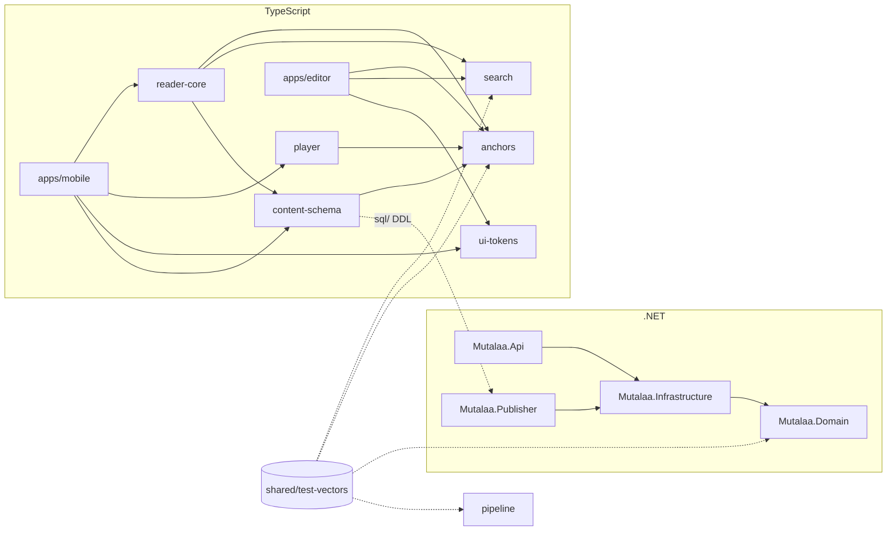

# Proje yapısı

> **Sürüm:** 1.7 · **Tarih:** 27 Ekim 2026 · **Durum:** Taslak
> **Bağlı kararlar:** [K-09](../00-ozet/02-karar-defteri.md#k-09--mobil-teknoloji) · [K-10](../00-ozet/02-karar-defteri.md#k-10--arka-uç) · [K-12](../00-ozet/02-karar-defteri.md#k-12--i̇çerik-hattı-python) · [K-13](../00-ozet/02-karar-defteri.md#k-13--editör-paneli) · [K-14](../00-ozet/02-karar-defteri.md#k-14--web) · [K-17](../00-ozet/02-karar-defteri.md#k-17--arama-sqlite-fts5) · [K-26](../00-ozet/02-karar-defteri.md#k-26--kalıcı-adresler-çapa-şeması) · [K-35](../00-ozet/02-karar-defteri.md#k-35--çapa-api-ayrıntıları) · [K-36](../00-ozet/02-karar-defteri.md#k-36--arama-normalizasyonu-ayrıntıları) · [K-32](../00-ozet/02-karar-defteri.md#k-32--pnpm-kurulumu-sürüm-sabitleme-ve-düzen) · [K-33](../00-ozet/02-karar-defteri.md#k-33--net-test-çalıştırıcısı-xunitv3--microsofttestingplatform)

Kod tek depoda durur: TypeScript uygulamaları ve paketleri pnpm + Turborepo ile, .NET projeleri `server/` altındaki çözümle, Python içerik hattı `pipeline/` altında uv ile yönetilir. Bu dosya klasörleri, bağımlılık kurallarını, araçları, kod biçimini, Git kurallarını ve CI iş akışlarını tanımlar.

---

## 1. Dizin ağacı

```
mutalaa/
├─ apps/
│  ├─ mobile/                    Expo uygulaması (ayrıntı: 06-mobil/01-mobil-mimari.md)
│  │  ├─ app/                    Expo Router rotaları; iş mantığı tutmaz
│  │  ├─ src/features/           reader, crossref, audio, search, library, notebook,
│  │  │                          settings, storage, onboarding
│  │  ├─ src/db/                 içerik bağlantısı, ATTACH, Drizzle bağlantıları ve göçler (user.db, device.db), device.db şeması
│  │  ├─ src/packs/              manifest istemcisi, görünürlük, kurulum, doğrulama
│  │  ├─ src/lib/                i18n, hata türleri, telemetri, kv, ağ, bayraklar
│  │  ├─ assets/db/              gömülü core-<sürüm>.db (git dışı; fetch-core indirir)
│  │  ├─ scripts/fetch-core.mjs  core paketini kanal manifestinden indirir, sha256 doğrular
│  │  ├─ e2e/                    Maestro akışları (*.yaml; Test stratejisi §9, A33)
│  │  └─ app.config.ts · eas.json · metro.config.js
│  ├─ editor/                    editör paneli (React + Vite)
│  │  ├─ src/routes/             giris, kuyruk/baglanti, kuyruk/lemma, kuyruk/ocr,
│  │  │                          kaynaklar, birimler, yayinlar
│  │  ├─ src/api/                OpenAPI belgesinden üretilen tipler ve istemci
│  │  ├─ src/components/         shadcn/ui bileşenleri
│  │  └─ vite.config.ts          /api vekili → http://localhost:5080
│  └─ web/                       Next.js 16; Faz 5'te açılır
├─ packages/
│  ├─ anchors/                   çapa ayrıştırma, biçimlendirme, doğrulama; src/generated/ayet-sayilari.ts (üretilir, elle düzenlenmez)
│  ├─ content-schema/            sql/ (paket DDL'i), manifest.schema.json, user.db Drizzle şeması
│  ├─ search/                    Türkçe ve Arapça normalizasyon (src/normalize.ts), FTS5 sorgu kurucu; src/generated/ic-kesme.ts (üretilir, elle düzenlenmez)
│  ├─ reader-core/               sayfa, satır, kelime modelleri; seçim; içerik sorguları
│  ├─ player/                    XState oynatıcı makinesi, motor arayüzü
│  └─ ui-tokens/                 renk, tip ölçeği, boşluk jetonları
├─ server/
│  ├─ Mutalaa.slnx · Directory.Build.props · Directory.Packages.props
│  ├─ Mutalaa.Domain/            varlıklar, çapa, lisans kapısı kuralları, C# normalizasyon (Text/SearchNormalizer.cs; Text/IcKesme.g.cs üretilir)
│  ├─ Mutalaa.Infrastructure/    EF Core, göçler, Identity, S3, SQLite paket yazıcı
│  ├─ Mutalaa.Api/               Minimal API uçları, openapi/v1.json
│  ├─ Mutalaa.Publisher/         yayın konsolu
│  └─ tests/                     Domain, Api ve Publisher test projeleri
├─ pipeline/                     içerik hattı (ayrıntı: 04-icerik/02-icerik-hatti.md)
│  ├─ pyproject.toml · uv.lock · .python-version · mutalaa.toml
│  ├─ sources/                   kaynak kayıtları (TOML) ve tarihli lisans kopyaları
│  ├─ prompts/                   sürümlü yapay zekâ istemleri
│  ├─ stubs/                     tip bilgisi taşımayan paketler için mypy taslakları (snowballstemmer; A05)
│  ├─ src/mutalaa_pipeline/      cli.py (`mutalaa` komutu), ingest/, normalize/, anchor/,
│  │                             enrich/, qa/, export/
│  └─ tests/                     birim testleri ve test vektörü koşucusu
├─ shared/test-vectors/
│  ├─ package.json               JSONL biçim denetimi (Turborepo önbelleği için)
│  ├─ normalize/                 tr.jsonl, ar.jsonl
│  ├─ anchors/                   valid.jsonl, invalid.jsonl, compare.jsonl, contains.jsonl, route.jsonl
│  ├─ content-hash/              hash.jsonl
│  ├─ offsets/                   offsets.jsonl (kod noktası ofsetleri, snapSpan)
│  ├─ fts-query/                 query.jsonl
│  └─ arama/                     olcum.jsonl (arama ölçüm kümesi; vektör koşucuları okumaz)
├─ shared/data/                  ayet-sayilari.json (114 eleman; Tanzil üst verisinden üretilir, A04; üç kopyası src/generated/ayet-sayilari.ts, anchor/ayet_sayilari.py, Anchors/AyetSayilari.g.cs)
│                                ic-kesme.txt (iç kesme listesi, A05; kopyaları packages/search/src/generated/ic-kesme.ts ve Text/IcKesme.g.cs `uv run mutalaa export ic-kesme` ile üretilir; Python dosyayı doğrudan okur)
│                                sure-adlari.json (114 kayıt; Çapa şeması §12; A11'de gelir)
├─ infra/local/                  yerel konteyner yapılandırması (s3.example.json; s3.json git dışı)
├─ data/                         git dışı: raw/, gelen/, staged/, ocr/, gold/, llm-cache/, reports/, logs/, packs/, kurul/, backups/ (§1.1)
├─ docs/                         proje belgeleri (eski adıyla mutalaa-docs); Claude Code rehberi docs/10-claude-code/
├─ scripts/                      backup-db.ps1, restore-db.ps1, lan-ip.ps1
│  └─ ci/                        CI yardımcıları (A08): check-licenses.mjs, pr-title.mjs, license-exceptions.json ve *.test.mjs testleri
├─ CLAUDE.md · .claude/          Claude Code kiti: kılavuz, ajanlar, beceriler, kurallar, hook'lar (K-31)
├─ .tmp/                         git dışı geçici dosyalar ve Claude Code plan dosyaları
├─ .github/                      CI (§7)
│  ├─ workflows/                 ci-ts.yml, ci-dotnet.yml, ci-pipeline.yml, ci-workflows.yml, pr-title.yml, eas-build.yml
│  └─ dependabot.yml             haftalık gruplu bağımlılık güncellemesi (Teknoloji yığını §4.2)
├─ docker-compose.yml · .env.example · .dockerignore
├─ package.json · pnpm-workspace.yaml · turbo.json · tsconfig.base.json   (.npmrc yalnız gerekirse, K-32)
├─ eslint.config.mjs · .prettierrc.json · .editorconfig · .gitattributes · .gitignore
└─ global.json · .nvmrc · .config/dotnet-tools.json
```

Mobil özellik klasörlerinin iç düzeni ve rotalar [Mobil mimari](../06-mobil/01-mobil-mimari.md) bölüm 3 ve 4'te, hattın modülleri ve komutları [İçerik hattı](../04-icerik/02-icerik-hatti.md) dosyasındadır.

Editör rotaları [Backend API](./05-backend-api.md#41-i̇nceleme-kuyrukları) §4.1'deki inceleme kuyruklarını şöyle karşılar: `kuyruk/baglanti` bağlantı adaylarını, `kuyruk/lemma` kelime anlamı taslaklarını ve Türkçe kelime → Arapça kök eşlemelerini (`tr_root_index`, `tr_form`), `kuyruk/ocr` OCR ve metin düzeltmelerini, `kaynaklar` kaynak lisansı taleplerini gösterir. `quran_word_fix` ve `surah_alias` için ayrı rota yoktur: kök ve lemma düzeltmeleri `kuyruk/lemma` ekranında ya da API karar uçlarıyla, sure adı varyantları API karar uçlarıyla işlenir; ayrı rota açılıp açılmayacağı Açık soru (A11, A15, A17).

### 1.1 `data/` klasörü

| Alt klasör | İçerik | Yedek |
|---|---|---|
| `raw/` | İndirilen kaynak dosyalar, tarama görselleri | Evet; lisans gereği depoya girmez |
| `gelen/` | Kullanıcının elle getirdiği taramalar ve dosyalar; `ingest` bunları `raw/` altına kopyalar (öneri; A09) | Hayır; kopyası `raw/` altındadır |
| `staged/`, `reports/` | Hat modüllerinin ara çıktıları ve nitelik raporları | Hayır; yeniden üretilir |
| `ocr/` | Sayfa başına OCR çıktısı ve koordinatlar ([İçerik hattı](../04-icerik/02-icerik-hatti.md) §5) | Hayır; `raw/` taramalarından yeniden üretilir, model yanıtları `llm-cache/` altındadır |
| `gold/` | Altın metinler (OCR örneklemi, ör. `gold/elmalili-ocr/`) ve altın setler (bağlantı, kök); kişilerin elle hazırladığı ölçüm verisi | Evet; insan emeğidir ve yeniden üretilemez. Yedek betiği arşivler ([Yerel geliştirme](./04-yerel-gelistirme.md) §9) |
| `llm-cache/` | Yapay zekâ taslak yanıtlarının önbelleği | Evet; yeniden üretmek ücretlidir |
| `logs/` | Hat çalıştırma günlükleri (`{run_id}.jsonl`) | Hayır; tanı içindir |
| `packs/` | Yayınlayıcı çıktısı (`{release}/` altında paketler, kapı raporu) | Hayır; yeniden üretilir |
| `kurul/` | Kurul başvuru dosyası (öneri; A34) | Evet; teslim edilen dosyanın kopyasıdır |
| `backups/` | `pg_dump` dosyaları ve `gold/` arşivleri | Evet; bilgisayar dışına da kopyalanır ([Yerel geliştirme](./04-yerel-gelistirme.md) §9) |

### 1.2 Test vektörü biçimi

Her dosya JSONL'dir: UTF-8, BOM yok, LF satır sonu, satır başına bir JSON nesnesi. Python, TypeScript ve C# koşucuları aynı dosyaları okur. Vektörlerin hesaplanan alanları (`codepoints`, `utf16`, `cp_to_utf16`, `sha256`) ve sınır satırları `uv run mutalaa export test-vectors` ile üretilir; anlamsal beklentiler elle yazılır ve gözden geçirilir ([İçerik hattı](../04-icerik/02-icerik-hatti.md) §4). `--check` kipi diskle karşılaştırır. Âyet sayısı dizisi `uv run mutalaa export ayet-sayilari` ile üretilir (A04). Normalizasyon vektörlerinde (`normalize/tr.jsonl`, `normalize/ar.jsonl`) `expected` tamamen elle yazılır; üreteç yalnız biçimi, `\u` kaçışını ve kimlik düzenini denetler (A05). İç kesme listesi kopyaları `uv run mutalaa export ic-kesme [--check]` ile üretilir. Bir normalizasyon kuralı değişmeden önce o kuralı gösteren vektör eklenir.

Kimlik önekleri: `tr-` ve `ar-` (`normalize/`, ayrı iki dizi); `an-` (`anchors/valid` ve `anchors/invalid` tek ortak dizi), `cm-` (`compare`), `ct-` (`contains`), `ro-` (`route`), `of-` (`offsets`), `ch-` (`content-hash`). Üretilen sınır satırları `an-s…` ve `an-u-…` kimliklidir. Hata önceliğini sınayan çok ihlalli satırlar `invalid` içindedir ([K-35](../00-ozet/02-karar-defteri.md#k-35--çapa-api-ayrıntıları)).

```json
{"id":"tr-0001","input":"Işık","expected":{"dar":"ışık","genis":"isik"},"note":"I → ı"}
{"id":"tr-0015","input":"IŞIK","expected":{"dar":"ışık","genis":"isik"},"note":"büyük harf I → ı (Test stratejisi 2)"}
{"id":"ar-0001","input":"بًب","expected":"بب","note":"U+064B (silme aralığının başı) silinir, harfler birleşir"}
```

Beklenen değerler [Arama](../03-veri/05-arama-fts5.md) ve [Çapa şeması](../03-veri/01-capa-semasi.md) kurallarından gelir; yukarıdaki satırlar gerçek vektörlerdir ve biçimi gösterir. Arapça normalizasyon satırları sentetik `\u` dizileridir (Kur'an metni değildir; A05). `note` isteğe bağlıdır; `expected` dosyaya göre bir değer ya da nesnedir (ör. Türkçe dosyada `dar` ve `genis`). `arama/olcum.jsonl` vektör değil, arama ölçüm kümesidir: satır alanları `id`, `kategori`, `sorgu`, `beklenen` ([Arama](../03-veri/05-arama-fts5.md) §6); vektör koşucuları bu klasörü okumaz. `offsets/` dosyası en az bir Temel Çok Dilli Düzlem (BMP) dışı karakter içerir, çünkü JavaScript ve C# dizeleri UTF-16'dır ve ofsetler kanonik metnin kod noktalarıdır. Tanzil metni NFC'ye çevrilmeden saklandığı için ([K-26](../00-ozet/02-karar-defteri.md#k-26--kalıcı-adresler-çapa-şeması)) `content-hash/` dosyası NFC olmayan bir Arapça dizi de içerir; böylece bir uygulamanın metni sessizce normalize etmesi testte yakalanır.

## 2. Bağımlılık kuralları



1. `apps/*` paketlere bağlanır; paketler uygulamalara bağlanmaz. Uygulamalar birbirine bağlanmaz.
2. `packages/*` içinde `react-native`, `expo-*`, `next` ve DOM API'si kullanılmaz. Platform işi arayüzle içeri verilir: `player` bir ses motoru arayüzü, `reader-core` bir SQL yürütücüsü alır.
3. `anchors` ve `search` yaprak pakettir; başka iç pakete bağlanmaz.
4. Döngüsel bağımlılık yasaktır.
5. `Mutalaa.Domain` başka projeye ve altyapı paketine (EF Core, Npgsql, AWS) bağlanmaz. `Mutalaa.Api` ile `Mutalaa.Publisher` birbirine bağlanmaz.
6. Hat modülleri veriyi `data/staged/` ve PostgreSQL üzerinden devreder. Ortak yardımcılar (`config`, `db`, `logs`) başka modüle bağlanmaz.
7. Diller arası sözleşmeler dört dosya türüdür: test vektörleri, OpenAPI belgesi (`server/Mutalaa.Api/openapi/v1.json`), manifest şeması (`packages/content-schema/manifest.schema.json`) ve paket DDL'i (`packages/content-schema/sql/`).

Denetim: TypeScript tarafında ESLint `no-restricted-imports` ve `import/no-restricted-paths` ([Mobil mimari](../06-mobil/01-mobil-mimari.md) aynı kuralı kullanır); .NET tarafında proje başvuruları ve Domain derlemesinin başvuru listesini sınayan bir mimari testi; Python tarafında `qa` testlerinde içe aktarma denetimi.

## 3. Paylaşılan ve platforma özgü kod

| Konu | Paylaşılan (yer) | Platforma özgü |
|---|---|---|
| Çapa grameri | `packages/anchors`, `Mutalaa.Domain/Anchors`, `mutalaa_pipeline.anchor` | — |
| Normalizasyon ve FTS sorgusu | `packages/search`, `Mutalaa.Domain/Text`, `mutalaa_pipeline.normalize` | — |
| Paket şeması | `packages/content-schema/sql` | Bağlantı ve ATTACH yönetimi (`apps/mobile/src/db`) |
| Manifest tipi ve görünürlük kuralı | Şema `content-schema`; C# kuralı `Mutalaa.Domain/Licensing` | `apps/mobile/src/packs/visibility.ts` |
| Okuma mantığı | `packages/reader-core` | Mushaf A, B, C çizimi, jestler, sayfalayıcı |
| Ses durum makinesi | `packages/player` | expo-audio motoru (mobil); HTMLAudioElement (web, sonra) |
| Tasarım jetonları | `packages/ui-tokens` | NativeWind teması, Tailwind teması |
| Arayüz bileşenleri | — | React Native Reusables (mobil); shadcn/ui (editör, web) |
| Dosya, indirme, depolama | — | expo-file-system (mobil) |

## 4. Araçlar

### 4.1 pnpm ve Turborepo

```yaml
# pnpm-workspace.yaml
packages:
  - apps/*
  - packages/*
  - shared/test-vectors
```

`node_modules` düzeni pnpm'in izole varsayılanıdır ([K-32](../00-ozet/02-karar-defteri.md#k-32--pnpm-kurulumu-sürüm-sabitleme-ve-düzen)); Expo SDK 54'ten beri izole kurulumu destekler. Metro ile sembolik bağ sorunu çıkarsa yedek, `pnpm-workspace.yaml` içine `nodeLinker: hoisted` yazmaktır ve `/karar` ister. `nodeLinker` ayarı `.npmrc` dosyasından okunmaz. `.npmrc` yalnız kimlik doğrulama, kayıt defteri ya da sertifika gerekirse açılır. Paket adları `@mutalaa/<klasör>` biçimindedir; iç bağımlılıklar `workspace:*` ile yazılır.

pnpm npm ile kurulur, Corepack kullanılmaz. Sürüm kök `package.json` içinde yalnız `devEngines.packageManager` ile tam sürüm olarak sabitlenir (A02'de 12.14.0); `packageManager` alanı yazılmaz (K-32).

```json
{
  "name": "mutalaa",
  "private": true,
  "devEngines": {
    "packageManager": { "name": "pnpm", "version": "<kurulu tam sürüm>" }
  },
  "scripts": {
    "dev:editor": "pnpm --filter @mutalaa/editor dev",
    "dev:mobile": "pnpm --filter @mutalaa/mobile start",
    "lint": "turbo run lint",
    "typecheck": "turbo run typecheck",
    "test": "turbo run test",
    "format": "prettier --write ."
  }
}
```

```json
{
  "globalDependencies": ["tsconfig.base.json", "eslint.config.mjs", ".prettierrc.json"],
  "tasks": {
    "build": { "dependsOn": ["^build"], "outputs": ["dist/**"] },
    "typecheck": { "dependsOn": ["^build"] },
    "lint": {},
    "test": { "dependsOn": ["^build"], "env": ["LANG", "LC_ALL"] },
    "dev": { "cache": false, "persistent": true }
  }
}
```

`turbo.json` içindeki `globalDependencies` ile kök yapılandırma dosyaları (`tsconfig.base.json`, `eslint.config.mjs`, `.prettierrc.json`) Turborepo önbelleğine girdi olur; ESLint, tsconfig ya da Prettier kuralı değişince önbellek geçersiz sayılır.

`test` görevi `env: ["LANG", "LC_ALL"]` bildirir. Bildirilmezse yerel ayar karşıtı koşu önbellekten gelir: A08'de `--dry=json` özetleri eski `turbo.json`'da `C.UTF-8` ve `tr_TR.UTF-8` için aynı çıktı (`LANG` yerleşik geçiş listesindeydi ama önbellek anahtarına girmiyor, `LC_ALL` ise süzülüyordu), yenisinde farklı çıktı. Bu yüzden `globalEnv: ["LANG"]` önerisi kalktı. Ayrıntı: [A08 aşama kaydı](../10-claude-code/asamalar/A08-ci-is-akislari.md#aşama-kaydı-2026-10-27).

`shared/test-vectors` bir çalışma alanı paketidir ve `build` görevi JSONL biçimini denetler. `search` ve `anchors` bu pakete geliştirme bağımlılığı olarak bağlanır. Böylece bir vektör değişince Turborepo bu paketlerin test önbelleğini geçersiz sayar.

### 4.2 .NET

- `global.json` SDK'yı `10.0.100` ve `rollForward: latestFeature` ile sabitler. Aynı dosyada `"test": { "runner": "Microsoft.Testing.Platform" }` yazılıdır: `dotnet test` MTP kipinde koşar ve çözüm yolu `--solution` ile verilir (`dotnet test --solution server/Mutalaa.slnx`). Test projeleri `xunit.v3` 4.x kullanır; `Microsoft.NET.Test.Sdk` ve `xunit.runner.visualstudio` eklenmez ([K-33](../00-ozet/02-karar-defteri.md#k-33--net-test-çalıştırıcısı-xunitv3--microsofttestingplatform)).
- `server/Directory.Build.props` ortak ayarları taşır (hedef `net10.0`, `Nullable`, uyarıların hata sayılması, kilit dosyası); içerik [Backend API](./05-backend-api.md) bölüm 2'dedir.
- `server/Directory.Packages.props` bütün NuGet sürümlerini tek yerde tutar.
- `dotnet-ef` yerel araçtır: `dotnet new tool-manifest` ve `dotnet tool install dotnet-ef` bir kez çalıştırılır; diğer geliştiriciler `dotnet tool restore` kullanır.
- Çözüm dosyası XML biçimli `Mutalaa.slnx`'tir; `.sln`'e geçilmez. Çözüldü (21 Ekim 2026, [K-33](../00-ozet/02-karar-defteri.md#k-33--net-test-çalıştırıcısı-xunitv3--microsofttestingplatform)): `dotnet new sln` .NET 10'da `.slnx` üretir; `restore`, `build`, `test` ve `format` `.slnx` ile SDK 10.0.402'de çalışıyor. IDE desteği Doğrulanacak: kaynaklar çelişkili (VS Code C# Dev Kit için `dotnet.defaultSolution` ayarı gerekebilir; Rider ve Visual Studio 17.14+ destekler). Kullanıcının IDE'sinde ilk açılışta denenir.

### 4.3 uv

`pipeline/pyproject.toml` ve `mutalaa.toml` [İçerik hattı](../04-icerik/02-icerik-hatti.md) §3'tedir: Python `>=3.13,<3.14`, komut `mutalaa` (`mutalaa_pipeline.cli:app`), isteğe bağlı bağımlılık grupları `arapca` (CAMeL Tools), `turkce` (zeyrek) ve `gomme` (sentence-transformers). `uv sync --frozen --extra arapca` kilit dosyasından birebir kurar; komutlar `uv run mutalaa …` ile çalışır. Geliştirme araçları (`pytest`, `ruff`, `mypy`) geliştirme bağımlılığıdır.

## 5. Lint ve biçim

| Dil | Seçim | Gerekçe | Reddedilen |
|---|---|---|---|
| TypeScript | ESLint (düz yapılandırma) + Prettier | Expo'nun resmî ESLint yapılandırması ve `npx expo lint` komutu var. React Hooks kuralları, `import/no-restricted-paths` ve Türkçe yerel ayar kuralı ESLint eklentileriyle yazılır | Biome: tek ve hızlı araç, ama Expo yapılandırmasının ve bu eklentilerin karşılığı yok. Faz 5'te yeniden değerlendirilir |
| C# | `dotnet format` + `.editorconfig` + .NET çözümleyicileri | SDK ile gelir. CA1304, CA1305, CA1307, CA1309, CA1310 ve CA1311 kültüre duyarlı çağrıları derlemede durdurur | StyleCop: ek kural seti gerekmiyor |
| Python | `ruff check` + `ruff format`; tip denetimi `mypy` | Tek araç; Black, isort ve flake8'in işini görür | Black (eski plan) |

```js
// eslint.config.mjs (özet)
import { defineConfig } from 'eslint/config';
import tseslint from 'typescript-eslint';
import prettier from 'eslint-config-prettier';

export default defineConfig([
  { ignores: ['**/dist/**', '**/.expo/**', 'apps/mobile/android/**', 'apps/mobile/ios/**'] },
  tseslint.configs.recommended,
  {
    rules: {
      'no-restricted-syntax': ['error',
        { selector: "CallExpression[callee.property.name=/^toLocale(Upper|Lower)Case$/][arguments.length=0]",
          message: "Yerel ayarı açıkça verin ya da packages/search içindeki kültürsüz eşlemeyi kullanın." },
        { selector: "CallExpression[callee.property.name='localeCompare'][arguments.length<2]",
          message: "Türkçe sıralama için Intl.Collator('tr'), diğer durumlarda sıralı karşılaştırma kullanın." },
      ],
    },
  },
  {
    files: ['packages/**/*.ts'],
    rules: {
      'no-restricted-imports': ['error', { patterns: ['react-native', 'react-native-*', 'expo', 'expo-*', 'next', 'next/*'] }],
    },
  },
  prettier,
]);
```

**Windows tuzağı.** Proje yolundaki "İ" (U+0130, `MEHMET SAİD`) yüzünden kök yapılandırmada `files: ['packages/**/*.ts']` gibi glob'lar Windows'ta eşleşmez (Node `path.relative` sonucu glob ile uyuşmuyor). Bu yüzden kural kökte glob ile değil, her paketin kendi `eslint.config.mjs` dosyasında uygulanır: paket dosyası kökteki `baseConfig` ve `packageImportRules({leaf})` yardımcılarını `files: ['**/*.ts']` ile çağırır. Yeni paket açılırken kendi `eslint.config.mjs` dosyası unutulmamalıdır; yoksa paket kuralsız kalır. Ayrıntı: `windows-sorun` becerisi. Yukarıdaki özet kuralların içeriğini gösterir; `files` değerleri bu nedenle pakette `**/*.ts` olur.

Mobil uygulama bu yapılandırmaya Expo'nun ESLint yapılandırmasını ve React Hooks kurallarını ekler. Prettier ayarı: `{ "printWidth": 100, "singleQuote": true, "trailingComma": "all", "endOfLine": "lf" }`.

```ini
# .editorconfig (özet)
root = true

[*]
charset = utf-8
end_of_line = lf
insert_final_newline = true
indent_style = space
indent_size = 2
trim_trailing_whitespace = true

[*.{cs,csproj,props,py}]
indent_size = 4

[*.cs]
dotnet_diagnostic.CA1304.severity = error
dotnet_diagnostic.CA1305.severity = error
dotnet_diagnostic.CA1307.severity = error
dotnet_diagnostic.CA1309.severity = error
dotnet_diagnostic.CA1310.severity = error
dotnet_diagnostic.CA1311.severity = error

[*.{ps1,cmd}]
end_of_line = crlf
```

```gitattributes
# .gitattributes
* text=auto eol=lf
*.ps1 text eol=crlf
*.cmd text eol=crlf
*.db binary
*.png binary
*.jpg binary
*.ttf binary
*.otf binary
*.woff2 binary
*.mp3 binary
```

Python için `pyproject.toml` içinde `[tool.ruff] target-version = "py313"`, `line-length = 100`, `[tool.ruff.lint] select = ["E", "F", "W", "I", "UP", "B", "SIM", "RUF"]` ve `[tool.ruff.format] line-ending = "lf"` yazılır.

## 6. Git kuralları

- **Gövde tabanlı geliştirme.** `main` her zaman derlenir; CI yeşil olmadan birleştirme yapılmaz. GitHub Free planında özel depoda dal koruması ve kurallar (rulesets) yoktur (docs.github.com "gated features" sayfası, okuma 27 Ekim 2026; kaynak: [A08 aşama kaydı](../10-claude-code/asamalar/A08-ci-is-akislari.md#aşama-kaydı-2026-10-27)); uygulamada kural: PR yeşil görülmeden birleştirilmez. Dallar kısa ömürlüdür (en çok iki gün): `feat/…`, `fix/…`, `docs/…`, `chore/…`. Birleştirme "squash" ile yapılır. Yarım kalan özellik derleme türü bayrağıyla gizlenir ([Mobil mimari](../06-mobil/01-mobil-mimari.md), `flags.ts`).
- **Conventional Commits.** Biçim `<tür>(<kapsam>): <özet>`; dil İngilizce (araçlar ve eski plan ile aynı). Türler: `feat`, `fix`, `docs`, `refactor`, `perf`, `test`, `build`, `ci`, `chore`, `data`. Kapsamlar: `mobile`, `editor`, `web`, `api`, `server` (`Mutalaa.Domain`, `Mutalaa.Infrastructure` ve çözüm geneli), `publisher`, `pipeline`, `anchors`, `content-schema`, `search`, `reader-core`, `player`, `ui-tokens`, `test-vectors`, `infra`, `docs`, `kit` (`CLAUDE.md` ve `.claude/`; [K-31](../00-ozet/02-karar-defteri.md#k-31--geliştirme-aracı-claude-code)). Squash birleştirmede PR başlığı commit mesajı olur. Başlığın biçimini [pr-title.yml](../../.github/workflows/pr-title.yml) denetler; kural [scripts/ci/pr-title.mjs](../../scripts/ci/pr-title.mjs) içindedir ve yukarıdaki tür ve kapsam listeleriyle birebir aynıdır (kit testi iki listeyi eşit tutar). Özet en çok 72 karakterdir, küçük harf (ya da rakam) ile başlar ve noktayla bitmez; Dependabot başlıkları için uzunluk sınırı yoktur. Dependabot başlıkları var olan kapsamları kullanır: `build(infra)` (npm), `build(pipeline)` (uv), `ci(infra)` (GitHub Actions).
  ```
  feat(publisher): write gate report next to packs
  fix(search): map dotted capital I before lowercasing
  ```
- **Etiketler.** Uygulama sürümleri `mobile-vX.Y.Z` etiketiyle işaretlenir. İçerik yayınları Git etiketiyle izlenmez; `release` tablosunda ve manifest geçmişinde izlenir.
- **PR kontrol listesi.** Test eklendi mi; normalizasyon değiştiyse test vektörü eklendi mi; şema değiştiyse göç eklendi mi; OpenAPI belgesi güncel mi; KVKK ve erişilebilirlik etkisi düşünüldü mü (eski planın listesinden uyarlandı: `quran-app-docs/00-baslangic/04-contributing.md`).

## 7. CI iş akışları (GitHub Actions)

İş akışlarının tek kaynağı [.github/](../../.github/) klasörüdür; bu belge YAML kopyası tutmaz, kopya eskirdi ve koddan ayrışırdı. Tablo yalnız özet verir; ayrıntı dosyadadır. Her iş akışında `pull_request` ve (varsa) `push` aynı `paths` listesini kullanır; `push` yalnız `main` içindir. Aşama kaydı: [A08](../10-claude-code/asamalar/A08-ci-is-akislari.md#aşama-kaydı-2026-10-27).

| Dosya | Tetikleyici | `paths` özeti | İşler |
|---|---|---|---|
| [ci-ts.yml](../../.github/workflows/ci-ts.yml) | `pull_request`, `push` (`main`), elle | `apps/**`, `packages/**`, `shared/test-vectors/**`, `shared/data/**`, `scripts/ci/**`, `server/Mutalaa.Api/openapi/**`, kök TypeScript yapılandırma ve kilit dosyaları, kendi dosyası | Matris `LANG` = `C.UTF-8` ve `tr_TR.UTF-8` (`fail-fast: false`). Her ayakta etkin yerel ayar günlüğe yazılır. `C.UTF-8` ayağı: `turbo run lint typecheck test`, `scripts/ci` testleri, ESLint, `prettier --check .`, pnpm lisans kapısı, `expo install --check` (`apps/mobile` varsa), editör API istemcisi güncel mi (`apps/editor` varsa). `tr_TR.UTF-8` ayağı: `turbo run test` |
| [ci-dotnet.yml](../../.github/workflows/ci-dotnet.yml) | `pull_request`, `push` (`main`), elle | `server/**`, `shared/test-vectors/**`, `shared/data/**`, `packages/content-schema/enums.json`, `docs/03-veri/02-editoryal-veritabani.md`, `global.json`, `.editorconfig`, `.config/dotnet-tools.json`, `scripts/ci/**`, kendi dosyası | `dotnet tool restore`, `restore --locked-mode`, `format --verify-no-changes`, `build -c Release`, `test` (Testcontainers ile PostgreSQL), normalizasyon ortamı günlüğü, OpenAPI belgesi güncel mi (belge varsa), NuGet lisans kapısı |
| [ci-pipeline.yml](../../.github/workflows/ci-pipeline.yml) | `pull_request`, `push` (`main`), elle | `pipeline/**`, `shared/test-vectors/**`, `shared/data/**`, `packages/content-schema/enums.json`, `pnpm-workspace.yaml`, üretilen kopyalar (`ic-kesme.ts`, `ayet-sayilari.ts`, `IcKesme.g.cs`, `AyetSayilari.g.cs`), kendi dosyası | Matris `ubuntu-24.04` ve `windows-2025` (`fail-fast: false`): `uv sync --locked`, ortam günlüğü, `ruff check`, `ruff format --check`, `mypy`, `pytest`. Yalnız Linux: `mutalaa export test-vectors --check` ve `pip-licenses` listesi (kapı değil) |
| [ci-workflows.yml](../../.github/workflows/ci-workflows.yml) | `pull_request`, `push` (`main`), elle | `.github/**` | actionlint (ShellCheck ve pyflakes ile); resmî Docker imajı `rhysd/actionlint:1.7.12`, özet (digest) ile sabit |
| [pr-title.yml](../../.github/workflows/pr-title.yml) | `pull_request` (`opened`, `edited`, `synchronize`, `reopened`) | Yok (her PR) | PR başlığı `scripts/ci/pr-title.mjs` ile denetlenir (§6); başlık yalnız ortam değişkeninden okunur |
| [eas-build.yml](../../.github/workflows/eas-build.yml) | Elle (`workflow_dispatch`) ve `mobile-v*` etiketi | Yok | EAS Build (`--no-wait`); mağazaya gönderim (`eas submit`) yoktur, elle yapılır |

Bağımlılık güncellemesi için [dependabot.yml](../../.github/dependabot.yml) vardır (Teknoloji yığını §4.2). Yerel yardımcılar [scripts/ci/](../../scripts/ci/) altındadır: `check-licenses.mjs` (lisans kapısı), `license-exceptions.json` (istisna listesi; şu an boş), `pr-title.mjs` ve `node --test` testleri.

**Ortak kurallar**

- **Eylemler tam commit SHA'sı ve sürüm yorumuyla sabittir.** Sürümler A08.1'de GitHub depolarının sürüm sayfalarından okundu (27 Ekim 2026): `actions/checkout` v7.0.1, `pnpm/action-setup` v6.1.0, `actions/setup-node` v7.1.0, `actions/setup-dotnet` v6.0.0, `astral-sh/setup-uv` v10.3.2, `expo/expo-github-action` 9.0.1. `setup-uv` v8'den beri kayan ana sürüm etiketi (`v10`) yayımlamıyor, bu yüzden SHA zorunludur. Kaynaklar: [checkout](https://github.com/actions/checkout/releases), [pnpm/action-setup](https://github.com/pnpm/action-setup/releases), [setup-node](https://github.com/actions/setup-node/releases), [setup-dotnet](https://github.com/actions/setup-dotnet/releases), [setup-uv](https://github.com/astral-sh/setup-uv/releases), [expo-github-action](https://github.com/expo/expo-github-action/releases). Güncellemeleri Dependabot (`github-actions`) önerir.
- **Runner'lar sabittir:** `ubuntu-24.04` ve `windows-2025`. `ubuntu-latest` 19 Ekim ile 19 Kasım 2026 arasında Ubuntu 26.04'e geçiyor (GitHub changelog, 17 Eylül 2026); sabitleme geçişin bir PR'ı habersiz kırmasını önler.
- **En az izin ve güvenli tetikleyici.** İş akışı düzeyinde `permissions: contents: read` (`pr-title.yml` iş akışı düzeyinde `{}` verip işte `contents: read` açar). `pull_request_target` kullanılmaz. Her `actions/checkout` adımında `persist-credentials: false` vardır (v7'de varsayılan hâlâ `true`). Sırlar yalnız `secrets` bağlamından okunur; `EXPO_TOKEN` yalnız `eas-build.yml` içindedir.
- **Eşzamanlılık.** `concurrency` grubu iş akışı adı ve PR için `github.ref`, `main` için commit SHA'sıdır: PR'da yeni itme eskisini iptal eder, `main`'de her commit kendi koşusunu tamamlar. `pr-title.yml` PR başına iptal eder.
- **`fail-fast: false`** ve her işte `timeout-minutes` (2 ila 25 dakika) vardır; matrisin bir ayağı kırmızı olunca diğeri iptal edilmez, takılan iş saatlerce sürmez.
- **Betik enjeksiyonu.** PR başlığı ve girdi değerleri komut satırına gömülmez; `env:` ile verilir (`pr-title.yml`, `eas-build.yml`).
- **Telemetri kapalı:** `TURBO_TELEMETRY_DISABLED`, `TESTINGPLATFORM_TELEMETRY_OPTOUT`, `DOTNET_CLI_TELEMETRY_OPTOUT`.
- **Kilit dosyaları birebir kullanılır:** `pnpm install --frozen-lockfile`, `dotnet restore --locked-mode`, `uv sync --locked` (`ci-pipeline.yml` ayrıca `UV_LOCKED=1` tanımlar).
- **Henüz var olmayan uygulamalar.** `@mutalaa/mobile`, `@mutalaa/editor` ve OpenAPI belgesine bağlı adımlar `if: hashFiles('…') != ''` koşuluyla ilgili dosya oluşana kadar atlanır.

**ci-ts**

- pnpm sürümünü eylem kök `package.json` içindeki `devEngines.packageManager` alanından okur; `version` girdisi verilmez (K-32 ile uyumlu). Node sürümü `.nvmrc`'den gelir.
- Yerel ayar karşıtlığı yalnız Linux'ta görülür (Windows'ta Node iki koşuda da `tr-TR`). `packages/anchors` ve `packages/search` Vitest kurulum dosyaları (`test/global-setup.ts`) koşu başında `locale=` ve `unicode=` yazar; Windows dışında `tr_TR` istenip ICU Türkçe çözmediyse test hata verir, böylece `tr_TR.UTF-8` ayağı sessizce İngilizce koşamaz.
- Turborepo `test` görevi `env: ["LANG","LC_ALL"]` bildirir (§4.1); `tr_TR.UTF-8` ayağı `C.UTF-8` ayağının önbelleğinden gelmez.
- Lisans kapısı: `pnpm licenses list -r --json --prod | node scripts/ci/check-licenses.mjs pnpm`. Kuralları ve kapsamı: [Teknoloji yığını §3](./02-teknoloji-yigini.md#3-lisans-notları).

**ci-dotnet**

- `dotnet test --solution server/Mutalaa.slnx -c Release --no-build` birleşimi çalışır (MTP kipi, [K-33](../00-ozet/02-karar-defteri.md#k-33--net-test-çalıştırıcısı-xunitv3--microsofttestingplatform); [dotnet test belgesi](https://learn.microsoft.com/en-us/dotnet/core/testing/unit-testing-with-dotnet-test)). Yerelde 1755 testin 1755'i geçti. `--no-build` `--no-restore`'u da içerir. SDK 10'da hiç test koşmayan bir proje bütün koşuyu 8 koduyla düşürür.
- xunit.v3 testi tek başına çalıştırılıp çıktısı görülmek istenirse: `dotnet <test dll> -diagnostics -showLiveOutput -method <test adı>`. İş akışı bunu normalizasyon ortamı günlüğü için kullanır (globalleşme kipi ve kültür; A05).
- `setup-dotnet` `global.json` içindeki SDK'yı kurar; NuGet önbelleği `packages.lock.json` dosyalarına bağlıdır.
- Lisans kapısı: `nuget-license` yerel araçtır (`.config/dotnet-tools.json`); test projeleri dışlanır. Ayrıntı: Teknoloji yığını §3.

**ci-pipeline**

- Python sürümünü `setup-uv` kurmaz; `uv` `pipeline/.python-version` dosyasından 3.13'ü ister ve gerekirse indirir. `uv` sürümü `0.13.1` olarak sabittir (`version` girdisi).
- `PYTHONUTF8` bilerek verilmez; kodlama hataları Windows ayağında görünür. Yerelde `PYTHONUTF8=0` koşusu tercih edilen kodlamayı `cp1254`'e düşürür; GitHub Windows ayağının `cp1252`'sinin tam karşılığı değildir, asıl kanıt CI'dır.
- `mypy` ruff'tan sonra, `pytest`'ten önce koşar.

**ci-workflows**

- Yerel eşdeğeri: `MSYS_NO_PATHCONV=1 docker run --rm -v "$(pwd -W):/repo" -w /repo rhysd/actionlint:1.7.12@sha256:b1934ee5f1c509618f2508e6eb47ee0d3520686341fec936f3b79331f9315667 -color`. Şema denetimi için `uvx check-jsonschema@0.39.0 --builtin-schema vendor.github-workflows <dosya>` ve `vendor.dependabot` kullanılabilir (A08 aşama kaydı).

**eas-build**

- Yalnız elle ya da `mobile-v*` etiketiyle başlar. Etiket itmek ücretli bir üretim derlemesi başlatır (profil girdisi yoksa `production`); CLAUDE.md kural 11 gereği bu kullanıcının kararıdır. `apps/mobile/package.json` yoksa iş, sırrı görecek adımdan önce durur. `eas-cli` 26.0.0 sabittir (`latest` yok); `EXPO_TOKEN` yalnız `secrets.EXPO_TOKEN` olarak geçer.

Gömülü `core` denetimi EAS'in derleme kancasında çalışır. `apps/mobile/package.json` içindeki `eas-build-post-install` betiği `node scripts/fetch-core.mjs` komutunu çağırır. Betik profilin `MANIFEST_URL` değerinden manifesti okur, imzasını derleme türünün açık anahtarıyla doğrular, `core` paketini indirir ve sha256'yı doğrular. İmzasız ya da imzası tutmayan manifestte derleme durur. `production` profilinde `core` için `kurul_onay` boşsa da derleme durur ([Kapsam ve fazlar](../01-urun/01-kapsam-ve-fazlar.md), B-05 ve B-06). `development` profilinde `MANIFEST_URL` yerel SeaweedFS'i gösterir ve EAS bulutu ona ulaşamaz; bu profilde kanca indirmeyi atlar, geliştirme derlemesinde `core` Metro üzerinden yerel `assets/db/` klasöründen gelir ([Yerel geliştirme](./04-yerel-gelistirme.md) §6 adım 7; öneri, A23'te doğrulanır ve `/karar` ile yazılır). CI aynı denetimi yapıt üzerinde `verify --flavor public --embedded-core …` ile yineler ([Yayın kapısı ve Kurul](../07-yayin/01-yayin-kapisi-ve-kurul.md) §5). Mağazaya gönderim (`eas submit`) bu denetimler ve Kurul onayı görüldükten sonra elle yapılır.

## 8. Açık sorular

1. ~~pnpm `node-linker=hoisted` yerine izole kurulum Expo SDK 57'de çalışıyor mu?~~ Çözüldü (21 Ekim 2026, [K-32](../00-ozet/02-karar-defteri.md#k-32--pnpm-kurulumu-sürüm-sabitleme-ve-düzen)): izole düzen varsayılandır ([Expo monorepo kılavuzu](https://docs.expo.dev/guides/monorepos/)); SDK 58'e özel tablo yok, A21'de yeniden sınanır.
2. `Mutalaa.slnx` kullanılan IDE'de ve `dotnet format`'ta sorunsuz mu? Çözüldü (21 Ekim 2026, [K-33](../00-ozet/02-karar-defteri.md#k-33--net-test-çalıştırıcısı-xunitv3--microsofttestingplatform)): `dotnet format` ve komut satırı araçları `.slnx` ile çalışıyor (10.0.402). IDE kısmı Doğrulanacak: kaynaklar çelişkili, kullanıcının IDE'sinde ilk açılışta denenir (VS Code C# Dev Kit için `dotnet.defaultSolution` ayarı gerekebilir).
3. EAS'in ücretsiz planındaki aylık derleme sınırı Faz 2 temposuna yetiyor mu? Sınır doğrulandı (27 Ekim 2026, A08.1): ücretsiz planda ayda 15 Android ve 15 iOS derleme; kota aşılınca ücret çıkmaz, derleme durur ([expo.dev/pricing](https://expo.dev/pricing), [Planlar ve faturalama](https://docs.expo.dev/billing/plans)). Faz 2 temposuna yetip yetmediği A21 ve A33 planında değerlendirilir (iki aşama dosyasına not düşüldü).

## İlgili dosyalar

- [Genel mimari](./01-genel-mimari.md) · [Teknoloji yığını](./02-teknoloji-yigini.md) · [Yerel geliştirme](./04-yerel-gelistirme.md) · [Backend API](./05-backend-api.md)
- [Mobil mimari](../06-mobil/01-mobil-mimari.md) · [İçerik hattı](../04-icerik/02-icerik-hatti.md)
- [Çapa şeması](../03-veri/01-capa-semasi.md) · [İçerik paketleri](../03-veri/03-icerik-paketleri.md) · [Arama](../03-veri/05-arama-fts5.md)
- [Test stratejisi](../07-yayin/03-test-stratejisi.md) · [Karar defteri](../00-ozet/02-karar-defteri.md)
