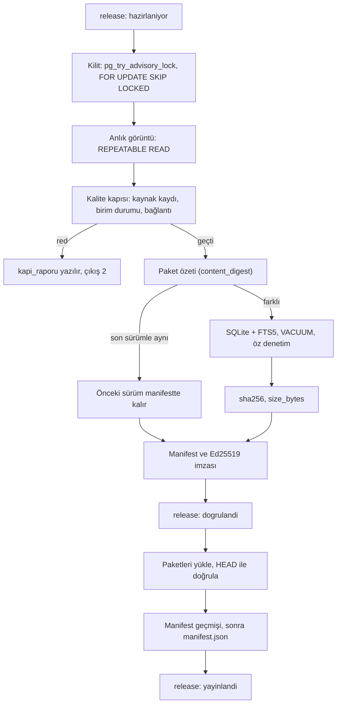

# Backend API

> **Sürüm:** 1.12 · **Tarih:** 10 Kasım 2026 · **Durum:** Taslak
> **Bağlı kararlar:** [K-48](../00-ozet/02-karar-defteri.md#k-48--editör-api-kuralları-inceleme-kararı-ikinci-onay-eşzamanlılık-yayın-talebi-ve-sayfa-görseli) · [K-47](../00-ozet/02-karar-defteri.md#k-47--yayın-kapsamı-tutarlılığı-sarkan-bağlantı-ve-çapa-sürekliliği) · [K-46](../00-ozet/02-karar-defteri.md#k-46--yayın-kaydı-içerik-özetleri-ve-fikstürler) · [K-45](../00-ozet/02-karar-defteri.md#k-45--manifest-imzası-ve-kanonik-json) · [K-37](../00-ozet/02-karar-defteri.md#k-37--editoryal-şema-ayrıntıları) · [K-42](../00-ozet/02-karar-defteri.md#k-42--kaynak-ilkesi-ve-kalite-temelli-görünürlük) · [K-10](../00-ozet/02-karar-defteri.md#k-10--arka-uç) · [K-11](../00-ozet/02-karar-defteri.md#k-11--veritabanı-postgresql-18) · [K-13](../00-ozet/02-karar-defteri.md#k-13--editör-paneli) · [K-15](../00-ozet/02-karar-defteri.md#k-15--hesap-ve-senkron-v1xte) · [K-16](../00-ozet/02-karar-defteri.md#k-16--senkron-çakışma-çözümü) · [K-19](../00-ozet/02-karar-defteri.md#k-19--kuran-kelime-anlamları) · [K-21](../00-ozet/02-karar-defteri.md#k-21--i̇çerik-dağıtımı) · [K-27](../00-ozet/02-karar-defteri.md#k-27--tek-bağlantı-tablosu) · [K-36](../00-ozet/02-karar-defteri.md#k-36--arama-normalizasyonu-ayrıntıları) · [K-38](../00-ozet/02-karar-defteri.md#k-38--kaynak-edinimi-dijital-öncelikli-kanıtla-yükseltme) · [K-41](../00-ozet/02-karar-defteri.md#k-41--ses-sistemi-hazır-kayıtlar-ayna-ve-çevrimiçi-öncelikli-dinleme)

Bu dosya ASP.NET Core 10 çözümünü, uçları, kimlik doğrulamayı, hata modelini, EF Core kurallarını ve Yayınlayıcı konsolunu tanımlar. Tablolar [Editoryal veritabanı](../03-veri/02-editoryal-veritabani.md), paket ve manifest biçimi [İçerik paketleri](../03-veri/03-icerik-paketleri.md), kalite kapısı kuralları [Yayın süreci](../07-yayin/01-yayin-sureci.md) dosyasındadır.

---

## 1. Çalışma kipleri

| Kip | Ayar | Ne zaman | Açık uçlar | Bağlanma |
|---|---|---|---|---|
| Editör | `Mutalaa:Features:Editor=true` | v1, yerel | Sağlık, oturum, editör, yayın | `127.0.0.1` |
| Genel | `Mutalaa:Features:Public=true` | v1.x, canlı | Sağlık, hesap, senkron, bağlantı oyu | Canlı sunucu (K-20) |

Genel kipte editör uçları hiç eşlenmez. v1'de okur uygulaması API'ye bağlanmaz ([Genel mimari](./01-genel-mimari.md)).

## 2. Çözüm yapısı

```
server/
├─ Mutalaa.slnx · Directory.Build.props · Directory.Packages.props
├─ Mutalaa.Domain/          bağımlılıksız çekirdek
│  ├─ Anchors/              AnchorRef, AnchorSpan, ayrıştırıcı ([GeneratedRegex], CultureInvariant)
│  ├─ Content/ Links/       Source, Unit, QuranWord, Lemma, Root, Xref ve öteki tablo varlıkları, enum'lar
│  ├─ Releases/ Reviews/    BuildFlavor, Release, PipelineRun, Review ve durum enum'ları; kalite kapısı (saf fonksiyonlar), içerik özeti, inceleme ve ikinci onay kuralları: ReviewTargets, ReviewDecisions, ReviewVerification (A13, A14)
│  ├─ Text/                 SearchNormalizer, IcKesme.g.cs (üretilir), ContentHash, kod noktası ofsetleri
│  └─ DomainException, DomainErrorCodes   alan kuralı ihlali (kod dizgisi taşır, HTTP bilmez; A14)
├─ Mutalaa.Infrastructure/  Persistence/ (IcerikDbContext, Configurations/, Converters/, RowVersion), Identity/, Migrations/,
│                           Storage/ (S3), Packs/ (SqlitePackWriter, ManifestSigner) (A13),
│                           Releases/ (ReleaseRepository, GatePlanner, DataVersions, PackFiles; Yayınlayıcı ve API ortak kullanır, A14)
├─ Mutalaa.Api/             Program.cs, Endpoints/, Problems/, Auth/, Hosting/, Paging/, Reviews/, Releases/, Settings/, openapi/v1.json
├─ Mutalaa.Publisher/       Program.cs, Commands/
└─ tests/                   Domain, Api, Publisher test projeleri
```

`Directory.Build.props` ortak ayarları taşır: `TargetFramework=net10.0`, `Nullable=enable`, `TreatWarningsAsErrors=true`, `RestorePackagesWithLockFile=true`. `InvariantGlobalization` açılmaz, çünkü NFC normalizasyonu ve Türkçe sıralama testleri ICU'ya ihtiyaç duyabilir (Doğrulanacak). Kültür bağımsızlığı bölüm 9'daki kurallarla sağlanır.

## 3. `Program.cs` iskeleti

```csharp
CultureInfo.DefaultThreadCurrentCulture = CultureInfo.InvariantCulture;
CultureInfo.DefaultThreadCurrentUICulture = CultureInfo.InvariantCulture;

// İçerik kökü derleme klasörüdür (appsettings*.json oradan okunur); çalışma dizini dotnet run/watch'ta depo köküdür.
var builder = WebApplication.CreateBuilder(new WebApplicationOptions { Args = args, ContentRootPath = AppContext.BaseDirectory });
builder.AddApiLogging();                                        // Serilog; statik önyükleme günlükçüsü yok

builder.Services.AddIcerikDb(builder.Configuration);            // IcerikDbContext (A07)
builder.Services.AddEditorAuth();                               // AddEditorIdentity().AddSignInManager(), çerez, Editor ve Admin politikaları
builder.Services.AddOptions<ApiOptions>().Bind(builder.Configuration.GetSection("Mutalaa:Paths"))
    .PostConfigure(o => o.Normalize());                          // yollar çalışma dizinine göre tam yola çevrilir
builder.Services.ConfigureHttpJsonOptions(o =>
{
    o.SerializerOptions.PropertyNamingPolicy = JsonNamingPolicy.SnakeCaseLower;
    o.SerializerOptions.UnmappedMemberHandling = JsonUnmappedMemberHandling.Disallow;
});
builder.Services.AddReleaseServices();                          // ReleaseRepository, PackCatalog, IPreviousPackResolver, önizleme
builder.Services.AddValidation();                               // .NET 10 Minimal API doğrulaması
builder.Services.AddApiProblemDetails();                        // type, kod ve traceId uzantıları
builder.Services.AddExceptionHandler<DomainExceptionHandler>(); // önce Domain, sonra genel yakalayıcı
builder.Services.AddExceptionHandler<ApiExceptionHandler>();
builder.Services.AddApiOpenApi();                               // OpenApi3_1, servers boş
builder.Services.AddHealthChecks().AddDbContextCheck<IcerikDbContext>("postgres", tags: ["ready"]);

var app = builder.Build();
if (args is ["seed"]) { Environment.ExitCode = await IdentitySeeder.RunAsync(app.Services, CancellationToken.None); return; }

// Ayarlar Build() sonrasında okunur; belge üretiminde (GetDocument.Insider) veritabanı ve DevAutoLogin denetimi atlanır.
bool documentGeneration = OpenApiSetup.IsDocumentGeneration();
if (!documentGeneration) DevAutoLogin.EnsureAllowed(app.Configuration, app.Environment);
ApiFeatures features = ApiFeatures.From(app.Configuration);

app.UseExceptionHandler();
app.UseStatusCodePages();                                       // kimlik doğrulamadan önce: 401, 403, 404, 405 gövdesi ProblemDetails
app.UseApiRequestLogging();                                     // UseSerilogRequestLogging
app.UseAuthentication();
if (!documentGeneration && DevAutoLogin.IsEnabled(app.Configuration)) app.UseDevAutoLogin();
app.UseAuthorization();
app.MapHealthChecks("/health/live", new() { Predicate = _ => false }) /* yalnız GET ve HEAD, anonim, belgeden hariç */;
app.MapHealthChecks("/health/ready", new() { Predicate = c => c.Tags.Contains("ready") });
var v1 = app.MapGroup("/api/v1");
if (features.Editor) v1.MapEditorEndpoints();                   // Public kipi (v1.x) için uç eşlemesi yok
if (app.Environment.IsDevelopment())
{
    app.MapOpenApi().ExcludeFromDescription();
    app.MapScalarApiReference(o => o.DisableDefaultFonts()).ExcludeFromDescription();
}
app.Run();

public partial class Program;                                   // WebApplicationFactory<Program> için
```

**Uygulandı (A07, 27 Ekim 2026; A14, 10 Kasım 2026):** `AddIcerikDb`, `AddEditorIdentity` ve `seed` dalı A07'de teslim edildi (`Mutalaa.Infrastructure/DependencyInjection.cs`); iskeletin kalanı A14'te `Mutalaa.Api/Program.cs` olarak yazıldı. `AddIcerikDb` bağlantı dizesi yokken de hata vermez (`dotnet ef` göç üretimi bağlantı istemez); otomatik göç yoktur. `seed` çıkış kodları: `0` başarı, `1` beklenmeyen hata, `2` eksik ayar, `3` Identity reddetti.

- **`DatabaseHealthCheck` yazılmadı.** Hazırlık denetimi `AddDbContextCheck<IcerikDbContext>` ile yapılır (`ready` etiketi). `/health/*` uçları yalnız GET ve HEAD kabul eder, anonimdir ve OpenAPI belgesine girmez.
- **İçerik kökü ve çalışma dizini.** İçerik kökü `AppContext.BaseDirectory`'dir: `appsettings*.json` hem `bin` klasöründen hem konteynerde `/app` klasöründen okunur. Göreli `data/...` yolları çalışma dizinine göre çözülür; csproj'taki `RunWorkingDirectory` bunu `dotnet run` ve `dotnet watch` için depo kökü yapar, konteynerde `WORKDIR /repo` aynı işi görür. Açılış günlüğü içerik kökünü, çalışma dizinini ve çözülen dört yolu yazar.
- **Ayar okuma Build() sonrasındadır.** Özellik bayrakları ve `DevAutoLogin` `app.Configuration` ile `app.Environment` üzerinden okunur. `DevAutoLogin` açık ve ortam `Development` değilse açılışta `InvalidOperationException` fırlar.
- **Serilog.** `UseSerilog((ctx, services, cfg) => …, preserveStaticLogger: true, writeToProviders: true)`; varsayılan konsol sağlayıcısı kaldırılır (yoksa satırlar iki kez yazılır). `Serilog:Format = Json` ise konsol sıkıştırılmış JSON yazar (konteyner), değilse okunur metin yazar. Ayrıntı: §8.
- **Ara katman sırası** açıkça yazılır: `UseExceptionHandler`, `UseStatusCodePages`, istek günlüğü, `UseAuthentication`, (yalnız `DevAutoLogin` açıksa `UseDevAutoLogin`), `UseAuthorization`. `UseStatusCodePages` kimlik doğrulamadan önce gelir ki 401 ve 403 gövdesi ProblemDetails olsun.
- **Çerez olayları.** `AddEditorAuth`, `AddIdentityCookies`'in kurduğu `Events` nesnesini yerinde değiştirir (yenisini atamaz; `OnValidatePrincipal` güvenlik damgası denetimi korunur): `OnRedirectToLogin` yalnız 401, `OnRedirectToAccessDenied` yalnız 403 yazar. Neden: §6.
- **Yetki.** `Editor` (editor ya da admin) ve `Admin` (yalnız admin) adlı politikalar vardır. `/api/v1` grubu `Editor` politikasını, yönetim uçları `Admin` politikasını taşır, giriş ucu `AllowAnonymous`'tur; `FallbackPolicy` kullanılmaz.
- **Adres.** `appsettings` içinde `Urls` ya da `Kestrel` yoktur. `Properties/launchSettings.json` (`http` profili) `http://127.0.0.1:5080` ve `Development` verir; konteyner `ASPNETCORE_HTTP_PORTS=8080` kullanır ([Yerel geliştirme](./04-yerel-gelistirme.md) §4).

## 4. v1 uçları (editör kipi)

| Yöntem ve yol | Yetki | İş |
|---|---|---|
| `GET`, `HEAD /health/live`, `/health/ready` | Anonim | Süreç ve PostgreSQL (`AddDbContextCheck<IcerikDbContext>`); yalnız GET ve HEAD, OpenAPI belgesinde yok |
| `POST /api/v1/auth/login`, `/auth/logout`; `GET /auth/me` | Anonim (yalnız giriş), editor | Çerezle oturum. Giriş ve `me` `{kullanici: {id, email}, roller}` döner; çıkış 204. Her giriş başarısızlığı 401 `oturum-acilamadi` alır |
| `GET`, `POST /api/v1/users`; `PUT /users/{id}/roles` | admin | Editör hesabı ve rol; kendi kendine kayıt yok. Aynı e-posta 409; Identity hataları 400 `dogrulama` ve `hatalar` listesi; son yöneticinin admin rolü alınamaz (409) |
| `GET /api/v1/sources`, `/sources/{slug}` | editor | Kaynak kaydı (ad, tür, sürüm, adres, atıf satırı, dosya özeti), birim sayısı; salt okunur. Başka yöntemler 405 `yontem-desteklenmiyor` ve `Allow: GET` alır |
| `GET /api/v1/units?source=&prefix=&q=&cursor=&limit=`; `GET /units/{anchor}` | editor | `q` en çok 1.024 kod noktasıdır ve C# normalizasyonundan geçer (`TurkishWide` ve `Arabic` anahtarları; `tr_wide` ve `ar_norm` üzerinde alt dizgi); `prefix` çapa önekidir. Ayrıntı `duzeltilebilir` alanı ve `ETag` taşır. Geçersiz çapa 400 `capa-gecersiz` ve `capa_hata_kodu` uzantısı |
| `POST /api/v1/units/{anchor}/corrections` | editor | `{metin, gerekce}` → 201, `Location` (`/api/v1/reviews/{id}`), `{id, durum}`. Yalnız kendi ürettiğimiz metinlerde düzeltme önerisi; metin NFC'ye çevrilir. Değişmez metinde (`unit.kind = 'ayet'` ya da `source.tur = 'kuran_metni'`; [K-48](../00-ozet/02-karar-defteri.md#k-48--editör-api-kuralları-inceleme-kararı-ikinci-onay-eşzamanlılık-yayın-talebi-ve-sayfa-görseli) madde 5) 422 `degistirilemez-metin`; aynı birim için açık metin incelemesi varsa 409 `cakisma`; "değişiklik yok" 400 `dogrulama` |
| `GET /api/v1/reviews?hedef_tablo=&alan=&durum=acik&cursor=&limit=`; `GET /reviews/{id:long}` | editor | Kuyruk ve ayrıntı. Öğede `onceki`, `onerilen`, `duzenlenen`, `yz_modeli`, `yz_kaydi`, `guven`, `ikinci_*`, `xmin`, `dogrulanmamis`, `ikinci_onay_bekliyor`; ayrıntı ayrıca `hedef` anlık görüntüsünü, `dogrulanmis` alanını ve `ETag` başlığını taşır |
| `POST /api/v1/reviews/{id:long}/decision` | editor | `{karar: onaylandi\|reddedildi, duzenlenen?: {metin}, gerekce}`; `If-Match` zorunlu (§4.2). 200 `{id, durum, eylem, ikinci_onay_bekliyor, hedef_durumu, xmin}` ve yeni `ETag` |
| `POST /api/v1/reviews/decisions` | editor | `{kararlar: [{id, xmin, karar, duzenlenen?, gerekce}]}`; 1 ile 100 öğe, tek işlemde ya hepsi ya hiçbiri; `If-Match` yok, sürüm her öğenin `xmin` alanındadır. 200 `{sonuclar: [{id, durum, eylem, xmin}]}`. Aynı kimlik ya da aynı hedef için ikinci karar 400; bulunamayan kayıtlar 404 ve `kimlikler`; tutmayan sürümler 412 ve `kimlikler`; bir kural ihlali kendi durumunu ve `kimlik` uzantısını verir |
| `GET /api/v1/reviews/stats` | editor | `{kuyruklar: [{hedef_tablo, alan, acik}], toplam_acik}` |
| `GET /api/v1/scans/{baski}/{sayfa}` | editor | OCR sayfa görseli ([K-48](../00-ozet/02-karar-defteri.md#k-48--editör-api-kuralları-inceleme-kararı-ikinci-onay-eşzamanlılık-yayın-talebi-ve-sayfa-görseli) madde 8; [Elmalılı hazırlığı](../04-icerik/03-elmalili-hazirligi.md) §7). Dosya olduğu gibi akıtılır (`image/tiff`, `image/png` ya da `image/jpeg`; `Cache-Control: private, no-store`); ayrıntı §4.3 |
| `POST /api/v1/releases` | admin | `{derleme, paketler?, notlar?}` → 202, `Location`, `{id, surum, derleme, durum, talep}` (`durum: hazirlaniyor`). Talep `release` kaydına `talep = yayin`, `paketler` ve `notlar` ile yazılır (`not` PostgreSQL'de ayrılmış sözcüktür; [K-46](../00-ozet/02-karar-defteri.md#k-46--yayın-kaydı-içerik-özetleri-ve-fikstürler) madde 2). Sürümü `ReleaseVersion.Next` atar |
| `POST /api/v1/releases/preview` | admin | `{derleme, paketler?}`: paket üretmeden kalite kapısı raporu. Geçerse 200 `{derleme, kapi_raporu, uyarilar}`; kapı reddederse 422 `kalite-kapisi` ve `kapi_raporu`. Yalnız yayın talebi içindir; P-14 yalnız terfide çalışır (§10.6) |
| `GET /api/v1/releases?derleme=&cursor=&limit=`, `/releases/{id:int}` | editor | Liste özet döner (`id` azalan, varsayılan 50, en çok 200); ayrıntı `kapi_raporu`, `ozetler`, `manifest`, `notlar`, `data_version` ve `ETag` taşır |
| `POST /api/v1/releases/{id:int}/promote` | admin | `{notlar?}` (gövde verilmeyebilir) → 202. Kaynak `yayinlandi` durumundaki `internal` yayındır; aksi 409 `durum-gecisi-gecersiz`. Yeni satır `derleme = public`, kaynağın sürümü, `talep = terfi` ve `kaynak_release_id` taşır; `watch` talebi bu alanlardan okur (§10.6) |
| `POST /api/v1/releases/{id:int}/rollback` | admin | `{notlar?}` → 202. Hedef aynı derleme türünün `yayinlandi` ya da `geri_cekildi` yayınıdır; güncel yayına geri alma 409 `durum-gecisi-gecersiz`. Yeni satır yeni sürüm, `talep = geri_alma` ve `kaynak_release_id` (hedef) taşır |

Bilinmeyen yayın kimliği 404 `bulunamadi` alır. Aynı derleme türünde açık (`hazirlaniyor` ya da `dogrulandi`) satır varken `POST /releases`, `promote` ve `rollback` 409 `yayin-suruyor` alır (§4.2).

### 4.1 İnceleme kuyrukları

Hat ve editör önerileri tek `review` tablosundan geçer. Onay editörün `duzenlenen` değerini, boşsa özgün `onerilen` değerini hedefe aynı işlemde uygular; ret hedefi değiştirmez ([Editoryal veritabanı](../03-veri/02-editoryal-veritabani.md) §8; [K-48](../00-ozet/02-karar-defteri.md#k-48--editör-api-kuralları-inceleme-kararı-ikinci-onay-eşzamanlılık-yayın-talebi-ve-sayfa-görseli) madde 1). Karar verilmiş kayda yeni karar 409 `durum-gecisi-gecersiz` alır; `gerekce` zorunludur (boş değil, en çok 2.000 karakter).

A14'te yalnız biçimi tanımlı kuyruklar uygulanır (K-48 madde 2); kalan hedefler A17 ve A18'de eklenir.

| Kuyruk | `hedef_tablo` | `alan` | `hedef_anahtar` | A14 durumu | Ayrıntı |
|---|---|---|---|---|---|
| Bağlantı adayları | `xref` | `status` | uuid (`xref_id` de dolu) | Uygulandı: durum onayı | [Bağlantı modeli](../05-capraz-referans/01-baglanti-modeli.md) |
| Kelime anlamı taslakları | `lemma_gloss` | `anlam_kisa` | `lemma_id` | Uygulandı: durum onayı (anlam düzenleme A17'de) | [Kelime anlamları](../04-icerik/06-kelime-anlamlari.md) |
| Lemma durumu | `lemma` | `status` | `lemma_id` | Uygulandı: durum onayı | [Kök ve lemma](../05-capraz-referans/03-kok-ve-lemma.md) |
| OCR satırı, metin düzeltmesi | `unit` | `metin` | çapa | Uygulandı: metin onayı (aşağıda) | [Elmalılı hazırlığı](../04-icerik/03-elmalili-hazirligi.md) |
| Kök ve lemma düzeltmesi | `quran_word_fix` | `root_id`, `lemma_id`, `pos`, `features` | uuid | Uygulandı: durum onayı (`new_value` düzenleme A17'de) | [Kök ve lemma](../05-capraz-referans/03-kok-ve-lemma.md) §4 |
| Sure adı varyantları | `surah_alias` | `status` | `{surah_no}:{alias}` (ilk `:` işaretinden bölünür) | Uygulandı: durum onayı | [İktibas tespiti](../05-capraz-referans/02-iktibas-tespiti.md) |
| Türkçe kelime → Arapça kök | `tr_root_index`, `tr_form` | eşleme | ayrıştırılmaz | Ertelendi (A18): 422 `inceleme-desteklenmiyor` | [Kök ve lemma](../05-capraz-referans/03-kok-ve-lemma.md) §5 |

- **Çözüldü (19 Ekim 2026):** `review.hedef_tablo` denetim listesi `quran_word_fix`, `tr_root_index`, `tr_form` ve `surah_alias` değerlerini taşır ([Editoryal veritabanı](../03-veri/02-editoryal-veritabani.md) §8).
- **Çözüldü (10 Kasım 2026):** sure adı kuyruğunun alanı `alias` değil `status`'tür; hat `surah_alias` için `alan = 'status'` yazar ([Editoryal veritabanı](../03-veri/02-editoryal-veritabani.md) §8).
- **Durum hedefleri.** Kendi `status` alanı olan tablolarda (`xref`, `quran_word_fix`, `surah_alias`, `lemma`, `lemma_gloss`) onay `onayli`, ret `red` yazar. Hedefin durumu `aday` değilse istek 409 alır. Editörün değer girdiği (`duzenlenen`) istek 422 `inceleme-desteklenmiyor` alır.
- **Birim metni (`unit` + `metin`).** `onceki`, `onerilen` ve `duzenlenen` `{"metin": …, "content_hash": …}` biçimindedir; özeti API hesaplar. Onayda önce birimin güncel `content_hash` değeri `onceki.content_hash` ile karşılaştırılır, tutmazsa 409 (hedef bayatlamış). Metin değişiyorsa `TextCanonicalizer`'dan geçer, `content_hash` yeniden hesaplanır, `rev` bir artar, `tr_narrow`, `tr_wide` ve `ar_norm` C# normalleştiricisiyle yenilenir ve `tr_stem` NULL olur. `marks`, `sentences`, `ayah_range`, `data_version` ve `provenance` yenilenmez ([BÇ-53](../10-claude-code/07-belge-celiskileri.md), A16). Son onayda `metin_durumu = onayli` yazılır. Değişmez metinde (`unit.kind = 'ayet'` ya da `source.tur = 'kuran_metni'`) onay 422 `degistirilemez-metin` alır.
- **İkinci onay** yalnız `unit` + `metin` kayıtlarında ve `unit.kind` `meal` ya da `tefsir` iken uygulanır (K-48 madde 4). İlk onay `inceleyen`, `incelendi_at` ve `gerekce` alanlarını doldurur; düzenleme varsa değer `duzenlenen` alanına girer; kayıt `acik` kalır. `taslak` birim `incelemede` olur; `onayli` birim ikinci onaya kadar eski metnini ve `onayli` durumunu korur (K-47 çapa sürekliliği bozulmasın). Farklı bir editörün onayı değeri uygular ve `ikinci_inceleyen`, `ikinci_incelendi_at` ile `ikinci_gerekce` alanlarını doldurur. İkinci onay değeri değiştiremez (422 `inceleme-desteklenmiyor`; değiştirmek isteyen reddeder); aynı kişinin ikinci onayı 409 `durum-gecisi-gecersiz` alır. Ret her aşamada verilebilir; `incelemede` olan birim `taslak`a döner. `koken = editor` kayıtta öneren kendi önerisini onaylayamaz (409).
- **Ertelenenler (A17 ve A18).** Değeri değiştiren öteki eylemler A14'te 422 `inceleme-desteklenmiyor` döner: anlam düzenleme, `new_value` düzenleme, bağlantıda hedef, aralık ya da tür değişimi, `tr_root_index` ve `tr_form` eşlemesi, uzmana gönderme, etimolojik işaret. Böl ve Birleştir eylemlerinin karşılığı da kurulmadı (A16 ve A18'de karara bağlanır).
- Onaysız yapay zekâ taslağı (`yz_modeli` dolu ve hedef onaylı değil) yanıtta `dogrulanmamis: true` taşır ([K-25](../00-ozet/02-karar-defteri.md#k-25--i̇lkeler)). `dogrulanmis` saklanmaz; ayrıntıda hedefin durumundan türetilir.

### 4.2 Uç kuralları

- JSON alan adları veritabanı sütunlarıyla aynıdır (snake_case); enum değerleri veritabanı etiketleriyle aynıdır (`incelemede`, `onaylandi`, `hazirlaniyor`). Bilinmeyen alan 400 `dogrulama` alır. jsonb alanları (`onceki`, `onerilen`, `duzenlenen`, `yz_kaydi`, `kapi_raporu`, `ozetler`, `manifest`) JSON nesnesi olarak döner.
- Sayfalama imleçlidir: `?cursor=&limit=` (en çok 200), yanıt `{ "items": [...], "next_cursor": "..." }`. İmleç opak ve anahtar kümelidir; bozuk imleç 400 alır.
- **Eşzamanlılık** ([K-48](../00-ozet/02-karar-defteri.md#k-48--editör-api-kuralları-inceleme-kararı-ikinci-onay-eşzamanlılık-yayın-talebi-ve-sayfa-görseli) madde 6): `ETag` değeri `"{xmin}"` biçimindedir; inceleme, birim ve yayın ayrıntıları `ETag` başlığı taşır, inceleme ve yayın öğeleri `xmin` alanını da verir.
  - Tekil karar `If-Match` ister: başlık yoksa 428 `surum-gerekli`; `*`, `W/` ya da virgüllü liste ve bozuk biçim 400 `dogrulama`; değer tutmazsa 412 `surum-uyusmazligi`.
  - Toplu karar `If-Match` taşımaz; sürüm her öğenin `xmin` alanındadır. Önce bütün `xmin` değerleri bellekte karşılaştırılır; tutmayan kimliklerin tam listesi 412 yanıtının `kimlikler` uzantısında döner. Kayıt sırasındaki yarışta liste en az bir kimlik içerir.
  - `DbUpdateConcurrencyException` (inceleme kaydı ya da hedef satır arada değişti) de 412 olur.
- Çapa yol parçası olarak gönderilir; istemci `encodeURIComponent` kullanır. Yol kısıtları: yayın kimliği `{id:int}`, inceleme kimliği `{id:long}`.
- Aynı derleme türünde açık (`hazirlaniyor` ya da `dogrulandi`) bir yayın varken yeni talep, terfi ya da geri alma 409 `yayin-suruyor` alır; yanıtın `yayin` uzantısı açık satırı gösterir: `{id, surum, derleme, durum, talep}`. Aynı sürümle başarısız olmayan satır varsa 409 `cakisma`. `paketler` `PackCatalog.Default` ile doğrulanır; bilinmeyen paket 400 alır. `data_version` Yayınlayıcının biçimidir; `olusturan` Identity kullanıcı adıdır.
- Bozuk JSON ve bağlama hatası da 400 `dogrulama` alır.

### 4.3 OCR sayfa görseli

`GET /api/v1/scans/{baski}/{sayfa}` ([K-48](../00-ozet/02-karar-defteri.md#k-48--editör-api-kuralları-inceleme-kararı-ikinci-onay-eşzamanlılık-yayın-talebi-ve-sayfa-görseli) madde 8; editor yetkisi):

- `baski` `^[a-z0-9-]{1,64}$`, `sayfa` `^c[0-9]{2}-s[0-9]{4}$` desenine uymalıdır; aksi 400 `dogrulama`.
- Dosya `{RawDir}/{baski}/` altındaki bütün `YYYY-MM-DD` klasörlerinde yeniden eskiye `{sayfa}.{tif,tiff,png,jpg,jpeg}` olarak aranır ve olduğu gibi (baytlar değişmeden) akıtılır; bulunamazsa 404 `bulunamadi`.
- Çözülen yol `RawDir` dışına çıkamaz; sembolik bağ izlenmez. `data/raw/` salt okunur kalır. Oturumsuz istek 401 ProblemDetails alır (`Location` yok).
- TIFF gösterimi panelin (A15) işidir. Birimden görsele eşleme (`attrs` alan adları) A16'da kesinleşir.

## 5. v1.x uçları (genel kip)

| Yöntem ve yol | İş |
|---|---|
| `POST /api/v1/account/register`, `/login`, `/refresh`, `/logout` | E-posta ve parola; taşıyıcı (bearer) ve yenileme belirteci |
| `POST /api/v1/account/external/google`, `/external/apple` | `{id_token, nonce}`; sunucu imzayı, `aud` ve `nonce` değerini doğrular. Google ile giriş sunulursa Apple ile Giriş de sunulur (brif; App Store yönergesinin güncel metni Doğrulanacak) |
| `DELETE /api/v1/account`; `GET /account/export` | Hesap, senkron verisi ve oylar silinir; veri dökümü (öneri) |
| `POST /api/v1/sync/push` | `{device_id, ops: [{op_id, table, row}]}` → `{accepted, conflicts, server_seq, server_hlc}`; `op_id` (UUIDv7) ile idempotent |
| `GET /api/v1/sync/pull?cursor={server_seq}&limit=500` | `{changes, next_cursor, has_more, server_hlc}`; imleç silinmiş satır saklama sınırının (`gc_seq`) gerisindeyse 410 ve `imlec-eskidi` hata kodu döner, cihaz tam yeniden eşitleme yapar |
| `PUT`, `DELETE /api/v1/xrefs/{id}/vote` | `{vote: up\|down, reason?}`; hesap başına tek oy |

- Birleştirme kuralları K-16'dır; ayrıntı [Kullanıcı verisi ve senkron](../03-veri/04-kullanici-verisi-ve-senkron.md).
- Oylar `xref_vote(xref_id, account_hash, vote, reason, data_version, created_at)` tablosundadır; `account_hash = HMAC-SHA256(sunucu sırrı, hesap kimliği)`; nedenler `yanlis_ayet`, `iktibas_degil`, `kok_yanlis`, `alakasiz`. Gece işi toplamları `xref.votes_up` ve `votes_down` sütunlarına yazar ve eşiği geçen bağlantıya `review` satırı açar. Oy durumu kendiliğinden değiştirmez, sayısı gösterilmez ([Bağlantı modeli](../05-capraz-referans/01-baglanti-modeli.md) §12).
- Hız sınırı yerleşik `AddRateLimiter` ile hesap ve IP başına uygulanır.

## 6. Kimlik doğrulama, OpenAPI ve hata modeli

**Editör kimliği** ([Editoryal veritabanı](../03-veri/02-editoryal-veritabani.md) ED-1 sorusunun cevabı):
- ASP.NET Core Identity; kullanıcı tipi `EditorUser`, roller `editor` ve `admin`. Çerez (`mutalaa.editor`) `HttpOnly`, `SameSite=Strict`'tir; `Development` dışında `Secure`'dur (`Development`'ta isteğe göre). Oturum 8 saat kayar (A14, [K-48](../00-ozet/02-karar-defteri.md#k-48--editör-api-kuralları-inceleme-kararı-ikinci-onay-eşzamanlılık-yayın-talebi-ve-sayfa-görseli) madde 10). Rol değişiminde güvenlik damgası yenilenir ve doğrulama aralığı 1 dakikadır; rol ya da kilit en geç bir dakikada açık oturuma yansır. Yetkisiz istek 401, yetkisiz rol 403 alır.
- **Çerez yönlendirmesi kapatılır.** .NET 10 JSON okuyan ya da yazan Minimal API uçlarında çerez yönlendirmesini kendiliğinden kapatması beklenir ([Learn](https://learn.microsoft.com/en-us/aspnet/core/breaking-changes/10/cookie-authentication-api-endpoints?view=aspnetcore-10.0)); **Çözüldü (10 Kasım 2026, A14.1):** `IResult` dönen düz Minimal API uçlarında bu kapanmadı, yanıt 302 ve `Location` ile geldi (`TypedResults` ya da JSON gövde de `Location` başlığını kaldırmaz). Bu yüzden `AddIdentityCookies`'in `Events` nesnesinde `OnRedirectToLogin` yalnız 401, `OnRedirectToAccessDenied` yalnız 403 yazacak biçimde ezilir; yönlendirme ve `Location` başlığı hiç yoktur. 401 ve 403 gövdesini `UseStatusCodePages` ProblemDetails ile doldurur.
- **Parola ve kilit ([K-37](../00-ozet/02-karar-defteri.md#k-37--editoryal-şema-ayrıntıları), A07'de uygulandı):** parola yalnız en az 12 karakter ister; büyük harf, rakam ya da simge şartı yoktur. 5 hatalı denemede hesap 15 dakika kilitlenir. `RequireUniqueEmail` açıktır; kullanıcı adı e-posta adresidir. Identity tabloları `kimlik` şemasında 7 tablodur (`users`, `roles`, `user_roles`, `user_claims`, `user_logins`, `user_tokens`, `role_claims`; passkey tablosu yok).
- **Uygulandı (A14, kilit):** kilit yalnız `AccessFailedAsync` ya da `CheckPasswordSignInAsync(..., lockoutOnFailure: true)` üzerinden işler. Giriş ucu `CheckPasswordSignInAsync(..., lockoutOnFailure: true)` çağırır; beşinci hatalı denemeden sonra doğru parola da reddedilir. Başka bir parola denetimi sayacı artırmazdı ve kilit çalışmazdı.
- Kendi kendine kayıt yoktur; ilk yönetici `seed` komutuyla açılır. `review.oneren` ve `inceleyen` alanlarına Identity kullanıcı adı yazılır.
- **Yalnız yerel kip.** API `127.0.0.1` adresine bağlanır, CORS kapalıdır, editör Vite vekiliyle (`/api`) aynı kökenden çağırır. `Mutalaa:Auth:DevAutoLogin=true` yalnız `Development` ortamında ve geri döngü (loopback) isteğinde (uzak adres bilinmiyorsa açmaz) `Mutalaa:Seed:AdminEmail` yöneticisiyle oturum açar; başka ortamda açılışta hata verir. Konteynerde istek geri döngü adresinden gelmediği için çalışmaz; yalnız ana makinedeki `dotnet watch` içindir. Panel dışarı açılırsa HTTPS, antiforgery başlığı ve iki adımlı doğrulama zorunludur.

**OpenAPI.** Yerleşik `Microsoft.AspNetCore.OpenApi` OpenAPI 3.1 belgesini `/openapi/v1.json`, Scalar arayüzü `/scalar/v1` adresinde yalnız `Development` ortamında sunar; ikisi de belgeden hariçtir. Belge derlemede de üretilip `server/Mutalaa.Api/openapi/v1.json` olarak depoya girer (`Microsoft.Extensions.ApiDescription.Server`); CI farkı denetler, editör tipleri bu dosyadan `openapi-typescript` ile üretilir. Belge üretimi uygulamayı başlattığı için açılış kodu veritabanına bağlanmaz (`GetDocument.Insider` denetimi). `servers` listesi boşaltılır: belge ortamdan ve adresten bağımsız, belirlenimcidir.
- **Çözüldü (10 Kasım 2026, A14.1): derlemede belge.** csproj'ta `OpenApiDocumentsDirectory = openapi` ve `OpenApiGenerateDocumentsOptions = --file-name v1 --openapi-version OpenApi3_1` verilir; `--openapi-version` 10.0.14'te çalışır (çalışma zamanındaki `OpenApiVersion = OpenApi3_1` ayarı yedek olarak da yazılıdır). `OpenApiGenerateDocumentsOnBuild` yalnız `Release` yapılandırmasında açıktır (Debug derlemesi belge üretmez; CI Release ile derler). Üretilen belge `Production`, `Development` ve `Staging` ortamlarında bayt bayt aynı çıktı. `openapi/**` çıktı klasörüne kopyalanmaz. Kaynak: [Generate OpenAPI documents](https://learn.microsoft.com/en-us/aspnet/core/fundamentals/openapi/aspnetcore-openapi?view=aspnetcore-10.0).
- **Çözüldü (10 Kasım 2026, A14.1): Scalar yolu.** `MapScalarApiReference()` varsayılan yolu `/scalar` olsa da çalışan API'de belge adı `v1` ile `/scalar/v1` doğru yoldur. Yazı tipleri CDN'den gelmesin diye `DisableDefaultFonts()` verilir. Kaynak: [Scalar ASP.NET Core entegrasyonu](https://raw.githubusercontent.com/scalar/scalar/66ba1d7671c2f230af9be4ed7a94ee057683b8df/documentation/integrations/aspnetcore/integration.md) (commit `66ba1d76`).
- **Çözüldü (10 Kasım 2026, A14.1): `AddValidation()`.** Zorunlu alanı eksik istek 400 `HttpValidationProblemDetails` döner; alan adları snake_case'e çevrilir. Kaynak üretici yalnız `AddValidation` çağrılan derlemeyi kapsar; bu yüzden istek tipleri `Mutalaa.Api` içindedir. Bilinmeyen JSON alanı için `UnmappedMemberHandling = Disallow` verilir. Kaynak: [Validation in ASP.NET Core](https://learn.microsoft.com/en-us/aspnet/core/fundamentals/validation?view=aspnetcore-10.0).

**Hata modeli.** RFC 9457 `application/problem+json`. `type` alanı `urn:mutalaa:problem:<kod>` olur (**Çözüldü, 10 Kasım 2026:** kod ayrıca `kod` uzantı alanında da gider; ad `kod`'dur, `type` ile aynı kodu taşır). Gövde `traceId` taşır. Girdi doğrulaması 400 `HttpValidationProblemDetails` döner. Alan kuralları Domain'de `DomainException` fırlatır (kod dizgisi taşır, HTTP bilmez); `DomainExceptionHandler` kodu HTTP durumuna eşler ve ProblemDetails'e çevirir, tanımsız kod için `false` döner ve genel yakalayıcı 500 `sunucu-hatasi` yazar. İki yakalayıcı bu sırayla kayıtlıdır: `DomainExceptionHandler`, sonra `ApiExceptionHandler` (`DbUpdateConcurrencyException` 412 olur ve 23505 eşlemesinden önce yakalanır). Günlüğe istisna iletisi yazılmaz, yalnız tür adları.

`DomainException` eşlemesi (K-48 madde 9): `dogrulama` 400, `bulunamadi` 404, `durum-gecisi-gecersiz` 409, `surum-uyusmazligi` 412, `degistirilemez-metin` ve `inceleme-desteklenmiyor` 422.

| Kod | HTTP | Ne zaman |
|---|---|---|
| `dogrulama` | 400 | Alan biçimi, bozuk JSON, bilinmeyen alan, bağlama hatası, bozuk `If-Match`; Identity hataları (`hatalar` listesi) |
| `capa-gecersiz` | 400 | Çapa grameri hatalı ya da birim düzeyinde değil; `capa_hata_kodu` ek alanı çapa ayrıştırıcısının hata kodunu verir ([Çapa şeması](../03-veri/01-capa-semasi.md)) |
| `oturum-acilamadi`, `yetki-yok`, `bulunamadi` | 401, 403, 404 | Kimlik, rol, kayıt |
| `yontem-desteklenmiyor` | 405 | Salt okunur uca yazma yöntemi (ör. kaynak uçlarına POST); `Allow` başlığı döner |
| `yayin-suruyor` | 409 | Derleme türünde açık yayın var; `yayin` uzantısı `{id, surum, derleme, durum, talep}` verir |
| `durum-gecisi-gecersiz` | 409 | İzin verilmeyen durum geçişi: karar verilmiş kayıt, aday olmayan hedef, bayat hedef, aynı kişinin ikinci onayı, öneren kendi önerisini onaylıyor, terfi ya da geri alma kaynağı uygun değil, son yöneticinin rolü |
| `cakisma` | 409 | PostgreSQL 23505 (tekil) ve 23503 (yabancı anahtar) ihlali; aynı e-posta; aynı sürümle yayın; birim için açık düzeltme önerisi; sürmekte olan önizleme |
| `surum-uyusmazligi` | 412 | `If-Match` ya da toplu karardaki `xmin` tutmadı; toplu kararda `kimlikler` listesi eklidir |
| `surum-gerekli` | 428 | Karar isteğinde `If-Match` başlığı yok |
| `degistirilemez-metin` | 422 | Değişmez metne (`unit.kind = 'ayet'` ya da `source.tur = 'kuran_metni'`) düzeltme ya da metin onayı |
| `inceleme-desteklenmiyor` | 422 | Hedef tablo, alan ya da eylem için A14'te inceleme akışı yok (ertelenen eylemler, durum hedefine editör değeri, ikinci onayda değer değişikliği) |
| `onceki-yayin-bozuk` | 422 | Önizlemede önceki yayının manifesti yok ya da okunamıyor |
| `kalite-kapisi` | 422 | Önizleme kalite kapısına takıldı; `kapi_raporu` uzantısı kapı raporunu verir |
| `depo-erisilemiyor` | 503 | Önizleme önceki yayının paketini okuyamadı (depoda yok ya da özeti manifestle uyuşmuyor) |
| `sunucu-hatasi` | 500 | Beklenmeyen hata (PostgreSQL 23502 dahil); ayrıntı yalnız günlüktedir |
| `imlec-eskidi` | 410 | v1.x senkron çekmesinde imleç silinmiş satır saklama sınırının (`gc_seq`) gerisinde; cihaz tam yeniden eşitleme yapar ([Kullanıcı verisi ve senkron](../03-veri/04-kullanici-verisi-ve-senkron.md) §8) |
| `saat_ileri` | Doğrulanacak | v1.x senkron işleminin HLC fiziksel kısmı sunucu saatinden 10 dakikadan fazla ileride (öneri, KV-2); uygulama "Cihaz saatini kontrol edin" der. Ad Kullanıcı verisi ve senkron §3'teki gibidir; istek düzeyinde hata mı, işlem sonucu mu olduğu Doğrulanacak |

## 7. EF Core 10 ve Npgsql

- `IcerikDbContext` bütün tabloları eşler; API ve Yayınlayıcı aynı bağlamı kullanır. Adlar `EFCore.NamingConventions` ile snake_case'tir; tablo adları tekildir ve `ToTable("source")` gibi açıkça yazılır. Identity tabloları ayrı `kimlik` şemasında durur (uygulandı, A07; K-37). `icerik` şemasındaki anahtar, yabancı anahtar ve tekil dizin adları PostgreSQL'in varsayılan adlarıdır (`{tablo}_pkey` …); ayrıntı [Editoryal veritabanı](../03-veri/02-editoryal-veritabani.md) §12.
- PostgreSQL enum türleri (10 tür: `source_kind`, `xref_type`, `xref_status`, `xref_origin`, `derleme_turu`, `unit_kind`, `unit_status`, `metin_durumu`, `inceleme_durumu`, `surum_durumu`) C# enum'larına bağlanır (`TextStatus.Incelemede` → `incelemede`). Her tür `HasPostgresEnum(şema, ad, etiketler)` ile açık sırayla tanımlanır; `MapEnum` yalnız ad çevirmenidir, çünkü Npgsql 10 `MapEnum` etiketleri alfabetik dizer ([efcore.pg #3667](https://github.com/npgsql/efcore.pg/issues/3667)) ve anlamlı sırayı bozar (`metin_durumu` sırası `taslak`, `incelemede`, `onayli`'dir; alfabetik sıra `incelemede`, `onayli`, `taslak` olurdu). `SetPostgresVersion(18, 0)` verilir. Bir Domain testi her değerin etiketini, bir PostgreSQL testi `pg_enum` sırasını JSON ile karşılaştırır.
- **Uygulandı (A06, 26 Ekim 2026; A07, 27 Ekim 2026): etiket eşlemesi Domain'de saftır.** `Mutalaa.Domain/Releases` içinde `BuildFlavor` ve `ReleaseStatus`, `Content` içinde `SourceKind`, `UnitKind`, `UnitStatus` ve `TextStatus`, `Links` içinde `XrefType`, `XrefStatus` ve `XrefOrigin`, `Reviews` içinde `ReviewStatus` bulunur. Her enum için aynı dosyada `...Labels` sınıfı vardır: `ToLabel` (açık `switch`; tanımsız sayısal değerde `ArgumentOutOfRangeException`) ve `TryParseLabel` (Ordinal, büyük-küçük harfe duyarlı, kırpmasız). Yansıma, `Enum.ToString` ve kültürlü dönüşüm yoktur; Domain Npgsql'e bağlanmaz. Bildirim sırası `packages/content-schema/enums.json` sırasıdır ve sayısal değerler bu sıradır (`Taslak = 0`, `Incelemede = 1`, `Onayli = 2`). `EnumLabelTests` her JSON türünü ve sırasını sınar. Npgsql eşlemesi (veritabanı etiketi ↔ C# enum) `Mutalaa.Infrastructure/Persistence/PostgresEnums` içindedir; `PostgresEnumTests` PostgreSQL etiketlerini ve sırasını `enums.json` ile karşılaştırır.
- **Uygulandı (A13): kapı ayrıştırılamayan değerde `public` gibi davranır.** `TryParseLabel` başarısız olunca `value = default` verir; `BuildFlavor` için bu en gevşek görünürlük olan `Dev`'dir. Bu yüzden kapı `BuildFlavor`'ı `FlavorPolicy.ParseOrMostRestrictive` ile ayrıştırır: `bool` dönüşü denetlenir, ayrıştırılamayan değer `Public` olur (en kısıtlayıcı). Bir Domain testi bunu kilitler ([K-46](../00-ozet/02-karar-defteri.md#k-46--yayın-kaydı-içerik-özetleri-ve-fikstürler) madde 7).
- Çapa sütunları `AnchorRef` değer dönüştürücüsüyle bağlanır; zaman `timestamptz` ve UTC'dir; eşzamanlılık belirteci `xmin`'dir. **Çözüldü (27 Ekim 2026):** `xmin` gölge `uint` özelliktir (`IsRowVersion()`, `xid`); göçte sütun üretilmez ([Editoryal veritabanı](../03-veri/02-editoryal-veritabani.md) §12). Dönüştürülmüş çapa sütunlarında LINQ `LIKE` ve aralık işleci çevrilmez; bu sorgular ham SQL ya da `AsNoTracking()` ile projeksiyon kullanır (A13, A14).
- Okumalar `AsNoTracking()` ile, ham SQL yalnız parametreli `FromSql` ile yazılır. **Karar yazımı (tekil ve toplu) izlenen güncellemedir** ([K-48](../00-ozet/02-karar-defteri.md#k-48--editör-api-kuralları-inceleme-kararı-ikinci-onay-eşzamanlılık-yayın-talebi-ve-sayfa-görseli); `ExecuteUpdateAsync` seçilmedi, çünkü hedef kayda göre değişir): kayıtlar izlenerek yüklenir; istemcinin `xmin` değeri bellekte karşılaştırılır (tutmazsa 412); `RowVersion.Expect` özgün değeri verir; Domain kuralı ve hedef değişikliği uygulanır; tek `SaveChanges` çağrısı EF'in eklediği `WHERE xmin = …` ile işler ve `UpdatedAtInterceptor` `updated_at` değerini yazar; `DbUpdateConcurrencyException` 412 olur. `ExecuteUpdateAsync` `xmin` denetimi eklemez ve `updated_at` değerini kendiliğinden yazmaz (`UpdatedAtInterceptor` yalnız `SaveChanges`te çalışır); bu yüzden karar yolunda kullanılmaz. `RowVersion` (`Mutalaa.Infrastructure/Persistence`) `xmin` adını, `Get` ve `Expect` yardımcılarını taşır.

**Göç politikası** ([Editoryal veritabanı](../03-veri/02-editoryal-veritabani.md) §12 ile aynı): şemanın tek sahibi `server/Mutalaa.Infrastructure/Migrations` altındaki EF Core göçleridir. Her PR en çok bir göç ekler; SQL `dotnet ef migrations script --idempotent` ile gözden geçirilir; uygulanmış göç değiştirilmez. Yerelde `dotnet ef database update`, CI ve canlıda göç paketi (`migrations bundle`) kullanılır; API açılışında otomatik göç yoktur. Yıkıcı değişiklik genişlet, taşı, daralt adımlarıyla yapılır.

## 8. Günlük ve telemetri

- **Serilog (A14).** Konsola yazar: `Serilog:Format = Json` ise sıkıştırılmış JSON (`Serilog__Format=Json` ortam değişkeniyle; `docker-compose.yml` bunu şimdilik vermez, konteyner da okunur metin yazar), değilse okunur metin (geliştirme). Düzeyler `appsettings.json` `Serilog` bölümünden okunur (varsayılan `Information`; `Microsoft.AspNetCore` ve EF `Database.Command` `Warning`). `UseSerilogRequestLogging` her isteği tek satırla kaydeder; sağlık uçları `Verbose`, 5xx ve istisna `Error` düzeyindedir. İstek günlüğü yolu ve durumu yazar; sorgu dizesi, çerez, e-posta ve gövde yazmaz. Statik önyükleme günlükçüsü yoktur (`preserveStaticLogger`); varsayılan konsol sağlayıcısı kaldırılır, yoksa her satır iki kez çıkar.
- **OpenTelemetry A14 dışındadır** ([K-48](../00-ozet/02-karar-defteri.md#k-48--editör-api-kuralları-inceleme-kararı-ikinci-onay-eşzamanlılık-yayın-talebi-ve-sayfa-görseli) madde 11); Serilog istek günlüğü yeterlidir. İz ve ölçüler (ASP.NET Core, HttpClient, Npgsql; dışa aktarım yalnız `OTEL_EXPORTER_OTLP_ENDPOINT` verilirse) canlı sunucuya geçişte eklenir.
- Günlüğe parola, belirteç, çerez, not içeriği, istek gövdesi ve e-posta yazılmaz; v1.x'te IP saklama süresi [Gizlilik](../07-yayin/02-gizlilik.md) ile belirlenir.

## 9. Kültürden bağımsız metin işleme

- **Kanonik metin** ([K-26](../00-ozet/02-karar-defteri.md#k-26--kalıcı-adresler-çapa-şeması)): hazır kaynak metni dağıtıldığı gibi saklanır ve API onu değiştirmez; Tanzil'e NFC bile uygulanmaz. NFC yalnız kendi ürettiğimiz metinlere ilk kayıtta uygulanır. Çapa ofsetleri kanonik metnin kod noktalarıdır. Normalizasyon yalnız ayrı `search_text` sütununda ve sorguda yapılır.
- Açılışta varsayılan kültür `InvariantCulture` olur; Türkçe Windows'taki `dotnet run` ile Linux konteyner aynı sonucu verir.
- CA1304, CA1305, CA1307, CA1309, CA1310 ve CA1311 hata düzeyindedir ([Proje yapısı](./03-proje-yapisi.md)). Karşılaştırmada `StringComparison.Ordinal`, sayı ve tarihte `CultureInfo.InvariantCulture`, düzenli ifadede `RegexOptions.CultureInvariant` kullanılır.
- Türkçe küçük harf kültür verisine bırakılmaz; açık eşlemeyle yapılır ve test vektörleriyle Python ve TypeScript uygulamalarına kilitlenir ([K-36](../00-ozet/02-karar-defteri.md#k-36--arama-normalizasyonu-ayrıntıları)). Domain testleri `tr-TR` kültüründe de koşar ve aynı sonucu vermelidir.

```csharp
// Mutalaa.Domain/Text/SearchNormalizer.cs (özet): küçük harf kod noktası başınadır
public static string LowerTurkish(string text)
{
    var sb = new StringBuilder(text.Length);
    int i = 0;
    while (i < text.Length)
    {
        if (Rune.TryGetRuneAt(text, i, out Rune r))
        {
            sb.Append(r.Value switch
            {
                0x49 => new Rune(0x131),        // I → ı
                0x130 => new Rune(0x69),        // İ → i
                _ => Rune.ToLowerInvariant(r),  // dize düzeyinde ToLowerInvariant yok: son sigma bağlamı uygulanmaz
            });
            i += r.Utf16SequenceLength;
        }
        else sb.Append(text[i++]);              // eşsiz vekil olduğu gibi kalır (ön adım onu U+0020 yapar)
    }
    return sb.ToString();   // gevşek katlama (ı→i, ş→s …) Arama kurallarıyla ayrı adımda
}
```

NFC `LowerTurkish` içinde değildir; yalnız `SplitScripts` ön adımında, bölmeden önce uygulanır (I + U+0307 böylece `İ` olur ve `i` verir; `tr-0019`). .NET `Normalize` U+FFFE'yi reddettiği için ön adım NFC'yi U+FFFE sınırlarında parçalayarak uygular. Genel API: `SearchNormalizer.TurkishNarrow`, `TurkishWide`, `Arabic`, `Keys` (`SearchKeys` kaydı), sabit `NormalizerVersion = "1.0"`; iç kesme listesi üretilmiş `IcKesme.Entries`'ten gelir.

## 10. Yayınlayıcı (`Mutalaa.Publisher`)

### 10.1 Komutlar

| Komut | İş |
|---|---|
| `publish --flavor <dev\|internal\|public> [--pack <id>]… [--dry-run] [--version <YYYY.M.N>] [--restart]` | Derleme, imza ve yükleme tek adımda; `--dry-run` yalnız kalite kapısı raporu üretir (kilit almaz, `release` ve depo yazmaz); `--version` verilmezse sürüm `ReleaseVersion.Next` ile gelir; `--restart` açık `dogrulandi` yayın satırını `basarisiz` yapar (hata kodu `yeniden-baslatildi`) ve aynı sürümle yeniden derleyip yükler (yerel çıktı kaybolduysa ya da depoyla tutarsızsa; [K-46](../00-ozet/02-karar-defteri.md#k-46--yayın-kaydı-içerik-özetleri-ve-fikstürler) madde 3). `--restart` `--dry-run` ile birlikte verilemez (komut satırı hatası, çıkış `1`); `hazirlaniyor` satır zaten yeniden derlenir, `yayinlandi` satıra dokunulmaz; önceki satırın `--pack` listesi ve notları yeni satıra taşınır |
| `build --flavor <f> [--pack <id>]… [--version <s>] [--out <klasör>]` | Kalite kapısı, paket, sha256, imzalı manifest; `release` satırı `dogrulandi`'da kalır, depoya yüklemez. `--out` çıktı kök klasörüdür (varsayılan `Publisher:OutDir` = `data/packs`); dosyalar `{out}/{flavor}/{surum}/` altına yazılır |
| `upload --flavor <f> [--surum <s>] [--out <klasör>]` | Üretilmiş (`dogrulandi`) yayını depoya yükler; `--surum` verilmezse derleme türünün en son açık yayınıdır. Aynı komut yeniden çalıştırılabilir (aynı sha256 ve boyut atlanır). `yayinlandi` satır yalnız derleme türünün en son yayınlanan satırıysa yeniden yüklenir; eski yayın için çıkış `1` verilir ve `rollback` önerilir (sessiz geri alma olmasın; geri dönüş yalnız `rollback` ile) |
| `promote [--from internal] [--to public] [--surum <s>] [--pack <id>]… [--dry-run] [--out <klasör>]` | İç kanalda test edilen yayını aynı sürümle `public` için derler ve yükler (yalnız kullanıcı kararıyla). `--from` yalnız `internal`, `--to` yalnız `public` kabul eder; `--surum` verilmezse en son `yayinlandi` `internal` yayın alınır; P-14 yalnız burada çalışır; `--dry-run` kapı ve P-14 raporu verir |
| `rollback --flavor <f> --to <surum> [--out <klasör>]` | Manifesti geçmişteki yayına çevirir (yeni `release` satırı olarak). Aynı derleme türünde açık (`hazirlaniyor` ya da `dogrulandi`) bir `geri_alma` satırı aynı hedefe işaret ediyorsa o sürdürülür; farklı hedefliyse eski talep `yeni-geri-alma-talebi` ile `basarisiz` yapılır |
| `verify --flavor <f> [--manifest <yol>] [--embedded-core <yol>] [--public-key <base64>]` | İmza, şema, adres, boyut, sha256 ve kalite kapısı kurallarını yeniden denetler ([Yayın süreci](../07-yayin/01-yayin-sureci.md) §5). Veritabanına bağlanmaz ve kilit almaz; manifest `--manifest` ile verilmezse depodan okunur. Açık anahtar `--public-key` (32 baytın base64'ü) ya da `Signing:{flavor}:PublicKey` ile gelir; imza gerçek açık anahtarla denetlenir, bu yüzden fikstür (RFC 8032 TEST 1) imzalı manifest için TEST 1 açık anahtarı verilir. Manifestteki `release`, `pack_id` ve `version` değerleri depo anahtarına girmeden desenle denetlenir; geçersizse `manifest-anahtar-gecersiz` bulgusu verilir (çıkış `3`, depoya gidilmez) |
| `watch [--interval <sn>] [--once]` | API'nin `hazirlaniyor` bıraktığı talepleri sırayla işler; `release.talep` değerine göre `publish`, `promote` ya da `rollback` yürütür. Varsayılan aralık 5 saniyedir; `--once` tek tur yapıp çıkar; kilit her turda alınır ve turun sonunda bırakılır. Yalnız `durum = 'hazirlaniyor'` satırları alınır ve her satır ayrı yakalanır: bir satırın hatası turu durdurmaz. Kalıcı girdi hatası (bilinmeyen paket, önceki yayının manifesti yok, manifestte paket yok, bozuk sürüm) satırı `basarisiz` yapar; yapılandırma hatası (sır, anahtar, bağlantı dizesi yok) ve geçici hata (depo, veritabanı) satırı `hazirlaniyor` bırakır. Terfi satırının sürümü kaynak `internal` yayının sürümüyle aynı olmalıdır (`terfi-surumu-uyumsuz`) |
| `keys generate --flavor <f> [--force]` | Ed25519 anahtar çifti ([K-45](../00-ozet/02-karar-defteri.md#k-45--manifest-imzası-ve-kanonik-json)); tohum, `kid` ve açık anahtar kullanıcı sırlarına yazılır, ekrana yalnız açık anahtar ve `kid` basılır; var olan anahtarın üstüne `--force` olmadan yazılmaz; `--force` anahtarın iç içe biçimini de temizler (aynı anahtar dosyada hem iç içe hem düz bulunmaz). Tohumlu geçici dosya kısıtlı izinle oluşur (Unix'te yalnız sahibi; Windows'ta UserSecrets klasörünün erişim listesini miras alır) ve hata durumunda silinir |

Çıkış kodları: `0` başarı, `2` kapı reddi, `3` doğrulama hatası, `4` depo hatası, `1` diğer (komut satırı ayrıştırma hatası, danışma kilidinin alınamaması, yapılandırma ve beklenmeyen hata dahil). **Kilit:** `build`, `upload`, `rollback`, `watch` ile `--dry-run` olmadan `publish` ve `promote` danışma kilidini alır; `--dry-run`, `verify` ve `keys` almaz. Komut satırı `System.CommandLine` 2.0.14 ve .NET genel ana bilgisayarıyla kurulur; komut argümanları yapılandırmaya verilmez ve kullanıcı sırları yalnız `Development` ortamında yüklenir ([K-45](../00-ozet/02-karar-defteri.md#k-45--manifest-imzası-ve-kanonik-json) madde 6).

**API talep akışı (A14).** `Mutalaa.Api` ve `Mutalaa.Publisher` birbirine bağlanmaz; API yalnız `release` satırı açar (`durum = hazirlaniyor`, `talep`, `kaynak_release_id`, `paketler`, `notlar`), işi `watch` alır. Satır `ReleaseRepository.CreateAsync(request, requireNoOpen: true)` ile açılır: her çağrı kendi `READ COMMITTED` işleminde `pg_advisory_xact_lock` alır (anahtar `ReleaseRepository.CreateLockKey`; Yayınlayıcının oturum boyunca tutulan kilidinden ayrıdır, yalnız satır açma işlemi boyunca durur), aynı işlemde derleme türünde açık (`hazirlaniyor` ya da `dogrulandi`) satırı arar ve varsa `ReleaseInProgressException` fırlatır (API bunu 409 `yayin-suruyor` yapar). Yayınlayıcının sürdürme akışı bayrağı açmaz (`requireNoOpen = false`). Sürüm atama yarışında yeni işlemle yeniden denenir.

**Önizleme ve ortak kod (A14).** `POST /releases/preview` Yayınlayıcı ile aynı kodu çalıştırır: kalite kapısının planlama aşaması `GatePlanner` (`Mutalaa.Infrastructure/Releases`) içindedir (anlık görüntü, önceki yayın, kapı, ham dosya denetimi, kaynak özetleri, P-13, P-14, paket birleştirme ve özetleme); dosya yazmaz, depo ve imza anahtarına dokunmaz. Önizleme `SkipAssembly` kipindedir: paket birleştirme ve paket özeti atlanır, rapor gerçek derlemeyle aynıdır (bir eşdeğerlik testi `publish --dry-run` raporu ile planlayıcı raporunu karşılaştırır). P-14 yalnız terfide çalışır (`PromoteFrom`), önizlemede çalışmaz. Önceki yayının paket dosyası `IPreviousPackResolver` ile gelir: Yayınlayıcı önce çıktı klasörüne, sonra geçici önbelleğe, sonra depoya bakar (sha256 denetimiyle); API'nin `HttpPreviousPackResolver` sınıfı yerel `data/packs`, sonra `.tmp/api` önbelleği, sonra manifestteki herkese açık `url` adresine bakar (60 saniye zaman aşımı, boyut sınırı manifestteki `size_bytes`, sha256 denetimi, yalnız http ve https). Aynı anda tek önizleme çalışır (sürerken 409 `cakisma`). Planlayıcı hataları `GatePlanException` (tür ve `IsPermanent` taşır) olarak çıkar: Yayınlayıcı bunu aynı ileti ve çıkış koduyla `PublisherException`'a çevirir; API önceki manifest yok ya da okunamıyor ise 422 `onceki-yayin-bozuk`, önceki paket yok ya da özeti uyuşmuyor ise 503 `depo-erisilemiyor` yazar. `Files` yardımcıları (`LocalPackPath`, `Sha256Async`, `WriteBytesAsync`) `PackFiles` olarak Infrastructure'a, Yayınlayıcının `GitInfo`/`DataVersionAsync` işlevi `DataVersions` olarak aynı projeye taşındı.

**Girdiler.** Yapılandırma: `ConnectionStrings:Editorial`; `Storage:ServiceUrl`, `AccessKey`, `SecretKey`, `Bucket`, `PublicBaseUrl`; `Signing:{flavor}:Kid` ve `Signing:{flavor}:PrivateKey` (kullanıcı sırları ya da gizli ortam değişkeni); `Publisher:SchemaDir`. Veri tek `REPEATABLE READ` salt okunur işlemde akışla okunur; paket tek bir tutarlı anlık görüntüden üretilir. Paket listesi ve iç şema [İçerik paketleri](../03-veri/03-icerik-paketleri.md) dosyasındadır.

### 10.2 Akış



### 10.3 Kapı kontrolleri

Kalite kapısı kaynak kaydına ve editoryal kaliteye bakar ([K-42](../00-ozet/02-karar-defteri.md#k-42--kaynak-ilkesi-ve-kalite-temelli-görünürlük) madde 5). Kural kodları ve metinleri [Yayın süreci](../07-yayin/01-yayin-sureci.md) §4 ile aynıdır.

| Kod | Kural | Derleme |
|---|---|---|
| P-01 | Kaynak kaydı olmayan içerik hiçbir pakete girmez | Hepsi |
| P-07 | Bağlantı: kaynak eser görünür; hedef eser görünür ya da ayrı kayıtlı bir dizine ait; iki ucun birimi derlemenin kapsamında (`uc-birim-girmedi`); `red` hiç girmez; insan onayı isteyen türün (`atif`, `iktibas`, `ima`, `konu`) `aday` satırı yalnız `dev` ve `internal`'a girer, otomatik türler (`kok`, `lemma`, `benzer_ayet`, `anlamsal`) `confidence ≥ 0,50` ile her derlemeye girer; `public` için ek koşullar aşağıdadır | Hepsi |
| P-08 | Onaysız yapay zekâ taslağı `public`'e girmez; iç derlemelere "doğrulanmamış" işaretiyle girer | public |
| P-09 | `quran_word_fix`, `tr_root_index` ve `tr_form` satırlarından yalnız onaylılar uygulanır | Hepsi |
| P-10 | Yalnız `metin_durumu = onayli` birimler `public`'e girer | public |
| P-11 | Tanzil birimlerinin `content_hash` değeri ham dosyadan yeniden hesaplananla aynı; birim metni ham satırla bayt bayt aynı; hash kendi metninden yeniden hesaplananla aynı; `quran_word.text_uthmani` ayet metninin kod noktası dilimi; her kaynağın `atif_metni` ve `atif_url` değeri pakete aynen yazılır | Hepsi |
| P-12 | Slug'ı `test-` ile başlayan kaynak `public`'e girmez; `internal`'a yalnız uçtan uca fikstürler (`test-kucuk`, `test-ses`) girer | public, internal |
| P-13 | `depends_on` döngüsüz; her bağımlılık aynı manifestte | Hepsi |
| P-14 | Terfide içerik özetleri iç kanalda test edilen yayınla aynı | public |

Kural kodları sabittir; yeniden numaralanmaz. Kapı raporu her paket ve kaynak için "girdi" ya da "girmedi" kararını kural koduyla `release.kapi_raporu` sütununa yazar. `public` kuru çalıştırması (`publish --flavor public --dry-run`) 0 ile biter. Kuru çalıştırma `release` satırı yazmaz; raporu stdout'a ve `data/reports/publisher/` altına yazar.

**Kapı sonuç türleri** ([K-46](../00-ozet/02-karar-defteri.md#k-46--yayın-kaydı-içerik-özetleri-ve-fikstürler) madde 7):

| Tür | Kurallar | Sonuç |
|---|---|---|
| Süzme | P-07, P-08, P-09, P-10, P-12 | İçerik pakete alınmaz, rapora "girmedi" ve kural kodu yazılır; derleme sürer |
| Bütünlük | P-01, P-11, P-13, P-14 | Yayın reddedilir; satır `basarisiz` olur, çıkış kodu `2` |

- **Çapa sürekliliği** ([Yayın süreci](../07-yayin/01-yayin-sureci.md) §4 madde 2; [K-47](../00-ozet/02-karar-defteri.md#k-47--yayın-kapsamı-tutarlılığı-sarkan-bağlantı-ve-çapa-sürekliliği) madde 2) kural kodu taşımayan bir bütünlük denetimidir: önceki yayının paketlerindeki her çapa bu derlemenin kapsamına girmiş bir birim olmalıdır ya da açık geri çekilme kaydı taşımalıdır (`status = kullanim_disi` ve dolu `successors`); aksi hâlde yayın reddedilir (çıkış `2`). Rapor gerekçesi `capa-kayboldu:{alt-neden}` biçimindedir; alt nedenler `satir-yok`, `yonlendirmesiz`, `kapsam-disi` ya da kapsam dışı etkin birimin süzme gerekçesidir (`onaysiz-birim`, `yapay-zeka-taslagi-onaysiz`, `test-oneki`). Geri çekilme kaydının paketle taşınması bu kararda yoktur (BÇ-51).
- **P-01** üç şeye bakar: `pipeline/sources/{slug}.toml` dosyası var mı, `source` satırı var mı, `atif_metni` dolu mu.
- **P-08, P-10'dan önce gelir:** yapay zekâ taslağı P-08 koduyla, öteki `taslak` ve `incelemede` birimler P-10 koduyla girmez.
- **P-07 ayrıntıları.** `onayli` her derlemeye girer. Otomatik türde `aday` ve `confidence < 0,50` hiçbir derlemeye girmez ([Bağlantı modeli](../05-capraz-referans/01-baglanti-modeli.md#6-puanlama) §6: "gösterilmez"). Hedef ayrı kayıtlı bir dizinse (`risale-atif-dizini`) hedefin görünürlüğü aranmaz. **Uç birim süzgeci** ([K-47](../00-ozet/02-karar-defteri.md#k-47--yayın-kapsamı-tutarlılığı-sarkan-bağlantı-ve-çapa-sürekliliği) madde 1): `GateEvaluator` kapsamdaki birimleri belirledikten sonra her bağlantının iki ucunu `AnchorRef.UnitOf()` ile birime indirir (`:3-7` ve `@0-5` sonekleri atılır); birim satırı varsa ve kapsamda değilse (P-08, P-10, kullanım dışı, süzülmüş kaynak) bağlantı "girmedi" olur, kural P-07, gerekçe `uc-birim-girmedi`. Neden `XrefVerdict.Detail` alanında durur (ör. `kaynak=P-10:onaysiz-birim,hedef=kullanim-disi`; rapor satırı `uc-birim-girmedi:` + Detail). Birim satırı olmayan uçlar (`konu:`) ve ayrı kayıtlı dizindeki hedef etkilenmez; başka bir P-07 gerekçesiyle zaten dışarıda kalan bağlantı o gerekçeyi korur. `PackAssembler` yalnız kabul edilen bağlantıları yazar. `public` için ek koşullar ([Bağlantı modeli](../05-capraz-referans/01-baglanti-modeli.md#8-yayın-kuralı-ve-insan-onayı) §8): bağlantıda açık `review` yok; `kok` ve `lemma` için `evidence.lexicon_status` onaylı (alan yoksa onaylı sayılır); `anlamsal` v1'de girmez. Paketteki `xref_idx.approved` = (`status = onayli`); `folded` = `anlamsal` ya da (otomatik tür, onaysız ve `confidence < 0,70`).
- **P-09** yalnız durum sütunu olan tablolara uygulanır: `quran_word_fix` ve `lemma_gloss` yalnız `onayli` satırla girer. Durum sütunu olmayan `tr_root_index` ve `tr_form` yalnız onaylı veri taşır; bağlı Türkçe lemma onaylıysa girer ([Editoryal veritabanı](../03-veri/02-editoryal-veritabani.md) §8).
- **P-11** şunları denetler: Tanzil `content_hash` değeri ham dosyadan yeniden hesaplanır (dosya `{RawDir}/{slug}/{alinma_tarihi}/` altındadır ve SHA-256'sı `dosya_sha256` olan dosyadır); birimin `metin` değeri ham dosyadaki satırla `Ordinal` eşittir (`metin-uyusmuyor`; yalnız hash'e bakmak metni değiştirip hash'i sabit bırakan kaydı kaçırırdı); `ContentHash.Compute(metin)` kayıtlı `content_hash` değerine eşittir (`hash-metinle-uyusmuyor`); `quran_word.text_uthmani` ayet metninin `[char_start, char_end)` kod noktası dilimidir (`kelime-metni-uyusmuyor`; ayet yoksa `kelime-ayeti-yok`); `notice_text` ham bildirim bloğuyla bayt bayt aynıdır; pakete yazılan `attribution` paketten geri okununca `source` satırıyla aynıdır.
- **P-13** önceki sürümden taşınan paketleri de sayar.
- **Verisi hiç olmayan paket** (`kelime-kok`, QAC gelene kadar) aday sayılmaz: rapora kural kodu olmadan "girmedi · icerik-yok" yazılır, kapı reddetmez. Aynısı süzme sonrası boş kalan pakete uygulanır: kaynağı girdiği hâlde bu derleme türünde (P-08/P-10 sonrası) hiç birimi kalmayan paket "girmedi · icerik-yok" olur. Yapı satırı taşıyan paket (`core`: `quran_word`, `quran_marker`, `page_map`; `GatePack.HasStructure`) her derlemede girer.
- **`BuildFlavor` ayrıştırılamazsa** kapı `public` gibi davranır (§7).

P-10 ile K-38 uyumludur. Hazır ve çıkarılmış metinler `taslak` girer (`onayli` ile giriş yalnız Tanzil gibi kanonik başvuru kaynakları içindir); bu yüzden editör onayından geçmeden `public` derlemeye girmezler. Meal ve tefsirde ikinci onay da aranır ([K-38](../00-ozet/02-karar-defteri.md#k-38--kaynak-edinimi-dijital-öncelikli-kanıtla-yükseltme), madde 4; [Editoryal veritabanı](../03-veri/02-editoryal-veritabani.md) §4). Kapı kuralının kendisi değişmez.

### 10.4 Paket yazımı

1. `{pack_id}-{version}.db.tmp` açılır; derleme süresince `PRAGMA page_size=4096; journal_mode=OFF; synchronous=OFF`.
2. DDL `packages/content-schema/sql/` altından çalışır; `PRAGMA user_version` şema sürümüdür. Hangi paket türünün hangi DDL dosyalarını çalıştırdığı `packages/content-schema/sql/paketler.json` dosyasındadır: tür deseni (`desen`), paket yazımından önce çalışan `ddl` listesi ve satırlar yazıldıktan sonra çalışan `sonra` dosyaları. Yayınlayıcı bu dosyayı okur; tür→dosya listesi başka yerde tekrarlanmaz.
3. Satırlar çapa sırasıyla tek işlemde, hazırlanmış komutlarla yazılır. İçerikli FTS5 tablolarında `'rebuild'`, `rank` ve `'optimize'` çalışır. İçeriksiz tablolarda (`content=''`; `risale-dizin`) `'rebuild'` yoktur: satırlar doğrudan yazılır ve yalnız `rank` ile `'optimize'` çalışır (K-44 madde 4; [Arama](../03-veri/05-arama-fts5.md)).
4. `pack_meta` anahtarları [İçerik paketleri](../03-veri/03-icerik-paketleri.md) §3'teki listeyle yazılır (`content_digest`, `normalizer_version` dahil). Ardından `ANALYZE`, `VACUUM`, `PRAGMA journal_mode=DELETE`.
5. Öz denetim: `PRAGMA integrity_check` sonucu `ok`; beklenen tablolar var; `unit` ve `unit_fts` taşıyan türlerde `q:2:255` (yalnız `core`) ve bir FTS sorgusu sonuç döner (İçerik paketleri §8 madde 5: denetimler tür koşulludur).
6. Bağlantı kapanır (`Pooling=False`; Windows açık dosyayı taşıtmaz), dosya `.db` adına taşınır, sha256 ve boyut hesaplanır (`SHA256.HashDataAsync`, `Convert.ToHexStringLower`).

Dosya yoluna giren sürüm (CalVer `YYYY.M.N`) ve paket kimliği (`manifest.schema.json` deseni) veritabanından ya da manifestten geldiği için yola girmeden doğrulanır; geçersiz değer kalıcı girdi hatasıdır ve `--out` klasörünün dışına yazmak mümkün değildir.

Açılışta `PRAGMA compile_options` içinde `ENABLE_FTS5` aranır; yoksa Yayınlayıcı durur. Paket yalnız cihazdaki SQLite'ın desteklediği özellikleri kullanır; cihaz SQLite sürümü Doğrulanacak.

**Paket kaynak eşlemesi (A13 uygulaması).** Paket-kaynak bağlantısında (`PackSourceBinding`) her kaynağın rolü (`Content`, `Attribution`, `Structure`) ve `Required` işareti vardır. Zorunlu kaynak her zaman, isteğe bağlı kaynak yalnız pakete satır verdiyse `pack_source` ve `attribution` satırı alır. `core` için üç kaynak zorunludur: `tanzil-uthmani` (içerik), `tanzil-simple-clean` (yalnız atıf; `ar_norm` kaynağı, K-44 madde 2) ve `tanzil-ust-veri` (yapı: `page_map` ve `quran_marker`). `hadis-tecrid` paketinde `tecrid-ar` zorunlu, `tecrid-naim` ve `tecrid-miras` isteğe bağlıdır. A13'te `sure` ve `tr_root_index` tabloları boş yazılır (sure adları onaylanana kadar, İ-23; `tr_root_index` QAC'ye bağlıdır); `unit.sentences` sütunu `[[bas, son], ...]` jsonb metnidir ([İçerik paketleri](../03-veri/03-icerik-paketleri.md) §3.2).

### 10.5 Sürüm, özet, imza ve depo düzeni

- **Sürüm** CalVer `YYYY.M.N` biçimindedir ve yayının `surum` değerinden gelir. Sürüm verilmezse N, ayın `basarisiz` olmayan yayınları içindeki en büyük numaranın bir fazlasıdır (0'dan başlar; bütün derleme türleri tek sayaç kullanır); kural Domain'de saf işlevdir (`ReleaseVersion.Next`) ve A14 de onu kullanır. İçeriği değişmeyen paket önceki sürümünü korur ([İçerik paketleri](../03-veri/03-icerik-paketleri.md) §6).
- **İçerik özetleri** ([K-46](../00-ozet/02-karar-defteri.md#k-46--yayın-kaydı-içerik-özetleri-ve-fikstürler) madde 1): iki özet vardır.
  - **Kaynak özeti**, kaynağın etkin birimlerinin `anchor\tcontent_hash\n` satırlarının (çapa bayt sırası) SHA-256'sıdır; birimi olmayan kaynakta (`tanzil-ust-veri`) yapı satırlarının kanonik JSON satırları kullanılır. Derleme türünden bağımsızdır, `release.ozetler.kaynaklar` içinde durur ve terfide P-14 onu karşılaştırır.
  - **Paket özeti** (`pack_meta.content_digest`, `release.ozetler.paketler`), `schema_version`, `normalizer_version` ve `flavor` başlık satırları ile pakete yazılan her satırın RFC 8785 JSON dizisi (`[tablo, değerler…]`; sabit tablo sırası, satırlar anahtar bayt sırasında) üzerinden SHA-256'dır. `version`, `built_at`, `pack_meta.data_version` ve `content_digest` girmez (`xref_idx.data_version` sütunu satırın parçasıdır ve girer). Gerçek sayılar (`score`, `confidence`) `float` değerinin kısa onlu gösterimiyle yazılır (`double`'a doğrudan genişletme 0,7 değerini 0,699999988 yapardı). Özet güncel yayının `ozetler.paketler` değeriyle aynıysa paket yeniden yazılmaz, önceki manifest satırı ve sürümü kalır.
- **Manifest** [İçerik paketleri](../03-veri/03-icerik-paketleri.md) §5 alanlarını taşır: paket satırı `pack_id, version, sha256, size_bytes, min_app_version, depends_on, url` (ek olarak `schema_version`, `title`, `bundled`). `url` mutlaktır: `{PublicBaseUrl}/packs/{flavor}/{pack_id}/{version}/{pack_id}-{version}.db`.
- **İmza** (`signature: {alg, kid, value}`) her derleme türünde zorunludur ([K-45](../00-ozet/02-karar-defteri.md#k-45--manifest-imzası-ve-kanonik-json)). İmzasız ya da imzası tutmayan manifesti `verify` reddeder (çıkış 3), uygulama yok sayar; `public` derlemede bu kural gevşetilmez.
  - **Algoritma:** Ed25519, `NSec.Cryptography` 26.4.0 ile (yedek `BouncyCastle.Cryptography` 2.7.0). Özel anahtar 32 baytlık ham tohum, açık anahtar 32 bayt, imza 64 bayttır.
  - **Girdi:** `signature` alanı çıkarılmış manifestin RFC 8785 (JCS) baytlarıdır; kitaplık `MackySoft.Json.Canonicalization` 0.1.0 (yedek `Jcs.Net` 0.1.1). Cihaz tarafı (A23) aynı baytları `canonicalize` 5.1.0 ve `@noble/ed25519` 3.2.0 ile üretir ve doğrular.
  - **Alan:** `{alg: "ed25519", kid: "{derleme}-{YYYY}-{n}", value: base64(64 bayt)}`.
  - **Anahtar:** her derleme türünün ayrı anahtarı vardır. Tohum yalnız `dotnet user-secrets` (`Signing:{derleme}:PrivateKey`, `Kid`, `PublicKey`) ya da konteynerde ortam değişkeninde durur; dosyaya, koda, günlüğe ve `appsettings*.json` içine yazılmaz. Açık anahtarlar uygulamaya gömülür.
  - **Fikstür anahtarı:** depodaki imzalı örnek manifestler RFC 8032 §7.1 TEST 1 anahtarıyla imzalanır; bu anahtar herkese açık bir test vektörüdür ve `kid` değeri `test-` ile başlar.

| Nesne | Anahtar | `Cache-Control` |
|---|---|---|
| Paket | `packs/{flavor}/{pack_id}/{version}/{pack_id}-{version}.db` | `public, max-age=31536000, immutable` |
| Manifest | `{flavor}/manifest.json` | `no-cache` (CDN davranışı Doğrulanacak) |
| Manifest geçmişi | `{flavor}/manifests/{surum}.json` | `no-cache` |

- Yükleme sırası: paketler → HEAD ile boyut ve `sha256` meta verisi → manifest geçmişi → `manifest.json`. Manifest tek PUT'tur; okur yarım yayın görmez.
- Var olan anahtara farklı sha256 ile yazılmaz; Yayınlayıcı hata verir. **İstisna** ([K-46](../00-ozet/02-karar-defteri.md#k-46--yayın-kaydı-içerik-özetleri-ve-fikstürler) madde 3): paketin sürümü yayın satırının sürümüne eşitse ve satır `yayinlandi` değilse ve depoda `manifests/{sürüm}.json` yoksa ve canlı `manifest.json` o sürümü göstermiyorsa nesne yayımlanmamıştır ve hiçbir canlı manifestte yoktur (veritabanı satırı tek başına yetmez: yedekten geri yükleme); yükleme onu değiştirir (`IPackStore.PutPackAsync(..., replaceExisting: true)`, sonuç `PutResult.Replaced`). Değiştirmeden sonra HEAD ile boyut ve `x-amz-meta-sha256` doğrulanır; uyuşmazlık `Integrity` kalır. Daha eski sürümlü paketler ve `yayinlandi` satır hiçbir zaman değiştirilmez (çıkış `4`). Değiştirme yalnız yerel dosyanın sha256 değeri manifestle aynıysa yapılır ve manifest hemen sonra yeniden yazılır. Aynı sha256 ve aynı boyut varsa yükleme atlanır; sha256 üst verisi aynı ama depodaki boyut yerel dosyadan farklıysa `Integrity` hatası verilir (bozuk önceki yükleme "aynı" sayılmaz; çıkış `4`).
- `verify`, `public` önekindeki her nesnenin geçerli manifestte ya da manifest geçmişinde bulunduğunu denetler.
- `AWSSDK.S3` istemcisi `ServiceURL` ve `ForcePathStyle = true` ile kurulur; nesneler `application/vnd.sqlite3` türü ve `x-amz-meta-sha256` ile yazılır. İstemci `RequestChecksumCalculation` ve `ResponseChecksumValidation` için `WHEN_REQUIRED` kullanır. Sonuç (SeaweedFS 4.48 ile sınandı, 9 Kasım 2026): varsayılan `WHEN_SUPPORTED` ve `WHEN_REQUIRED` ikisi de HTTP'de çalıştı, yani sorun çıkmadı; yine de `WHEN_REQUIRED` seçildi. https, gerçek S3 ve büyük gövde sınanmadı. Öteki ölçümler (yol biçimi, `X-Amz-Meta-sha256` üst verisi, Range 206, anonim GET 200 ve PUT 403, kovanın PUT ile kendiliğinden açılması) [A13](../10-claude-code/asamalar/A13-yayinlayici-ve-kalite-kapisi.md) Tedarik bölümündedir. Depo hataları üç gruba ayrılır: 403 `AccessDenied`, 404 `NotFound`, bağlantı reddi ve 5xx `Unavailable`; `Storage:Bucket` yazım hatası sessizce yeni kova açacağı için değer dikkatle girilir.

### 10.6 Durumlar, idempotentlik, terfi ve geri alma

- `release.durum`: `hazirlaniyor` → `dogrulandi` (paketler ve imzalı manifest hazır) → `yayinlandi` → `geri_cekildi`. Başarısız deneme `basarisiz` olarak işaretlenir ([Editoryal veritabanı](../03-veri/02-editoryal-veritabani.md), `surum_durumu`); hata `kapi_raporu` içindedir. `(surum, derleme)` tekilliği `durum <> 'basarisiz'` koşullu kısmi tekil dizindir (`release_surum_derleme_key`; [K-46](../00-ozet/02-karar-defteri.md#k-46--yayın-kaydı-içerik-özetleri-ve-fikstürler) madde 3): başarısız deneme aynı sürümle yeniden denenir, `basarisiz` satır sürüm numarasını yakmaz.
- **Talep alanları.** `release.talep` (`yayin`, `terfi`, `geri_alma`), `kaynak_release_id` (terfide ve geri almada kaynak yayın), `paketler` (`--pack` listesi) ve `notlar` talebi taşır; `watch` talebe göre `publish`, `promote` ya da `rollback` yürütür. API bu satırları yalnız açar (`POST /releases`, `promote`, `rollback`; §4 ve §10.1 "API talep akışı"); derleme, imza ve yükleme Yayınlayıcıdadır.
- **Sürdürme.** `publish` açık satırı sürdürür: `dogrulandi` satır doğrudan yüklemeye geçer, `hazirlaniyor` satır yeniden derlenir. Geçici depo hatasında satır `dogrulandi` kalır ve `upload` ile sürer. Daha eski sürümlü bir paket anahtarına farklı sha256 yazılmak istenirse satır `basarisiz` olur, çıkış `4`; satırın kendi sürümündeki yayımlanmamış nesne değiştirilir (§10.5). Yerel çıktısı kaybolmuş ya da depoyla tutarsız `dogrulandi` satır için `publish --restart` kullanılır: satır `basarisiz` (`yeniden-baslatildi`) yapılır ve aynı sürümle yeni satır açılıp derlenir ve yüklenir. Sürüm depoda yayın aşamasına gelmişse (`manifests/{sürüm}.json` var ya da canlı `manifest.json` o sürümü gösteriyor) `--restart` satırı `basarisiz` yapmaz (çıkış `1`, `upload` ile tamamlanır) ve farklı baytlı yükleme değiştirmez (çıkış `4`). Etkisiz kalan `--restart` sessiz kalmaz (çıkış `1`). Yeniden denemeden sonra depo anahtar kümesi aynı kalır, yetim nesne oluşmaz.
- **Eski yayın yüklenmez.** `upload` ile `yayinlandi` satır yalnız derleme türünün en son yayınlanan satırıysa yeniden yüklenir; eski yayın için çıkış `1` verilir ve `rollback` önerilir.
- **`watch` hata ayrımı.** Kalıcı girdi hatası (bilinmeyen paket, önceki yayının manifesti yok, manifestte paket yok, bozuk sürüm; `PublisherException.IsPermanent`) satırı `basarisiz` yapar. Yapılandırma hatası (sır, anahtar, bağlantı dizesi yok) ve geçici hata satırı `hazirlaniyor` bırakır. Her satır ayrı yakalanır, tur sürer. Terfi satırında satır sürümü kaynak `internal` sürümüyle aynı olmalıdır (`terfi-surumu-uyumsuz`).
- Aynı anda tek Yayınlayıcı çalışır (`pg_try_advisory_lock`); `watch` kaydı `FOR UPDATE SKIP LOCKED` ile alır. Paket anahtarları değişmediği ve manifest en son yazıldığı için yarıda kalan komut kaldığı yerden sürer.
- **Terfi:** `promote`, `yayinlandi` durumundaki `internal` yayının `surum` değeriyle `public` derlemesi üretir (`(surum, derleme)` tekildir; `talep = terfi`, `kaynak_release_id` = `internal` yayın); yalnız kullanıcı kararıyla çalışır. P-14 kaynak özetlerini karşılaştırır.
- **Geri alma:** `rollback` yeni bir `release` satırıdır (`talep = geri_alma`, yeni sürüm, `kaynak_release_id` = hedef yayın); hedef yayının paketleri yeni manifestte yeniden imzalanır. Hedefin manifesti ve bütün paket anahtarları depoda bulunmalıdır. Önceki güncel yayın `geri_cekildi` olur. Paketler silinmediği için anında çalışır; uygulama manifesti istenen durum sayar. CLI `rollback`, aynı derleme türünde açık (`hazirlaniyor`/`dogrulandi`) bir `geri_alma` satırı varsa onu görmezden gelmez: aynı hedefe (`kaynak_release_id`) işaret ediyorsa sürdürür, farklı hedefliyse eski talebi `yeni-geri-alma-talebi` ile `basarisiz` yapar (yoksa sonraki `watch` turu manifesti beklenmedik biçimde geri alırdı).

## 11. Test

Domain testleri test vektörlerini, kalite kapısı kurallarının derleme türü × içerik durumu matrisini (`Mutalaa.Domain.Tests`) ve `tr-TR` kültüründe yeniden koşumu kapsar. API testleri `WebApplicationFactory` ve Testcontainers `postgres:18` ile her uçta yetki matrisini ve ikinci onay akışını sınar (A14). Fabrika `Testing` ortamıyla kurulur (kullanıcı sırları yüklenmez); bağlantı dizesi, özellik bayrakları ve yol anahtarları `UseSetting` ile verilir; istemci `https://localhost` adresine bağlanır (`Secure` çerez) ve yönlendirmeyi izlemez. **Yetki matrisi:** `EndpointDataSource` host başladıktan sonra okunur, anahtar `(yöntem, RoutePattern.RawText)`'tir; bulunan uç kümesi testteki beklenen tabloyla birebir aynı olmalıdır (yeni uç eklenince test kırılır). Her uçta politika üst verisi denetlenir ve canlı çağrı yapılır: anonim 401, editörden yönetim ucuna 403 (`application/problem+json`, `Location` yok); yetkili rolde yanıt 401 ya da 403 olmaz. Akış testleri ikinci onay (aynı kişi 409, farklı kişi değeri uygular, ikinci onaylayan değer değiştiremez), dört göz, hedef bayatlığı, `If-Match` durumları (412, 428, `*` 400), toplu karar sınırları ve ya hep ya hiç, değişmez metin, yayın talepleri (409 `yayin-suruyor`, terfi ve geri alma doğrulamaları, önizleme 422), kaynak uçlarında 405, görsel ucunda yol kaçışı, `DevAutoLogin` açılışı, kilit (beşinci hatalı girişten sonra doğru parola da reddedilir), eşzamanlılık (eski `xmin` ile çakışma istisnası) ve `seed` süreç çıkış kodlarını (0, 2, 3) kapsar. Test verisi sentetiktir. Yayınlayıcı testleri fikstür veritabanından üç derleme üretir; P-01 ve P-07…P-14, FTS sorgusu, aynı girdide aynı `content_digest` ve imza doğrulaması denetlenir ([Test stratejisi](../07-yayin/03-test-stratejisi.md)).

## 12. Açık sorular

1. **Çözüldü (19 Ekim 2026):** `review.hedef_tablo` listesi yeni tabloları taşır ([Editoryal veritabanı](../03-veri/02-editoryal-veritabani.md) §8).
2. **Çözüldü (19 Ekim 2026):** `surum_durumu` türü başarısız yayın için `basarisiz` değerini taşır ([Editoryal veritabanı](../03-veri/02-editoryal-veritabani.md) §2 ve §10).
3. v1.x'te kullanıcı veritabanının editoryal veritabanından ayrılması ve oy aktarım sıklığı ([Genel mimari](./01-genel-mimari.md)).
4. **Çözüldü (9 Kasım 2026):** imza algoritması, JSON kanonikleştirme ve anahtar saklama ([İçerik paketleri](../03-veri/03-icerik-paketleri.md) IP-7): Ed25519 (NSec), RFC 8785 JCS, derleme türü başına anahtar ([K-45](../00-ozet/02-karar-defteri.md#k-45--manifest-imzası-ve-kanonik-json)). Anahtar değişimi [Yayın süreci](../07-yayin/01-yayin-sureci.md) §4.2 öneriyle sürer (uygulama geçerli ve sıradaki iki anahtarı taşır).
5. **Çözüldü (19 Ekim 2026):** paket adı `kelime-kok`; `tr_form` bu pakettedir. `tr_root_index` QAC'ye bağlıdır: `core`'daki meal birimleri için `kelime-kok`'ta, diğer metin paketlerinde kendi paketinde, Risale için `risale-dizin`'de durur ([İçerik paketleri](../03-veri/03-icerik-paketleri.md) §1, §3.2, §3.3).
6. Hesap silmede bekleme süresi (eski planda 30 gün) ve IP saklama süresi ([Gizlilik](../07-yayin/02-gizlilik.md)).

## 13. Ses (K-41)

- **v1'de ses için API ucu yoktur.** Uygulama ses kataloğunu ve zamanlamayı paketlerden (`ses-katalog`, `ses-zaman-{kayit}`), ses dosyalarını içerik deposundaki aynadan (`audio/{kayit}/{dosya_surumu}/{sss}.mp3`) alır; ASP.NET arka ucu ses baytlarını iletmez ([K-41](../00-ozet/02-karar-defteri.md#k-41--ses-sistemi-hazır-kayıtlar-ayna-ve-çevrimiçi-öncelikli-dinleme), [Ses sistemi](../06-mobil/02-ses-sistemi.md)).
- **Yayınlayıcı** ses paketlerini üretir ve ayna dosyalarını depoya yükler (A27.2). Ses kaynaklarının kaynak kaydı (P-01) ve atıf satırı (P-11) pakete yazılır; `test-ses` kaynağı yalnız `dev` ve `internal` derlemesine girer (P-12).

## İlgili dosyalar

- [Genel mimari](./01-genel-mimari.md) · [Teknoloji yığını](./02-teknoloji-yigini.md) · [Proje yapısı](./03-proje-yapisi.md) · [Yerel geliştirme](./04-yerel-gelistirme.md)
- [Editoryal veritabanı](../03-veri/02-editoryal-veritabani.md) · [İçerik paketleri](../03-veri/03-icerik-paketleri.md) · [Kullanıcı verisi ve senkron](../03-veri/04-kullanici-verisi-ve-senkron.md) · [Arama](../03-veri/05-arama-fts5.md)
- [Bağlantı modeli](../05-capraz-referans/01-baglanti-modeli.md) · [Kök ve lemma](../05-capraz-referans/03-kok-ve-lemma.md) · [Anlamsal katman](../05-capraz-referans/04-anlamsal-katman.md)
- [Yayın süreci](../07-yayin/01-yayin-sureci.md) · [Gizlilik](../07-yayin/02-gizlilik.md) · [Test stratejisi](../07-yayin/03-test-stratejisi.md)
