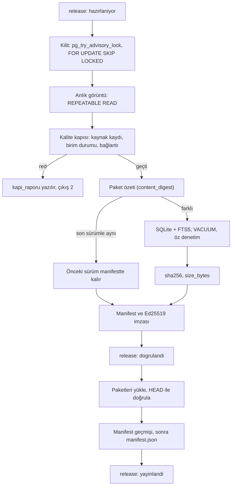

# Backend API

> **Sürüm:** 1.9 · **Tarih:** 9 Kasım 2026 · **Durum:** Taslak
> **Bağlı kararlar:** [K-46](../00-ozet/02-karar-defteri.md#k-46--yayın-kaydı-içerik-özetleri-ve-fikstürler) · [K-45](../00-ozet/02-karar-defteri.md#k-45--manifest-imzası-ve-kanonik-json) · [K-37](../00-ozet/02-karar-defteri.md#k-37--editoryal-şema-ayrıntıları) · [K-42](../00-ozet/02-karar-defteri.md#k-42--kaynak-ilkesi-ve-kalite-temelli-görünürlük) · [K-10](../00-ozet/02-karar-defteri.md#k-10--arka-uç) · [K-11](../00-ozet/02-karar-defteri.md#k-11--veritabanı-postgresql-18) · [K-13](../00-ozet/02-karar-defteri.md#k-13--editör-paneli) · [K-15](../00-ozet/02-karar-defteri.md#k-15--hesap-ve-senkron-v1xte) · [K-16](../00-ozet/02-karar-defteri.md#k-16--senkron-çakışma-çözümü) · [K-19](../00-ozet/02-karar-defteri.md#k-19--kuran-kelime-anlamları) · [K-21](../00-ozet/02-karar-defteri.md#k-21--i̇çerik-dağıtımı) · [K-27](../00-ozet/02-karar-defteri.md#k-27--tek-bağlantı-tablosu) · [K-36](../00-ozet/02-karar-defteri.md#k-36--arama-normalizasyonu-ayrıntıları) · [K-38](../00-ozet/02-karar-defteri.md#k-38--kaynak-edinimi-dijital-öncelikli-kanıtla-yükseltme) · [K-41](../00-ozet/02-karar-defteri.md#k-41--ses-sistemi-hazır-kayıtlar-ayna-ve-çevrimiçi-öncelikli-dinleme)

Bu dosya ASP.NET Core 10 çözümünü, uçları, kimlik doğrulamayı, hata modelini, EF Core kurallarını ve Yayınlayıcı konsolunu tanımlar. Tablolar [Editoryal veritabanı](../03-veri/02-editoryal-veritabani.md), paket ve manifest biçimi [İçerik paketleri](../03-veri/03-icerik-paketleri.md), kalite kapısı kuralları [Yayın süreci](../07-yayin/01-yayin-sureci.md) dosyasındadır.

---

## 1. Çalışma kipleri

| Kip | Ayar | Ne zaman | Açık uçlar | Bağlanma |
|---|---|---|---|---|
| Editör | `Mutalaa:Features:Editor=true` | v1, yerel | Sağlık, oturum, editör, yayın | `127.0.0.1` |
| Genel | `Mutalaa:Features:Public=true` | v1.x, canlı | Sağlık, hesap, senkron, bağlantı oyu | Canlı sunucu (K-20) |

Genel kipte editör uçları hiç eşlenmez. v1'de okur uygulaması API'ye bağlanmaz ([Genel mimari](./01-genel-mimari.md)).

## 2. Çözüm yapısı

```
server/
├─ Mutalaa.slnx · Directory.Build.props · Directory.Packages.props
├─ Mutalaa.Domain/          bağımlılıksız çekirdek
│  ├─ Anchors/              AnchorRef, AnchorSpan, ayrıştırıcı ([GeneratedRegex], CultureInvariant)
│  ├─ Content/ Links/       Source, Unit, QuranWord, Lemma, Root, Xref ve öteki tablo varlıkları, enum'lar
│  ├─ Releases/ Reviews/    BuildFlavor, Release, PipelineRun, Review ve durum enum'ları; kalite kapısı (saf fonksiyonlar), içerik özeti, inceleme ve ikinci onay kuralları (A13, A14)
│  └─ Text/                 SearchNormalizer, IcKesme.g.cs (üretilir), ContentHash, kod noktası ofsetleri
├─ Mutalaa.Infrastructure/  Persistence/ (IcerikDbContext, Configurations/, Converters/), Identity/, Migrations/,
│                           Storage/ (S3), Packs/ (SqlitePackWriter, ManifestSigner) (A13)
├─ Mutalaa.Api/             Program.cs, Endpoints/, Problems/, openapi/v1.json
├─ Mutalaa.Publisher/       Program.cs, Commands/
└─ tests/                   Domain, Api, Publisher test projeleri
```

`Directory.Build.props` ortak ayarları taşır: `TargetFramework=net10.0`, `Nullable=enable`, `TreatWarningsAsErrors=true`, `RestorePackagesWithLockFile=true`. `InvariantGlobalization` açılmaz, çünkü NFC normalizasyonu ve Türkçe sıralama testleri ICU'ya ihtiyaç duyabilir (Doğrulanacak). Kültür bağımsızlığı bölüm 9'daki kurallarla sağlanır.

## 3. `Program.cs` iskeleti

```csharp
CultureInfo.DefaultThreadCurrentCulture = CultureInfo.InvariantCulture;
CultureInfo.DefaultThreadCurrentUICulture = CultureInfo.InvariantCulture;

var builder = WebApplication.CreateBuilder(args);
builder.Host.UseSerilog((ctx, cfg) => cfg.ReadFrom.Configuration(ctx.Configuration));
var features = builder.Configuration.GetSection("Mutalaa:Features").Get<FeatureOptions>() ?? new();

builder.Services.AddIcerikDb(builder.Configuration);         // IcerikDbContext (A07)
builder.Services.AddEditorIdentity();                          // Identity: parola, kilit (A07)
builder.Services.AddProblemDetails();
builder.Services.AddExceptionHandler<DomainExceptionHandler>();
builder.Services.AddValidation();                               // .NET 10 Minimal API doğrulaması (Doğrulanacak)
builder.Services.AddOpenApi();
builder.Services.AddHealthChecks().AddCheck<DatabaseHealthCheck>("postgres", tags: ["ready"]);
builder.Services.AddAuthorizationBuilder()
    .AddPolicy("Editor", p => p.RequireRole("editor", "admin"))
    .AddPolicy("Admin", p => p.RequireRole("admin"));

var app = builder.Build();
if (args is ["seed"]) { Environment.ExitCode = await IdentitySeeder.RunAsync(app.Services, CancellationToken.None); return; }

app.UseExceptionHandler();
app.UseStatusCodePages();
app.UseSerilogRequestLogging();
app.UseAuthentication();
app.UseAuthorization();
app.MapHealthChecks("/health/live", new() { Predicate = _ => false });
app.MapHealthChecks("/health/ready", new() { Predicate = c => c.Tags.Contains("ready") });
if (app.Environment.IsDevelopment()) { app.MapOpenApi(); app.MapScalarApiReference(); }
var v1 = app.MapGroup("/api/v1");
if (features.Editor) v1.MapEditorEndpoints();
if (features.Public) v1.MapPublicEndpoints();
app.Run();

public sealed class FeatureOptions { public bool Editor { get; set; } = true; public bool Public { get; set; } }
```

**Uygulandı (A07, 27 Ekim 2026):** `AddIcerikDb`, `AddEditorIdentity` ve `seed` dalı teslim edildi (`Mutalaa.Api/Program.cs`, `Mutalaa.Infrastructure/DependencyInjection.cs`). Gerisi (Serilog, ProblemDetails, sağlık uçları, OpenAPI, yetki politikaları, uçlar) A14'tedir. `AddIcerikDb` bağlantı dizesi yokken de hata vermez (`dotnet ef` göç üretimi bağlantı istemez); otomatik göç yoktur. `seed` çıkış kodları: `0` başarı, `1` beklenmeyen hata, `2` eksik ayar, `3` Identity reddetti.

## 4. v1 uçları (editör kipi)

| Yöntem ve yol | Yetki | İş |
|---|---|---|
| `GET /health/live`, `/health/ready` | Anonim | Süreç ve PostgreSQL |
| `POST /api/v1/auth/login`, `/auth/logout`; `GET /auth/me` | Anonim, editor | Çerezle oturum |
| `GET`, `POST /api/v1/users`; `PUT /users/{id}/roles` | admin | Editör hesabı ve rol; kendi kendine kayıt yok |
| `GET /api/v1/sources`, `/sources/{slug}` | editor | Kaynak kaydı (ad, tür, sürüm, adres, atıf satırı, dosya özeti), birim sayısı; salt okunur |
| `GET /api/v1/units?source=&prefix=&q=&cursor=`; `GET /units/{anchor}` | editor | `q` C# normalizasyonundan geçer, `search_text` üzerinde aranır |
| `POST /api/v1/units/{anchor}/corrections` | editor | Yalnız kendi ürettiğimiz metinlerde düzeltme önerisi; metin NFC'ye çevrilir. Hazır kaynak metninde (Tanzil) 422 `degistirilemez-metin` |
| `GET /api/v1/reviews?hedef_tablo=&alan=&durum=acik&cursor=`; `GET /reviews/{id}` | editor | Kuyruk ve ayrıntı (`onceki`, `onerilen`, kanıt, `yz_modeli`, `guven`) |
| `POST /api/v1/reviews/{id}/decision`; `POST /reviews/decisions` | editor | `{karar: onaylandi\|reddedildi, onerilen?, gerekce}`; toplu en çok 100; `If-Match` zorunlu |
| `GET /api/v1/reviews/stats` | editor | Kuyruk başına açık kayıt |
| OCR sayfa görseli ucu (yöntem ve yol A14'te `/karar` ile belirlenir) | editor | OCR inceleme ekranının sayfa görseli ([Elmalılı hazırlığı](../04-icerik/03-elmalili-hazirligi.md) §7); yalnız `data/raw/{baskı}/` altından, salt okunur (öneri; A14) |
| `POST /api/v1/releases` | admin | `{derleme, paketler?, notlar}` → 202, `Location`, `durum: hazirlaniyor`. Talep `release` kaydına `talep = yayin`, `paketler` ve `notlar` ile yazılır (`not` PostgreSQL'de ayrılmış sözcüktür; [K-46](../00-ozet/02-karar-defteri.md#k-46--yayın-kaydı-içerik-özetleri-ve-fikstürler) madde 2) |
| `POST /api/v1/releases/preview` | admin | Paket üretmeden kalite kapısı raporu |
| `GET /api/v1/releases?derleme=`, `/releases/{id}` | editor | Durum, kapı raporu, manifest |
| `POST /api/v1/releases/{id}/promote`, `/rollback` | admin | `public` terfisi (yalnız kullanıcı kararıyla); manifesti bu yayına çevirme. Yeni `release` satırı `talep = terfi` ya da `geri_alma` ve `kaynak_release_id` (talep edilen yayın) taşır; `watch` talebi bu alanlardan okur (§10.6) |

### 4.1 İnceleme kuyrukları

Hat ve editör önerileri tek `review` tablosundan geçer. Onay `onerilen` değeri hedefe aynı işlemde uygular; ret hedefi değiştirmez ([Editoryal veritabanı](../03-veri/02-editoryal-veritabani.md) §8).

| Kuyruk | `hedef_tablo` | `alan` | Ayrıntı |
|---|---|---|---|
| Bağlantı adayları | `xref` | `status` | [Bağlantı modeli](../05-capraz-referans/01-baglanti-modeli.md) |
| Kelime anlamı taslakları | `lemma_gloss` | `anlam_kisa` | [Kelime anlamları](../04-icerik/06-kelime-anlamlari.md) |
| OCR satırı, metin düzeltmesi | `unit` | `metin` | [Elmalılı hazırlığı](../04-icerik/03-elmalili-hazirligi.md) |
| Kök ve lemma düzeltmesi | `quran_word_fix` | `root_id`, `lemma_id`, `pos`, `features` | [Kök ve lemma](../05-capraz-referans/03-kok-ve-lemma.md) §4 |
| Türkçe kelime → Arapça kök | `tr_root_index`, `tr_form` | eşleme | [Kök ve lemma](../05-capraz-referans/03-kok-ve-lemma.md) §5 |
| Sure adı varyantları | `surah_alias` | `alias` | [İktibas tespiti](../05-capraz-referans/02-iktibas-tespiti.md) |

- **Çözüldü (19 Ekim 2026):** `review.hedef_tablo` denetim listesi `quran_word_fix`, `tr_root_index`, `tr_form` ve `surah_alias` değerlerini taşır ([Editoryal veritabanı](../03-veri/02-editoryal-veritabani.md) §8).
- Kendi `status` alanı olan tablolarda (`xref`, `quran_word_fix`, `surah_alias`) onay `onayli`, ret `red` yazar.
- İkinci onay gereken alanlarda (meal ve tefsir metni) ilk onay `inceleyen` alanını doldurur, kayıt `acik` kalır. Farklı bir editörün onayı değeri uygular ve `ikinci_inceleyen` alanını doldurur.
- Onaysız yapay zekâ taslağı (`yz_modeli` dolu) "doğrulanmamış" sayılır ([K-25](../00-ozet/02-karar-defteri.md#k-25--i̇lkeler)).

### 4.2 Uç kuralları

- JSON alan adları veritabanı sütunlarıyla aynıdır (snake_case); enum değerleri veritabanı etiketleriyle aynıdır (`incelemede`, `onaylandi`, `hazirlaniyor`).
- Sayfalama imleçlidir: `?cursor=&limit=` (en çok 200), yanıt `{ "items": [...], "next_cursor": "..." }`.
- Yanıtlar `ETag` (PostgreSQL `xmin`) taşır; karar uçları `If-Match` ister, uyuşmazsa 412 döner.
- Çapa yol parçası olarak gönderilir; istemci `encodeURIComponent` kullanır.
- Aynı derleme türünde `hazirlaniyor` bir yayın varken yeni talep 409 alır.

## 5. v1.x uçları (genel kip)

| Yöntem ve yol | İş |
|---|---|
| `POST /api/v1/account/register`, `/login`, `/refresh`, `/logout` | E-posta ve parola; taşıyıcı (bearer) ve yenileme belirteci |
| `POST /api/v1/account/external/google`, `/external/apple` | `{id_token, nonce}`; sunucu imzayı, `aud` ve `nonce` değerini doğrular. Google ile giriş sunulursa Apple ile Giriş de sunulur (brif; App Store yönergesinin güncel metni Doğrulanacak) |
| `DELETE /api/v1/account`; `GET /account/export` | Hesap, senkron verisi ve oylar silinir; veri dökümü (öneri) |
| `POST /api/v1/sync/push` | `{device_id, ops: [{op_id, table, row}]}` → `{accepted, conflicts, server_seq, server_hlc}`; `op_id` (UUIDv7) ile idempotent |
| `GET /api/v1/sync/pull?cursor={server_seq}&limit=500` | `{changes, next_cursor, has_more, server_hlc}`; imleç silinmiş satır saklama sınırının (`gc_seq`) gerisindeyse 410 ve `imlec-eskidi` hata kodu döner, cihaz tam yeniden eşitleme yapar |
| `PUT`, `DELETE /api/v1/xrefs/{id}/vote` | `{vote: up\|down, reason?}`; hesap başına tek oy |

- Birleştirme kuralları K-16'dır; ayrıntı [Kullanıcı verisi ve senkron](../03-veri/04-kullanici-verisi-ve-senkron.md).
- Oylar `xref_vote(xref_id, account_hash, vote, reason, data_version, created_at)` tablosundadır; `account_hash = HMAC-SHA256(sunucu sırrı, hesap kimliği)`; nedenler `yanlis_ayet`, `iktibas_degil`, `kok_yanlis`, `alakasiz`. Gece işi toplamları `xref.votes_up` ve `votes_down` sütunlarına yazar ve eşiği geçen bağlantıya `review` satırı açar. Oy durumu kendiliğinden değiştirmez, sayısı gösterilmez ([Bağlantı modeli](../05-capraz-referans/01-baglanti-modeli.md) §12).
- Hız sınırı yerleşik `AddRateLimiter` ile hesap ve IP başına uygulanır.

## 6. Kimlik doğrulama, OpenAPI ve hata modeli

**Editör kimliği** ([Editoryal veritabanı](../03-veri/02-editoryal-veritabani.md) ED-1 sorusunun cevabı):
- ASP.NET Core Identity; kullanıcı tipi `EditorUser`, roller `editor` ve `admin`. Çerez `HttpOnly`, `SameSite=Strict`, canlıda `Secure`; yetkisiz istek 401 ya da 403 alır. 8 saat kayan oturum (öneri; A14).
- **Parola ve kilit ([K-37](../00-ozet/02-karar-defteri.md#k-37--editoryal-şema-ayrıntıları), A07'de uygulandı):** parola yalnız en az 12 karakter ister; büyük harf, rakam ya da simge şartı yoktur. 5 hatalı denemede hesap 15 dakika kilitlenir. `RequireUniqueEmail` açıktır; kullanıcı adı e-posta adresidir. Identity tabloları `kimlik` şemasında 7 tablodur (`users`, `roles`, `user_roles`, `user_claims`, `user_logins`, `user_tokens`, `role_claims`; passkey tablosu yok).
- **A14 notu (kilit):** kilit yalnız `AccessFailedAsync` ya da `CheckPasswordSignInAsync(..., lockoutOnFailure: true)` üzerinden işler. Giriş ucu başka bir parola denetimi kullanırsa sayaç artmaz ve kilit çalışmaz.
- Kendi kendine kayıt yoktur; ilk yönetici `seed` komutuyla açılır. `review.oneren` ve `inceleyen` alanlarına Identity kullanıcı adı yazılır.
- **Yalnız yerel kip.** API `127.0.0.1` adresine bağlanır, CORS kapalıdır, editör Vite vekiliyle (`/api`) aynı kökenden çağırır. `Mutalaa:Auth:DevAutoLogin=true` yalnız `Development` ortamında ve geri döngü (loopback) isteğinde yöneticiyle oturum açar; başka ortamda açılışta hata verir. Panel dışarı açılırsa HTTPS, antiforgery başlığı ve iki adımlı doğrulama zorunludur.

**OpenAPI.** Yerleşik `Microsoft.AspNetCore.OpenApi` belgeyi `/openapi/v1.json`, Scalar arayüzü `/scalar/v1` adresinde yalnız `Development` ortamında sunar. Belge derlemede de üretilip `server/Mutalaa.Api/openapi/v1.json` olarak depoya girer (`Microsoft.Extensions.ApiDescription.Server`; Doğrulanacak); CI farkı denetler, editör tipleri bu dosyadan `openapi-typescript` ile üretilir. Belge üretimi uygulamayı başlattığı için açılış kodu veritabanına bağlanmaz.

**Hata modeli.** RFC 9457 `application/problem+json`; `type` alanı `urn:mutalaa:problem:<kod>` (alan adı henüz seçilmedi), gövde `traceId` taşır. Girdi doğrulaması 400 `HttpValidationProblemDetails` döner. Alan kuralları Domain'de `DomainException` fırlatır; `DomainExceptionHandler` bunu ProblemDetails'e çevirir.

| Kod | HTTP | Ne zaman |
|---|---|---|
| `dogrulama`, `capa-gecersiz` | 400 | Alan biçimi ya da çapa grameri hatalı |
| `oturum-acilamadi`, `yetki-yok`, `bulunamadi` | 401, 403, 404 | Kimlik, rol, kayıt |
| `yayin-suruyor`, `durum-gecisi-gecersiz` | 409 | Süren yayın; izin verilmeyen durum geçişi |
| `surum-uyusmazligi` | 412 | `If-Match` tutmadı |
| `degistirilemez-metin` | 422 | Hazır kaynak metnine (Tanzil) düzeltme |
| `kalite-kapisi` | 422 | Yayın kalite kapısına takıldı; kapı raporu eklidir |
| `imlec-eskidi` | 410 | v1.x senkron çekmesinde imleç silinmiş satır saklama sınırının (`gc_seq`) gerisinde; cihaz tam yeniden eşitleme yapar ([Kullanıcı verisi ve senkron](../03-veri/04-kullanici-verisi-ve-senkron.md) §8) |
| `saat_ileri` | Doğrulanacak | v1.x senkron işleminin HLC fiziksel kısmı sunucu saatinden 10 dakikadan fazla ileride (öneri, KV-2); uygulama "Cihaz saatini kontrol edin" der. Ad Kullanıcı verisi ve senkron §3'teki gibidir; istek düzeyinde hata mı, işlem sonucu mu olduğu Doğrulanacak |

## 7. EF Core 10 ve Npgsql

- `IcerikDbContext` bütün tabloları eşler; API ve Yayınlayıcı aynı bağlamı kullanır. Adlar `EFCore.NamingConventions` ile snake_case'tir; tablo adları tekildir ve `ToTable("source")` gibi açıkça yazılır. Identity tabloları ayrı `kimlik` şemasında durur (uygulandı, A07; K-37). `icerik` şemasındaki anahtar, yabancı anahtar ve tekil dizin adları PostgreSQL'in varsayılan adlarıdır (`{tablo}_pkey` …); ayrıntı [Editoryal veritabanı](../03-veri/02-editoryal-veritabani.md) §12.
- PostgreSQL enum türleri (10 tür: `source_kind`, `xref_type`, `xref_status`, `xref_origin`, `derleme_turu`, `unit_kind`, `unit_status`, `metin_durumu`, `inceleme_durumu`, `surum_durumu`) C# enum'larına bağlanır (`TextStatus.Incelemede` → `incelemede`). Her tür `HasPostgresEnum(şema, ad, etiketler)` ile açık sırayla tanımlanır; `MapEnum` yalnız ad çevirmenidir, çünkü Npgsql 10 `MapEnum` etiketleri alfabetik dizer ([efcore.pg #3667](https://github.com/npgsql/efcore.pg/issues/3667)) ve anlamlı sırayı bozar (`metin_durumu` sırası `taslak`, `incelemede`, `onayli`'dir; alfabetik sıra `incelemede`, `onayli`, `taslak` olurdu). `SetPostgresVersion(18, 0)` verilir. Bir Domain testi her değerin etiketini, bir PostgreSQL testi `pg_enum` sırasını JSON ile karşılaştırır.
- **Uygulandı (A06, 26 Ekim 2026; A07, 27 Ekim 2026): etiket eşlemesi Domain'de saftır.** `Mutalaa.Domain/Releases` içinde `BuildFlavor` ve `ReleaseStatus`, `Content` içinde `SourceKind`, `UnitKind`, `UnitStatus` ve `TextStatus`, `Links` içinde `XrefType`, `XrefStatus` ve `XrefOrigin`, `Reviews` içinde `ReviewStatus` bulunur. Her enum için aynı dosyada `...Labels` sınıfı vardır: `ToLabel` (açık `switch`; tanımsız sayısal değerde `ArgumentOutOfRangeException`) ve `TryParseLabel` (Ordinal, büyük-küçük harfe duyarlı, kırpmasız). Yansıma, `Enum.ToString` ve kültürlü dönüşüm yoktur; Domain Npgsql'e bağlanmaz. Bildirim sırası `packages/content-schema/enums.json` sırasıdır ve sayısal değerler bu sıradır (`Taslak = 0`, `Incelemede = 1`, `Onayli = 2`). `EnumLabelTests` her JSON türünü ve sırasını sınar. Npgsql eşlemesi (veritabanı etiketi ↔ C# enum) `Mutalaa.Infrastructure/Persistence/PostgresEnums` içindedir; `PostgresEnumTests` PostgreSQL etiketlerini ve sırasını `enums.json` ile karşılaştırır.
- **Uygulandı (A13): kapı ayrıştırılamayan değerde `public` gibi davranır.** `TryParseLabel` başarısız olunca `value = default` verir; `BuildFlavor` için bu en gevşek görünürlük olan `Dev`'dir. Bu yüzden kapı `BuildFlavor`'ı `FlavorPolicy.ParseOrMostRestrictive` ile ayrıştırır: `bool` dönüşü denetlenir, ayrıştırılamayan değer `Public` olur (en kısıtlayıcı). Bir Domain testi bunu kilitler ([K-46](../00-ozet/02-karar-defteri.md#k-46--yayın-kaydı-içerik-özetleri-ve-fikstürler) madde 7).
- Çapa sütunları `AnchorRef` değer dönüştürücüsüyle bağlanır; zaman `timestamptz` ve UTC'dir; eşzamanlılık belirteci `xmin`'dir. **Çözüldü (27 Ekim 2026):** `xmin` gölge `uint` özelliktir (`IsRowVersion()`, `xid`); göçte sütun üretilmez ([Editoryal veritabanı](../03-veri/02-editoryal-veritabani.md) §12). Dönüştürülmüş çapa sütunlarında LINQ `LIKE` ve aralık işleci çevrilmez; bu sorgular ham SQL ya da `AsNoTracking()` ile projeksiyon kullanır (A13, A14).
- Okumalar `AsNoTracking()` ile, toplu karar `ExecuteUpdateAsync` ile, ham SQL yalnız parametreli `FromSql` ile yazılır. `ExecuteUpdateAsync` `xmin` denetimi (`WHERE xmin = …`) eklemez ve `updated_at` değerini kendiliğinden yazmaz: `UpdatedAtInterceptor` yalnız `SaveChanges`te çalışır. Toplu kararda `If-Match` karşılaştırması ve `updated_at = now()` SQL'e açıkça yazılır.

**Göç politikası** ([Editoryal veritabanı](../03-veri/02-editoryal-veritabani.md) §12 ile aynı): şemanın tek sahibi `server/Mutalaa.Infrastructure/Migrations` altındaki EF Core göçleridir. Her PR en çok bir göç ekler; SQL `dotnet ef migrations script --idempotent` ile gözden geçirilir; uygulanmış göç değiştirilmez. Yerelde `dotnet ef database update`, CI ve canlıda göç paketi (`migrations bundle`) kullanılır; API açılışında otomatik göç yoktur. Yıkıcı değişiklik genişlet, taşı, daralt adımlarıyla yapılır.

## 8. Günlük ve telemetri

- Serilog konsola yazar (geliştirmede okunur biçim, konteynerde sıkıştırılmış JSON); `UseSerilogRequestLogging` her isteği tek satırla kaydeder. OpenTelemetry iz ve ölçüleri ASP.NET Core, HttpClient ve Npgsql'den toplar; dışa aktarım yalnız `OTEL_EXPORTER_OTLP_ENDPOINT` verilirse açılır.
- Günlüğe parola, belirteç, çerez, not içeriği ve e-posta yazılmaz; v1.x'te IP saklama süresi [Gizlilik](../07-yayin/02-gizlilik.md) ile belirlenir.

## 9. Kültürden bağımsız metin işleme

- **Kanonik metin** ([K-26](../00-ozet/02-karar-defteri.md#k-26--kalıcı-adresler-çapa-şeması)): hazır kaynak metni dağıtıldığı gibi saklanır ve API onu değiştirmez; Tanzil'e NFC bile uygulanmaz. NFC yalnız kendi ürettiğimiz metinlere ilk kayıtta uygulanır. Çapa ofsetleri kanonik metnin kod noktalarıdır. Normalizasyon yalnız ayrı `search_text` sütununda ve sorguda yapılır.
- Açılışta varsayılan kültür `InvariantCulture` olur; Türkçe Windows'taki `dotnet run` ile Linux konteyner aynı sonucu verir.
- CA1304, CA1305, CA1307, CA1309, CA1310 ve CA1311 hata düzeyindedir ([Proje yapısı](./03-proje-yapisi.md)). Karşılaştırmada `StringComparison.Ordinal`, sayı ve tarihte `CultureInfo.InvariantCulture`, düzenli ifadede `RegexOptions.CultureInvariant` kullanılır.
- Türkçe küçük harf kültür verisine bırakılmaz; açık eşlemeyle yapılır ve test vektörleriyle Python ve TypeScript uygulamalarına kilitlenir ([K-36](../00-ozet/02-karar-defteri.md#k-36--arama-normalizasyonu-ayrıntıları)). Domain testleri `tr-TR` kültüründe de koşar ve aynı sonucu vermelidir.

```csharp
// Mutalaa.Domain/Text/SearchNormalizer.cs (özet): küçük harf kod noktası başınadır
public static string LowerTurkish(string text)
{
    var sb = new StringBuilder(text.Length);
    int i = 0;
    while (i < text.Length)
    {
        if (Rune.TryGetRuneAt(text, i, out Rune r))
        {
            sb.Append(r.Value switch
            {
                0x49 => new Rune(0x131),        // I → ı
                0x130 => new Rune(0x69),        // İ → i
                _ => Rune.ToLowerInvariant(r),  // dize düzeyinde ToLowerInvariant yok: son sigma bağlamı uygulanmaz
            });
            i += r.Utf16SequenceLength;
        }
        else sb.Append(text[i++]);              // eşsiz vekil olduğu gibi kalır (ön adım onu U+0020 yapar)
    }
    return sb.ToString();   // gevşek katlama (ı→i, ş→s …) Arama kurallarıyla ayrı adımda
}
```

NFC `LowerTurkish` içinde değildir; yalnız `SplitScripts` ön adımında, bölmeden önce uygulanır (I + U+0307 böylece `İ` olur ve `i` verir; `tr-0019`). .NET `Normalize` U+FFFE'yi reddettiği için ön adım NFC'yi U+FFFE sınırlarında parçalayarak uygular. Genel API: `SearchNormalizer.TurkishNarrow`, `TurkishWide`, `Arabic`, `Keys` (`SearchKeys` kaydı), sabit `NormalizerVersion = "1.0"`; iç kesme listesi üretilmiş `IcKesme.Entries`'ten gelir.

## 10. Yayınlayıcı (`Mutalaa.Publisher`)

### 10.1 Komutlar

| Komut | İş |
|---|---|
| `publish --flavor <dev\|internal\|public> [--pack <id>]… [--dry-run] [--version <YYYY.M.N>]` | Derleme, imza ve yükleme tek adımda; `--dry-run` yalnız kalite kapısı raporu üretir (kilit almaz, `release` ve depo yazmaz); `--version` verilmezse sürüm `ReleaseVersion.Next` ile gelir |
| `build --flavor <f> [--pack <id>]… [--version <s>] [--out <klasör>]` | Kalite kapısı, paket, sha256, imzalı manifest; `release` satırı `dogrulandi`'da kalır, depoya yüklemez. `--out` çıktı kök klasörüdür (varsayılan `Publisher:OutDir` = `data/packs`); dosyalar `{out}/{flavor}/{surum}/` altına yazılır |
| `upload --flavor <f> [--surum <s>] [--out <klasör>]` | Üretilmiş (`dogrulandi`) yayını depoya yükler; `--surum` verilmezse derleme türünün en son açık yayınıdır. Aynı komut yeniden çalıştırılabilir (aynı sha256 atlanır). Derleme türünün en son `yayinlandi` satırı dışındaki eski yayın yeniden yüklenmez (sessiz geri alma olmasın; geri dönüş yalnız `rollback` ile) |
| `promote [--from internal] [--to public] [--surum <s>] [--pack <id>]… [--dry-run] [--out <klasör>]` | İç kanalda test edilen yayını aynı sürümle `public` için derler ve yükler (yalnız kullanıcı kararıyla). `--from` yalnız `internal`, `--to` yalnız `public` kabul eder; `--surum` verilmezse en son `yayinlandi` `internal` yayın alınır; P-14 yalnız burada çalışır; `--dry-run` kapı ve P-14 raporu verir |
| `rollback --flavor <f> --to <surum> [--out <klasör>]` | Manifesti geçmişteki yayına çevirir (yeni `release` satırı olarak) |
| `verify --flavor <f> [--manifest <yol>] [--embedded-core <yol>] [--public-key <base64>]` | İmza, şema, adres, boyut, sha256 ve kalite kapısı kurallarını yeniden denetler ([Yayın süreci](../07-yayin/01-yayin-sureci.md) §5). Veritabanına bağlanmaz ve kilit almaz; manifest `--manifest` ile verilmezse depodan okunur. Açık anahtar `--public-key` (32 baytın base64'ü) ya da `Signing:{flavor}:PublicKey` ile gelir; imza gerçek açık anahtarla denetlenir, bu yüzden fikstür (RFC 8032 TEST 1) imzalı manifest için TEST 1 açık anahtarı verilir |
| `watch [--interval <sn>] [--once]` | API'nin `hazirlaniyor` bıraktığı talepleri sırayla işler; `release.talep` değerine göre `publish`, `promote` ya da `rollback` yürütür. Varsayılan aralık 5 saniyedir; `--once` tek tur yapıp çıkar; kilit her turda alınır ve turun sonunda bırakılır. Yalnız `durum = 'hazirlaniyor'` satırları alınır; girdi hatası satırı `basarisiz` yapar, geçici hata (depo, veritabanı, yapılandırma) satırı `hazirlaniyor` bırakır |
| `keys generate --flavor <f> [--force]` | Ed25519 anahtar çifti ([K-45](../00-ozet/02-karar-defteri.md#k-45--manifest-imzası-ve-kanonik-json)); tohum, `kid` ve açık anahtar kullanıcı sırlarına yazılır, ekrana yalnız açık anahtar ve `kid` basılır; var olan anahtarın üstüne `--force` olmadan yazılmaz |

Çıkış kodları: `0` başarı, `2` kapı reddi, `3` doğrulama hatası, `4` depo hatası, `1` diğer (komut satırı ayrıştırma hatası, danışma kilidinin alınamaması, yapılandırma ve beklenmeyen hata dahil). **Kilit:** `build`, `upload`, `rollback`, `watch` ile `--dry-run` olmadan `publish` ve `promote` danışma kilidini alır; `--dry-run`, `verify` ve `keys` almaz. Komut satırı `System.CommandLine` 2.0.14 ve .NET genel ana bilgisayarıyla kurulur; komut argümanları yapılandırmaya verilmez ve kullanıcı sırları yalnız `Development` ortamında yüklenir ([K-45](../00-ozet/02-karar-defteri.md#k-45--manifest-imzası-ve-kanonik-json) madde 6).

**Girdiler.** Yapılandırma: `ConnectionStrings:Editorial`; `Storage:ServiceUrl`, `AccessKey`, `SecretKey`, `Bucket`, `PublicBaseUrl`; `Signing:{flavor}:Kid` ve `Signing:{flavor}:PrivateKey` (kullanıcı sırları ya da gizli ortam değişkeni); `Publisher:SchemaDir`. Veri tek `REPEATABLE READ` salt okunur işlemde akışla okunur; paket tek bir tutarlı anlık görüntüden üretilir. Paket listesi ve iç şema [İçerik paketleri](../03-veri/03-icerik-paketleri.md) dosyasındadır.

### 10.2 Akış



### 10.3 Kapı kontrolleri

Kalite kapısı kaynak kaydına ve editoryal kaliteye bakar ([K-42](../00-ozet/02-karar-defteri.md#k-42--kaynak-ilkesi-ve-kalite-temelli-görünürlük) madde 5). Kural kodları ve metinleri [Yayın süreci](../07-yayin/01-yayin-sureci.md) §4 ile aynıdır.

| Kod | Kural | Derleme |
|---|---|---|
| P-01 | Kaynak kaydı olmayan içerik hiçbir pakete girmez | Hepsi |
| P-07 | Bağlantı: kaynak eser görünür; hedef eser görünür ya da ayrı kayıtlı bir dizine ait; `red` hiç girmez; insan onayı isteyen türün (`atif`, `iktibas`, `ima`, `konu`) `aday` satırı yalnız `dev` ve `internal`'a girer, otomatik türler (`kok`, `lemma`, `benzer_ayet`, `anlamsal`) `confidence ≥ 0,50` ile her derlemeye girer; `public` için ek koşullar aşağıdadır | Hepsi |
| P-08 | Onaysız yapay zekâ taslağı `public`'e girmez; iç derlemelere "doğrulanmamış" işaretiyle girer | public |
| P-09 | `quran_word_fix`, `tr_root_index` ve `tr_form` satırlarından yalnız onaylılar uygulanır | Hepsi |
| P-10 | Yalnız `metin_durumu = onayli` birimler `public`'e girer | public |
| P-11 | Tanzil birimlerinin `content_hash` değeri ham dosyadan yeniden hesaplananla aynı; her kaynağın `atif_metni` ve `atif_url` değeri pakete aynen yazılır | Hepsi |
| P-12 | Slug'ı `test-` ile başlayan kaynak `public`'e girmez; `internal`'a yalnız uçtan uca fikstürler (`test-kucuk`, `test-ses`) girer | public, internal |
| P-13 | `depends_on` döngüsüz; her bağımlılık aynı manifestte | Hepsi |
| P-14 | Terfide içerik özetleri iç kanalda test edilen yayınla aynı | public |

Kural kodları sabittir; yeniden numaralanmaz. Kapı raporu her paket ve kaynak için "girdi" ya da "girmedi" kararını kural koduyla `release.kapi_raporu` sütununa yazar. `public` kuru çalıştırması (`publish --flavor public --dry-run`) 0 ile biter. Kuru çalıştırma `release` satırı yazmaz; raporu stdout'a ve `data/reports/publisher/` altına yazar.

**Kapı sonuç türleri** ([K-46](../00-ozet/02-karar-defteri.md#k-46--yayın-kaydı-içerik-özetleri-ve-fikstürler) madde 7):

| Tür | Kurallar | Sonuç |
|---|---|---|
| Süzme | P-07, P-08, P-09, P-10, P-12 | İçerik pakete alınmaz, rapora "girmedi" ve kural kodu yazılır; derleme sürer |
| Bütünlük | P-01, P-11, P-13, P-14 | Yayın reddedilir; satır `basarisiz` olur, çıkış kodu `2` |

- **Çapa sürekliliği** ([Yayın süreci](../07-yayin/01-yayin-sureci.md) §4 madde 2) kural kodu taşımayan bir bütünlük denetimidir: önceki yayının paketlerindeki her çapa anlık görüntüde bulunmalıdır, bulunmazsa yayın reddedilir.
- **P-01** üç şeye bakar: `pipeline/sources/{slug}.toml` dosyası var mı, `source` satırı var mı, `atif_metni` dolu mu.
- **P-08, P-10'dan önce gelir:** yapay zekâ taslağı P-08 koduyla, öteki `taslak` ve `incelemede` birimler P-10 koduyla girmez.
- **P-07 ayrıntıları.** `onayli` her derlemeye girer. Otomatik türde `aday` ve `confidence < 0,50` hiçbir derlemeye girmez ([Bağlantı modeli](../05-capraz-referans/01-baglanti-modeli.md#6-puanlama) §6: "gösterilmez"). Hedef ayrı kayıtlı bir dizinse (`risale-atif-dizini`) hedefin görünürlüğü aranmaz. `public` için ek koşullar ([Bağlantı modeli](../05-capraz-referans/01-baglanti-modeli.md#8-yayın-kuralı-ve-insan-onayı) §8): bağlantıda açık `review` yok; `kok` ve `lemma` için `evidence.lexicon_status` onaylı (alan yoksa onaylı sayılır); `anlamsal` v1'de girmez. Paketteki `xref_idx.approved` = (`status = onayli`); `folded` = `anlamsal` ya da (otomatik tür, onaysız ve `confidence < 0,70`).
- **P-09** yalnız durum sütunu olan tablolara uygulanır: `quran_word_fix` ve `lemma_gloss` yalnız `onayli` satırla girer. Durum sütunu olmayan `tr_root_index` ve `tr_form` yalnız onaylı veri taşır; bağlı Türkçe lemma onaylıysa girer ([Editoryal veritabanı](../03-veri/02-editoryal-veritabani.md) §8).
- **P-11** üç şeyi denetler: Tanzil `content_hash` değeri ham dosyadan yeniden hesaplanır (dosya `{RawDir}/{slug}/{alinma_tarihi}/` altındadır ve SHA-256'sı `dosya_sha256` olan dosyadır); `notice_text` ham bildirim bloğuyla bayt bayt aynıdır; pakete yazılan `attribution` paketten geri okununca `source` satırıyla aynıdır.
- **P-13** önceki sürümden taşınan paketleri de sayar.
- **Verisi hiç olmayan paket** (`kelime-kok`, QAC gelene kadar) aday sayılmaz: rapora kural kodu olmadan "girmedi · icerik-yok" yazılır, kapı reddetmez.
- **`BuildFlavor` ayrıştırılamazsa** kapı `public` gibi davranır (§7).

P-10 ile K-38 uyumludur. Hazır ve çıkarılmış metinler `taslak` girer (`onayli` ile giriş yalnız Tanzil gibi kanonik başvuru kaynakları içindir); bu yüzden editör onayından geçmeden `public` derlemeye girmezler. Meal ve tefsirde ikinci onay da aranır ([K-38](../00-ozet/02-karar-defteri.md#k-38--kaynak-edinimi-dijital-öncelikli-kanıtla-yükseltme), madde 4; [Editoryal veritabanı](../03-veri/02-editoryal-veritabani.md) §4). Kapı kuralının kendisi değişmez.

### 10.4 Paket yazımı

1. `{pack_id}-{version}.db.tmp` açılır; derleme süresince `PRAGMA page_size=4096; journal_mode=OFF; synchronous=OFF`.
2. DDL `packages/content-schema/sql/` altından çalışır; `PRAGMA user_version` şema sürümüdür. Hangi paket türünün hangi DDL dosyalarını çalıştırdığı `packages/content-schema/sql/paketler.json` dosyasındadır: tür deseni (`desen`), paket yazımından önce çalışan `ddl` listesi ve satırlar yazıldıktan sonra çalışan `sonra` dosyaları. Yayınlayıcı bu dosyayı okur; tür→dosya listesi başka yerde tekrarlanmaz.
3. Satırlar çapa sırasıyla tek işlemde, hazırlanmış komutlarla yazılır. İçerikli FTS5 tablolarında `'rebuild'`, `rank` ve `'optimize'` çalışır. İçeriksiz tablolarda (`content=''`; `risale-dizin`) `'rebuild'` yoktur: satırlar doğrudan yazılır ve yalnız `rank` ile `'optimize'` çalışır (K-44 madde 4; [Arama](../03-veri/05-arama-fts5.md)).
4. `pack_meta` anahtarları [İçerik paketleri](../03-veri/03-icerik-paketleri.md) §3'teki listeyle yazılır (`content_digest`, `normalizer_version` dahil). Ardından `ANALYZE`, `VACUUM`, `PRAGMA journal_mode=DELETE`.
5. Öz denetim: `PRAGMA integrity_check` sonucu `ok`; beklenen tablolar var; `unit` ve `unit_fts` taşıyan türlerde `q:2:255` (yalnız `core`) ve bir FTS sorgusu sonuç döner (İçerik paketleri §8 madde 5: denetimler tür koşulludur).
6. Bağlantı kapanır (`Pooling=False`; Windows açık dosyayı taşıtmaz), dosya `.db` adına taşınır, sha256 ve boyut hesaplanır (`SHA256.HashDataAsync`, `Convert.ToHexStringLower`).

Açılışta `PRAGMA compile_options` içinde `ENABLE_FTS5` aranır; yoksa Yayınlayıcı durur. Paket yalnız cihazdaki SQLite'ın desteklediği özellikleri kullanır; cihaz SQLite sürümü Doğrulanacak.

**Paket kaynak eşlemesi (A13 uygulaması).** Paket-kaynak bağlantısında (`PackSourceBinding`) her kaynağın rolü (`Content`, `Attribution`, `Structure`) ve `Required` işareti vardır. Zorunlu kaynak her zaman, isteğe bağlı kaynak yalnız pakete satır verdiyse `pack_source` ve `attribution` satırı alır. `core` için üç kaynak zorunludur: `tanzil-uthmani` (içerik), `tanzil-simple-clean` (yalnız atıf; `ar_norm` kaynağı, K-44 madde 2) ve `tanzil-ust-veri` (yapı: `page_map` ve `quran_marker`). `hadis-tecrid` paketinde `tecrid-ar` zorunlu, `tecrid-naim` ve `tecrid-miras` isteğe bağlıdır. A13'te `sure` ve `tr_root_index` tabloları boş yazılır (sure adları onaylanana kadar, İ-23; `tr_root_index` QAC'ye bağlıdır); `unit.sentences` sütunu `[[bas, son], ...]` jsonb metnidir ([İçerik paketleri](../03-veri/03-icerik-paketleri.md) §3.2).

### 10.5 Sürüm, özet, imza ve depo düzeni

- **Sürüm** CalVer `YYYY.M.N` biçimindedir ve yayının `surum` değerinden gelir. Sürüm verilmezse N, ayın `basarisiz` olmayan yayınları içindeki en büyük numaranın bir fazlasıdır (0'dan başlar; bütün derleme türleri tek sayaç kullanır); kural Domain'de saf işlevdir (`ReleaseVersion.Next`) ve A14 de onu kullanır. İçeriği değişmeyen paket önceki sürümünü korur ([İçerik paketleri](../03-veri/03-icerik-paketleri.md) §6).
- **İçerik özetleri** ([K-46](../00-ozet/02-karar-defteri.md#k-46--yayın-kaydı-içerik-özetleri-ve-fikstürler) madde 1): iki özet vardır.
  - **Kaynak özeti**, kaynağın etkin birimlerinin `anchor\tcontent_hash\n` satırlarının (çapa bayt sırası) SHA-256'sıdır; birimi olmayan kaynakta (`tanzil-ust-veri`) yapı satırlarının kanonik JSON satırları kullanılır. Derleme türünden bağımsızdır, `release.ozetler.kaynaklar` içinde durur ve terfide P-14 onu karşılaştırır.
  - **Paket özeti** (`pack_meta.content_digest`, `release.ozetler.paketler`), `schema_version`, `normalizer_version` ve `flavor` başlık satırları ile pakete yazılan her satırın RFC 8785 JSON dizisi (`[tablo, değerler…]`; sabit tablo sırası, satırlar anahtar bayt sırasında) üzerinden SHA-256'dır. `version`, `built_at`, `pack_meta.data_version` ve `content_digest` girmez (`xref_idx.data_version` sütunu satırın parçasıdır ve girer). Gerçek sayılar (`score`, `confidence`) `float` değerinin kısa onlu gösterimiyle yazılır (`double`'a doğrudan genişletme 0,7 değerini 0,699999988 yapardı). Özet güncel yayının `ozetler.paketler` değeriyle aynıysa paket yeniden yazılmaz, önceki manifest satırı ve sürümü kalır.
- **Manifest** [İçerik paketleri](../03-veri/03-icerik-paketleri.md) §5 alanlarını taşır: paket satırı `pack_id, version, sha256, size_bytes, min_app_version, depends_on, url` (ek olarak `schema_version`, `title`, `bundled`). `url` mutlaktır: `{PublicBaseUrl}/packs/{flavor}/{pack_id}/{version}/{pack_id}-{version}.db`.
- **İmza** (`signature: {alg, kid, value}`) her derleme türünde zorunludur ([K-45](../00-ozet/02-karar-defteri.md#k-45--manifest-imzası-ve-kanonik-json)). İmzasız ya da imzası tutmayan manifesti `verify` reddeder (çıkış 3), uygulama yok sayar; `public` derlemede bu kural gevşetilmez.
  - **Algoritma:** Ed25519, `NSec.Cryptography` 26.4.0 ile (yedek `BouncyCastle.Cryptography` 2.7.0). Özel anahtar 32 baytlık ham tohum, açık anahtar 32 bayt, imza 64 bayttır.
  - **Girdi:** `signature` alanı çıkarılmış manifestin RFC 8785 (JCS) baytlarıdır; kitaplık `MackySoft.Json.Canonicalization` 0.1.0 (yedek `Jcs.Net` 0.1.1). Cihaz tarafı (A23) aynı baytları `canonicalize` 5.1.0 ve `@noble/ed25519` 3.2.0 ile üretir ve doğrular.
  - **Alan:** `{alg: "ed25519", kid: "{derleme}-{YYYY}-{n}", value: base64(64 bayt)}`.
  - **Anahtar:** her derleme türünün ayrı anahtarı vardır. Tohum yalnız `dotnet user-secrets` (`Signing:{derleme}:PrivateKey`, `Kid`, `PublicKey`) ya da konteynerde ortam değişkeninde durur; dosyaya, koda, günlüğe ve `appsettings*.json` içine yazılmaz. Açık anahtarlar uygulamaya gömülür.
  - **Fikstür anahtarı:** depodaki imzalı örnek manifestler RFC 8032 §7.1 TEST 1 anahtarıyla imzalanır; bu anahtar herkese açık bir test vektörüdür ve `kid` değeri `test-` ile başlar.

| Nesne | Anahtar | `Cache-Control` |
|---|---|---|
| Paket | `packs/{flavor}/{pack_id}/{version}/{pack_id}-{version}.db` | `public, max-age=31536000, immutable` |
| Manifest | `{flavor}/manifest.json` | `no-cache` (CDN davranışı Doğrulanacak) |
| Manifest geçmişi | `{flavor}/manifests/{surum}.json` | `no-cache` |

- Yükleme sırası: paketler → HEAD ile boyut ve `sha256` meta verisi → manifest geçmişi → `manifest.json`. Manifest tek PUT'tur; okur yarım yayın görmez.
- Var olan anahtara farklı sha256 ile yazılmaz; Yayınlayıcı hata verir. Aynı sha256 varsa yükleme atlanır.
- `verify`, `public` önekindeki her nesnenin geçerli manifestte ya da manifest geçmişinde bulunduğunu denetler.
- `AWSSDK.S3` istemcisi `ServiceURL` ve `ForcePathStyle = true` ile kurulur; nesneler `application/vnd.sqlite3` türü ve `x-amz-meta-sha256` ile yazılır. İstemci `RequestChecksumCalculation` ve `ResponseChecksumValidation` için `WHEN_REQUIRED` kullanır. Sonuç (SeaweedFS 4.48 ile sınandı, 9 Kasım 2026): varsayılan `WHEN_SUPPORTED` ve `WHEN_REQUIRED` ikisi de HTTP'de çalıştı, yani sorun çıkmadı; yine de `WHEN_REQUIRED` seçildi. https, gerçek S3 ve büyük gövde sınanmadı. Öteki ölçümler (yol biçimi, `X-Amz-Meta-sha256` üst verisi, Range 206, anonim GET 200 ve PUT 403, kovanın PUT ile kendiliğinden açılması) [A13](../10-claude-code/asamalar/A13-yayinlayici-ve-kalite-kapisi.md) Tedarik bölümündedir. Depo hataları üç gruba ayrılır: 403 `AccessDenied`, 404 `NotFound`, bağlantı reddi ve 5xx `Unavailable`; `Storage:Bucket` yazım hatası sessizce yeni kova açacağı için değer dikkatle girilir.

### 10.6 Durumlar, idempotentlik, terfi ve geri alma

- `release.durum`: `hazirlaniyor` → `dogrulandi` (paketler ve imzalı manifest hazır) → `yayinlandi` → `geri_cekildi`. Başarısız deneme `basarisiz` olarak işaretlenir ([Editoryal veritabanı](../03-veri/02-editoryal-veritabani.md), `surum_durumu`); hata `kapi_raporu` içindedir. `(surum, derleme)` tekilliği `durum <> 'basarisiz'` koşullu kısmi tekil dizindir (`release_surum_derleme_key`; [K-46](../00-ozet/02-karar-defteri.md#k-46--yayın-kaydı-içerik-özetleri-ve-fikstürler) madde 3): başarısız deneme aynı sürümle yeniden denenir, `basarisiz` satır sürüm numarasını yakmaz.
- **Talep alanları.** `release.talep` (`yayin`, `terfi`, `geri_alma`), `kaynak_release_id` (terfide ve geri almada kaynak yayın), `paketler` (`--pack` listesi) ve `notlar` talebi taşır; `watch` talebe göre `publish`, `promote` ya da `rollback` yürütür.
- **Sürdürme.** `publish` açık satırı sürdürür: `dogrulandi` satır doğrudan yüklemeye geçer, `hazirlaniyor` satır yeniden derlenir. Geçici depo hatasında satır `dogrulandi` kalır ve `upload` ile sürer. Bir anahtara farklı sha256 yazılmak istenirse satır `basarisiz` olur, çıkış `4`.
- Aynı anda tek Yayınlayıcı çalışır (`pg_try_advisory_lock`); `watch` kaydı `FOR UPDATE SKIP LOCKED` ile alır. Paket anahtarları değişmediği ve manifest en son yazıldığı için yarıda kalan komut kaldığı yerden sürer.
- **Terfi:** `promote`, `yayinlandi` durumundaki `internal` yayının `surum` değeriyle `public` derlemesi üretir (`(surum, derleme)` tekildir; `talep = terfi`, `kaynak_release_id` = `internal` yayın); yalnız kullanıcı kararıyla çalışır. P-14 kaynak özetlerini karşılaştırır.
- **Geri alma:** `rollback` yeni bir `release` satırıdır (`talep = geri_alma`, yeni sürüm, `kaynak_release_id` = hedef yayın); hedef yayının paketleri yeni manifestte yeniden imzalanır. Hedefin manifesti ve bütün paket anahtarları depoda bulunmalıdır. Önceki güncel yayın `geri_cekildi` olur. Paketler silinmediği için anında çalışır; uygulama manifesti istenen durum sayar.

## 11. Test

Domain testleri test vektörlerini, kalite kapısı kurallarının derleme türü × içerik durumu matrisini (`Mutalaa.Domain.Tests`) ve `tr-TR` kültüründe yeniden koşumu kapsar. API testleri `WebApplicationFactory` ve Testcontainers `postgres:18` ile her uçta yetki matrisini ve ikinci onay akışını sınar. Yayınlayıcı testleri fikstür veritabanından üç derleme üretir; P-01 ve P-07…P-14, FTS sorgusu, aynı girdide aynı `content_digest` ve imza doğrulaması denetlenir ([Test stratejisi](../07-yayin/03-test-stratejisi.md)).

## 12. Açık sorular

1. **Çözüldü (19 Ekim 2026):** `review.hedef_tablo` listesi yeni tabloları taşır ([Editoryal veritabanı](../03-veri/02-editoryal-veritabani.md) §8).
2. **Çözüldü (19 Ekim 2026):** `surum_durumu` türü başarısız yayın için `basarisiz` değerini taşır ([Editoryal veritabanı](../03-veri/02-editoryal-veritabani.md) §2 ve §10).
3. v1.x'te kullanıcı veritabanının editoryal veritabanından ayrılması ve oy aktarım sıklığı ([Genel mimari](./01-genel-mimari.md)).
4. **Çözüldü (9 Kasım 2026):** imza algoritması, JSON kanonikleştirme ve anahtar saklama ([İçerik paketleri](../03-veri/03-icerik-paketleri.md) IP-7): Ed25519 (NSec), RFC 8785 JCS, derleme türü başına anahtar ([K-45](../00-ozet/02-karar-defteri.md#k-45--manifest-imzası-ve-kanonik-json)). Anahtar değişimi [Yayın süreci](../07-yayin/01-yayin-sureci.md) §4.2 öneriyle sürer (uygulama geçerli ve sıradaki iki anahtarı taşır).
5. **Çözüldü (19 Ekim 2026):** paket adı `kelime-kok`; `tr_form` bu pakettedir. `tr_root_index` QAC'ye bağlıdır: `core`'daki meal birimleri için `kelime-kok`'ta, diğer metin paketlerinde kendi paketinde, Risale için `risale-dizin`'de durur ([İçerik paketleri](../03-veri/03-icerik-paketleri.md) §1, §3.2, §3.3).
6. Hesap silmede bekleme süresi (eski planda 30 gün) ve IP saklama süresi ([Gizlilik](../07-yayin/02-gizlilik.md)).

## 13. Ses (K-41)

- **v1'de ses için API ucu yoktur.** Uygulama ses kataloğunu ve zamanlamayı paketlerden (`ses-katalog`, `ses-zaman-{kayit}`), ses dosyalarını içerik deposundaki aynadan (`audio/{kayit}/{dosya_surumu}/{sss}.mp3`) alır; ASP.NET arka ucu ses baytlarını iletmez ([K-41](../00-ozet/02-karar-defteri.md#k-41--ses-sistemi-hazır-kayıtlar-ayna-ve-çevrimiçi-öncelikli-dinleme), [Ses sistemi](../06-mobil/02-ses-sistemi.md)).
- **Yayınlayıcı** ses paketlerini üretir ve ayna dosyalarını depoya yükler (A27.2). Ses kaynaklarının kaynak kaydı (P-01) ve atıf satırı (P-11) pakete yazılır; `test-ses` kaynağı yalnız `dev` ve `internal` derlemesine girer (P-12).

## İlgili dosyalar

- [Genel mimari](./01-genel-mimari.md) · [Teknoloji yığını](./02-teknoloji-yigini.md) · [Proje yapısı](./03-proje-yapisi.md) · [Yerel geliştirme](./04-yerel-gelistirme.md)
- [Editoryal veritabanı](../03-veri/02-editoryal-veritabani.md) · [İçerik paketleri](../03-veri/03-icerik-paketleri.md) · [Kullanıcı verisi ve senkron](../03-veri/04-kullanici-verisi-ve-senkron.md) · [Arama](../03-veri/05-arama-fts5.md)
- [Bağlantı modeli](../05-capraz-referans/01-baglanti-modeli.md) · [Kök ve lemma](../05-capraz-referans/03-kok-ve-lemma.md) · [Anlamsal katman](../05-capraz-referans/04-anlamsal-katman.md)
- [Yayın süreci](../07-yayin/01-yayin-sureci.md) · [Gizlilik](../07-yayin/02-gizlilik.md) · [Test stratejisi](../07-yayin/03-test-stratejisi.md)
