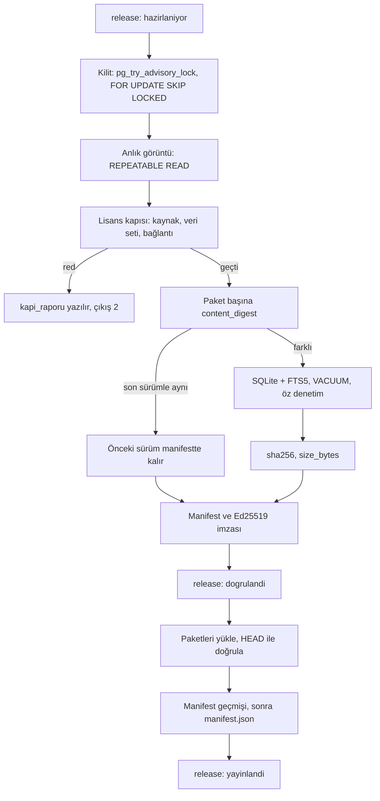

# Backend API

> **Sürüm:** 1.4 · **Tarih:** 27 Ekim 2026 · **Durum:** Taslak
> **Bağlı kararlar:** [K-37](../00-ozet/02-karar-defteri.md#k-37--editoryal-şema-ayrıntıları) · [K-06](../00-ozet/02-karar-defteri.md#k-06--yayın-kapısı) · [K-10](../00-ozet/02-karar-defteri.md#k-10--arka-uç) · [K-11](../00-ozet/02-karar-defteri.md#k-11--veritabanı-postgresql-18) · [K-13](../00-ozet/02-karar-defteri.md#k-13--editör-paneli) · [K-15](../00-ozet/02-karar-defteri.md#k-15--hesap-ve-senkron-v1xte) · [K-16](../00-ozet/02-karar-defteri.md#k-16--senkron-çakışma-çözümü) · [K-19](../00-ozet/02-karar-defteri.md#k-19--kuran-kelime-anlamları) · [K-21](../00-ozet/02-karar-defteri.md#k-21--i̇çerik-dağıtımı) · [K-27](../00-ozet/02-karar-defteri.md#k-27--tek-bağlantı-tablosu) · [K-36](../00-ozet/02-karar-defteri.md#k-36--arama-normalizasyonu-ayrıntıları) · [K-38](../00-ozet/02-karar-defteri.md#k-38--kaynak-edinimi-dijital-öncelikli-kanıtla-yükseltme)

Bu dosya ASP.NET Core 10 çözümünü, uçları, kimlik doğrulamayı, hata modelini, EF Core kurallarını ve Yayınlayıcı konsolunu tanımlar. Tablolar [Editoryal veritabanı](../03-veri/02-editoryal-veritabani.md), paket ve manifest biçimi [İçerik paketleri](../03-veri/03-icerik-paketleri.md), kapı kuralları [Yayın kapısı ve Kurul](../07-yayin/01-yayin-kapisi-ve-kurul.md) dosyasındadır.

---

## 1. Çalışma kipleri

| Kip | Ayar | Ne zaman | Açık uçlar | Bağlanma |
|---|---|---|---|---|
| Editör | `Mutalaa:Features:Editor=true` | v1, yerel | Sağlık, oturum, editör, yayın | `127.0.0.1` |
| Genel | `Mutalaa:Features:Public=true` | v1.x, canlı | Sağlık, hesap, senkron, bağlantı oyu | Canlı sunucu (K-20) |

Genel kipte editör uçları hiç eşlenmez. v1'de okur uygulaması API'ye bağlanmaz ([Genel mimari](./01-genel-mimari.md)).

## 2. Çözüm yapısı

```
server/
├─ Mutalaa.slnx · Directory.Build.props · Directory.Packages.props
├─ Mutalaa.Domain/          bağımlılıksız çekirdek
│  ├─ Anchors/              AnchorRef, AnchorSpan, ayrıştırıcı ([GeneratedRegex], CultureInvariant)
│  ├─ Content/ Links/       Source, Unit, QuranWord, Lemma, Root, Xref ve öteki tablo varlıkları, enum'lar
│  ├─ Licensing/            LicenseStatus, BuildFlavor; LicenseGate (A13; saf fonksiyonlar)
│  ├─ Releases/ Reviews/    Release, PipelineRun, Review ve durum enum'ları; içerik özeti, inceleme ve ikinci onay kuralları (A13, A14)
│  └─ Text/                 SearchNormalizer, IcKesme.g.cs (üretilir), ContentHash, kod noktası ofsetleri
├─ Mutalaa.Infrastructure/  Persistence/ (IcerikDbContext, Configurations/, Converters/), Identity/, Migrations/,
│                           Storage/ (S3), Packs/ (SqlitePackWriter, ManifestSigner) (A13)
├─ Mutalaa.Api/             Program.cs, Endpoints/, Problems/, openapi/v1.json
├─ Mutalaa.Publisher/       Program.cs, Commands/
└─ tests/                   Domain, Api, Publisher test projeleri
```

`Directory.Build.props` ortak ayarları taşır: `TargetFramework=net10.0`, `Nullable=enable`, `TreatWarningsAsErrors=true`, `RestorePackagesWithLockFile=true`. `InvariantGlobalization` açılmaz, çünkü NFC normalizasyonu ve Türkçe sıralama testleri ICU'ya ihtiyaç duyabilir (Doğrulanacak). Kültür bağımsızlığı bölüm 9'daki kurallarla sağlanır.

## 3. `Program.cs` iskeleti

```csharp
CultureInfo.DefaultThreadCurrentCulture = CultureInfo.InvariantCulture;
CultureInfo.DefaultThreadCurrentUICulture = CultureInfo.InvariantCulture;

var builder = WebApplication.CreateBuilder(args);
builder.Host.UseSerilog((ctx, cfg) => cfg.ReadFrom.Configuration(ctx.Configuration));
var features = builder.Configuration.GetSection("Mutalaa:Features").Get<FeatureOptions>() ?? new();

builder.Services.AddIcerikDb(builder.Configuration);         // IcerikDbContext (A07)
builder.Services.AddEditorIdentity();                          // Identity: parola, kilit (A07)
builder.Services.AddProblemDetails();
builder.Services.AddExceptionHandler<DomainExceptionHandler>();
builder.Services.AddValidation();                               // .NET 10 Minimal API doğrulaması (Doğrulanacak)
builder.Services.AddOpenApi();
builder.Services.AddHealthChecks().AddCheck<DatabaseHealthCheck>("postgres", tags: ["ready"]);
builder.Services.AddAuthorizationBuilder()
    .AddPolicy("Editor", p => p.RequireRole("editor", "admin"))
    .AddPolicy("Admin", p => p.RequireRole("admin"));

var app = builder.Build();
if (args is ["seed"]) { Environment.ExitCode = await IdentitySeeder.RunAsync(app.Services, CancellationToken.None); return; }

app.UseExceptionHandler();
app.UseStatusCodePages();
app.UseSerilogRequestLogging();
app.UseAuthentication();
app.UseAuthorization();
app.MapHealthChecks("/health/live", new() { Predicate = _ => false });
app.MapHealthChecks("/health/ready", new() { Predicate = c => c.Tags.Contains("ready") });
if (app.Environment.IsDevelopment()) { app.MapOpenApi(); app.MapScalarApiReference(); }
var v1 = app.MapGroup("/api/v1");
if (features.Editor) v1.MapEditorEndpoints();
if (features.Public) v1.MapPublicEndpoints();
app.Run();

public sealed class FeatureOptions { public bool Editor { get; set; } = true; public bool Public { get; set; } }
```

**Uygulandı (A07, 27 Ekim 2026):** `AddIcerikDb`, `AddEditorIdentity` ve `seed` dalı teslim edildi (`Mutalaa.Api/Program.cs`, `Mutalaa.Infrastructure/DependencyInjection.cs`). Gerisi (Serilog, ProblemDetails, sağlık uçları, OpenAPI, yetki politikaları, uçlar) A14'tedir. `AddIcerikDb` bağlantı dizesi yokken de hata vermez (`dotnet ef` göç üretimi bağlantı istemez); otomatik göç yoktur. `seed` çıkış kodları: `0` başarı, `1` beklenmeyen hata, `2` eksik ayar, `3` Identity reddetti.

## 4. v1 uçları (editör kipi)

| Yöntem ve yol | Yetki | İş |
|---|---|---|
| `GET /health/live`, `/health/ready` | Anonim | Süreç ve PostgreSQL |
| `POST /api/v1/auth/login`, `/auth/logout`; `GET /auth/me` | Anonim, editor | Çerezle oturum |
| `GET`, `POST /api/v1/users`; `PUT /users/{id}/roles` | admin | Editör hesabı ve rol; kendi kendine kayıt yok |
| `GET /api/v1/sources`, `/sources/{slug}` | editor | Lisans, Kurul, `embed_ok`, `kisitlar`, birim sayısı |
| `PUT /api/v1/sources/{slug}/license-status`, `/kurul-onay`, `/embed-ok` | admin | `review` satırı açar; ikinci onayla uygulanır |
| `GET /api/v1/units?source=&prefix=&q=&cursor=`; `GET /units/{anchor}` | editor | `q` C# normalizasyonundan geçer, `search_text` üzerinde aranır |
| `POST /api/v1/units/{anchor}/corrections` | editor | Yalnız kendi ürettiğimiz metinlerde düzeltme önerisi; metin NFC'ye çevrilir. Hazır kaynak metninde (Tanzil) 422 `degistirilemez-metin` |
| `GET /api/v1/reviews?hedef_tablo=&alan=&durum=acik&cursor=`; `GET /reviews/{id}` | editor | Kuyruk ve ayrıntı (`onceki`, `onerilen`, kanıt, `yz_modeli`, `guven`) |
| `POST /api/v1/reviews/{id}/decision`; `POST /reviews/decisions` | editor | `{karar: onaylandi\|reddedildi, onerilen?, gerekce}`; toplu en çok 100; `If-Match` zorunlu |
| `GET /api/v1/reviews/stats` | editor | Kuyruk başına açık kayıt |
| OCR sayfa görseli ucu (yöntem ve yol A14'te `/karar` ile belirlenir) | editor | OCR inceleme ekranının sayfa görseli ([Elmalılı hazırlığı](../04-icerik/03-elmalili-hazirligi.md) §7); yalnız `data/raw/{baskı}/` altından, salt okunur (öneri; A14) |
| `POST /api/v1/releases` | admin | `{derleme, paketler?, not}` → 202, `Location`, `durum: hazirlaniyor` |
| `POST /api/v1/releases/preview` | admin | Paket üretmeden kapı raporu |
| `GET /api/v1/releases?derleme=`, `/releases/{id}` | editor | Durum, kapı raporu, manifest |
| `POST /api/v1/releases/{id}/promote`, `/rollback` | admin | `public` terfisi; manifesti bu yayına çevirme |

### 4.1 İnceleme kuyrukları

Hat ve editör önerileri tek `review` tablosundan geçer. Onay `onerilen` değeri hedefe aynı işlemde uygular; ret hedefi değiştirmez ([Editoryal veritabanı](../03-veri/02-editoryal-veritabani.md) §8).

| Kuyruk | `hedef_tablo` | `alan` | Ayrıntı |
|---|---|---|---|
| Bağlantı adayları | `xref` | `status` | [Bağlantı modeli](../05-capraz-referans/01-baglanti-modeli.md) |
| Kelime anlamı taslakları | `lemma_gloss` | `anlam_kisa` | [Kelime anlamları](../04-icerik/06-kelime-anlamlari.md) |
| OCR satırı, metin düzeltmesi | `unit` | `metin` | [Elmalılı hazırlığı](../04-icerik/03-elmalili-hazirligi.md) |
| Kök ve lemma düzeltmesi | `quran_word_fix` | `root_id`, `lemma_id`, `pos`, `features` | [Kök ve lemma](../05-capraz-referans/03-kok-ve-lemma.md) §4 |
| Türkçe kelime → Arapça kök | `tr_root_index`, `tr_form` | eşleme | [Kök ve lemma](../05-capraz-referans/03-kok-ve-lemma.md) §5 |
| Sure adı varyantları | `surah_alias` | `alias` | [İktibas tespiti](../05-capraz-referans/02-iktibas-tespiti.md) |
| Kaynak lisansı | `source` | `license_status`, `kurul_onay`, `embed_ok` | [Lisans defteri](../04-icerik/01-kaynaklar-ve-lisans-defteri.md) |

- **Çözüldü (19 Ekim 2026):** `review.hedef_tablo` denetim listesi `quran_word_fix`, `tr_root_index`, `tr_form` ve `surah_alias` değerlerini taşır ([Editoryal veritabanı](../03-veri/02-editoryal-veritabani.md) §8).
- Kendi `status` alanı olan tablolarda (`xref`, `quran_word_fix`, `surah_alias`) onay `onayli`, ret `red` yazar.
- İkinci onay gereken alanlarda (meal ve tefsir metni, `license_status`, `kurul_onay`, `embed_ok`) ilk onay `inceleyen` alanını doldurur, kayıt `acik` kalır. Farklı bir editörün onayı değeri uygular ve `ikinci_inceleyen` alanını doldurur.
- Onaysız yapay zekâ taslağı (`yz_modeli` dolu) "doğrulanmamış" sayılır ([K-25](../00-ozet/02-karar-defteri.md#k-25--i̇lkeler)).

### 4.2 Uç kuralları

- JSON alan adları veritabanı sütunlarıyla aynıdır (snake_case); enum değerleri veritabanı etiketleriyle aynıdır (`ic_kullanim`, `onaylandi`, `hazirlaniyor`).
- Sayfalama imleçlidir: `?cursor=&limit=` (en çok 200), yanıt `{ "items": [...], "next_cursor": "..." }`.
- Yanıtlar `ETag` (PostgreSQL `xmin`) taşır; karar uçları `If-Match` ister, uyuşmazsa 412 döner.
- Çapa yol parçası olarak gönderilir; istemci `encodeURIComponent` kullanır.
- Aynı derleme türünde `hazirlaniyor` bir yayın varken yeni talep 409 alır.

## 5. v1.x uçları (genel kip)

| Yöntem ve yol | İş |
|---|---|
| `POST /api/v1/account/register`, `/login`, `/refresh`, `/logout` | E-posta ve parola; taşıyıcı (bearer) ve yenileme belirteci |
| `POST /api/v1/account/external/google`, `/external/apple` | `{id_token, nonce}`; sunucu imzayı, `aud` ve `nonce` değerini doğrular. Google ile giriş sunulursa Apple ile Giriş de sunulur (brif; App Store yönergesinin güncel metni Doğrulanacak) |
| `DELETE /api/v1/account`; `GET /account/export` | Hesap, senkron verisi ve oylar silinir; veri dökümü (öneri) |
| `POST /api/v1/sync/push` | `{device_id, ops: [{op_id, table, row}]}` → `{accepted, conflicts, server_seq, server_hlc}`; `op_id` (UUIDv7) ile idempotent |
| `GET /api/v1/sync/pull?cursor={server_seq}&limit=500` | `{changes, next_cursor, has_more, server_hlc}`; imleç silinmiş satır saklama sınırının (`gc_seq`) gerisindeyse 410 ve `imlec-eskidi` hata kodu döner, cihaz tam yeniden eşitleme yapar |
| `PUT`, `DELETE /api/v1/xrefs/{id}/vote` | `{vote: up\|down, reason?}`; hesap başına tek oy |

- Birleştirme kuralları K-16'dır; ayrıntı [Kullanıcı verisi ve senkron](../03-veri/04-kullanici-verisi-ve-senkron.md).
- Oylar `xref_vote(xref_id, account_hash, vote, reason, data_version, created_at)` tablosundadır; `account_hash = HMAC-SHA256(sunucu sırrı, hesap kimliği)`; nedenler `yanlis_ayet`, `iktibas_degil`, `kok_yanlis`, `alakasiz`. Gece işi toplamları `xref.votes_up` ve `votes_down` sütunlarına yazar ve eşiği geçen bağlantıya `review` satırı açar. Oy durumu kendiliğinden değiştirmez, sayısı gösterilmez ([Bağlantı modeli](../05-capraz-referans/01-baglanti-modeli.md) §12).
- Hız sınırı yerleşik `AddRateLimiter` ile hesap ve IP başına uygulanır.

## 6. Kimlik doğrulama, OpenAPI ve hata modeli

**Editör kimliği** ([Editoryal veritabanı](../03-veri/02-editoryal-veritabani.md) ED-1 sorusunun cevabı):
- ASP.NET Core Identity; kullanıcı tipi `EditorUser`, roller `editor` ve `admin`. Çerez `HttpOnly`, `SameSite=Strict`, canlıda `Secure`; yetkisiz istek 401 ya da 403 alır. 8 saat kayan oturum (öneri; A14).
- **Parola ve kilit ([K-37](../00-ozet/02-karar-defteri.md#k-37--editoryal-şema-ayrıntıları), A07'de uygulandı):** parola yalnız en az 12 karakter ister; büyük harf, rakam ya da simge şartı yoktur. 5 hatalı denemede hesap 15 dakika kilitlenir. `RequireUniqueEmail` açıktır; kullanıcı adı e-posta adresidir. Identity tabloları `kimlik` şemasında 7 tablodur (`users`, `roles`, `user_roles`, `user_claims`, `user_logins`, `user_tokens`, `role_claims`; passkey tablosu yok).
- **A14 notu (kilit):** kilit yalnız `AccessFailedAsync` ya da `CheckPasswordSignInAsync(..., lockoutOnFailure: true)` üzerinden işler. Giriş ucu başka bir parola denetimi kullanırsa sayaç artmaz ve kilit çalışmaz.
- Kendi kendine kayıt yoktur; ilk yönetici `seed` komutuyla açılır. `review.oneren` ve `inceleyen` alanlarına Identity kullanıcı adı yazılır.
- **Yalnız yerel kip.** API `127.0.0.1` adresine bağlanır, CORS kapalıdır, editör Vite vekiliyle (`/api`) aynı kökenden çağırır. `Mutalaa:Auth:DevAutoLogin=true` yalnız `Development` ortamında ve geri döngü (loopback) isteğinde yöneticiyle oturum açar; başka ortamda açılışta hata verir. Panel dışarı açılırsa HTTPS, antiforgery başlığı ve iki adımlı doğrulama zorunludur.

**OpenAPI.** Yerleşik `Microsoft.AspNetCore.OpenApi` belgeyi `/openapi/v1.json`, Scalar arayüzü `/scalar/v1` adresinde yalnız `Development` ortamında sunar. Belge derlemede de üretilip `server/Mutalaa.Api/openapi/v1.json` olarak depoya girer (`Microsoft.Extensions.ApiDescription.Server`; Doğrulanacak); CI farkı denetler, editör tipleri bu dosyadan `openapi-typescript` ile üretilir. Belge üretimi uygulamayı başlattığı için açılış kodu veritabanına bağlanmaz.

**Hata modeli.** RFC 9457 `application/problem+json`; `type` alanı `urn:mutalaa:problem:<kod>` (alan adı henüz seçilmedi), gövde `traceId` taşır. Girdi doğrulaması 400 `HttpValidationProblemDetails` döner. Alan kuralları Domain'de `DomainException` fırlatır; `DomainExceptionHandler` bunu ProblemDetails'e çevirir.

| Kod | HTTP | Ne zaman |
|---|---|---|
| `dogrulama`, `capa-gecersiz` | 400 | Alan biçimi ya da çapa grameri hatalı |
| `oturum-acilamadi`, `yetki-yok`, `bulunamadi` | 401, 403, 404 | Kimlik, rol, kayıt |
| `yayin-suruyor`, `durum-gecisi-gecersiz` | 409 | Süren yayın; izin verilmeyen durum geçişi |
| `surum-uyusmazligi` | 412 | `If-Match` tutmadı |
| `degistirilemez-metin` | 422 | Hazır kaynak metnine (Tanzil) düzeltme |
| `lisans-kapisi`, `kurul-onayi-eksik` | 422 | Yayın kapıya takıldı; kapı raporu eklidir |
| `imlec-eskidi` | 410 | v1.x senkron çekmesinde imleç silinmiş satır saklama sınırının (`gc_seq`) gerisinde; cihaz tam yeniden eşitleme yapar ([Kullanıcı verisi ve senkron](../03-veri/04-kullanici-verisi-ve-senkron.md) §8) |
| `saat_ileri` | Doğrulanacak | v1.x senkron işleminin HLC fiziksel kısmı sunucu saatinden 10 dakikadan fazla ileride (öneri, KV-2); uygulama "Cihaz saatini kontrol edin" der. Ad Kullanıcı verisi ve senkron §3'teki gibidir; istek düzeyinde hata mı, işlem sonucu mu olduğu Doğrulanacak |

## 7. EF Core 10 ve Npgsql

- `IcerikDbContext` bütün tabloları eşler; API ve Yayınlayıcı aynı bağlamı kullanır. Adlar `EFCore.NamingConventions` ile snake_case'tir; tablo adları tekildir ve `ToTable("source")` gibi açıkça yazılır. Identity tabloları ayrı `kimlik` şemasında durur (uygulandı, A07; K-37). `icerik` şemasındaki anahtar, yabancı anahtar ve tekil dizin adları PostgreSQL'in varsayılan adlarıdır (`{tablo}_pkey` …); ayrıntı [Editoryal veritabanı](../03-veri/02-editoryal-veritabani.md) §12.
- PostgreSQL enum türleri (`license_status`, `xref_status`, `inceleme_durumu`, `derleme_turu`, `surum_durumu` …) C# enum'larına bağlanır (`IcKullanim` → `ic_kullanim`). Her tür `HasPostgresEnum(şema, ad, etiketler)` ile açık sırayla tanımlanır; `MapEnum` yalnız ad çevirmenidir, çünkü Npgsql 10 `MapEnum` etiketleri alfabetik dizer ([efcore.pg #3667](https://github.com/npgsql/efcore.pg/issues/3667)). `SetPostgresVersion(18, 0)` verilir. Bir Domain testi her değerin etiketini, bir PostgreSQL testi `pg_enum` sırasını JSON ile karşılaştırır.
- **Uygulandı (A06, 2026-10-26): etiket eşlemesi Domain'de saftır.** `Mutalaa.Domain/Licensing` içinde `LicenseStatus` ve `BuildFlavor`, `Content` içinde `SourceKind`, `Links` içinde `XrefType`, `XrefStatus` ve `XrefOrigin` bulunur. Her enum için aynı dosyada `...Labels` sınıfı vardır: `ToLabel` (açık `switch`; tanımsız sayısal değerde `ArgumentOutOfRangeException`) ve `TryParseLabel` (Ordinal, büyük-küçük harfe duyarlı, kırpmasız). Yansıma, `Enum.ToString` ve kültürlü dönüşüm yoktur; Domain Npgsql'e bağlanmaz. Bildirim sırası `packages/content-schema/enums.json` sırasıdır ve sayısal değerler bu sıradır (`Serbest = 0` … `Kapali = 3`). `EnumLabelTests` her JSON türünü ve sırasını sınar. **Uygulandı (A07, 27 Ekim 2026):** Npgsql eşlemesi (veritabanı etiketi ↔ C# enum) `Mutalaa.Infrastructure/Persistence/PostgresEnums` içindedir; `PostgresEnumTests` PostgreSQL etiketlerini ve sırasını `enums.json` ile karşılaştırır.
- **A13 için not (kod incelemesi bulgusu):** `TryParseLabel` başarısız olunca `value = default` verir; `LicenseStatus` için bu en gevşek değer `Serbest`'tir. Lisans kapısı (A13) `TryParseLabel`'in `bool` dönüşünü zorunlu denetlemeli, yalnız `out` değerine bakmamalıdır; başarısız ayrıştırma kapıyı kapalı (en kısıtlayıcı) sonuçlandırmalıdır (öneri; kapı tasarımı A13'tedir).
- Çapa sütunları `AnchorRef` değer dönüştürücüsüyle bağlanır; zaman `timestamptz` ve UTC'dir; eşzamanlılık belirteci `xmin`'dir. **Çözüldü (27 Ekim 2026):** `xmin` gölge `uint` özelliktir (`IsRowVersion()`, `xid`); göçte sütun üretilmez ([Editoryal veritabanı](../03-veri/02-editoryal-veritabani.md) §12). Dönüştürülmüş çapa sütunlarında LINQ `LIKE` ve aralık işleci çevrilmez; bu sorgular ham SQL ya da `AsNoTracking()` ile projeksiyon kullanır (A13, A14).
- Okumalar `AsNoTracking()` ile, toplu karar `ExecuteUpdateAsync` ile, ham SQL yalnız parametreli `FromSql` ile yazılır. `ExecuteUpdateAsync` `xmin` denetimi (`WHERE xmin = …`) eklemez ve `updated_at` değerini kendiliğinden yazmaz: `UpdatedAtInterceptor` yalnız `SaveChanges`te çalışır. Toplu kararda `If-Match` karşılaştırması ve `updated_at = now()` SQL'e açıkça yazılır.

**Göç politikası** ([Editoryal veritabanı](../03-veri/02-editoryal-veritabani.md) §12 ile aynı): şemanın tek sahibi `server/Mutalaa.Infrastructure/Migrations` altındaki EF Core göçleridir. Her PR en çok bir göç ekler; SQL `dotnet ef migrations script --idempotent` ile gözden geçirilir; uygulanmış göç değiştirilmez. Yerelde `dotnet ef database update`, CI ve canlıda göç paketi (`migrations bundle`) kullanılır; API açılışında otomatik göç yoktur. Yıkıcı değişiklik genişlet, taşı, daralt adımlarıyla yapılır.

## 8. Günlük ve telemetri

- Serilog konsola yazar (geliştirmede okunur biçim, konteynerde sıkıştırılmış JSON); `UseSerilogRequestLogging` her isteği tek satırla kaydeder. OpenTelemetry iz ve ölçüleri ASP.NET Core, HttpClient ve Npgsql'den toplar; dışa aktarım yalnız `OTEL_EXPORTER_OTLP_ENDPOINT` verilirse açılır.
- Günlüğe parola, belirteç, çerez, not içeriği ve e-posta yazılmaz; v1.x'te IP saklama süresi [KVKK ve gizlilik](../07-yayin/02-kvkk-ve-gizlilik.md) ile belirlenir.

## 9. Kültürden bağımsız metin işleme

- **Kanonik metin** ([K-26](../00-ozet/02-karar-defteri.md#k-26--kalıcı-adresler-çapa-şeması)): hazır kaynak metni dağıtıldığı gibi saklanır ve API onu değiştirmez; Tanzil'e NFC bile uygulanmaz. NFC yalnız kendi ürettiğimiz metinlere ilk kayıtta uygulanır. Çapa ofsetleri kanonik metnin kod noktalarıdır. Normalizasyon yalnız ayrı `search_text` sütununda ve sorguda yapılır.
- Açılışta varsayılan kültür `InvariantCulture` olur; Türkçe Windows'taki `dotnet run` ile Linux konteyner aynı sonucu verir.
- CA1304, CA1305, CA1307, CA1309, CA1310 ve CA1311 hata düzeyindedir ([Proje yapısı](./03-proje-yapisi.md)). Karşılaştırmada `StringComparison.Ordinal`, sayı ve tarihte `CultureInfo.InvariantCulture`, düzenli ifadede `RegexOptions.CultureInvariant` kullanılır.
- Türkçe küçük harf kültür verisine bırakılmaz; açık eşlemeyle yapılır ve test vektörleriyle Python ve TypeScript uygulamalarına kilitlenir ([K-36](../00-ozet/02-karar-defteri.md#k-36--arama-normalizasyonu-ayrıntıları)). Domain testleri `tr-TR` kültüründe de koşar ve aynı sonucu vermelidir.

```csharp
// Mutalaa.Domain/Text/SearchNormalizer.cs (özet): küçük harf kod noktası başınadır
public static string LowerTurkish(string text)
{
    var sb = new StringBuilder(text.Length);
    int i = 0;
    while (i < text.Length)
    {
        if (Rune.TryGetRuneAt(text, i, out Rune r))
        {
            sb.Append(r.Value switch
            {
                0x49 => new Rune(0x131),        // I → ı
                0x130 => new Rune(0x69),        // İ → i
                _ => Rune.ToLowerInvariant(r),  // dize düzeyinde ToLowerInvariant yok: son sigma bağlamı uygulanmaz
            });
            i += r.Utf16SequenceLength;
        }
        else sb.Append(text[i++]);              // eşsiz vekil olduğu gibi kalır (ön adım onu U+0020 yapar)
    }
    return sb.ToString();   // gevşek katlama (ı→i, ş→s …) Arama kurallarıyla ayrı adımda
}
```

NFC `LowerTurkish` içinde değildir; yalnız `SplitScripts` ön adımında, bölmeden önce uygulanır (I + U+0307 böylece `İ` olur ve `i` verir; `tr-0019`). .NET `Normalize` U+FFFE'yi reddettiği için ön adım NFC'yi U+FFFE sınırlarında parçalayarak uygular. Genel API: `SearchNormalizer.TurkishNarrow`, `TurkishWide`, `Arabic`, `Keys` (`SearchKeys` kaydı), sabit `NormalizerVersion = "1.0"`; iç kesme listesi üretilmiş `IcKesme.Entries`'ten gelir.

## 10. Yayınlayıcı (`Mutalaa.Publisher`)

### 10.1 Komutlar

| Komut | İş |
|---|---|
| `publish --flavor <dev\|internal\|public> [--pack <id>]… [--dry-run]` | Derleme, imza ve yükleme tek adımda; `--dry-run` yalnız kapı raporu üretir |
| `build --flavor <f> [--out <klasör>]` | Kapı, paket, sha256, imzalı manifest; varsayılan çıktı `data/packs/{flavor}/{surum}/` |
| `upload --flavor <f> --surum <s>` | Üretilmiş yayını depoya yükler |
| `promote --surum <s> --to public` | İç kanalda test edilen yayını `public` için derler ve yükler |
| `rollback --flavor <f> --to <surum>` | Manifesti geçmişteki yayına çevirir |
| `verify --flavor <f> [--manifest <yol>] [--embedded-core <yol>]` | İmza, şema, adres, boyut, sha256 ve kapı kurallarını yeniden denetler ([Yayın kapısı ve Kurul](../07-yayin/01-yayin-kapisi-ve-kurul.md) §5) |
| `watch` | API'nin `hazirlaniyor` bıraktığı talepleri sırayla işler |
| `keys generate --flavor <f>` | Ed25519 anahtar çifti; özel anahtar kullanıcı sırlarına, açık anahtar ekrana (öneri) |

Çıkış kodları: `0` başarı, `2` kapı reddi, `3` doğrulama hatası, `4` depo hatası, `1` diğer.

**Girdiler.** Yapılandırma: `ConnectionStrings:Editorial`; `Storage:ServiceUrl`, `AccessKey`, `SecretKey`, `Bucket`, `PublicBaseUrl`; `Signing:{flavor}:Kid` ve `Signing:{flavor}:PrivateKey` (kullanıcı sırları ya da gizli ortam değişkeni); `Publisher:SchemaDir`. Veri tek `REPEATABLE READ` salt okunur işlemde akışla okunur; paket tek bir tutarlı anlık görüntüden üretilir. Paket listesi ve iç şema [İçerik paketleri](../03-veri/03-icerik-paketleri.md) dosyasındadır.

### 10.2 Akış



### 10.3 Kapı kontrolleri

| Kod | Kural | Derleme |
|---|---|---|
| P-01 | Kaynak kaydı olmayan ya da `kapali` kaynaklı içerik hiçbir pakete girmez | Hepsi |
| P-02 | `kisitlar.hazir_vt_yasak` taşıyan kaynak hiçbir pakete girmez (QF şartları) | Hepsi |
| P-03 | Paketin durumu kaynaklarının en kısıtlayıcısıdır (`serbest` < `bekliyor` < `ic_kullanim` < `kapali`). `public` ve `internal` yalnız `serbest` alır; `bekliyor` ve `ic_kullanim` yalnız ekip içi `dev` derlemesine girer (K-06, 18 Ekim 2026 güncellemesi; `LicenseGate.Check`, [Yayın kapısı ve Kurul](../07-yayin/01-yayin-kapisi-ve-kurul.md) §4) | Hepsi |
| P-04 | `kurul_gerekli` kaynakta `kurul_onay` doludur ve yayının içerik özeti `source.kurul_onay_ozeti` ile aynıdır; değilse paket kapı raporunda "girmedi" olur ve `public` derleme durur: manifest yayımlanmaz, çıkış kodu `2` ([Yayın kapısı ve Kurul](../07-yayin/01-yayin-kapisi-ve-kurul.md) §4) | public |
| P-05 | Kapı veri setlerine de uygulanır. QAC kaynaklı kök ve lemma verisi `core` paketine yazılmaz; kendi lisans durumuyla ayrı pakete (öneri `kelime-kok`) yazılır ve kaynak `bekliyor` kaldıkça `public`'e girmez (K-06 uygulama notu) | Hepsi |
| P-06 | `embed_ok = false` kaynaktan türeyen gömme vektörü ve `anlamsal` bağlantı pakete girmez; Quran Foundation içeriği hiç gömülmez ([Anlamsal katman](../05-capraz-referans/04-anlamsal-katman.md)) | Hepsi |
| P-07 | Bağlantı üç koşulla girer: kaynak eser görünür; hedef eser görünür ya da ayrı kayıtlı bir dizine aittir; `xref.license` derlemeye izin verir. `red` hiç girmez; `aday` yalnız `dev` ve `internal`'a girer | Hepsi |
| P-08 | Onaysız yapay zekâ taslağı `public`'e girmez; iç derlemelere "doğrulanmamış" işaretiyle girer | public |
| P-09 | `quran_word_fix`, `tr_root_index` ve `tr_form` satırlarından yalnız onaylılar uygulanır | Hepsi |
| P-10 | Yalnız `metin_durumu = onayli` birimler `public`'e girer | public |
| P-11 | Tanzil birimlerinin `content_hash` değeri ham Tanzil dosyasından yeniden hesaplananla aynıdır (değiştirme yasağı); her kaynağın `atif_metni` ve `atif_url` değeri pakete aynen yazılır ([Lisans defteri](../04-icerik/01-kaynaklar-ve-lisans-defteri.md)) | Hepsi |
| P-12 | Slug'ı `test-` ile başlayan kaynak `public`'e girmez | public |
| P-13 | `depends_on` döngüsüzdür; her bağımlılık aynı manifestte görünür | Hepsi |
| P-14 | Terfide kaynakların içerik özetleri iç kanalda test edilen yayındakiyle aynıdır | public |

Kapı raporu her paket ve kaynak için "girdi" ya da "girmedi" kararını kural koduyla `release.kapi_raporu` sütununa yazar.

P-10 ile K-38 uyumludur. Hazır ve çıkarılmış metinler `taslak` girer (`onayli` ile giriş yalnız Tanzil gibi kanonik başvuru kaynakları içindir); bu yüzden editör onayından geçmeden `public` derlemeye girmezler. Meal ve tefsirde ikinci onay da aranır ([K-38](../00-ozet/02-karar-defteri.md#k-38--kaynak-edinimi-dijital-öncelikli-kanıtla-yükseltme), madde 4; [Editoryal veritabanı](../03-veri/02-editoryal-veritabani.md) §4). Kapı kuralının kendisi değişmez.

### 10.4 Paket yazımı

1. `{pack_id}-{version}.db.tmp` açılır; derleme süresince `PRAGMA page_size=4096; journal_mode=OFF; synchronous=OFF`.
2. DDL `packages/content-schema/sql/` altından çalışır; `PRAGMA user_version` şema sürümüdür.
3. Satırlar çapa sırasıyla tek işlemde, hazırlanmış komutlarla yazılır. FTS5 tabloları doldurulur; `'rebuild'` ve `'optimize'` çalışır ([Arama](../03-veri/05-arama-fts5.md)).
4. `pack_meta` anahtarları [İçerik paketleri](../03-veri/03-icerik-paketleri.md) §3'teki listeyle yazılır (`content_digest`, `kurul_gerekli`, `normalizer_version` dahil). Ardından `ANALYZE`, `VACUUM`, `PRAGMA journal_mode=DELETE`.
5. Öz denetim: `PRAGMA integrity_check` sonucu `ok`; beklenen tablolar var; `q:2:255` ve bir FTS sorgusu sonuç döner.
6. Bağlantı kapanır (`Pooling=False`; Windows açık dosyayı taşıtmaz), dosya `.db` adına taşınır, sha256 ve boyut hesaplanır (`SHA256.HashDataAsync`, `Convert.ToHexStringLower`).

Açılışta `PRAGMA compile_options` içinde `ENABLE_FTS5` aranır; yoksa Yayınlayıcı durur. Paket yalnız cihazdaki SQLite'ın desteklediği özellikleri kullanır; cihaz SQLite sürümü Doğrulanacak.

### 10.5 Sürüm, özet, imza ve depo düzeni

- **Sürüm** CalVer `YYYY.M.N` biçimindedir ve yayının `surum` değerinden gelir. İçeriği değişmeyen paket önceki sürümünü korur ([İçerik paketleri](../03-veri/03-icerik-paketleri.md) §6).
- **`content_digest`**: paket şema sürümü, `normalizer_version`, pakete giren kaynakların içerik özetleri ([Editoryal veritabanı](../03-veri/02-editoryal-veritabani.md) §10), giren bağlantıların `id`, `status`, `data_version` değerleri ve lisans alanları üzerinden SHA-256.
- **Manifest** [İçerik paketleri](../03-veri/03-icerik-paketleri.md) §5 alanlarını taşır, paket başına `kurul_gerekli` dahil. `url` mutlaktır: `{PublicBaseUrl}/packs/{flavor}/{pack_id}/{version}/{pack_id}-{version}.db`.
- **İmza** (`signature: {alg, kid, value}`) her derleme türünde zorunludur. İmzasız ya da imzası tutmayan manifesti `verify` reddeder, uygulama yok sayar; `public` derlemede bu kural gevşetilmez. Girdi, `signature` alanı çıkarılmış manifestin kanonik JSON biçimidir (öneri RFC 8785 JCS). Her derleme türünün ayrı anahtarı vardır; açık anahtarlar uygulamaya gömülür. Algoritma, kanonikleştirme ve .NET kitaplığı (NSec ya da BouncyCastle) Doğrulanacak.

| Nesne | Anahtar | `Cache-Control` |
|---|---|---|
| Paket | `packs/{flavor}/{pack_id}/{version}/{pack_id}-{version}.db` | `public, max-age=31536000, immutable` |
| Manifest | `{flavor}/manifest.json` | `no-cache` (CDN davranışı Doğrulanacak) |
| Manifest geçmişi | `{flavor}/manifests/{surum}.json` | `no-cache` |

- Yükleme sırası: paketler → HEAD ile boyut ve `sha256` meta verisi → manifest geçmişi → `manifest.json`. Manifest tek PUT'tur; okur yarım yayın görmez.
- Var olan anahtara farklı sha256 ile yazılmaz; Yayınlayıcı hata verir. Aynı sha256 varsa yükleme atlanır.
- `verify`, `public` önekindeki her nesnenin geçerli manifestte ya da manifest geçmişinde bulunduğunu denetler.
- `AWSSDK.S3` istemcisi `ServiceURL` ve `ForcePathStyle = true` ile kurulur; nesneler `application/vnd.sqlite3` türü ve `x-amz-meta-sha256` ile yazılır. SDK'nın varsayılan bütünlük sağlaması sorun çıkarırsa `RequestChecksumCalculation = WHEN_REQUIRED` denenir (Doğrulanacak).

### 10.6 Durumlar, idempotentlik, terfi ve geri alma

- `release.durum`: `hazirlaniyor` → `dogrulandi` (paketler ve imzalı manifest hazır) → `yayinlandi` → `geri_cekildi`. Başarısız deneme `basarisiz` olarak işaretlenir ([Editoryal veritabanı](../03-veri/02-editoryal-veritabani.md), `surum_durumu`); hata `kapi_raporu` içindedir ve aynı talep yeni bir `release` satırıyla yeniden denenir.
- Aynı anda tek Yayınlayıcı çalışır (`pg_try_advisory_lock`); `watch` kaydı `FOR UPDATE SKIP LOCKED` ile alır. Paket anahtarları değişmediği ve manifest en son yazıldığı için yarıda kalan komut kaldığı yerden sürer.
- **Terfi:** `promote`, test edilen yayının `surum` değeriyle `public` derlemesi üretir (`(surum, derleme)` tekildir); P-14 içerik özetlerini karşılaştırır.
- **Geri alma:** `rollback` geçmişteki yayını yeni bir imzalı manifest olarak yazar ve geri alınan yayını `geri_cekildi` yapar. Paketler silinmediği için anında çalışır; uygulama manifesti istenen durum sayar.

## 11. Test

Domain testleri test vektörlerini, `LicenseGate` matrisini ve `tr-TR` kültüründe yeniden koşumu kapsar. API testleri `WebApplicationFactory` ve Testcontainers `postgres:18` ile her uçta yetki matrisini ve ikinci onay akışını sınar. Yayınlayıcı testleri fikstür veritabanından üç derleme üretir; P-01…P-14, FTS sorgusu, aynı girdide aynı `content_digest` ve imza doğrulaması denetlenir ([Test stratejisi](../07-yayin/03-test-stratejisi.md)).

## 12. Açık sorular

1. **Çözüldü (19 Ekim 2026):** `review.hedef_tablo` listesi yeni tabloları taşır ([Editoryal veritabanı](../03-veri/02-editoryal-veritabani.md) §8).
2. **Çözüldü (19 Ekim 2026):** `surum_durumu` türü başarısız yayın için `basarisiz` değerini taşır ([Editoryal veritabanı](../03-veri/02-editoryal-veritabani.md) §2 ve §10).
3. v1.x'te kullanıcı veritabanının editoryal veritabanından ayrılması ve oy aktarım sıklığı ([Genel mimari](./01-genel-mimari.md)).
4. İmza algoritması, JSON kanonikleştirme, anahtar saklama ve değişimi ([İçerik paketleri](../03-veri/03-icerik-paketleri.md) IP-7).
5. **Çözüldü (19 Ekim 2026):** paket adı `kelime-kok`; `tr_form` bu pakettedir. `tr_root_index` QAC'ye bağlıdır: `core`'daki meal birimleri için `kelime-kok`'ta, diğer metin paketlerinde kendi paketinde, Risale için `risale-dizin`'de durur ve kaynağın lisansıyla süzülür ([İçerik paketleri](../03-veri/03-icerik-paketleri.md) §1, §3.2, §3.3).
6. Hesap silmede bekleme süresi (eski planda 30 gün) ve IP saklama süresi ([KVKK ve gizlilik](../07-yayin/02-kvkk-ve-gizlilik.md)).

## İlgili dosyalar

- [Genel mimari](./01-genel-mimari.md) · [Teknoloji yığını](./02-teknoloji-yigini.md) · [Proje yapısı](./03-proje-yapisi.md) · [Yerel geliştirme](./04-yerel-gelistirme.md)
- [Editoryal veritabanı](../03-veri/02-editoryal-veritabani.md) · [İçerik paketleri](../03-veri/03-icerik-paketleri.md) · [Kullanıcı verisi ve senkron](../03-veri/04-kullanici-verisi-ve-senkron.md) · [Arama](../03-veri/05-arama-fts5.md)
- [Bağlantı modeli](../05-capraz-referans/01-baglanti-modeli.md) · [Kök ve lemma](../05-capraz-referans/03-kok-ve-lemma.md) · [Anlamsal katman](../05-capraz-referans/04-anlamsal-katman.md)
- [Yayın kapısı ve Kurul](../07-yayin/01-yayin-kapisi-ve-kurul.md) · [KVKK ve gizlilik](../07-yayin/02-kvkk-ve-gizlilik.md) · [Test stratejisi](../07-yayin/03-test-stratejisi.md)
