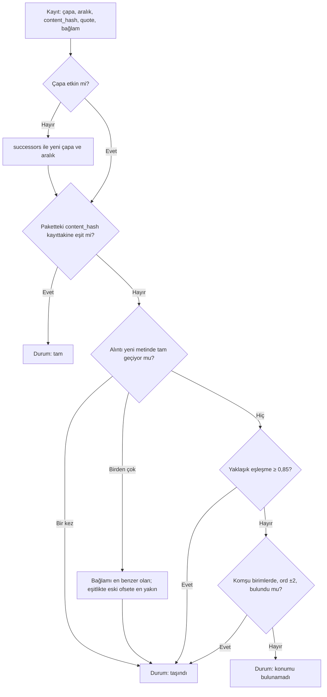

# Çapa Şeması

> **Sürüm:** 1.1 · **Tarih:** 19 Ekim 2026 · **Durum:** Taslak
> **Bağlı kararlar:** [K-26](../00-ozet/02-karar-defteri.md#k-26--kalıcı-adresler-çapa-şeması) · [K-07](../00-ozet/02-karar-defteri.md#k-07--mushaf-görünümü-üç-seçenek) · [K-27](../00-ozet/02-karar-defteri.md#k-27--tek-bağlantı-tablosu) · [K-16](../00-ozet/02-karar-defteri.md#k-16--senkron-çakışma-çözümü)

Her metin birimi tek bir gramere göre kalıcı bir adres (çapa) alır. Vurgular, notlar, yer imleri, `xref` bağlantıları, sayfa eşlemeleri, derin bağlantılar ve arama sonuçları bu adresle çalışır. Eski plan aynı içerik için en az beş uyumsuz biçim kullanıyordu (`2:255`, `quran:2:255`, `sozler:32:612`, `risale:sozler:13:para:42`). Bu dosya hepsinin yerini alır (`quran-app-docs/03-veri-modeli/03-polymorphic-content-ref.md`, `quran-app-docs/03-veri-modeli/02-tam-sql-ddl.md`).

## 1. Birim türleri

| Birim | Biçim | Örnek | Çapanın gösterdiği metin |
|---|---|---|---|
| Kur'an âyeti | `q:{sure}:{ayet}` | `q:2:255` | Tanzil Uthmani âyet metni |
| Kur'an kelimesi | `q:{sure}:{ayet}:{kelime}` | `q:2:255:3` | Âyet metninde `quran_word.char_start`–`char_end` |
| Kur'an kelime aralığı | `q:{sure}:{ayet}:{ilk}-{son}` | `q:2:255:3-7` | İlk ve son kelime dahil |
| Kur'an âyet aralığı | `q:{sure}:{ilk}-{son}` | `q:2:255-257` | Ardışık âyetlere başvuru; kendi metni yoktur |
| Meal | `meal:{meal}:{sure}:{ayet}` | `meal:elmalili:2:255` | Âyetin meal metni |
| Tefsir paragrafı | `tf:{eser}:{sure}-{ilk}-{son}:p{n}` | `tf:elmalili:2-255-257:p3` | Paragraf metni; çapa kapsanan âyetleri de taşır |
| Âyete bağlı olmayan tefsir bölümü | `tf:{eser}:{bolum}:p{n}` | `tf:elmalili:mukaddime:p4` | Paragraf metni |
| Risale paragrafı | `rn:{kitap}(:{bolum})*:p{n}` | `rn:sozler:soz-10:hakikat-3:p4` | Paragraf metni |
| Risale cümlesi | `rn:…:p{n}:s{cumle}` | `rn:sozler:soz-10:hakikat-3:p4:s2` | Paragraf içindeki cümle aralığı |
| Hadis (Arapça) | `h:{koleksiyon}:{no}` | `h:buhari:52`, `h:tecrid:15` | Hadis metni |
| Hadis çevirisi | `ht:{ceviri}:{koleksiyon}:{no}` | `ht:naim:tecrid:15` | Çeviri metni |
| Kitap (sonra) | `k:{kitap}(:{bolum})*:p{n}` | `k:kisas-i-enbiya:hz-ibrahim:p2` | Paragraf metni |
| Konu düğümü | `konu:{slug}` | `konu:tevhid` | Metin taşımaz; `konu` bağlantılarının hedefi (v1.x) |
| Kesin aralık | `{çapa}@{başlangıç}-{bitiş}` | `rn:sozler:soz-10:hakikat-3:p4@120-184` | Kanonik metinde kod noktası aralığı; başlangıç dahil, bitiş hariç |

Kur'an tarafında hazır anahtarlar var. QUL kelimeleri `sure:âyet:kelime` biçiminde anahtarlar, örneğin `2:3:5` ([QUL lemma](https://qul.tarteel.ai/resources/morphology/75)). Aralık tutmanın gerekçesi Blue Letter Bible deneyimidir. Bağlantılar yalnız ilk kelimeye bağlıyken kullanıcı bağlantının hangi ifadeye ait olduğunu göremiyordu; 2024'te 66 binden fazla kayıt tüm ifadeyi kapsayacak biçimde düzeltildi ([BLB blog](https://blogs.blueletterbible.org/blb/2024/11/19/updated-tsk/)).

## 2. Biçimsel gramer (EBNF)

```ebnf
/* W3C EBNF gösterimi. Tırnak içindeki dizgiler aynen yazılır. */
capa_ref     ::= kuran | konu | metin_capa ( "@" ofset "-" ofset )? | risale_cumle
kuran        ::= "q:" sayi ":" ( sayi ( ":" sayi ( "-" sayi )? )? | sayi "-" sayi )
konu         ::= "konu:" slug
metin_capa   ::= meal | tefsir | risale | hadis | hadis_ceviri | kitap
meal         ::= "meal:" slug ":" sayi ":" sayi
tefsir       ::= "tf:" slug ":" ( sayi "-" sayi "-" sayi | bolum ) ":" para
risale       ::= "rn:" bolum ( ":" bolum )* ":" para
risale_cumle ::= risale ":" cumle
hadis        ::= "h:" slug ":" sayi
hadis_ceviri ::= "ht:" slug ":" slug ":" sayi
kitap        ::= "k:" bolum ( ":" bolum )* ":" para
para         ::= "p" sayi
cumle        ::= "s" sayi
sayi         ::= [1-9] [0-9]*
ofset        ::= "0" | sayi
slug         ::= [a-z] [a-z0-9]* ( "-" [a-z0-9]+ )*
bolum        ::= slug - ayrilmis
ayrilmis     ::= ( "p" | "s" ) [0-9]+
```

Gramere uyan bir dizgi şu anlam kurallarını da sağlamalıdır:

1. `sure` 1–114 arasındadır. `ayet` o surenin âyet sayısını aşmaz; toplam 6.236 âyet vardır ([PyPI ijaza](https://pypi.org/project/ijaza/)). `packages/anchors` 114 elemanlı âyet sayısı dizisini gömülü taşır.
2. `kelime` âyetin kelime sayısını aşmaz. Bu denetim içerik verisiyle (`quran_word`) yapılır; ayrıştırıcı yapmaz.
3. Kelime aralığında ve âyet aralığında `ilk < son`. Tek kelime `q:2:255:3`, tek âyet `q:2:255` yazılır; `q:2:255:3-3` ve `q:2:255-255` kanonik sayılmaz. Âyet aralığı yapısı gereği tek sure içindedir ve `son` o surenin âyet sayısını aşmaz.
4. Tefsir âyet aralığında `ilk ≤ son` olur ve iki uç her zaman yazılır (`2-255-255`). Aralık sure sınırını geçmez; kaynak geçerse hat bölümü ikiye ayırır.
5. Kesin aralık yarı açıktır: başlangıç dahil, bitiş hariç, `[başlangıç, bitiş)` (K-26). `başlangıç < bitiş ≤ metin uzunluğu` koşulu birim metniyle denetlenir.
6. `@` Kur'an, konu ve cümle çapalarına eklenmez (gramer bunu yapısal olarak dışarıda bırakır). Âyet aralığı ve konu çapası birer başvurudur; kendi metinleri ve `content_hash` değerleri yoktur. Kur'an'da kesin aralık kelime aralığıyla yazılır. Mod A glif çiziminde karakter ofseti yoktur ve bir vurgu üç modda da aynı yeri göstermelidir (K-07). Cümle çapası paragraf üzerindeki bir aralığın adıdır; aynı aralığı ikinci bir yoldan yazmak kanonik biçimi bozar.
7. `p` ya da `s` ile başlayıp yalnız rakamla süren adlar (`p4`, `s12`) bölüm adı olamaz.
8. Slug en çok 64 karakter, bölüm derinliği en çok 8, çapanın tamamı en çok 256 karakterdir.
9. Çapa yalnız küçük harf ASCII içerir. "Bakara 255" ya da "2:255" gibi insan yazımları ayrı bir ayrıştırıcıyla çapaya çevrilir (bölüm 12).

## 3. Doğrulama düzenli ifadeleri

```text
SAYI = [1-9][0-9]*
K3   = [1-9][0-9]{0,2}                 (sure, âyet, kelime; üst sınırlar anlam denetiminde)
SLUG = [a-z][a-z0-9]*(?:-[a-z0-9]+)*
SEG  = (?![ps][0-9]+(?::|@|$))[a-z][a-z0-9]*(?:-[a-z0-9]+)*
ARA  = (?:@(?<bas>0|[1-9][0-9]*)-(?<bit>[1-9][0-9]*))?

q    ^q:(?<sure>K3):(?:(?<ayet>K3)(?::(?<ilk>K3)(?:-(?<son>K3))?)?|(?<ayet_ilk>K3)-(?<ayet_son>K3))$
konu ^konu:(?<konu>SLUG)$
meal ^meal:(?<meal>SLUG):(?<sure>K3):(?<ayet>K3)ARA$
tf   ^tf:(?<eser>SLUG):(?:(?<sure>K3)-(?<ilk>K3)-(?<son>K3)|(?<bolum>SEG)):p(?<p>SAYI)ARA$
rn   ^rn:(?<yol>SEG(?::SEG)*):p(?<p>SAYI)(?::s(?<s>SAYI)|ARA)$
h    ^h:(?<koleksiyon>SLUG):(?<no>SAYI)ARA$
ht   ^ht:(?<ceviri>SLUG):(?<koleksiyon>SLUG):(?<no>SAYI)ARA$
k    ^k:(?<yol>SEG(?::SEG)*):p(?<p>SAYI)ARA$
```

- Yer tutucular yerine konarak her tür için tek desen derlenir. Önek (`q:`, `konu:`, `meal:`, `tf:`, `rn:`, `h:`, `ht:`, `k:`) türü belirlediği için desenler çakışmaz. `rn` deseninde `yol` grubunun ilk parçası kitaptır. `q` desenindeki grup adları ayrıdır, çünkü eski JavaScript motorları aynı adı iki dalda kabul etmez.
- `\d` kullanılmaz. .NET'te ve Python 3'ün `str` desenlerinde `\d` başka yazı sistemlerinin rakamlarını da eşler; `[0-9]` yalnız ASCII rakamı kabul eder.
- Python'un `re` modülünde adlı grup `(?P<ad>…)` yazılır. .NET'te `RegexOptions.CultureInvariant` kullanılır, `IgnoreCase` kullanılmaz.
- `SEG` içindeki olumsuz ileri bakış JavaScript, Python ve .NET motorlarının üçünde de çalışır.

## 4. Örnekler

| Girdi | Tür | Ayrıştırma |
|---|---|---|
| `q:1:1` | âyet | sure 1, âyet 1 |
| `q:2:255:3-7` | kelime aralığı | sure 2, âyet 255, kelime 3–7 |
| `q:2:255-257` | âyet aralığı | Bakara 255–257 |
| `konu:tevhid` | konu düğümü | v1.x |
| `meal:elmalili:2:255@10-48` | meal + aralık | kod noktası [10, 48) |
| `tf:elmalili:2-255-257:p3` | tefsir | 2:255–257'yi kapsayan bölümün 3. paragrafı |
| `tf:elmalili:2-255-255:p1` | tefsir | tek âyetlik bölüm |
| `tf:elmalili:mukaddime:p4` | tefsir bölümü | âyetten bağımsız bölüm |
| `tf:elmalili:sure-2-giris:p1` | tefsir bölümü | sure girişi (adlandırma önerisi) |
| `rn:sozler:soz-10:hakikat-3:p4:s2` | Risale cümlesi | 4. paragrafın 2. cümlesi |
| `rn:sozler:soz-10:hasiye-1:p1` | Risale haşiyesi | adlandırma önerisi, bölüm 5 |
| `h:tecrid:15` · `ht:naim:tecrid:15` | hadis · çeviri | aynı hadisin Arapçası ve Türkçesi |
| `k:kisas-i-enbiya:hz-ibrahim:p2` | kitap | sonraki faz |

| Geçersiz girdi | Hata kodu | Neden |
|---|---|---|
| `q:115:1` | `SURE_ARALIGI` | Sure 114'ü aşıyor |
| `q:2:287` | `AYET_ARALIGI` | Bakara 286 âyettir |
| `q:2:255:7-3` | `TERS_ARALIK` | `ilk > son` |
| `q:2:255:3-3`, `q:2:255-255` | `KANONIK_DEGIL` | Tek kelime ya da tek âyet aralık olarak yazılmış |
| `q:2:257-255` | `TERS_ARALIK` | Âyet aralığında `ilk > son` |
| `konu:tevhid@0-5` | `BICIM` | Konu çapasına `@` eklenmez |
| `q:02:255`, `Q:2:255` | `BICIM` | Baştaki sıfır; büyük harf |
| `q:2:255@0-10` | `BICIM` | Kur'an çapasına `@` eklenmez |
| `rn:sozler:p4:p5` | `BICIM` | `p4` ayrılmış ad |
| `rn:sözler:p1` | `BICIM` | ASCII dışı harf |
| `tf:elmalili:2-255:p3` | `BICIM` | Tefsir aralığının iki ucu zorunlu |
| `meal:elmalili:2:255@48-10` | `TERS_ARALIK` | `başlangıç ≥ bitiş` |
| `h:muslim:2564a` | `BICIM` | Alt numara desteklenmiyor (Açık soru ÇŞ-3, bölüm 13) |

## 5. Slug kuralları

- Dönüşüm: `ç→c, ğ→g, ı→i, İ→i, ö→o, ş→s, ü→u, â→a, î→i, û→u`. Kesme işareti silinir. Boşluk ve noktalama tireye döner, ardışık tireler teke iner, baştaki ve sondaki tire atılır.
- Sıra adları `{tür}-{sayı}` kalıbıyla, sayı rakamla yazılır: "Onuncu Söz" → `soz-10`, "Üçüncü Hakikat" → `hakikat-3`, "Yirmi Dokuzuncu Lem'a" → `lema-29`.
- Önerilen kök sluglar (kesin listeler ilgili hazırlık dosyalarında):
  - Meal ve tefsir: `elmalili`.
  - Risale kitapları: `sozler`, `mektubat`, `lemalar`, `sualar`, `mesnevi-i-nuriye`, `isaratul-icaz`, … ([Risale hazırlığı](../04-icerik/05-risale-hazirligi.md)).
  - Hadis: `buhari`, `muslim`, `ebu-davud`, `tirmizi`, `nesai`, `ibn-mace`, `tecrid`; çeviri: `naim`, `miras` ([Hadis hazırlığı](../04-icerik/04-hadis-hazirligi.md)).
- Haşiye (öneri): bağlı olduğu bölümün altında `hasiye-{n}` bölümü açılır, örneğin `rn:sozler:soz-10:hasiye-1:p1`. Ana paragraftaki haşiye işareti `marks` alanında bu çapayı gösterir ([Editoryal veritabanı](./02-editoryal-veritabani.md)).
- Bir slug verildikten sonra değişmez. Yanlış bir slug düzeltilecekse yeni çapalar açılır, eskiler yönlendirmeyle kullanım dışı kalır (bölüm 6).

## 6. Kararlılık kuralları

1. Bir çapa bir kez verilir ve hep aynı birimi gösterir. Hiçbir sürüm çapaları yeniden numaralamaz; kullanılmış numara ya da ad başka birime verilmez.
2. `p{n}` bir kimliktir. Okuma sırası `unit.ord` sütunundadır ve her sürümde yeniden hesaplanabilir. Okuyucunun gösterdiği paragraf numarası (¶) `ord` sırasından türetilir.
3. Çapa silinmez. Kullanım dışı kalır (`status = 'kullanim_disi'`) ve `successors` alanında yönlendirme taşır.
4. Her yayında yayınlayıcı, önceki yayının bütün çapalarının etkin ya da yönlendirmeli olduğunu doğrular. Bu denetim yayın kapısının adımlarından biridir ([Yayın kapısı ve Kurul](../07-yayin/01-yayin-kapisi-ve-kurul.md)).

| Olay | Çapa | Yönlendirme |
|---|---|---|
| Metin düzeltmesi (yazım, OCR) | Aynı kalır; `content_hash` değişir, `rev` artar | Gerekmez; kullanıcı kayıtları yeniden çapalanır (bölüm 9) |
| Paragraf bölünmesi | İlk parça eski çapayı tutar; ikinci parça kitaptaki en büyük numaranın bir fazlasını alır | Eski çapanın `[k, son)` aralığı yeni çapaya, `delta = -k` |
| Paragraf birleşmesi | Öndeki çapa kalır; arkadaki kullanım dışı olur | Arkadakinin tamamı öndekine, `delta = öndekinin eski uzunluğu + ayırıcı` |
| Silme | Kullanım dışı | Komşu birime gezinme yönlendirmesi; aralık eşlemesi yok |
| Bölüm yeniden adlandırma | Yeni çapalar açılır | Eski çapaların hepsi birebir yönlendirilir |

```json
[{ "anchor": "rn:sozler:soz-10:hakikat-3:p27", "from": 312, "to": 640, "delta": -312 }]
```

Kur'an âyet çapaları sabittir. Kelime numaraları QAC konumuna sabitlenir. Kelime sayısı kaynağa göre değişiyor: QAC 77.429, Vikipedi 77.430, QUL 77.432 ([QAC SSS](https://corpus.quran.com/faq.jsp); [Wikipedia](https://en.wikipedia.org/wiki/Quranic_Arabic_Corpus); [QUL kaynaklar](https://qul.tarteel.ai/resources)). Hat, QUL ve Quran Foundation kelime konumlarını QAC'ye karşı denetler ve fark varsa eşleme tablosu tutar (Açık soru).

## 7. Kanonik metin ve `content_hash`

Kanonik metin, birimin kelimesi kelimesine düz metnidir. Biçimlendirme, dil işaretleri ve haşiye işaretleri metne gömülmez; `unit.marks` alanında kod noktası ofsetleriyle durur. Metnin nereden geldiğine göre iki kural vardır (K-26):

| Metin | Kanonik metin | Örnek |
|---|---|---|
| Kaynaktan alınan metin | Kaynağın dağıttığı hâliyle, bayt bayt saklanır. NFC dahil hiçbir dönüşüm uygulanmaz. Birim metni kaynak dosyanın aynen bir parçasıdır. | Tanzil Uthmani ve Simple Clean, hazır Arapça hadis metinleri |
| Kendi ürettiğimiz metin | İlk kayıtta bir kez kanonikleştirilir, sonra bir daha değiştirilmez. | Elmalılı ve Risale transkripsiyonları, kelime anlamları, Ahmed Naim çevirisinin aktarımı |

Kendi ürettiğimiz metinde ilk kayıt adımları şunlardır:

1. Unicode NFC.
2. Satır sonu yalnız U+000A olur. Baştaki ve sondaki boşluk kırpılır. U+0020 ve U+0009 dizileri tek U+0020'ye iner; U+00A0 korunur.
3. Şu karakterler silinir: U+FEFF, U+00AD, U+200E, U+200F, U+202A–U+202E, U+2066–U+2069, U+061C. U+200C ve U+200D korunur.
4. Kesme işaretleri, harekeler ve düzeltme işaretleri basılı kaynaktaki gibi yazılır.

```python
content_hash = hashlib.sha256(kanonik_metin.encode("utf-8")).hexdigest()  # 64 küçük harf onaltılık
```

- Tanzil şartları metnin aynen dağıtılmasına izin verir ve "CHANGING IT IS NOT ALLOWED" der ([Tanzil metni, OpenITI kopyası](https://raw.githubusercontent.com/OpenITI/0025AH/master/data/0001Quran/0001Quran.Mushaf/0001Quran.Mushaf.Tanzil001-ara1.mARkdown)). NFC şedde ile harekenin sırasını değiştirdiği için Tanzil metnine uygulanmaz.
- Arama için normalize edilmiş metin ayrı sütunlarda durur ve kanonik metnin yerine geçmez ([Arama](./05-arama-fts5.md)).
- Hat, kaynaktan alınan her birim için `kaynak_dosyası[başlangıç:bitiş] == unit.text` eşitliğini QA adımında doğrular.
- Özet yalnız içerik hattında hesaplanır. Cihaz özeti yeniden hesaplamaz; paketteki `unit.content_hash` değerini kopyalar.

## 8. Ofsetler

- Ofset, kanonik metindeki Unicode kod noktası sırasıdır; 0'dan başlar, aralık yarı açıktır. Tanzil metninde kod noktaları kaynakta nasılsa öyle sayılır.
- Python `str` kod noktasıyla indeksler. JavaScript ve C# UTF-16 birimiyle indeksler. Dönüşüm yalnız `packages/anchors` üzerinden yapılır (`cpToUtf16`, `utf16ToCp`).
- Sınır hizalama: başlangıç bir birleşen işaretin (Unicode `Mn`) üstüne düşerse geriye, bitiş bir `Mn` öncesine düşerse ileriye kayar. Böylece bir harf harekesinden ayrılmaz. Kural üç dilde aynı test vektörleriyle sınanır.
- Hat, içerikte BMP dışı karakter olup olmadığını raporlar (Doğrulanacak). Yoksa iki ofset sayısı eşittir; dönüşüm yine API'den geçer, çünkü not metinleri BMP dışı karakter içerebilir.
- Mod C'de yapılan Kur'an seçimi kelime sınırlarına genişletilir ve `q:{s}:{a}:{ilk}-{son}` olarak saklanır. Dönüşüm `quran_word.char_start` ve `char_end` ile yapılır.
- Depolama tablolarında (`xref`, `xref_idx`) uç birim düzeyindedir. Kur'an ucunda kelime aralığı âyet çapasına ve kelime konumu aralığına çevrilir: `q:2:255:3-7` → `q:2:255` + `[3,8)`. Metin birimlerinde aralık kod noktasıdır. Dönüşümü `toUnitSpan` yapar ([Bağlantı modeli](../05-capraz-referans/01-baglanti-modeli.md)). Âyet aralığı çapası depolamada âyet başına satıra bölünür.

## 9. İçerik güncellemesinden sonra yeniden çapalama

Her kullanıcı kaydı (yer imi, vurgu, not) çapayı, oluşturulduğu andaki `content_hash` değerini, kısa bir adres etiketini (`label`, örneğin "Sözler › 10. Söz › 3. Hakikat ¶4") ve bir metin alıntısını (`excerpt`) saklar. Paket silinse bile kayıt bu alanlarla Defterim'de okunur kalır. Kesin aralık taşıyan kayıtlar ayrıca `span_start`, `span_end`, seçilen metni (`quote`) ve iki yandan 32'şer kod noktası bağlamı (`prefix`, `suffix`) saklar. Tablolar [Kullanıcı verisi ve senkron](./04-kullanici-verisi-ve-senkron.md) dosyasındadır.



- Benzerlik `1 − düzenleme_uzaklığı / max(uzunluk)` ile kod noktası üzerinde ölçülür. 0,85 başlangıç değeridir; Elmalılı OCR düzeltmeleri üzerinde ölçülerek ayarlanır.
- Eski ofset, metin uzunluğu oranıyla ölçeklenerek yakınlık için kullanılır.
- Sonuç yalnız cihazdaki `anchor_resolution` önbelleğine yazılır; senkronlanan kayıt otomatik olarak değişmez. Farklı paket sürümündeki iki cihaz aynı kaydı karşılıklı yeniden yazarsa döngüye girer. Senkronlanan kayıt yalnız kullanıcı eylemiyle güncellenir.
- "Konumu bulunamadı" durumu Defterim'de rozetle gösterilir. Saklanan alıntı okunur kalır. Eylemler: "Yeniden seç" (yeni çapa, aralık ve özet yazılır), "Birime bağla" (aralık kaldırılır, kayıt paragrafın tamamına bağlanır), "Sil".
- Kur'an metni değişmez. Bir Kur'an biriminde özet farkı görülürse bu bir hat hatasıdır ve QA alarmı üretir.

## 10. Sayfa eşlemeleri

Çapa sayfa numarası taşımaz. Mushaf sayfaları ve basılı baskı sayfaları `page_map` tablosuyla çapaya bağlanır ([Editoryal veritabanı](./02-editoryal-veritabani.md)). Okuma konumu çapa olarak tutulur; mod değişince ilgili sayfa `page_map` ile bulunur. Bu yüzden mushaf modu değişince notlar ve vurgular kopmaz (K-07).

| Düzen ya da baskı | Eşleme birimi | Kaynak |
|---|---|---|
| Mod A · Medine 604 sayfa, 15 satır | Satır başına ilk ve son kelime çapası | QPC/QUL düzen verisi; lisans Açık soru |
| Mod C · akan Unicode | Sayfa başına ilk ve son kelime (A ile aynı sayfa sınırları) | A'nın verisinden türetilir |
| Mod B · Türk hattı | Sayfa başına âyet aralığı ve `ayah_box` koordinatları | Lisanslı görsel kaynak |
| Risale baskıları | Sayfa başlangıcı `(çapa, ofset)` | Baskı eşlemesi |
| Elmalılı 1935–39 | Cilt ve sayfa başlangıcı `(çapa, ofset)` | Özgün baskı |

- Medine düzenleri 604 sayfa ve 15 satırdır; listelenen düzenlerin hiçbiri Türk düzeni değildir ([QUL düzenleri](https://qul.tarteel.ai/mushaf_layouts)). Türk "âyet berkenar" düzeninde her sayfa tam bir âyetle başlar ve biter ([Küre Ansiklopedi](https://kureansiklopedi.com/tr/detay/ayet-berkenar-a2f19)). Medine düzeninde bu güvence yazılı değildir; A ve C eşlemesi bu yüzden kelime düzeyindedir (veriyle Doğrulanacak).
- Biçim örneği: `medine-604 · sayfa 1 → q:1:1:1 … q:1:7:{son}`.
- Risale'de ders halkalarında farklı baskıların sayfa numaraları kullanılır. 14 ciltlik büyük boy bir baskı 7.550 sayfadır ([kitapyurdu](https://www.kitapyurdu.com/kitap/risalei-nur-kulliyati-buyuk-boy-14-cilt-takim/429602.html)). Eşleme `page_map(baskı, çapa, sayfa)` biçimindedir (rapor).
- Hatim ilerlemesi çapayla tutulmaz; `(düzen, sayfa)` ile tutulur ([Kullanıcı verisi ve senkron](./04-kullanici-verisi-ve-senkron.md)).

## 11. `packages/anchors` API

```ts
export type Anchor =
  | { t: 'q'; sure: number; ayet: number; ilk?: number; son?: number } // ilk tek başına: kelime
  | { t: 'qa'; sure: number; ilk: number; son: number }                // âyet aralığı
  | { t: 'konu'; slug: string }
  | { t: 'meal'; meal: string; sure: number; ayet: number }
  | { t: 'tf'; eser: string; sure: number; ilk: number; son: number; p: number }
  | { t: 'tfb'; eser: string; bolum: string; p: number }
  | { t: 'rn'; yol: string[]; p: number; s?: number }                    // yol[0] kitaptır
  | { t: 'h'; koleksiyon: string; no: number }
  | { t: 'ht'; ceviri: string; koleksiyon: string; no: number }
  | { t: 'k'; yol: string[]; p: number };
export interface Span { start: number; end: number }   // kod noktası, [start, end)
export interface AnchorRef { anchor: Anchor; span?: Span }

export class AnchorError extends Error { code: 'BICIM' | 'SURE_ARALIGI' | 'AYET_ARALIGI' | 'TERS_ARALIK' | 'KANONIK_DEGIL' | 'UZUNLUK' }
export function parse(s: string): AnchorRef;                 // geçersizde AnchorError
export function tryParse(s: string): AnchorRef | null;
export function format(r: AnchorRef): string;                // parse(format(r)) her zaman r'ye eşit
export function compare(a: AnchorRef, b: AnchorRef): -1 | 0 | 1;
export function contains(dis: AnchorRef, ic: AnchorRef): boolean;
export function toRoute(r: AnchorRef, hedef: 'native' | 'web', sema?: string): string;
export function fromRoute(url: string): AnchorRef | null;
export function unitOf(r: AnchorRef): AnchorRef;             // q:2:255:3-7 → q:2:255; aralığı atar
export function coveredAyahs(r: AnchorRef): Array<{ sure: number; ayet: number }>; // qa, tf ve meal
export function toUnitSpan(r: AnchorRef): { unit: string; span?: [number, number] }; // xref depolama biçimi
export function cpToUtf16(text: string, cp: number): number;
export function utf16ToCp(text: string, i: number): number;
export function snapSpan(text: string, s: Span): Span;      // bölüm 8'deki Mn hizalaması
```

- **`compare`** belirlenimci bir anahtar sırasıdır. Kur'an çapaları (`q`, `qa`) sure ve başlangıç âyetine göre birlikte dizilir; eşitlikte âyet, kelime, kelime aralığı, âyet aralığı sırası izlenir. Ardından türler `meal < tf < tfb < rn < h < ht < k < konu` sırasıyla gelir. Aynı türde sayısal alanlar sayı olarak, slug'lar ASCII olarak karşılaştırılır; aralıksız kayıt aralıklıdan önce gelir. Kur'an'da bu sıra okuma sırasıyla aynıdır. Tefsir, Risale ve kitapta okuma sırası `unit.ord` sütunundan okunur, çünkü bölünme sonrası numaralar sırayı izlemez.
- **`contains`**: aynı çapa her zaman kapsar. `q:2:255-257` aralıktaki âyetleri, kelimelerini ve iç âyet aralıklarını kapsar. `q:2:255` kendi kelimelerini ve kelime aralıklarını, bir kelime aralığı içindeki kelimeleri kapsar. Aralıksız birim kendi aralıklarını, `[a, b)` aralığı içindeki `[c, d)` aralığını kapsar. Paragraf kendi cümle çapalarını yapısal olarak kapsar. Farklı türler birbirini kapsamaz; meal ve tefsirin âyetle ilişkisi `coveredAyahs` ile sorulur.
- **`toRoute`**: yerel biçim mekaniktir. Ön ek `{sema}://`, ardından çapanın `:` işaretleri `/` olur, aralık `?aralik=` sorgusuna gider. Şema derleme türüne göre `mutalaa`, `mutalaa-internal` ya da `mutalaa-dev` olur ([Mobil mimari](../06-mobil/01-mobil-mimari.md)). Bu biçim mobil mimarideki MM-14 için öneridir; Expo Router'da tek bir yakalayıcı rota (`[...capa].tsx`) bütün türleri çözer.

| Çapa | Yerel | Web (Faz 5'te kesinleşir) |
|---|---|---|
| `q:2:255` | `mutalaa://q/2/255` | `/kuran/2/255` |
| `q:2:255:3-7` | `mutalaa://q/2/255/3-7` | `/kuran/2/255?k=3-7` |
| `q:2:255-257` | `mutalaa://q/2/255-257` | `/kuran/2/255-257` |
| `konu:tevhid` | `mutalaa://konu/tevhid` | `/konu/tevhid` |
| `meal:elmalili:2:255` | `mutalaa://meal/elmalili/2/255` | `/meal/elmalili/2#255` |
| `tf:elmalili:2-255-257:p3` | `mutalaa://tf/elmalili/2-255-257/p3` | `/tefsir/elmalili/2/255#p3` |
| `rn:sozler:soz-10:hakikat-3:p4@120-184` | `mutalaa://rn/sozler/soz-10/hakikat-3/p4?aralik=120-184` | `/risale/sozler/soz-10/hakikat-3#p4` |
| `h:buhari:52` | `mutalaa://h/buhari/52` | `/hadis/buhari/52` |

Web rotaları raporun önerdiği `/kuran/[sure]/[ayet]`, `/meal/[meal]/[sure]`, `/tefsir/elmalili/[sure]/[ayet]` ve `/risale/[kitap]/[bolum]` listesine dayanır ([araştırma raporu](../09-kaynakca.md)).

**Python ve C# karşılıkları.** Aynı davranış üç dilde yazılır ve ortak test vektörleriyle kilitlenir.

| İşlev | TypeScript | Python (`pipeline/src/mutalaa_pipeline/anchor/capa.py`) | C# (`Mutalaa.Domain/Anchors`) |
|---|---|---|---|
| Ayrıştırma | `parse`, `tryParse` | `parse(s)`, `try_parse(s)` | `AnchorRef.Parse(s)`, `TryParse(s, out r)` |
| Biçimleme | `format(r)` | `format(r)`, `str(r)` | `r.ToString()` |
| Sıralama | `compare(a, b)` | `sort_key(r)` | `IComparable<AnchorRef>` |
| Kapsama | `contains(a, b)` | `contains(a, b)` | `a.Contains(b)` |
| Rota | `toRoute`, `fromRoute` | `to_route(r, hedef)` | `r.ToRoute(hedef)` |

Python'da değişmez `dataclass(frozen=True)`, C#'ta `sealed record` kullanılır. C# tarafı EF Core değer dönüştürücüsüyle `text` sütunlarına eşlenir ([Editoryal veritabanı](./02-editoryal-veritabani.md)).

```text
shared/test-vectors/            input → expected
  anchors/valid.jsonl           çapa dizesi → nesne (ref) ve kanonik dize (canonical)
  anchors/invalid.jsonl         dize → hata kodu
  anchors/compare.jsonl         [a, b] → -1, 0 ya da 1
  anchors/contains.jsonl        [dış, iç] → true ya da false
  anchors/route.jsonl           çapa → yerel ve web rota
  offsets/offsets.jsonl         metin → kod noktası ↔ UTF-16, snapSpan
  content-hash/hash.jsonl       metin → content_hash (bölüm 7)
```

Dosyalar JSONL'dir; her satır `id`, `input`, `expected` ve isteğe bağlı `note` alanlarını taşır ([Proje yapısı](../02-mimari/03-proje-yapisi.md) §1.2). Aşağıdaki örnek okunsun diye satırlara bölünmüştür, dosyada tek satırdır.

```json
{ "id": "an-0007",
  "input": "rn:sozler:soz-10:hakikat-3:p4@120-184",
  "expected": { "ref": { "anchor": { "t": "rn", "yol": ["sozler", "soz-10", "hakikat-3"], "p": 4 },
                         "span": { "start": 120, "end": 184 } },
                "canonical": "rn:sozler:soz-10:hakikat-3:p4@120-184" },
  "note": "Risale paragrafı, kod noktası aralığı" }
```

CI üç test koşucusunu aynı dosyalarla çalıştırır. TypeScript vektörleri Hermes üzerinde de koşar ([Test stratejisi](../07-yayin/03-test-stratejisi.md)).

## 12. Sure adları ve insan yazımları

- Sure adlarının ve yazım varyantlarının tek kaynağı editoryal veritabanındaki `surah_alias` tablosudur ([Editoryal veritabanı](./02-editoryal-veritabani.md)). Onaylı satırlar `shared/data/sure-adlari.json` dosyasına (114 kayıt) dışa aktarılır. Varyantlar geniş arama anahtarıyla normalize edilmiş biçimde tutulur ([Arama](./05-arama-fts5.md)).

```json
{ "no": 2, "ad": "Bakara", "ad_ar": "البقرة", "ayet_sayisi": 286,
  "varyantlar": ["bakara", "el bakara", "sure i bakara", "bakara suresi"] }
```

- Üretilen kopyalar: `packages/anchors/src/generated/sure-adlari.ts`, hattın Python modülü, C# gömülü kaynağı ve `core` paketindeki `sure` tablosu (arama kutusunda "Bakara 255" yazımı için).
- Metin içindeki açık atıflar ("(Bakara Sûresi, 255)", "Âl-i İmrân: 7") için rapor, İncil Pasaj Referans Ayrıştırıcısı'nı örnek alan küçük bir gramer ve bu tabloyu önerir. O ayrıştırıcı adları en uzun eşleşmeden başlayarak arar ve ham metinde yanlış pozitif verebileceğini yazar ([Bible Passage Reference Parser](https://github.com/openbibleinfo/Bible-Passage-Reference-Parser)). Ayrıntı [İktibas tespiti](../05-capraz-referans/02-iktibas-tespiti.md) dosyasında.
- Notlarda bağlantı `[[q:2:255]]` biçimindedir. Not düzenleyicisi "Bakara 255" yazımını kayıtta kanonik çapaya çevirir. Eski plandaki `[[Q 2:255]]` ve `[[R Sözler.13.42]]` biçimleri içe aktarımda bu biçime dönüştürülür (`quran-app-docs/04-okuma/04-reading-symmetry.md`).

## 13. Açık sorular

| No | Konu | Durum |
|---|---|---|
| ÇŞ-1 | QAC, QUL ve QF kelime numaralandırması arasındaki farklar ve eşleme tablosu | Açık soru |
| ÇŞ-2 | Tanzil'e soru: ayrı sütundaki normalize arama metninin "değiştirme" sayılıp sayılmadığı (lisans defteri, yazışma 1; hukuki görüş değildir) | Açık soru |
| ÇŞ-3 | Hadis numara sistemi ve alt numaralar (`2564a`); gramere harf soneki eklenmesi | Açık soru |
| ÇŞ-4 | Haşiye ve tefsir sure girişi adlandırması (`hasiye-{n}`, `sure-{n}-giris`) | Öneri |
| ÇŞ-5 | Yeniden çapalama eşiği (0,85) ve cihazda yaklaşık eşleşme algoritmasının kitaplık seçimi | Doğrulanacak |
| ÇŞ-6 | Mod A satır düzeni verisinin kaynağı ve lisansı (mobil mimari MM-2) | Açık soru |
| ÇŞ-7 | Web rotaları | Faz 5'te kesinleşir |
| ÇŞ-8 | Konu düğümlerinin slug listesi ve tabloları (v1.x) | Açık soru |

## İlgili dosyalar

- [Karar defteri](../00-ozet/02-karar-defteri.md) · [Sözlük](../00-ozet/03-sozluk.md)
- [Editoryal veritabanı](./02-editoryal-veritabani.md) · [İçerik paketleri](./03-icerik-paketleri.md) · [Kullanıcı verisi ve senkron](./04-kullanici-verisi-ve-senkron.md) · [Arama (FTS5)](./05-arama-fts5.md)
- [Bağlantı modeli](../05-capraz-referans/01-baglanti-modeli.md) · [İktibas tespiti](../05-capraz-referans/02-iktibas-tespiti.md)
- [İçerik hattı](../04-icerik/02-icerik-hatti.md) · [Risale hazırlığı](../04-icerik/05-risale-hazirligi.md) · [Hadis hazırlığı](../04-icerik/04-hadis-hazirligi.md)
- [Mobil mimari](../06-mobil/01-mobil-mimari.md) · [Okuma deneyimi](../01-urun/02-okuma-deneyimi.md) · [Yayın kapısı ve Kurul](../07-yayin/01-yayin-kapisi-ve-kurul.md)
