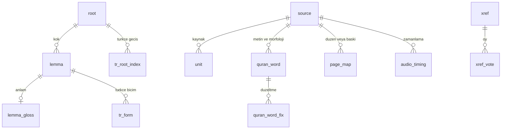
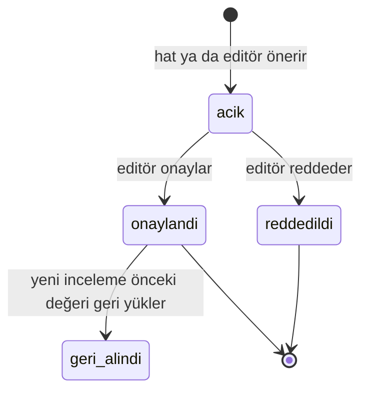

# Editoryal Veritabanı

> **Sürüm:** 1.11 · **Tarih:** 10 Kasım 2026 · **Durum:** Taslak
> **Bağlı kararlar:** [K-48](../00-ozet/02-karar-defteri.md#k-48--editör-api-kuralları-inceleme-kararı-ikinci-onay-eşzamanlılık-yayın-talebi-ve-sayfa-görseli) · [K-46](../00-ozet/02-karar-defteri.md#k-46--yayın-kaydı-içerik-özetleri-ve-fikstürler) · [K-11](../00-ozet/02-karar-defteri.md#k-11--veritabanı-postgresql-18) · [K-10](../00-ozet/02-karar-defteri.md#k-10--arka-uç) · [K-42](../00-ozet/02-karar-defteri.md#k-42--kaynak-ilkesi-ve-kalite-temelli-görünürlük) · [K-27](../00-ozet/02-karar-defteri.md#k-27--tek-bağlantı-tablosu) · [K-35](../00-ozet/02-karar-defteri.md#k-35--çapa-api-ayrıntıları) · [K-37](../00-ozet/02-karar-defteri.md#k-37--editoryal-şema-ayrıntıları) · [K-13](../00-ozet/02-karar-defteri.md#k-13--editör-paneli) · [K-19](../00-ozet/02-karar-defteri.md#k-19--kuran-kelime-anlamları) · [K-38](../00-ozet/02-karar-defteri.md#k-38--kaynak-edinimi-dijital-öncelikli-kanıtla-yükseltme) · [K-39](../00-ozet/02-karar-defteri.md#k-39--tanzil-alımı-simple-cleanin-yeri-kanonik-kaynakta-hat-yazma-kuralı-kilit) · K-12 ([karar defteri](../00-ozet/02-karar-defteri.md)) · [K-41](../00-ozet/02-karar-defteri.md#k-41--ses-sistemi-hazır-kayıtlar-ayna-ve-çevrimiçi-öncelikli-dinleme) · [K-43](../00-ozet/02-karar-defteri.md#k-43--kuran-yapı-verisi-kelime-numarası-işaret-tablosu-ve-aday-satırları)

Editoryal veritabanı içeriğin tek doğruluk kaynağıdır. Python içerik hattı yazar, editör paneli onaylar, .NET yayınlayıcı okuyup SQLite paketlerini üretir. Mobil uygulama bu veritabanına bağlanmaz. Seçim PostgreSQL 18'dir; Türkçe ve Arapça tam metin yapılandırmaları hazırdır, anlamsal katman için pgvector eklenir (K-11). Geliştirme yerel Docker Compose'ta `postgres:18` ile çalışır ([Yerel geliştirme](../02-mimari/04-yerel-gelistirme.md)). Bu dosya diğer belgelerin önerdiği tabloları da kesin DDL olarak toplar (bölüm 11).

## 1. İlkeler

- Kaynak metin değiştirilmez ([K-26](../00-ozet/02-karar-defteri.md#k-26--kalıcı-adresler-çapa-şeması)): Tanzil metni bayt bayt saklanır, QAC değerleri de kaynaktaki gibi kalır. Düzeltmeler ayrı katmanda durur (`quran_word_fix`, `review`).
- Her satır bir kaynağa bağlanır; kaynağın kaydı `pipeline/sources/{slug}.toml` dosyasındadır ([K-42](../00-ozet/02-karar-defteri.md#k-42--kaynak-ilkesi-ve-kalite-temelli-görünürlük) madde 4). Yayınlayıcı kalite kapısı kaynak kaydına ve editoryal kaliteye bakar (K-42 madde 5). Kapı metinlere ve veri setlerine aynı biçimde uygulanır.
- Tablo adları brifteki gibi İngilizcedir; enum değerleri Türkçedir. Kaynak kaydının TOML alanları ve Backend API'nin JSON alanları sütun adlarıyla aynıdır. Bu belgelerin Türkçe adlandırdığı sütunlar (`source` alanlarının çoğu, `unit.metin`, `unit.metin_durumu`, `review` ve `release`) aynı adı taşır. Tablolar `icerik` şemasındadır; v1.x kullanıcı tabloları `kullanici` şemasında durur ([Kullanıcı verisi ve senkron](./04-kullanici-verisi-ve-senkron.md)).
- Çapa sütunları `COLLATE "C"` kullanır; bayt sıralaması `LIKE 'rn:sozler:%'` önek sorgularının B-ağacı dizinini kullanmasını sağlar. Bu bayt sırası çapa API'sinin `compare` sırası değildir ([Çapa şeması](./01-capa-semasi.md) §11, K-35); okuma sırası `unit.ord` sütunundadır. Aralıklar `int4range` olarak tutulur; PostgreSQL'in kanonik `[)` biçimi çapa şemasındaki yarı açık aralıkla aynıdır ([Çapa şeması](./01-capa-semasi.md)).
- `root.id`, `lemma.id` ve `xref.id` çapalar gibi kalıcıdır; satır silinip yeniden yaratılmaz.



Birim çapalarına (`unit.anchor`) yabancı anahtar yoktur: `xref`, `review.hedef_anahtar`, `tr_root_index` ve `embedding` birimlere çapa dizgisiyle bağlanır. Bütünlüğü hat QA'sı ve kalite kapısı denetler. Çapa olmayan bağlar gerçek yabancı anahtardır: `review.xref_id` → `xref.id`; `tr_root_index.root_id` → `root.id`; `tr_root_index.tr_lemma_id` → `lemma.id`.

## 2. Türler

```sql
CREATE SCHEMA IF NOT EXISTS icerik;
SET search_path = icerik, public;

CREATE TYPE derleme_turu   AS ENUM ('dev','internal','public');
CREATE TYPE source_kind    AS ENUM ('kuran_metni','meal','tefsir','hadis','hadis_ceviri','risale','kitap','morfoloji',
                                    'kelime_anlami','sozluk','mushaf_duzeni','mushaf_gorseli','font','baski','ses',
                                    'zamanlama','baglanti_verisi');
CREATE TYPE unit_kind      AS ENUM ('ayet','meal','tefsir','risale','hadis','hadis_ceviri','kitap');
CREATE TYPE unit_status    AS ENUM ('etkin','kullanim_disi');
CREATE TYPE metin_durumu   AS ENUM ('taslak','incelemede','onayli');
CREATE TYPE xref_type      AS ENUM ('atif','iktibas','ima','kok','lemma','konu','benzer_ayet','anlamsal');
CREATE TYPE xref_status    AS ENUM ('aday','onayli','red');
CREATE TYPE xref_origin    AS ENUM ('hat','editor','kullanici_oyu');
CREATE TYPE inceleme_durumu AS ENUM ('acik','onaylandi','reddedildi','geri_alindi');
CREATE TYPE surum_durumu   AS ENUM ('hazirlaniyor','dogrulandi','yayinlandi','basarisiz','geri_cekildi');
```

Türler 10'dur ve `packages/content-schema/enums.json` ile aynı etiketleri aynı sırayla taşır ([K-37](../00-ozet/02-karar-defteri.md#k-37--editoryal-şema-ayrıntıları) madde 2). `xref_type`, `xref_status` ve `xref_origin` adları [Bağlantı modeli](../05-capraz-referans/01-baglanti-modeli.md) DDL'iyle; `inceleme_durumu`, `derleme_turu`, `surum_durumu` ve `metin_durumu` adları [Backend API](../02-mimari/05-backend-api.md) ile aynıdır. Backend API de `xref_status` adını kullanır (ED-7 çözüldü).

## 3. `source`

```sql
CREATE TABLE source (
  slug                text COLLATE "C" PRIMARY KEY,     -- kaynak kaydındaki kimlik: 'tanzil-uthmani'
  tur                 source_kind NOT NULL,
  baslik              text NOT NULL,
  yazar               text,
  surum               text NOT NULL,                    -- veri setinin ya da baskının sürümü
  provider            text,                             -- 'tanzil', 'qac', 'quran_foundation', 'tarteel', …
  kaynak_url          text,
  alinma_tarihi       date,                             -- dosyanın indirildiği gün
  dosya_sha256        char(64) CHECK (dosya_sha256 ~ '^[0-9a-f]{64}$'),  -- indirilen dosyanın özeti; NULL serbest (K-46 madde 4)
  baski_bilgisi       jsonb,                            -- baskılar: yayınevi, yıl, cilt takımı, ISBN, boy, yazı, metin esası
  atif_metni          text NOT NULL,                    -- Ayarlar › Kaynaklar ekranındaki atıf satırı
  atif_url            text,                             -- atıfla gösterilen bağlantı; boşsa kaynak_url
  notice_text         text,                             -- kaynağın kendi bildirimi, bayt bayt (ör. Tanzil dosyasındaki bildirim bloğu)
  notlar              text,
  created_at          timestamptz NOT NULL DEFAULT now(),
  updated_at          timestamptz NOT NULL DEFAULT now()
);
```

- `source` betimleyici bir kaynak kaydıdır: ad, adres, sürüm, dosya özeti, atıf ve kaynağın kendi bildirimi ([K-42](../00-ozet/02-karar-defteri.md#k-42--kaynak-ilkesi-ve-kalite-temelli-görünürlük) madde 4). Kimlikler [Kaynaklar](../04-icerik/01-kaynaklar.md) dosyasında ve `pipeline/sources/{slug}.toml` kayıtlarındadır; kaydı olmayan kaynak hatta alınmaz. Kayıt (TOML) dosya özeti ve alma tarihi taşımaz; alanları aynı adlı sütunlara yüklenir. İndirilen dosyanın özeti `data/gelen/<kaynak>/<YYYY-AA-GG>/SHA256SUMS` dosyasındadır; `export pg` tek dosyalı kaynakta `alinma_tarihi` ve `dosya_sha256` sütunlarını bu kayıttan doldurur (K-42 madde 2 ve 4). `surum` kayıtta isteğe bağlıdır ama sütun `NOT NULL`'dır: yüklenen kaynağın sürümü çözülemezse `export pg` çıkış `2` verir. Hat kaynak satırını şöyle yükler ([K-39](../00-ozet/02-karar-defteri.md#k-39--tanzil-alımı-simple-cleanin-yeri-kanonik-kaynakta-hat-yazma-kuralı-kilit) madde 3):
  - **Satır yoksa** kayıttaki bütün alanlarla eklenir; `alinma_tarihi` ve `dosya_sha256` indirilen dosyadan gelir.
  - **Satır varsa** yalnız betimleyici alanlar güncellenir: `baslik`, `surum`, `kaynak_url`, `atif_metni`, `atif_url`, `notice_text`, `alinma_tarihi`, `dosya_sha256`. Öteki sütunlara (`tur`, `yazar`, `provider`, `baski_bilgisi`, `notlar`) hat ilk eklemeden sonra yazmaz.
  - **`notice_text`** dosyadan gelir: Tanzil'de dosyadaki bildirim bloğunun baytlarının katı UTF-8 çözümüdür, hiçbir dönüşüm uygulanmaz (K-39 madde 6).

  Backend API kaynağı `/api/v1/sources/{slug}` adresinde aynı adlarla döndürür.
- Derleme görünürlüğü editoryal kaliteye bağlıdır (K-42 madde 5). Kaynak kaydı olmayan içerik hiçbir pakete girmez. Onaysız birim ve onaysız yapay zekâ taslağı `public`'e girmez; insan onayı isteyen türün (`atif`, `iktibas`, `ima`, `konu`) aday bağlantısı yalnız `dev` ve `internal`'dadır, otomatik türler (`kok`, `lemma`, `benzer_ayet`, `anlamsal`) `confidence ≥ 0,50` ile her derlemeye girer. Slug'ı `test-` ile başlayan kaynak `public`'e girmez; `internal`'a yalnız uçtan uca fikstürler (`test-kucuk`, `test-ses`) girer. Kapı kuralları (P-01, P-07…P-14) [Backend API](../02-mimari/05-backend-api.md) §10.3'tedir.
- Yayınlayıcı her pakete `attribution` satırını şu eşlemeyle yazar: `baslik` → `title`, `surum` → `version`, `atif_url` (boşsa `kaynak_url`) → `source_url`, `atif_metni` → `required_credit`; `notice_text` aynı adla geçer ([İçerik paketleri](./03-icerik-paketleri.md) §3.1). Atıflar Ayarlar › Kaynaklar ekranında görünür.
- Risale baskıları (`tur = 'baski'`) da birer kaynaktır. [Risale hazırlığı](../04-icerik/05-risale-hazirligi.md) dosyasındaki `baski` alanları `baski_bilgisi` içinde durur.
- `baski_bilgisi` anahtarları: yayınevi, yıl, cilt takımı, ISBN, boy, yazı ve `metin_esasi` (metnin hangi baskıya ya da nüshaya dayandığı). Metin hazır dijital dosyadan geliyorsa dijital kaynağın türü de yazılır (öneri; anahtar adı ve değerleri A20'deki şema çalışmasında kesinleşir ve A20 anahtar listesine eklenir): `hazir_metin` (TXT, EPUB, metin katmanlı PDF, HTML) ya da `tarama` (OCR yolu) ([K-38](../00-ozet/02-karar-defteri.md#k-38--kaynak-edinimi-dijital-öncelikli-kanıtla-yükseltme)). Alanın şema doğrulaması A20'de planlıdır; bugün serbest biçimli jsonb'dir.

Örnek satırlar (kimlikler ve kesin değerler kaynak kayıtlarındadır):

| `slug` | `tur` | Not |
|---|---|---|
| `tanzil-uthmani`, `tanzil-simple-clean` | kuran_metni | Kanonik metin, bayt bayt saklanır (K-26); Simple Clean `q:` birimi olmaz, yalnız `ar_norm` kaynağıdır ([K-39](../00-ozet/02-karar-defteri.md#k-39--tanzil-alımı-simple-cleanin-yeri-kanonik-kaynakta-hat-yazma-kuralı-kilit) madde 1) |
| `elmalili-meal`, `elmalili-tefsir` | meal, tefsir | Kendi aktarımımız; baskı kimliği `elmalili-1935` `baski_bilgisi` içinde |
| `qac-morfoloji` | morfoloji | Kök, lemma ve sözcük türü (`quran_word.morph_source`, bölüm 5) |
| `tecrid-naim` · `tecrid-miras` | hadis_ceviri | Ahmed Naim Türkçesi ve Kâmil Miras ciltleri ([K-04](../00-ozet/02-karar-defteri.md#k-04--hadis-kaynakları)) |
| `risale-1956-1960`, `risale-asil-nusha` | risale | Risale metninin dayandığı baskı ve nüsha kayıtları ([Risale hazırlığı](../04-icerik/05-risale-hazirligi.md)) |
| `zamanlama-qud`, `zamanlama-mp3quran` (A27.0'da açılır) | zamanlama | QUD v4.0.0 (âyet ve kelime); MP3Quran yedek âyet zamanlaması ([K-41](../00-ozet/02-karar-defteri.md#k-41--ses-sistemi-hazır-kayıtlar-ayna-ve-çevrimiçi-öncelikli-dinleme) madde 3; [Ses kaynağı araştırması](../06-mobil/04-ses-kaynak-arastirmasi.md)) |
| `ses-mp3quran`, `ses-tarteel-cdn` (A27.0'da açılır) | ses | Dosyalar içerik hattıyla bir kez alınır, kendi depomuzdan sunulur (K-41 madde 3–4) |
| `medine-604-duzen` | mushaf_duzeni | Kaynak ve sürüm A26.0 tedarik adımında sabitlenir (ED-5) |

## 4. `unit`

```sql
CREATE TABLE unit (
  id            bigint GENERATED ALWAYS AS IDENTITY PRIMARY KEY,
  anchor        text COLLATE "C" NOT NULL UNIQUE,   -- '@' içermez
  kind          unit_kind NOT NULL,
  role          text NOT NULL DEFAULT 'govde' CHECK (role IN ('govde','baslik','hasiye','dipnot','siir')),
  source_id     text NOT NULL REFERENCES source(slug),
  parent_path   text COLLATE "C",                    -- 'rn:sozler:soz-10:hakikat-3' (içindekiler)
  ord           bigint NOT NULL,                     -- okuma sırası; her yayında yeniden hesaplanabilir
  ayah_range    int4range,                           -- küresel âyet sırası 1..6236; âyete bağlı değilse NULL
  metin         text NOT NULL,                       -- kanonik metin (K-26: kaynak aynen; kendi metnimiz ilk kayıtta Çapa şeması §7 adımlarıyla, K-35); pakette text
  marks         jsonb NOT NULL DEFAULT '[]',         -- [{"s":0,"e":14,"t":"ar"},{"s":88,"t":"hasiye","a":"rn:…"}]
  sentences     int4range[],                         -- s1, s2, … sınırları (Risale)
  attrs         jsonb NOT NULL DEFAULT '{}',         -- türe özgü öznitelikler: {"cilt":1,"sayfa":214,…}; pakette attrs
  content_hash  char(64) NOT NULL CHECK (content_hash ~ '^[0-9a-f]{64}$'),
  rev           integer NOT NULL DEFAULT 1,
  metin_durumu  metin_durumu NOT NULL DEFAULT 'taslak',
  status        unit_status NOT NULL DEFAULT 'etkin',
  successors    jsonb,                               -- [{"anchor":"…","from":312,"to":640,"delta":-312}]
  tr_narrow     text,                                -- arama anahtarları; hat üretir
  tr_wide       text,
  tr_stem       text,
  ar_norm       text,
  tsv_tr        tsvector GENERATED ALWAYS AS (to_tsvector('turkish', coalesce(tr_narrow, ''))) STORED,
  tsv_ar        tsvector GENERATED ALWAYS AS (to_tsvector('arabic', coalesce(ar_norm, ''))) STORED,
  data_version  text NOT NULL,
  provenance    jsonb NOT NULL DEFAULT '{}',
  run_id        uuid,                                -- yükleyen hat çalıştırması (bölüm 10)
  created_at    timestamptz NOT NULL DEFAULT now(),
  updated_at    timestamptz NOT NULL DEFAULT now(),
  CHECK (status = 'etkin' OR successors IS NOT NULL)
);
CREATE INDEX unit_source_ord ON unit (source_id, ord);
CREATE INDEX unit_parent     ON unit (parent_path, ord);
CREATE INDEX unit_ayah       ON unit USING gist (ayah_range);
CREATE INDEX unit_tsv_tr     ON unit USING gin (tsv_tr);
CREATE INDEX unit_tsv_ar     ON unit USING gin (tsv_ar);
```

- Kur'an âyetleri, mealler, tefsir, Risale, hadis ve kitap paragrafları bu tabloda durur; Kur'an kelimeleri `quran_word` tablosundadır.
- Âyet ↔ meal ve âyet ↔ tefsir aralığı ilişkileri çapadan türetilir, `xref`'e yazılmaz (K-27). Sorgu için `ayah_range` yeter: "2:255'i açıklayan tefsir paragrafları" `ayah_range @> 262` olur (2:255'in küresel sırası 7 + 255 = 262).
- Diğer belgelerin `search_text` dediği normalize arama metni bu tabloda dört sütundur: `tr_narrow`, `tr_wide`, `tr_stem`, `ar_norm`. Hat onları [Arama](./05-arama-fts5.md) dosyasındaki kurallarla üretir. `tsv_tr` dar anahtarı kullanır, çünkü Snowball Türkçe gövdeleyicisi Türkçe harfleri bekler; PostgreSQL `turkish` ve `arabic` yapılandırmalarını hazır getirir ([PostgreSQL](https://docs.w3cub.com/postgresql~18/textsearch-psql)). Bu sütunlar editör paneli ve sonraki web araması içindir.
- ~~PostgreSQL 18'in üretilen sütunlarda varsayılanı sanal (VIRTUAL) yaptığı bilgisi Doğrulanacak.~~ **Çözüldü (27 Ekim 2026):** PostgreSQL 18'de üretilen sütunun varsayılanı `VIRTUAL`'dır ve sanal sütun dizinlenemez. Dizinlenen sütunlar bu yüzden açıkça `STORED` yazılır. Kaynaklar: [CREATE TABLE](https://www.postgresql.org/docs/18/sql-createtable.html), [Üretilen sütunlar](https://www.postgresql.org/docs/18/ddl-generated-columns.html) (okuma 26 Ekim 2026).
- `metin_durumu`: `onayli` ile giriş yalnız Tanzil gibi kanonik başvuru kaynakları içindir. Hazır ve çıkarılmış metinler ile Elmalılı OCR metni `taslak` girer ve editör onayından geçer; meal ve tefsirde ikinci onay da gerekir ([K-38](../00-ozet/02-karar-defteri.md#k-38--kaynak-edinimi-dijital-öncelikli-kanıtla-yükseltme), madde 4). `public` derlemeye yalnız `onayli` metin girer (Backend API kapı kuralı P-10).
- `page_map` durum sütunu taşımaz; onay durumu `review` ile türetilir (K-37, A07 güncellemesi). Hazır metinden türetilen sayfa eşlemesi için ayrı bir kural karar defterinde yoktur; öneri: satırlar `staged` ve QA'dan geçtikten sonra yazılır.
- `attrs` birim türüne özgü öznitelikleri taşır; paketteki `unit.attrs` bu sütundan gelir ([İçerik paketleri](./03-icerik-paketleri.md) §3.2) ve hattın `staged` satırındaki `attrs` alanı buraya yüklenir. Basılı kaynaktan aktarılan birimde cilt, sayfa, bölge kutusu ve kaynak satırları; birleşik mealde `kapsam` ve `birlesik_ile`; sure başındaki besmele mealinde `besmele_meali`; dipnotta `dipnotlar` ([Elmalılı hazırlığı](../04-icerik/03-elmalili-hazirligi.md#6-meali-âyetlere-bölme-ve-hizalama) §6). Satırın kökeni ayrıca `provenance` içindedir (bölüm 10).

## 5. Kur'an kelimeleri, kök ve lemma

```sql
CREATE TABLE root (
  id            integer PRIMARY KEY,                -- kalıcı kimlik
  letters       text NOT NULL UNIQUE,               -- 'ص ب ر'
  letters_bw    text,                               -- QAC Buckwalter
  occurrences   integer NOT NULL DEFAULT 0,         -- kelime sayısı
  ayah_count    integer NOT NULL DEFAULT 0,
  idf_q         real,                               -- ln(6236 / ayah_count)
  kok_anlami    text,                               -- kökün temel anlamı (kelime anlamları kılavuzu)
  source_id     text NOT NULL REFERENCES source(slug),
  data_version  text NOT NULL
);

CREATE TABLE lemma (
  id                 integer PRIMARY KEY,           -- kalıcı kimlik
  lang               text NOT NULL CHECK (lang IN ('ar','tr')),
  text               text NOT NULL,
  text_clean         text NOT NULL,
  root_id            integer REFERENCES root(id),
  occurrences        integer NOT NULL DEFAULT 0,
  qac_ref            text,                          -- QAC lemma dizgisi; QAC v2 geçişinde eşleme
  ar_lemma_id        integer REFERENCES lemma(id),  -- yalnız 'tr' satırı: Arapça karşılığı
  etymological_only  boolean NOT NULL DEFAULT false,
  origin             text,                          -- 'qac' | 'kaikki' | 'llm' | 'editor'
  status             xref_status NOT NULL DEFAULT 'aday',
  freq               integer,                       -- 'tr' satırında külliyat sıklığı
  source_id          text NOT NULL REFERENCES source(slug),
  data_version       text NOT NULL
);

CREATE TABLE lemma_gloss (                         -- K-19 Türkçe anlamları; kendi verimiz
  lemma_id           integer PRIMARY KEY REFERENCES lemma(id),
  anlam_kisa          text NOT NULL,                -- kelime kartındaki 1–4 kelimelik karşılık
  kuran_anlamlari     jsonb NOT NULL DEFAULT '[]',  -- en çok 3 madde
  turkce_es_kelime    text,
  yalnizca_etimolojik boolean NOT NULL DEFAULT false,
  editor_notu         text,                         -- uygulamada görünmez
  status             xref_status NOT NULL DEFAULT 'aday',
  origin             text NOT NULL,                 -- 'yz:{model}' | 'editor'
  version            text NOT NULL,
  content_hash       char(64) NOT NULL CHECK (content_hash ~ '^[0-9a-f]{64}$'),
  updated_at         timestamptz NOT NULL DEFAULT now()
);

CREATE TABLE quran_word (
  anchor        text COLLATE "C" PRIMARY KEY,        -- 'q:2:255:3'
  surah         smallint NOT NULL, ayah smallint NOT NULL, word smallint NOT NULL,
  ayah_index    smallint NOT NULL,                   -- 1..6236
  text_uthmani  text NOT NULL,                       -- Tanzil Uthmani kelime, kaynaktaki baytlarla
  norm          text NOT NULL,                       -- Arapça normalize biçim
  char_start    integer NOT NULL,                    -- âyet kanonik metninde
  char_end      integer NOT NULL,
  root_id       integer REFERENCES root(id),         -- QAC değeri; düzeltme yayınlayıcıda uygulanır
  lemma_id      integer REFERENCES lemma(id),
  pos           text,
  features      jsonb,
  source_id     text NOT NULL REFERENCES source(slug), -- kelime bölme: tanzil-uthmani
  morph_source  text REFERENCES source(slug),          -- kök, lemma, pos: qac-morfoloji
  data_version  text NOT NULL,
  UNIQUE (surah, ayah, word),
  CHECK (char_start < char_end)
);
CREATE INDEX quran_word_root  ON quran_word (root_id);
CREATE INDEX quran_word_lemma ON quran_word (lemma_id);
CREATE INDEX quran_word_ayah  ON quran_word (ayah_index, word);

CREATE TABLE quran_word_fix (
  id          uuid PRIMARY KEY DEFAULT uuidv7(),
  anchor      text COLLATE "C" NOT NULL,             -- 'q:2:255:3'
  field       text NOT NULL CHECK (field IN ('root_id','lemma_id','pos','features')),
  qac_value   text,
  new_value   text NOT NULL,
  reason      text NOT NULL,
  status      xref_status NOT NULL DEFAULT 'aday',
  editor      text,
  created_at  timestamptz NOT NULL DEFAULT now(),
  UNIQUE (anchor, field)
);

CREATE TABLE quran_marker (                        -- cüz, hizb, çeyrek ve secde işaretleri (K-43)
  kind          text NOT NULL CHECK (kind IN ('cuz','hizb','rub','secde')),
  no            smallint NOT NULL,                 -- tür içinde 1'den kesintisiz sıra
  anchor        text COLLATE "C" NOT NULL,         -- başlangıç âyeti 'q:2:142'; secde için secde âyeti
  secde_turu    text CHECK (secde_turu IN ('recommended','obligatory')),  -- Tanzil etiketi; yalnız secde satırında dolu
  source_id     text NOT NULL REFERENCES source(slug),  -- tanzil-ust-veri
  data_version  text NOT NULL,
  PRIMARY KEY (kind, no),
  CHECK ((kind = 'secde') = (secde_turu IS NOT NULL))
);
CREATE INDEX quran_marker_anchor ON quran_marker (anchor);
```

- `quran_marker` Tanzil üst veri dosyasındaki cüz (30), hizb çeyreği (240, `rub`), hizb (her dördüncü çeyrek, 60) ve secde (15) kayıtlarını taşır; menzil ve rükû yüklenmez. Değerler yalnız kaynak dosyadan gelir, `review` açılmaz ve hat satır silmez ([K-43](../00-ozet/02-karar-defteri.md#k-43--kuran-yapı-verisi-kelime-numarası-işaret-tablosu-ve-aday-satırları)). `core` paketinde aynı adlı tablo vardır ([İçerik paketleri](./03-icerik-paketleri.md) §3.2).
- `quran_word.word` QAC ve QPC1 konumudur; Tanzil bölmesi bu konuma dört âyetlik birleştirme listesiyle eşitlenir, eşleme tablosu yoktur (K-43 madde 1). Hat `quran_word`'ün QAC sütunlarına (`root_id`, `lemma_id`, `pos`, `features`, `morph_source`) yazmaz; Tanzil sütunlarını upsert eder.
- QAC 77.429 kelimeyi yaklaşık %99 doğrulukla etiketler ve veri hâlâ düzeltilmektedir ([QAC SSS](https://corpus.quran.com/faq.jsp)). Kelime bölme, metin ve ofsetler Tanzil'den türetilir (`source_id`); kök, lemma ve sözcük türü QAC'den gelir (`morph_source`). Bu ayrım paket bölünmesini taşır: QAC kaynaklı veri `core` paketine girmez, `kelime-kok` paketine girer ([İçerik paketleri](./03-icerik-paketleri.md) §1).
- Yayınlayıcı QAC tabanını okur ve yalnız `status = 'onayli'` düzeltmeleri üstüne uygular; künye "QAC v0.4 + Mütâlaa düzeltmeleri (N adet)" yazar ([Kök ve lemma](../05-capraz-referans/03-kok-ve-lemma.md)).
- Türkçe anlam alanları [Kelime anlamları](../04-icerik/06-kelime-anlamlari.md) kılavuzundaki adları aynen taşır: `anlam_kisa`, `kuran_anlamlari`, `turkce_es_kelime`, `yalnizca_etimolojik`, `editor_notu`; kökün temel anlamı `root.kok_anlami` sütunundadır. İş yükü farklı lemma sayısına bağlıdır (K-19).
- ~~PostgreSQL 18'in `uuidv7()` işlevi Doğrulanacak; yoksa kimliği hat üretir.~~ **Çözüldü (27 Ekim 2026):** `uuidv7()` PostgreSQL 18.0'da eklendi ([UUID işlevleri](https://www.postgresql.org/docs/18/functions-uuid.html)). Yerel kapta (18.6) çalışır; `uuid_extract_version` 7 verir. `xref.id` ve `quran_word_fix.id` için `DEFAULT uuidv7()` göçtedir.

## 6. Türkçe → kök indeksi ve sure adları

```sql
CREATE TABLE tr_root_index (                       -- onaylı köke bağlanan her Türkçe token
  anchor             text COLLATE "C" NOT NULL,
  span_start         integer NOT NULL,             -- kanonik metinde kod noktası
  span_end           integer NOT NULL,
  root_id            integer NOT NULL REFERENCES root(id),
  tr_lemma_id        integer NOT NULL REFERENCES lemma(id),
  etymological_only  boolean NOT NULL DEFAULT false,
  data_version       text NOT NULL,
  PRIMARY KEY (anchor, span_start),
  CHECK (span_start < span_end)
);
CREATE INDEX tr_root_index_root ON tr_root_index (root_id, anchor);

CREATE TABLE tr_form (                             -- dokunulan Türkçe kelimenin lemmasını bulur
  key_wide     text NOT NULL,
  key_narrow   text NOT NULL,
  tr_lemma_id  integer NOT NULL REFERENCES lemma(id),
  freq         integer NOT NULL DEFAULT 0,
  PRIMARY KEY (key_narrow, tr_lemma_id)
);
CREATE INDEX tr_form_wide ON tr_form (key_wide);

CREATE TABLE surah_alias (
  surah_no   smallint NOT NULL CHECK (surah_no BETWEEN 1 AND 114),
  alias      text NOT NULL,                        -- görüldüğü gibi: 'Âl-i İmrân'
  alias_key  text NOT NULL,                        -- Türkçe: A05 geniş anahtarı 'al i imran'; Arapça: A05 normalize_ar
  kind       text NOT NULL CHECK (kind IN ('kanonik','yazim','arapca','diger_ad')),
  risky      boolean NOT NULL DEFAULT false,       -- Nûr, Fecr gibi ortak kelime olan adlar
  status     xref_status NOT NULL DEFAULT 'aday',
  PRIMARY KEY (surah_no, alias)
);
```

- `tr_root_index` ve `tr_form` alanları [Kök ve lemma](../05-capraz-referans/03-kok-ve-lemma.md) önerisiyle aynıdır. `key_wide` ve `key_narrow` arama dosyasındaki geniş ve dar anahtarlardır.
- `surah_alias` açık atıf ayrıştırıcısının sure adı alternatiflerini besler ([İktibas tespiti](../05-capraz-referans/02-iktibas-tespiti.md)). Onaylı satırlardan `shared/data/sure-adlari.json` dışa aktarılır; `packages/anchors` ve `core` paketindeki `sure` tablosu bu dosyadan üretilir ([Çapa şeması](./01-capa-semasi.md)).

## 7. `xref` ve `xref_vote`

```sql
CREATE TABLE xref (
  id            uuid PRIMARY KEY DEFAULT uuidv7(),
  src_anchor    text COLLATE "C" NOT NULL, src_span int4range,
  dst_anchor    text COLLATE "C" NOT NULL, dst_span int4range,
  type          xref_type NOT NULL,
  score         real NOT NULL CHECK (score BETWEEN 0 AND 1),
  confidence    real NOT NULL CHECK (confidence BETWEEN 0 AND 1),
  evidence      jsonb NOT NULL DEFAULT '{}',
  origin        xref_origin NOT NULL,
  status        xref_status NOT NULL DEFAULT 'aday',
  votes_up      integer NOT NULL DEFAULT 0,
  votes_down    integer NOT NULL DEFAULT 0,
  data_version  text NOT NULL,
  CONSTRAINT xref_natural_key UNIQUE NULLS NOT DISTINCT (type, src_anchor, src_span, dst_anchor, dst_span)
);
CREATE INDEX xref_src   ON xref (src_anchor, type);
CREATE INDEX xref_dst   ON xref (dst_anchor, type);
CREATE INDEX xref_queue ON xref (type, confidence DESC) WHERE status = 'aday';

CREATE TABLE xref_vote (                           -- v1.x; canlıda genel kip veritabanında
  xref_id       uuid NOT NULL,                     -- xref.id; ayrı veritabanında yabancı anahtar tanımlanmaz
  account_hash  text NOT NULL,                     -- HMAC-SHA256(sunucu sırrı, hesap kimliği)
  vote          text NOT NULL CHECK (vote IN ('up','down')),
  reason        text CHECK (reason IN ('yanlis_ayet','iktibas_degil','kok_yanlis','alakasiz')),
  data_version  text NOT NULL,
  created_at    timestamptz NOT NULL DEFAULT now(),
  PRIMARY KEY (xref_id, account_hash)
);
```

- Sütunlar brifteki listeyle ve [Bağlantı modeli](../05-capraz-referans/01-baglanti-modeli.md) DDL'iyle aynıdır. Uçlar birim düzeyindedir. Kur'an ucunda `q:2:255:3-7` seçimi `dst_anchor = 'q:2:255'`, `dst_span = '[3,8)'` (kelime konumu) olur; metin biriminde aralık kod noktasıdır. Dönüşümü üç dilde `toUnitSpan` (`to_unit_span`, `ToUnitSpan`) yapar ([Çapa şeması](./01-capa-semasi.md) §11, K-35).
- Bağlantının pakete girmesi iki ucunun görünürlüğüne ve `status` değerine bağlıdır: `red` hiç girmez; insan onayı isteyen türün (`atif`, `iktibas`, `ima`, `konu`) `aday` satırı yalnız `dev` ve `internal`'a girer, otomatik türler (`kok`, `lemma`, `benzer_ayet`, `anlamsal`) `confidence ≥ 0,50` ile her derlemeye girer (P-07, [K-42](../00-ozet/02-karar-defteri.md#k-42--kaynak-ilkesi-ve-kalite-temelli-görünürlük) madde 5; [Bağlantı modeli](../05-capraz-referans/01-baglanti-modeli.md) §8).
- Âyet aralığı çapası (`q:2:255-257`) bir birim olmadığı için `xref` ucu olmaz; aralık atıfları âyet başına satıra bölünür ve `evidence.group` ile bağlanır. Âyetleri `coveredAyahs` verir; `toUnitSpan` âyet aralığında ve cümle çapasında hata verir (K-35).
- `xref_vote` hesap kimliğini açık tutmaz. Tablo canlıdaki genel kip veritabanında durur; oy `PUT` ve `DELETE /api/v1/xrefs/{id}/vote` ile yazılır ([Genel mimari](../02-mimari/01-genel-mimari.md); [Backend API](../02-mimari/05-backend-api.md) §5). Gece işi oyları editoryal veritabanındaki `votes_up` ve `votes_down` sayaçlarına işler; hesap silinince oylar silinir (K-25, [Gizlilik](../07-yayin/02-gizlilik.md)).

## 8. `review` ve inceleme akışı

```sql
CREATE TABLE review (
  id               bigint GENERATED ALWAYS AS IDENTITY PRIMARY KEY,
  hedef_tablo      text NOT NULL CHECK (hedef_tablo IN ('source','unit','quran_word_fix','lemma','lemma_gloss',
                   'root','tr_root_index','tr_form','surah_alias','xref','page_map','ayah_box','audio_timing')),
  hedef_anahtar    text NOT NULL,                  -- çapa, lemma id, kaynak id …
  xref_id          uuid REFERENCES xref(id),       -- bağlantı incelemesinde dolu
  alan             text NOT NULL,                  -- 'metin', 'anlam_kisa', 'status', …
  eylem            text NOT NULL,                  -- 'oner' (hat adayı) | 'onayla' | 'duzenle_onayla' | 'reddet' | 'uzmana_gonder' | 'etimolojik_isaretle'
  onceki           jsonb,
  onerilen         jsonb,                          -- özgün öneri (hat ya da editör); onayda değişmez
  duzenlenen       jsonb,                          -- editörün düzenleyip uyguladığı değer (K-48 madde 1); boşsa onay onerilen'i uygular
  durum            inceleme_durumu NOT NULL DEFAULT 'acik',
  koken            xref_origin NOT NULL,
  yz_modeli        text,
  yz_kaydi         jsonb,                          -- G-YZ: {"prompt_id","prompt_sha256","input_sha256"} (K-37)
  guven            real,
  oneren           text NOT NULL,
  inceleyen        text,
  ikinci_inceleyen text,
  ikinci_incelendi_at timestamptz,                 -- ikinci onayın (ya da ikinci aşama retinin) zamanı (K-48)
  ikinci_gerekce   text,                           -- ikinci onay gerekçesi (K-48)
  sure_ms          integer,                        -- maliyet tahmini için
  gerekce          text,
  created_at       timestamptz NOT NULL DEFAULT now(),
  incelendi_at     timestamptz,
  CONSTRAINT review_yz_kaydi_check CHECK (
    (yz_modeli IS NULL AND yz_kaydi IS NULL)
    OR (yz_modeli IS NOT NULL AND yz_kaydi IS NOT NULL AND jsonb_typeof(yz_kaydi) = 'object'
        AND yz_kaydi ?& ARRAY['prompt_id','prompt_sha256','input_sha256']
        AND coalesce(yz_kaydi->>'prompt_sha256','') ~ '^[0-9a-f]{64}$'
        AND coalesce(yz_kaydi->>'input_sha256','') ~ '^[0-9a-f]{64}$'))
);
CREATE INDEX review_queue ON review (hedef_tablo, created_at) WHERE durum = 'acik';
CREATE INDEX review_xref  ON review (xref_id) WHERE xref_id IS NOT NULL;
```



- Hat onaylı alanlara yazmaz. İstisna, kanonik kaynak Tanzil'dir ([K-39](../00-ozet/02-karar-defteri.md#k-39--tanzil-alımı-simple-cleanin-yeri-kanonik-kaynakta-hat-yazma-kuralı-kilit) madde 2): Tanzil birimleri `onayli` girer ve hat bu satırlarda yalnız türetilmiş sütunları günceller (`ar_norm`, `tr_*`, `provenance`, `data_version`, `ord`, `ayah_range`, `run_id`, `updated_at`). `metin`, `content_hash`, `metin_durumu`, `status`, `successors`, `rev`, `marks` ve `source_id` sütunlarına hiç yazılmaz; Tanzil satırı için `review` açılmaz. Adayları yazar (`xref.status = 'aday'`, `lemma_gloss.status = 'aday'`, `unit.metin_durumu = 'taslak'`) ve her aday için `review` satırı açar. Yeni çalışmada üretilmeyen `aday` bağlantı silinir; `onayli` bağlantı silinmez, yeniden doğrulama için kuyruğa düşer (bağlantı modeli).
- Sure adı adayları (`surah_alias`, `status = 'aday'`) için hat satır başına bir `review` açar ([K-43](../00-ozet/02-karar-defteri.md#k-43--kuran-yapı-verisi-kelime-numarası-işaret-tablosu-ve-aday-satırları) madde 4): `hedef_tablo = 'surah_alias'`, `hedef_anahtar = '{surah_no}:{alias}'` (ilk `:` ile bölünür), `alan = 'status'`, `eylem = 'oner'`, `koken = 'hat'`, `oneren = 'hat'`, `onceki` boş. `onerilen` jsonb alanı `kind`, `alias`, `risky`, `kaynaklar` (dosya ve satır), `anlam` (yalnız kanonik satırda), `tanzil_fark` (yalnız kanonik satırda ve yalnız Vikipedi listesinin âyet sayısı, iniş yeri ya da iniş sırası Tanzil'den farklıysa; editör kuyruğunda işaretlidir) ve aynı anahtarı veren öteki yazımları (`yazimlar`) taşır; `surah_alias` kaynak ya da anlam sütunu taşımaz. Hat `surah_alias` için yalnız ekler: `(surah_no, alias)` anahtarı varsa satıra (aday, onaylı ya da red) ve aynı hedef için var olan `review` satırına dokunmaz; hesaplanan `alias_key`, `kind` ya da `risky` var olan satırdan farklıysa satır değişmez, sayaçta uyarı olarak raporlanır (yeni öneri için editör eski adayı reddeder ya da siler). Hiçbir satırı silmez. `alias_key` Türkçe adaylarda A05 geniş anahtarı, Arapça adaylarda A05 `normalize_ar` işlevidir (geniş anahtar Arapça için boş döner); kesme işaretiyle ilgili açık nokta: [BÇ-44](../10-claude-code/07-belge-celiskileri.md). Tanzil üst veri dosyasından gelen yapı verisi (`quran_marker`, `page_map`, `quran_word` Tanzil sütunları) için `review` açılmaz.
- **`hedef_anahtar` biçimi ve A14'te uygulanan hedefler** ([K-48](../00-ozet/02-karar-defteri.md#k-48--editör-api-kuralları-inceleme-kararı-ikinci-onay-eşzamanlılık-yayın-talebi-ve-sayfa-görseli) madde 2 ve 3): `unit` için çapa; `surah_alias` için `{surah_no}:{alias}` (ilk `:` işaretinden bölünür); `xref` ve `quran_word_fix` için uuid (`xref` kaydında `xref_id` de dolu); `lemma` ve `lemma_gloss` için `lemma_id`. Karar uçları `surah_alias`, `xref`, `lemma`, `lemma_gloss`, `quran_word_fix` ve `unit` + `metin` hedeflerini işler; `tr_root_index` ve `tr_form` eşlemesi, anlam düzenleme, `new_value` düzenleme, bağlantıda hedef, aralık ya da tür değişimi, uzmana gönderme ve etimolojik işaret A17 ve A18'de eklenir (A14 bunlara 422 `inceleme-desteklenmiyor` verir; desteklenmeyen hedefin `hedef_anahtar` değeri ayrıştırılmaz).
- **Karar satırı.** Kayıt yerinde güncellenir. Onayda `durum = onaylandi`, `eylem = onayla` (değer düzenlendiyse `duzenle_onayla`); `inceleyen`, `incelendi_at` ve `gerekce` yazılır. Retde `durum = reddedildi`, `eylem = reddet`; hedef değişmez. Karar verilmiş kayda yeni karar 409 olur; `geri_alindi` geçişini sağlayan uç A14'te yoktur. `gerekce` zorunludur (boş değil, en çok 2.000 karakter).
- Onay hedefe aynı işlemde `duzenlenen` değerini, boşsa `onerilen` değerini uygular ([K-48](../00-ozet/02-karar-defteri.md#k-48--editör-api-kuralları-inceleme-kararı-ikinci-onay-eşzamanlılık-yayın-talebi-ve-sayfa-görseli) madde 1); `onerilen` özgün öneri olarak kalır. `onceki`, `onerilen` ve `duzenlenen` metin incelemesinde `{"metin": …, "content_hash": …}` biçimindedir; uygulama sırasında hedefin güncel `content_hash` değeri `onceki.content_hash` ile aynı olmalıdır, değilse onay reddedilir (hedef bayatlamış). Metin değişiyorsa `content_hash`, `rev`, `tr_narrow`, `tr_wide` ve `ar_norm` yenilenir, `tr_stem` NULL olur; `marks`, `sentences`, `ayah_range`, `data_version` ve `provenance` yenilenmez ([BÇ-53](../10-claude-code/07-belge-celiskileri.md)). Kural kodu `Mutalaa.Domain/Reviews` altındadır. Kendi `status` alanı olan tablolarda (`xref`, `quran_word_fix`, `surah_alias`, `lemma`, `lemma_gloss`) onay `onayli`, ret `red` yazar; hedefin durumu `aday` değilse onay 409 alır. Kelime anlamı incelemesi gerçek sütun adlarını kullanır: `hedef_tablo = 'lemma_gloss'`, `alan = 'anlam_kisa'` ([Backend API](../02-mimari/05-backend-api.md) §4.1 kuyruk tablosuyla aynı). Kur'an metni için metin incelemesi açılmaz: değişmez metinde (`unit.kind = 'ayet'` ya da `source.tur = 'kuran_metni'`; K-48 madde 5) düzeltme ve metin onayı 422 `degistirilemez-metin` alır.
- İkinci onay gereken alanlar: meal ve tefsir metni ([K-38](../00-ozet/02-karar-defteri.md#k-38--kaynak-edinimi-dijital-öncelikli-kanıtla-yükseltme) madde 4; yalnız `unit` + `metin` kayıtlarında ve `unit.kind` `meal` ya da `tefsir` iken uygulanır). İlk onay `inceleyen`, `incelendi_at` ve `gerekce` alanlarını doldurur ve kayıt `acik` kalır; düzenleme varsa değer `duzenlenen` alanına girer. `metin_durumu` geçişi: `taslak` birim `incelemede` olur; `onayli` birim ikinci onaya kadar eski metnini ve `onayli` durumunu korur (K-47 çapa sürekliliği bozulmasın). Farklı bir editörün onayı değeri uygular, `metin_durumu = onayli` yazar ve `ikinci_inceleyen`, `ikinci_incelendi_at`, `ikinci_gerekce` alanlarını doldurur ([K-48](../00-ozet/02-karar-defteri.md#k-48--editör-api-kuralları-inceleme-kararı-ikinci-onay-eşzamanlılık-yayın-talebi-ve-sayfa-görseli) madde 4). Aynı kişinin ikinci onayı 409 alır. İkinci onay değeri değiştiremez; değiştirmek isteyen reddeder. Ret her aşamada verilebilir ve `incelemede` olan birim `taslak`a döner. Öneren editör kendi önerisini onaylayamaz (`koken = editor` kayıtta 409) ([Backend API](../02-mimari/05-backend-api.md) §4.1).
- Yapay zekâ taslakları `yz_modeli` ve `yz_kaydi` taşır ve onaylanana kadar "doğrulanmamış" rozetiyle görünür ([K-25](../00-ozet/02-karar-defteri.md#k-25--i̇lkeler)). G-YZ kaydının ([İçerik hattı](../04-icerik/02-icerik-hatti.md) §9–§10) alanları şöyle eşlenir ([K-37](../00-ozet/02-karar-defteri.md#k-37--editoryal-şema-ayrıntıları)):
  - `ai_model` → `yz_modeli`; `prompt_id`, `prompt_sha256` ve `input_sha256` → `yz_kaydi` nesnesinin anahtarları; `review_id` → `review.id`; `created_at` → `review.created_at`.
  - `review_yz_kaydi_check`: `yz_modeli` ile `yz_kaydi` ya ikisi birden boştur ya ikisi birden doludur. Doluysa `yz_kaydi` üç anahtarı taşıyan bir JSON nesnesidir; iki özet 64 küçük harfli onaltılık karakterdir.
  - `dogrulanmis` saklanmaz; hedef satırın onaylı durumundan türetilir. `xref_status` türünde `status` sütunu olan tablolarda (`lemma`, `lemma_gloss`, `quran_word_fix`, `surah_alias`, `xref`) `status = 'onayli'`, `unit`'te `metin_durumu = 'onayli'` doğrulanmış demektir. Durum sütunu olmayan hedefler (`source`, `root`, `tr_root_index`, `tr_form`, `page_map`, `ayah_box`, `audio_timing`) yalnız onaylı veri taşır; hat bunlara taslak yazmaz. Bu hedeflerde `dogrulanmis`, ilgili `review` satırının `durum = 'onaylandi'` olması demektir. Bu kural K-37'nin anlamını değiştirmez, boşluğu kapatır.
- `oneren` ve `inceleyen` alanlarına ASP.NET Core Identity kullanıcı adı yazılır; roller `editor` ve `admin`'dir ([Backend API](../02-mimari/05-backend-api.md) §6).

## 9. Mushaf, ses ve gömme tabloları

### 9.1 `page_map`, `ayah_box`, `audio_timing`

```sql
CREATE TABLE page_map (
  id            bigint GENERATED ALWAYS AS IDENTITY PRIMARY KEY,
  source_id     text NOT NULL REFERENCES source(slug),  -- düzen ya da baskı
  volume        smallint,
  page          integer NOT NULL,
  line          smallint,                             -- yalnız Mod A
  line_type     text CHECK (line_type IN ('ayet','sure_adi','besmele')),
  centered      boolean NOT NULL DEFAULT false,
  start_anchor  text COLLATE "C" NOT NULL,            -- Mod A ve C'de kelime çapası
  start_offset  integer,                              -- basılı baskılarda paragraf içi ofset
  end_anchor    text COLLATE "C" NOT NULL,
  end_offset    integer,
  glyphs        jsonb,                                -- Mod A: [{"a":"q:2:6:1","g":"…"},{"a":"q:2:6","g":"…","end":true}]
  data_version  text NOT NULL,
  UNIQUE NULLS NOT DISTINCT (source_id, volume, page, line)
);
CREATE INDEX page_map_start ON page_map (start_anchor);

CREATE TABLE ayah_box (
  source_id  text NOT NULL REFERENCES source(slug),     -- Mod B görsel kaynağı
  page       integer NOT NULL,
  anchor     text COLLATE "C" NOT NULL,               -- 'q:{sure}:{ayet}'
  seq        smallint NOT NULL,                       -- âyetin satır başına kutuları
  x integer NOT NULL, y integer NOT NULL, w integer NOT NULL, h integer NOT NULL,  -- görsel pikseli
  data_version text NOT NULL,
  PRIMARY KEY (source_id, page, anchor, seq),
  CHECK (w > 0 AND h > 0)
);

CREATE TABLE audio_timing (
  source_id      text NOT NULL REFERENCES source(slug), -- zamanlama kaynağı (A07 şeması; A27.2 notuna bakın)
  anchor         text COLLATE "C" NOT NULL,           -- 'q:{sure}:{ayet}'
  file           text NOT NULL,                       -- paket içi yol: '002/255.mp3' ya da '002.mp3'
  file_sha256    char(64) NOT NULL CHECK (file_sha256 ~ '^[0-9a-f]{64}$'),  -- zamanlamanın bağlı olduğu bayt dizisi
  start_ms       integer NOT NULL,
  end_ms         integer NOT NULL,
  words          jsonb,                               -- [[kelime, start_ms, end_ms], …]
  timing_source  text NOT NULL,                       -- 'qud' | 'mp3quran' | 'editor' (K-41 madde 3)
  data_version   text NOT NULL,
  PRIMARY KEY (source_id, anchor),
  CHECK (start_ms < end_ms)
);
```

- `page_map` satırının anlamı kaynağa göre değişir: Mod A'da satır, Mod B ve C'de sayfa, basılı baskıda sayfa başlangıcı. `sure_adi` ve `besmele` satırlarında çapa olarak surenin ilk âyeti yazılır. `glyphs` Mod A paketindeki `glyph_word` tablosunun kaynağıdır ([Mobil mimari](../06-mobil/01-mobil-mimari.md)). Düzen verisinin kaynağı A26.0 tedarik adımında sabitlenir (`medine-604-duzen`, ED-5). Medine 604 sayfa düzeyi (A11) `source_id = 'tanzil-ust-veri'` ile yazılır: sayfa başına tek satır, `volume` ve `line` boş, `start_anchor` ve `end_anchor` kelime çapası, `centered = false`, `glyphs` boş; hat bu satırları upsert eder, `review` açmaz, silmez ve değişmiş ya da yetim satırda işlemi geri alır ([K-43](../00-ozet/02-karar-defteri.md#k-43--kuran-yapı-verisi-kelime-numarası-işaret-tablosu-ve-aday-satırları) madde 3). Pakette `layout` sütunu vardır; Yayınlayıcı bu `source_id` için `layout = 'medine-604'` yazar.
- Basılı baskıda `source_id` şöyle seçilir. Tek baskıdan kendi aktarımımızı yaptığımız kaynakta (Elmalılı, Tecrîd) `source_id` birimin kaynağıdır (`elmalili-meal`, `elmalili-tefsir`, `tecrid-naim` …); baskı kimliği (ör. `elmalili-1935`) o kaynağın `baski_bilgisi` alanındadır ve cilt `volume` sütunundadır. Birden çok baskısı eşlenen eserde (Risale) her baskı `tur = 'baski'` olan ayrı bir kaynaktır ve `source_id` odur (bölüm 3).
- `ayah_box` koordinatları görsel piksel uzayındadır. Yaklaşım Quran for Android'den alınmıştır, onun veri biçimi doğrulanmadı.
- **K-41 sonrası (A27.2 göçü).** Ses artık okuyucunun kaydına ait 114 sure dosyasıdır ([K-41](../00-ozet/02-karar-defteri.md#k-41--ses-sistemi-hazır-kayıtlar-ayna-ve-çevrimiçi-öncelikli-dinleme)). Aynı zamanlama kaynağı (QUD) birden çok kayda hizmet ettiği için `audio_timing` kayda bağlanır: kayıt kimliği sütunu eklenir ve birincil anahtar kayıt ile çapaya taşınır; `file` `'002.mp3'` biçimindedir, `file_sha256` aynadaki dosyanın özetidir, `words` QUD kelime satırlarıdır (`[kelime_no (1 tabanlı), start_ms, end_ms]`). Kayıtlar ve sure dosyaları (bayt, sha256, süre, `dosya_surumu`) için yeni tablolar eklenir. Tablo ve sütun adları, DDL ve EF göçü A27.2'de (`sunucu-gelistirici`, `ef-goc`) karara bağlanır ve bu bölüme yazılır; o zamana kadar yukarıdaki DDL A07 şemasıdır.
- `file_sha256` dosya değişince satırın reddedilmesini sağlar; zamanlama yalnız katalogdaki `dosya_surumu` dosyalarıyla geçerlidir.

### 9.2 `embedding` (v1.x)

```sql
CREATE EXTENSION IF NOT EXISTS vector;
CREATE TABLE embedding (
  anchor        text COLLATE "C" NOT NULL,
  chunk         smallint NOT NULL DEFAULT 0,
  span          int4range,
  model         text NOT NULL,
  content_hash  char(64) NOT NULL,                  -- gömüldüğü andaki birim özeti
  v             halfvec(1024) NOT NULL,
  PRIMARY KEY (anchor, chunk, model)
);
CREATE INDEX embedding_hnsw ON embedding USING hnsw (v halfvec_cosine_ops);
```

Satır birimin güncel metninden üretilir; `content_hash` birimin güncel özetinden farklıysa satır yeniden gömülür. Hangi birimlerin gömüleceği, tasarım ve model seçimi [Anlamsal katman](../05-capraz-referans/04-anlamsal-katman.md) dosyasındadır; pgvector HNSW ve `halfvec` destekler ([PGXN pgvector](https://pgxn.org/dist/vector)).

## 10. Köken, yükleme ve `release`

```sql
CREATE TABLE release (
  id               integer GENERATED ALWAYS AS IDENTITY PRIMARY KEY,
  surum            text NOT NULL,                  -- '2026.11.0'
  derleme          derleme_turu NOT NULL,
  durum            surum_durumu NOT NULL DEFAULT 'hazirlaniyor',
  manifest         jsonb,                          -- imzalı manifest.json
  kapi_raporu      jsonb NOT NULL DEFAULT '{}',    -- paket başına dahil/hariç ve gerekçe
  ozetler          jsonb NOT NULL DEFAULT '{}',    -- {"kaynaklar": {...}, "paketler": {...}}: kaynak ve paket içerik özetleri
  data_version     text NOT NULL,
  olusturan        text NOT NULL,
  created_at       timestamptz NOT NULL DEFAULT now(),
  yayinlandi_at    timestamptz,
  talep            text NOT NULL DEFAULT 'yayin' CHECK (talep IN ('yayin','terfi','geri_alma')),  -- watch'ın yürüteceği iş (K-46 madde 2)
  kaynak_release_id integer REFERENCES release(id),  -- terfide ve geri almada kaynak yayın
  paketler         text[],                         -- --pack listesi; boşsa bütün paketler
  notlar           text                            -- 'not' PostgreSQL'de ayrılmış sözcük
);
CREATE UNIQUE INDEX release_surum_derleme_key ON release (surum, derleme) WHERE durum <> 'basarisiz';

CREATE TABLE pipeline_run (
  run_id      uuid PRIMARY KEY,                     -- hattın ürettiği UUIDv7
  komut       text NOT NULL,
  git_commit  text NOT NULL,
  parmak_izi  char(64) NOT NULL,                    -- girdi, yapılandırma ve araç sürümlerinin özeti
  baslangic   timestamptz NOT NULL,
  bitis       timestamptz,
  durum       text NOT NULL CHECK (durum IN ('calisiyor','basarili','basarisiz')),
  manifest    jsonb NOT NULL DEFAULT '{}'           -- çalıştırma manifesti
);
ALTER TABLE unit ADD FOREIGN KEY (run_id) REFERENCES pipeline_run (run_id);
```

- `data_version` hat çalıştırmalarında `{yyyy.mm.dd}-{hat_git_kısa_sha}`, hazır veri setlerinde `{source_id}@{sürüm}` biçimindedir; Tanzil için `tanzil-uthmani@{surum}` (sürüm kaynak kaydındaki `surum` alanından gelir, çözülemezse hat çıkış `2` verir). Tanzil `provenance` değeri `{"file":"<dosya adı>","sha256":"…","line":1,"bayt":[0,0],"steps":[]}` biçimindedir (bayt aralığı ham dosyada yarı açıktır, tarihli yol girmez; sayılar yer tutucudur). `ar_norm` Simple Clean'i de kaynak aldığı için satır ayrıca `provenance.ar_norm = {"kaynak":"tanzil-simple-clean","sha256":"…","line":1,"normalizer_version":"…","ar4":true}` taşır ([K-39](../00-ozet/02-karar-defteri.md#k-39--tanzil-alımı-simple-cleanin-yeri-kanonik-kaynakta-hat-yazma-kuralı-kilit) madde 1 ve 5; `kaynak` değerinin yazımı kod yazılırken kesinleşir, Doğrulanacak). `unit.provenance` satırın kökenini yazar: `{"file":"cilt1.txt","line":1204,"ocr_page":"c01-s0045","steps":["nfc","bosluk"]}` (`ocr_page` sayfa görseli ucunun dosya adı biçimindedir, `c{cilt:00}-s{sayfa:0000}`; [Backend API](../02-mimari/05-backend-api.md) §4.3, [K-48](../00-ozet/02-karar-defteri.md#k-48--editör-api-kuralları-inceleme-kararı-ikinci-onay-eşzamanlılık-yayın-talebi-ve-sayfa-görseli) madde 8; birimden görsele eşleme A16'da kesinleşir). HTML, EPUB ya da PDF'ten çıkarılan metinde `provenance` ayrıca ham dosyanın özetini (SHA-256), dosya içi konumu ve çıkarıcı sürümünü taşır ([K-38](../00-ozet/02-karar-defteri.md#k-38--kaynak-edinimi-dijital-öncelikli-kanıtla-yükseltme), madde 3).
- Hattın yüklediği her `unit` satırı `run_id` taşır; `pipeline_run` sütunları [İçerik hattı](../04-icerik/02-icerik-hatti.md) önerisiyle aynıdır. `xref` satırının çalıştırması `evidence.run_id` içinde durur; bağlantı modelinin sütun listesi değişmez.
- Hat veriyi `staging_unit` gibi geçici tablolara psycopg 3 `COPY` ile yükler, sonra tek işlemde çapaya göre upsert yapar (Tanzil'de upsert yerine iki ifade: ekleme ve türetilmiş sütunları güncelleme, K-39) ([İçerik hattı](../04-icerik/02-icerik-hatti.md) §6). İşlem kapanmadan şu denetimler koşar: önceki çalışmadaki her çapa hâlâ var; kullanım dışı her çapanın `successors` alanı dolu; özetler biçimce geçerli.
- İçerik özetleri tek sıralama kuralı kullanır: çapaların bayt sırası (`COLLATE "C"`); ses ve font dosyalarında yolun bayt sırası. İki özet vardır ([K-46](../00-ozet/02-karar-defteri.md#k-46--yayın-kaydı-içerik-özetleri-ve-fikstürler) madde 1) ve ikisi de `release.ozetler` içinde durur: `ozetler.kaynaklar` (kaynak başına, derleme türünden bağımsız) ve `ozetler.paketler` (paket başına, `pack_meta.content_digest` ile aynı değer). Satır biçimi ve hesap [İçerik paketleri](./03-icerik-paketleri.md) bölüm 6'dadır. Terfide kaynak özetleri iç kanalda test edilen yayındakiyle aynı olmalıdır (Backend API P-14).
- Kapıdan ya da doğrulamadan geçemeyen yayın `durum = 'basarisiz'` olur ve `kapi_raporu` gerekçeyi taşır; manifest yayımlanmaz. [Backend API](../02-mimari/05-backend-api.md#106-durumlar-idempotentlik-terfi-ve-geri-alma) §10.6 de aynı değeri kullanır. `(surum, derleme)` tekilliği `durum <> 'basarisiz'` koşullu kısmi tekil dizindir (`release_surum_derleme_key`): başarısız deneme sürüm numarasını yakmaz ve aynı talep aynı sürümle yeniden denenir (K-46 madde 3).
- `talep` yayının hangi işle üretildiğini yazar: `yayin` (`publish`), `terfi` (`promote`; `kaynak_release_id` terfi eden `internal` yayındır) ya da `geri_alma` (`rollback`; `kaynak_release_id` hedef yayındır). `paketler` `--pack` listesini, `notlar` serbest açıklamayı taşır; `watch` API'nin açtığı `hazirlaniyor` satırı bu alanlara göre yürütür. `talep` yeni bir PostgreSQL enum'u değil, metin ve CHECK'tir (ileride değer eklemek `ALTER TYPE` gerektirmez).
- Yayımlanmış sürüm değişmez. Geri alma yeni bir `release` satırıdır (`talep = geri_alma`, yeni sürüm, eski yayının paketleri yeniden imzalanır); önceki güncel yayın `durum = 'geri_cekildi'` olur ([İçerik paketleri](./03-icerik-paketleri.md)).

## 11. Diğer belgelerin önerileriyle eşleşme

| Öneren belge | Öneri | Bu şemadaki karşılığı |
|---|---|---|
| [Bağlantı modeli](../05-capraz-referans/01-baglanti-modeli.md) | `xref`, `xref_vote`, yayın süzgeci sorgusu (`review.xref_id`, `review.state`) | Bölüm 7 ve 8; `review.state` bu şemada `durum` adını taşır |
| [Kök ve lemma](../05-capraz-referans/03-kok-ve-lemma.md) | `root`, `lemma`, `quran_word`, `quran_word_fix`, `tr_root_index`, `tr_form` | Bölüm 5 ve 6; Türkçe lemmalar `lemma.lang = 'tr'` satırıdır |
| [İktibas tespiti](../05-capraz-referans/02-iktibas-tespiti.md) | `surah_alias` | Bölüm 6 |
| [Anlamsal katman](../05-capraz-referans/04-anlamsal-katman.md) | `embedding` | Bölüm 9.2 |
| [Kelime anlamları](../04-icerik/06-kelime-anlamlari.md) | Anlam alanları | `lemma_gloss` ve `root.kok_anlami`, aynı alan adlarıyla |
| [Risale hazırlığı](../04-icerik/05-risale-hazirligi.md) | `baski` | `source.tur = 'baski'` + `baski_bilgisi` |
| [Hadis hazırlığı](../04-icerik/04-hadis-hazirligi.md) | `hadis_numara_esleme`, `hadis_konum` | Aşağıda, İngilizce adlarla |
| [Kaynaklar](../04-icerik/01-kaynaklar.md) | Kaynak kaydının TOML alanları; örnek satırlar | Bölüm 3, aynı adlarla |
| [İçerik hattı](../04-icerik/02-icerik-hatti.md) | `pipeline_run`, `run_id`; `xref` tekillik anahtarına `origin`; örnekteki `unit.text` ve `status = 'aday'` | Bölüm 10; `xref_natural_key` bağlantı modelindeki gibi `origin` içermez, reddedilen anahtarı `red` satırı korur; `unit.metin` ve `metin_durumu = 'taslak'`; G-YZ kaydı (K-37, bölüm 8): `ai_model` → `review.yz_modeli`; `prompt_id`, `prompt_sha256`, `input_sha256` → `review.yz_kaydi` (`review_yz_kaydi_check`); `review_id` → `review.id`; `created_at` → `review.created_at`; `dogrulanmis` saklanmaz |
| [Yayın süreci](../07-yayin/01-yayin-sureci.md) | `atif_metni`; yayın kaydı | Bölüm 3 ve 10, aynı adlarla |
| [Genel mimari](../02-mimari/01-genel-mimari.md) | `xref_vote` canlı veritabanında, editoryal tarafta yalnız toplamlar | Bölüm 7 |
| [Backend API](../02-mimari/05-backend-api.md) | `search_text`; kelime anlamı alanı; bağlantı durumu türü; paket üst veri tablosu | Bölüm 4'teki dört arama sütunu; `lemma_gloss.anlam_kisa`; `xref_status` (bölüm 2); `pack_meta` ([İçerik paketleri](./03-icerik-paketleri.md)). Backend API bu adları aynen kullanır (ED-7 çözüldü) |

```sql
CREATE TABLE hadith_number_map (                  -- hadis_numara_esleme
  collection  text NOT NULL,                      -- 'buhari'
  system      text NOT NULL,                      -- 'kaynak-baski', 'sunnah-com', 'tecrid'
  number      text NOT NULL,
  anchor      text COLLATE "C" NOT NULL,          -- 'h:buhari:52'
  PRIMARY KEY (collection, system, number)
);
CREATE TABLE hadith_location (                    -- hadis_konum: kitap › bâb › hadis
  anchor     text COLLATE "C" PRIMARY KEY,
  book_no    integer, book_name text,
  bab_no     integer, bab_name  text,
  ord        integer NOT NULL
);
```

## 12. EF Core eşleme notları ve göç politikası

Bu bölüm A07 koduyla doğrulandı (27 Ekim 2026; [K-37](../00-ozet/02-karar-defteri.md#k-37--editoryal-şema-ayrıntıları)). Kod `server/Mutalaa.Infrastructure/Persistence` altındadır.

- `Mutalaa.Infrastructure` içinde `IcerikDbContext` tabloları eşler; yayınlayıcı ve editör uçları aynı bağlamı kullanır ([Proje yapısı](../02-mimari/03-proje-yapisi.md)). Seçenekler tek yoldan verilir (`IcerikDbContextOptions.Configure`). C# adlandırması PascalCase, veritabanı adları snake_case'tir.
- **`EFCore.NamingConventions`: Çözüldü (27 Ekim 2026).** 10.0.1 sürümü EF Core 10 ile çalışır ([depo](https://github.com/efcore/EFCore.NamingConventions)). `UseSnakeCaseNamingConvention(CultureInfo.InvariantCulture)` çağrılır; kültür verilmezse de Invariant kullanılır. Açıkça verilen adları ezmez.
- **Enum eşlemesi.** Her tür `HasPostgresEnum(şema, ad, etiketler)` ile açık sırayla tanımlanır; etiketler enum'un sayısal sırasıdır ve `packages/content-schema/enums.json` sırasıdır. `MapEnum` yalnız C# değeri ile etiket arasındaki ad çevirmenini kurar. Sebep: Npgsql 10 `MapEnum` etiketlerini alfabetik sıraya dizer ([efcore.pg #3390](https://github.com/npgsql/efcore.pg/issues/3390), [#3667](https://github.com/npgsql/efcore.pg/issues/3667)); `metin_durumu` sırası (`taslak`, `incelemede`, `onayli`; alfabetik değil) anlamlı olduğu için buna bırakılamaz. Çevirmenler tek statik örnektir. `SetPostgresVersion(18, 0)` verilir (varsayılan 14'tür). Bağlantı dizesi `UseNpgsql(...)` çağrısına doğrudan verilir; sonradan verilirse enum eşlemesi kaybolur. 10 türün C# karşılıkları Domain'dedir: `BuildFlavor` (`derleme_turu`; `Mutalaa.Domain/Releases`), `SourceKind`, `UnitKind`, `UnitStatus`, `TextStatus` (`metin_durumu`), `XrefType`, `XrefStatus`, `XrefOrigin`, `ReviewStatus` (`inceleme_durumu`), `ReleaseStatus` (`surum_durumu`).
- **Tür eşlemeleri.** `int4range` → `AnchorSpan` (değer dönüştürücü; `NpgsqlRange<int>` sağlayıcı türü), `int4range[]` → `AnchorSpan[]` (`HasColumnType("int4range[]")` şarttır, yoksa Npgsql `int4multirange` seçer), `tsvector` → gölge `NpgsqlTsVector` özelliği, `halfvec` → pgvector .NET türü (v1.x; Doğrulanacak). jsonb sütunları C#'ta `string` olur (`HasColumnType("jsonb")`); `ToJson` ve `JsonDocument` kullanılmaz, çünkü `JsonDocument` havuzdan bellek kiralar ve değişiklik izlemede sorun çıkarır. Üretilen sütunlar `HasComputedColumnSql("…", stored: true)`, `COLLATE "C"` `UseCollation("C")`, GiST/GIN/HNSW `HasMethod(…)` ile tanımlanır.
- **`xmin`.** Eşzamanlılık belirteci gölge `uint` özelliktir (`HasColumnType("xid")`, `IsRowVersion()`); Domain'e alan eklenmez. `xmin` sistem sütunudur, göçte sütun üretilmez. `Mutalaa.Infrastructure/Persistence/RowVersion` herkese açık `xmin` adını ve iki yardımcıyı taşır: `Get` izlenen satırın okunan değerini verir (ETag ve `xmin` alanı), `Expect` istemcinin gönderdiği değeri özgün değer yapar; `SaveChanges` EF'in eklediği `WHERE xmin = …` ile işler ve uyuşmazlıkta `DbUpdateConcurrencyException` atar (API 412 `surum-uyusmazligi` yapar). `ExecuteUpdateAsync` `xmin` denetimi eklemez ve `updated_at` değerini kendiliğinden yazmaz; `updated_at` yalnız `UpdatedAtInterceptor` ile `SaveChanges` sırasında yazılır, bu yüzden karar yazımı izlenen güncellemedir ([Backend API](../02-mimari/05-backend-api.md) §7; [K-48](../00-ozet/02-karar-defteri.md#k-48--editör-api-kuralları-inceleme-kararı-ikinci-onay-eşzamanlılık-yayın-talebi-ve-sayfa-görseli) madde 6).
- **`review` denetim izi sütunları.** `AddReviewAuditColumns` göçü (tek göç, 9 Kasım 2026 tarihli dosya) `review` tablosuna `duzenlenen jsonb`, `ikinci_incelendi_at timestamptz` ve `ikinci_gerekce text` sütunlarını ekler; üçü de boş olabilir. `ikinci_inceleyen` önceden vardı.
- **Çapa sütunları.** `Mutalaa.Domain/Anchors` içindeki `AnchorRef` türüne değer dönüştürücüsüyle bağlanır; geçersiz çapa yazılamaz. Yayınlayıcı okumaları `AsNoTracking()` ve `AsAsyncEnumerable()` ile akış hâlinde yapar.
  - Dönüştürücü yalnız `@` aralığını reddeder (aralık ayrı `int4range` sütunundadır). Birim düzeyi yazım kuralı (xref uçları `q:2:255:3-7` → `q:2:255` + span) dönüştürücüde denetlenmez; hat QA'sı ve A10/A14 doğrulaması `toUnitSpan` ile yapar.
  - Dönüştürülmüş sütunlarda (`AnchorRef`, `AnchorSpan`) LINQ ile `LIKE` ve aralık işleci SQL'e çevrilmez. A13 ve A14 bu sorgular için ham SQL ya da projeksiyon kullanır. `unit` okumaları `tsv_tr` ve `tsv_ar` gölge sütunlarını da seçer; bu yüzden yayınlayıcı ve uç okumaları `AsNoTracking()` ile projeksiyon yapar.
  - `AnchorSpan` üç anlam taşır: `unit.ayah_range` küresel âyet sırasıdır (1..6236); `xref.src_span` ve `dst_span` Kur'an ucunda kelime konumudur, metin ucunda kod noktasıdır; `unit.sentences` kod noktasıdır.
- Şemanın tek sahibi EF Core göçleridir (`server/Mutalaa.Infrastructure/Migrations`). Python hattı şema değiştirmez. Göçler `dotnet ef migrations bundle` ile uygulanır; API açılışında otomatik göç yoktur.
- **Ham SQL.** Bugünkü göçte ham SQL yalnız `xref_natural_key`'dir (gerçek `UNIQUE NULLS NOT DISTINCT` kısıtı). Hat bu kısıtı `ON CONFLICT ON CONSTRAINT xref_natural_key` ile hedefler. `page_map` üzerindeki `NULLS NOT DISTINCT` EF'de `AreNullsDistinct(false)` ile adlı tekil dizin olarak tanımlanır. İleride `ALTER TYPE … ADD VALUE` ve HNSW (v1.x) göçleri ham SQL içerir.
- **DDL'den kasıtlı sapmalar (K-37).** Göçün ürettiği şema, bu belgedeki DDL'den şu farklarla ayrılır. Anlık görüntü [Test stratejisi](../07-yayin/03-test-stratejisi.md) §6'daki yoldadır.
  - Belgede `UNIQUE` yazılanlar adlı tekil dizindir: `unit_anchor_key`, `root_letters_key`, `quran_word_surah_ayah_word_key`, `quran_word_fix_anchor_field_key`, `page_map_source_id_volume_page_line_key`. Yalnız `xref_natural_key` gerçek kısıttır. `release_surum_derleme_key` kısmi tekil dizindir (`WHERE durum <> 'basarisiz'`; EF ve PostgreSQL filtreyi `durum <> 'basarisiz'::icerik.surum_durumu` diye yazar); göç, model anlık görüntüsü ve şema dökümü aynı filtreyi taşır (K-46 madde 3). Bu yüzden hat `ON CONFLICT`'i sütun listesiyle yazar (`ON CONFLICT (anchor)` gibi); kısıt adıyla hedef yalnız `xref` içindir.
  - EF birincil anahtar sütunlarını önce yazar ve üretilen sütunları (`tsv_*`) sona koyar; sütun sırası bu belgedeki DDL'den farklıdır. Yüklemeler (`COPY`, `INSERT`) her zaman sütun listesiyle yapılır.
  - `CREATE TYPE` sırası tür adına göre alfabetiktir. Etiket sırası ise `pg_enum.enumsortorder` içinde JSON sırasıdır.
  - `icerik."__EFMigrationsHistory"` ek tablodur ve 19 tabloya dahil değildir. Birincil anahtarı `pk___ef_migrations_history` adını taşır; ad politikasının `pk_` önekli tek `icerik` istisnasıdır.
  - Kimlik şeması (`kimlik`) 7 tablodur: `users`, `roles`, `user_roles`, `user_claims`, `user_logins`, `user_tokens`, `role_claims`. Passkey tablosu yoktur. Bu şemada EF adları (`pk_`, `ix_`) kalır.
  - `review_yz_kaydi_check` birden çok sütuna baktığı hâlde açık adlıdır (`review_check` olmaz).
- **Biçim denetimi (BÇ-41, çözüldü 9 Kasım 2026).** Özet sütunlarının dördü biçimce denetlenir: `unit.content_hash` (`unit_content_hash_check`), `source.dosya_sha256` (`source_dosya_sha256_check`), `audio_timing.file_sha256` (`audio_timing_file_sha256_check`) ve `lemma_gloss.content_hash` (`lemma_gloss_content_hash_check`); hepsi `^[0-9a-f]{64}$`. `NULL` serbesttir (`source.dosya_sha256`). Karar: [K-46](../00-ozet/02-karar-defteri.md#k-46--yayın-kaydı-içerik-özetleri-ve-fikstürler) madde 4; kayıt: [belge çelişkileri](../10-claude-code/07-belge-celiskileri.md) BÇ-41. v1.x tablosu `embedding.content_hash` eklenirken aynı CHECK ile gelir.
- Yıkıcı değişiklik tek adımda yapılmaz: sütun eklenir, doldurulur, okuyucular geçirilir, eski sütun sonraki göçte kalkar. Enum'a eklenen değer geri alınamaz.
- CI `postgres:18` konteyneri açar, göç paketini uygular, hat ve yayınlayıcı testlerini aynı veritabanında koşar ([Test stratejisi](../07-yayin/03-test-stratejisi.md)).

## 13. Açık sorular

| No | Konu | Durum |
|---|---|---|
| ED-1 | Editör panelinin v1 kimlik doğrulaması | Cevaplandı: ASP.NET Core Identity ([Backend API](../02-mimari/05-backend-api.md) §6) |
| ED-2 | İkinci onay gereken alanların kesin listesi | Öneri; Backend API §4.1 ile aynı |
| ED-3 | PostgreSQL 18'de `uuidv7()` ve üretilen sütun varsayılanı | **Çözüldü (27 Ekim 2026):** `uuidv7()` 18.0'da eklendi ([UUID işlevleri](https://www.postgresql.org/docs/18/functions-uuid.html)); üretilen sütun varsayılanı `VIRTUAL`'dır, dizinlenenler `STORED` yazılır ([CREATE TABLE](https://www.postgresql.org/docs/18/sql-createtable.html), [Üretilen sütunlar](https://www.postgresql.org/docs/18/ddl-generated-columns.html)) |
| ED-5 | Mod A düzen ve glif verisinin kaynağı (`medine-604-duzen`; QPC/QUL) | Doğrulanacak: kaynak ve sürüm A26.0 tedarik adımında sabitlenir |
| ED-6 | Konu düğümü tabloları (`konu:{slug}`, v1.x) | Açık soru |
| ED-7 | Backend API ile ad farkları: `xref_durum` tür adı, `lemma.tr_anlam`, paket `meta` tablosu, başarısız yayının `hazirlaniyor` kalması. Bu şema bağlantı modelinin tür adlarını, `lemma_gloss`, `pack_meta` ve `basarisiz` değerini kullanır | **Çözüldü (19 Ekim 2026):** Backend API bu şemanın adlarını kullanır ([Backend API](../02-mimari/05-backend-api.md) §4.1, §7, §10.4, §10.6) |

## İlgili dosyalar

- [Karar defteri](../00-ozet/02-karar-defteri.md) · [Çapa şeması](./01-capa-semasi.md) · [İçerik paketleri](./03-icerik-paketleri.md) · [Kullanıcı verisi ve senkron](./04-kullanici-verisi-ve-senkron.md) · [Arama (FTS5)](./05-arama-fts5.md)
- [Kaynaklar](../04-icerik/01-kaynaklar.md) · [İçerik hattı](../04-icerik/02-icerik-hatti.md) · [Kelime anlamları](../04-icerik/06-kelime-anlamlari.md)
- [Bağlantı modeli](../05-capraz-referans/01-baglanti-modeli.md) · [İktibas tespiti](../05-capraz-referans/02-iktibas-tespiti.md) · [Kök ve lemma](../05-capraz-referans/03-kok-ve-lemma.md) · [Anlamsal katman](../05-capraz-referans/04-anlamsal-katman.md)
- [Backend API](../02-mimari/05-backend-api.md) · [Proje yapısı](../02-mimari/03-proje-yapisi.md) · [Yayın süreci](../07-yayin/01-yayin-sureci.md)
