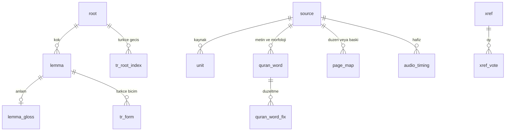
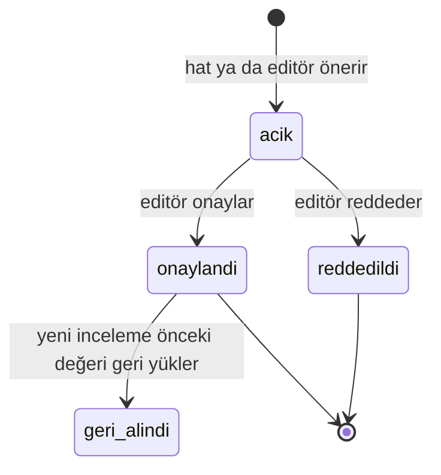

# Editoryal Veritabanı

> **Sürüm:** 1.3 · **Tarih:** 26 Ekim 2026 · **Durum:** Taslak
> **Bağlı kararlar:** [K-11](../00-ozet/02-karar-defteri.md#k-11--veritabanı-postgresql-18) · [K-10](../00-ozet/02-karar-defteri.md#k-10--arka-uç) · [K-06](../00-ozet/02-karar-defteri.md#k-06--yayın-kapısı) · [K-27](../00-ozet/02-karar-defteri.md#k-27--tek-bağlantı-tablosu) · [K-35](../00-ozet/02-karar-defteri.md#k-35--çapa-api-ayrıntıları) · [K-37](../00-ozet/02-karar-defteri.md#k-37--editoryal-şema-ayrıntıları) · [K-13](../00-ozet/02-karar-defteri.md#k-13--editör-paneli) · [K-19](../00-ozet/02-karar-defteri.md#k-19--kuran-kelime-anlamları) · K-12 ([karar defteri](../00-ozet/02-karar-defteri.md))

Editoryal veritabanı içeriğin tek doğruluk kaynağıdır. Python içerik hattı yazar, editör paneli onaylar, .NET yayınlayıcı okuyup SQLite paketlerini üretir. Mobil uygulama bu veritabanına bağlanmaz. Seçim PostgreSQL 18'dir; Türkçe ve Arapça tam metin yapılandırmaları hazırdır, anlamsal katman için pgvector eklenir (K-11). Geliştirme yerel Docker Compose'ta `postgres:18` ile çalışır ([Yerel geliştirme](../02-mimari/04-yerel-gelistirme.md)). Bu dosya diğer belgelerin önerdiği tabloları da kesin DDL olarak toplar (bölüm 11).

## 1. İlkeler

- Kaynak metin değiştirilmez. QAC dosyası "CHANGING IT IS NOT ALLOWED" der ([QAC indirme](https://corpus.quran.com/download/)); Tanzil şartları da değiştirmeyi yasaklar ([Tanzil metni, OpenITI kopyası](https://raw.githubusercontent.com/OpenITI/0025AH/master/data/0001Quran/0001Quran.Mushaf/0001Quran.Mushaf.Tanzil001-ara1.mARkdown)). Düzeltmeler ayrı katmanda durur.
- Her satır bir kaynağa, kaynak da lisans durumuna bağlanır. Yayın kapısı bu zincirle karar verir (K-06). Kapı metinlere ve veri setlerine aynı biçimde uygulanır.
- Tablo adları brifteki gibi İngilizcedir; enum değerleri Türkçedir. Lisans defterinin TOML alanları ve Backend API'nin JSON alanları sütun adlarıyla aynıdır. Bu belgelerin Türkçe adlandırdığı sütunlar (`source` alanlarının çoğu, `unit.metin`, `unit.metin_durumu`, `review` ve `release`) aynı adı taşır. Tablolar `icerik` şemasındadır; v1.x kullanıcı tabloları `kullanici` şemasında durur ([Kullanıcı verisi ve senkron](./04-kullanici-verisi-ve-senkron.md)).
- Çapa sütunları `COLLATE "C"` kullanır; bayt sıralaması `LIKE 'rn:sozler:%'` önek sorgularının B-ağacı dizinini kullanmasını sağlar. Bu bayt sırası çapa API'sinin `compare` sırası değildir ([Çapa şeması](./01-capa-semasi.md) §11, K-35); okuma sırası `unit.ord` sütunundadır. Aralıklar `int4range` olarak tutulur; PostgreSQL'in kanonik `[)` biçimi çapa şemasındaki yarı açık aralıkla aynıdır ([Çapa şeması](./01-capa-semasi.md)).
- `root.id`, `lemma.id` ve `xref.id` çapalar gibi kalıcıdır; satır silinip yeniden yaratılmaz.



`xref`, `review`, `tr_root_index` ve `embedding` birimlere çapa dizgisiyle bağlanır; yabancı anahtar yoktur. Bütünlüğü hat QA'sı ve yayın kapısı denetler.

## 2. Türler

```sql
CREATE SCHEMA IF NOT EXISTS icerik;
SET search_path = icerik, public;

CREATE TYPE license_status AS ENUM ('serbest','bekliyor','ic_kullanim','kapali');
CREATE TYPE derleme_turu   AS ENUM ('dev','internal','public');
CREATE TYPE source_kind    AS ENUM ('kuran_metni','meal','tefsir','hadis','hadis_ceviri','risale','kitap','morfoloji',
                                    'kelime_anlami','sozluk','mushaf_duzeni','mushaf_gorseli','font','baski','ses',
                                    'zamanlama','baglanti_verisi');
CREATE TYPE unit_kind      AS ENUM ('ayet','meal','tefsir','risale','hadis','hadis_ceviri','kitap');
CREATE TYPE unit_status    AS ENUM ('etkin','kullanim_disi');
CREATE TYPE metin_durumu   AS ENUM ('taslak','incelemede','onayli');
CREATE TYPE xref_type      AS ENUM ('atif','iktibas','ima','kok','lemma','konu','benzer_ayet','anlamsal');
CREATE TYPE xref_status    AS ENUM ('aday','onayli','red');
CREATE TYPE xref_origin    AS ENUM ('hat','editor','kullanici_oyu');
CREATE TYPE inceleme_durumu AS ENUM ('acik','onaylandi','reddedildi','geri_alindi');
CREATE TYPE surum_durumu   AS ENUM ('hazirlaniyor','dogrulandi','yayinlandi','basarisiz','geri_cekildi');
```

`license_status`, `xref_type`, `xref_status` ve `xref_origin` adları [Bağlantı modeli](../05-capraz-referans/01-baglanti-modeli.md) DDL'iyle; `inceleme_durumu`, `derleme_turu`, `surum_durumu` ve `metin_durumu` adları [Backend API](../02-mimari/05-backend-api.md) ile aynıdır. Backend API de `license_status` ve `xref_status` adlarını kullanır (ED-7 çözüldü).

## 3. `source`

```sql
CREATE TABLE source (
  slug                text COLLATE "C" PRIMARY KEY,     -- lisans defterindeki kimlik: 'tanzil-uthmani'
  tur                 source_kind NOT NULL,
  baslik              text NOT NULL,
  yazar               text,
  yazar_vefat_yili    smallint,
  surum               text NOT NULL,                    -- veri setinin ya da baskının sürümü
  provider            text,                             -- 'tanzil', 'qac', 'quran_foundation', 'tarteel', …
  kaynak_url          text,
  alinma_tarihi       date,
  dosya_sha256        char(64),
  baski_bilgisi       jsonb,                            -- baskılar: yayınevi, yıl, cilt takımı, ISBN, boy, yazı, metin esası
  license_name        text NOT NULL,                    -- 'CC BY 3.0 + değiştirme yasağı'
  license_url         text,
  license_status      license_status NOT NULL DEFAULT 'bekliyor',
  lisans_kopyasi      text,                             -- 'licenses/{slug}-{tarih}.txt'
  lisans_sha256       char(64),
  kamu_mali_tarihi    date,                             -- kamu malı olacağı gün
  kisitlar            jsonb NOT NULL DEFAULT '{}',      -- {"degistirme_yasak":true,"hazir_vt_yasak":true,"onbellek_gun":7}
  embed_ok            boolean NOT NULL DEFAULT false,   -- gömülebilir ya da dil modeli API'sine gönderilebilir mi
  kurul_gerekli       boolean NOT NULL DEFAULT false,
  kurul_onay          jsonb,                            -- {"onay_no","onayli_surum"}
  kurul_onay_tarihi   date,
  kurul_onay_ozeti    char(64),                         -- onaylanan içerik özeti (bölüm 10)
  atif_metni          text NOT NULL,                    -- Kaynaklar ve lisanslar ekranındaki zorunlu atıf
  atif_url            text,                             -- atıfla gösterilen bağlantı; boşsa kaynak_url
  notice_text         text,                             -- tam bildirim (ör. Tanzil telif bildirimi)
  yeniden_kontrol     date,
  notlar              text,
  created_at          timestamptz NOT NULL DEFAULT now(),
  updated_at          timestamptz NOT NULL DEFAULT now(),
  CHECK (kurul_onay IS NULL OR (kurul_onay ?& ARRAY['onay_no','onayli_surum']
                                AND kurul_onay_tarihi IS NOT NULL AND kurul_onay_ozeti IS NOT NULL))
);
```

- Kimlikler ve her kaynağın kesin durumu [Kaynaklar ve lisans defteri](../04-icerik/01-kaynaklar-ve-lisans-defteri.md) dosyasındadır. Defterdeki `pipeline/sources/{slug}.toml` alanları aynı adlı sütunlara yüklenir: `slug`, `tur`, `baslik`, `yazar`, `surum`, `kaynak_url`, `license_name`, `license_url`, `license_status`, `kisitlar`, `atif_metni`, `kurul_gerekli`, `embed_ok` ve hatta özgü `lisans_kopyasi`, `lisans_sha256`, `yeniden_kontrol`. Backend API kaynağı `/api/v1/sources/{slug}` adresinde aynı adlarla döndürür.
- Derleme türüne göre görünürlük yalnız `license_status` ile belirlenir: `public` ve `internal` yalnız `serbest`, `dev` ayrıca `bekliyor` ve `ic_kullanim` alır, `kapali` hiçbir derlemeye girmez (K-06). Lisans defterindeki `izinli_derleme` önerisine bu kuralla gerek kalmaz.
- `kurul_gerekli` varsayılanı türden gelir: `kuran_metni`, Arapça metinle gösterilen `meal`, `ses`, `mushaf_duzeni`, `font` ve `mushaf_gorseli` için `true`. Editör tek tek değiştirebilir; yayın kapısı yalnız bu alana bakar ([Yayın kapısı ve Kurul](../07-yayin/01-yayin-kapisi-ve-kurul.md)). Dayanak 633 sayılı Kanun m. 6'dır ([Lexpera, 633](https://www.lexpera.com.tr/mevzuat/kanunlar/diyanet-isleri-baskanligi-kurulus-ve-gorevleri-hakkinda-kanun-633)).
- Kurul onayı üç sütunda durur: `kurul_onay` (onay no ve onaylı sürüm), `kurul_onay_tarihi` ve `kurul_onay_ozeti`. Yayınlayıcı manifestteki `kurul_onay` nesnesini (`onay_no`, `onay_tarihi`, `onayli_surum`, `icerik_ozeti`) bu sütunlardan kurar ([Yayın kapısı ve Kurul](../07-yayin/01-yayin-kapisi-ve-kurul.md) §2.2).
- Yayınlayıcı her pakete `attribution` satırını şu eşlemeyle yazar: `baslik` → `title`, `surum` → `version`, `atif_url` (boşsa `kaynak_url`) → `source_url`, `atif_metni` → `required_credit`; `license_name`, `license_url` ve `notice_text` aynı adla geçer ([İçerik paketleri](./03-icerik-paketleri.md) §3.1).
- `kisitlar.hazir_vt_yasak = true` taşıyan kaynak hiçbir pakete girmez. Quran Foundation şartları hazır veritabanı dağıtımına izin vermez ve gömme vektörlerini de aynı kısıtlara bağlar ([QF Developer Terms](https://api-docs.quran.foundation/legal/developer-terms/)).
- `embed_ok` hukuki onayı tutar. Gömme hattı `provider = 'quran_foundation'` kaynakları hiç işlemez; diğerlerinde `embed_ok` ister. Risale için hukuki durum netleşene kadar `false` kalır ([Anlamsal katman](../05-capraz-referans/04-anlamsal-katman.md)).
- Risale baskıları (`tur = 'baski'`) da birer kaynaktır. [Risale hazırlığı](../04-icerik/05-risale-hazirligi.md) dosyasındaki `baski` alanları `baski_bilgisi` içinde durur.

Durumların anlamı K-06'dadır: `serbest` kamu malı, açık lisans ya da yazılı izin; `bekliyor` izin ya da açıklık istendi, cevap bekleniyor; `ic_kullanim` avukat görüşüyle yalnız ekip işleyebilir; `kapali` hiç kullanılmaz ve işlenmez. Hat `kapali` kaynağın dosyasını okumaz. Örnek satırlar (kimlikler ve kesin değerler lisans defterindedir; hukuki görüş değildir):

| `slug` | `tur` | `license_status` | `kurul_gerekli` | Not |
|---|---|---|---|---|
| `tanzil-uthmani`, `tanzil-simple-clean` | kuran_metni | `serbest` | evet | CC BY 3.0, değiştirme yasağı ([Tanzil metni](https://raw.githubusercontent.com/OpenITI/0025AH/master/data/0001Quran/0001Quran.Mushaf/0001Quran.Mushaf.Tanzil001-ara1.mARkdown)) |
| `elmalili-meal`, `elmalili-tefsir` | meal, tefsir | `serbest` | meal evet; tefsir Açık soru | 1 Ocak 2013'ten beri serbest ([MKÜ kaydı](https://openaccess.mku.edu.tr/items/1b02bae2-408d-43ea-920d-6c26605c442a); 2026-10-26'da 403 verdi, tarih 1942 + 71 hesabıdır, [lisans defteri](../04-icerik/01-kaynaklar-ve-lisans-defteri.md) §3.3); baskı kimliği `elmalili-1935` `baski_bilgisi` içinde; kendi aktarımımız |
| `qac-morfoloji` | morfoloji | `bekliyor` | hayır | QAC'ye yazılı soru ([QAC SSS](https://corpus.quran.com/faq.jsp)) |
| `tecrid-naim` · `tecrid-miras` | hadis_ceviri | `serbest` · `kapali` | hayır | Miras ciltleri 1 Ocak 2028'de serbest; `kamu_mali_tarihi = 2028-01-01` |
| `risale-1956-1960`, `risale-asil-nusha` | risale | `kapali` | hayır | Metin avukat görüşüne kadar kapalı; sonra `ic_kullanim`, izinle ya da 1 Ocak 2031'de `serbest`. Asıl nüsha 2031'den sonra yalnız karşılaştırma için |
| `quran-align` | zamanlama | `serbest` | ses paketiyle | CC BY 4.0 ([quran-align](https://raw.githubusercontent.com/cpfair/quran-align/master/README.md)) |
| `medine-604-duzen` | mushaf_duzeni | `bekliyor` | evet | Kaynak seçimi Açık soru |

## 4. `unit`

```sql
CREATE TABLE unit (
  id            bigint GENERATED ALWAYS AS IDENTITY PRIMARY KEY,
  anchor        text COLLATE "C" NOT NULL UNIQUE,   -- '@' içermez
  kind          unit_kind NOT NULL,
  role          text NOT NULL DEFAULT 'govde' CHECK (role IN ('govde','baslik','hasiye','dipnot','siir')),
  source_id     text NOT NULL REFERENCES source(slug),
  parent_path   text COLLATE "C",                    -- 'rn:sozler:soz-10:hakikat-3' (içindekiler)
  ord           bigint NOT NULL,                     -- okuma sırası; her yayında yeniden hesaplanabilir
  ayah_range    int4range,                           -- küresel âyet sırası 1..6236; âyete bağlı değilse NULL
  metin         text NOT NULL,                       -- kanonik metin (K-26: kaynak aynen; kendi metnimiz ilk kayıtta Çapa şeması §7 adımlarıyla, K-35); pakette text
  marks         jsonb NOT NULL DEFAULT '[]',         -- [{"s":0,"e":14,"t":"ar"},{"s":88,"t":"hasiye","a":"rn:…"}]
  sentences     int4range[],                         -- s1, s2, … sınırları (Risale)
  attrs         jsonb NOT NULL DEFAULT '{}',         -- türe özgü öznitelikler: {"cilt":1,"sayfa":214,…}; pakette attrs
  content_hash  char(64) NOT NULL CHECK (content_hash ~ '^[0-9a-f]{64}$'),
  rev           integer NOT NULL DEFAULT 1,
  metin_durumu  metin_durumu NOT NULL DEFAULT 'taslak',
  status        unit_status NOT NULL DEFAULT 'etkin',
  successors    jsonb,                               -- [{"anchor":"…","from":312,"to":640,"delta":-312}]
  tr_narrow     text,                                -- arama anahtarları; hat üretir
  tr_wide       text,
  tr_stem       text,
  ar_norm       text,
  tsv_tr        tsvector GENERATED ALWAYS AS (to_tsvector('turkish', coalesce(tr_narrow, ''))) STORED,
  tsv_ar        tsvector GENERATED ALWAYS AS (to_tsvector('arabic', coalesce(ar_norm, ''))) STORED,
  data_version  text NOT NULL,
  provenance    jsonb NOT NULL DEFAULT '{}',
  run_id        uuid,                                -- yükleyen hat çalıştırması (bölüm 10)
  created_at    timestamptz NOT NULL DEFAULT now(),
  updated_at    timestamptz NOT NULL DEFAULT now(),
  CHECK (status = 'etkin' OR successors IS NOT NULL)
);
CREATE INDEX unit_source_ord ON unit (source_id, ord);
CREATE INDEX unit_parent     ON unit (parent_path, ord);
CREATE INDEX unit_ayah       ON unit USING gist (ayah_range);
CREATE INDEX unit_tsv_tr     ON unit USING gin (tsv_tr);
CREATE INDEX unit_tsv_ar     ON unit USING gin (tsv_ar);
```

- Kur'an âyetleri, mealler, tefsir, Risale, hadis ve kitap paragrafları bu tabloda durur; Kur'an kelimeleri `quran_word` tablosundadır.
- Âyet ↔ meal ve âyet ↔ tefsir aralığı ilişkileri çapadan türetilir, `xref`'e yazılmaz (K-27). Sorgu için `ayah_range` yeter: "2:255'i açıklayan tefsir paragrafları" `ayah_range @> 262` olur (2:255'in küresel sırası 7 + 255 = 262).
- Diğer belgelerin `search_text` dediği normalize arama metni bu tabloda dört sütundur: `tr_narrow`, `tr_wide`, `tr_stem`, `ar_norm`. Hat onları [Arama](./05-arama-fts5.md) dosyasındaki kurallarla üretir. `tsv_tr` dar anahtarı kullanır, çünkü Snowball Türkçe gövdeleyicisi Türkçe harfleri bekler; PostgreSQL `turkish` ve `arabic` yapılandırmalarını hazır getirir ([PostgreSQL](https://docs.w3cub.com/postgresql~18/textsearch-psql)). Bu sütunlar editör paneli ve sonraki web araması içindir.
- PostgreSQL 18'in üretilen sütunlarda varsayılanı sanal (VIRTUAL) yaptığı bilgisi Doğrulanacak; dizinlenen sütunlar bu yüzden açıkça `STORED` yazılır.
- `metin_durumu`: Tanzil ve hazır metinler `onayli` girer; Elmalılı OCR metni `taslak` başlar ve editör onayından geçer. `public` derlemeye yalnız `onayli` metin girer (Backend API kapı kuralı P-10).
- `attrs` birim türüne özgü öznitelikleri taşır; paketteki `unit.attrs` bu sütundan gelir ([İçerik paketleri](./03-icerik-paketleri.md) §3.2) ve hattın `staged` satırındaki `attrs` alanı buraya yüklenir. Basılı kaynaktan aktarılan birimde cilt, sayfa, bölge kutusu ve kaynak satırları; birleşik mealde `kapsam` ve `birlesik_ile`; sure başındaki besmele mealinde `besmele_meali`; dipnotta `dipnotlar` ([Elmalılı hazırlığı](../04-icerik/03-elmalili-hazirligi.md#6-meali-âyetlere-bölme-ve-hizalama) §6). Satırın kökeni ayrıca `provenance` içindedir (bölüm 10).

## 5. Kur'an kelimeleri, kök ve lemma

```sql
CREATE TABLE root (
  id            integer PRIMARY KEY,                -- kalıcı kimlik
  letters       text NOT NULL UNIQUE,               -- 'ص ب ر'
  letters_bw    text,                               -- QAC Buckwalter
  occurrences   integer NOT NULL DEFAULT 0,         -- kelime sayısı
  ayah_count    integer NOT NULL DEFAULT 0,
  idf_q         real,                               -- ln(6236 / ayah_count)
  kok_anlami    text,                               -- kökün temel anlamı (kelime anlamları kılavuzu)
  source_id     text NOT NULL REFERENCES source(slug),
  data_version  text NOT NULL
);

CREATE TABLE lemma (
  id                 integer PRIMARY KEY,           -- kalıcı kimlik
  lang               text NOT NULL CHECK (lang IN ('ar','tr')),
  text               text NOT NULL,
  text_clean         text NOT NULL,
  root_id            integer REFERENCES root(id),
  occurrences        integer NOT NULL DEFAULT 0,
  qac_ref            text,                          -- QAC lemma dizgisi; QAC v2 geçişinde eşleme
  ar_lemma_id        integer REFERENCES lemma(id),  -- yalnız 'tr' satırı: Arapça karşılığı
  etymological_only  boolean NOT NULL DEFAULT false,
  origin             text,                          -- 'qac' | 'kaikki' | 'llm' | 'editor'
  status             xref_status NOT NULL DEFAULT 'aday',
  freq               integer,                       -- 'tr' satırında külliyat sıklığı
  source_id          text NOT NULL REFERENCES source(slug),
  data_version       text NOT NULL
);

CREATE TABLE lemma_gloss (                         -- K-19 Türkçe anlamları; kendi verimiz
  lemma_id           integer PRIMARY KEY REFERENCES lemma(id),
  anlam_kisa          text NOT NULL,                -- kelime kartındaki 1–4 kelimelik karşılık
  kuran_anlamlari     jsonb NOT NULL DEFAULT '[]',  -- en çok 3 madde
  turkce_es_kelime    text,
  yalnizca_etimolojik boolean NOT NULL DEFAULT false,
  editor_notu         text,                         -- uygulamada görünmez
  status             xref_status NOT NULL DEFAULT 'aday',
  origin             text NOT NULL,                 -- 'yz:{model}' | 'editor'
  version            text NOT NULL,
  content_hash       char(64) NOT NULL,
  updated_at         timestamptz NOT NULL DEFAULT now()
);

CREATE TABLE quran_word (
  anchor        text COLLATE "C" PRIMARY KEY,        -- 'q:2:255:3'
  surah         smallint NOT NULL, ayah smallint NOT NULL, word smallint NOT NULL,
  ayah_index    smallint NOT NULL,                   -- 1..6236
  text_uthmani  text NOT NULL,                       -- Tanzil Uthmani kelime, kaynaktaki baytlarla
  norm          text NOT NULL,                       -- Arapça normalize biçim
  char_start    integer NOT NULL,                    -- âyet kanonik metninde
  char_end      integer NOT NULL,
  root_id       integer REFERENCES root(id),         -- QAC değeri; düzeltme yayınlayıcıda uygulanır
  lemma_id      integer REFERENCES lemma(id),
  pos           text,
  features      jsonb,
  source_id     text NOT NULL REFERENCES source(slug), -- kelime bölme: tanzil-uthmani
  morph_source  text REFERENCES source(slug),          -- kök, lemma, pos: qac-morfoloji
  data_version  text NOT NULL,
  UNIQUE (surah, ayah, word),
  CHECK (char_start < char_end)
);
CREATE INDEX quran_word_root  ON quran_word (root_id);
CREATE INDEX quran_word_lemma ON quran_word (lemma_id);
CREATE INDEX quran_word_ayah  ON quran_word (ayah_index, word);

CREATE TABLE quran_word_fix (
  id          uuid PRIMARY KEY DEFAULT uuidv7(),
  anchor      text COLLATE "C" NOT NULL,             -- 'q:2:255:3'
  field       text NOT NULL CHECK (field IN ('root_id','lemma_id','pos','features')),
  qac_value   text,
  new_value   text NOT NULL,
  reason      text NOT NULL,
  status      xref_status NOT NULL DEFAULT 'aday',
  editor      text,
  created_at  timestamptz NOT NULL DEFAULT now(),
  UNIQUE (anchor, field)
);
```

- QAC 77.429 kelimeyi yaklaşık %99 doğrulukla etiketler ve veri hâlâ düzeltilmektedir ([QAC SSS](https://corpus.quran.com/faq.jsp)). Kelime bölme, metin ve ofsetler Tanzil'den türetilir (`source_id`); kök, lemma ve sözcük türü QAC'den gelir (`morph_source`). Bu ayrım paket bölünmesini taşır: QAC kaynaklı veri `core` paketine girmez, `kelime-kok` paketine girer ([İçerik paketleri](./03-icerik-paketleri.md); K-06 uygulama notu).
- Yayınlayıcı QAC tabanını okur ve yalnız `status = 'onayli'` düzeltmeleri üstüne uygular; künye "QAC v0.4 + Mütâlaa düzeltmeleri (N adet)" yazar ([Kök ve lemma](../05-capraz-referans/03-kok-ve-lemma.md)).
- Türkçe anlam alanları [Kelime anlamları](../04-icerik/06-kelime-anlamlari.md) kılavuzundaki adları aynen taşır: `anlam_kisa`, `kuran_anlamlari`, `turkce_es_kelime`, `yalnizca_etimolojik`, `editor_notu`; kökün temel anlamı `root.kok_anlami` sütunundadır. İş yükü farklı lemma sayısına bağlıdır (K-19).
- PostgreSQL 18'in `uuidv7()` işlevi Doğrulanacak; yoksa kimliği hat üretir.

## 6. Türkçe → kök indeksi ve sure adları

```sql
CREATE TABLE tr_root_index (                       -- onaylı köke bağlanan her Türkçe token
  anchor             text COLLATE "C" NOT NULL,
  span_start         integer NOT NULL,             -- kanonik metinde kod noktası
  span_end           integer NOT NULL,
  root_id            integer NOT NULL REFERENCES root(id),
  tr_lemma_id        integer NOT NULL REFERENCES lemma(id),
  etymological_only  boolean NOT NULL DEFAULT false,
  data_version       text NOT NULL,
  PRIMARY KEY (anchor, span_start),
  CHECK (span_start < span_end)
);
CREATE INDEX tr_root_index_root ON tr_root_index (root_id, anchor);

CREATE TABLE tr_form (                             -- dokunulan Türkçe kelimenin lemmasını bulur
  key_wide     text NOT NULL,
  key_narrow   text NOT NULL,
  tr_lemma_id  integer NOT NULL REFERENCES lemma(id),
  freq         integer NOT NULL DEFAULT 0,
  PRIMARY KEY (key_narrow, tr_lemma_id)
);
CREATE INDEX tr_form_wide ON tr_form (key_wide);

CREATE TABLE surah_alias (
  surah_no   smallint NOT NULL CHECK (surah_no BETWEEN 1 AND 114),
  alias      text NOT NULL,                        -- görüldüğü gibi: 'Âl-i İmrân'
  alias_key  text NOT NULL,                        -- geniş anahtar: 'al i imran'
  kind       text NOT NULL CHECK (kind IN ('kanonik','yazim','arapca','diger_ad')),
  risky      boolean NOT NULL DEFAULT false,       -- Nûr, Fecr gibi ortak kelime olan adlar
  status     xref_status NOT NULL DEFAULT 'aday',
  PRIMARY KEY (surah_no, alias)
);
```

- `tr_root_index` ve `tr_form` alanları [Kök ve lemma](../05-capraz-referans/03-kok-ve-lemma.md) önerisiyle aynıdır. `key_wide` ve `key_narrow` arama dosyasındaki geniş ve dar anahtarlardır.
- `surah_alias` açık atıf ayrıştırıcısının sure adı alternatiflerini besler ([İktibas tespiti](../05-capraz-referans/02-iktibas-tespiti.md)). Onaylı satırlardan `shared/data/sure-adlari.json` dışa aktarılır; `packages/anchors` ve `core` paketindeki `sure` tablosu bu dosyadan üretilir ([Çapa şeması](./01-capa-semasi.md)).

## 7. `xref` ve `xref_vote`

```sql
CREATE TABLE xref (
  id            uuid PRIMARY KEY DEFAULT uuidv7(),
  src_anchor    text COLLATE "C" NOT NULL, src_span int4range,
  dst_anchor    text COLLATE "C" NOT NULL, dst_span int4range,
  type          xref_type NOT NULL,
  score         real NOT NULL CHECK (score BETWEEN 0 AND 1),
  confidence    real NOT NULL CHECK (confidence BETWEEN 0 AND 1),
  evidence      jsonb NOT NULL DEFAULT '{}',
  origin        xref_origin NOT NULL,
  status        xref_status NOT NULL DEFAULT 'aday',
  votes_up      integer NOT NULL DEFAULT 0,
  votes_down    integer NOT NULL DEFAULT 0,
  data_version  text NOT NULL,
  license       license_status NOT NULL,
  CONSTRAINT xref_natural_key UNIQUE NULLS NOT DISTINCT (type, src_anchor, src_span, dst_anchor, dst_span)
);
CREATE INDEX xref_src   ON xref (src_anchor, type);
CREATE INDEX xref_dst   ON xref (dst_anchor, type);
CREATE INDEX xref_queue ON xref (type, confidence DESC) WHERE status = 'aday';

CREATE TABLE xref_vote (                           -- v1.x; canlıda genel kip veritabanında
  xref_id       uuid NOT NULL,                     -- xref.id; ayrı veritabanında yabancı anahtar kurulmaz
  account_hash  text NOT NULL,                     -- HMAC-SHA256(sunucu sırrı, hesap kimliği)
  vote          text NOT NULL CHECK (vote IN ('up','down')),
  reason        text CHECK (reason IN ('yanlis_ayet','iktibas_degil','kok_yanlis','alakasiz')),
  data_version  text NOT NULL,
  created_at    timestamptz NOT NULL DEFAULT now(),
  PRIMARY KEY (xref_id, account_hash)
);
```

- Sütunlar brifteki listeyle ve [Bağlantı modeli](../05-capraz-referans/01-baglanti-modeli.md) DDL'iyle aynıdır. Uçlar birim düzeyindedir. Kur'an ucunda `q:2:255:3-7` seçimi `dst_anchor = 'q:2:255'`, `dst_span = '[3,8)'` (kelime konumu) olur; metin biriminde aralık kod noktasıdır. Dönüşümü üç dilde `toUnitSpan` (`to_unit_span`, `ToUnitSpan`) yapar ([Çapa şeması](./01-capa-semasi.md) §11, K-35).
- `license` iki ucun ve bağlantı verisinin kaynaklarının en kısıtlayıcısıdır. Sorunlu çıkan bir veri seti tek sorguyla kapanır (rapor).
- Âyet aralığı çapası (`q:2:255-257`) bir birim olmadığı için `xref` ucu olmaz; aralık atıfları âyet başına satıra bölünür ve `evidence.group` ile bağlanır. Âyetleri `coveredAyahs` verir; `toUnitSpan` âyet aralığında ve cümle çapasında hata verir (K-35).
- `xref_vote` hesap kimliğini açık tutmaz. Tablo canlıdaki genel kip veritabanında durur; oy `PUT` ve `DELETE /api/v1/xrefs/{id}/vote` ile yazılır ([Genel mimari](../02-mimari/01-genel-mimari.md); [Backend API](../02-mimari/05-backend-api.md) §5). Gece işi oyları editoryal veritabanındaki `votes_up` ve `votes_down` sayaçlarına işler; hesap silinince oylar silinir (K-25, [KVKK](../07-yayin/02-kvkk-ve-gizlilik.md)).

## 8. `review` ve inceleme akışı

```sql
CREATE TABLE review (
  id               bigint GENERATED ALWAYS AS IDENTITY PRIMARY KEY,
  hedef_tablo      text NOT NULL CHECK (hedef_tablo IN ('source','unit','quran_word_fix','lemma','lemma_gloss',
                   'root','tr_root_index','tr_form','surah_alias','xref','page_map','ayah_box','audio_timing')),
  hedef_anahtar    text NOT NULL,                  -- çapa, lemma id, kaynak id …
  xref_id          uuid REFERENCES xref(id),       -- bağlantı incelemesinde dolu
  alan             text NOT NULL,                  -- 'metin', 'anlam_kisa', 'status', 'license_status', …
  eylem            text NOT NULL,                  -- 'onayla' | 'duzenle_onayla' | 'reddet' | 'uzmana_gonder' | 'etimolojik_isaretle'
  onceki           jsonb,
  onerilen         jsonb,
  durum            inceleme_durumu NOT NULL DEFAULT 'acik',
  koken            xref_origin NOT NULL,
  yz_modeli        text,
  yz_kaydi         jsonb,                          -- G-YZ: {"prompt_id","prompt_sha256","input_sha256"} (K-37)
  guven            real,
  oneren           text NOT NULL,
  inceleyen        text,
  ikinci_inceleyen text,
  sure_ms          integer,                        -- maliyet tahmini için
  gerekce          text,
  created_at       timestamptz NOT NULL DEFAULT now(),
  incelendi_at     timestamptz,
  CONSTRAINT review_yz_kaydi_check CHECK (
    (yz_modeli IS NULL AND yz_kaydi IS NULL)
    OR (yz_modeli IS NOT NULL AND yz_kaydi IS NOT NULL AND jsonb_typeof(yz_kaydi) = 'object'
        AND yz_kaydi ?& ARRAY['prompt_id','prompt_sha256','input_sha256']
        AND coalesce(yz_kaydi->>'prompt_sha256','') ~ '^[0-9a-f]{64}$'
        AND coalesce(yz_kaydi->>'input_sha256','') ~ '^[0-9a-f]{64}$'))
);
CREATE INDEX review_queue ON review (hedef_tablo, created_at) WHERE durum = 'acik';
CREATE INDEX review_xref  ON review (xref_id) WHERE xref_id IS NOT NULL;
```



- Hat onaylı alanlara yazmaz. Adayları yazar (`xref.status = 'aday'`, `lemma_gloss.status = 'aday'`, `unit.metin_durumu = 'taslak'`) ve her aday için `review` satırı açar. Yeni çalışmada üretilmeyen `aday` bağlantı silinir; `onayli` bağlantı silinmez, yeniden doğrulama için kuyruğa düşer (bağlantı modeli).
- Onay `onerilen` değerini hedefe aynı işlemde uygular; kendi `status` alanı olan tablolarda onay `onayli`, ret `red` yazar. Kelime anlamı incelemesi gerçek sütun adlarını kullanır: `hedef_tablo = 'lemma_gloss'`, `alan = 'anlam_kisa'` ([Backend API](../02-mimari/05-backend-api.md) §4.1 kuyruk tablosuyla aynı). Kur'an metni için metin incelemesi açılmaz.
- İkinci onay gereken alanlar: meal ve tefsir metni, `source.license_status`, `source.kurul_onay`, `source.embed_ok`. İlk onay `inceleyen` alanını doldurur ve kayıt `acik` kalır; farklı bir editörün onayı değeri uygular ve `ikinci_inceleyen` alanını doldurur ([Backend API](../02-mimari/05-backend-api.md) §4.1).
- Yapay zekâ taslakları `yz_modeli` ve `yz_kaydi` taşır ve onaylanana kadar "doğrulanmamış" rozetiyle görünür ([K-25](../00-ozet/02-karar-defteri.md#k-25--i̇lkeler)). G-YZ kaydının ([İçerik hattı](../04-icerik/02-icerik-hatti.md) §9–§10) alanları şöyle eşlenir ([K-37](../00-ozet/02-karar-defteri.md#k-37--editoryal-şema-ayrıntıları)):
  - `ai_model` → `yz_modeli`; `prompt_id`, `prompt_sha256` ve `input_sha256` → `yz_kaydi` nesnesinin anahtarları; `review_id` → `review.id`; `created_at` → `review.created_at`.
  - `review_yz_kaydi_check`: `yz_modeli` ile `yz_kaydi` ya ikisi birden boştur ya ikisi birden doludur. Doluysa `yz_kaydi` üç anahtarı taşıyan bir JSON nesnesidir; iki özet 64 küçük harfli onaltılık karakterdir.
  - `dogrulanmis` saklanmaz; hedef satırın onaylı durumundan türetilir. `xref_status` türünde `status` sütunu olan tablolarda (`lemma`, `lemma_gloss`, `quran_word_fix`, `surah_alias`, `xref`) `status = 'onayli'`, `unit`'te `metin_durumu = 'onayli'` doğrulanmış demektir.
- `oneren` ve `inceleyen` alanlarına ASP.NET Core Identity kullanıcı adı yazılır; roller `editor` ve `admin`'dir ([Backend API](../02-mimari/05-backend-api.md) §6).

## 9. Mushaf, ses ve gömme tabloları

### 9.1 `page_map`, `ayah_box`, `audio_timing`

```sql
CREATE TABLE page_map (
  id            bigint GENERATED ALWAYS AS IDENTITY PRIMARY KEY,
  source_id     text NOT NULL REFERENCES source(slug),  -- düzen ya da baskı
  volume        smallint,
  page          integer NOT NULL,
  line          smallint,                             -- yalnız Mod A
  line_type     text CHECK (line_type IN ('ayet','sure_adi','besmele')),
  centered      boolean NOT NULL DEFAULT false,
  start_anchor  text COLLATE "C" NOT NULL,            -- Mod A ve C'de kelime çapası
  start_offset  integer,                              -- basılı baskılarda paragraf içi ofset
  end_anchor    text COLLATE "C" NOT NULL,
  end_offset    integer,
  glyphs        jsonb,                                -- Mod A: [{"a":"q:2:6:1","g":"…"},{"a":"q:2:6","g":"…","end":true}]
  data_version  text NOT NULL,
  UNIQUE NULLS NOT DISTINCT (source_id, volume, page, line)
);
CREATE INDEX page_map_start ON page_map (start_anchor);

CREATE TABLE ayah_box (
  source_id  text NOT NULL REFERENCES source(slug),     -- Mod B görsel kaynağı
  page       integer NOT NULL,
  anchor     text COLLATE "C" NOT NULL,               -- 'q:{sure}:{ayet}'
  seq        smallint NOT NULL,                       -- âyetin satır başına kutuları
  x integer NOT NULL, y integer NOT NULL, w integer NOT NULL, h integer NOT NULL,  -- görsel pikseli
  data_version text NOT NULL,
  PRIMARY KEY (source_id, page, anchor, seq),
  CHECK (w > 0 AND h > 0)
);

CREATE TABLE audio_timing (
  source_id      text NOT NULL REFERENCES source(slug), -- hafız ses kaynağı
  anchor         text COLLATE "C" NOT NULL,           -- 'q:{sure}:{ayet}'
  file           text NOT NULL,                       -- paket içi yol: '002/255.mp3' ya da '002.mp3'
  file_sha256    char(64) NOT NULL,                   -- zamanlamanın bağlı olduğu bayt dizisi
  start_ms       integer NOT NULL,
  end_ms         integer NOT NULL,
  words          jsonb,                               -- [[kelime, start_ms, end_ms], …]
  timing_source  text NOT NULL,                       -- 'quran-align' | 'editor'
  data_version   text NOT NULL,
  PRIMARY KEY (source_id, anchor),
  CHECK (start_ms < end_ms)
);
```

- `page_map` satırının anlamı kaynağa göre değişir: Mod A'da satır, Mod B ve C'de sayfa, basılı baskıda sayfa başlangıcı. `sure_adi` ve `besmele` satırlarında çapa olarak surenin ilk âyeti yazılır. `glyphs` Mod A paketindeki `glyph_word` tablosunun kaynağıdır ([Mobil mimari](../06-mobil/01-mobil-mimari.md)). Düzen verisinin kaynağı Açık soru (`medine-604-duzen`, lisans defteri).
- Basılı baskıda `source_id` şöyle seçilir. Tek baskıdan kendi aktarımımızı yaptığımız kaynakta (Elmalılı, Tecrîd) `source_id` birimin kaynağıdır (`elmalili-meal`, `elmalili-tefsir`, `tecrid-naim` …); baskı kimliği (ör. `elmalili-1935`) o kaynağın `baski_bilgisi` alanındadır ve cilt `volume` sütunundadır. Birden çok baskısı eşlenen eserde (Risale) her baskı `tur = 'baski'` olan ayrı bir kaynaktır ve `source_id` odur (bölüm 3).
- `ayah_box` koordinatları görsel piksel uzayındadır. Yaklaşım Quran for Android'den alınmıştır, onun veri biçimi doğrulanmadı.
- quran-align zamanlamaları yalnız hizalandıkları EveryAyah dosyaları için geçerlidir ([quran-align](https://raw.githubusercontent.com/cpfair/quran-align/master/README.md)); `file_sha256` dosya değişince satırın reddedilmesini sağlar. Çıktı biçiminin `words` dizisine dönüşümü Doğrulanacak.

### 9.2 `embedding` (v1.x)

```sql
CREATE EXTENSION IF NOT EXISTS vector;
CREATE TABLE embedding (
  anchor        text COLLATE "C" NOT NULL,
  chunk         smallint NOT NULL DEFAULT 0,
  span          int4range,
  model         text NOT NULL,
  content_hash  char(64) NOT NULL,                  -- gömüldüğü andaki birim özeti
  v             halfvec(1024) NOT NULL,
  PRIMARY KEY (anchor, chunk, model)
);
CREATE INDEX embedding_hnsw ON embedding USING hnsw (v halfvec_cosine_ops);
```

Satır yalnız `embed_ok` kaynaklardan üretilir. `content_hash` birimin güncel özetinden farklıysa satır yeniden gömülür. Tasarım ve model seçimi [Anlamsal katman](../05-capraz-referans/04-anlamsal-katman.md) dosyasındadır; pgvector HNSW ve `halfvec` destekler ([PGXN pgvector](https://pgxn.org/dist/vector)).

## 10. Köken, yükleme ve `release`

```sql
CREATE TABLE release (
  id               integer GENERATED ALWAYS AS IDENTITY PRIMARY KEY,
  surum            text NOT NULL,                  -- '2026.11.0'
  derleme          derleme_turu NOT NULL,
  durum            surum_durumu NOT NULL DEFAULT 'hazirlaniyor',
  manifest         jsonb,                          -- imzalı manifest.json
  kapi_raporu      jsonb NOT NULL DEFAULT '{}',    -- paket başına dahil/hariç ve gerekçe
  kaynak_durumu    jsonb NOT NULL DEFAULT '{}',    -- yayın anındaki lisans ve Kurul bilgisi
  ozetler          jsonb NOT NULL DEFAULT '{}',    -- kaynak ve paket içerik özetleri
  data_version     text NOT NULL,
  olusturan        text NOT NULL,
  created_at       timestamptz NOT NULL DEFAULT now(),
  yayinlandi_at    timestamptz,
  UNIQUE (surum, derleme)
);

CREATE TABLE pipeline_run (
  run_id      uuid PRIMARY KEY,                     -- hattın ürettiği UUIDv7
  komut       text NOT NULL,
  git_commit  text NOT NULL,
  parmak_izi  char(64) NOT NULL,                    -- girdi, yapılandırma ve araç sürümlerinin özeti
  baslangic   timestamptz NOT NULL,
  bitis       timestamptz,
  durum       text NOT NULL CHECK (durum IN ('calisiyor','basarili','basarisiz')),
  manifest    jsonb NOT NULL DEFAULT '{}'           -- çalıştırma manifesti
);
ALTER TABLE unit ADD FOREIGN KEY (run_id) REFERENCES pipeline_run (run_id);
```

- `data_version` hat çalıştırmalarında `{yyyy.mm.dd}-{hat_git_kısa_sha}`, hazır veri setlerinde `{source_id}@{sürüm}` biçimindedir. `unit.provenance` satırın kökenini yazar: `{"file":"cilt1.txt","line":1204,"ocr_page":"c1-s45","steps":["nfc","bosluk"]}`.
- Hattın yüklediği her `unit` satırı `run_id` taşır; `pipeline_run` sütunları [İçerik hattı](../04-icerik/02-icerik-hatti.md) önerisiyle aynıdır. `xref` satırının çalıştırması `evidence.run_id` içinde durur; bağlantı modelinin sütun listesi değişmez.
- Hat veriyi `staging_unit` gibi geçici tablolara psycopg 3 `COPY` ile yükler, sonra tek işlemde çapaya göre upsert yapar ([İçerik hattı](../04-icerik/02-icerik-hatti.md) §6). İşlem kapanmadan şu denetimler koşar: önceki çalışmadaki her çapa hâlâ var; kullanım dışı her çapanın `successors` alanı dolu; özetler biçimce geçerli.
- İçerik ve Kurul özetleri tek sıralama kuralı kullanır: çapaların bayt sırası (`COLLATE "C"`); ses ve font dosyalarında yolun bayt sırası. Satır biçimi ve hesap [İçerik paketleri](./03-icerik-paketleri.md) bölüm 6'dadır; Kurul özeti aynı kuralı yalnız Kurul kapsamındaki kaynaklara uygular ([Yayın kapısı ve Kurul](../07-yayin/01-yayin-kapisi-ve-kurul.md)). `public` kapısı bu özetin `source.kurul_onay_ozeti` ile eşleşmesini ister (Backend API P-04). Kurul onayı belirli bir sürüme bağlıdır ve onaylanmış eserin içeriği değiştirilemez ([Memurlar.net, 2022](https://www.memurlar.net/haber/1045766/kur-an-i-kerim-basim-ve-yayim-kriterleri-hakkinda-yonetmelik-resmi-gazete-de-yayimlandi.html)).
- Kapıdan ya da doğrulamadan geçemeyen yayın `durum = 'basarisiz'` olur ve `kapi_raporu` gerekçeyi taşır; manifest yayımlanmaz. [Backend API](../02-mimari/05-backend-api.md#106-durumlar-idempotentlik-terfi-ve-geri-alma) §10.6 de aynı değeri kullanır; talep yeni bir `release` satırıyla yeniden denenir.
- Yayımlanmış sürüm değişmez. Geri çekme `durum = 'geri_cekildi'` ve önceki sürümü gösteren yeni manifestle yapılır ([İçerik paketleri](./03-icerik-paketleri.md)).

## 11. Diğer belgelerin önerileriyle eşleşme

| Öneren belge | Öneri | Bu şemadaki karşılığı |
|---|---|---|
| [Bağlantı modeli](../05-capraz-referans/01-baglanti-modeli.md) | `xref`, `xref_vote`, yayın süzgeci sorgusu (`review.xref_id`, `review.state`) | Bölüm 7 ve 8; `review.state` bu şemada `durum` adını taşır |
| [Kök ve lemma](../05-capraz-referans/03-kok-ve-lemma.md) | `root`, `lemma`, `quran_word`, `quran_word_fix`, `tr_root_index`, `tr_form` | Bölüm 5 ve 6; Türkçe lemmalar `lemma.lang = 'tr'` satırıdır |
| [İktibas tespiti](../05-capraz-referans/02-iktibas-tespiti.md) | `surah_alias` | Bölüm 6 |
| [Anlamsal katman](../05-capraz-referans/04-anlamsal-katman.md) | `embedding`, `source.embed_ok` | Bölüm 9 ve 3 |
| [Kelime anlamları](../04-icerik/06-kelime-anlamlari.md) | Anlam alanları | `lemma_gloss` ve `root.kok_anlami`, aynı alan adlarıyla |
| [Risale hazırlığı](../04-icerik/05-risale-hazirligi.md) | `baski` | `source.tur = 'baski'` + `baski_bilgisi` |
| [Hadis hazırlığı](../04-icerik/04-hadis-hazirligi.md) | `hadis_numara_esleme`, `hadis_konum` | Aşağıda, İngilizce adlarla |
| [Kaynaklar ve lisans defteri](../04-icerik/01-kaynaklar-ve-lisans-defteri.md) | TOML alanları; `izinli_derleme`; örnek satırlar | Bölüm 3, aynı adlarla; `izinli_derleme` yerine K-06 derleme kuralı; örnek satırlar defterle aynıdır (`risale-asil-nusha` ve `tecrid-miras` `kapali`) |
| [İçerik hattı](../04-icerik/02-icerik-hatti.md) | `pipeline_run`, `run_id`; `xref` tekillik anahtarına `origin`; örnekteki `unit.text` ve `status = 'aday'` | Bölüm 10; `xref_natural_key` bağlantı modelindeki gibi `origin` içermez, reddedilen anahtarı `red` satırı korur; `unit.metin` ve `metin_durumu = 'taslak'` |
| [Yayın kapısı ve Kurul](../07-yayin/01-yayin-kapisi-ve-kurul.md) | `kurul_onay`, `kurul_onay_tarihi`, `kurul_onay_ozeti`, `atif_metni` | Bölüm 3, aynı adlarla |
| [Genel mimari](../02-mimari/01-genel-mimari.md) | `xref_vote` canlı veritabanında, editoryal tarafta yalnız toplamlar | Bölüm 7 |
| [Backend API](../02-mimari/05-backend-api.md) | `search_text`; kelime anlamı alanı; lisans ve bağlantı durumu türleri; paket üst veri tablosu; `kisitlar.hazir_vt_yasak` | Bölüm 4'teki dört arama sütunu; `lemma_gloss.anlam_kisa`; `license_status`, `xref_status` (bölüm 2); `pack_meta` ([İçerik paketleri](./03-icerik-paketleri.md)); bölüm 3. Backend API bu adları aynen kullanır (ED-7 çözüldü) |

```sql
CREATE TABLE hadith_number_map (                  -- hadis_numara_esleme
  collection  text NOT NULL,                      -- 'buhari'
  system      text NOT NULL,                      -- 'kaynak-baski', 'sunnah-com', 'tecrid'
  number      text NOT NULL,
  anchor      text COLLATE "C" NOT NULL,          -- 'h:buhari:52'
  PRIMARY KEY (collection, system, number)
);
CREATE TABLE hadith_location (                    -- hadis_konum: kitap › bâb › hadis
  anchor     text COLLATE "C" PRIMARY KEY,
  book_no    integer, book_name text,
  bab_no     integer, bab_name  text,
  ord        integer NOT NULL
);
```

## 12. EF Core eşleme notları ve göç politikası

- `Mutalaa.Infrastructure` içinde `IcerikDbContext` tabloları eşler; yayınlayıcı ve editör uçları aynı bağlamı kullanır ([Proje yapısı](../02-mimari/03-proje-yapisi.md)). C# adlandırması PascalCase, veritabanı adları snake_case'tir (`EFCore.NamingConventions`; EF Core 10 desteği Doğrulanacak).
- Enum'lar Npgsql enum eşlemesiyle bağlanır (`LicenseStatus`, `BuildFlavor` yayın kapısı belgesindeki C# türleridir); Npgsql EF Core 10'daki yapılandırma API'sinin adı Doğrulanacak.
- Tür eşlemeleri: `int4range` → `NpgsqlRange<int>`, `jsonb` → sahipli tür (`ToJson`) ya da `JsonDocument`, `tsvector` → `NpgsqlTsVector`, `halfvec` → pgvector .NET türü (Doğrulanacak). Üretilen sütunlar `HasComputedColumnSql("…", stored: true)`, `COLLATE "C"` `UseCollation("C")`, GiST/GIN/HNSW `HasMethod(…)` ile tanımlanır.
- Çapa sütunları `Mutalaa.Domain/Anchors` içindeki `AnchorRef` türüne değer dönüştürücüsüyle bağlanır; geçersiz çapa yazılamaz. Yayınlayıcı okumaları `AsNoTracking()` ve `AsAsyncEnumerable()` ile akış hâlinde yapar.
- Şemanın tek sahibi EF Core göçleridir (`server/Mutalaa.Infrastructure/Migrations`). Python hattı şema değiştirmez. Göçler `dotnet ef migrations bundle` ile uygulanır; API açılışında otomatik göç yoktur. EF'nin ifade edemediği yapılar (`UNIQUE NULLS NOT DISTINCT`, `ALTER TYPE … ADD VALUE`, HNSW) göç içinde ham SQL'dir.
- Yıkıcı değişiklik tek adımda yapılmaz: sütun eklenir, doldurulur, okuyucular geçirilir, eski sütun sonraki göçte kalkar. Enum'a eklenen değer geri alınamaz.
- CI `postgres:18` konteyneri açar, göç paketini uygular, hat ve yayınlayıcı testlerini aynı veritabanında koşar ([Test stratejisi](../07-yayin/03-test-stratejisi.md)).

## 13. Açık sorular

| No | Konu | Durum |
|---|---|---|
| ED-1 | Editör panelinin v1 kimlik doğrulaması | Cevaplandı: ASP.NET Core Identity ([Backend API](../02-mimari/05-backend-api.md) §6) |
| ED-2 | İkinci onay gereken alanların kesin listesi | Öneri; Backend API §4.1 ile aynı |
| ED-3 | PostgreSQL 18'de `uuidv7()` ve üretilen sütun varsayılanı | Doğrulanacak |
| ED-4 | QAC lisansı; gelmezse kelime anlamlarının kelime çapasına göre `core`'a alınması (avukat) | Açık soru, hukuki görüş değildir |
| ED-5 | Mod A düzen ve glif verisinin kaynağı (`medine-604-duzen`) | Açık soru |
| ED-6 | Konu düğümü tabloları (`konu:{slug}`, v1.x) | Açık soru |
| ED-7 | Backend API ile ad farkları: `lisans_durumu` ve `xref_durum` tür adları, `lemma.tr_anlam`, paket `meta` tablosu, başarısız yayının `hazirlaniyor` kalması. Bu şema bağlantı modelinin tür adlarını, `lemma_gloss`, `pack_meta` ve `basarisiz` değerini kullanır | **Çözüldü (19 Ekim 2026):** Backend API bu şemanın adlarını kullanır ([Backend API](../02-mimari/05-backend-api.md) §4.1, §7, §10.4, §10.6) |

## İlgili dosyalar

- [Karar defteri](../00-ozet/02-karar-defteri.md) · [Çapa şeması](./01-capa-semasi.md) · [İçerik paketleri](./03-icerik-paketleri.md) · [Kullanıcı verisi ve senkron](./04-kullanici-verisi-ve-senkron.md) · [Arama (FTS5)](./05-arama-fts5.md)
- [Kaynaklar ve lisans defteri](../04-icerik/01-kaynaklar-ve-lisans-defteri.md) · [İçerik hattı](../04-icerik/02-icerik-hatti.md) · [Kelime anlamları](../04-icerik/06-kelime-anlamlari.md)
- [Bağlantı modeli](../05-capraz-referans/01-baglanti-modeli.md) · [İktibas tespiti](../05-capraz-referans/02-iktibas-tespiti.md) · [Kök ve lemma](../05-capraz-referans/03-kok-ve-lemma.md) · [Anlamsal katman](../05-capraz-referans/04-anlamsal-katman.md)
- [Backend API](../02-mimari/05-backend-api.md) · [Proje yapısı](../02-mimari/03-proje-yapisi.md) · [Yayın kapısı ve Kurul](../07-yayin/01-yayin-kapisi-ve-kurul.md)
