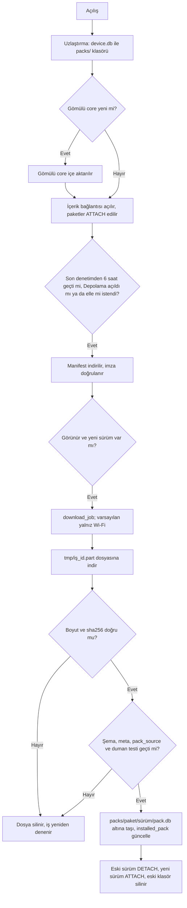

# İçerik Paketleri

> **Sürüm:** 1.10 · **Tarih:** 11 Kasım 2026 · **Durum:** Taslak
> **Bağlı kararlar:** [K-46](../00-ozet/02-karar-defteri.md#k-46--yayın-kaydı-içerik-özetleri-ve-fikstürler) · [K-45](../00-ozet/02-karar-defteri.md#k-45--manifest-imzası-ve-kanonik-json) · K-21 ([karar defteri](../00-ozet/02-karar-defteri.md)) · [K-44](../00-ozet/02-karar-defteri.md#k-44--arama-indeksi-ve-paket-şeması-cihaz-gövdeleyicisi-simple-clean-paket-tabloları) · [K-42](../00-ozet/02-karar-defteri.md#k-42--kaynak-ilkesi-ve-kalite-temelli-görünürlük) · [K-18](../00-ozet/02-karar-defteri.md#k-18--depolama-yöneticisi-v1de) · [K-07](../00-ozet/02-karar-defteri.md#k-07--mushaf-görünümü-üç-seçenek) · [K-27](../00-ozet/02-karar-defteri.md#k-27--tek-bağlantı-tablosu) · [K-41](../00-ozet/02-karar-defteri.md#k-41--ses-sistemi-hazır-kayıtlar-ayna-ve-çevrimiçi-öncelikli-dinleme) · [K-43](../00-ozet/02-karar-defteri.md#k-43--kuran-yapı-verisi-kelime-numarası-işaret-tablosu-ve-aday-satırları) · [K-49](../00-ozet/02-karar-defteri.md#k-49--elmalılı-mealleri-hazır-metin-yolu-ve-ocrın-proje-sonuna-ertelenmesi)

İçerik cihaza sürümlü SQLite paketleri olarak iner. Yerelde SeaweedFS'in S3 API'si ([Yerel geliştirme](../02-mimari/04-yerel-gelistirme.md)), canlıda S3 uyumlu bir depo kullanılır; öneri Cloudflare R2'dir (depolama 0,015 $/GB-ay, veri çıkışı ücretsiz; [R2 fiyatlandırma](https://developers.cloudflare.com/r2/pricing)). Yayınlayıcı (`Mutalaa.Publisher`) editoryal veritabanından her derleme türü için ayrı paketler ve ayrı, imzalı bir manifest üretir ([Editoryal veritabanı](./02-editoryal-veritabani.md); [Yayın süreci](../07-yayin/01-yayin-sureci.md)).

Cihazda üç tür yerel veritabanı vardır ([Mobil mimari](../06-mobil/01-mobil-mimari.md); [Depolama yöneticisi](../06-mobil/03-depolama-yoneticisi.md)):

| Dosya | Yazma | Senkron | İçerik |
|---|---|---|---|
| `packs/core-<sürüm>.db` (gömülü çekirdek), `packs/<pack_id>/<sürüm>/pack.db` (indirilen) | Yok (`PRAGMA query_only`) | Yok | Bu dosyadaki paketler |
| `db/user.db` | Var | v1.x'te | Kullanıcı verisi ([Kullanıcı verisi ve senkron](./04-kullanici-verisi-ve-senkron.md)) |
| `db/device.db` | Var | Hiç | `installed_pack`, `download_job`, `audio_file` |

## 1. Paket listesi

| pack_id | İçerik | Kaynak ve not |
|---|---|---|
| `core` (uygulamaya gömülü) | Tanzil Uthmani metni ve Simple Clean'den üretilen Arapça arama metni (bölüm 3.2), Elmalılı mealleri (orijinal `elmalili-meal` ve sadeleştirilmiş `elmalili-sade-meal`; `taslak` girer, `dev` ve `internal`'da "doğrulanmamış" rozetiyle görünür, `public`'te yalnız onaylılar; [K-49](../00-ozet/02-karar-defteri.md#k-49--elmalılı-mealleri-hazır-metin-yolu-ve-ocrın-proje-sonuna-ertelenmesi)), Tanzil'den türetilen kelime bölmesi (`quran_word`), Kur'an içi ve meal bağlantı indeksleri, Medine 604 sayfa eşlemesi, `sure` tablosu | Yalnız Kur'an metni, meal ve kendi verimiz; her derlemede bulunur |
| `kelime-kok` | QAC kaynaklı kök, lemma ve kelime morfolojisi; Türkçe kelime anlamları; Türkçe biçim sözlüğü; meal için Türkçe → kök indeksi | Bütün derlemelerde yer alır; boyutu yüzünden ayrı ve isteğe bağlı pakettir. Türkçe anlamlar önce hazır kaynaktan alınır (K-19) |
| `tefsir-elmalili` | Hak Dini Kur'an Dili paragrafları ve haşiyeleri, bağlantılar, 1935–39 baskı sayfa eşlemesi | Metin kaynağı hazır metin uygunsa A37'de alınır; uygun değilse S-15 (K-38, K-49) |
| `hadis-tecrid` | `h:tecrid` Arapça, `ht:naim` ve `ht:miras` çevirileri | Tecrîd-i Sarîh'in tamamı: Ahmed Naim ve Kâmil Miras çevirileri (K-04) |
| `hadis-kutub-i-sitte` | Altı kitabın Arapça metni | Kaynak, eksiksizlik ve numaralandırma ölçümüyle A19'da seçilir (K-04) |
| `risale-dizin` | Bütün Risale kitapları için arama indeksi, Risale bağlantı indeksi, baskı sayfa eşlemeleri | Metinli atıf dizini; Risale metniyle birlikte üretilir (A20) |
| `risale-{kitap}` | Kitabın paragrafları ve haşiyeleri; arama indeksi taşımaz | Kelimesi kelimesine; kaynak A20'de araştırmayla seçilir |
| `mushaf-a-cuz-{01..30}` | QPC V2 sayfa fontları, satır düzeni ve glif kodları | QPC fontları ve düzen verisi GitHub ya da QUL'dan alınır (A26) |
| `mushaf-b` | Türk hattı sayfa görselleri, `ayah_box`, Türk düzeni sayfa eşlemesi | Sayfa görselleri A40'ta kaynak araştırmasıyla bulunur (K-07) |
| `ses-katalog` | Okuyucular, kayıtlar ve kayıt başına 114 sure dosyasının ayna adresi, bayt, sha256 ve süresi; manifestle kendiliğinden iner | Sure dosyaları MP3Quran ve Tarteel CDN'inden alınıp kendi depomuzda yansıtılır (K-41 madde 3 ve 4) |
| `ses-zaman-{kayit}` | Kaydın âyet, kelime ve özel bölüt zamanlaması (QUD); kayıt ilk seçilince kendiliğinden iner. Ses dosyaları paket dışındadır, aynadan iner | Zamanlama QUD v4.0.0'dandır (K-41 madde 3); atıf Ayarlar › Kaynaklar ekranında görünür |

- `core` QAC verisi taşımaz. Kelime bölmesi, kelime metni ve ofsetler Tanzil metninden türetilir. `kelime-kok` kurulu değilse kelime kartı Arapça kelimeyi, âyeti ve aramayı gösterir; kök, lemma ve Türkçe anlam bu paketle gelir.
- `risale-dizin` bir kitap değildir; Risale kitap slugları `dizin` adını kullanmaz. Paket ATTACH sınırı yüzünden vardır (bölüm 2).
- Paketlerin kaynakları ve atıf satırları [Kaynaklar](../04-icerik/01-kaynaklar.md) dosyasında ve `pipeline/sources/` kayıtlarındadır. Hangi paketin hangi derlemede ne taşıdığı bölüm 7'dedir.

## 2. ATTACH bütçesi

SQLite bir bağlantıya varsayılan olarak en çok 10 veritabanı bağlar (`SQLITE_MAX_ATTACHED`; [SQLite sınırları](https://www.sqlite.org/limits.html)). expo-sqlite derlemesindeki değer Doğrulanacak; mobil mimari `MAX_ATTACHED = 8` kullanır. Risale kitap başına bir paket olduğu için kitapları tek tek bağlamak bu sınırı aşar. Bu yüzden Risale araması, Risale bağlantıları ve Risale için Türkçe → kök indeksi tek bir `risale-dizin` paketinde durur. Kitap paketleri yalnız okuma ve sonuç parçası için, istek anında bağlanır.

| Şema | Paket | Ne zaman |
|---|---|---|
| `main` | `core` | Her zaman |
| `p_kelime_kok` | `kelime-kok` | Kuruluysa açılışta |
| `p_tefsir_elmalili`, `p_hadis_tecrid`, `p_hadis_kutub_i_sitte` | Metin paketleri | Kuruluysa açılışta |
| `p_risale_dizin` | Risale indeksi | Bir Risale kitabı kuruluysa |
| `p_risale_{kitap}` | Okunan ya da sonuçta görünen kitaplar | İstek anında, en çok 3 (LRU) |

Bağlı şema sayısı en çok 8'dir. Mushaf ve ses paketleri ATTACH edilmez; kendi salt okunur bağlantılarıyla açılır. Gelecekte çok paketli başka bir aile (diğer tefsirler, kitaplar) aynı yolla bir `-dizin` paketi alır.

## 3. Paket içi SQLite şeması

### 3.1 Her pakette

```sql
PRAGMA user_version = 1;    -- paket şema sürümü; pack_meta.schema_version ile aynı
CREATE TABLE pack_meta (key TEXT PRIMARY KEY, value TEXT NOT NULL) WITHOUT ROWID;
CREATE TABLE pack_source (source_id TEXT PRIMARY KEY) WITHOUT ROWID;
CREATE TABLE attribution (
  source_id TEXT PRIMARY KEY, title TEXT NOT NULL, version TEXT, source_url TEXT,
  required_credit TEXT NOT NULL, notice_text TEXT
);
```

| `pack_meta` anahtarı | Örnek | Kullanım |
|---|---|---|
| `pack_id`, `version`, `flavor` | `core`, `2026.11.0`, `public` | Manifestle ve uygulamanın derleme türüyle karşılaştırma |
| `schema_version` | `1` | Desteklenen aralıkla karşılaştırma |
| `content_digest` | 64 onaltılık | Paket özeti: içerik değişmediyse yeni sürüm üretilmez; hesap kuralı bölüm 6 (K-46 madde 1) |
| `normalizer_version` | `1.0` | Arama normalleştiricisiyle eşleşme ([Arama](./05-arama-fts5.md)) |
| `anchors_version`, `data_version`, `built_at`, `unit_count` | | Tanılama ve duman testi |

Brifteki `meta` tablosu bu dosyada ve mobil mimaride `pack_meta` adını taşır; Backend API §10.4'ün `meta` anahtarları bu tablodadır. `pack_source` paketteki içeriğin hangi kaynaklardan geldiğini listeler ve paket dosyasının manifestten bağımsız denetlenmesini sağlar: uygulama `public` derlemede `test-` önekli kaynak taşıyan paketi, `internal` derlemede `test-kucuk` ve `test-ses` dışında `test-` önekli kaynak taşıyan paketi açmaz (P-12; bölüm 8). `attribution` her kaynağın atıf satırını (`atif_metni` → `required_credit`, `atif_url` → `source_url`) ve kaynağın kendi bildirimini (`notice_text`) taşır; Yayınlayıcı atıf alanlarını kaynak kaydından aynen yazar (P-11). `notice_text` kaynağın kendi bildirimidir; kaynak kaydındaki metinle bayt bayt aynıdır (K-42 madde 4). Tablo Ayarlar › Kaynaklar ekranını besler ([Yayın süreci](../07-yayin/01-yayin-sureci.md) §6); sütunların `source` karşılığı [Editoryal veritabanı](./02-editoryal-veritabani.md) §3'tedir.

### 3.2 Metin paketleri

`core`, `tefsir-elmalili`, `hadis-*` ve `risale-{kitap}` `unit` tablosunu taşır. `test-` önekli sentetik fikstür paketleri (`test-kucuk`, `tefsir-test-ornek`) de metin paketidir ve aynı tabloları taşır: `paketler.json` `metin` deseni `^(tefsir|hadis|test)-[a-z0-9-]+$` olur (K-46 madde 5; `test-kucuk` önceden hiçbir türe uymuyordu). `xref_idx` `risale-{kitap}` paketlerinde yoktur; Risale uçlu bağlantılar `risale-dizin` içindedir (bölüm 4 madde 2). `tr_root_index` yalnız `kelime-kok`, `tefsir-elmalili`, `hadis-*` ve `risale-dizin` paketlerinde bulunur; `core`'da yoktur (K-44 madde 3). Tablolar şöyledir:

```sql
CREATE TABLE unit (
  rowid         INTEGER PRIMARY KEY,         -- yalnız bu paket sürümünde geçerli
  anchor        TEXT NOT NULL UNIQUE,        -- kalıcı adres; kullanıcı verisi buna bağlanır
  kind          TEXT NOT NULL,               -- ayet | meal | tefsir | risale | hadis | hadis_ceviri | kitap
  role          TEXT NOT NULL DEFAULT 'govde',
  parent_path   TEXT,
  ord           INTEGER NOT NULL,            -- okuma sırası
  ayah_first    INTEGER, ayah_last INTEGER,  -- küresel âyet sırası 1..6236
  label         TEXT NOT NULL,               -- 'Sözler › 10. Söz › 3. Hakikat ¶4'; yayınlayıcı üretir
  text          TEXT NOT NULL,               -- kanonik metin (Tanzil aynen; kendi metnimiz NFC)
  marks TEXT, sentences TEXT, attrs TEXT,    -- JSON
  content_hash  TEXT NOT NULL,
  status        TEXT NOT NULL DEFAULT 'etkin',
  approved      INTEGER NOT NULL DEFAULT 1,  -- 1: metin_durumu = onayli; 0: "doğrulanmamış" rozeti (K-46 madde 5)
  successors    TEXT                         -- JSON yönlendirme
);
CREATE INDEX unit_ord    ON unit(ord);
CREATE INDEX unit_parent ON unit(parent_path, ord);
CREATE INDEX unit_ayah   ON unit(ayah_first, ayah_last);

CREATE TABLE xref_idx (                      -- core, tefsir-elmalili, hadis-*, risale-dizin; risale-{kitap}'ta yok. Sütunlar Bağlantı modeli §13 ile aynı
  id TEXT PRIMARY KEY,                       -- editoryal xref.id
  src_anchor TEXT NOT NULL, src_start INTEGER, src_end INTEGER,
  dst_anchor TEXT NOT NULL, dst_start INTEGER, dst_end INTEGER,
  type TEXT NOT NULL, score REAL NOT NULL, confidence REAL NOT NULL,
  approved INTEGER NOT NULL, folded INTEGER NOT NULL,   -- yayınlayıcı görünüm kuralını önceden hesaplar
  evidence TEXT NOT NULL, data_version TEXT NOT NULL
);
CREATE INDEX xref_idx_src ON xref_idx(src_anchor, type);
CREATE INDEX xref_idx_dst ON xref_idx(dst_anchor, type);

CREATE TABLE tr_root_index (                 -- kelime-kok, tefsir-elmalili, hadis-* ve risale-dizin paketlerinde; core'da yok.
                                             -- QAC'ye bağlı; yalnız onaylı satırlar uygulanır (P-09)
  anchor TEXT NOT NULL, span_start INTEGER NOT NULL, span_end INTEGER NOT NULL,
  root_id INTEGER NOT NULL, tr_lemma_id INTEGER NOT NULL, etymological_only INTEGER NOT NULL,
  PRIMARY KEY (anchor, span_start)
) WITHOUT ROWID;
CREATE INDEX tr_root_index_root ON tr_root_index(root_id);
```

- `approved`, birimin editoryal `metin_durumu` değerinden gelir (`onayli` ise 1, değilse 0). Onaysız birim yalnız `dev` ve `internal` paketlerinde bulunur (P-08, P-10) ve arayüz "doğrulanmamış" rozetini bu sütundan okur; ayrı bir `attrs` ayrıştırması gerekmez. Sütun `xref_idx.approved` ile aynı adı taşır. `user_version` 1 kalır, çünkü henüz yayımlanmış paket yoktur (K-46 madde 5).
- `sentences`, editoryal `unit.sentences` (`int4range[]`, kod noktası aralıkları) değerinin pakette JSON metin hâlidir: `[[bas, son], ...]` (her çift yarı açık `[bas, son)` aralığıdır; aralık yoksa `NULL`). Yayınlayıcı bunu PostgreSQL'den `jsonb` metni olarak okur ve olduğu gibi yazar (A13 uygulaması, `EditorialSnapshotReader`). **Doğrulanacak:** çift sırası ve uçların yarı açıklığı (`[bas, son)`) A20'de Risale cümle ayırıcısı gerçek veri ürettiğinde ve `s{n}` çapası bu aralıklardan türetilirken doğrulanır; o zamana kadar tanım bu biçimdir.
- Kalıcı başvuru her zaman `anchor` ile yapılır; `rowid` paket sürümü değişince değişebilir.
- `kind` değerleri editoryal `unit.kind` ile aynıdır ([Editoryal veritabanı](./02-editoryal-veritabani.md)); `kitap`, `k:` çapalı kitap paragrafıdır (Çapa şemasında "sonra" fazı; enum değeri baştan vardır).
- `label` sonuç listesinde ve kullanıcı kayıtlarında okunabilir adrestir. Kayıt oluşturulurken kopyalanır; paket silinse de kayıt okunur kalır.
- Âyete bağlı birimlerde âyet sorgusu küresel sırayla yazılır. Bağlantı modeli §3'teki sorgu `262 BETWEEN ayah_first AND ayah_last` olur (2:255).
- Kur'an birimlerinde çapa ve gösterim Uthmani metindir (`unit.text`). Simple Clean pakette ayrı birim ya da sütun olarak durmaz; Simple Clean âyet metninin normalize hâli `unit_search.ar_norm` sütunundadır ve yalnız aramada kullanılır ([Arama](./05-arama-fts5.md) §1.4).
- Arama tabloları (`unit_search`, `unit_fts`, `unit_tri`) [Arama](./05-arama-fts5.md) dosyasında tanımlıdır. Pakette Türkçe gövde tablosu yoktur; gövdeyi cihazdaki gövdeleyici üretir (K-44 madde 1). `risale-{kitap}` paketleri arama tablolarını, `xref_idx` ve `tr_root_index` tablolarını taşımaz; üçü de `risale-dizin` içindedir.
- `core` paketinin `pack_source` ve `attribution` satırları Simple Clean'i (`ar_norm` kaynağı) kaynak olarak listeler (K-44 madde 2).

`core` ayrıca şunları taşır:

```sql
CREATE TABLE quran_word (                    -- Tanzil'den türetilen kelime bölmesi
  anchor TEXT PRIMARY KEY, ayah_index INTEGER NOT NULL, word INTEGER NOT NULL,
  text_uthmani TEXT NOT NULL, norm TEXT NOT NULL, char_start INTEGER NOT NULL, char_end INTEGER NOT NULL
) WITHOUT ROWID;
CREATE INDEX quran_word_ayah ON quran_word(ayah_index, word);
CREATE TABLE page_map (
  layout TEXT NOT NULL, volume INTEGER, page INTEGER NOT NULL, line INTEGER,
  start_anchor TEXT NOT NULL, start_offset INTEGER, end_anchor TEXT NOT NULL, end_offset INTEGER
);
CREATE INDEX page_map_page  ON page_map(layout, volume, page, line);
CREATE INDEX page_map_start ON page_map(start_anchor);
CREATE TABLE quran_marker (                  -- cüz, hizb, çeyrek ve secde işaretleri (K-43 madde 2)
  kind TEXT, no INTEGER, anchor TEXT, secde_turu TEXT,
  PRIMARY KEY (kind, no)
) WITHOUT ROWID;
CREATE TABLE sure (no INTEGER PRIMARY KEY, name TEXT NOT NULL, name_ar TEXT NOT NULL,
                   ayah_count INTEGER NOT NULL, variants TEXT NOT NULL);
```

- `page_map` yalnız `core` içinde değildir: aynı tablo ve dizinler `tefsir-elmalili`, `hadis-*` (metin paketlerinde; hadis için satır olmayabilir, tablo boş kalabilir), `risale-dizin` (bölüm 3.4) ve `mushaf-b` (bölüm 3.5) paketlerinde de bulunur. `risale-{kitap}`, `kelime-kok`, `mushaf-a-cuz-*` ve `ses-*` paketlerinde yoktur (`paketler.json`).
- `quran_marker.kind`: `cuz` (30), `hizb` (60; her dördüncü çeyrek), `rub` (240 çeyrek), `secde` (15). `anchor` başlangıç âyetinin çapasıdır (`q:{s}:{a}`; `secde` için secde âyeti); `secde_turu` yalnız `secde` satırında dolu olur (`recommended` ya da `obligatory`, Tanzil'in etiketi; fıkhî hüküm olarak gösterilmez). Menzil ve rükû v1'de paketlenmez. Editoryal tablo `source_id` ve `data_version` sütunlarını da taşır; pakette yoktur ([Editoryal veritabanı](./02-editoryal-veritabani.md) §5). Değerler yalnız Tanzil üst veri dosyasından gelir.

### 3.3 `kelime-kok`

```sql
CREATE TABLE word_morph (anchor TEXT PRIMARY KEY, root_id INTEGER, lemma_id INTEGER, pos TEXT, features TEXT) WITHOUT ROWID;
CREATE INDEX word_morph_root  ON word_morph(root_id);
CREATE INDEX word_morph_lemma ON word_morph(lemma_id);
CREATE TABLE root  (id INTEGER PRIMARY KEY, letters TEXT NOT NULL, occurrences INTEGER NOT NULL,
                    ayah_count INTEGER NOT NULL, idf_q REAL, kok_anlami TEXT);
CREATE TABLE lemma (id INTEGER PRIMARY KEY, lang TEXT NOT NULL, text TEXT NOT NULL, text_clean TEXT NOT NULL,
                    root_id INTEGER, occurrences INTEGER NOT NULL, ar_lemma_id INTEGER, etymological_only INTEGER NOT NULL);
CREATE TABLE lemma_gloss (lemma_id INTEGER PRIMARY KEY, anlam_kisa TEXT NOT NULL, kuran_anlamlari TEXT NOT NULL,
                          turkce_es_kelime TEXT, yalnizca_etimolojik INTEGER NOT NULL, status TEXT NOT NULL);
CREATE TABLE tr_form (key_wide TEXT NOT NULL, key_narrow TEXT NOT NULL, tr_lemma_id INTEGER NOT NULL,
                      freq INTEGER NOT NULL, PRIMARY KEY (key_narrow, tr_lemma_id)) WITHOUT ROWID;
CREATE INDEX tr_form_wide ON tr_form(key_wide);
-- tr_root_index: 3.2 ile aynı; core'daki meal birimlerinin Türkçe → kök indeksi burada durur (core'da değil)
```

`word_morph` yayınlayıcının QAC tabanına onaylı `quran_word_fix` düzeltmelerini uygulamış hâlidir. `public` derlemede yalnız `status = 'onayli'` anlamlar bulunur; diğer derlemelerde taslaklar "doğrulanmamış" rozetiyle görünür ([K-25](../00-ozet/02-karar-defteri.md#k-25--i̇lkeler); [Kelime anlamları](../04-icerik/06-kelime-anlamlari.md)). `root.id` ve `lemma.id` editoryal kimliklerdir ve paket sürümleri arasında değişmez.

### 3.4 `risale-dizin`

```sql
CREATE TABLE unit_ref (rowid INTEGER PRIMARY KEY, anchor TEXT NOT NULL UNIQUE,
                       pack_id TEXT NOT NULL, ord INTEGER NOT NULL, label TEXT NOT NULL);
-- içeriksiz unit_fts ve unit_tri: Arama dosyasında
-- xref_idx, tr_root_index ve page_map: 3.2 ile aynı
```

İndeks içeriksizdir; metin yalnız kitap paketlerinde durur. Bir sonuç kurulu olmayan bir kitaptaysa liste etiketi gösterir ve "Bu sonuç için Mektûbât paketini indir" eylemini sunar.

### 3.5 Mushaf ve ses paketleri

- `mushaf-a-cuz-NN`: `page_font(page, format, data BLOB, sha256)`, `page_line(page, line, line_type, centered, sure)`, `glyph_word(page, line, pos, anchor, ayah, glyph, is_ayah_end)`. Biçim mobil mimarinin önerisiyle aynıdır; fontlar SQLite içinde durduğu için paket tek dosya, tek özet ve tek indirmedir. Sayfa, ilk âyetinin bulunduğu cüzün paketine girer.
- `mushaf-b`: `page_image(page, format, width, height, data BLOB, sha256)`, `ayah_box(page, anchor, seq, x, y, w, h)`, `page_map` (Türk düzeni). Görsel biçimi ve cüzlere bölünme Açık soru (MM-7).
- `ses-katalog` ([K-41](../00-ozet/02-karar-defteri.md#k-41--ses-sistemi-hazır-kayıtlar-ayna-ve-çevrimiçi-öncelikli-dinleme)): `okuyucu(id, ad, ad_ar, sira)`, `kayit(id, okuyucu_id, tarz, rivayet, zamanlama, zamanlama_surumu, dosya_surumu, bit_hizi_kbps, bit_hizi_turu, toplam_bayt)`, `kayit_sure(kayit_id, sure, url, bayt, sha256, sure_ms)`. `url` kendi depomuzdaki değişmez adrestir: `audio/{kayit}/{dosya_surumu}/{sss}.mp3`. Ses dosyaları paket dışında, sure başına iner ve `device.db` `audio_file` tablosunda izlenir ([Ses sistemi](../06-mobil/02-ses-sistemi.md) §3, §11).
- `ses-zaman-{kayit}`: `ayet_zaman(anchor, start_ms, end_ms)`, `kelime_zaman(anchor, kelime_no, start_ms, end_ms)`, `ozel_bolut(sure, tur, start_ms, end_ms)`; zamanlar sure dosyasına göre ms, aralık yarı açık. Kaynak QUD v4.0.0 (âyet ve kelime), yedek MP3Quran (âyet); zamanlama yalnız katalogdaki `dosya_surumu` dosyalarıyla geçerlidir. Tablo ve sütun adları A27.2'de kesinleşir.

## 4. Bağlantıların paketlere dağılımı

Âyet ↔ meal ve âyet ↔ tefsir aralığı ilişkileri çapadan türetilir ve `xref_idx` satırı gerektirmez (K-27). Diğer her satır tek bir pakete yazılır:

1. İki uç da `core` içindeyse `core`.
2. Bir uç Risale ise `risale-dizin`. Bağlantı modeli §13 bu satırları kitap paketine koymayı öneriyordu; ATTACH sınırı yüzünden burada toplanır. Kitap paketi silinse de bağlantı kalır ve etiketle gösterilir.
3. Bir uç `core`, öbür uç P paketindeyse P.
4. İki uç iki ayrı isteğe bağlı paketteyse `depends_on` ile bağımlı olan paket; bağımlılık yoksa `pack_id` değeri alfabetik olarak sonra gelen paket.

Çapadan paket kimliği türetilir (`q`, `meal` → `core`; `tf:elmalili` → `tefsir-elmalili`; `rn:{kitap}` → `risale-{kitap}`). Öbür ucun paketi kurulu değilse uygulama satırı etiketiyle gösterir ve indirme önerir.

## 5. `manifest.json`

Her paket satırı şu alanları taşır: `pack_id, version, sha256, size_bytes, min_app_version, depends_on, url`. Önerilen ek alanlar: `schema_version`, `title`, `bundled`. Manifest düzeyinde `signature` her derleme türünde zorunludur ([K-21](../00-ozet/02-karar-defteri.md#k-21--i̇çerik-dağıtımı), [K-42](../00-ozet/02-karar-defteri.md#k-42--kaynak-ilkesi-ve-kalite-temelli-görünürlük), [K-45](../00-ozet/02-karar-defteri.md#k-45--manifest-imzası-ve-kanonik-json)).

Aşağıdaki örnek `dev` derlemenin manifestidir; `dev` manifesti yerel SeaweedFS S3 deposundan `MANIFEST_URL` ile okunur ([Yerel geliştirme](../02-mimari/04-yerel-gelistirme.md)). `internal` ve `public` manifestler aynı yapıdadır; paket içeriği bölüm 7'deki kurala göre süzülür. Depoda manifest `{flavor}/manifest.json`, paket `packs/{flavor}/{pack_id}/{version}/{pack_id}-{version}.db` anahtarındadır; `url` bu anahtarın `Storage:PublicBaseUrl` ile birleşmiş mutlak hâlidir ([Backend API](../02-mimari/05-backend-api.md) §10.5). Özet ve imza değerleri örnektir; gerçek imza biçimi aşağıdaki tablodadır.

```json
{
  "manifest_version": 1,
  "flavor": "dev",
  "release": "2026.11.0",
  "generated_at": "2026-11-20T09:00:00Z",
  "packs": [
    {
      "pack_id": "core",
      "version": "2026.11.0",
      "sha256": "4f6c1d0e9b2a73c5e8d1f0a9b8c7d6e5f4a3b2c1d0e9f8a7b6c5d4e3f2a1b0c9",
      "size_bytes": 20971520,
      "min_app_version": "1.0.0",
      "depends_on": [],
      "url": "http://192.168.1.50:8333/mutalaa/packs/dev/core/2026.11.0/core-2026.11.0.db",
      "schema_version": 1,
      "title": "Kur'an ve Elmalılı mealleri",
      "bundled": true
    },
    {
      "pack_id": "kelime-kok",
      "version": "2026.11.0",
      "sha256": "7d2e9f0a1b3c4d5e6f708192a3b4c5d67d2e9f0a1b3c4d5e6f708192a3b4c5d6",
      "size_bytes": 9437184,
      "min_app_version": "1.0.0",
      "depends_on": ["core"],
      "url": "http://192.168.1.50:8333/mutalaa/packs/dev/kelime-kok/2026.11.0/kelime-kok-2026.11.0.db",
      "schema_version": 1,
      "title": "Kelime kökleri ve anlamları"
    },
    {
      "pack_id": "tefsir-elmalili",
      "version": "2026.11.0",
      "sha256": "9a8b7c6d5e4f30211203f4e5d6c7b8a99a8b7c6d5e4f30211203f4e5d6c7b8a9",
      "size_bytes": 41943040,
      "min_app_version": "1.0.0",
      "depends_on": ["core"],
      "url": "http://192.168.1.50:8333/mutalaa/packs/dev/tefsir-elmalili/2026.11.0/tefsir-elmalili-2026.11.0.db",
      "schema_version": 1,
      "title": "Elmalılı · Hak Dini Kur'an Dili"
    },
    {
      "pack_id": "hadis-tecrid",
      "version": "2026.11.0",
      "sha256": "0b1c2d3e4f5a69788796a5b4c3d2e1f00b1c2d3e4f5a69788796a5b4c3d2e1f0",
      "size_bytes": 12582912,
      "min_app_version": "1.0.0",
      "depends_on": ["core"],
      "url": "http://192.168.1.50:8333/mutalaa/packs/dev/hadis-tecrid/2026.11.0/hadis-tecrid-2026.11.0.db",
      "schema_version": 1,
      "title": "Tecrîd-i Sarîh (Arapça, Ahmed Naim ve Kâmil Miras)"
    },
    {
      "pack_id": "ses-katalog",
      "version": "2026.11.0",
      "sha256": "e5f60718293a4b5c6d7e8f9a0b1c2d3ee5f60718293a4b5c6d7e8f9a0b1c2d3e",
      "size_bytes": 1048576,
      "min_app_version": "1.0.0",
      "depends_on": ["core"],
      "url": "http://192.168.1.50:8333/mutalaa/packs/dev/ses-katalog/2026.11.0/ses-katalog-2026.11.0.db",
      "schema_version": 1,
      "title": "Ses kataloğu"
    }
  ],
  "signature": { "alg": "ed25519", "kid": "dev-2026-1", "value": "BASE64-ORNEK-IMZA" }
}
```

| Alan | Kural |
|---|---|
| `version` | CalVer `YYYY.M.N`. Paket özeti (`content_digest`) değişmedikçe yeni sürüm üretilmez. |
| `sha256`, `size_bytes` | `url` adresindeki baytların özeti ve boyutu |
| `min_app_version` | Uygulamanın yerel sürümüyle karşılaştırılır; EAS Update yalnız JavaScript taşır |
| `depends_on` | Önce kurulması gereken paketler |
| `signature` | Her derleme türünde zorunludur (K-21, K-42); imzasız ya da imzası tutmayan manifest yayımlanmaz, `verify` onu reddeder (çıkış 3) ve uygulama okumaz. Biçim `{alg: "ed25519", kid: "{derleme}-{YYYY}-{n}", value: base64(64 bayt)}`. İmza girdisi, `signature` alanı çıkarılmış manifestin RFC 8785 (JCS) baytlarıdır. Algoritma Ed25519'dur (NSec 26.4.0); açık anahtar 32 bayt, imza 64 bayttır. Her derleme türünün ayrı anahtarı vardır; açık anahtarlar uygulamaya gömülür ve `kid` anahtar değişimine izin verir. Depodaki örnek manifestler RFC 8032 §7.1 TEST 1 anahtarıyla imzalanır (`kid` `test-` ile başlar; anahtar herkese açık bir test vektörüdür) (K-45). |

İmza doğrulanmazsa uygulama manifesti yok sayar, kurulu paketlerle çalışır ve kişisel veri içermeyen bir hata kaydı gönderir. Paket özetleri imzalı manifestten geldiği için güvenilir sayılır; özet ile imza birlikte paketin hem bütünlüğünü hem kaynağını doğrular.

## 6. Sürümleme

- Yayımlanmış bir `(pack_id, version, flavor)` dosyası değişmez; düzeltme yeni sürümle gelir.
- `schema_version` paket şemasının tamsayı sürümüdür. Uygulama `[PACK_SCHEMA_MIN, PACK_SCHEMA_MAX]` aralığını destekler.
- **İçerik özetleri** ([K-46](../00-ozet/02-karar-defteri.md#k-46--yayın-kaydı-içerik-özetleri-ve-fikstürler) madde 1). Tek sıralama kuralı vardır: çapaların bayt sırası (`COLLATE "C"`). İki özet hesaplanır:
  - **Kaynak özeti.** Kaynağın her etkin birimi için `anchor + "\t" + content_hash + "\n"` satırı (ses ve font dosyaları için yolun bayt sırasıyla `yol + "\t" + sha256 + "\n"`) yazılır; özet bu dizginin SHA-256'sıdır. Birimi olmayan kaynakta (`tanzil-ust-veri`) yapı satırları kanonik JSON satırı olarak yazılır. Derleme türünden bağımsızdır ve `release.ozetler.kaynaklar` içinde durur. `promote` ile `public`'e geçen yayında kaynak özetleri iç kanalda test edilen yayınla aynıdır (P-14; [Yayın süreci](../07-yayin/01-yayin-sureci.md) §4).
  - **Paket özeti** (`pack_meta.content_digest`, `release.ozetler.paketler`). `schema_version`, `normalizer_version` ve `flavor` başlık satırları ile pakete yazılan her satırın RFC 8785 JSON dizisi (`[tablo, değerler…]`) dizilir; tablolar sabit sırada (`pack_source`, `attribution`, `unit`, `unit_search`, `xref_idx`, `quran_word`, `quran_marker`, `page_map`, `sure`, `tr_root_index`), satırlar anahtar bayt sırasındadır. `version`, `built_at`, `data_version` ve `content_digest` girmez. Gerçek sayılar (`score`, `confidence`) `float` değerinin kısa onlu gösterimiyle yazılır. Özet güncel yayının paketinkiyle aynıysa paket yeni sürüm almaz (SQLite dosyasının sha256 değeri bu karşılaştırmada kullanılmaz).
- `normalizer_version` (`major.minor`) uygulamadaki normalleştiriciyle aynı olmalıdır. Arama kuralı değişirse bütün metin paketleri yeniden üretilir ([Arama](./05-arama-fts5.md)).
- Geri çekme: yayınlayıcı önceki sürümü gösteren yeni bir manifest yayımlar ve uygulama ona iner. Kullanıcı kayıtları çapa ve `content_hash` ile yeniden çapalanır ([Çapa şeması](./01-capa-semasi.md)).
- Gömülü `core` EAS Update ile değişmez; yeni içerik yeni ikiliyle ya da manifestle gelir.

## 7. Derleme türüne göre süzme

Görünürlük editoryal kaliteye bağlıdır ([K-42](../00-ozet/02-karar-defteri.md#k-42--kaynak-ilkesi-ve-kalite-temelli-görünürlük) madde 5). Süzme kaynak ve birim düzeyinde yapılır; aynı paket kimliği derleme türüne göre farklı içerik taşıyabilir. Derleme türü (`BuildFlavor`) `Mutalaa.Domain/Releases` altındadır.

| İçerik | `dev` (ekip) | `internal` (davetli test) | `public` (mağaza) |
|---|---|---|---|
| Onaylı birim, onaylı bağlantı | var | var | var |
| Onaysız birim, onaysız yapay zekâ taslağı | "doğrulanmamış" rozetiyle | "doğrulanmamış" rozetiyle | yok |
| Aday bağlantı (onay isteyen tür) | var | var | yok |
| `red` bağlantı | yok | yok | yok |
| `test-` önekli kaynak | var | yalnız uçtan uca fikstürler (`test-kucuk`, `test-ses`) | yok |

Derleme türleri EAS profillerine şöyle bağlanır: `dev` → `development`, `internal` → `internal`, `public` → `production` ([Mobil mimari](../06-mobil/01-mobil-mimari.md)). Manifest her derleme türünde imzalıdır (bölüm 5). Kuralların sahibi [Yayın süreci](../07-yayin/01-yayin-sureci.md) belgesidir (§3 görünürlük, §4 kalite kapısı kuralları: P-01, P-07…P-14).

- Kaynak kaydı olmayan içerik hiçbir pakete girmez (P-01). Kayıtlar `pipeline/sources/` altındadır ([Kaynaklar](../04-icerik/01-kaynaklar.md)).
- `xref_idx` satırları bağlantı modelinin yayın kuralıyla süzülür (P-07; [Bağlantı modeli](../05-capraz-referans/01-baglanti-modeli.md) §8): `red` satır hiçbir pakete girmez; insan onayı isteyen türün (`atif`, `iktibas`, `ima`, `konu`) `aday` satırı yalnız `dev` ve `internal` derlemeye `approved = 0` ile girer; otomatik türler (`kok`, `lemma`, `benzer_ayet`, `anlamsal`) `confidence ≥ 0,50` ile her derlemeye girer.
- Yalnız `metin_durumu = onayli` birimler `public`'e girer (P-10). Onaysız yapay zekâ taslağı `public`'e girmez, iç derlemelere "doğrulanmamış" işaretiyle girer (P-08). `quran_word_fix`, `tr_root_index` ve `tr_form` satırlarından yalnız onaylılar uygulanır (P-09).
- Süzme sonrası hiç birimi kalmayan paket (kaynağı girdiği hâlde, örneğin `public`'te bütün birimleri taslak olan metin paketi) derlemeye girmez: kapı raporuna kural kodu olmadan "girmedi · icerik-yok" yazılır ve yayın reddedilmez. Yapı satırı taşıyan `core` birim süzmesinden etkilenmez ve her derlemede girer.
- QAC kaynaklı satırlar (`kelime-kok` paketi ile `tefsir-elmalili`, `hadis-*` ve `risale-dizin` paketlerindeki `tr_root_index`) bütün derlemelerde yer alır; `kelime-kok` boyutu yüzünden ayrı ve isteğe bağlı pakettir. `public` derlemede yalnız onaylı kelime anlamları bulunur (bölüm 3.3).
- `core` sayfa eşlemesi: Medine 604 sayfa başlangıçları Tanzil üst veri dosyasındadır (`quran-data.xml` `pages` grubu, kaynak kimliği `tanzil-ust-veri`); A11 bunları `page_map` satırı olarak yükler (sayfa başına tek satır, `line` boş, başlangıç ve bitiş kelime çapasıdır). QPC1 düzeni (`medine-604-duzen`) yalnız doğrulayıcıdır ve `source` satırı yazılmaz; QPC1 ile 604 sayfanın başlangıç âyeti aynıdır. Yayınlayıcı `source_id = 'tanzil-ust-veri'` satırları pakette `layout = 'medine-604'` olarak yazar (K-43 madde 3). Satır düzeni ve glifler Mod A'ya aittir (`medine-604-duzen` QPC1, A26). *Çözüldü (2026-11-09):* hangi kaynağın `core`'a gireceği sorusu bu kararla kapandı ([Kaynaklar](../04-icerik/01-kaynaklar.md) §3.1). Mod C ve 604 sayfalık hatim bu eşlemeye bağlıdır.
- `risale-{kitap}` ve `risale-dizin` paketleri her derlemede bulunur ve onaysız birimler `public`'e girmez (P-10). `risale-dizin` içindeki arama indeksi kitap metninden türer; bağlantılar ve sayfa eşlemeleri kitap metninden ayrı, kaynak kaydı olan bir dizin verisidir (`risale-atif-dizini`; P-01, P-07).
- `dev` ve `internal` paketleri herkese açık bir adresten indirilemez. `dev` paketleri yerel SeaweedFS deposundadır; `internal` için özel depo ve süreli imzalı URL kullanılır (yöntem Açık soru).

## 8. Cihazda yaşam döngüsü



1. **Uzlaştırma ve gömülü çekirdek.** Açılışta `device.db` ile disk karşılaştırılır; yarım kurulumlar ve sahipsiz `.part` dosyaları silinir. Gömülü `core` uygulama varlıklarında `apps/mobile/assets/db/core-<sürüm>.db` olarak durur ve ilk açılışta ya da yeni gömülü sürümde `Paths.document/mutalaa/packs/` altına aktarılır (mobil mimari §6.2); indirilmiş `core` daha yeniyse o kalır ([Depolama yöneticisi](../06-mobil/03-depolama-yoneticisi.md)).
2. **Güncelleme denetimi.** Uygulama öne geldiğinde en fazla 6 saatte bir, Ayarlar › Depolama açılınca ve "Güncellemeleri denetle" ile yapılır ([Depolama yöneticisi](../06-mobil/03-depolama-yoneticisi.md) §8). Manifest `ETag` ile istenir; değişiklik yoksa sunucu 304 döner.
3. **Görünürlük.** Uygulama kalite kapısının ikinci kontrolünü uygular ([Yayın süreci](../07-yayin/01-yayin-sureci.md) §4.3): manifest imzasını doğrular; paketin derleme türü (`pack_meta.flavor`) ve kaynakları (`pack_source`) uygulamanın derleme türüne uygun olmalıdır. `public` derlemede `test-` önekli kaynak taşıyan paket, `internal` derlemede `test-kucuk` ve `test-ses` dışında `test-` önekli kaynak taşıyan paket açılmaz ve listelenmez. Süzmenin kendisi paket üretilirken yapılır (bölüm 7).
4. **İndirme.** Kuyruk `download_job` tablosundadır; duraklatılabilir ve varsayılan olarak yalnız Wi-Fi ile çalışır (K-18). Büyük dosyada akışlı SHA-256 için kitaplık seçimi Doğrulanacak.
5. **Doğrulama.** Dosya salt okunur açılır: `PRAGMA user_version` desteklenen aralıkta; `pack_meta` içindeki `pack_id`, `version`, `flavor` ve `normalizer_version` beklenen değerlerde; `pack_source` derleme türüne uygun; `PRAGMA quick_check` geçer. Son iki denetim paket türüne göre koşulludur ve yalnız ilgili tabloyu taşıyan türlerde yapılır: `unit` taşıyan türlerde (`core`, `tefsir-elmalili`, `hadis-*`, `risale-{kitap}`) `SELECT count(*) FROM unit` sonucu `pack_meta.unit_count` ile eşleşir; `unit_fts` taşıyan türlerde (`core`, `tefsir-elmalili`, `hadis-*`, `risale-dizin`) bir FTS sorgusu hatasız döner. `risale-{kitap}` paketinde FTS sorgusu, `risale-dizin`, `kelime-kok`, `mushaf-*` ve `ses-*` paketlerinde `unit` sayımı yapılmaz; bu türlerde yalnız öteki denetimler uygulanır. Hangi türün hangi tabloları taşıdığı `packages/content-schema/sql/paketler.json` dosyasındadır (Backend API §10.4).
6. **Kurulum.** Dosya kendi sürüm klasörüne taşınır ve `installed_pack` satırı tek işlemde güncellenir. Taşımanın atomikliği belgede yazmadığı için kurulum sürüm klasörü, tek işlem ve açılış uzlaştırmasıyla çökmeye dayanıklı kurulur (depolama yöneticisi).
7. **Bağlama ve geri dönüş.** İçerik bağlantısı süren sorgular bitince eski şemayı ayırır, yenisini bağlar. 5–7. adımlardan biri başarısız olursa yeni dosya silinir, önceki sürüm etkin kalır ve kişisel veri içermeyen bir hata kaydı gönderilir.
8. **Uyumsuz şema.** Paket şeması uygulamanın üst sınırından büyükse paket "Uygulamayı güncelleyin" notuyla listelenir ve indirilmez; normalde `min_app_version` bunu baştan önler.
9. **Silme.** Kullanıcı paketi silince bağlantı ayrılır ve dosya silinir. Yer imi, vurgu ve not kayıtları silinmez; `label`, `excerpt` ve `content_hash` taşıdıkları için Defterim'de okunur kalır ve "Metni görmek için paketi indir" eylemini gösterir ([Kullanıcı verisi ve senkron](./04-kullanici-verisi-ve-senkron.md)).

## 9. Boyut tahminleri

Değerlerin tamamı tahmindir ve gerçek veriyle ölçülecektir.

| Paket | Tahmin | Dayanak |
|---|---|---|
| `core` | 10–25 MB | Arapça metin biçim başına 1–2 MB, meal 1–1,6 MB (araştırma notları), artı FTS ve bağlantılar |
| `kelime-kok` | 5–15 MB | Morfoloji tablosu 77,4 bin satır, 2–4 MB (araştırma notları), artı anlamlar ve Türkçe biçimler |
| `tefsir-elmalili` | 25–50 MB | Metin 12–20 MB (sayfa sayısı bulunamadı), FTS dizini metnin 0,5–1,5 katı |
| `risale-{kitap}` toplamı | 11–15 MB metin | 6.000–7.550 sayfa × 1.800–2.500 karakter |
| `risale-dizin` | 10–25 MB | İçeriksiz FTS, trigram, bağlantılar, Türkçe → kök indeksi |
| `hadis-*` | Bilinmiyor | Kaynak A19 tedarikinde seçilir (K-04) |
| `mushaf-a-cuz-NN` | ~3 MB (woff2) | V2 tam set 93,2 MB woff2 ([Quran.com font klasörü](https://github.com/quran/quran.com-frontend-next/tree/production/public/fonts/quran/hafs)); TTF yaklaşık 2,8 kat (mobil mimari) |
| `mushaf-b` | Bilinmiyor | Görsel biçimine bağlı (A40) |
| Kayıt sesleri (paket dışı) | Kayıt başına yaklaşık 1–1,7 GB (128 kbps murattal; mücevved daha uzun), kesin değer katalogda | Bayt ≈ süre × bit hızı ÷ 8; ölçüm A27.2 ([Ses kaynağı araştırması](../06-mobil/04-ses-kaynak-arastirmasi.md) §4.4) |
| `ses-katalog`, `ses-zaman-{kayit}` | Katalog küçük; zamanlama kayıt başına yaklaşık 1 MB | QUD zip boyutu yaklaşık 0,6 MB |

## 10. Açık sorular

| No | Konu | Durum |
|---|---|---|
| IP-7 | İmza algoritması, JSON kanonikleştirme ve anahtar yönetimi (imza zorunlu) | Çözüldü (9 Kasım 2026): Ed25519 (NSec), RFC 8785 JCS, derleme türü başına anahtar; [K-45](../00-ozet/02-karar-defteri.md#k-45--manifest-imzası-ve-kanonik-json). Anahtar değişimi: uygulama geçerli ve sıradaki iki anahtarı taşır ([Yayın süreci](../07-yayin/01-yayin-sureci.md) §4.2, öneri) |
| IP-8 | `SQLITE_MAX_ATTACHED` değeri, sıkıştırmalı aktarım, akışlı SHA-256 | Doğrulanacak |
| IP-9 | İç derleme paketlerine erişim yöntemi | Açık soru |
| IP-10 | Hadis paketlerinin boyutu; Mod B görsel biçimi (MM-7); Risale lügat verisinin paketi | Açık soru |

## İlgili dosyalar

- [Karar defteri](../00-ozet/02-karar-defteri.md) · [Çapa şeması](./01-capa-semasi.md) · [Editoryal veritabanı](./02-editoryal-veritabani.md) · [Kullanıcı verisi ve senkron](./04-kullanici-verisi-ve-senkron.md) · [Arama (FTS5)](./05-arama-fts5.md)
- [Mobil mimari](../06-mobil/01-mobil-mimari.md) · [Ses sistemi](../06-mobil/02-ses-sistemi.md) · [Depolama yöneticisi](../06-mobil/03-depolama-yoneticisi.md)
- [Yayın süreci](../07-yayin/01-yayin-sureci.md) · [Kaynaklar](../04-icerik/01-kaynaklar.md) · [Bağlantı modeli](../05-capraz-referans/01-baglanti-modeli.md) · [Kök ve lemma](../05-capraz-referans/03-kok-ve-lemma.md)
