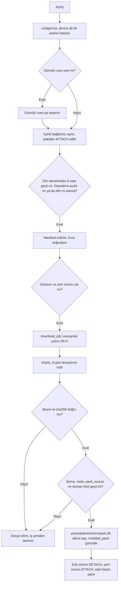

# İçerik Paketleri

> **Sürüm:** 1.2 · **Tarih:** 20 Ekim 2026 · **Durum:** Taslak
> **Bağlı kararlar:** K-21 ([karar defteri](../00-ozet/02-karar-defteri.md)) · [K-06](../00-ozet/02-karar-defteri.md#k-06--yayın-kapısı) · [K-18](../00-ozet/02-karar-defteri.md#k-18--depolama-yöneticisi-v1de) · [K-05](../00-ozet/02-karar-defteri.md#k-05--risale-i-nur-ve-lisansı-bekleyen-içerik) · [K-07](../00-ozet/02-karar-defteri.md#k-07--mushaf-görünümü-üç-seçenek) · [K-27](../00-ozet/02-karar-defteri.md#k-27--tek-bağlantı-tablosu)

İçerik cihaza sürümlü SQLite paketleri olarak iner. Yerelde SeaweedFS'in S3 API'si ([Yerel geliştirme](../02-mimari/04-yerel-gelistirme.md)), canlıda S3 uyumlu bir depo kullanılır; öneri Cloudflare R2'dir (depolama 0,015 $/GB-ay, veri çıkışı ücretsiz; [R2 fiyatlandırma](https://developers.cloudflare.com/r2/pricing)). Yayınlayıcı (`Mutalaa.Publisher`) editoryal veritabanından her derleme türü için ayrı paketler ve ayrı, imzalı bir manifest üretir ([Editoryal veritabanı](./02-editoryal-veritabani.md); [Yayın kapısı ve Kurul](../07-yayin/01-yayin-kapisi-ve-kurul.md)).

Cihazda üç tür yerel veritabanı vardır ([Mobil mimari](../06-mobil/01-mobil-mimari.md); [Depolama yöneticisi](../06-mobil/03-depolama-yoneticisi.md)):

| Dosya | Yazma | Senkron | İçerik |
|---|---|---|---|
| `packs/core-<sürüm>.db` (gömülü çekirdek), `packs/<pack_id>/<sürüm>/pack.db` (indirilen) | Yok (`PRAGMA query_only`) | Yok | Bu dosyadaki paketler |
| `db/user.db` | Var | v1.x'te | Kullanıcı verisi ([Kullanıcı verisi ve senkron](./04-kullanici-verisi-ve-senkron.md)) |
| `db/device.db` | Var | Hiç | `installed_pack`, `download_job`, `audio_file` |

## 1. Paket listesi

| pack_id | İçerik | Lisans notu |
|---|---|---|
| `core` (uygulamaya gömülü) | Tanzil Uthmani metni ve Simple Clean'den üretilen Arapça arama metni (bölüm 3.2), Elmalılı meali, Tanzil'den türetilen kelime bölmesi (`quran_word`), Kur'an içi ve meal bağlantı indeksleri, Medine 604 sayfa eşlemesi, `sure` tablosu | Kurul gerekli. Yalnız Kur'an metni, meal ve kendi verimiz |
| `kelime-kok` | QAC kaynaklı kök, lemma ve kelime morfolojisi; Türkçe kelime anlamları; Türkçe biçim sözlüğü; meal için Türkçe → kök indeksi | QAC'den yazılı açıklık gelene kadar `bekliyor` (K-06 uygulama notu) |
| `tefsir-elmalili` | Hak Dini Kur'an Dili paragrafları ve haşiyeleri, bağlantılar, 1935–39 baskı sayfa eşlemesi | Serbest; Kurul gerekliliği Açık soru |
| `hadis-tecrid` | `h:tecrid` Arapça ve `ht:naim` çevirisi; `ht:miras` 1 Ocak 2028'den sonra | `tecrid-miras` o güne kadar `kapali` ([Küre: Miras](https://kureansiklopedi.com/tr/detay/miras-kamil)) |
| `hadis-kutub-i-sitte` | Altı kitabın Arapça metni | Kaynak seçimi açık (K-04) |
| `risale-dizin` | Bütün Risale kitapları için arama indeksi, Risale bağlantı indeksi, baskı sayfa eşlemeleri | Risale metni işlenebilir olunca üretilir (bölüm 7) |
| `risale-{kitap}` | Kitabın paragrafları ve haşiyeleri; arama indeksi taşımaz | Külliyat 31 Aralık 2030'a kadar korunuyor ([TDV İA](https://islamansiklopedisi.org.tr/risale-i-nur-kulliyati)); metin avukat görüşüne kadar `kapali` |
| `mushaf-a-cuz-{01..30}` | QPC V2 sayfa fontları, satır düzeni ve glif kodları | QF şartları ve Kurul (mobil mimari MM-1, MM-2) |
| `mushaf-b` | Türk hattı sayfa görselleri, `ayah_box`, Türk düzeni sayfa eşlemesi | Lisans gelince (K-07) |
| `ses-{hafiz}` | `audio_timing` ve sure başına ses dosyası listesi; dosyalar ayrı iner | Okuyucu izni ve Kurul ([AlQuran Cloud](https://alquran.cloud/terms-and-conditions)) |

- `core` QAC verisi taşımaz. Kelime bölmesi, kelime metni ve ofsetler Tanzil metninden türetilir. `kelime-kok` kurulu değilse kelime kartı Arapça kelimeyi, âyeti ve aramayı gösterir; kök, lemma ve Türkçe anlam bu paketle gelir.
- `risale-dizin` bir kitap değildir; Risale kitap slugları `dizin` adını kullanmaz. Paket ATTACH sınırı yüzünden vardır (bölüm 2).
- Her kaynağın kesin `license_status` değeri [Kaynaklar ve lisans defteri](../04-icerik/01-kaynaklar-ve-lisans-defteri.md) dosyasındadır; bu tablo değer vermez.

## 2. ATTACH bütçesi

SQLite bir bağlantıya varsayılan olarak en çok 10 veritabanı bağlar (`SQLITE_MAX_ATTACHED`; [SQLite sınırları](https://www.sqlite.org/limits.html)). expo-sqlite derlemesindeki değer Doğrulanacak; mobil mimari `MAX_ATTACHED = 8` kullanır. Risale kitap başına bir paket olduğu için kitapları tek tek bağlamak bu sınırı aşar. Bu yüzden Risale araması, Risale bağlantıları ve Risale için Türkçe → kök indeksi tek bir `risale-dizin` paketinde durur. Kitap paketleri yalnız okuma ve sonuç parçası için, istek anında bağlanır.

| Şema | Paket | Ne zaman |
|---|---|---|
| `main` | `core` | Her zaman |
| `p_kelime_kok` | `kelime-kok` | Kuruluysa açılışta |
| `p_tefsir_elmalili`, `p_hadis_tecrid`, `p_hadis_kutub_i_sitte` | Metin paketleri | Kuruluysa açılışta |
| `p_risale_dizin` | Risale indeksi | Bir Risale kitabı kuruluysa |
| `p_risale_{kitap}` | Okunan ya da sonuçta görünen kitaplar | İstek anında, en çok 3 (LRU) |

Bağlı şema sayısı en çok 8'dir. Mushaf ve ses paketleri ATTACH edilmez; kendi salt okunur bağlantılarıyla açılır. Gelecekte çok paketli başka bir aile (diğer tefsirler, kitaplar) aynı yolla bir `-dizin` paketi alır.

## 3. Paket içi SQLite şeması

### 3.1 Her pakette

```sql
PRAGMA user_version = 1;    -- paket şema sürümü; pack_meta.schema_version ile aynı
CREATE TABLE pack_meta (key TEXT PRIMARY KEY, value TEXT NOT NULL) WITHOUT ROWID;
CREATE TABLE pack_source (source_id TEXT PRIMARY KEY, license_status TEXT NOT NULL, kurul_gerekli INTEGER NOT NULL);
CREATE TABLE attribution (
  source_id TEXT PRIMARY KEY, title TEXT NOT NULL, version TEXT, license_name TEXT NOT NULL,
  license_url TEXT, source_url TEXT, required_credit TEXT NOT NULL, notice_text TEXT
);
```

| `pack_meta` anahtarı | Örnek | Kullanım |
|---|---|---|
| `pack_id`, `version`, `flavor` | `core`, `2026.11.0`, `public` | Manifestle karşılaştırma |
| `schema_version` | `1` | Desteklenen aralıkla karşılaştırma |
| `content_digest` | 64 onaltılık | İçerik değişmediyse yeni sürüm üretilmez; hesap kuralı bölüm 6 |
| `kurul_gerekli`, `kurul_onay` | `1`, JSON | Ayarlar › Kurul onay bilgisi |
| `normalizer_version` | `1.0` | Arama normalleştiricisiyle eşleşme ([Arama](./05-arama-fts5.md)) |
| `anchors_version`, `data_version`, `built_at`, `unit_count` | | Tanılama ve duman testi |

Brifteki `meta` tablosu bu dosyada ve mobil mimaride `pack_meta` adını taşır; Backend API §10.4'ün `meta` anahtarları bu tablodadır. `pack_source` paket dosyasının manifestten bağımsız denetlenmesini sağlar; uygulama izin dışı bir durum görürse paketi açmaz. `attribution` Kaynaklar ve lisanslar ekranını besler ([Yayın kapısı ve Kurul](../07-yayin/01-yayin-kapisi-ve-kurul.md)); sütunların `source` karşılığı [Editoryal veritabanı](./02-editoryal-veritabani.md) §3'tedir.

### 3.2 Metin paketleri

`core`, `tefsir-elmalili`, `hadis-*` ve `risale-{kitap}` şu tabloları taşır:

```sql
CREATE TABLE unit (
  rowid         INTEGER PRIMARY KEY,         -- yalnız bu paket sürümünde geçerli
  anchor        TEXT NOT NULL UNIQUE,        -- kalıcı adres; kullanıcı verisi buna bağlanır
  kind          TEXT NOT NULL,               -- ayet | meal | tefsir | risale | hadis | hadis_ceviri
  role          TEXT NOT NULL DEFAULT 'govde',
  parent_path   TEXT,
  ord           INTEGER NOT NULL,            -- okuma sırası
  ayah_first    INTEGER, ayah_last INTEGER,  -- küresel âyet sırası 1..6236
  label         TEXT NOT NULL,               -- 'Sözler › 10. Söz › 3. Hakikat ¶4'; yayınlayıcı üretir
  text          TEXT NOT NULL,               -- kanonik metin (Tanzil aynen; kendi metnimiz NFC)
  marks TEXT, sentences TEXT, attrs TEXT,    -- JSON
  content_hash  TEXT NOT NULL,
  status        TEXT NOT NULL DEFAULT 'etkin',
  successors    TEXT                         -- JSON yönlendirme
);
CREATE INDEX unit_ord    ON unit(ord);
CREATE INDEX unit_parent ON unit(parent_path, ord);
CREATE INDEX unit_ayah   ON unit(ayah_first, ayah_last);

CREATE TABLE xref_idx (                      -- sütunlar Bağlantı modeli §13 ile aynı
  id TEXT PRIMARY KEY,                       -- editoryal xref.id
  src_anchor TEXT NOT NULL, src_start INTEGER, src_end INTEGER,
  dst_anchor TEXT NOT NULL, dst_start INTEGER, dst_end INTEGER,
  type TEXT NOT NULL, score REAL NOT NULL, confidence REAL NOT NULL,
  approved INTEGER NOT NULL, folded INTEGER NOT NULL,   -- yayınlayıcı görünüm kuralını önceden hesaplar
  evidence TEXT NOT NULL, data_version TEXT NOT NULL
);
CREATE INDEX xref_idx_src ON xref_idx(src_anchor, type);
CREATE INDEX xref_idx_dst ON xref_idx(dst_anchor, type);

CREATE TABLE tr_root_index (                 -- QAC'ye bağlı; kaynağın lisansıyla süzülür
  anchor TEXT NOT NULL, span_start INTEGER NOT NULL, span_end INTEGER NOT NULL,
  root_id INTEGER NOT NULL, tr_lemma_id INTEGER NOT NULL, etymological_only INTEGER NOT NULL,
  PRIMARY KEY (anchor, span_start)
) WITHOUT ROWID;
CREATE INDEX tr_root_index_root ON tr_root_index(root_id);
```

- Kalıcı başvuru her zaman `anchor` ile yapılır; `rowid` paket sürümü değişince değişebilir.
- `label` sonuç listesinde ve kullanıcı kayıtlarında okunabilir adrestir. Kayıt oluşturulurken kopyalanır; paket silinse de kayıt okunur kalır.
- Âyete bağlı birimlerde âyet sorgusu küresel sırayla yazılır. Bağlantı modeli §3'teki sorgu `262 BETWEEN ayah_first AND ayah_last` olur (2:255).
- Kur'an birimlerinde çapa ve gösterim Uthmani metindir (`unit.text`). Simple Clean pakette ayrı birim ya da sütun olarak durmaz; Simple Clean âyet metninin normalize hâli `unit_search.ar_norm` sütunundadır ve yalnız aramada kullanılır ([Arama](./05-arama-fts5.md) §1.4). Tanzil'in cevabına göre Kur'an için içeriksiz FTS seçilirse bu metin de saklanmaz, yalnız indeks taşınır.
- Arama tabloları (`unit_search`, `unit_fts`, `unit_tri`, `tr_stem_lex`) [Arama](./05-arama-fts5.md) dosyasında tanımlıdır. `risale-{kitap}` paketleri bunları ve `tr_root_index` tablosunu taşımaz; ikisi de `risale-dizin` içindedir.

`core` ayrıca şunları taşır:

```sql
CREATE TABLE quran_word (                    -- Tanzil'den türetilen kelime bölmesi
  anchor TEXT PRIMARY KEY, ayah_index INTEGER NOT NULL, word INTEGER NOT NULL,
  text_uthmani TEXT NOT NULL, norm TEXT NOT NULL, char_start INTEGER NOT NULL, char_end INTEGER NOT NULL
) WITHOUT ROWID;
CREATE INDEX quran_word_ayah ON quran_word(ayah_index, word);
CREATE TABLE page_map (
  layout TEXT NOT NULL, volume INTEGER, page INTEGER NOT NULL, line INTEGER,
  start_anchor TEXT NOT NULL, start_offset INTEGER, end_anchor TEXT NOT NULL, end_offset INTEGER
);
CREATE INDEX page_map_page  ON page_map(layout, volume, page, line);
CREATE INDEX page_map_start ON page_map(start_anchor);
CREATE TABLE sure (no INTEGER PRIMARY KEY, name TEXT NOT NULL, name_ar TEXT NOT NULL,
                   ayah_count INTEGER NOT NULL, variants TEXT NOT NULL);
```

### 3.3 `kelime-kok`

```sql
CREATE TABLE word_morph (anchor TEXT PRIMARY KEY, root_id INTEGER, lemma_id INTEGER, pos TEXT, features TEXT) WITHOUT ROWID;
CREATE INDEX word_morph_root  ON word_morph(root_id);
CREATE INDEX word_morph_lemma ON word_morph(lemma_id);
CREATE TABLE root  (id INTEGER PRIMARY KEY, letters TEXT NOT NULL, occurrences INTEGER NOT NULL,
                    ayah_count INTEGER NOT NULL, idf_q REAL, kok_anlami TEXT);
CREATE TABLE lemma (id INTEGER PRIMARY KEY, lang TEXT NOT NULL, text TEXT NOT NULL, text_clean TEXT NOT NULL,
                    root_id INTEGER, occurrences INTEGER NOT NULL, ar_lemma_id INTEGER, etymological_only INTEGER NOT NULL);
CREATE TABLE lemma_gloss (lemma_id INTEGER PRIMARY KEY, anlam_kisa TEXT NOT NULL, kuran_anlamlari TEXT NOT NULL,
                          turkce_es_kelime TEXT, yalnizca_etimolojik INTEGER NOT NULL, status TEXT NOT NULL);
CREATE TABLE tr_form (key_wide TEXT NOT NULL, key_narrow TEXT NOT NULL, tr_lemma_id INTEGER NOT NULL,
                      freq INTEGER NOT NULL, PRIMARY KEY (key_narrow, tr_lemma_id)) WITHOUT ROWID;
CREATE INDEX tr_form_wide ON tr_form(key_wide);
-- tr_root_index: 3.2 ile aynı; core'daki meal birimleri için
```

`word_morph` yayınlayıcının QAC tabanına onaylı `quran_word_fix` düzeltmelerini uygulamış hâlidir. `public` derlemede yalnız `status = 'onayli'` anlamlar bulunur; diğer derlemelerde taslaklar "doğrulanmamış" rozetiyle görünür ([K-25](../00-ozet/02-karar-defteri.md#k-25--i̇lkeler); [Kelime anlamları](../04-icerik/06-kelime-anlamlari.md)). `root.id` ve `lemma.id` editoryal kimliklerdir ve paket sürümleri arasında değişmez.

### 3.4 `risale-dizin`

```sql
CREATE TABLE unit_ref (rowid INTEGER PRIMARY KEY, anchor TEXT NOT NULL UNIQUE,
                       pack_id TEXT NOT NULL, ord INTEGER NOT NULL, label TEXT NOT NULL);
-- içeriksiz unit_fts, unit_tri ve tr_stem_lex: Arama dosyasında
-- xref_idx, tr_root_index ve page_map: 3.2 ile aynı
```

İndeks içeriksizdir; metin yalnız kitap paketlerinde durur. Bir sonuç kurulu olmayan bir kitaptaysa liste etiketi gösterir ve "Bu sonuç için Mektûbât paketini indir" eylemini sunar.

### 3.5 Mushaf ve ses paketleri

- `mushaf-a-cuz-NN`: `page_font(page, format, data BLOB, sha256)`, `page_line(page, line, line_type, centered, sure)`, `glyph_word(page, line, pos, anchor, ayah, glyph, is_ayah_end)`. Biçim mobil mimarinin önerisiyle aynıdır; fontlar SQLite içinde durduğu için paket tek dosya, tek özet ve tek indirmedir. Sayfa, ilk âyetinin bulunduğu cüzün paketine girer.
- `mushaf-b`: `page_image(page, format, width, height, data BLOB, sha256)`, `ayah_box(page, anchor, seq, x, y, w, h)`, `page_map` (Türk düzeni). Görsel biçimi ve cüzlere bölünme Açık soru (MM-7).
- `ses-{hafiz}`: `audio_timing(anchor, file, file_sha256, start_ms, end_ms, words)` ve `audio_part(part TEXT PRIMARY KEY, url, size_bytes, sha256)`. `part` sure numarasıdır (`002`). Ses dosyaları SQLite dışında, sure başına iner ve `device.db` `audio_file` tablosunda izlenir ([Ses sistemi](../06-mobil/02-ses-sistemi.md)). quran-align zamanlamaları yalnız hizalandıkları dosyalarla geçerlidir ([quran-align](https://raw.githubusercontent.com/cpfair/quran-align/master/README.md)).

## 4. Bağlantıların paketlere dağılımı

Âyet ↔ meal ve âyet ↔ tefsir aralığı ilişkileri çapadan türetilir ve `xref_idx` satırı gerektirmez (K-27). Diğer her satır tek bir pakete yazılır:

1. İki uç da `core` içindeyse `core`.
2. Bir uç Risale ise `risale-dizin`. Bağlantı modeli §13 bu satırları kitap paketine koymayı öneriyordu; ATTACH sınırı yüzünden burada toplanır. Kitap paketi silinse de bağlantı kalır ve etiketle gösterilir.
3. Bir uç `core`, öbür uç P paketindeyse P.
4. İki uç iki ayrı isteğe bağlı paketteyse `depends_on` ile bağımlı olan paket; bağımlılık yoksa `pack_id` değeri alfabetik olarak sonra gelen paket.

Çapadan paket kimliği türetilir (`q`, `meal` → `core`; `tf:elmalili` → `tefsir-elmalili`; `rn:{kitap}` → `risale-{kitap}`). Öbür ucun paketi kurulu değilse uygulama satırı etiketiyle gösterir ve indirme önerir.

## 5. `manifest.json`

Brifteki zorunlu alanlar aynen korunur: `pack_id, version, sha256, size_bytes, license_status, kurul_onay, min_app_version, depends_on, url`. Karar defterine işlenen iki ek alan vardır (K-06 uygulama notu): paket başına `kurul_gerekli` ve manifest düzeyinde `signature`. Uygulama Kurul kuralını paket türünden çıkarmaz (mobil mimari MM-8). `kurul_onay` alt alanları yayın kapısı belgesindeki biçimdir. Önerilen ek alanlar: `schema_version`, `title`, `bundled`.

Aşağıdaki örnek `dev` derlemenin manifestidir; `dev` manifesti yerel SeaweedFS S3 deposundan `MANIFEST_URL` ile okunur ([Yerel geliştirme](../02-mimari/04-yerel-gelistirme.md)). `internal` ve `public` manifestler aynı yapıdadır ve yalnız `serbest` paketleri listeler (bölüm 7). Depoda manifest `{flavor}/manifest.json`, paket `packs/{flavor}/{pack_id}/{version}/{pack_id}-{version}.db` anahtarındadır; `url` bu anahtarın `Storage:PublicBaseUrl` ile birleşmiş mutlak hâlidir ([Backend API](../02-mimari/05-backend-api.md) §10.5). Özet, onay ve imza değerleri örnektir. `tefsir-elmalili` için `kurul_gerekli: true` da örnek değerdir: tefsirin Kurul kapsamı IP-1'de açıktır (bölüm 10).

```json
{
  "manifest_version": 1,
  "flavor": "dev",
  "release": "2026.11.0",
  "generated_at": "2026-11-20T09:00:00Z",
  "packs": [
    {
      "pack_id": "core",
      "version": "2026.11.0",
      "sha256": "4f6c1d0e9b2a73c5e8d1f0a9b8c7d6e5f4a3b2c1d0e9f8a7b6c5d4e3f2a1b0c9",
      "size_bytes": 20971520,
      "license_status": "serbest",
      "kurul_gerekli": true,
      "kurul_onay": { "onay_no": "ÖRNEK-0001", "onay_tarihi": "2026-11-15",
                      "onayli_surum": "core@2026.11.0", "icerik_ozeti": "435eb09ad6947e3f21aa1bcd600a3a0f536086879dc6ee0e057f5386d597ae3e" },
      "min_app_version": "1.0.0",
      "depends_on": [],
      "url": "http://192.168.1.50:8333/mutalaa/packs/dev/core/2026.11.0/core-2026.11.0.db",
      "schema_version": 1,
      "title": "Kur'an ve Elmalılı meali",
      "bundled": true
    },
    {
      "pack_id": "kelime-kok",
      "version": "2026.11.0",
      "sha256": "7d2e9f0a1b3c4d5e6f708192a3b4c5d67d2e9f0a1b3c4d5e6f708192a3b4c5d6",
      "size_bytes": 9437184,
      "license_status": "bekliyor",
      "kurul_gerekli": false,
      "kurul_onay": null,
      "min_app_version": "1.0.0",
      "depends_on": ["core"],
      "url": "http://192.168.1.50:8333/mutalaa/packs/dev/kelime-kok/2026.11.0/kelime-kok-2026.11.0.db",
      "schema_version": 1,
      "title": "Kelime kökleri ve anlamları"
    },
    {
      "pack_id": "tefsir-elmalili",
      "version": "2026.11.0",
      "sha256": "9a8b7c6d5e4f30211203f4e5d6c7b8a99a8b7c6d5e4f30211203f4e5d6c7b8a9",
      "size_bytes": 41943040,
      "license_status": "serbest",
      "kurul_gerekli": true,
      "kurul_onay": null,
      "min_app_version": "1.0.0",
      "depends_on": ["core"],
      "url": "http://192.168.1.50:8333/mutalaa/packs/dev/tefsir-elmalili/2026.11.0/tefsir-elmalili-2026.11.0.db",
      "schema_version": 1,
      "title": "Elmalılı · Hak Dini Kur'an Dili"
    },
    {
      "pack_id": "hadis-tecrid",
      "version": "2026.11.0",
      "sha256": "0b1c2d3e4f5a69788796a5b4c3d2e1f00b1c2d3e4f5a69788796a5b4c3d2e1f0",
      "size_bytes": 12582912,
      "license_status": "serbest",
      "kurul_gerekli": false,
      "kurul_onay": null,
      "min_app_version": "1.0.0",
      "depends_on": ["core"],
      "url": "http://192.168.1.50:8333/mutalaa/packs/dev/hadis-tecrid/2026.11.0/hadis-tecrid-2026.11.0.db",
      "schema_version": 1,
      "title": "Tecrîd-i Sarîh (Arapça ve Ahmed Naim)"
    },
    {
      "pack_id": "ses-ornek-hafiz",
      "version": "2026.11.0",
      "sha256": "e5f60718293a4b5c6d7e8f9a0b1c2d3ee5f60718293a4b5c6d7e8f9a0b1c2d3e",
      "size_bytes": 1048576,
      "license_status": "bekliyor",
      "kurul_gerekli": true,
      "kurul_onay": null,
      "min_app_version": "1.0.0",
      "depends_on": ["core"],
      "url": "http://192.168.1.50:8333/mutalaa/packs/dev/ses-ornek-hafiz/2026.11.0/ses-ornek-hafiz-2026.11.0.db",
      "schema_version": 1,
      "title": "Örnek hafız"
    }
  ],
  "signature": { "alg": "ed25519", "kid": "dev-2026-1", "value": "BASE64-ORNEK-IMZA" }
}
```

| Alan | Kural |
|---|---|
| `version` | CalVer `YYYY.M.N`. `content_digest` değişmedikçe yeni sürüm üretilmez. |
| `sha256`, `size_bytes` | `url` adresindeki baytların özeti ve boyutu |
| `license_status` | Pakete giren kaynakların en kısıtlayıcısı: `serbest < bekliyor < ic_kullanim < kapali` |
| `kurul_gerekli` | Pakete giren kaynaklardan biri `kurul_gerekli` ise `true` |
| `kurul_onay` | `{onay_no, onay_tarihi, onayli_surum, icerik_ozeti}`; onay yoksa `null`. Yayınlayıcı nesneyi `source.kurul_onay`, `kurul_onay_tarihi` ve `kurul_onay_ozeti` sütunlarından kurar. Mobil mimarideki `isPackVisible` alanı yalnız doluluğuyla okur. **Çözüldü (19 Ekim 2026):** tür tanımı bu nesneye güncellendi ([Mobil mimari](../06-mobil/01-mobil-mimari.md) §10). |
| `min_app_version` | Uygulamanın yerel sürümüyle karşılaştırılır; EAS Update yalnız JavaScript taşır |
| `depends_on` | Önce kurulması gereken paketler |
| `signature` | Zorunludur (K-06); imzasız manifest yayımlanmaz ve uygulama tarafından okunmaz. İmza girdisi, `signature` alanı çıkarılmış manifestin kanonik JSON biçimidir. Açık anahtarlar derleme türüne göre uygulamaya gömülür; `kid` anahtar değişimine izin verir. Algoritma ve kanonikleştirme yöntemi Doğrulanacak; örnekteki Ed25519 bir öneridir. |

İmza doğrulanmazsa uygulama manifesti yok sayar, kurulu paketlerle çalışır ve kişisel veri içermeyen bir hata kaydı gönderir. Paket özetleri imzalı manifestten geldiği için güvenilir sayılır; özet ile imza birlikte paketin hem bütünlüğünü hem kaynağını doğrular.

## 6. Sürümleme

- Yayımlanmış bir `(pack_id, version, flavor)` dosyası değişmez; düzeltme yeni sürümle gelir.
- `schema_version` paket şemasının tamsayı sürümüdür. Uygulama `[PACK_SCHEMA_MIN, PACK_SCHEMA_MAX]` aralığını destekler.
- **İçerik özeti.** Tek sıralama kuralı vardır: çapaların bayt sırası (`COLLATE "C"`). Her etkin birim için `anchor + "\t" + content_hash + "\n"` satırı, ses ve font dosyaları için yolun bayt sırasıyla `yol + "\t" + sha256 + "\n"` satırı yazılır; özet bu dizginin SHA-256'sıdır. `pack_meta.content_digest` paketin bütün içeriğinden, Kurul özeti yalnız Kurul kapsamındaki kaynaklardan aynı kuralla hesaplanır ([Yayın kapısı ve Kurul](../07-yayin/01-yayin-kapisi-ve-kurul.md)).
- `normalizer_version` (`major.minor`) uygulamadaki normalleştiriciyle aynı olmalıdır. Arama kuralı değişirse bütün metin paketleri yeniden üretilir ([Arama](./05-arama-fts5.md)).
- Geri çekme: yayınlayıcı önceki sürümü gösteren yeni bir manifest yayımlar ve uygulama ona iner. Kullanıcı kayıtları çapa ve `content_hash` ile yeniden çapalanır ([Çapa şeması](./01-capa-semasi.md)).
- Kurul onayı içerik sürümüne bağlıdır. Gömülü `core` EAS Update ile değişmez; yeni içerik yeni ikiliyle ya da manifestle gelir.

## 7. Derleme türüne göre süzme

| `license_status` | `dev` | `internal` | `public` |
|---|---|---|---|
| `serbest` | Var | Var | Var; `kurul_gerekli` kaynakta onay ve özet eşleşmesi şart |
| `bekliyor` | Var | Yok | Yok |
| `ic_kullanim` | Var | Yok | Yok |
| `kapali` | Yok | Yok | Yok |

`dev` yalnız ekibe, `internal` davetli test kullanıcılarına gider (K-06). Derleme türleri EAS profillerine şöyle bağlanır: `dev` → `development`, `internal` → `internal`, `public` → `production` ([Mobil mimari](../06-mobil/01-mobil-mimari.md)). Kurul onayı bekleyen Kur'an metni, meal ve sesin `internal` derlemede gösterilip gösterilemeyeceği Kurul'a sorulur; cevap gelene kadar dış test kullanıcısı alınmaz. Kuralın sahibi [Yayın kapısı ve Kurul](../07-yayin/01-yayin-kapisi-ve-kurul.md) belgesidir. **Çözüldü (19 Ekim 2026):** Mobil mimarideki `isPackVisible` işlevi `internal` için de yalnız `serbest` kabul eder ([Mobil mimari](../06-mobil/01-mobil-mimari.md) §10).

- Süzme kaynak düzeyinde yapılır; aynı paket kimliği derleme türüne göre farklı içerik taşıyabilir.
- `kisitlar.hazir_vt_yasak` taşıyan kaynak hiçbir pakete girmez. Quran Foundation şartları hazır veritabanı dağıtımına izin vermez ([QF Developer Terms](https://api-docs.quran.foundation/legal/developer-terms/)).
- `xref_idx` satırları bağlantı modelinin yayın kuralıyla süzülür: `red` satır hiçbir pakete girmez, `aday` satır yalnız `dev` ve `internal` derlemeye `approved = 0` ile girer (Backend API P-07) ([Bağlantı modeli](../05-capraz-referans/01-baglanti-modeli.md)).
- QAC kaynaklı satırlar (`kelime-kok` paketi ve metin paketlerindeki `tr_root_index`) `bekliyor` durumundadır; QAC'den yazılı açıklık gelene kadar yalnız ekip içi `dev` derlemede görünür. `internal` ve `public` derlemede kök, lemma ve anlam satırları kapalıdır. Bu, K-06 ve lisans defteri §1'in tekrarıdır, yeni karar değildir ([QAC SSS](https://corpus.quran.com/faq.jsp); [Kaynaklar ve lisans defteri](../04-icerik/01-kaynaklar-ve-lisans-defteri.md) §1). Kelime anlamlarının QAC lemma kimliklerine bağlı olmasının etkisi avukata sorulur (Açık soru, hukuki görüş değildir).
- `core` sayfa eşlemesinin kaynağı Açık soru. Lisans defterinde Mod A düzeni (`medine-604-duzen`) `bekliyor` durumundadır; Medine sayfa başlangıçlarını Tanzil üst verisinden almak Doğrulanacak. Kaynak açılmazsa `public` `core` sayfa eşlemesiz çıkar; Mod C ve 604 sayfalık hatim buna bağlıdır.
- Durumların anlamı K-06'dadır: `serbest` kamu malı, açık lisans ya da yazılı izin; `bekliyor` izin ya da açıklık istendi, cevap bekleniyor; `ic_kullanim` avukat görüşüyle yalnız ekip işleyebilir; `kapali` hiç kullanılmaz ve işlenmez.
- Risale metni avukat görüşü gelene kadar `kapali` durumdadır ([Kaynaklar ve lisans defteri](../04-icerik/01-kaynaklar-ve-lisans-defteri.md)). Bu sürede Risale metni işlenmez; `risale-{kitap}` ve `risale-dizin` paketleri üretilmez, yalnız kod, şema ve çapa kuralları hazırlanır. Görüş olumlu gelirse durum `ic_kullanim` olur ve Risale yalnız `dev` derlemesinde görünür (K-05); yazılı izinle ya da 1 Ocak 2031'de `serbest` olur.
- `risale-dizin` içinde arama indeksi metinden türediği için metnin durumuyla süzülür. Bağlantılar ve sayfa eşlemeleri ayrı bir dizin kaynağıdır; metin içermeyen bir atıf dizininin `internal` ya da `public` derlemeye girmesi avukat görüşüne bağlıdır (rapor; hukuki görüş değildir).
- `tecrid-miras` 1 Ocak 2028'e kadar `kapali` olduğu için `hadis-tecrid` paketi her derlemede yalnız Arapça metni ve Ahmed Naim çevirisini taşır.
- `dev` ve `internal` paketleri herkese açık bir adresten indirilemez. `dev` paketleri yerel SeaweedFS deposundadır; `internal` için özel depo ve süreli imzalı URL kullanılır (yöntem Açık soru).

## 8. Cihazda yaşam döngüsü



1. **Uzlaştırma ve gömülü çekirdek.** Açılışta `device.db` ile disk karşılaştırılır; yarım kurulumlar ve sahipsiz `.part` dosyaları silinir. Gömülü `core` uygulama varlıklarında `apps/mobile/assets/db/core-<sürüm>.db` olarak durur ve ilk açılışta ya da yeni gömülü sürümde `Paths.document/mutalaa/packs/` altına aktarılır (mobil mimari §6.2); indirilmiş `core` daha yeniyse o kalır ([Depolama yöneticisi](../06-mobil/03-depolama-yoneticisi.md)).
2. **Güncelleme denetimi.** Uygulama öne geldiğinde en fazla 6 saatte bir, Ayarlar › Depolama açılınca ve "Güncellemeleri denetle" ile yapılır ([Depolama yöneticisi](../06-mobil/03-depolama-yoneticisi.md) §8). Manifest `ETag` ile istenir; değişiklik yoksa sunucu 304 döner.
3. **Görünürlük.** Uygulama kapıyı ikinci kez uygular: `kapali` paketi hiç göstermez; `internal` ve `public` derlemede `serbest` olmayanı, `public` derlemede ayrıca `kurul_gerekli` olup `kurul_onay` taşımayanı gizler. Kurul'un kapalı test sorusuna cevabı gelene kadar (IP-4) `internal` derleme de bu Kurul kuralını uygular; Yayınlayıcı kapısında Kurul kuralı (P-04) yalnız `public`'tedir.
4. **İndirme.** Kuyruk `download_job` tablosundadır; duraklatılabilir ve varsayılan olarak yalnız Wi-Fi ile çalışır (K-18). Büyük dosyada akışlı SHA-256 için kitaplık seçimi Doğrulanacak.
5. **Doğrulama.** Dosya salt okunur açılır: `PRAGMA user_version` desteklenen aralıkta; `pack_meta` içindeki `pack_id`, `version` ve `normalizer_version` beklenen değerlerde; `pack_source` derlemeye uygun; `PRAGMA quick_check` geçer; `SELECT count(*) FROM unit` sonucu `pack_meta.unit_count` ile eşleşir; bir FTS sorgusu hatasız döner.
6. **Kurulum.** Dosya kendi sürüm klasörüne taşınır ve `installed_pack` satırı tek işlemde güncellenir. Taşımanın atomikliği belgede yazmadığı için kurulum sürüm klasörü, tek işlem ve açılış uzlaştırmasıyla çökmeye dayanıklı kurulur (depolama yöneticisi).
7. **Bağlama ve geri dönüş.** İçerik bağlantısı süren sorgular bitince eski şemayı ayırır, yenisini bağlar. 5–7. adımlardan biri başarısız olursa yeni dosya silinir, önceki sürüm etkin kalır ve kişisel veri içermeyen bir hata kaydı gönderilir.
8. **Uyumsuz şema.** Paket şeması uygulamanın üst sınırından büyükse paket "Uygulamayı güncelleyin" notuyla listelenir ve indirilmez; normalde `min_app_version` bunu baştan önler.
9. **Silme.** Kullanıcı paketi silince bağlantı ayrılır ve dosya silinir. Yer imi, vurgu ve not kayıtları silinmez; `label`, `excerpt` ve `content_hash` taşıdıkları için Defterim'de okunur kalır ve "Metni görmek için paketi indir" eylemini gösterir ([Kullanıcı verisi ve senkron](./04-kullanici-verisi-ve-senkron.md)).

## 9. Boyut tahminleri

Değerlerin tamamı tahmindir ve gerçek veriyle ölçülecektir.

| Paket | Tahmin | Dayanak |
|---|---|---|
| `core` | 10–25 MB | Arapça metin biçim başına 1–2 MB, meal 1–1,6 MB (araştırma notları), artı FTS ve bağlantılar |
| `kelime-kok` | 5–15 MB | Morfoloji tablosu 77,4 bin satır, 2–4 MB (araştırma notları), artı anlamlar ve Türkçe biçimler |
| `tefsir-elmalili` | 25–50 MB | Metin 12–20 MB (sayfa sayısı bulunamadı), FTS dizini metnin 0,5–1,5 katı |
| `risale-{kitap}` toplamı | 11–15 MB metin | 6.000–7.550 sayfa × 1.800–2.500 karakter |
| `risale-dizin` | 10–25 MB | İçeriksiz FTS, trigram, bağlantılar, Türkçe → kök indeksi |
| `hadis-*` | Bilinmiyor | Kaynak seçilmedi (K-04) |
| `mushaf-a-cuz-NN` | ~3 MB (woff2) | V2 tam set 93,2 MB woff2 ([Quran.com font klasörü](https://github.com/quran/quran.com-frontend-next/tree/production/public/fonts/quran/hafs)); TTF yaklaşık 2,8 kat (mobil mimari) |
| `mushaf-b` | Bilinmiyor | Lisanslı görsel biçimine bağlı |
| `ses-{hafiz}` | 0,5–1,5 GB tam hatim | 64 kbps 28,8 MB/saat; bir tam kayıt arşivi ~0,9 GB ([way2quran](https://way2quran.com/sw/reciters/mahmoud-khalil-al-hosary)) |

## 10. Açık sorular

| No | Konu | Durum |
|---|---|---|
| IP-1 | `tefsir-elmalili` ve kelime anlamları Kurul onayına tabi mi | Açık soru |
| IP-2 | QPC fontlarını ve düzen verisini paketle dağıtmak QF şartlarına uyar mı (MM-1, MM-2) | Açık soru |
| IP-3 | `core` sayfa eşlemesinin kaynağı (Tanzil üst verisi ya da `medine-604-duzen`) | Doğrulanacak |
| IP-4 | Kurul onayı bekleyen Kur'an metni ve mealin `internal` derlemede gösterilmesi | Açık soru (Kurul'a) |
| IP-5 | Metinsiz `risale-dizin` paketinin `internal` ve `public` derlemeye girmesi | Açık soru, hukuki görüş değildir |
| IP-6 | QAC izni gelmezse kelime anlamlarının `core`'a kelime çapasıyla taşınması | Açık soru, hukuki görüş değildir |
| IP-7 | İmza algoritması, JSON kanonikleştirme ve anahtar yönetimi (imza zorunlu) | Doğrulanacak |
| IP-8 | `SQLITE_MAX_ATTACHED` değeri, sıkıştırmalı aktarım, akışlı SHA-256 | Doğrulanacak |
| IP-9 | İç derleme paketlerine erişim yöntemi | Açık soru |
| IP-10 | Hadis paketlerinin boyutu; Mod B görsel biçimi (MM-7); Risale lügat verisinin paketi | Açık soru |

## İlgili dosyalar

- [Karar defteri](../00-ozet/02-karar-defteri.md) · [Çapa şeması](./01-capa-semasi.md) · [Editoryal veritabanı](./02-editoryal-veritabani.md) · [Kullanıcı verisi ve senkron](./04-kullanici-verisi-ve-senkron.md) · [Arama (FTS5)](./05-arama-fts5.md)
- [Mobil mimari](../06-mobil/01-mobil-mimari.md) · [Ses sistemi](../06-mobil/02-ses-sistemi.md) · [Depolama yöneticisi](../06-mobil/03-depolama-yoneticisi.md)
- [Yayın kapısı ve Kurul](../07-yayin/01-yayin-kapisi-ve-kurul.md) · [Kaynaklar ve lisans defteri](../04-icerik/01-kaynaklar-ve-lisans-defteri.md) · [Bağlantı modeli](../05-capraz-referans/01-baglanti-modeli.md) · [Kök ve lemma](../05-capraz-referans/03-kok-ve-lemma.md)
