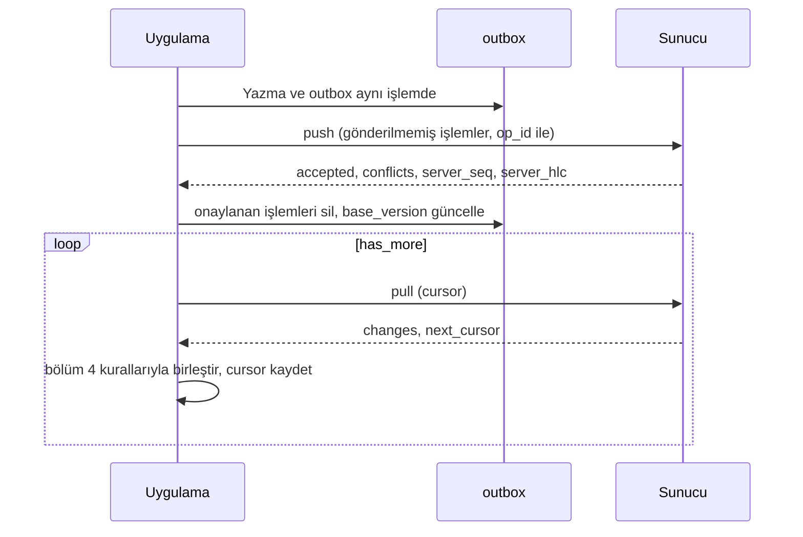

# Kullanıcı Verisi ve Senkron

> **Sürüm:** 1.1 · **Tarih:** 19 Ekim 2026 · **Durum:** Taslak
> **Bağlı kararlar:** [K-15](../00-ozet/02-karar-defteri.md#k-15--hesap-ve-senkron-v1xte) · [K-16](../00-ozet/02-karar-defteri.md#k-16--senkron-çakışma-çözümü) · [K-26](../00-ozet/02-karar-defteri.md#k-26--kalıcı-adresler-çapa-şeması) · [K-25](../00-ozet/02-karar-defteri.md#k-25--i̇lkeler) · [K-10](../00-ozet/02-karar-defteri.md#k-10--arka-uç)

v1 hesapsız ve çevrimdışı tam çalışır; notlar, vurgular ve ilerleme cihazda kalır. Hesap ve cihazlar arası senkron v1.x'te gelir. Yerel veritabanı v1'den itibaren senkrona hazır şemayla kurulur; v1.x'te göç gerekmez (K-15). Rapor, tek kullanıcılı ve çakışması az bu veri için yerel giden kutusu, "imleçten bu yana değişiklikler" sorgusu ve yumuşak silmeyle basit bir senkronu yeterli görür ([React Native Relay](https://reactnativerelay.com/article/building-offline-first-react-native-apps-2026-expo-sqlite-drizzle-orm-sync-strategies)).

## 1. Dosyalar

| Dosya | İçerik | Senkron | Yedek |
|---|---|---|---|
| `db/user.db` | `bookmark`, `highlight`, `note`, `reading_position`, `hatim`, `hatim_page`, `collection`, `setting`, `vocab` (v1.x) | v1.x'te | Var |
| `db/user.db` (yerel tablolar) | `outbox`, `sync_state` | Hiç | Yok |
| `db/device.db` | `installed_pack`, `download_job`, `audio_file`, öneri olarak `anchor_resolution` | Hiç | Yok |
| İçerik paketleri | Salt okunur metin ve indeksler | Yok | Yok |

`outbox` kullanıcı yazımıyla aynı işlemde (transaction) yazılmak zorunda olduğu için `user.db` içindedir. `device.db` şemasının sahibi [Depolama yöneticisi](../06-mobil/03-depolama-yoneticisi.md) dosyasıdır; `anchor_resolution` tablosunun oraya eklenmesi önerilir (bölüm 2).

## 2. Şema (`user.db`)

Her senkron tablosu şu ortak sütunları taşır:

| Sütun | Tür | Anlam |
|---|---|---|
| `id` | TEXT | UUIDv7 ([RFC 9562](https://www.rfc-editor.org/rfc/rfc9562)); zaman sıralı, cihazda üretilir |
| `hlc` | TEXT | Son değişikliğin hibrit mantıksal saati (bölüm 3) |
| `updated_at` | INTEGER | Epoch milisaniye; yalnız gösterim için, birleştirmede kullanılmaz |
| `deleted_at` | INTEGER | Yumuşak silme; NULL değilse kayıt silinmiştir |
| `base_version` | INTEGER | Kaydın dayandığı sunucu sürümü (`server_seq`); 0 = hiç eşitlenmedi |
| `device_id` | TEXT | Son değiştiren cihaz (UUIDv4, ilk açılışta üretilir) |

```ts
// packages/content-schema/src/user/columns.ts (Drizzle)
export const syncColumns = {
  id: text('id').primaryKey(),
  hlc: text('hlc').notNull(),
  updatedAt: integer('updated_at').notNull(),
  deletedAt: integer('deleted_at'),
  baseVersion: integer('base_version').notNull().default(0),
  deviceId: text('device_id').notNull(),
};
```

Aşağıdaki tablolarda ortak sütunlar `/* + ortak */` ile gösterilir.

```sql
CREATE TABLE collection (name TEXT NOT NULL, color INTEGER, sort_key TEXT NOT NULL /* + ortak */);

CREATE TABLE bookmark (
  anchor        TEXT NOT NULL,     -- birim çapası ya da âyet aralığı ('q:2:255-257')
  label         TEXT NOT NULL,     -- okunur adres; oluşturulurken paketten kopyalanır
  excerpt       TEXT,              -- birim metninin ilk 160 kod noktası
  content_hash  TEXT,              -- birimin o andaki özeti; âyet aralığında NULL
  title         TEXT,              -- 'Hatim ayracı', 'Ders ayracı'
  collection_id TEXT,
  sort_key      TEXT NOT NULL      /* + ortak */
);
CREATE INDEX bookmark_anchor     ON bookmark(anchor) WHERE deleted_at IS NULL;
CREATE INDEX bookmark_collection ON bookmark(collection_id, sort_key) WHERE deleted_at IS NULL;

CREATE TABLE highlight (
  anchor        TEXT NOT NULL,     -- birim: 'q:2:255', 'rn:sozler:soz-10:hakikat-3:p4'
  span_start    INTEGER, span_end INTEGER,  -- Kur'an'da kelime konumu, metinde kod noktası; NULL = tamamı
  content_hash  TEXT NOT NULL,
  label         TEXT NOT NULL, excerpt TEXT,
  quote         TEXT, prefix TEXT, suffix TEXT,   -- yeniden çapalama bağlamı
  color         INTEGER NOT NULL CHECK (color BETWEEN 1 AND 5),
  group_id      TEXT,              -- birden çok birime yayılan seçim
  CHECK ((span_start IS NULL) = (span_end IS NULL)),
  CHECK (span_start IS NULL OR span_start < span_end)  /* + ortak */
);
CREATE INDEX highlight_anchor ON highlight(anchor) WHERE deleted_at IS NULL;

CREATE TABLE note (
  anchor        TEXT,              -- NULL: bağımsız not
  span_start    INTEGER, span_end INTEGER, content_hash TEXT,
  label         TEXT, excerpt TEXT, quote TEXT, prefix TEXT, suffix TEXT,
  highlight_id  TEXT,
  title         TEXT,
  body          TEXT NOT NULL,     -- Markdown; bağlantılar [[q:2:255]], [[konu:sabir]]
  tags          TEXT NOT NULL DEFAULT '[]' CHECK (json_valid(tags)),
  collection_id TEXT,
  conflict_of   TEXT               -- çakışma kopyasıysa asıl notun kimliği  /* + ortak */
);
CREATE INDEX note_anchor   ON note(anchor) WHERE deleted_at IS NULL;
CREATE INDEX note_conflict ON note(conflict_of) WHERE conflict_of IS NOT NULL AND deleted_at IS NULL;

CREATE TABLE reading_position (
  context       TEXT NOT NULL,     -- 'kuran', 'tefsir:elmalili', 'risale:sozler', 'hadis:tecrid'
  anchor        TEXT NOT NULL,
  offset_ratio  REAL NOT NULL DEFAULT 0,   -- birim içinde 0–1; yazı boyutuna ve döndürmeye dayanıklı
  view          TEXT NOT NULL,     -- mushaf-a | mushaf-b | mushaf-c | meal | tefsir | risale | hadis
  page          INTEGER,
  UNIQUE (device_id, context)      /* + ortak */
);

CREATE TABLE hatim (name TEXT NOT NULL, layout TEXT NOT NULL DEFAULT 'medine-604',
                    started_at INTEGER NOT NULL, target_date INTEGER, completed_at INTEGER /* + ortak */);
CREATE TABLE hatim_page (hatim_id TEXT NOT NULL, page INTEGER NOT NULL, read_at INTEGER NOT NULL /* + ortak */);
CREATE INDEX hatim_page_live ON hatim_page(hatim_id, page) WHERE deleted_at IS NULL;

CREATE TABLE setting (key TEXT NOT NULL UNIQUE, value TEXT NOT NULL CHECK (json_valid(value)) /* + ortak */);

CREATE TABLE vocab (               -- v1.x kelime defteri
  lang TEXT NOT NULL CHECK (lang IN ('ar','ota','tr')), key TEXT NOT NULL, display TEXT NOT NULL,
  first_anchor TEXT, seen_count INTEGER NOT NULL DEFAULT 1,
  state TEXT NOT NULL DEFAULT 'yeni' CHECK (state IN ('yeni','calisiyor','ogrenildi')), note TEXT /* + ortak */
);
CREATE UNIQUE INDEX vocab_key ON vocab(lang, key) WHERE deleted_at IS NULL;

-- Yalnız yerel; senkrona ve yedeğe girmez
CREATE TABLE outbox (op_id TEXT PRIMARY KEY, tbl TEXT NOT NULL, row_id TEXT NOT NULL, hlc TEXT NOT NULL,
                     created_at INTEGER NOT NULL, sent_at INTEGER, attempts INTEGER NOT NULL DEFAULT 0, last_error TEXT);
CREATE INDEX outbox_row ON outbox(tbl, row_id);
CREATE TABLE sync_state (key TEXT PRIMARY KEY, value TEXT NOT NULL) WITHOUT ROWID;  -- cursor, hlc_last, account

-- device.db için öneri: yeniden çapalama önbelleği (Çapa şeması §9)
CREATE TABLE anchor_resolution (record_tbl TEXT NOT NULL, record_id TEXT NOT NULL, pack_version TEXT NOT NULL,
  anchor TEXT NOT NULL, span_start INTEGER, span_end INTEGER,
  state TEXT NOT NULL CHECK (state IN ('tam','tasindi','bulunamadi')), PRIMARY KEY (record_tbl, record_id)) WITHOUT ROWID;
```

- **Çapa ve aralık.** Kayıtlar `xref` ile aynı depolama kuralını izler: uç birim çapasıdır, Kur'an'da aralık kelime konumu (`q:2:255:3-7` → `q:2:255`, `[3,8)`), metinde kod noktasıdır ([Çapa şeması](./01-capa-semasi.md) §8). Okuyucu görünür birimlerin kayıtlarını `WHERE anchor IN (…)` ile tek sorguda alır.
- **Vurgu anahtarı.** Vurgu çapa + aralık + `content_hash` ile tanımlanır. `quote` en çok 1.000 kod noktasıdır; daha uzun seçimde ilk ve son 500 kod noktası saklanır.
- **Paket silinince.** `label`, `excerpt` ve `content_hash` kayıtla birlikte saklandığı için paketi silinmiş içerikteki yer imi, vurgu ve not Defterim'de okunur kalır ([İçerik paketleri](./03-icerik-paketleri.md)).
- **Birden çok birim.** Paragraf sınırını aşan seçim ve âyet aralığı vurgusu birim başına satıra bölünür; satırlar `group_id` ile bağlanır.
- **Renkler.** `color` 1–5 arası yuvadır. Renk değeri ve ad tasarım sistemindedir; renk tek başına anlam taşımaz ([Tasarım sistemi](../01-urun/04-tasarim-sistemi.md)).
- **Yazma.** Her kullanıcı değişikliği tek işlemdir: satır yeni `hlc`, `updated_at` ve `device_id` ile yazılır. Hesap bağlıysa aynı işlemde `outbox` satırı eklenir. v1'de `outbox` yazılmaz; hesap bağlanınca bütün satırlar bir kez kuyruğa alınır (bölüm 8).

## 3. Hibrit mantıksal saat (HLC)

Biçim sabit genişlikli küçük harf onaltılıktır; bu yüzden dizgi karşılaştırması zaman sırasını verir:

```text
{fiziksel_ms: 12 hane}-{sayaç: 4 hane}-{düğüm: 16 hane}
01a14f8cf400-0000-8f14e45fceea167a        (fiziksel kısım ≈ 18 Ekim 2026)
```

Düğüm, `device_id` değerinin tiresiz ilk 16 onaltılık hanesidir; iki cihazın saati eşit olsa da sıra belirlenir.

```ts
// packages/reader-core/src/sync/hlc.ts
let l = 0, c = 0;                                   // sync_state.hlc_last ile kalıcı
export function tick(now = Date.now()): string {    // yerel olay
  if (now > l) { l = now; c = 0; } else { c += 1; }
  if (c > 0xffff) { l += 1; c = 0; }                // sayaç taşarsa mantıksal zaman ilerler
  return fmt(l, c);
}
export function recv(remote: string, now = Date.now()): void {   // sunucudan HLC gelince
  const [lm, cm] = parse(remote);
  const nl = Math.max(l, lm, now);
  c = nl === l && nl === lm ? Math.max(c, cm) + 1 : nl === l ? c + 1 : nl === lm ? cm + 1 : 0;
  l = nl;
}
```

- Son değer `sync_state` içinde saklanır; cihaz saati geri alınsa da yeni HLC eskisinden küçük olmaz.
- Sunucu fiziksel kısmı kendi saatinden 10 dakikadan fazla ileride olan işlemi `saat_ileri` koduyla reddeder (öneri); uygulama "Cihaz saatini kontrol edin" uyarısı gösterir.

## 4. Birleştirme kuralları

| Tablo | Kural (K-16) | Kimlik | Silme ile düzenleme yarışırsa |
|---|---|---|---|
| `bookmark`, `highlight`, `collection`, `hatim`, `vocab` | Kayıt bazında son yazan kazanır (büyük HLC) | `id` | Büyük HLC kazanır |
| `setting` | Anahtar başına son yazan kazanır | `key` | Büyük HLC kazanır |
| `hatim_page` | Küme birleşimi; silme yalnız gördüğü satırları kaldırır | `id`; sayfa okunmuş = canlı satır var | Görülmemiş işaret kalır |
| `reading_position` | Cihaz başına; çakışmaz | `(device_id, context)` | Yok |
| `note` | İki tarafta da değiştiyse iki sürüm korunur, kullanıcı seçer | `id` | Düzenleme kazanır; not geri gelir |

Ek kurallar:
- Silinen koleksiyonun yer imleri `collection_id = NULL` olur.
- Aynı çapada, aynı koleksiyonda başlıksız iki canlı yer imi oluşursa küçük `id` kalır, öteki silinir. Kural sunucuda yükleme sırasında, cihazda çekmeden sonra çalışır.
- `vocab` aynı `(lang, key)` için tek satırda birleşir; `seen_count` büyük olanı alır.

**Örnek 1 · Yer imi.** Telefon bir yer iminin başlığını "Ders ayracı" yapar (HLC `…a`). Tablet, haberi olmadan aynı yer imini "Hatim" koleksiyonuna taşır (HLC `…b`, `b > a`). Eşitlemeden sonra tabletin kaydı bütünüyle kazanır ve başlık eski değerine döner. Kayıt bazında son yazanın kazanmasının bilinen bedeli budur; K-16 alan bazında birleştirme istemez.

**Örnek 2 · Hatim sayfası.** A ve B çevrimdışıyken 77. sayfayı işaretler (satır `r3` ve `r4`). Eşitlemeden sonra iki satır da canlıdır ve sayfa okunmuştur. A işareti kaldırınca gördüğü `r3` ve `r4` satırlarını siler; sayfa her yerde okunmamış olur. A işareti `r4` gelmeden kaldırırsa yalnız `r3` silinir, `r4` canlı kalır ve sayfa okunmuş görünür. Eşzamanlı işaret böylece kaybolmaz.

**Örnek 3 · Not çakışması.** N notunun `base_version` değeri 12'dir. Telefon çevrimdışıyken notu düzenler. Tablet de düzenler ve önce gönderir; sunucu sürümü 15 olur. Telefon `base_version = 12` ile gönderir. Sunucu 15 > 12 görür ve çakışma kaydeder. Kendi sürümünü asıl not olarak bırakır, telefonun metnini `id = op_id` ve `conflict_of = N` ile kopya olarak saklar. İki cihaz da çekişte kopyayı alır ve asıl notta çakışma şeridi görünür.

**Örnek 4 · Okuma konumu.** Her cihaz yalnız kendi satırını yazar. Telefonun "Devam et" kartı kendi konumunu gösterir; tabletteki son konum "Diğer cihazda: Bakara 255 · 2 saat önce" önerisi olarak görünür.

**Örnek 5 · Silinmiş not.** Telefon notu siler, tablet aynı notu düzenler. Düzenleme kazanır, not geri gelir ve telefonda "Bu not başka bir cihazda düzenlendiği için geri getirildi" bildirimi çıkar. Kullanıcının yazdığı metin kaybolmaz.

## 5. Not çakışması arayüzü

- Asıl notun üstünde şerit: "Bu not iki cihazda değiştirildi · Sürümleri karşılaştır". Defterim listesinde notun yanında metinli "Çakışma" rozeti durur; renk tek başına anlam taşımaz.
- Karşılaştırma ekranı telefonda iki kartı alt alta, tablette yan yana gösterir: "Bu cihaz" ve "Diğer cihaz", her birinde cihaz adı ve değişiklik zamanı. Farklar kelime düzeyinde altı çizili ve üstü çizili gösterilir (fark kitaplığı Doğrulanacak).
- Eylemler: "Bunu tut", "Diğerini tut", "İkisini ayrı not olarak tut", "Elle birleştir". Elle birleştirme düzenleyiciyi iki metinle açar.
- Çözüm tek işlemdir. "Tut" seçenekleri asıl notu seçilen metinle yeni HLC ile yazar ve kopyayı siler. "İkisini ayrı tut" kopyanın `conflict_of` alanını boşaltır.
- Ekran okuyucu şeridi "Çakışma: bu not iki cihazda değiştirildi" diye okur; düğmeler 44×44 pt hedeftir.

## 6. v1 · Yedekle ve Geri yükle

Hesap gelmeden önce veri yalnız cihazdadır. Ayarlar › Yedekle kullanıcı verisini tek bir JSON dosyasına yazar ve paylaşım menüsüyle kullanıcının seçtiği yere (Dosyalar, Drive) kaydettirir. Geri yükle belge seçiciyle dosyayı açar. Kullanılacak Expo modülleri (paylaşım, belge seçici) Doğrulanacak.

```json
{
  "format": "mutalaa-yedek",
  "format_version": 1,
  "user_schema_version": 3,
  "app_version": "1.0.3",
  "created_at": "2026-10-18T12:00:00Z",
  "device_id": "8f14e45f-ceea-467a-9b1c-2d3e4f5a6b7c",
  "tables": {
    "bookmark": [{ "id": "01a14f8c-f400-7a3b-9c2d-5e6f7a8b9c0d", "anchor": "q:2:255", "label": "Bakara 255",
                   "excerpt": "ٱللَّهُ لَآ إِلَٰهَ إِلَّا هُوَ…", "content_hash": "…", "title": null,
                   "collection_id": null, "sort_key": "a0", "hlc": "01a14f8cf400-0000-8f14e45fceea167a",
                   "updated_at": 1792336000000, "deleted_at": null, "base_version": 0,
                   "device_id": "8f14e45f-ceea-467a-9b1c-2d3e4f5a6b7c" }],
    "highlight": [], "note": [], "reading_position": [], "hatim": [], "hatim_page": [],
    "collection": [], "setting": []
  }
}
```

- Dosya adı `mutalaa-yedek-2026-10-18.json` biçimindedir. Silinmiş satırlar da dosyaya girer; böylece geri yükleme silmeleri de taşır. `outbox`, `sync_state` ve `device.db` girmez.
- Geri yükleme varsayılan olarak birleştirir ve bölüm 4'teki kuralları kullanır; aynı dosyayı iki kez yüklemek bir şey değiştirmez. Aynı `id` ile iki farklı not gövdesi varsa cihazdaki asıl kalır, yedektekiler çakışma kopyası olur. "Tümünü değiştir" seçeneği onay ister.
- Önce önizleme gösterilir ("142 vurgu, 37 not, 12 yer imi"). Dosyanın `user_schema_version` değeri uygulamanınkinden büyükse işlem reddedilir ve güncelleme istenir; küçükse bellekte göç uygulanır.
- Dosya notları içerir ve kişisel veridir. Uygulama dosyayı hiçbir sunucuya göndermez; kullanıcı bu konuda bilgilendirilir ([KVKK ve gizlilik](../07-yayin/02-kvkk-ve-gizlilik.md)). Parolalı yedek Açık soru.
- İşletim sistemi yedeklerinin (`user.db` için Android otomatik yedekleme, iCloud cihaz yedeği) kapsamı Doğrulanacak.

## 7. Hangi ayarlar senkrona girer

| Kapsam | Ayarlar |
|---|---|
| Hesap (`setting` tablosu, v1.x'te eşitlenir) | Tema, mushaf modu, hafız, varsayılan meal, lügat yoğunluğu, vurgu renk adları, Gizli mod, sayfa çevirme yönü |
| Cihaz (yalnız MMKV) | Yazı boyutları, Yalnız Wi-Fi, otomatik temizlik, indirme kuyruğu tercihleri |

Mobil mimari, senkrona girenlerin bu dosyada belirlenmesini ister ([Mobil mimari](../06-mobil/01-mobil-mimari.md)). Gizli mod açıkken okuma geçmişi, otomatik hatim işaretlemesi ve seri kaydı tutulmaz; mevcut kayıtlar gizlenir, silinmez ([Okuma deneyimi](../01-urun/02-okuma-deneyimi.md) §14). İlerleme varsayılan olarak gizlidir ve paylaşılmaz (K-25).

## 8. v1.x · Sunucu ve senkron protokolü

Sunucu ASP.NET Core 10 Minimal API ve PostgreSQL 18'dir (K-10). Kullanıcı tabloları `kullanici` şemasındadır ve yerel tabloları `user_id` ve `server_seq` sütunlarıyla izler.

```sql
CREATE TABLE kullanici.sync_user (user_id uuid PRIMARY KEY, last_seq bigint NOT NULL DEFAULT 0,
                                  gc_seq bigint NOT NULL DEFAULT 0);
CREATE TABLE kullanici.device (id uuid PRIMARY KEY, user_id uuid NOT NULL, name text, platform text,
                               last_seen_at timestamptz);
CREATE TABLE kullanici.op_log (user_id uuid NOT NULL, op_id uuid NOT NULL, result jsonb NOT NULL,
                               received_at timestamptz NOT NULL DEFAULT now(), PRIMARY KEY (user_id, op_id));
CREATE TABLE kullanici.note (
  user_id uuid NOT NULL, id uuid NOT NULL,
  anchor text COLLATE "C", span int4range, content_hash char(64), label text, excerpt text,
  quote text, prefix text, suffix text, highlight_id uuid, title text, body text NOT NULL,
  tags jsonb NOT NULL DEFAULT '[]', collection_id uuid, conflict_of uuid,
  hlc text NOT NULL, updated_at timestamptz NOT NULL, deleted_at timestamptz, device_id uuid NOT NULL,
  server_seq bigint NOT NULL,
  PRIMARY KEY (user_id, id)
);
CREATE INDEX note_seq ON kullanici.note (user_id, server_seq);
-- bookmark, highlight, reading_position, hatim, hatim_page, collection, setting, vocab aynı kalıpla
```

**`server_seq`.** Her yazma, kullanıcının sayacından numara alır:

```sql
UPDATE kullanici.sync_user SET last_seq = last_seq + $2 WHERE user_id = $1 RETURNING last_seq;
```

Satır kilidi aynı kullanıcının yüklemelerini sıraya koyar; numaralar işlem sırasıyla görünür olur. Genel bir dizi kullanılmaz, çünkü geç biten bir işlemin küçük numarası, imleci onu geçmiş bir cihaz tarafından hiç çekilmez. Satırın `server_seq` değeri aynı zamanda onun sürümüdür ve istemcide `base_version` olur.

**Yükleme.** `POST /api/v1/sync/push` ([Backend API](../02-mimari/05-backend-api.md) §5)

```json
{ "device_id": "8f14e45f-ceea-467a-9b1c-2d3e4f5a6b7c",
  "ops": [{ "op_id": "01a14f8d-0a10-7c1e-8d2f-3a4b5c6d7e8f", "table": "note",
            "row": { "id": "01a14f8c-…", "hlc": "01a14f8d0a10-0000-8f14e45fceea167a", "base_version": 12,
                     "deleted_at": null, "body": "…", "tags": [] } }] }
```

`row` satırın gönderim anındaki tam hâlidir (örnek kısaltıldı); alan adları `user.db` sütunlarıdır. Giden kutusundaki `tbl` alanı istekte `table` adını alır. Sunucu her işlemi sırayla şöyle uygular: `op_log` içinde aynı `op_id` varsa kayıtlı sonucu döner; çapa ve boyutları doğrular; tablonun kuralını uygular; `server_seq` atar; sonucu `op_log`'a yazar. Bir istek en çok 500 işlem taşır.

```json
{ "accepted": [{ "op_id": "01a14f8d-0a10-7c1e-8d2f-3a4b5c6d7e8f", "result": "uygulandi", "server_seq": 1735 }],
  "conflicts": [],
  "server_seq": 1735, "server_hlc": "01a14f8d0b20-0000-…" }
```

`accepted` her işlemi sonuç koduyla listeler: `uygulandi`, `eskimis` (gelen HLC küçük, sunucu satırı kaldı) ya da `reddedildi`. `conflicts` not çakışmalarını `{op_id, result: "cakisma_kopyasi", conflict_of}` biçiminde taşır. İstemci iki listedeki işlemleri giden kutusundan siler. `server_hlc` bu belgenin Backend API yanıtına eklediği alandır; istemci `recv` ile saatini ilerletir (KV-8).

**Çekme.** `GET /api/v1/sync/pull?cursor=1234&limit=500` → `{ "changes": [...], "next_cursor": 1734, "has_more": true, "server_hlc": "…" }`. Her değişiklik `{table, row, server_seq}` biçimindedir. Sunucu her tablodan `server_seq > cursor` olan ilk `limit` satırı okur, birleştirir ve sıraya göre ilk `limit` satırı döner; `next_cursor` son satırın numarasıdır. Döndürülmeyen her satırın numarası bu değerden büyük olduğu için atlama olmaz.



- **Tetik.** Uygulama öne gelince, yerel yazmadan 5 saniye sonra (toplanarak) ve "Şimdi eşitle" ile. Önce yükleme, sonra çekme yapılır.
- **Giden kutusunda birleştirme.** Gönderilmemiş işlemler aynı satır için teke iner; gönderim anında satırın güncel hâli okunur. Gönderilmiş ama yanıtı gelmemiş işlem aynı `op_id` ile yeniden gönderilir; o arada gelen yeni değişiklik yeni bir `op_id` alır.
- **Hesap bağlama.** İlk girişte bütün yerel satırlar kuyruğa alınır ve hesaptaki verilerle bölüm 4 kurallarıyla birleşir. İkinci cihaz da aynı yolla katılır.
- **Silinmiş satırların saklanması.** Sunucu silinmiş satırları 180 gün tutar (öneri); temizlik işi silinen en büyük numarayı `gc_seq` alanına yazar. İmleci `gc_seq` değerinden küçük bir cihaz 410 yanıtı alır (ProblemDetails kodu `imlec-eskidi`, KV-8) ve tam eşitleme yapar: önce giden kutusunu yükler, sonra canlı satırların tamamını indirir; giden kutusunda olmayan ve sunucuda bulunmayan yerel satırları siler. Cihaz kendi silinmiş satırlarını 365 gün tutar (öneri).
- **Oylar.** Bağlantı oyu senkrona girmez; `PUT` ve `DELETE /api/v1/xrefs/{id}/vote` ile doğrudan gider ([Editoryal veritabanı](./02-editoryal-veritabani.md) §7).
- **Gizlilik.** Hesapta yalnız e-posta ve kullanıcının kayıtları tutulur; hesap silinince `kullanici` şemasındaki bütün satırlar ve `xref_vote` oyları silinir. Yurt dışı aktarım ve aydınlatma yükümlülükleri [KVKK ve gizlilik](../07-yayin/02-kvkk-ve-gizlilik.md) dosyasındadır (hukuki görüş değildir).
- **Seçenekler.** Gereksinim büyürse (ör. paylaşımlı okuma grupları) PowerSync değerlendirilir; Pro planı aylık 49 $'dan başlar, kendi sunucunda çalışan sürümü ücretsizdir ([PowerSync](https://toolradar.com/tools/powersync/pricing)). Metin CRDT'si (Yjs, Automerge) yalnız ortak düzenleme gelirse gündeme gelir. expo-sqlite SDK 56'da oturum değişiklik kümeleri ekledi ([Expo SDK 56](https://expo.dev/changelog/sdk-56)); kullanımı Doğrulanacak.

## 9. Açık sorular

| No | Konu | Durum |
|---|---|---|
| KV-1 | Silinmiş satır saklama süreleri (sunucu 180, cihaz 365 gün) | Öneri |
| KV-2 | Saat kayması eşiği (10 dakika) | Öneri |
| KV-3 | Parolalı yedek; işletim sistemi yedeklerinin kapsamı | Açık soru / Doğrulanacak |
| KV-4 | UUIDv7 üretimi için kitaplık ve güvenli rastgele sayı kaynağı | Doğrulanacak |
| KV-5 | `anchor_resolution` tablosunun `device.db` şemasına eklenmesi | Öneri ([Depolama yöneticisi](../06-mobil/03-depolama-yoneticisi.md)) |
| KV-6 | Not karşılaştırması için fark kitaplığı | Doğrulanacak |
| KV-7 | Yinelenen yer imi kuralının kullanıcıya görünümü | Öneri |
| KV-8 | `server_hlc` yanıt alanının ve `imlec-eskidi` hata kodunun Backend API'ye eklenmesi | **Çözüldü (19 Ekim 2026):** ikisi de [Backend API](../02-mimari/05-backend-api.md) §5'te; `imlec-eskidi` ve `saat_ileri` §6 hata tablosunda |

## İlgili dosyalar

- [Karar defteri](../00-ozet/02-karar-defteri.md) · [Çapa şeması](./01-capa-semasi.md) · [İçerik paketleri](./03-icerik-paketleri.md) · [Editoryal veritabanı](./02-editoryal-veritabani.md)
- [Mobil mimari](../06-mobil/01-mobil-mimari.md) · [Depolama yöneticisi](../06-mobil/03-depolama-yoneticisi.md) · [Mobil ekranlar](../01-urun/03-mobil-ekranlar.md) · [Tasarım sistemi](../01-urun/04-tasarim-sistemi.md)
- [Backend API](../02-mimari/05-backend-api.md) · [KVKK ve gizlilik](../07-yayin/02-kvkk-ve-gizlilik.md) · [Bağlantı modeli](../05-capraz-referans/01-baglanti-modeli.md)
