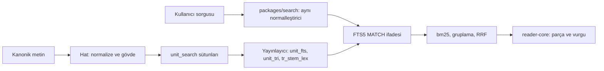

# Arama (SQLite FTS5)

> **Sürüm:** 1.1 · **Tarih:** 19 Ekim 2026 · **Durum:** Taslak
> **Bağlı kararlar:** [K-17](../00-ozet/02-karar-defteri.md#k-17--arama-sqlite-fts5) · [K-26](../00-ozet/02-karar-defteri.md#k-26--kalıcı-adresler-çapa-şeması) · [K-14](../00-ozet/02-karar-defteri.md#k-14--web) · K-21 ([karar defteri](../00-ozet/02-karar-defteri.md))

Arama cihazda SQLite FTS5 ile yapılır. Arama metni içerik hattında normalize edilir ve kanonik metinden ayrı sütunlarda durur; kanonik metin değişmez (K-26). Diğer belgelerdeki `search_text` adı bu sütunların (`tr_narrow`, `tr_wide`, `tr_stem`, `ar_norm`) ortak adıdır. Önek indeksi, Arapça için trigram tablosu ve bm25 sıralaması kullanılır; hedef orta seviye Android'de 50 ms altıdır (K-17). Normalleştirme kuralları yalnız bu dosyada tanımlıdır; Python, TypeScript ve C# uygulamaları `shared/test-vectors/` ile birbirine kilitlenir.

FTS5'in varsayılan `unicode61` belirteçleyicisi büyük-küçük harfi Unicode 6.1 kurallarıyla katlar ve aksan işaretlerini yalnız Latin harflerinden siler ([SQLite FTS5](https://sqlite.org/fts5.html)). Araştırmadaki yerel denemede "Işık" kelimesi "ışık", "IŞIK" ve "isik" sorgularıyla bulunamadı; harekeli besmele tek harflik parçalara bölündü (rapor). Normalleştirme bu yüzden belirteçleyiciye bırakılmaz.



## 1. Normalleştirme belirtimi

Sürüm `normalizer_version = 1.0`. Uygulamalar `packages/search/src/normalize.ts`, `pipeline/src/mutalaa_pipeline/normalize/` ve `server/Mutalaa.Domain/Text/` altındadır ([Backend API](../02-mimari/05-backend-api.md) §2). Paketin `pack_meta.normalizer_version` değeri uygulamanınkiyle `major.minor` düzeyinde aynı olmalıdır ([İçerik paketleri](./03-icerik-paketleri.md)). Yama sürümü çıktıyı değiştiremez; değiştiren her kural yeni bir küçük sürümdür ve bütün metin paketlerini yeniden ürettirir.

### 1.1 Ortak ön adım

1. Metin Unicode NFC'ye çevrilir. Bu yalnız arama anahtarını üretirken yapılır; kanonik metin aynen kalır.
2. Metin yazı sistemine göre parçalara ayrılır. Arapça bloklarındaki harfler (U+0600–06FF, U+0750–077F, U+08A0–08FF, U+FB50–FDFF, U+FE70–FEFF) Arapça parçaya, diğer harfler Türkçe parçaya gider. Türkçe sözcükler `tr_*` sütunlarına, Arapça sözcükler `ar_norm` sütununa yazılır.

### 1.2 Türkçe

1. **Küçük harf.** Önce `I → ı` ve `İ → i` elle çevrilir, sonra dilden bağımsız küçük harf dönüşümü yapılır. Python'da `"İ".lower()` ve JavaScript'te `"İ".toLowerCase()` iki kod noktası (`i` + U+0307) döndürür; Hermes'te `toLocaleLowerCase('tr')` davranışı Doğrulanacak ([Mobil mimari](../06-mobil/01-mobil-mimari.md) MM-11).
2. **Kesme işareti.** U+2019, U+2018, U+02BC, U+02BE, U+02BF, U+00B4 ve U+0060 düz kesmeye (U+0027) çevrilir.
3. **Ek ayırma.**
   - Sözcük `shared/data/ic-kesme.txt` listesindeki bir girdiyle başlıyorsa (en uzun eşleşme, geniş anahtarla karşılaştırılır), girdinin içindeki kesmeler iç kesmedir ve silinir. Liste Arapça kökenli iç kesmeli kelimeleri taşır: `kur'an`, `mu'min`, `ma'na`, `san'at`, `lem'a`, `i'caz`, `te'sir` gibi. Liste külliyattaki bütün kesmeli sözcüklerden çıkarılır ve editör onaylar.
   - Kalan kısımda ilk kesmeden sonrası ektir ve atılır: "Kur'ân'ın" → "kurân", "Sözler'de" → "sözler".
   - Sözcük başındaki ve sonundaki kesme noktalamadır.
4. **Noktalama.** Tire ve noktalama boşluğa döner, boşluk dizileri teke iner: "rahmet-i İlâhiye" → "rahmet i ilâhiye".
5. Sonuç **dar anahtardır** (`tr_narrow`, `key_narrow`). Düzeltme işaretleri ve Türkçe harfler korunur.
6. **Geniş anahtar** (`tr_wide`, `key_wide`): dar anahtarda `ı → i` yapılır, NFD uygulanır, U+0300–U+036F silinir, NFC'ye dönülür. Böylece `â î û` ve `ç ğ ö ş ü` katlanır. Rapor bu iki anahtarı ister: düzeltme işaretsiz geniş anahtar ve âlem/alem, hâlâ/hala gibi çiftleri ayıran dar anahtar (rapor). [Kök ve lemma](../05-capraz-referans/03-kok-ve-lemma.md) dosyasındaki `keys()` örneği yalnız düzeltme işaretlerini katlıyor; tek tanım bu dosyadır.
7. **Gövde** (`tr_stem`): hat, dar anahtarın her sözcüğü için Snowball Türkçe gövdesini üretir ve geniş anahtara katlar. PostgreSQL'in `turkish_stem` sözlüğü de Snowball'dur ([PostgreSQL docs](https://www.postgresql.org/docs/19/textsearch-psql.html)). Python paketindeki Türkçe Snowball uygulaması Doğrulanacak; zeyrek (MIT, 0.1.3, alfa) lemma için ayrıca kullanılır ([PyPI zeyrek](https://pypi.org/project/zeyrek)). Değişmez kural: `tr_wide` ve `tr_stem` aynı sayıda sözcük taşır ve sıraları aynıdır.

### 1.3 Arapça

1. Silinir: U+064B–U+065F (harekeler, hemze üstü ve altı işaretleri dahil), U+0670 (üstteki elif), U+06D6–U+06ED (Kur'an işaretleri), U+0640 (tatvil).
2. Birleştirilir: `أ إ آ ٱ → ا`, `ى → ي`, `ة → ه`, `ؤ → و`, `ئ → ي`.
3. Arapça noktalama (`، ؛ ؟ « » ﴾ ﴿`) boşluğa döner.
4. Öneri (kaynakta görülürse, Doğrulanacak): Arapça-Hint rakamları ASCII'ye, Farsça `ی` (U+06CC) `ي`'ye, `ک` (U+06A9) `ك`'ye çevrilir. QA, bu kurallardan sonra Arapça bloklarında kalan her birleşen işareti (Mn) raporlar.

Kurallar IAJIT 2022 tarifine dayanır: harekeler, Kur'an işaretleri ve keşide silinir; hemze ve medli elif biçimleri elife, elif maksûre ye'ye, tâ merbûta he'ye indirilir ([IAJIT 2022](https://www.ccis2k.org/iajit/images/Year2022/No.4/20568.pdf)).

### 1.4 Kur'an birimleri

Rapor, arama için türetilmiş bir sütun yerine Tanzil'in kendi yayımladığı Simple Clean sürümünün kullanılmasını önerir; bu raporun çıkarımıdır. Kur'an birimlerinde `ar_norm` bu yüzden Simple Clean âyet metninin normalize hâlidir. Uthmani yazımı Simple Clean'den farklı olan kelimelerin normalize biçimleri sona eklenir (öneri); yapıştırılan Uthmani metin de böylece bulunur. Ayrı sütundaki normalize metnin Tanzil şartlarında "değiştirme" sayılıp sayılmadığı Tanzil'e sorulur ([Kaynaklar ve lisans defteri](../04-icerik/01-kaynaklar-ve-lisans-defteri.md), yazışma 1; hukuki görüş değildir). Gerekirse Kur'an için içeriksiz FTS tablosu kullanılır; o durumda normalize metin pakette saklanmaz, yalnız indeks taşınır.

### 1.5 Test vektörleri

```text
shared/test-vectors/normalize/tr.jsonl      Türkçe: girdi → dar ve geniş anahtar
shared/test-vectors/normalize/ar.jsonl      Arapça: girdi → ar_norm
shared/test-vectors/fts-query/query.jsonl   sorgu → FTS5 MATCH ifadesi ve son süzgeç (bölüm 3)
shared/test-vectors/arama/olcum.jsonl       ölçüm sorguları ve beklenen ilk sonuçlar (bölüm 6)
```

Vektör satırları `id`, `input`, `expected` ve isteğe bağlı `note` alanlarını taşır ([Proje yapısı](../02-mimari/03-proje-yapisi.md) §1.2). Türkçe dosyada `expected` iki anahtarı birlikte verir:

```jsonl
{"id":"tr-0001","input":"Işık","expected":{"dar":"ışık","genis":"isik"},"note":"I → ı"}
{"id":"tr-0004","input":"Kur'ân'ın","expected":{"dar":"kurân","genis":"kuran"},"note":"iç kesme + ek"}
```

| Girdi | Dar | Geniş | Sınanan kural |
|---|---|---|---|
| `Işık` | `ışık` | `isik` | I → ı |
| `İMAN` | `iman` | `iman` | İ → i |
| `ışığın` | `ışığın` | `isigin` | Türkçe harf katlama |
| `Kur'ân'ın` | `kurân` | `kuran` | iç kesme listesi + ek |
| `Kur’an’dan` | `kuran` | `kuran` | tipografik kesme |
| `mü'min` · `Lem'alar` | `mümin` · `lemalar` | `mumin` · `lemalar` | iç kesme listesi |
| `Sözler'de` | `sözler` | `sozler` | ek atılır |
| `âlem` · `alem` | `âlem` · `alem` | `alem` · `alem` | dar anahtar ayırır |
| `hâlâ` · `hala` | `hâlâ` · `hala` | `hala` · `hala` | dar anahtar ayırır |
| `Âl-i İmrân` | `âl i imrân` | `al i imran` | tire |
| `a` + U+0302 + `lem` | `âlem` | `alem` | NFC |

| Girdi | `ar` | Sınanan kural |
|---|---|---|
| `بِسْمِ ٱللَّهِ ٱلرَّحْمَٰنِ ٱلرَّحِيمِ` | `بسم الله الرحمن الرحيم` | hareke, U+0670, `ٱ` |
| `ٱلْأَرْضِ` | `الارض` | `أ → ا` |
| `مُوسَىٰ` | `موسي` | `ى → ي` |
| `رَحْمَةً` | `رحمه` | `ة → ه` |
| `مُؤْمِنُونَ` | `مومنون` | `ؤ → و` |
| `شَىْءٍ` | `شيء` | yalın hemze korunur |
| `يَسْـَٔلُونَكَ` | `يسلونك` | tatvil ve hemze işareti; imlâî `يسألونك` → `يسالونك` farkı |

Vektörler CI'da Python (`pytest`), TypeScript (`vitest` ve Hermes) ve C# (`xUnit`) ile koşar ([Test stratejisi](../07-yayin/03-test-stratejisi.md)).

## 2. FTS5 tabloları

```sql
-- Metin paketlerinde (core, tefsir-elmalili, hadis-*)
CREATE TABLE unit_search (rowid INTEGER PRIMARY KEY, tr_wide TEXT, tr_stem TEXT, ar_norm TEXT);  -- rowid = unit.rowid

CREATE VIRTUAL TABLE unit_fts USING fts5(
  tr_wide, tr_stem, ar_norm,
  content='unit_search', content_rowid='rowid',
  tokenize='unicode61 remove_diacritics 0',
  prefix='2 3 4'
);
CREATE VIRTUAL TABLE unit_tri USING fts5(
  ar_norm,
  content='unit_search', content_rowid='rowid',
  tokenize='trigram'
);
CREATE TABLE tr_stem_lex (form TEXT PRIMARY KEY, stem TEXT NOT NULL) WITHOUT ROWID;   -- geniş biçim → gövde

-- Yayınlayıcı, satırları yazdıktan sonra:
INSERT INTO unit_fts(unit_fts) VALUES('rebuild');
INSERT INTO unit_tri(unit_tri) VALUES('rebuild');
INSERT INTO unit_fts(unit_fts, rank) VALUES('rank', 'bm25(1.0, 0.4, 1.0)');
INSERT INTO unit_fts(unit_fts) VALUES('optimize');
INSERT INTO unit_tri(unit_tri) VALUES('optimize');

-- risale-dizin: içeriksiz; metin kitap paketlerindedir
CREATE VIRTUAL TABLE unit_fts USING fts5(tr_wide, tr_stem, ar_norm, content='',
  tokenize='unicode61 remove_diacritics 0', prefix='2 3 4');
CREATE VIRTUAL TABLE unit_tri USING fts5(ar_norm, content='', tokenize='trigram');
```

- **`remove_diacritics 0`.** Varsayılan değer Latin aksanlarını siler. Normalleştirme katlamayı zaten yapar; belirteçleyici yalnız boşluktan böler.
- **Kategoriler.** `unicode61` varsayılan olarak `L* N* Co` kategorilerini sözcük sayar; harekeler `Mn` kategorisindedir ve normalize metinde kalmaz.
- **Önek indeksi.** `prefix='2 3 4'` 2–4 karakterlik önek sorgularını hızlandırır. Türkçe ekler için gövde sütunu da vardır.
- **Trigram.** 3 karakterden kısa alt dizeler hiçbir satırı eşlemez. `remove_diacritics` açık değilse LIKE ve GLOB indeksle hızlanır ([SQLite FTS5](https://sqlite.org/fts5.html)). İçeriksiz tabloda trigram araması `MATCH` ile yapılır. Arapça bitişik ekler (و ف ب ل ال) bu tabloyla bulunur: `الصابرين` araması `والصابرين` geçen âyeti de getirir.
- **`detail=full`.** Varsayılandır ve ifade sorgusu için gereklidir. `detail=none` bir denemede indeksi 743 MiB'den 134 MiB'ye indirdi ama ifade sorgusunu kapatır ([SQLite FTS5](https://sqlite.org/fts5.html)). İçeriksiz tablo arama metnini ikinci kez saklamaz; büyük paketlerde boyuta göre seçilir (Açık soru).
- **`tr_stem_lex`.** Yayınlayıcı, her paketin geniş biçimlerini gövdeleriyle eşler. Kaynak `tr_wide` ve `tr_stem` sütunlarının sözcük sözcük hizasıdır; eki atılmadan önceki birleşik biçimler de eklenir ("kuranin" → `kuran` gövdesi). Uygulama böylece cihazda gövdeleyici çalıştırmaz. TypeScript'te bir Snowball Türkçe uygulaması bulunursa tablo gereksizleşir (Doğrulanacak).
- **`snippet()` kullanılmaz.** Arama sütunları katlanmış metin taşır; `snippet()` ve `highlight()` katlanmış metni döndürür. Sonuç parçası `packages/reader-core` içinde kanonik metinden üretilir (bölüm 4).

## 3. Sorgu ayrıştırma

```text
sorgu   ::= oge ( " " oge )*
oge     ::= filtre | ifade | terim
filtre  ::= ( "kök:" | "kaynak:" ) deger
ifade   ::= '"' metin '"'
terim   ::= sozcuk "*"?
```

1. **Adres.** Önce sorgunun bir adres olup olmadığına bakılır: "Bakara 255", "2:255", "Âl-i İmrân 7". Sure adları `core` paketindeki `sure` tablosundan gelir ([Çapa şeması](./01-capa-semasi.md) bölüm 12). Eşleşirse "Git: Bakara 255" sonucu en üstte çıkar.
2. **Yazı sistemi.** Arapça harfli terim `ar_norm` sütununa, Latin harfli terim `tr_*` sütunlarına gider.
3. **Türkçe terim.** Geniş anahtarı `tr_wide` sütununda aranır. `tr_stem_lex` terimin gövdesini verirse `tr_stem` sütunu da `OR` ile eklenir. Terim `â`, `î` ya da `û` içeriyorsa sonuçlar dar anahtarla süzülür (bölüm 4); hiç sonuç kalmazsa geniş sonuçlar "Düzeltme işaretsiz yazımlar da gösteriliyor" notuyla döner. Arayüzdeki "Tam yazımla ara" anahtarı süzgeci bütün terimlere uygular.
4. **Önek.** Açık `*` ya da yazarken son terim için örtük önek kullanılır. Önek en az 2 karakterdir; tek karakterli terim yok sayılır. Önekte gövde sütunu kullanılmaz.
5. **İfade.** Tırnak içi metin `tr_wide` ya da `ar_norm` sütununda ifade sorgusudur; gövde kullanılmaz.
6. **Arapça terim.** `ar_norm` sütununda sözcük olarak aranır. Sonuç azsa ve terim en az 3 karakterse `unit_tri` ile alt dize araması yapılır; bu sonuçlar "otomatik eşleşme" çipiyle katlı gelir ([Bağlantı modeli](../05-capraz-referans/01-baglanti-modeli.md)).
7. **`kök:`** Kök araması `kelime-kok` paketindeki `word_morph` tablosuyla yapılır; diğer eserlerde `tr_root_index` kullanılır. Paket kurulu değilse filtre "Kelime kökleri paketi gerekli" der ([İçerik paketleri](./03-icerik-paketleri.md)).
8. **`kaynak:`** Aramayı `kuran`, `meal`, `tefsir`, `hadis` ya da `risale` grubuna sınırlar.
9. **Kaçış.** Her sözcük FTS5 dizgisi olarak çift tırnağa alınır; kullanıcı girdisindeki FTS5 sözdizimi karakterleri sorguyu bozamaz.

| Sorgu | MATCH ifadesi |
|---|---|
| `sabır` | `tr_wide : "sabir" OR tr_stem : "{G}"` (`{G}` = `tr_stem_lex('sabir')`) |
| `ışığın nuru` | `(tr_wide : "isigin" OR tr_stem : "{G1}") AND (tr_wide : "nuru" OR tr_stem : "{G2}")` |
| `kur*` | `tr_wide : "kur"*` |
| `"rahmet-i ilâhiye"` | `tr_wide : "rahmet i ilahiye"` ve dar süzgeç |
| `âlem` | `tr_wide : "alem"` ve dar süzgeç `âlem` |
| `الصابرين` | `ar_norm : "الصابرين"`; az sonuçta `unit_tri MATCH '"الصابرين"'` |
| `kök:صبر` | `word_morph.root_id` ve `tr_root_index.root_id` sorguları |

```sql
-- Kök araması (p_kelime_kok bağlıysa)
SELECT q.anchor, q.ayah_index, q.word
FROM main.quran_word q JOIN p_kelime_kok.word_morph m ON m.anchor = q.anchor
WHERE m.root_id = ?1 ORDER BY q.ayah_index, q.word;
SELECT occurrences FROM p_kelime_kok.root WHERE id = ?1;   -- "Bu kök Kur'an'da N yerde geçer"
```

## 4. Sıralama ve sonuç parçası

- **bm25.** Sütun ağırlıkları paket üretilirken `rank` ayarına yazılır: `tr_wide` 1,0, `tr_stem` 0,4, `ar_norm` 1,0 (başlangıç değeri). FTS5'te bm25 sütun ağırlığı alır; `k1 = 1,2` ve `b = 0,75` sabittir ([SQLite FTS5](https://sqlite.org/fts5.html)). Küçük değer daha iyidir; sorgu `ORDER BY rank` kullanır.
- **Gruplar.** Sonuçlar esere göre gruplanır: Âyet, Meal, Tefsir, Hadis, Risale-i Nur (rapor). Grup içinde bm25 sırası geçerlidir. Okurken açılan aramada okunan eserin grubu önce gelir.
- **"Tümü" listesi.** Farklı FTS tablolarının bm25 değerleri karşılaştırılamaz, çünkü her tablonun kendi külliyat istatistiği vardır. Birleşik liste ağırlıklı RRF ile kurulur: `Σ w / (60 + sıra)`; k ≈ 60 önerisi Azure AI Search belgesinden gelir ([MS Learn RRF](https://learn.microsoft.com/en-us/azure/search/hybrid-search-ranking)). Başlangıç ağırlıkları: Âyet 1,2 · Meal 1,0 · Tefsir 0,9 · Risale 0,9 · Hadis 0,8.
- **Ek puan.** Başlık rolündeki birim ×1,5, tam ifade eşleşmesi ×1,3, dar anahtar eşleşmesi ×1,2. Değerler ölçümle ayarlanır.
- **Kısa önek.** 2 karakterlik önekte bm25 hesaplanmaz; sonuçlar okuma sırasıyla (`ord`) gelir. Böylece çok satır eşleşse de maliyet sınırlı kalır.
- **Sonuç parçası.** `reader-core` sonucun kanonik metnini sözcüklere böler, her sözcüğün geniş ve dar anahtarını hesaplar, sorgu terimine, önekine ya da gövdesine (`tr_stem_lex` toplu sorgusu) uyanları işaretler. En yoğun eşleşmenin çevresinden ±12 sözcüklük pencere alır. Arapça sözcükler ayrı `Text` parçası olarak sağdan sola çizilir; dil ve yön özellikleri [Mobil mimari](../06-mobil/01-mobil-mimari.md#13-erişilebilirlik-uygulaması) §13'tedir (iOS `accessibilityLanguage="ar"`, Android karşılığı Doğrulanacak).

## 5. Paketler arasında arama (ATTACH)

İçerik bağlantısında `core` ana şemadır; `kelime-kok`, `tefsir-elmalili`, `hadis-*` ve `risale-dizin` bağlıdır. SQLite varsayılan olarak en çok 10 veritabanı bağlar ([SQLite sınırları](https://www.sqlite.org/limits.html)); mobil mimari 8'le sınırlar. Risale kitapları tek tek bağlanmaz; Risale araması `risale-dizin` içindeki tek indeksle yapılır ([İçerik paketleri](./03-icerik-paketleri.md) bölüm 2). Arama tek deyimle çalışır:

```sql
SELECT * FROM (SELECT 'core' AS pack, u.anchor, u.kind, u.ord, u.label, bm25(unit_fts, 1.0, 0.4, 1.0) AS s
               FROM main.unit_fts JOIN main.unit u ON u.rowid = unit_fts.rowid
               WHERE unit_fts MATCH ?1 ORDER BY s LIMIT 20)
UNION ALL
SELECT * FROM (SELECT 'tefsir-elmalili', u.anchor, u.kind, u.ord, u.label, bm25(unit_fts, 1.0, 0.4, 1.0)
               FROM p_tefsir_elmalili.unit_fts JOIN p_tefsir_elmalili.unit u ON u.rowid = unit_fts.rowid
               WHERE unit_fts MATCH ?1 ORDER BY 6 LIMIT 20)
UNION ALL
SELECT * FROM (SELECT r.pack_id, r.anchor, 'risale', r.ord, r.label, bm25(unit_fts, 1.0, 0.4, 1.0)
               FROM p_risale_dizin.unit_fts JOIN p_risale_dizin.unit_ref r ON r.rowid = unit_fts.rowid
               WHERE unit_fts MATCH ?1 ORDER BY 6 LIMIT 20);
```

- Şema nitelemeli FTS5 tablolarında `MATCH` sözdizimi prototipte sınanır (Doğrulanacak).
- Risale sonucunun metni kitap paketinden okunur; kitap kurulu değilse liste yalnız etiketi gösterir ve indirme önerir. Görünen sonuçların kitapları istek anında bağlanır (en çok 3).
- "Daha fazla" grup başına `LIMIT 20 OFFSET n` ile yüklenir.
- expo-sqlite web derlemesi FTS içermez ([Expo SQLite](https://docs.expo.dev/versions/v58.0.0/sdk/sqlite.md)). Web geldiğinde (Faz 5) arama sunucuda, editoryal veritabanındaki `turkish` ve `arabic` yapılandırmalı `tsvector` sütunlarıyla yapılır ([PostgreSQL](https://docs.w3cub.com/postgresql~18/textsearch-psql)); çevrimdışı web için Arapça ve Türkçe gövdeleyicisi olan Orama değerlendirilir ([Orama](https://docs.orama.com/open-source/supported-languages)). Sorgu normalleştirmesi aynı TypeScript paketinden gelir. Açık soru: editoryal veritabanı dışarı açılmadığı için ([Genel mimari](../02-mimari/01-genel-mimari.md#10-güvenlik-ve-gizlilik-sınırları) §10, §11 madde 3) web aramasının bu sütunlara mı, yayımlanmış paketlerden üretilen ayrı bir indekse mi dayanacağı A38'de `/karar` ile seçilir.

## 6. Performans bütçesi ve ölçüm

- **Hedef.** Sorgu dizgisinden ilk sayfa sonuç satırlarına kadar p95 < 50 ms. Ölçüm orta seviye bir Android cihazda, sürüm (release) derlemesinde, `core` ve üç isteğe bağlı paket bağlıyken yapılır ([Kapsam ve fazlar](../01-urun/01-kapsam-ve-fazlar.md#8-v1-başarı-ölçütleri) B-02); bağlı paketler ve sürümleri ölçüm çıktısında yazılır. Isınmış durum bütçeye tabidir; açılıştan sonraki ilk sorgu ayrıca raporlanır. Sonuç parçası ve çizim ayrı arayüz bütçesindedir.
- **Referans cihaz.** Adıyla [Test stratejisi](../07-yayin/03-test-stratejisi.md) dosyasında belirlenir (Açık soru, mobil mimari MM-12).
- **Sorgu kümesi.** `shared/test-vectors/arama/olcum.jsonl` yaklaşık 200 sorgu taşır: sık ve seyrek sözcükler, 2–4 karakterlik önekler, ifadeler, düzeltme işaretli terimler, Arapça sözcükler, trigram aramaları, kök ve adres sorguları. Her sorgu beklenen ilk sonuçları da taşır; böylece küme hem hızı hem doğruluğu sınar. Satır alanları `id`, `kategori`, `sorgu`, `beklenen`dir (ilk sonuç çapaları). Bu dosya ortak test vektörü değildir; Python, TypeScript ve C# vektör koşucuları `arama/` klasörünü okumaz.
- **Ölçüm aracı.** `internal` ve `dev` derlemesindeki gizli "Arama ölçümü" ekranı kümeyi üç kez koşar, her sorguyu `performance.now()` ile ölçer, kategori başına p50, p95 ve en yüksek değeri cihaz modeli ve paket sürümleriyle JSON olarak dışa verir. Ölçüm her sürüm adayında ve normalleştirici ya da paket şeması değiştiğinde yapılır.
- **Yöntemler.** Hazırlanmış deyimler yeniden kullanılır; ATTACH açılışta bir kez yapılır; her dal `LIMIT` taşır; paket üretiminde `optimize` çalışır; kısa önek bm25'siz sıralanır; `tr_stem_lex` sorguları toplu yapılır. JSI geçişlerinin maliyeti nedeniyle paket başına ayrı sorgu yerine tek `UNION ALL` deyimi tercih edilir (ölçümle doğrulanacak). Bir PowerSync karşılaştırması işlem ve WAL kullanımının kitaplık seçiminden daha çok fark yarattığını gösterir ([PowerSync](https://powersync.com/blog/react-native-database-performance-comparison)).
- **Bütçe aşılırsa.** Sırasıyla: içeriksiz tabloya geçmek, önek boyutlarını azaltmak, büyük paketleri bölmek, sık sorguların sonuçlarını önbelleğe almak.

## 7. Açık sorular

| No | Konu | Durum |
|---|---|---|
| AR-1 | İç kesme listesinin derlenmesi ve editör onayı | Öneri |
| AR-2 | TypeScript Snowball Türkçe gövdeleyicisi; Python Snowball uygulaması | Doğrulanacak |
| AR-3 | İçeriksiz ya da dış içerikli FTS seçimi (boyut ve Tanzil yazışması) | Açık soru, hukuki görüş değildir |
| AR-4 | Uthmani biçimlerinin Kur'an `ar_norm` sütununa eklenmesi | Öneri |
| AR-5 | bm25 sütun ağırlıkları, RRF kaynak ağırlıkları ve ek puanlar | Ölçülecek |
| AR-6 | expo-sqlite'ta `SQLITE_MAX_ATTACHED` ve şema nitelemeli `MATCH` | Doğrulanacak |
| AR-7 | Referans orta seviye Android cihaz | Açık soru |
| AR-8 | Farsça `ی` ve `ک` ile Arapça-Hint rakamlarının kaynaklarda görülmesi | Doğrulanacak |

## İlgili dosyalar

- [Karar defteri](../00-ozet/02-karar-defteri.md) · [Çapa şeması](./01-capa-semasi.md) · [Editoryal veritabanı](./02-editoryal-veritabani.md) · [İçerik paketleri](./03-icerik-paketleri.md)
- [Bağlantı modeli](../05-capraz-referans/01-baglanti-modeli.md) · [İktibas tespiti](../05-capraz-referans/02-iktibas-tespiti.md) · [Kök ve lemma](../05-capraz-referans/03-kok-ve-lemma.md)
- [Mobil mimari](../06-mobil/01-mobil-mimari.md) · [Test stratejisi](../07-yayin/03-test-stratejisi.md) · [İçerik hattı](../04-icerik/02-icerik-hatti.md) · [Kaynakça](../09-kaynakca.md)
