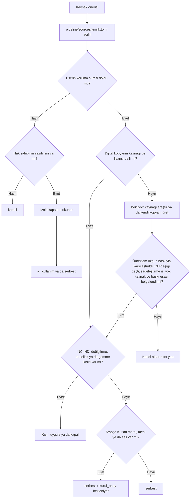

# Kaynaklar ve Lisans Defteri
> **Sürüm:** 1.5 · **Tarih:** 27 Ekim 2026 · **Durum:** Taslak
> **Bağlı kararlar:** [K-06](../00-ozet/02-karar-defteri.md#k-06--yayın-kapısı) · [K-03](../00-ozet/02-karar-defteri.md#k-03--tefsir-önce-elmalılı-meali) · [K-04](../00-ozet/02-karar-defteri.md#k-04--hadis-kaynakları) · [K-05](../00-ozet/02-karar-defteri.md#k-05--risale-i-nur-ve-lisansı-bekleyen-içerik) · [K-07](../00-ozet/02-karar-defteri.md#k-07--mushaf-görünümü-üç-seçenek) · [K-19](../00-ozet/02-karar-defteri.md#k-19--kuran-kelime-anlamları) · [K-28](../00-ozet/02-karar-defteri.md#k-28--ses) · [K-38](../00-ozet/02-karar-defteri.md#k-38--kaynak-edinimi-dijital-öncelikli-kanıtla-yükseltme)

Bu defter, Mütâlaa'ya giren ya da girmesi düşünülen her içerik kaynağının lisans durumunu tutar. Editoryal veritabanındaki her `source` satırı buradaki bir kayıtla aynı kimliği taşır. Yayınlayıcının lisans kapısı yalnız `license_status` ve `kurul_onay` alanlarına bakar ([Yayın kapısı ve Kurul](../07-yayin/01-yayin-kapisi-ve-kurul.md)). Defterde kaydı olmayan kaynak içerik hattına alınmaz.

> **Hukuki görüş değildir.** Değerlendirmeler Ekim 2026 araştırma raporuna ve bağlantısı verilen birincil sayfalara dayanır. "Açık soru" işaretli hukuki konular yayından önce bir fikri haklar avukatına sorulur. FSEK için güncel kaynak mevzuat.gov.tr metnidir ([FSEK, mevzuat.gov.tr](https://www.mevzuat.gov.tr/mevzuat?MevzuatNo=5846&MevzuatTur=1&MevzuatTertip=3)). WIPO Lex metni yalnız 2008 değişikliğine kadar günceldir; 6552 sayılı Kanun değişikliğini ve m. 47'nin iptal notunu taşımaz ([FSEK, WIPO Lex](https://www.wipo.int/wipolex/en/text/499171)). ~~Bu defterdeki FSEK madde alıntıları WIPO metninden alınmıştı; güncel metinle karşılaştırılması Doğrulanacak.~~ **Çözüldü (2026-10-26):** Defterdeki FSEK m. 26–27 alıntıları güncel mevzuat.gov.tr metniyle karşılaştırıldı ve aynıdır ([FSEK, mevzuat.gov.tr](https://www.mevzuat.gov.tr/mevzuat?MevzuatNo=5846&MevzuatTur=1&MevzuatTertip=3)). Bu karşılaştırma hukuki görüş değildir.

## 1. Durum kodları ve derleme görünürlüğü

| `license_status` | Anlamı | `dev` (yalnız ekip) | `internal` (davetli test) | `public` (mağaza) |
|---|---|---|---|---|
| `serbest` | Koruma süresi dolmuş ya da lisans ücretsiz uygulama dağıtımına izin veriyor; şartlar uygulanıyor | Görünür | Görünür; Kurul kapsamındaki içerik Açık soru | Görünür; Kurul kapsamındaysa yalnız onaylı sürüm |
| `bekliyor` | Serbest bir eserin kaynağı belirsiz dijital kopyası ya da şartları netleşmemiş bir lisans | Görünür | Görünmez | Görünmez |
| `ic_kullanim` | Hak sahibinin izni ya da avukat görüşü ekip içi kullanıma izin veriyor, dağıtıma vermiyor | Görünür | Görünmez | Görünmez |
| `kapali` | Hiçbir derlemeye girmez; ham verisi hatta alınmaz | Görünmez | Görünmez | Görünmez |

K-06 güncellemesine (18 Ekim 2026) göre `internal` derlemeler davetli test kullanıcılarına gittiği için yalnız `serbest` içerik görür; dış test kullanıcılarına dağıtım çoğaltma ve yayma sayılabilir. Kurul onayı bekleyen Kur'an metni, meal ve sesin kapalı testte gösterilip gösterilemeyeceği Kurul'a sorulur; cevap gelene kadar dış test kullanıcısı alınmaz.

**İç kullanım kuralı.** Koruma süresi dolmamış bir eserin metni, sesi ya da görseli (Risale-i Nur, Kâmil Miras ciltleri, modern mealler, hafız kayıtları) hak sahibinin yazılı izni ya da avukat görüşü olmadan indirilmez, hatta işlenmez, yapay zekâ servisine gönderilmez ve geliştirme derlemesine konmaz. Bu kaynaklar o güne kadar `kapali` kalır ve `embed_ok = false` taşır. Olumlu görüş gelirse en fazla `ic_kullanim` olurlar ve yalnız ekip içi `dev` derlemelerinde görünürler. Ekip içi işlemenin (dizin üretimi dahil) hukuki uygunluğu da hukukçuya danışılır (K-05).

**Çözüldü (19 Ekim 2026): Editoryal veritabanı ile fark.** [Editoryal veritabanı](../03-veri/02-editoryal-veritabani.md#3-source) §3 ve §11 artık bu defterle aynı değerleri verir: `risale-asil-nusha` ve `tecrid-miras` iç kullanım kuralı gereği avukat görüşüne ya da serbest kalma tarihine kadar `kapali`dır.

**Kurul alanı.** Kur'an metni, meal ve ses kaynakları `kurul_onay` alanında onay numarasını ve onaylı içerik sürümünü taşır. 633 sayılı Kanun m. 6'ya göre Kurul onayı olmayan "sesli, görüntülü ve elektronik ortamda hazırlanan Kur'an-ı Kerimler basılamaz ve yayımlanamaz" ([Lexpera, 633](https://www.lexpera.com.tr/mevzuat/kanunlar/diyanet-isleri-baskanligi-kurulus-ve-gorevleri-hakkinda-kanun-633)). 2022 yönetmeliğine göre onaylanmış eserin içeriği değiştirilemez ([Memurlar.net](https://www.memurlar.net/haber/1045766/kur-an-i-kerim-basim-ve-yayim-kriterleri-hakkinda-yonetmelik-resmi-gazete-de-yayimlandi.html)). Başvuru usulü, ücret ve süre bilinmiyor (Açık soru). Paket manifesti paket başına `kurul_gerekli` bilgisi taşır (K-06 uygulama notu); bu değer paketteki kaynakların Kurul kapsamından türetilir.

**`embed_ok` alanı.** Kaynağın metninin gömme (embedding) vektörüne çevrilip çevrilemeyeceğini ve harici bir yapay zekâ API'sine gönderilip gönderilemeyeceğini söyler. Varsayılan `false`'tur; kaynak kartındaki dayanakla `true` yapılır. Korumalı metinler (Risale-i Nur, Kâmil Miras ciltleri) hukuki onay olmadan `false` kalır. Quran Foundation içeriği `false`'tur; QF şartları içerikten türetilen gömmeleri de kısıtlara bağlıyor (20 Ekim 2026 okuması; [QF Developer Terms](https://api-docs.quran.foundation/legal/developer-terms/)). **Çözüldü (2026-10-26): "embeddings" sözcüğünün yeri ve kapsamı.** Şart kopyası alındı (`pipeline/sources/licenses/ses-qf-api-2026-10-26.txt`; aynı metin `qpc-v1-font`, `qpc-v2-font`, `qpc-v4-font` ve `medine-604-duzen` kopyalarında da var; "Last updated: 2026-10-11"). Sözcük iki yerde geçer. Derived Materials tanımı: "Outputs made from or using QF Content, including excerpts, compilations, indexes, embeddings, annotations, summaries, transformed media, and AI-generated responses." ve ardından "An output that reproduces or permits reconstruction of QF Content remains subject to the restrictions on that content." Yapay zekâ bölümü: "QF Content retained for retrieval, including content-derived embeddings that reproduce or permit reconstruction of it, remains subject to the applicable storage and use restrictions in these Terms." Yani kısıt, içeriği yeniden üreten ya da yeniden kurmaya izin veren gömmelerle sınırlıdır; önceki özet ("içerikten türetilen gömmeleri de aynı kısıtlara bağlıyor") bundan geniş yazılmıştı. Karar değişmez: `embed_ok = false` kalır; yalnız dayanağın kapsamı daraldı. Hukuki görüş değildir. İçerik hattı bu alana uyar ([İçerik hattı](./02-icerik-hatti.md)). Tablodaki "Uygulanmaz" değeri metin taşımayan kaynaklar (fontlar) içindir.

**Veri setleri de kapıdan geçer.** K-06 uygulama notuna göre QAC kaynaklı kök ve lemma verisi `core` paketinden ayrı bir pakette, kendi lisans durumuyla tutulur. Bu dosyada önerilen paket adı `kelime-kok`'tur; QAC'den yazılı açıklık gelene kadar `bekliyor` durumundadır ve bu sürede yalnız ekip içi `dev` derlemelerinde görünür.

## 2. Özet tablo

| Kimlik | Kaynak | `license_status` | `embed_ok` | Kurul | Hüküm |
|---|---|---|---|---|---|
| `tanzil-uthmani` | Tanzil Kur'an metni, Uthmani | `serbest` | Evet (çıkarım) | Evet | Kullan |
| `tanzil-simple-clean` | Tanzil Kur'an metni, Simple Clean | `serbest` | Evet (çıkarım) | Evet | Kullan (arama tabanı) |
| `kfgqpc-hafs-font` | KFGQPC Uthmanic Hafs fontu | `bekliyor` | Uygulanmaz | Dolaylı | Yazılı izin; yedek Amiri Quran |
| `qpc-v1-font`, `qpc-v2-font`, `qpc-v4-font` | QPC sayfa fontları | `bekliyor` | Uygulanmaz | Evet | QF şartlarıyla |
| `medine-604-duzen` | Mushaf A sayfa düzeni ve kelime-glif eşlemesi | `bekliyor` | Hayır (QF şartı) | Evet | Kaynak seçimi Açık soru |
| `amiri-quran-font` | Amiri Quran | `serbest` | Uygulanmaz | Dolaylı | Kullan (Mushaf C) |
| `qac-morfoloji` | Quranic Arabic Corpus v0.4 | `bekliyor` | Evet, yalnız etiket alanları (çıkarım) | Gerekmez (çıkarım) | Ayrı paket (`kelime-kok`); QAC'den yazılı açıklama |
| `qul-*` | QUL veri setleri | `bekliyor` (kaynak başına) | Kaynağa göre; varsayılan Hayır | Kaynağa göre | Kaynak başına teyit |
| `elmalili-meal`, `elmalili-tefsir` | Hak Dini Kur'an Dili, özgün baskı (baskı kimliği `elmalili-1935`) | `serbest` | Evet | Meal evet; tefsir Açık soru | Kendi aktarımımız |
| `tefsir-quranpedia` | Quranpedia klasik Arapça tefsirler | `serbest` | Evet (çıkarım) | Açık soru | Sonra (K-03) |
| `tecrid-ar` | Tecrîd-i Sarîh Arapça metni | `serbest` | Evet | Gerekmez (çıkarım) | Serbest ciltlerden |
| `tecrid-naim` | Tecrîd-i Sarîh, Ahmed Naim Türkçesi | `serbest` | Evet | Gerekmez (çıkarım) | Kullan |
| `tecrid-miras` | Tecrîd-i Sarîh, Kâmil Miras ciltleri | `kapali` (1 Ocak 2028'de `serbest`) | Hayır (2028'e kadar) | Gerekmez (çıkarım) | 2028'i bekle |
| `hadis-fawaz-ar` | fawazahmed0/hadith-api, Arapça | `bekliyor` | Hayır | Gerekmez | Yalnız prototip |
| `hadis-sunnah-api` | Sunnah.com API | `bekliyor` | Hayır | Gerekmez | Yazılı izin iste |
| `risale-1956-1960` | Risale-i Nur, müellif tashihli 1956–1960 baskıları | `kapali` (1 Ocak 2031) | Hayır (hukuki onay olmadan) | Gerekmez (çıkarım) | 2031 temel metni |
| `risale-asil-nusha` | Diyanet "asıl nüsha" | `kapali` | Hayır | Gerekmez | 2031'den sonra yalnız karşılaştırma |
| `risale-atif-dizini` | Risale âyet atıf dizini (metinsiz: âyet ↔ Risale yeri, baskı sayfası) | `kapali` (metinle birlikte, hukukçu görüşüne kadar; K-05) | Hayır (hukuki onay olmadan) | Gerekmez (çıkarım) | Hukukçu görüşü; üretimi metnin işlenmesini gerektirir |
| `risale-kelime-frekans` | Kelime-Frekans deposu, sıklık sütunları | `serbest` | Evet (kelime ve sıklık) | Gerekmez | Sıklık kullan, anlam kullanma |
| `lugat-redhouse-1890` | Redhouse, A Turkish and English Lexicon | `serbest` | Evet | Gerekmez | Kullan |
| `lugat-kamus-i-turki`, `lugat-naci` | Kâmûs-ı Türkî, Lugat-ı Nâci | `bekliyor` | Hayır (Doğrulanacak) | Gerekmez | Internet Archive taramaları var; kaynak ve baskı seçimi Doğrulanacak (§3.6) |
| `ses-everyayah`, `ses-quranicaudio` | Âyet ses dosyaları | `kapali` | Hayır | Evet | Hafız başına yazılı izin |
| `ses-qf-api` | Quran Foundation ses API'si | `bekliyor` | Hayır (QF şartı) | Evet | Akış için QF şartlarıyla |
| `ses-turk-hafiz-*` | Türk hafızlar | `kapali` | Hayır | Evet | Doğrudan görüşme |
| `ses-kfgqpc-meal` | KFGQPC sesli meal çevirileri | `bekliyor` | Hayır (Doğrulanacak) | Evet (çıkarım) | Türkçe sürüm Doğrulanacak |
| `quran-align` | quran-align kelime zamanlamaları | `serbest` | Evet | Ses paketiyle | Eşleştiği dosyalarla |
| `kaikki-tr` | Wiktionary / kaikki dökümleri | `bekliyor` | Evet (çıkarım) | Gerekmez | Lisans teyidi |
| `mushaf-b-*` | Türk hattı sayfa görselleri | `kapali` | Hayır | Evet | Lisans gelince |

## 3. Kaynak kartları

Kartlar özet tablodaki hükmün dayanağını, zorunlu atfı ve açık soruları verir.

### 3.1 Kur'an metni, fontlar ve mushaf düzeni

**`tanzil-uthmani`, `tanzil-simple-clean` · Tanzil.** Başlık "License: Creative Commons Attribution 3.0". Şartlar: "Permission is granted to copy and distribute verbatim copies of this text, but CHANGING IT IS NOT ALLOWED."; kaynak "clearly indicated" olmalı ve "a link is made to tanzil.net" şartı var; bildirim türetilmiş dosyalarda da korunur ([OpenITI kopyası](https://raw.githubusercontent.com/OpenITI/0025AH/master/data/0001Quran/0001Quran.Mushaf/0001Quran.Mushaf.Tanzil001-ara1.mARkdown)). Metin kadimdir, süre hesabı uygulanmaz (çıkarım). Kurul: evet.
- **Atıf:** "Kur'an metni: Tanzil Project, tanzil.net. Metin değiştirilmeden kullanılmıştır." Pakete Tanzil'in İngilizce bildirimi aynen konur.
- **Not:** Metin düzeltilmez. Tanzil'den türetilip değiştirilmiş metinler (ör. quranacademy/quran-text) kullanılmaz ([README](https://raw.githubusercontent.com/quranacademy/quran-text/master/README.md)). Simple Clean sürümünü arama tabanı almak değişiklik sorusunu küçültür (rapor çıkarımı).
- **Saklama:** Metin dağıtıldığı hâliyle, bayt bayt saklanır; NFC bile uygulanmaz, çünkü NFC şedde ile harekenin sırasını değiştirir (K-26). Arama için normalize metin ayrı sütunda tutulur ([İçerik hattı](./02-icerik-hatti.md)).
- **Çözüldü (2026-10-20): şartların canlı sayfadan okunması.** [Tanzil Text License](https://tanzil.net/docs/text_license) sayfası okundu; yukarıdaki alıntılarla aynıdır. Düzeltme (2026-10-24): önceki sürümde sayfa için "son revizyon 12 Şubat 2021" yazılmıştı. Sayfada bugün revizyon tarihi görünmüyor; yalnız "Copyright (C) 2007-2021 Tanzil Project" satırı var. 12 Şubat 2021, [güncellemeler sayfasındaki](https://tanzil.net/updates/) metin sürümü 1.1'in tarihidir, lisans sayfasının değil.
- **Çözüldü (2026-10-20): sürüm numarası.** Uthmani ve Simple Clean dosyalarının sürümü 1.1'dir, tarihi 12 Şubat 2021 ([Tanzil güncellemeler](https://tanzil.net/updates/)). Yan bulgu (çıkarım): dosya başlığındaki telif yılı satırı indirme yılına göre değişebilir ("2007-2021", "2007-2026"); metin aynı kalsa da dosya özeti değişebilir. A10'daki kilit dosyası tasarlanırken dikkate alınır; sürümün güncelliği ve indirmeler arasındaki fark Tanzil'e de sorulur ([yazışma taslağı](../yazismalar/tanzil-arama-metni.md), 3. soru).
- **Çözüldü (2026-10-26): şartların yeniden okunması (A06).** [Tanzil Text License](https://tanzil.net/docs/text_license) yeniden okundu; metin 2026-10-20 okumasıyla aynıdır. Lisans kopyaları `pipeline/sources/licenses/tanzil-uthmani-2026-10-26.txt` ve `tanzil-simple-clean-2026-10-26.txt`. [Güncellemeler sayfasında](https://tanzil.net/updates/) açık "1.1" girdisi yalnız Uthmani için görünüyor; Simple Clean için görünmüyor. Bu, Simple Clean dosyasının sürüm numarasını belirsiz kılar (kayıt notu; A10'da dosya başlığından ve indirmeden teyit edilir). Önceki "Uthmani ve Simple Clean sürümü 1.1" satırı Simple Clean için bu yüzden A10'a kadar kesin sayılmaz.
- **Açık soru:** Ayrı sütundaki normalize `search_text` "değiştirme" sayılır mı? Tanzil'e sorulur ([yazışma taslağı](../yazismalar/tanzil-arama-metni.md), 1. soru).
- **Açık soru (yeni, 2026-10-20; 2026-10-24'te genişletildi): ticari olmayan kullanım, Kur'an metni ve üst veri dosyası.** Tanzil SSS'sinin "For Developers" bölümü "We have provided all resources used in Tanzil in our resources page." ve "They are available for non-commercial purposes." diyor ([Tanzil SSS](https://tanzil.net/docs/faq)); [kaynaklar sayfası](https://tanzil.net/docs/resources) Quran Metadata'yı da listeliyor. Lisans sayfası ise Creative Commons Attribution 3.0 diyor. Bu cümlenin Kur'an metni için de, üst veri dosyaları (`quran-data.xml`, `quran-data.js`) için de geçerli olup olmadığı bilinmiyor; ikisi de Tanzil'e sorulur ([yazışma taslağı](../yazismalar/tanzil-arama-metni.md), 2. soru). Cevap ticari olmayan kullanım kısıtı doğurursa 7. bölümdeki akış "Kısıtı uygula ya da `kapali`" koluna girer; bu durumda K-22 ve [Sonra yapılacaklar](../08-yol-haritasi/02-sonra-yapilacaklar.md) S-01 etkilenir. Durum değişikliği yalnız `/karar` ile yapılır; cevap gelene kadar `serbest` kaydı değişmez. Hukuki görüş değildir.
- **Tanzil üst veri dosyası (okuma 2026-10-24).** Âyet sayısı dizisi için A04'te kullanılır; kullanıcı kararı D1 (2026-10-24): dizi bu dosyadan üretilerek devam edilir, belirsizlik kayda geçer. Bulgular:
  - [Quran Metadata belge sayfası](https://tanzil.net/docs/quran_metadata) (sürüm 1.0); dosyalar [`quran-data.xml`](https://tanzil.net/res/text/metadata/quran-data.xml) ve [`quran-data.js`](https://tanzil.net/res/text/metadata/quran-data.js). [Değişiklik günlüğü](https://tanzil.net/docs/metadata_updates): "Version 1.0 / Release date: February 28, 2008".
  - Dosyaların kendi lisans satırı: JS'de `// License: Creative Commons Attribution 3.0`; XML kök öğesinde `license="cc-by"` ve `copyright="(C) 2008-2009 Tanzil.info"`. Dosyalarda "CHANGING IT IS NOT ALLOWED" ifadesi yok.
  - [Text License](https://tanzil.net/docs/text_license) bildirimi yalnız Kur'an metnine bağlı ("The following copyright notice is applied to, and is included in all copies of Tanzil Quran text:"); sayfada "metadata" geçmiyor.
  - Çelişki: dosyadaki CC BY satırı ile SSS'deki "non-commercial purposes" cümlesi birbirini tutmuyor. İkisini uzlaştıran bir Tanzil ifadesi bulunamadı.
  - A04'te bu dosyadan yalnız 114 sure başına âyet sayısı alınır ve `shared/data/ayet-sayilari.json` dosyasına yazılır (alanlar: kaynak adresi, alınma tarihi, SHA-256, lisans, telif, sürüm). Dosyadan başka bir şey (ad, sayfa, cüz) alınmaz; JSON kaynağın lisans ve telif satırlarını taşır, böylece atıf izlenebilir kalır. Dosyanın kendisi `data/raw/` altına A11'de alınır ve kaynak kartı (kimlik, `pipeline/sources/{kimlik}.toml`, tarihli lisans kopyası) A11'de açılır; A04 dosyayı yalnız `.tmp/` altına indirir.
  - Üst veriden A11'de sayfa, cüz, hizb ve secde verisi de alınacaksa (BÇ-06) bu soru o işi de bağlar. Cevap kısıtlayıcı gelirse A04 dizisinin kaynağı ve A11 alımı yeniden değerlendirilir. Hukuki görüş değildir.
- **Not:** A10'daki indirme kullanıcı onayıyla yapılır.

**`kfgqpc-hafs-font`.** v0.09 EULA: "Permission is hereby granted, Free of Cost, ... the rights to Use, Copy, Distribute"; koşul: "The Font Software cannot be Sold, Modified, Altered, Translated ...". Telif alanı: "may not be reproduced, modified without the express written approval of King Fahd Glorious Quran Printing Complex" ([font dosyası](https://raw.githubusercontent.com/mustafa0x/qpc-fonts/f93bf5f3/various-woff2/UthmanicHafs1%20Ver09.woff2)). Kurul: dolaylı; basılı mushafta "Kurul'un uygun gördüğü yazı tipleri" şartı var ([Cumhuriyet](https://www.cumhuriyet.com.tr/turkiye/resmi-gazetede-yayimlandi-diyanetten-kuran-karari-1998786)), dijitaldeki karşılığı Açık soru.
- **Atıf:** "KFGQPC Uthmanic Script HAFS © King Fahd Glorious Qur'an Printing Complex." EULA metni Ayarlar › Kaynaklar ve lisanslar ekranında. Yazım farkları (20 Ekim 2026): EULA kurum adını "Quran" (kesmesiz) yazıyor ve güncel dosyada aile adı "KFGQPC HAFS Uthmanic Script". Atıf metni pakete aynen yazıldığı için (P-11) KFGQPC'nin cevabına göre tek biçime çekilir.
- **Not:** Alt kümeleme (subsetting) değişiklik sayılabileceği için yapılmaz.
- **Çözüldü (2026-10-26): `fsType` alanı.** Font dosyasından (`UthmanicHafs1 Ver09`, name tablosunda "Version 0.09") OpenType OS/2 `fsType` alanı okundu: `fsType = 0` ("installable embedding"; [OpenType OS/2](https://learn.microsoft.com/en-us/typography/opentype/spec/os2)). Bu, fontun kendi gömme bitinde kısıt olmadığını söyler; EULA'nın "Modified, Altered" yasağını ve alt kümeleme sorusunu kaldırmaz (hukuki görüş değildir). Okuma kaydı: `pipeline/sources/licenses/kfgqpc-hafs-font-2026-10-26.txt`.
- **Düzeltme (2026-10-20):** Önceki sürümdeki "resmî lisans sayfası dm.qurancomplex.gov.sa/copyright-2/" ifadesi yanlıştı. Arama dizinine göre o sayfa fontun değil dijital Mushaf dosyalarının (Mus'haf al-Madinah) kullanım sayfasıdır. Hafs fontunun kendi sayfası [fonts.qurancomplex.gov.sa/hafs-reading](https://fonts.qurancomplex.gov.sa/hafs-reading/); dizinde bu sayfanın kullanım hakları maddesi görünmüyor. ~~Kompleksin alan adları araçla açılamadı (ECONNREFUSED); sürüm ve lisans bilgisi yalnız arama dizininden ve ikincil kopyalardan geliyor.~~ **Çözüldü (2026-10-26):** Resmî sayfa [fonts.qurancomplex.gov.sa/hafs-reading](https://fonts.qurancomplex.gov.sa/hafs-reading/) bugün açıldı. Sayfa üç sürüm listeliyor: 3.0 (güncel), 2.2 ve 0.13. Sayfada EULA ya da kullanım hakları metni görünmüyor. Önceki "alan adları açılamadı" notu eskidir.
- **Çözüldü (2026-10-26): EULA metni.** ~~Tam metin A06'da resmî zip'ten teyit edilir.~~ EULA metni font dosyasının name tablosundan (nameID 13) okundu ve yukarıdaki ikincil alıntıyla uyuşuyor: "The Font Software cannot be Sold, Modified, Altered, Translated, Reverse Engineered, Decompiled, Disassembled, Reproduced or Attempted to discover the Source Code of this Font in no means." Telif satırı (nameID 0) da aynı: "may not be reproduced, modified without the express written approval of King Fahd Glorious Quran Printing Complex." Kopya: `pipeline/sources/licenses/kfgqpc-hafs-font-2026-10-26.txt`. Resmî zip denenmedi; metin yalnız bu font dosyasından teyit edildi.
- **Açık soru (güncel):** Hangi sürüm kullanılacak? Okunan dosya `Ver09` (name tablosunda "Version 0.09"); resmî sayfa 3.0'ı güncel gösteriyor, yani okunan dosya eski bir sürüm olabilir (çıkarım). Önceki "2.2" bilgisi artık resmî sayfada da görünüyor ama dosya adları hâlâ çelişkili (`UthmanicHafs_V22`, `Ver09`, `Ver13`, `Ver18`); sürümlerin hangisinin hangi dosyaya karşılık geldiği doğrulanamadı. Hangi sürümün kullanılacağı ve lisansın bütün sürümlerde aynı olup olmadığı KFGQPC'ye sorulur ([yazışma taslağı](../yazismalar/kfgqpc-hafs-font.md), 5. madde). Yazılı izin gelene kadar durum `bekliyor` kalır.

**`qpc-v1-font`, `qpc-v2-font`, `qpc-v4-font`, `medine-604-duzen` · QPC fontları ve düzen verisi.** Font meta verisi "King Fahad Complex, All rights reserved." diyor, kullanım hakkı tanımıyor ([QCF_P001](https://raw.githubusercontent.com/mustafa0x/qpc-fonts/f93bf5f3/mushaf-woff2/QCF_P001.woff2)). Woff2 boyutları V2 93,2 MB, V1 45,7 MB, V4 48,5 MB ([Quran.com font klasörü](https://github.com/quran/quran.com-frontend-next/tree/production/public/fonts/quran/hafs)). QF geliştirici şartları (son güncelleme 11 Ekim 2026; 20 Ekim 2026'da yeniden okundu) font maddesini şöyle yazar: "A Developer may cache or bundle font files and Mushaf images obtained through QF APIs or documented CDN URLs for use in an Application if the Developer maintains an active account in the Developer Console and credits Quran Foundation in a reasonably accessible place in the Application or its associated credits. The files may be distributed only as an integrated part of the Application. They may not be offered separately to others—for example, through the Developer's own API, asset package, or standalone download." Önceki sürümdeki "fontlar uygulamaya gömülebilir; uygulama dışında dağıtılamaz" özeti bu metinden daha geniş ve farklıydı. Font maddesinde "embed" sözcüğü geçmiyor; izin "cache or bundle" olarak yazılı, yani belgelerdeki "gömme" şartlarda "cache or bundle"dır. Dosyalar yalnız QF API'lerinden ya da belgelenmiş CDN adreslerinden alınmış olmalıdır. Düzen verisi QF API'den gelirse "QF Content" sayılır: "longer than 1 week" önbellek yasak, çevrimdışı kopya yalnız Content Sync ile ve bu istisna "does not itself authorize distributing a prepackaged database or build-time bundle of QF Content". Sayfa düzeni verisi Content Sync'in `mushafs` kaynağındadır ("Mushaf metadata, page mappings, and positioned words. Font files and images are not included."; [Content Sync](https://api-docs.quran.foundation/docs/tutorials/content-sync/getting-started/)). Content Sync çevrimdışı kopya için tek izinli yoldur; "at least every 7 days when connectivity to QF permits" eşitleme gerekir ve yükümlülük "copies kept on a backend or an offline device" için de geçerlidir. Şartlar New York hukukuna bağlıdır ve "30 days' notice" ile feshedilebilir ([QF Developer Terms](https://api-docs.quran.foundation/legal/developer-terms/)). QF'nin kılavuzu sayfa fontlarına "QCF", Unicode fonta "QPC Hafs" der; bu defterdeki kayıt kimlikleri (`qpc-v2-font` vb.) değişmez ([Font Rendering](https://api-docs.quran.foundation/docs/tutorials/fonts/font-rendering/)). QUL 31 düzen listeliyor, hiçbiri Türk düzeni değil ve lisans alanı yok ([QUL düzenleri](https://qul.tarteel.ai/mushaf_layouts)). Kurul: evet; Medine düzenli fontların kabulü Açık soru.
- **Atıf:** "Mushaf sayfa fontları: King Fahd Glorious Qur'an Printing Complex; Quran Foundation aracılığıyla."
- **Çözüldü (2026-10-20): QF'nin istediği kesin atıf ifadesi.** Şartlar kesin ifade tanımlamıyor; yalnız "in a reasonably accessible place in the Application or its associated credits" diyor. Kılavuzdaki örnek satır "Quran fonts provided by Quran Foundation." ([Font Rendering](https://api-docs.quran.foundation/docs/tutorials/fonts/font-rendering/)). Türkçe satırın kabul edilip edilmeyeceği QF'ye sorulur ([yazışma taslağı](../yazismalar/qf-developer-console.md), 3. soru).
- **Atıf (taslak, 2026-10-26; kullanıcı onaylı taslak, kesin metin A34'te gözden geçirilir), `medine-604-duzen`:** "Mushaf sayfa düzeni verisi: Quran Foundation."
- **Çözüldü (2026-10-26): şartların yeniden okunması (A06).** Şartlar yeniden okundu: atıf ifadesi (kesin ifade tanımlı değil, "reasonably accessible place") ve font maddesi değişmedi; "Last updated: 2026-10-11" tarihi doğrulandı ([QF Developer Terms](https://api-docs.quran.foundation/legal/developer-terms/)). Kopyalar: `pipeline/sources/licenses/qpc-v1-font-2026-10-26.txt`, `qpc-v2-font-2026-10-26.txt`, `qpc-v4-font-2026-10-26.txt`, `medine-604-duzen-2026-10-26.txt`.
- **Açık soru:** Fontların kendi depomuzdan cüz paketi (`mushaf-a-cuz-{01..30}`) olarak indirilmesi, şartlardaki "integrated part of the Application" kapsamında mı kalır, yoksa yasaklanan "asset package" ya da "standalone download" sayılır mı? Düzen verisi için cüz paketleri Content Sync kopyasından üretilirse bu "prepackaged database or build-time bundle of QF Content" olur mu? Cihazlardaki kopyalar için 7 günlük eşitleme yükümlülüğü nasıl uygulanır? Bunlar QF'ye sorulur ([yazışma taslağı](../yazismalar/qf-developer-console.md), 1. ve 2. soru). Düzen verisi QF Content Sync, QUL ya da KFGQPC izninden hangisiyle alınacak sorusu da açıktır. Bunlar çözülmeden Mushaf A çevrimdışı paketi yayına çıkmaz. Karar yoktur; bu yalnız soru kaydıdır. Hukuki görüş değildir.

**`amiri-quran-font`.** SIL Open Font License; test edilen 65 Kur'an kod noktasının 53'ünü içeriyor, Türkçe Latin harfi yok ([google/fonts](https://github.com/google/fonts/tree/main/ofl/amiriquran)).
- **Atıf:** "Amiri Quran, SIL Open Font License." OFL metni uygulamada yer alır.
- **Not:** Eksik kod noktalarında yedek font davranışı test edilir.
- **Çözüldü (2026-10-26): ayrılmış font adı (kısmen).** Depodaki [OFL.txt](https://raw.githubusercontent.com/google/fonts/main/ofl/amiriquran/OFL.txt) dosyasında telif satırı ("Copyright 2010-2022 The Amiri Quran Project Authors") hiçbir adı "Reserved Font Name" olarak ilan etmiyor; ifade yalnız OFL'nin genel tanımında ve 3. maddesinde geçiyor. Yani bu fonta bağlı ayrılmış bir font adı bildirimi bulunmadı. (`pipeline/sources/amiri-quran-font.toml` notundaki "OFL.txt'te ifade yok" cümlesi bu ayrımı yapmıyor; kayıt notunun düzeltilmesi önerilir.) Açık soru daraldı: alt kümeleme yapılırsa OFL'nin diğer koşulları (lisans metninin korunması, türev font için aynı lisans) A24'te yeniden okunur. Kopya: `pipeline/sources/licenses/amiri-quran-font-2026-10-26.txt`. Hukuki görüş değildir.

### 3.2 Morfoloji ve QUL

**`qac-morfoloji`.** 77.429 kelime, yaklaşık %99 doğruluk ([QAC SSS](https://corpus.quran.com/faq.jsp)). İndirme sayfası GNU GPL diyor: "Permission is granted to copy and distribute verbatim copies of this file, but CHANGING IT IS NOT ALLOWED."; veri "in any website or application" kaynak gösterilip corpus.quran.com'a bağlantı verilerek kullanılabilir ([QAC indirme](https://corpus.quran.com/download/)). SSS ise araştırma projeleri için veri paylaşımı sorusunda "You do not use the data for commercial purposes" şartını koyuyor. İndirme sayfası GPL sürüm 3 metnine bağlanıyor ([QAC lisans](https://corpus.quran.com/license.jsp)). İki metin çelişiyor. Yeniden okumada (2026-10-26) SSS'de ayrıca "freely for non-commercial use under the GNU public license" cümlesi görüldü; bu, çelişkiyi güçlendirir (GPL ticari kullanımı kısıtlamaz, SSS "non-commercial" der). QAC'ye sorulacak "commercial purposes" sorusu (yazışma taslağı 1. soru) bununla birlikte ele alınır ([yazışma taslağı](../yazismalar/qac-lisans.md); [İ-04](../10-claude-code/06-insan-adimlari.md)). Lisans kopyası: `pipeline/sources/licenses/qac-morfoloji-2026-10-26.txt`. Hukuki görüş değildir.
- **Hak sahibi ve iletişim (20 Ekim 2026 okuması):** [contact.jsp](https://corpus.quran.com/contact.jsp) hâlâ Kais Dukes'un üniversite adresini gösteriyor; GitHub [#81](https://github.com/kaisdukes/quranic-corpus/issues/81) bu adresin reddedildiğini bildiriyor ve cevapsız. Her sayfanın altbilgisi "Copyright © Kais Dukes, 2009-2017. Maintained by the quran.com team." diyor. İkincil kaynaklara göre Kais Dukes 2024'te vefat etti ([Sohaib Sandhu](https://sohaibsandhu.com/2024/03/09/kais-dukes-author-of-the-quran-corpus-passes-away/); [SIGARAB grubu](https://groups.google.com/g/sigarab/c/fY7yglgHj-M/m/n82x-iqiAAAJ)); resmî duyuru bulunamadı, doğrulanmadı. quran.com [hakkında](https://quran.com/about-us) ve [destek](https://quran.com/support) sayfaları Corpus.Quran.com'u Quran Foundation'ın sahip olduğu, yönettiği ya da desteklediği projeler arasında sayıyor. Bakımcıların izin verme yetkisi belirsizdir. QAC Version 2 deposunda veri lisansı ifadesi yok; bu yüzden [Kök ve lemma](../05-capraz-referans/03-kok-ve-lemma.md) §2'deki B planının (c) yolu zayıfladı.
- **Atıf:** "Morfoloji: Quranic Arabic Corpus (corpus.quran.com), GNU GPL." Bağlantıyla.
- **Not:** Dosya değiştirilmez; düzeltmeler ayrı katmanda tutulur ([Kök ve lemma](../05-capraz-referans/03-kok-ve-lemma.md)).
- **Paket:** `kelime-kok` (bölüm 1); `bekliyor` kaldıkça yalnız `dev` derlemelerinde görünür. Kendi Türkçe anlamlarımız bizimdir ama kelimeye QAC lemma eşlemesiyle bağlandığı için aynı pakete girer; yedek yol [Kelime anlamları](./06-kelime-anlamlari.md) dosyasında.
- **`embed_ok`:** İstemlere yalnız lemma, kök ve sözcük türü etiketleri girer (çıkarım). QAC'nin cevabı bunu kısıtlarsa istemler etiketsiz çalışır; bu QAC'ye sorulur ([yazışma taslağı](../yazismalar/qac-lisans.md), 5. soru).
- **Açık soru:** GPL verinin uygulama paketinde dağıtılmasının uygulama koduna etkisi avukata sorulur.
- **Açık soru (yeni, 2026-10-20):** İzin verme yetkisi kimde? Altbilgideki telif sahibi (Kais Dukes) ile bakımı yürüten quran.com ekibi/Quran Foundation farklı taraflar olabilir; cevap bu yüzden yazılı gelse de kaynağının yetkisi ayrıca sorulur ([yazışma taslağı](../yazismalar/qac-lisans.md), 6. soru). Hukuki görüş değildir.

**`qul-*`.** Kod MIT. SSS: "Yes, you can use QUL data in commercial projects. However, please review the licensing terms for each resource." İncelenen kaynak sayfalarında lisans alanı yok ([QUL SSS](https://qul.tarteel.ai/faq); [QUL lemma](https://qul.tarteel.ai/resources/morphology/75)). Tematik konu başlıkları "Clear Quran" çevirisinden geliyor ve telifli olabilir ([QUL konular](https://qul.tarteel.ai/resources/ayah-topics/45)). Her kaynak ayrı kimlik alır (ör. `qul-lemma-75`, `qul-benzer-ayet`). ~~Atıf QUL'a ve özgün yazara yapılır.~~ **Çözüldü (2026-10-26), yumuşatıldı:** [Krediler sayfası](https://qul.tarteel.ai/credits) QUL için bir atıf şartı koymuyor; atıf kaynak başına teyit edilir (hangi kaynakta kimin adı ve hangi lisans bildirimi gerektiği her kaynak kaydında yazılır). "Kod MIT" dayanağı SSS'de değil, QUL'un GitHub deposundadır (depo bağlantısı bu kayda işlenmedi; ilk QUL kaynağı alınırken eklenir); SSS yalnız yukarıdaki ticari kullanım cümlesini taşır. Hukuki görüş değildir.

### 3.3 Meal ve tefsir

**`elmalili-meal`, `elmalili-tefsir` · Hak Dini Kur'an Dili, özgün baskı.** Taramalar ve sayfa eşlemesi baskı kimliği `elmalili-1935` ile tutulur. "1935-1939 yıllarında İstanbul'da dokuz cilt ve 10.000 takım olarak basılmış" ([Küre](https://kureansiklopedi.com/tr/detay/hak-dini-kuran-dili-2)). Princeton kaydı: 8 cilt, 6.442 sayfa, [1935–1938], Matbaai Ebüzziya, "T. C. Diyanet işleri reisliği neşriyatından, no. 5" ([kayıt](https://catalog.princeton.edu/catalog/SCSB-3946972)); fihrist cildi 1939 ([kayıt](https://catalog.princeton.edu/catalog/SCSB-4322432)). Müellif 1942'de vefat etti; eser 1 Ocak 2013'ten beri serbest. **Çözüldü (2026-10-26), kısmen:** 1942 vefat yılı Küre Ansiklopedi'de doğrulandı. "1 Ocak 2013" tarihi bu yıldan FSEK m. 26–27 ile hesaplanır (1942 + 71; §6); önceki sürümde dayanak olarak gösterilen [MKÜ kaydı](https://openaccess.mku.edu.tr/items/1b02bae2-408d-43ea-920d-6c26605c442a) 2026-10-26'da 403 verdi, açılamadı. İkincil bir özete göre kayıt bibliyografya niteliğinde; MKÜ bağlantısı dayanak olarak doğrulanamadı (Doğrulanacak). Hesap MKÜ'ye değil mevzuata ve vefat yılına dayanır. Hukuki görüş değildir. Sadeleştirilmiş baskılar FSEK m. 6 anlamında işlenme eseridir. Düz bir aktarımın yeni hak doğurmadığı savunusu m. 1/B(a)'daki hususiyet ölçütüne dayandırılır: sahibinin hususiyetini taşımayan, yalnız metni olduğu gibi yazıya geçiren bir aktarım eser sayılmaz (çıkarım). ~~Önceki sürüm bu savunuyu m. 6/8'deki "alelade transkripsiyon" ifadesine dayandırıyordu.~~ **Düzeltme (2026-10-27):** Güncel metne göre m. 6/8 yalnız henüz yayımlanmamış eserlerin yayıma elverişli hâle getirilmesi bağlamındadır ([FSEK, mevzuat.gov.tr](https://www.mevzuat.gov.tr/mevzuat?MevzuatNo=5846&MevzuatTur=1&MevzuatTertip=3)). Elmalılı 1935'te yayımlanmış bir eserdir; bent buna doğrudan uygulanmaz. Yayımlanmış ve koruma süresi dolmuş bir eserin düz aktarımına ya da yeniden dizilmesine kıyasen uygulanıp uygulanamayacağı avukata sorulur (Açık soru). Hukuki görüş değildir. Kurul: meal için evet; meal Arapça metinle gösterildiğinde "mealli mushaf" sayılır (633 m. 6) ve meal yayınları Din İşleri Yüksek Kurulu incelemesine açıktır (m. 5/ı). Tefsir için Kurul kapsamı Açık soru.
- **Atıf:** "Elmalılı Muhammed Hamdi Yazır, Hak Dini Kur'an Dili, İstanbul 1935–1939. Metin özgün baskıdan Mütâlaa tarafından aktarılmıştır. Aktarım sürümü {sürüm}."
- **Açık soru:** Tarama kaynağı Doğrulanacak; seçim yapılmadı. Adaylar (okuma 2026-10-27; hukuki görüş değildir):
  - **Sahaftan takım alıp kendimiz taramak.** [TDV İA](https://islamansiklopedisi.org.tr/hak-dini-kuran-dili) maddesine göre 1960 ve 1971 baskıları ilk baskıdan ofsettir; sayfa düzeninin ilk baskıyla aynı olduğu doğrulanmalıdır (Doğrulanacak). Üçüncü tarafın tarama şartı doğmaz; `embed_ok` kararı bizdedir. Eserin hak durumu (Diyanet sözleşmesi, İ-03) ve ofset baskıdaki olası editoryal müdahale açık sorudur.
  - **İBB Atatürk Kitaplığı reprodüksiyonu.** 1935 nüshaları var. İstek `nadirdijital@ibb.gov.tr` adresine yapılır. Arama özetine göre 2026 tarifesi sayfa başına 5,00 TL ve 300–400 DPI'dır (birincil kaynakta doğrulanmadı); 6.442 sayfa için yaklaşık 32.210 TL eder. Yeniden kullanım şartı bilinmiyor; şart `embed_ok`'u, dolayısıyla görsel yapay zekâ OCR'ını da belirler.
  - **archive.org `HakDiniKuranDili`.** Eser 1979, "3. Baskı" künyeli. Tıpkıbasım olduğundan şüpheleniliyor ama kanıtlanmadı; künye yalnız OCR metninde geçiyor. Anonim yükleme, lisans alanı yok, `embed_ok` belirsiz. Sayfa numaraları HathiTrust'taki 1935 aramasıyla karşılaştırılmadan kullanılmaz.
  - **HathiTrust (1935, 8 cilt).** Yalnız arama yapılabiliyor (search-only); görüntü yok. Basılı sayfa numaralarını doğrulamaya yarar. ABD'de 1 Ocak 2031'de açılması beklenebilir (çıkarım).
  - **İSAM, Millî Kütüphane, Diyanet, TBMM.** İSAM'da tam metin yok; diğerlerine bakılamadı (Doğrulanacak).
  - **Hazır dijital metinlerin baskı esası.** Vikikaynak "Kur'an" sayfasının baskı esası belirsizdir: metin 2007'de kaynaksız girildi, 2014'te "kaynağı belirtilmemiş" notu düşüldü, kuranmeali.com bağlantısı sonradan eklendi; gövdede kamu malı şablonu, altbilgide CC BY-SA görünüyor (kısmen doğrulandı). kuranmeali.com "Elmalılı Meali (Orijinal)" yalnız "1935" yazıyor; "müelliflerin izni alınmıştır" cümlesi bulunamadı ve sitede ayrıca "Elmalılı Hamdi Yazır Meali" diye ayrı bir kayıt var. Johanna Pink'e göre basılı 1935 metni el yazmasından "with some editorial interventions" ile aktarılmıştır ve 1990'lardan beri Elmalılı adıyla satılan bir mealin atfı yanlıştır ([GloQur](https://gloqur.de/?p=2195)). İnternetteki "Elmalılı meali" etiketi bu yüzden 1935 metnini garanti etmez.
  - Yazı türü: K-03 düzeltmesine göre büyük olasılıkla Latin harfli (Princeton kaydı dili Türkçe olarak ve künyeyi Latin imlâsıyla veriyor; baskı 1928 harf devriminden sonra); bir tarama üzerinde Doğrulanacak. Eserin Diyanet sözleşmesiyle yazılmasının hak durumuna etkisi avukata teyit ettirilir. Aktarımımızın lisansı ([Elmalılı hazırlığı](./03-elmalili-hazirligi.md)).

**`tefsir-quranpedia` (sonra).** Veri lisansı (sürüm 2026-10-24; 2026-10-26 okuması, kopya `pipeline/sources/licenses/tefsir-quranpedia-2026-10-26.txt`; önceki sürümde 2026-10-14 yazıyordu) uygulamalarda kullanımı serbest bırakır ve bu kullanım için atıf istemez; indirilebilir veri tabanı olarak yeniden yayımlamada bağlantılı atıf ve döküm sürümü ister. Kur'an metni ve klasik tefsirler için "no one claims ownership of them" der; çeviriler ve çağdaş eserler sahiplerinde kalır ([Quranpedia LICENSE](https://quranpedia.net/dumps/LICENSE.md)). İndirilebilir paketlerimizde atıf zorunlu kabul edilir: "Arapça tefsir metni: Quranpedia.net, döküm sürümü {sürüm}." Modern tahkiklerin dipnot, giriş ve fihristleri ayıklanır.
- **Çözüldü (2026-10-26): lisansın kapsamı (A06).** Quranpedia lisansı yalnız tefsir dökümlerini kapsar. Morfoloji (QAC, GNU GPL) ve i'rab (Quranic Treebank, MIT) bu lisansın dışındadır; onlar §3.2'deki QAC kaydına ve kendi lisanslarına tabidir. Dağıtıcı dökümleri "changes" ucuyla güncel tutmalıdır (Quranpedia sürümü her indirmede yeniden okunur; §6). Hukuki görüş değildir.

### 3.4 Hadis

**`tecrid-ar`, `tecrid-naim`, `tecrid-miras`.** Babanzâde Ahmed Naim 13 Ağustos 1934'te vefat etti; çevirdiği kısım 1 Ocak 2005'ten beri serbest. Kâmil Miras III. cildin müsveddesini hazırladı, IV–XII. ciltleri (İstanbul 1938–1948) tamamladı ve 30 Nisan 1957'de vefat etti; ciltleri 1 Ocak 2028'de serbest kalır ([Küre: Miras](https://kureansiklopedi.com/tr/detay/miras-kamil)). Arapça metin yaşı itibarıyla serbesttir. Naim'in çevirdiği ciltler Doğrulanacak (aşağıdaki "Naim ve Miras payı" maddesi); o zamana kadar III. cilt Miras kısmı sayılır ve 2028'e kadar hatta alınmaz. Sonraki baskılardaki sadeleştirme ve editoryal ekler kullanılmaz.
- **Atıf:** "Tecrîd-i Sarîh Tercümesi, mütercim Babanzâde Ahmed Naim. Özgün baskıdan Mütâlaa tarafından aktarılmıştır."
- **Atıf (taslak, 2026-10-26; kullanıcı onaylı taslak, kesin metin A34'te gözden geçirilir), `tecrid-ar`:** "Tecrîd-i Sarîh, Arapça metin. Özgün baskıdan Mütâlaa tarafından aktarılmıştır."
- **Atıf (taslak, 2026-10-26; kullanıcı onaylı taslak, kesin metin A34'te gözden geçirilir), `tecrid-miras`:** "Tecrîd-i Sarîh Tercümesi, Kâmil Miras ciltleri. Özgün baskıdan Mütâlaa tarafından aktarılmıştır." (`kapali`; 2028'e kadar kullanılmaz.)
- **Çözüldü (2026-10-26): ölüm tarihleri (kısmen).** Ahmed Naim'in 13 Ağustos 1934 ve Kâmil Miras'ın 30 Nisan 1957 tarihli vefatı Küre Ansiklopedi'de teyit edildi ([Küre: Miras](https://kureansiklopedi.com/tr/detay/miras-kamil)). Hesap: 1934 + 71 → 1 Ocak 2005; 1957 + 71 → 1 Ocak 2028. ~~`tecrid-ar` için Arapça metnin yazarının ve ölüm tarihinin araştırılması yapılmadı (Doğrulanacak; A19).~~ **Çözüldü (2026-10-27):** Arapça metnin yazarı Zebîdî'nin vefatı 893/1488'dir ([TDV İA: Zebîdî](https://islamansiklopedisi.org.tr/zebidi-ahmed-b-ahmed)). Metin yaşı itibarıyla serbest kalır; kopya kaynağı ve baskı sorusu A19'da sürer. Hukuki görüş değildir.
- **Naim ve Miras payı (okuma 2026-10-27; Doğrulanacak).** Hansu'nun maddesine göre ([Küre: et-Tecrîdü's-sarîh](https://kureansiklopedi.com/tr/detay/et-tecridus-sarih), 20.11.2024) Naim mukaddimeyle 477 hadisi iki cilt hâlinde yayımladı (İstanbul 1346/1928), III. cildi hazırladı ama yayımlanmadan 1934'te öldü; Kâmil Miras III. cildi gözden geçirip yayımladı. Aynı maddeden Naim'in çevirdiği hadis sayısı 589, baskıda görünen 574 olarak okundu; farkın nedeni ve 477 ile ilişkisi açık. [TDV İA Babanzâde maddesi](https://islamansiklopedisi.org.tr/babanzade-ahmed-naim) "ilk üç cilt"i Naim'e verir. İki anlatım arasındaki fark Miras'ın payının anılıp anılmamasından gelebilir (çıkarım). Yukarıdaki "Miras III. cildin müsveddesini hazırladı" ifadesi ([Küre: Miras](https://kureansiklopedi.com/tr/detay/miras-kamil)) Hansu'nun anlatımıyla uyuşmuyor; hangisinin doğru olduğu ciltlerin künye ve önsözlerinden Doğrulanacak. **Mevcut kural korunur:** III. cilt Miras kısmı sayılır ve `kapali` kalır.
- **Türkçe kopyalar (okuma 2026-10-27).** İTÜ kataloğunda 1926–1928, cilt 1–3, "Osmanlıca" künyeli kayıt var; yalnız üst veri görülebiliyor ve "Copyright hakları saklıdır" yazıyor. Diyanet ePUB'ı ([yayin.diyanet.gov.tr](https://yayin.diyanet.gov.tr), 1. cilt ISBN 9789751970602) arama özetine göre ücretli, modern bir baskıdır ve Miras ciltlerini de içerir (Doğrulanacak; birincil sayfa açılmadı). Modern baskının sadeleştirmesi ve editoryal ekleri kullanılmaz; metni ancak izinle karşılaştırma tanığı olabilir. Kendi aktarımımız için 1928 ciltlerinin taraması bir kütüphaneden istenir ([İnsan adımları](../10-claude-code/06-insan-adimlari.md) İ-14).
- **Arapça hazır metinler (okuma 2026-10-27).** OpenITI ([Zenodo](https://zenodo.org/records/3082463), CC BY-NC-SA 4.0) ve Shamela ("haklar sahiplerinde kalır") kopyaları Risâle 2009 baskısına dayanıyor; zevâid hadisleri ve Buhârî numaraları sonradan eklenmiş. OpenITI §4'te `kapali`dır; Shamela için kayıt açılmadı. Bu kopyaların numaralandırması basılı Tecrîd numarasından farklı olabilir ([Hadis hazırlığı](./04-hadis-hazirligi.md) §5). Kendi OCR'ımız için aday: archive.org `AAlexandrina-103522` (Kahire, Hayriyye, 1322/1904); yükleyici ve kaynak kurum Doğrulanacak. Hukuki görüş değildir.

**`hadis-fawaz-ar`, `hadis-sunnah-api`.** fawazahmed0/hadith-api Unlicense ile 20 Arapça ve 8 Türkçe koleksiyon dağıtıyor; README metinlerin kaynağını belgelemiyor ([editions.json](https://raw.githubusercontent.com/fawazahmed0/hadith-api/1/editions.json); [LICENSE](https://raw.githubusercontent.com/fawazahmed0/hadith-api/1/LICENSE)). Unlicense yalnız yükleyicinin sahip olduğu şeyi kapsar. Sunnah.com: "You will need an API key to access this data"; "Our API offers access to a portion of our data"; kullanım şartları okunmadı ([Sunnah.com](https://sunnah.com/developers)). Seçim yolu [Hadis hazırlığı](./04-hadis-hazirligi.md) dosyasında.
- **Atıf (taslak, 2026-10-26; kullanıcı onaylı taslak, kesin metin A34'te gözden geçirilir), `hadis-fawaz-ar`:** "Arapça hadis metni: fawazahmed0/hadith-api, Unlicense (yalnız prototip)."
- **Atıf (taslak, 2026-10-26; kullanıcı onaylı taslak, kesin metin A34'te gözden geçirilir), `hadis-sunnah-api`:** "Hadis verisi: Sunnah.com API."
- **Çözüldü (2026-10-26): canlı okuma (A06).** `editions.json` yeniden sayıldı: 20 Arapça sürüm (10 koleksiyon × harekeli ve harekesiz) ve 8 Türkçe sürüm. Unlicense metni teyit edildi (kopya `pipeline/sources/licenses/hadis-fawaz-ar-2026-10-26.txt`). Sunnah.com geliştirici sayfası 403 verdi (Cloudflare doğrulama sayfası) ve okunamadı; `hadis-sunnah-api-2026-10-26.txt` gerçek şart metni değil, okuma durumu kaydıdır. "API anahtarı gerekir" ve "veri kısmidir" bilgisi önceki alıntıdan gelir, bu turda teyit edilmedi. Kullanım şartları hâlâ okunmadı (Doğrulanacak).

### 3.5 Risale-i Nur

**`risale-1956-1960`, `risale-asil-nusha`, `risale-kelime-frekans`.** Said Nursî 1960'ta vefat etti; Külliyat 1 Ocak 2031'de serbest kalır ([TDV İA](https://islamansiklopedisi.org.tr/risale-i-nur-kulliyati)). Hakları bugün kimin kullandığı belirsiz: 2014 Bakanlar Kurulu kararının dayandığı hükmü Anayasa Mahkemesi 14.05.2015 tarihli, E.2014/177, K.2015/49 sayılı kararla iptal etti; karar 11.06.2015 tarihli Resmî Gazete'de yayımlandı (sayı 29383) ve 2016–2026 için hak sahibini gösteren kaynak bulunamadı ([Resmî Gazete, 11.06.2015](https://www.resmigazete.gov.tr/eskiler/2015/06/20150611.htm); [FSEK m. 47 notu, mevzuat.gov.tr](https://www.mevzuat.gov.tr/mevzuat?MevzuatNo=5846&MevzuatTur=1&MevzuatTertip=3); [T24](https://t24.com.tr/haber/aym-risale-i-nur-yasagini-iptal-etti,299364)). "11 Haziran 2015" karar değil yayım tarihidir. Önceki sürümdeki K.2015/45 künyesi ve bağlantısı yanlıştı (bağlantı 404 veriyordu); K.2015/45 ayrı bir karardır (E.2015/48, 13.05.2015) ve hükmü okunamadı, bu yüzden çıkarıldı. Asıl nüsha 1956–1960 baskılarını esas alıyor ve 2015 başından beri basılıyor ([README](https://raw.githubusercontent.com/alitekdemir/Risale-i-Nur-Diyanet/master/README.md)); 2031'den sonra yalnız karşılaştırma metnidir, Diyanet'in eklediği notlar ayrıca korunabilir. Kelime-Frekans deposunun LICENSE dosyası CC0 1.0'dır; README "Çünkü sayfa altındaki kelime listesine erisale.com gibi sitelerden derledik." diyor ([depo](https://github.com/alitekdemir/Risale-i-Nur-Kelime-Frekans)). Bu depodan yalnız kelime ve sıklık sütunları alınır.
- **Atıf (taslak, 2026-10-26; kullanıcı onaylı taslak, kesin metin A34'te gözden geçirilir), `risale-1956-1960`:** "Risale-i Nur Külliyatı, Said Nursî, müellif tashihli 1956–1960 baskıları." (`kapali`.)
- **Atıf (taslak, 2026-10-26; kullanıcı onaylı taslak, kesin metin A34'te gözden geçirilir), `risale-asil-nusha`:** "Risale-i Nur Külliyatı, Said Nursî; Diyanet \"asıl nüsha\" karşılaştırma metni." (`kapali`.)
- **Atıf (taslak, 2026-10-26; kullanıcı onaylı taslak, kesin metin A34'te gözden geçirilir), `risale-atif-dizini`:** "Risale-i Nur âyet atıf dizini: Mütâlaa." (`kapali`.)
- **Atıf (taslak, 2026-10-26; kullanıcı onaylı taslak, kesin metin A34'te gözden geçirilir), `risale-kelime-frekans`:** "Kelime sıklıkları: Risale-i-Nur-Kelime-Frekans deposu, CC0 1.0."
- **Çözüldü (2026-10-26): vefat tarihi ve 2031 hesabı (kısmen).** [TDV İA maddesi](https://islamansiklopedisi.org.tr/risale-i-nur-kulliyati) yalnız Said Nursî'nin ö. 1960 olduğunu destekliyor. "1 Ocak 2031" tarihi maddeden değil hesaptan çıkar: 1960 + 71 (FSEK m. 26–27; §6). Hukuki görüş değildir.
- **Çözüldü (2026-10-26): AYM künyesi.** E.2014/177, K.2015/49 ve Resmî Gazete 11.06.2015, sayı 29383 künyesi Resmî Gazete başlığından ve mevzuat.gov.tr'deki m. 47 notundan teyit edildi ([Resmî Gazete, 11.06.2015](https://www.resmigazete.gov.tr/eskiler/2015/06/20150611.htm); [FSEK, mevzuat.gov.tr](https://www.mevzuat.gov.tr/mevzuat?MevzuatNo=5846&MevzuatTur=1&MevzuatTertip=3)).
- **Çözüldü (2026-10-26): Kelime-Frekans deposu.** LICENSE dosyası CC0 1.0'dır (kopya `pipeline/sources/licenses/risale-kelime-frekans-2026-10-26.txt`). Sıklık dosyalarının başlığı "frekans", ham CSV'de ise "anlam" sütunu var (kullanılmaz; §4). Depoda sürüm ya da sürüm notu yok; `source.surum` veritabanında zorunlu olduğu için sürüm etiketinin nasıl doldurulacağı alım aşamasında belirlenir (Açık soru). Kayıt `tur = "sozluk"` taşır (kullanıcı kararı, 2026-10-26: kitap içi anlamlar kendi yazımımızdan ya da serbest lügatlerden gelecek).
- **İstek (2026-10-26): atıf dizininde bağlantı yanında parça metin.** Kullanıcı, `risale-atif-dizini` çıktısının yalnız bağlantı vermesini değil bağlantının yanında Risale'den parça metin de göstermesini istedi. Bu, korunan metnin kullanımını gerektirir; K-05 ve İ-03 (avukat görüşü) ile `/karar` gerekir. Kayıt metinsiz ve `kapali` kalır (A20).
- **Açık soru:** Derlemelerde başka yazarların ya da mütercimlerin kısımları varsa süreleri kendi ölüm yıllarına göre işler (Doğrulanacak; [Risale hazırlığı](./05-risale-hazirligi.md)).

### 3.6 Lügat

**`lugat-redhouse-1890`.** Redhouse (1811–1892), *A Turkish and English Lexicon*, 1890; HathiTrust'ta iki parça hâlinde tam görünüm ([HathiTrust](https://catalog.hathitrust.org/Record/001771732); [Online Books](https://onlinebooks.library.upenn.edu/webbin/who/Redhouse%2c%20James%20W%2e%20%28James%20William%29%2c%20Sir%2c%201811%2d1892)). Türkçe tanımları biz yazarız. ~~Tarama sağlayıcısının kullanım bildirimi okunur (Doğrulanacak).~~ Tarama sağlayıcısının şartı aşağıda (Çözüldü, 2026-10-27). Kâmûs-ı Türkî ve Lugat-ı Nâci'nin durumu ve dijital erişimi için aşağıdaki maddelere bakın.
- **Atıf (taslak, 2026-10-26; kullanıcı onaylı taslak, kesin metin A34'te gözden geçirilir), `lugat-redhouse-1890`:** "James W. Redhouse, A Turkish and English Lexicon, 1890." (TOML'da zaten bu metin vardır; taslak listesinde de onaylandı.)
- **Atıf (taslak, 2026-10-26; kullanıcı onaylı taslak, kesin metin A34'te gözden geçirilir), `lugat-kamus-i-turki`:** "Şemseddin Sâmi, Kâmûs-ı Türkî."
- **Atıf (taslak, 2026-10-26; kullanıcı onaylı taslak, kesin metin A34'te gözden geçirilir), `lugat-naci`:** "Muallim Nâci; Müstecâbîzâde İsmet Bey, Lugat-ı Nâci." (Yazım TOML'daki gibidir: "Lugat-ı Nâci".)
- **Çözüldü (2026-10-26): Redhouse dijital kopyası (kısmen).** [HathiTrust API](https://catalog.hathitrust.org/api/volumes/full/recordnumber/001771732.json) yanıtı: iki cilt; `rightsCode` "pd", "Full view"; kaynak kurum Michigan State University; sayısallaştırma Google. HathiTrust kullanım şartı sayfası 403 verdi, okunamadı (Doğrulanacak). İkincil kaynağa göre (arama özeti, birincil kaynakta doğrulanmadı) Google'ın görüntü ve OCR çıktısının yeniden dağıtılmaması istenir. Redhouse'un ölüm yılı (defterdeki 1892) ve İngilizce eserde koruma süresinin hangi hukuka göre hesaplanacağı da Doğrulanacak. Kopya (dayanak notu): `pipeline/sources/licenses/lugat-redhouse-1890-2026-10-26.txt`. Hukuki görüş değildir.
- **Kısmen çözüldü (2026-10-27): Redhouse tarama şartı ve ölüm yılı.** HathiTrust'ın "Reusing HathiTrust Content" sayfası (son değişiklik 2024-02-05) Google taramalarının yeniden barındırılmasını, dağıtılmasını ve ticari kullanılmasını yasaklıyor; görüntüden aktarılan metin için kısıt koymuyor ([HathiTrust: Reusing HathiTrust Content](https://hathitrust.atlassian.net/wiki/spaces/GS/pages/2386591873/Reusing+HathiTrust+Content)). Sonuç: Google görüntüsü ve OCR çıktısı pakete girmez; görüntüden kendi yazdığımız tanım serbesttir. Bu, "tanımları biz yazarız" kuralıyla uyumludur ve kayıt notundaki (görüntü ve OCR pakete girmez) kısıt sayfanın kendi metnine dayanmış olur. Redhouse'un yaşam yılları 1811–1892'dir ([TDV İA](https://islamansiklopedisi.org.tr/redhouse-sir-james-william)); defterdeki 1892 doğrulandı. Belge çelişkisi BÇ-40 bununla kapandı ([Belge çelişkileri](../10-claude-code/07-belge-celiskileri.md)). Açık kalanlar: Google'ın ilettiği şartın bizi bağlayıp bağlamadığı ve Google görüntüsü üzerinde kendi çalıştırdığımız OCR'ın serbest bırakılan "transcribed text" sayılıp sayılmadığı avukata sorulur; İngilizce eserde koruma süresinin hangi hukuka göre hesaplanacağı Doğrulanacak. **Kapı:** Google görüntüsü üzerinde kendi OCR'ımız, avukat cevabına (İ-03) kadar çalıştırılmaz. Tarihli kopya 2026-10-27'de yenilendi: `pipeline/sources/licenses/lugat-redhouse-1890-2026-10-27.txt`. Hukuki görüş değildir.
- **Çözüldü (2026-10-26): Kâmûs-ı Türkî.** Şemseddin Sâmi'nin 18 Haziran 1904'te vefat ettiği Küre Ansiklopedi'de teyit edildi ([Küre](https://kureansiklopedi.com/tr/detay/semseddin-sami-2)). Hesap: 1904 + 71 → eser 1 Ocak 1975'ten beri serbest olmalı. ~~Dijital kopya bulunamadı; bu yüzden durum `bekliyor` kalır.~~ **Güncelleme (2026-10-27):** Dijital kopya bulundu, aşağıdaki iki madde. Durum `bekliyor` kalır. Ölüm tarihinin birincil kaynakla teyidi ve kullanılacak baskı Doğrulanacak. Hukuki görüş değildir.
- **Kâmûs-ı Türkî · Internet Archive taraması (okuma 2026-10-27).** `kamusitrki00emse`: Toronto kopyası, Internet Archive'ın kendi Scribe taraması, 500 ppi, 1594 görüntü, İkdam, 1899. Lisans alanı yok; üst veride "No copyright page found" yazıyor. Kendi aktarımımız için tarama adayıdır. "No copyright page found" notu bir izin anlamına gelmez; kullanım şartı Doğrulanacak.
- **Kâmûs-ı Türkî · Çağdaş Sözlük (okuma 2026-10-27).** [turki.cagdassozluk.com](https://turki.cagdassozluk.com) 29.859 madde başı veriyor (ayna: ottomanlexicons.com, 29.881). Her madde için Osmanlıca başlık, Latin aktarım, tanım metni ve sayfa ile sıra konumu var. Sitede "© 2003 - Çağdaş Sözlük Projesi" yazıyor; lisans, işleten ve iletişim bilgisi yok. Bu metin kaynak kaydı olmayan, izinsiz kullanılmayan bir kaynaktır (K-06 durumu atanmadı; §4 tablosunda): yazılı izin alınmadan indirilmez, işlenmez ve yapay zekâ servisine gönderilmez. Bu satır kayıt durumunu değiştirmez (`lugat-kamus-i-turki` `bekliyor` kalır). Sitede işleten ve iletişim bilgisi bulunmadığı için izin yolu Doğrulanacak. Hukuki görüş değildir.
- **Düzeltme (2026-10-26): Lugat-ı Nâci iki yazarlıdır.** Defter eseri tek yazarlı varsayıyordu. Muallim Nâci 12 Nisan 1893'te (25 Ramazan 1310) vefat etti ([Küre](https://kureansiklopedi.com/tr/detay/muallim-naci-2)); sözlüğü Müstecâbîzâde İsmet Bey tamamladı ve Mayıs 1917'de vefat etti (ikincil özet; sayfa doğrudan okunmadı; [Küre](https://kureansiklopedi.com/tr/detay/mustecabizade-ismet-bey)). Yayın bilgisi: sözlük 1891'de çıktı, kalan kısmı 1894'te İsmet Bey tamamladı ([TDV İA](https://islamansiklopedisi.org.tr/lugat-i-naci)). Ortak eserde sürenin son ölen eser sahibine göre hesaplandığı varsayıldı; hesap 1917 + 71 → 1 Ocak 1988 (ikincil; Doğrulanacak: FSEK'in ortak eser hükmünün maddesi ve metni, İsmet Bey'in ölüm tarihi ve sözlükteki payı, dijital kopya ve baskı). Durum `bekliyor` kalır. Kopya (dayanak notu): `pipeline/sources/licenses/lugat-naci-2026-10-26.txt`. Hukuki görüş değildir.
- **Güncelleme (2026-10-27): Lugat-ı Nâci süre hesabı, baskılar ve tarama.**
  - **İsmet Bey'in vefatı.** Müstecâbîzâde İsmet Bey Mayıs 1917'de vefat etti ([TDV İA](https://islamansiklopedisi.org.tr/mustecabizade-ismet-bey)); önceki "ikincil özet" kaydı birincil sayfayla teyit edildi. Ortak eserde süre son ölen eser sahibine göre hesaplanıyor (varsayım; FSEK m. 27/1, fıkra numarası mevzuat.gov.tr metniyle teyit edilir, Doğrulanacak). Hesap: 1917 + 71 → 1 Ocak 1988. Tâhirülmevlevî'nin payı eser sayılırsa süre 1951 + 71 → 1 Ocak 2023'e kayabilir; hesap avukata gider. Sözlükteki payın ayrılıp ayrılamayacağı avukata sorulur.
  - **Baskılar.** 1322 baskısında Tâhirülmevlevî (ö. 21 Haziran 1951) maddeleri yeniden dizdi ([TDV İA: Lugat-ı Nâcî](https://islamansiklopedisi.org.tr/lugat-i-naci); [TDV İA: Tâhirülmevlevî](https://islamansiklopedisi.org.tr/tahirulmevlevi)). Onun payının hukuki niteliği Doğrulanacak; bu yüzden önerilen baskı 1317/1318'dir.
  - **Tarama.** archive.org `lgatnaci0001na`: Duke kopyası, Internet Archive'ın Scribe taraması, 400 ppi, 832 görüntü, Asır Matbaası, 1900. Hangi baskı olduğu (1317 ya da 1318) künyeden Doğrulanacak.
  - **Atıf uyarısı.** IA üst verisinde yazar yalnız "Naci, Muallim" olarak geçiyor ve Türkçe karakterler bozuk. Atıf metni IA alanından alınmaz; yukarıdaki "Atıf (taslak)" metni kullanılır.
  - **Çağdaş Sözlük.** Lugat-ı Nâci için sitede yalnız madde başları var; tanım metni yok.
  - Durum `bekliyor` kalır. Hukuki görüş değildir.

### 3.7 Ses ve zamanlama

**`ses-everyayah`, `ses-quranicaudio`, `ses-turk-hafiz-*`.** Açık lisans yok. AlQuran Cloud: "All audio files used on this website and third party libraries own and retain their respective copyrights."; okuyucular "may ask you to remove the conent [sic]" ([AlQuran Cloud](https://alquran.cloud/terms-and-conditions)). Moderatör: "the copyright still remains with the reciter" ([Islamic Network](https://community.islamic.network/d/231-clarification-on-licensing-and-usage-rights-for-quran-recitation-api)). Türk hafızlar için açık kaynak yok; Osman Şahin ve İshak Danış gibi hafızlarla doğrudan görüşülür (rapor).
- **Atıf (taslak, 2026-10-26; kullanıcı onaylı taslak, kesin metin A34'te gözden geçirilir), `ses-everyayah`:** "Âyet ses kayıtları: EveryAyah; hak sahibi ilgili okuyucudur." (`kapali`.)
- **Atıf (taslak, 2026-10-26; kullanıcı onaylı taslak, kesin metin A34'te gözden geçirilir), `ses-quranicaudio`:** "Âyet ses kayıtları: QuranicAudio; hak sahibi ilgili okuyucudur." (`kapali`.)
- **Çözüldü (2026-10-26): AlQuran Cloud şartları.** [Şartlar sayfası](https://alquran.cloud/terms-and-conditions) yeniden okundu: güncelleme tarihi 14 Haziran 2026; yukarıdaki alıntılar sayfayla uyuşuyor. Sayfada ayrıca "personal and educational use" cümlesi var; kapsamı bu kayıtta yorumlanmadı ve yazılı izin ya da avukat görüşü olmadan bir hak doğurduğu varsayılmaz. Durum `kapali` kalır. Hukuki görüş değildir.

**`ses-qf-api`.** Âyet zaman damgaları ve isteğe bağlı kelime segmentleri verir; kimlik bilgileri arka uçta kalır ([QF ses](https://api-docs.quran.foundation/docs/sdk/audio/)). Akış serbest, çevrimdışı kopya yalnız Content Sync ile. Geliştirmedeki ses denemeleri bu yoldan yapılır; `ses-{hafiz}` paketleri bu kaynaktan üretilmez.
- **Atıf (taslak, 2026-10-26; kullanıcı onaylı taslak, kesin metin A34'te gözden geçirilir), `ses-qf-api`:** "Ses ve zamanlama verisi: Quran Foundation API."
- Şart kopyası: `pipeline/sources/licenses/ses-qf-api-2026-10-26.txt` (QF Developer Terms, "Last updated: 2026-10-11"; §1 `embed_ok` paragrafı).

**`ses-kfgqpc-meal`.** "free general use in computer apps, broadcasting channels, internet websites" ([KFGQPC](https://qurancomplex.gov.sa/en/?p=4973)). Sayfa dil listesi vermiyor; Türkçe sürüm Doğrulanacak.
- **Atıf (taslak, 2026-10-26; kullanıcı onaylı taslak, kesin metin A34'te gözden geçirilir), `ses-kfgqpc-meal`:** "Sesli meal: King Fahd Glorious Qur'an Printing Complex."
- **Doğrulanacak (2026-10-26 okuması):** Yukarıdaki adres bugün HTTP 404 verdi (sitenin "sayfa bulunamadı" sayfası); alıntı yeniden teyit edilemedi. Sayfanın yeni adresi, serbest kullanım cümlesinin güncel metni ve Türkçe sürümün kapsamda olup olmadığı açık. `pipeline/sources/licenses/ses-kfgqpc-meal-2026-10-26.txt` gerçek şart metni değil, okuma durumu kaydıdır.

**`quran-align`.** "These data files are licensed under a Creative Commons Attribution 4.0 International License"; kod MIT. Kelimeler Tanzil `quran-uthmani.txt` üzerinden bölünmüş; ortalama sapma 73 ms altında, kelimelerin %98,5–99,9'u hizalı; yalnız hizalandığı EveryAyah dosyaları için geçerli ([README](https://raw.githubusercontent.com/cpfair/quran-align/master/README.md)).
- **Atıf:** "Kelime zamanlamaları: Collin Fair, quran-align, CC BY 4.0." Bağlantı ve değişiklik notuyla.
- **Çözüldü (2026-10-26): lisans dayanağı (A06).** "Kod MIT" ifadesi depodaki LICENSE dosyasındadır; README yalnız veri lisansını (CC BY 4.0) söylüyor. Depoda tek sürüm etiketi `release-2016-11-24`, son commit 2017-01-26'dır; TOML'daki `surum` alanı bu yüzden boş bırakıldı ve alım sırasında doldurulur. Kopya: `pipeline/sources/licenses/quran-align-2026-10-26.txt`.

### 3.8 Diğer

**`kaikki-tr`.** kaikki lisans belirtmiyor; Ylonen (LREC 2022) atfı ve kaikki.org bağlantısı istiyor ([kaikki](https://kaikki.org/dictionary/rawdata.html)). ~~Wiktionary metninin CC BY-SA olduğu düşünülüyor, birincil kaynaktan doğrulanmadı.~~
- **Çözüldü (2026-10-26): Wiktionary lisansı.** Wiktionary metni birincil kaynaktan ([Wiktionary:Copyrights](https://en.wiktionary.org/wiki/Wiktionary:Copyrights)) CC BY-SA 4.0 ve GFDL ikili lisansıdır. kaikki sayfasında lisans cümlesi yok; yalnız Ylonen atfı ve bağlantı isteği var. Türkçe dökümü sayfası "DEPRECATED" işaretli; kullanılacak döküm ve adresi alım öncesi yeniden seçilir (Doğrulanacak). Durum `bekliyor` kalır (lisans teyidi sürüyor). Kopya: `pipeline/sources/licenses/kaikki-tr-2026-10-26.txt`. Hukuki görüş değildir.
- **Atıf (taslak, 2026-10-26; kullanıcı onaylı taslak, kesin metin A34'te gözden geçirilir), `kaikki-tr`:** "Sözlük verisi: Wiktionary, kaikki.org aracılığıyla (Tatu Ylonen, Wiktextract, LREC 2022)."

**`mushaf-b-*`.** Modern mushafların hattı ve tezhibi FSEK m. 4 ile korunur. Telifsiz Osmanlı mushaflarında (Kayışzâde ö. 1894, Hasan Rıza ö. 1920) tutan kütüphanenin kullanım şartı okunur ([Küre: âyet berkenar](https://kureansiklopedi.com/tr/detay/ayet-berkenar-a2f19)).

## 4. Kullanılmayacak kaynaklar (`kapali`)

| Kaynak | Gerekçe |
|---|---|
| alitekdemir/Risale-i-Nur-Diyanet | Metin "risaleinur.hizmetvakfi.org adresinden indirilmiştir"; CC BY-ND 4.0 ifadesi yalnız README'de ve yükleyici hak sahibi değil ([README](https://raw.githubusercontent.com/alitekdemir/Risale-i-Nur-Diyanet/master/README.md); [Risale hazırlığı](./05-risale-hazirligi.md)) |
| Tanzil çeviri dosyaları, Elmalılı dahil | "for non-commercial purposes only"; Elmalılı metninin baskı esası doğrulanmadı ([OPUS](https://opus.nlpl.eu/Tanzil/corpus/version/Tanzil)) |
| "Elmalılı sadeleştirilmiş" | Sadeleştirme işlenme eseridir ([editions.json](https://raw.githubusercontent.com/fawazahmed0/quran-api/1/editions.json)) |
| Açık Kuran | İkincil kaynağa göre CC BY-NC-SA 4.0 (ticari olmayan kullanım şartı); baskı esası belirsiz. Bu turda birincil kaynağa (API) erişilemedi, lisans birincil kaynakta doğrulanmadı (Doğrulanacak). Ücretsiz ve reklamsız bir mağaza uygulamasının NC şartı anlamında "ticari olmayan" sayılıp sayılmadığı avukata sorulur; o zamana kadar kullanılmaz. Hukuki görüş değildir |
| Tanzil türevleri: fawazahmed0 `tur-elmalilihamdiya`, quran.com kaynak no. 52 | Tanzil çevirisi kaynaklı kopyalar; Tanzil çeviri dosyaları için geçerli "non-commercial purposes only" şartı yukarıdaki satırdadır. Baskı esası beyan edilmiyor |
| GitHub `elmalili-meal/kuran`; Azim takımı (archive.org) | Sadeleştirilmiş metin; özgün 1935 metni değil (K-03) |
| Çağdaş Sözlük (`*.cagdassozluk.com`) ve aynası ottomanlexicons.com | "© 2003 - Çağdaş Sözlük Projesi"; lisans, işleten ve iletişim bilgisi yok. Yazılı izin alınmadan indirilmez, işlenmez, yapay zekâ servisine gönderilmez (ayrıntı §3.6). Kayıt durumları değişmez |
| YEK 2021 ve Ketebe 2025–26 tenkitli neşirleri | İlk baskıya ve yazma nüshalara dayanan modern neşirler; hazırlayanın tahkik emeğinin korunduğu varsayılır, hak durumu birincil kaynakta doğrulanmadı (Doğrulanacak; kamu malı eserin tahkikli neşrinde hak sorusu avukata gider). Hukuki görüş değildir |
| Diyanet ve Diyanet Vakfı mealleri (QUL #148 dahil), modern mealler, QuranEnc | Korunuyor; Diyanet için kamuya açık lisans yolu bulunamadı; QuranEnc "All Copyrights Reserved" ([QuranEnc](https://quran.islamcontent.com/en/turkish_shaban/112)) |
| Çantay meali; Bilmen meal-tefsiri | 1 Ocak 2035; 1 Ocak 2042 ([Küre: Çantay](https://kureansiklopedi.com/tr/detay/cantay-hasan-basri); [Küre: Bilmen](https://kureansiklopedi.com/tr/detay/bilmen-omer-nasuhi)) |
| QuranWBW; hablullah/data-quran | "copying them is not allowed"; CC BY-NC-ND 4.0 ([QuranWBW](https://legacy.quranwbw.com/2); [GitHub](https://github.com/hablullah/data-quran)) |
| OpenITI | CC BY-NC-SA 4.0; bağış ya da ileride ücretli katman olan üründe kullanılmaz ([Zenodo](https://zenodo.org/records/3082463)) |
| AhmedBaset/hadith-json; fawazahmed0 Türkçe hadisleri | Sunnah.com'dan kazınmış, lisans dosyası yok ([README](https://raw.githubusercontent.com/AhmedBaset/hadith-json/main/README.md)); Türkçe metinlerin kaynağı belgelenmemiş |
| erisale.com ve yayınevi lügatleri; Kelime-Frekans `anlam` sütunu | Korunan derlemeler |
| Modern Diyanet ya da özel mushaf taramaları | Hat ve tezhip FSEK m. 4 ile korunuyor |

Bu kaynakların hepsinde `embed_ok = false` geçerlidir.

## 5. Eski plandaki lisans iddialarının düzeltmesi

Kaynak: `quran-app-docs/11-icerik-edinim/01-veri-kaynaklari.md`, `02-telif-analizi.md`, `quran-app-docs/04-okuma/03-risale-i-nur-okuyucu.md`.

| Eski iddia | Düzeltme |
|---|---|
| Tanzil "CC BY-ND 3.0" | Başlık CC BY 3.0; ayrıca "değiştirmek yasak" şartı ve tanzil.net bağlantısı |
| Risale deposu "lisans açık, hukuken güvenli" | Geçersiz; okuyucu dokümanındaki "üretimden önce yazılı izin alın" uyarısı doğru |
| Kelime-Frekans "CC BY-ND 4.0" | LICENSE dosyası CC0 1.0; anlam sütunu lügatlerden derlenmiş |
| Manevi haklar "süresiz" (m. 16) | m. 19 mirasçılara 70 yıl veriyor; Bakanlık yetkisinin süresi belirtilmemiş. Pratik sonuç aynı: metin kelimesi kelimesine korunur |
| hadith-json "açık"; everyayah "Free distribution" | Lisans dosyası yok; açık lisans yok, telif okuyucuda |
| Tecrîd: Naim 1942, Miras 22 Eylül 1957, "PD olabilir" | Naim ö. 13 Ağustos 1934 (serbest); Miras ö. 30 Nisan 1957 (Küre). Serbest kalma tarihi iki tarihte de 1 Ocak 2028 |
| Hadis Türkçesi için yapay zekâ çevirisi | K-04 ile Naim ve Miras çevirileri seçildi |
| "Lane's Lexicon (Hans Wehr)" | İki ayrı sözlük karıştırılmış; Lane'in durumu Doğrulanacak |

## 6. Telif takvimi

FSEK m. 27: "Koruma süresi eser sahibinin yaşadığı müddetçe ve ölümünden itibaren 70 yıl devam eder." m. 26: süre "eser sahibinin öldüğü seneyi takip eden yılın ilk günü" başlar. Eser ölüm yılı + 71'inci yılın 1 Ocak'ında serbest kalır. Kural mütercim ve sadeleştiren için ayrıca işler.

| Tarih | Olay | Kaynak | Hazırlık |
|---|---|---|---|
| 1 Ocak 2005 | Ahmed Naim (ö. 1934) | `tecrid-naim` | Şimdi işlenir |
| 1 Ocak 2013 | Elmalılı (ö. 1942) | `elmalili-meal`, `elmalili-tefsir` | Şimdi işlenir |
| 1 Ocak 2028 | Kâmil Miras (ö. 30 Nisan 1957) | `tecrid-miras` | 2027'nin son çeyreğinde tarama planı ve araçlar hazır |
| 1 Ocak 2031 | Said Nursî (ö. 1960) | `risale-1956-1960` | 2030'un son çeyreğinde son hukuki kontrol |
| 1 Ocak 2035 | Hasan Basri Çantay (ö. 3 Aralık 1964) | Çantay meali | Sonra yapılacaklar |
| 1 Ocak 2042 | Ömer Nasuhi Bilmen (ö. 12 Ekim 1971) | Meal-tefsir, Hikmet Goncaları | Sonra yapılacaklar |

Zaten serbest olup sonraki fazda düşünülenler: Kısas-ı Enbiyâ özgün metni (Ahmed Cevdet Paşa ö. 1895; Mahir İz'in 1973 sadeleştirmesi korunuyor) ve Süleyman Çelebi'nin Mevlid'i (ö. 1422; tenkitli neşirlerin kurduğu metin işlenme sayılabilir) ([KTB](https://www.ktb.gov.tr/EN-118064/ahmed-cevdet-pasa.html); [TDV İA](https://islamansiklopedisi.org.tr/mevlid--suleyman-celebi)).

**Şart takibi.** QF şartları çeyrekte bir ve her `public` sürümden önce okunur (11 Ekim 2026'da güncellendi, 20 Ekim 2026 okumasında aynı tarihi taşıyordu; 30 gün bildirimle feshedilebilir; çevrimdışı kopyalar için 7 günlük Content Sync eşitlemesi A26'da ele alınır). Quranpedia lisansı sürümlüdür, her döküm indirmesinde okunur. Tanzil güncellemeleri her indirmede [tanzil.net/updates](https://tanzil.net/updates/) sayfasından kontrol edilir; duyurular için Tanzil-Text e-posta listesi vardır ([grup](http://groups.google.com/group/tanzil-text)). QAC'nin çelişkili metinleri yazılı cevap gelene kadar her sürümde yeniden okunur. KFGQPC fontunun lisans metni A06'da (2026-10-26) font dosyasının name tablosundan okundu ve ikincil alıntıyla uyuştu; resmî zip denenmedi. Sürüm açık kalır: okunan dosya `Ver09` ("Version 0.09"), resmî sayfa 3.0'ı güncel gösteriyor (§3.1); her sürüm değişiminde ve yazılı cevap gelince metin yeniden okunur. QF şartlarının tarihli kopyası A06'da alındı (`ses-qf-api` ve QPC kopyaları, "Last updated: 2026-10-11"); sonraki okumalarda `Last updated` tarihi bu kopyayla karşılaştırılır.

## 7. Yeni kaynak kontrol listesi (lisans hijyeni)



- [ ] Kaynak kimliği seçildi; `pipeline/sources/{kimlik}.toml` açıldı. Başlangıç durumu `bekliyor`, korumalı eserde `kapali`.
- [ ] Yazar, mütercim, sadeleştiren ve derleyicinin ölüm tarihleri kaynak bağlantısıyla yazıldı; FSEK m. 26–27 hesabı yapıldı.
- [ ] Kullanılacak baskı belirlendi; sadeleştirme, çeviri, tahkik dipnotu ve editoryal ek ayıklandı.
- [ ] Lisans metni canlı sayfadan ve dosya içinden okundu; tarihli kopyası `pipeline/sources/licenses/{kimlik}-{YYYY-MM-DD}.txt` olarak saklandı, SHA-256'sı kaydedildi.
- [ ] Yükleyicinin hak sahibi olup olmadığı kontrol edildi.
- [ ] NC, ND, "değiştirmek yasak", önbellek, çevrimdışı, gömme (embedding) ve alt kümeleme kısıtları listelendi.
- [ ] Kurul kapsamı belirlendi.
- [ ] `embed_ok` belirlendi: metin gömülebilir ya da harici yapay zekâ API'sine gönderilebilir mi? Korumalı metinde hukuki onay olmadan `false`.
- [ ] Türkçe atıf metni yazıldı ve Ayarlar › Kaynaklar ve lisanslar ekranına eklendi.
- [ ] Gerekiyorsa avukat görüşü alındı ve dosyaya bağlandı.
- [ ] Proje sahibi durumu onayladı; bu defter ve `source` satırı aynı değişiklikte güncellendi; yeniden kontrol tarihi girildi.

**Hazır dijital metin maddeleri ([K-38](../00-ozet/02-karar-defteri.md#k-38--kaynak-edinimi-dijital-öncelikli-kanıtla-yükseltme)).** Kaynak TXT, EPUB, metin katmanlı PDF ya da HTML gibi hazır bir dijital metinse yukarıdakilere şunlar eklenir. Hukuki görüş değildir.

- [ ] Dosyayı kullanıcı elle indirdi; otomatik toplu indirme yapılmadı. Ham dosyanın SHA-256'sı ve indirme tarihi kaydedildi.
- [ ] Dijital metnin kaynağı, yükleyicisi ve dayandığı baskı (`baski_bilgisi.metin_esasi`) belgelendi; baskı esası belirsizse durum `bekliyor` kalır.
- [ ] Sadeleştirilmiş ya da ticari kullanımı kapatan set aday olamaz; kökeni belgelenmemiş set `serbest` olmaz (R-06).
- [ ] Örneklem basılı özgün nüshayla karşılaştırıldı (CER ve sadeleştirme denetimi); sonuç ve eşik kayda yazıldı.
- [ ] Veri tabanı hakkı ve paylaşım şartı (örneğin CC BY-SA) gibi sorular avukat sorularına eklendi.
- [ ] Metin `taslak` girer ve editör onayından geçer; meal ve tefsirde ikinci onay gerekir.
- [ ] Risale-i Nur, Kâmil Miras ciltleri ve hazır Türkçe kelime mealleri bu yola alınmaz; `kapali` kalır.

Durum yükseltme karşılaştırma sonucuna ve belgelenen kaynak ile baskı esasına bağlıdır; yükseltme mevcut lisans akışıyla yapılır (`license_status` değişikliği editörde ikinci onayla uygulanır; `lisans-kapisi` becerisi). Akış şemasındaki "Dijital kopyanın kaynağı ve lisansı belli mi? Hayır" dalı bu yola bağlanır: örneklem karşılaştırması geçerse kısıt denetimine (NC, ND, değiştirme) devam edilir, geçmezse kendi aktarımımız yapılır.

**A06'da uygulanan düzen (2026-10-26).** Kayıtlar `pipeline/sources/{kimlik}.toml`, lisans kopyaları `pipeline/sources/licenses/{kimlik}-{YYYY-MM-DD}.txt` konumundadır. Kopya, lisans ya da şart metninin kendisidir; koruma süresi dolduğu için lisansı olmayan ya da sayfası okunamayan kaynakta kopya bir dayanak notu ya da okuma durumu kaydıdır (dosyanın başlığında kaynak adresi, okuma tarihi ve yöntem yazar; gerçek metin değilse dosyada açık uyarı vardır). `uv run mutalaa sources check` her `kapali` olmayan kayıtta kopyanın varlığını ve SHA-256'sını denetler; `kapali` kayıtta kopya aranmaz. Hata ve uyarı kuralları [İçerik hattı](./02-icerik-hatti.md#4-komut-satırı-tasarımı) §4'tedir. 30 kaydın v1 durumu A06'da yazıldı ve proje sahibi tarafından aynen onaylandı (2026-10-26): 11 `serbest`, 13 `bekliyor`, 6 `kapali`; §2 tablosuyla aynıdır. Kayıt ve bu defter aynı değişiklikte güncellenir kuralı geçerlidir. Aşağıdaki örnek TOML kayıt alan adlarını gösterir; `lisans_kopyasi` tarihi gerçek kayıtlarda 2026-10-26'dır.

```toml
# pipeline/sources/quran-align.toml (örnek; alan adları source tablosuyla aynı)
slug = "quran-align"
tur = "zamanlama"
baslik = "quran-align kelime zamanlamaları"
yazar = "Collin Fair"
surum = "<sürüm>"                  # source.surum zorunlu; veri setinin sürümü
kaynak_url = "https://github.com/cpfair/quran-align"
license_name = "CC BY 4.0 (veri), MIT (kod)"
license_url = "https://raw.githubusercontent.com/cpfair/quran-align/master/LICENSE"
license_status = "serbest"
kisitlar = { yalniz_eslesen_ses = true }
atif_metni = "Kelime zamanlamaları: Collin Fair, quran-align, CC BY 4.0."
kurul_gerekli = true               # ses paketiyle birlikte
embed_ok = true
# hatta özgü alanlar
lisans_kopyasi = "licenses/quran-align-2026-10-18.txt"
lisans_sha256 = "<sha256>"
yeniden_kontrol = 2027-04-01
```

## 8. Açık sorular ve yazışma listesi

| # | Muhatap | Soru | Engellediği iş |
|---|---|---|---|
| 1 | Tanzil | Açık: ayrı sütundaki normalize arama metni "değiştirme" sayılır mı? (Metin bayt bayt saklanır; K-26) Açık (yeni, 2026-10-20; 2026-10-24'te genişletildi): SSS'deki "non-commercial purposes" cümlesi Kur'an metni için ve üst veri dosyası (`quran-data.xml`, `quran-data.js`; dosyada CC BY 3.0 satırı var) için de geçerli mi? Sürümün güncelliği ve indirmeler arası fark. Çözüldü (2026-10-20): lisans metni canlı sayfadan okundu; Uthmani ve Simple Clean sürümü 1.1 (§3.1; 12 Şubat 2021 metin sürümünün tarihidir, lisans sayfasının değil). Yazı: [Tanzil sorusu](../yazismalar/tanzil-arama-metni.md) | `core` arama; Kur'an metninin `serbest` kaydı (2. soruya bağlı); `shared/data/ayet-sayilari.json` ve A11 üst veri alımı |
| 2 | KFGQPC | Hafs fontu için yazılı izin; alt kümeleme; sürüm numarası ve lisansın sürümler arası aynılığı; atıf yazımı. Yazı: [KFGQPC izin talebi](../yazismalar/kfgqpc-hafs-font.md) | Mushaf C fontu |
| 3 | Quran Foundation | Açık: fontların cüz paketiyle kendi depomuzdan indirilmesi ("integrated part" mı, "asset package/standalone download" mı); düzen verisinin cüz paketi olarak sunulması ve 7 günlük eşitleme. Çözüldü (2026-10-20): atıf ifadesi şartlarda tanımlı değil (kılavuz örneği var; Türkçe satır sorulur). Yazı: [QF soruları](../yazismalar/qf-developer-console.md) | Mushaf A |
| 4 | QAC | "commercial purposes" şartı bağışla yürüyen ücretsiz uygulamayı kapsar mı? Segmentlerin kelimede toplanması; yapay zekâ istemlerinde etiketler; hak sahibi kim (6 soru). Yazı: [QAC lisans sorusu](../yazismalar/qac-lisans.md) | `kelime-kok` paketi |
| 5 | Tarteel (QUL) | Kullanılacak her kaynağın lisansı | QUL verileri |
| 6 | Sunnah.com | Arapça metin ve numaralandırma izni | `hadis-kutub-i-sitte` |
| 7 | Hafızlar | Yazılı izin | `ses-{hafiz}` |
| 8 | Avukat | Risale iç kullanımı ve dizin yolu; GPL verinin dağıtımı; sipariş eserlerin (Elmalılı, Tecrîd) hak durumu; aktarımlarımızın ve kelime anlamlarının lisansı | Risale, `kelime-kok`, Elmalılı |
| 9 | Kurul | Başvuru usulü, ücret ve süre; Medine fontlarının kabulü; kelime anlamlarının meal sayılıp sayılmadığı. Yazı: [Kurul ön görüşme talebi](../yazismalar/kurul-on-gorusme.md) (20 Ekim 2026 okumasına göre Kurul yönetmeliğinde ücret ya da süre hükmü yok; başvuru, Başkanlıkça belirlenen matbu formla yapılır, mobil uygulamaya özgü hüküm bulunamadı; ayrıntı yazışma dosyasının iç notlarındadır, sorular açık kalır) | Mağaza yayını |

## İlgili dosyalar
- [Karar defteri](../00-ozet/02-karar-defteri.md) · [Sözlük](../00-ozet/03-sozluk.md)
- [İçerik hattı](./02-icerik-hatti.md) · [Elmalılı hazırlığı](./03-elmalili-hazirligi.md) · [Hadis hazırlığı](./04-hadis-hazirligi.md) · [Risale hazırlığı](./05-risale-hazirligi.md) · [Kelime anlamları](./06-kelime-anlamlari.md)
- [Editoryal veritabanı](../03-veri/02-editoryal-veritabani.md) · [İçerik paketleri](../03-veri/03-icerik-paketleri.md)
- [Yayın kapısı ve Kurul](../07-yayin/01-yayin-kapisi-ve-kurul.md) · [Sonra yapılacaklar](../08-yol-haritasi/02-sonra-yapilacaklar.md) · [Riskler](../08-yol-haritasi/03-riskler.md)
- [Kaynakça](../09-kaynakca.md)
