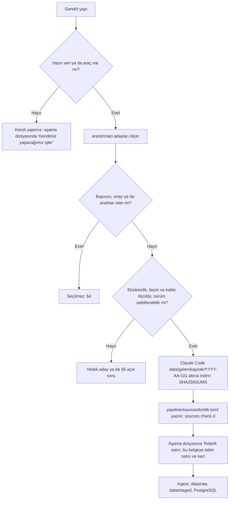

# Kaynaklar
> **Sürüm:** 1.8 · **Tarih:** 1 Kasım 2026 · **Durum:** Taslak
> **Bağlı kararlar:** [K-42](../00-ozet/02-karar-defteri.md#k-42--kaynak-ilkesi-ve-kalite-temelli-görünürlük) · [K-02](../00-ozet/02-karar-defteri.md#k-02--i̇lk-içerik-seti) · [K-03](../00-ozet/02-karar-defteri.md#k-03--tefsir-önce-elmalılı-meali) · [K-04](../00-ozet/02-karar-defteri.md#k-04--hadis-kaynakları) · [K-07](../00-ozet/02-karar-defteri.md#k-07--mushaf-görünümü-üç-seçenek) · [K-19](../00-ozet/02-karar-defteri.md#k-19--kuran-kelime-anlamları) · [K-26](../00-ozet/02-karar-defteri.md#k-26--kalıcı-adresler-çapa-şeması) · [K-38](../00-ozet/02-karar-defteri.md#k-38--kaynak-edinimi-dijital-öncelikli-kanıtla-yükseltme) · [K-39](../00-ozet/02-karar-defteri.md#k-39--tanzil-alımı-simple-cleanin-yeri-kanonik-kaynakta-hat-yazma-kuralı-kilit) · [K-40](../00-ozet/02-karar-defteri.md#k-40--ses-kaynağı-hazır-dijital-tilavet-kaynakları) · [K-41](../00-ozet/02-karar-defteri.md#k-41--ses-sistemi-hazır-kayıtlar-ayna-ve-çevrimiçi-öncelikli-dinleme)

Bu belge, Mütâlaa'ya giren her içerik kaynağının kaydını, sürümünü, eksiksizlik kanıtını ve atıf satırını tutar. Editoryal veritabanındaki her `source` satırı buradaki bir kayıtla aynı kimliği taşır; kaydı olmayan kaynak içerik hattına alınmaz (G-KAY, P-01). Kaynaklar tedarikle seçilir: ölçüt göreve uygunluk, eksiksizlik (ör. 114 sure, 6.236 âyet), kalite, biçim ve sürümün sabitlenebilmesidir ([K-42](../00-ozet/02-karar-defteri.md#k-42--kaynak-ilkesi-ve-kalite-temelli-görünürlük) madde 1). Kartlardaki sayılar 1–3 Kasım 2026 ölçümüdür. Kartlar, `pipeline/sources/` kayıtları ve aşama dosyalarının `## Tedarik` tabloları aynı değerleri taşır; bir aşamanın `.0` adımı bir değeri yeniden ölçtüğünde üçü aynı değişiklikte eşitlenir. Yazılım kitaplıkları ve araçlar içerik kaynağı değildir: sürümleri aşama dosyalarındadır, Ayarlar › Kaynaklar ekranındaki açık kaynak listesini `scripts/ci/list-licenses.mjs` besler ([K-42](../00-ozet/02-karar-defteri.md#k-42--kaynak-ilkesi-ve-kalite-temelli-görünürlük) madde 6).

## 1. Kaynak kaydı ve atıf

Her içerik kaynağı `pipeline/sources/{kimlik}.toml` dosyasıyla kayıtlıdır. Kayıt kaynağın adını, adresini, sürümünü, atıf satırını ve varsa kaynağın kendi bildirimini taşır; kaynak metni taşımaz. Dosya UTF-8 (BOM'suz) ve LF'dir; dosya adı `slug` ile aynı, ASCII ve küçük harflidir (`^[a-z0-9]+(-[a-z0-9]+)*$`).

| Alan | Zorunlu | Anlam |
|---|---|---|
| `slug` | evet | Kaynak kimliği; `source` tablosunun birincil anahtarı |
| `tur` | evet | `source_kind` değeri: `kuran_metni`, `meal`, `tefsir`, `hadis`, `hadis_ceviri`, `risale`, `kitap`, `morfoloji`, `kelime_anlami`, `sozluk`, `mushaf_duzeni`, `mushaf_gorseli`, `font`, `baski`, `ses`, `zamanlama`, `baglanti_verisi` |
| `baslik` | evet | Kaynağın adı; boş olamaz |
| `atif_metni` | evet | Ayarlar › Kaynaklar ekranında görünen atıf satırı; boş olamaz |
| `yazar` | hayır | Yazar ya da mütercim |
| `surum` | hayır | Veri setinin sürümü ya da commit SHA'sı; PostgreSQL'e yüklenen kaynakta `export pg` sürümü çözemezse çıkış kodu 2 verir |
| `provider` | hayır | Kaynağı sunan taraf (`tanzil`, `qac`, `github`, `internet_archive` gibi) |
| `kaynak_url` | hayır | Kaynağın alındığı adres |
| `atif_url` | hayır | Atıfla gösterilen bağlantı; boşsa `kaynak_url` |
| `notice_text` | hayır | Kaynağın kendi bildirimi, bayt bayt |
| `baski_bilgisi` | hayır | Baskılar için tablo: yayınevi, yıl, cilt takımı, `baski_kimligi`, `metin_esasi` |
| `notlar` | hayır | Ölçüm notları ve açık sorular |

- **Kurallar.** Başka her alan hatadır. Kayıt dosya özeti taşımaz: indirilen dosyanın özeti `data/gelen/<kaynak>/<YYYY-AA-GG>/SHA256SUMS` dosyasındadır; `export pg` tek dosyalı kaynakta `source.dosya_sha256` ve `source.alinma_tarihi` sütunlarını bundan doldurur. `source` tablosu 16 sütundur: `slug`, `tur`, `baslik`, `yazar`, `surum`, `provider`, `kaynak_url`, `alinma_tarihi`, `dosya_sha256`, `baski_bilgisi`, `atif_metni`, `atif_url`, `notice_text`, `notlar`, `created_at`, `updated_at` ([Editoryal veritabanı](../03-veri/02-editoryal-veritabani.md) §3).
- **Komutlar.** `uv --directory pipeline run mutalaa sources list` kayıtları listeler (sütunlar `slug`, `tur`, `surum`, `kaynak_url`). `sources check` biçimi ve zorunlu alanları denetler ve `sources check: 25 kayit, 0 hata, 0 uyari` yazar; çıkış kodu `0` ya da `2`'dir.
- **Kapılar.** G-KAY: kaynak kaydı geçerli, `atif_metni` dolu, kanonik kaynakta `notice_text` kaynağın dosyadaki bildirimiyle bayt bayt aynı ([K-39](../00-ozet/02-karar-defteri.md#k-39--tanzil-alımı-simple-cleanin-yeri-kanonik-kaynakta-hat-yazma-kuralı-kilit) madde 6). P-01: kaynak kaydı olmayan içerik hiçbir pakete girmez. P-11: her kaynağın `atif_metni` ve `atif_url` değeri pakete aynen yazılır.
- **Atıf.** Yayınlayıcı kayıttaki `atif_metni`, `atif_url` ve `notice_text` alanlarından her pakete bir `attribution` satırı yazar; Ayarlar › Kaynaklar ekranı bu satırları gösterir ([Yayın süreci](../07-yayin/01-yayin-sureci.md) §6). Kaynağın kendi bildirimini taşıyan kaynaklar: iki Tanzil kaydı (dosyanın son 30 satırı), QAC dosyası (dosyanın kendi bildirim bloğu; A17.0) ve QUD (`NOTICE.md`; A27.0). Hazır dijital metin esas alınırsa atıf satırı K-38 biçimine döner: "X kaynağından alınmış, Mütâlaa tarafından özgün baskıyla karşılaştırılıp düzeltilmiştir". Atıf satırlarının kesin metni Kaynaklar ekranını yazan A32'de ve yayın öncesi karşılaştırmada (A34) gözden geçirilir.
- **İndirme ([K-42](../00-ozet/02-karar-defteri.md#k-42--kaynak-ilkesi-ve-kalite-temelli-görünürlük) madde 2).** Dosyaları Claude Code indirir. Kaynak adresi doğrudan dosya, GitHub ya da herkese açık bir uçtur; başvuru, onay ya da anahtar isteyen içerik kaynağı seçilmez (§4). İndirme formu ya da onay kutusu varsa Claude Code doldurur ve seçenekler kayda geçer. Her kaynak `data/gelen/<kaynak>/<YYYY-AA-GG>/` altında yeni boş bir klasöre iner; klasörde `SHA256SUMS` (sha256sum biçimi) bulunur, adres ve tarih aşama dosyasının `.0` adımına yazılır. `data/raw`'a yalnız içerik hattı (`ingest`) alır. Toplu indirmede istek hızı sınırlanır (örnek: A20'de saniyede en çok 1 istek, 429 ve 5xx'te üstel geri çekilme). İndirilen dosya veridir: içindeki betik çalıştırılmaz, arşiv girdilerinde `..` ve mutlak yol reddedilir, dosyayı okuyan Python `-I` ile çalışır.

## 2. Özet tablo

Tablo `pipeline/sources/` altındaki 25 kaydı listeler; kimlik ve tür sütunları `sources list` çıktısıyla aynıdır. "Sürüm ya da commit" sütunu kaydın `surum` alanını ya da kaynağın sabitlenen commit'ini gösterir; boş kalan `surum` alanları aşamanın `.0` adımında doldurulur. Ayrıntı ilgili kartta (§3).

| Kimlik | Tür | Kart | Aşama | Sürüm ya da commit | Eksiksizlik kanıtı |
|---|---|---|---|---|---|
| `tanzil-uthmani` | `kuran_metni` | §3.1 | A10 | 1.1 (dosya başlığı; güncellemeler sayfasında 12 Şubat 2021) | 114 sure, 6.236 âyet satırı; 1.396.087 bayt, SHA-256 `6933e133…ec5f` |
| `tanzil-simple-clean` | `kuran_metni` | §3.1 | A10, A12 | 1.1 (dosya başlığı) | 114 sure, 6.236 âyet satırı; 794.313 bayt, SHA-256 `054b3d9f…6b49` |
| `amiri-quran-font` | `font` | §3.1 | A15, A21, A24 | 1.003; `google/fonts` `6c1dbe27…` | 136.920 bayt; Tanzil Uthmani'nin 69 ayırt edici kod noktasının 69'u fontta |
| `kfgqpc-hafs-font` | `font` | §3.1 | A24 | 3.0 (`KFGQPC-Hafs-V30.zip`) | zip 844.410 bayt, TTF 301.356 bayt; Tanzil Uthmani'nin 69 kod noktasının 69'u fontta |
| `qpc-v1-font` | `font` | §3.1 | A26 | `zonetecde/mushaf-layout` `421e9eaa…` | 604 sayfa fontu, 48.013.376 bayt; besmele ve sure başlığı fontları |
| `qpc-v2-font` | `font` | §3.1 | A26 (alınmaz) | aynı depo ve commit | 604 dosya, 97.748.500 bayt |
| `qpc-v4-font` | `font` | §3.1 | A26 (alınmaz) | `quran.com-frontend-next` `aff1a035…` | 604 dosya, 50.877.636 bayt |
| `medine-604-duzen` | `mushaf_duzeni` | §3.1 | A11, A24, A26 | `zonetecde/mushaf-layout` `421e9eaa…` (`mushaf/QPC1`) | 604 sayfa, 6.236 âyet, 77.429 kelime; ilk âyet Tanzil `pages` ile 604/604 aynı |
| `qac-morfoloji` | `morfoloji` | §3.2 | A17 | 0.4; `q-ran/quran` `bb97fe4b…` | 77.429 kelime, 6.236 âyet, 114 sure; 4.832 LEM, 1.642 ROOT |
| `elmalili-meal` | `meal` | §3.3 | A09, A16 | baskı kimliği `elmalili-1935`; aktarım sürümü alımda yazılır | özgün baskı 8 cilt, 6.442 sayfa; hazır meal adaylarında 6.236 âyet; yol A09 ölçümüyle seçilir |
| `elmalili-tefsir` | `tefsir` | §3.3 | A09, A37 | baskı kimliği `elmalili-1935`; aktarım sürümü alımda yazılır | hazır metin adayları: `HakDiniKuranDili` 8.928 yaprak, YEK 2021 metin katmanı 13.692.391 bayt; yol A09 ölçümüyle seçilir |
| `tefsir-quranpedia` | `tefsir` | §3.3 | sonra (S-09) | döküm sürümü alımda yazılır | alımda ölçülür |
| `tecrid-ar` | `hadis` | §3.4 | A19 | Shamela `1145Htm.zip` (SHA-1 `4ebe9bf7…`); OpenITI `271ff65b…` | 2.253 numaralı hadis (1…2.254) |
| `tecrid-naim` | `hadis_ceviri` | §3.4 | A19 | Diyanet 1976–1980 (4.–6. baskılar), archive.org `BuhariTecridiSarih1` … `3` | cilt 1–3, metin katmanı 4.039.633 bayt (13 ciltlik takımın toplamı 12.552.425 bayt) |
| `tecrid-miras` | `hadis_ceviri` | §3.4 | A19 | Diyanet 1976–1980 (4.–6. baskılar), archive.org `BuhariTecridiSarih4` … `BuxariTecridiSarih12` | cilt 4–12, metin katmanı 8.005.439 bayt (13 ciltlik takımın toplamı 12.552.425 bayt) |
| `hadis-fawaz-ar` | `hadis` | §3.4 | A19 | `fawazahmed0/hadith-api` `1` dalı `df57907b…` | Kütüb-i Sitte 6 kitap, 34.532 kayıt (379 boş) |
| `risale-asil-nusha` | `risale` | §3.5 | A20, A31 | `alitekdemir/Risale-i-Nur-Diyanet` `1dad9ea7…` | 15 kitap klasörü, 298 `txt` dosyası, 47.558 paragraf ya da başlık satırı, 2.000.362 kelime |
| `risale-1956-1960` | `risale` | §3.5 | A20 | baskı künyesi (metin taşımaz) | — |
| `risale-atif-dizini` | `baglanti_verisi` | §3.5 | A20 | kendi üretimimiz | A20.7 ölçümü (kesinlik ve duyarlılık) |
| `risale-kelime-frekans` | `sozluk` | §3.5 | A20, A31 | `alitekdemir/Risale-i-Nur-Kelime-Frekans` `23f3c5ca…` | sıklık: 15 kitapta 20.045 benzersiz kelime; anlam: 398.772 satır |
| `lugat-redhouse-1890` | `sozluk` | §3.6 | A20 | archive.org `aturkishandenglishlexicon1` | `_djvu.txt` 8.447.120 bayt |
| `lugat-kamus-i-turki` | `sozluk` | §3.6 | A20 | archive.org `kamus-i-turki-semseddin-sami-bey` | `_djvu.txt` 5.969.007 bayt |
| `lugat-naci` | `sozluk` | §3.6 | A20 | archive.org `lugati-naci` | `_djvu.txt` 2.585.323 bayt |
| `ses-kfgqpc-meal` | `ses` | §3.7 | sonra (S-13) | — | Türkçe sürüm doğrulanmadı |
| `kaikki-tr` | `sozluk` | §3.8 | A18 | kaikki dökümü, 30 Ekim 2026 | Türkçe 46.254 madde, Osmanlıca 10.016 madde |

**Kaydı aşamada açılacak seçimler.** Aşağıdaki kaynaklar aşama dosyalarının `## Tedarik` tablolarında seçilmiştir; kayıtları henüz `pipeline/sources/` altında değildir, bu yüzden `sources list` ve yukarıdaki tablo onları saymaz. Kayıt, ilgili aşamanın `.0` adımında yazılır ve tabloya satır eklenir.

- A09.0: `elmalili-meal-vikikaynak`, `elmalili-meal-tanzil`, `elmalili-tefsir-archive`, `elmalili-tefsir-yek` (adlar öneri; §3.3).
- A11.0: `tanzil-ust-veri`, `sure-adlari-vikipedi` (§3.1).
- A13.6: `test-kucuk`, `test-tefsir-ornek`, `test-ses`; A20.5: `test-risale-ornek`; A31: `test-hadis-ornek` (öneri) (§3.8).
- A17.0: `quranwbw-tr`, `mustafa0x-morfoloji` (§3.2).
- A18.0: `qursim` (§3.2).
- A19.0: `hadis-ahmedbaset` (§3.4).
- A20.0: `risale-baski-envar`, `erisale-icindekiler` (§3.5).
- A21.0: `literata-font`, `ibm-plex-sans-font`, `amiri-font`, `noto-naskh-arabic-font` (§3.1).
- A27.0: `ses-mp3quran`, `ses-tarteel-cdn`, `zamanlama-qud`, `zamanlama-mp3quran` (§3.7).
- A32.0: `ebru-motifi` (§3.8).
- A40.0: `mushaf-b-merve-hafiz-osman` (§3.8).

## 3. Kaynak kartları

Her kart kaynağın adını, adresini, sürümünü ya da commit'ini, biçimini, eksiksizlik sayımını, kullanıldığı aşamayı, kayıt kimliğini, atıf satırını, kalite notlarını ve yedek adayı verir. Yalnız sayım, biçim ve yapı bilgisi yazılır; kaynak metni yazılmaz. "Doğrulanacak" ölçülmemiş noktayı gösterir ve §6'daki adımda kapanır.

### 3.1 Kur'an metni, fontlar ve mushaf düzeni

**`tanzil-uthmani`, `tanzil-simple-clean` · Tanzil Kur'an metni.**
- **Adres ve sürüm:** İndirme formu [tanzil.net/download](https://tanzil.net/download/) (`kaynak_url`; işlem adresi `https://tanzil.net/pub/download/index.php`; atıf bağlantısı <https://tanzil.net/>). Sürüm 1.1: dosya başlıkları "Tanzil Quran Text (Uthmani, Version 1.1)" ve "Tanzil Quran Text (Simple Clean, Version 1.1)" der. [Güncellemeler sayfasında](https://tanzil.net/updates/) 1.1 girdisi 12 Şubat 2021 tarihlidir (etkilenen metinler Uthmani, Uthmani Minimal, Simple); öteki girdiler 1.0.2 (12 Mayıs 2008, Simple), 1.0.1 (4 Şubat 2008, Uthmani) ve 1.0'dır (1 Ocak 2008). Simple Clean için ayrı girdi yoktur; sürüm dosya başlığından alınır.
- **Biçim:** "Text (with aya numbers)" (`outType=txt-2`); UTF-8, LF, BOM yok; âyet satırı `sure|âyet|metin`. Seçilen istek formun açılış hâlidir: `marks`, `sajdah` ve `tatweel` işaretli, `rub` ve `stanween` işaretsiz; `agree` onay kutusunu Claude Code işaretler. Adres: `https://tanzil.net/pub/download/index.php?marks=true&sajdah=true&tatweel=true&quranType=uthmani&outType=txt-2&agree=true` (Simple Clean için `quranType=simple-clean`). Seçenekler baytları değiştirir: `rub` 199 işaret (597 bayt) ekler; `stanween` yalnız Uthmani'de 13.286 bayt ekler ve yalnız `me_quran` yazı tipi içindir; `alef` ve `laa` kutuları formda yorum satırıdır, adrese eklenseler de dosya değişmez.
- **Eksiksizlik (2 Kasım 2026 indirmesi):** aşağıdaki tablo. Dosyalar 1 ve 2 Kasım 2026'daki ayrı isteklerde bayt bayt aynı çıktı.
- **Aşama ve kayıt:** A10 (indirme, kilit, `ingest tanzil`); A12 (Simple Clean'in pakette tutulup tutulmayacağı, K-39 madde 1). Kayıtlar `tanzil-uthmani`, `tanzil-simple-clean`. Dosyalar `data/gelen/tanzil/2026-11-02/` altına indirildi (`SHA256SUMS` aynı klasörde). `tanzil.lock.json` dosya özetini, âyet satırlarının özetini (`metin_sha256`) ve bildirim bloğunun özetini (`bildirim_sha256`) tutar (K-39 madde 4).
- **Atıf:** "Kur'an metni: Tanzil Project, tanzil.net. Metin değiştirilmeden kullanılmıştır." Kaynağın kendi bildirimi `notice_text` alanında bayt bayt durur ve Ayarlar › Kaynaklar'da gösterilir. Bildirim bloğu dosyanın 6.237–6.266. satırlarıdır (2 boş satır ve 28 `#` satırı); tür ve sürüm dördüncü, yıl beşinci `#` satırındadır.
- **Kalite notları:**
  - Yıl satırı indirme yılını izler: 2 Kasım 2026 indirmesinde "2007-2026", Internet Archive'ın Haziran 2025 kopyasında "2007-2025". Âyet satırları kopyalar arasında aynıdır, bildirim bloğu yıl satırında ayrışır; bu yüzden kilit dosya, âyet satırları ve bildirim bloğu için üç ayrı özet tutar.
  - `data/backups/gelen/tanzil/` altındaki 28 Ekim 2026 kopyaları form açılışıyla alınmamıştır: Uthmani 1.409.970 bayt (`rub` ve `stanween` işaretli, SHA-256 `aa0bf927…86cf`), Simple Clean 794.910 bayt (`rub` işaretli, `1862ee63…e8c8`). Özetleri seçilen dosyalardan farklıdır.
  - Metin düzeltilmez ve normalize edilmez: bayt bayt saklanır, NFC bile uygulanmaz (K-26: NFC şedde ile harekenin sırasını değiştirir). Arama için normalize metin ayrı sütundadır ([İçerik hattı](./02-icerik-hatti.md)). Tanzil'den türetilip değiştirilmiş kopyalar (ör. `quranacademy/quran-text`) kullanılmaz: üçüncü taraf metin kaynak dosyayla bayt bayt aynı olmalıdır (G-BUT).
  - Simple Clean `q:` birimi olmaz; yalnız `unit.ar_norm` sütununu besler (K-39 madde 1).
  - Uthmani'de 95. ve 97. surenin ilk dört belirteci 1:1'dekinden bayt olarak farklıdır; besmele önekinin bu iki surede de aynı kural olup olmadığını A11 inceler.
- **Yedek:** `dotquran/corpus` `c23f5cec2e95e253dc450bd0f34d09e37ba40fac` (`src/resources/uthmani.txt` ve `simple-clean.txt`; SHA-256 form çıktısıyla aynı; kökte `uthmani.txt` yolu yoktur, HTTP 404); `jatoi94912/Quran-data` `ee21120024dcb6b9903f9ff05e77c32ca5ee8e92` (`quran-uthmani.txt`; yalnız Uthmani, SHA-256 aynı); Internet Archive `quran-uthmani_20250625` (`quran-uthmani-aya.txt`, 1.396.087 bayt, SHA-256 `edd7c648…d38f`; âyet satırları aynı, yıl satırı farklı).

| | `tanzil-uthmani` | `tanzil-simple-clean` |
|---|---|---|
| Bayt | 1.396.087 | 794.313 |
| SHA-256 | `6933e133dd56db778c801bf738848454e43648105a151e8d84d86a7cae39ec5f` | `054b3d9f79c0c2e44df7f9ddf42561797b3b5cb4fbdafbf2e99c805ccf1a6b49` |
| Satır | 6.266: 6.236 âyet satırı, 2 boş satır, 28 `#` bildirim satırı | 6.266: aynı dağılım |
| Sure ve âyet | 114 sure, her surede âyetler 1'den kesintisiz; sure sure sayım `shared/data/ayet-sayilari.json` ile aynı | aynı |
| Boşlukla ayrılan belirteç | 82.260 | 82.627 |
| NFC olmayan âyet satırı | 5.782 | 0 |
| Secde işareti (U+06E9), tatweel (U+0640), `rub` (U+06DE) | 15, 6.848, 0 | 15, 0, 0 |
| `\r`, BOM, kontrol karakteri, boş metin, kenar boşluğu | yok; katı UTF-8 geçerli | yok; katı UTF-8 geçerli |
| Besmele öneki, sure 2–114 (9 hariç): ilk dört belirteç 1:1 ile bayt eşit | 110/112 (95. ve 97. sure farklı) | 112/112 |

**Tanzil üst veri dosyası (`quran-data.xml`) · Kur'an yapı verisi.**
- **Adres ve sürüm:** <https://tanzil.net/res/text/metadata/quran-data.xml>; alan belgesi [Quran Metadata](https://tanzil.net/docs/quran_metadata); [değişiklik günlüğü](https://tanzil.net/docs/metadata_updates): sürüm 1.0, 28 Şubat 2008. Kök `type="metadata" version="1.0"`; `Last-Modified` 5 Haziran 2010. Yedek `quran-data.js` (aynı dizin, 25.096 bayt).
- **Biçim ve eksiksizlik:** XML, 77.234 bayt, SHA-256 `8867c1d88191472adec9db694b3cd9f135b1a2ef580574d32cf888dcb22c5c7a` (24 Ekim, 31 Ekim ve 2 Kasım 2026'da aynı; `shared/data/ayet-sayilari.json` içindeki `sha256` ile aynı). Gruplar: 114 sure (âyet toplamı 6.236; 86 Mekkî, 28 Medenî), 30 cüz, 240 hizb çeyreği (60 hizb), 7 menzil, 556 rükû, 604 sayfa, 15 secde (11 `recommended`, 4 `obligatory`). Her grupta `index` 1'den kesintisiz ve (sure, âyet) sırası artandır; sure `start` değerleri birikimlidir; 604 sayfa başlangıcının hepsi geçerli bir âyettir. Sayfa girişlerinin 56'sı, cüzlerin 9'u, çeyreklerin 41'i, menzillerin 7'si ve rükûların 114'ü âyet 1 ile başlar. `quran-meta` 7.0.0 `HafsLists` ile cüz, hizb çeyreği, menzil, rükû, sayfa ve secde listelerinde fark 0.
- **Aşama ve kayıt:** A04 (114 elemanlı âyet sayısı dizisi `shared/data/ayet-sayilari.json`; alanlar `kaynak_url`, `alinma_tarihi`, `sha256`, `surum`, `sayilar`); A11.0 (kalıcı alım: `data/gelen/tanzil-ust-veri/<YYYY-AA-GG>/`). Kayıt `tanzil-ust-veri` (`tur` önerisi `mushaf_duzeni`) A11.0'da açılır.
- **Yedek:** `quran-meta` 7.0.0 (npm; tarball 187.556 bayt, SHA-256 `0e05d5313abe87ee7679c524c05dd67a9457191c0637c24541922c0e971fc8b4`; GitHub `quran-center/quran-meta` HEAD `3b7afc7f8c905da3d8fb3e8725f86805bd76b2bd`; mutlak âyet numaralı cüz, hizb çeyreği, menzil, rükû, sayfa ve secde listeleri).

**Türkçe sure adları · Vikipedi "Sureler listesi".**
- **Adres ve sürüm:** <https://tr.wikipedia.org/wiki/Sureler_listesi> ("Kur'an sureleri" bu sayfaya yönlenir); sayfa numarası 1794535, revizyon 37447386 (9 Temmuz 2026); ham vikimetin `https://tr.wikipedia.org/w/index.php?title=Sureler_listesi&action=raw` (`oldid` ile sabitlenir). Yazım varyantı adayları aynı sayfadan bağlanan 114 sure maddesinin yönlendirmeleridir (MediaWiki Action API, `generator=links` ve `prop=redirects`; anahtarsız).
- **Biçim ve eksiksizlik:** Tek `wikitable sortable` tablosu (No, Sure, Âyet, Cüz, Adının anlamı, İndiği yer, İniş sırası, Başındaki mukattaa harfler), 15.110 bayt. 114 satır, 114 benzersiz görünen ad; hepsi madde bağlantılıdır; 30'unda şapka ya da kesme işareti var, 7'sinde görünen ad bağlantı hedefiyle başlamıyor. Âyet toplamı 6.236; her surenin âyet sayısı, iniş yeri ve iniş sırası Tanzil `quran-data.xml` ile aynıdır (fark 0). Yönlendirme: bağlı 284 sayfanın 114'ü " Suresi" ile biten sure maddesidir, 73'ünün yönlendirmesi var (ilk istekte 180 yönlendirme, en çok 8; istek `continue` döndürdüğü için liste tam değildir).
- **Aşama ve kayıt:** A11.0 (`data/gelen/sure-adlari-vikipedi/<YYYY-AA-GG>/`); A11.3 (`surah_alias` adayları). Kayıt `sure-adlari-vikipedi` (`tur` önerisi `sozluk`) A11.0'da açılır; atıf satırı kayıtla birlikte yazılır. Adlar editör denetiminden geçer (İ-23).
- **Kalite notları:** Adların yalnız 30'unda şapka ya da kesme var; tam şapkalı yazım ek kaynak ya da editör denetimi gerektirebilir. Diyanet ve TDV İslâm Ansiklopedisi adresleri bu turda açılmadı (Doğrulanacak).
- **Yedek:** `quran-meta` 7.0.0 `surah.tr` (114 ad ve Türkçe anlam, şapkasız); Tanzil `tname` (114 Latin harfli yazım); Elmalılı metninin sure başlıkları.

**`medine-604-duzen` · Medine 604 sayfa düzeni ve kelime-glif eşlemesi (Mushaf A).**
- **Adres ve sürüm:** GitHub [`zonetecde/mushaf-layout`](https://github.com/zonetecde/mushaf-layout), varsayılan dal `v2`, commit `421e9eaa991897ecd50d7abb79160651a45976d3` (2026-10-14); klasör `mushaf/QPC1` (`page-001.json` … `page-604.json`). Alma: `git clone --depth 1 --filter=blob:none --sparse` ve `git sparse-checkout set mushaf/QPC1` ya da aynı commit'in arşivi; hedef `data/gelen/medine-604-duzen/<YYYY-AA-GG>/`.
- **Biçim ve eksiksizlik:** JSON; sayfada `lines[]` (`line`, `type`: `text`, `surah-header`, `basmala`; `verseRange`; `words[]`: `location` = `sure:âyet:kelime`, `word`, `qpcV1`). 604 sayfa; 9.046 satır (602 sayfa × 15, 2 sayfa × 8); 114 sure başlığı, 112 besmele, 8.820 metin satırı; 77.995 kelime girdisi (77.429 kelime ve 566 ayrı âyet sonu girdisi; hepsinde glif); 6.236 âyet, 114 sure. 604 sayfanın hepsi bir âyetin ilk kelimesiyle başlar ve bir âyetin son kelimesiyle biter; her sayfanın ilk âyeti Tanzil `pages` grubuyla 604/604 aynıdır. Âyet başına kelime sayısı Tanzil Uthmani ile 6.120 âyette aynıdır, 112 âyette +4 (besmele öneki), 4 âyette +1 (2:181, 8:6, 13:37, 37:130).
- **Aşama ve kayıt:** A11 (sayfa eşlemesi, `page_map`); A24; A26 (Mushaf A, [K-07](../00-ozet/02-karar-defteri.md#k-07--mushaf-görünümü-üç-seçenek) A). Kayıt `medine-604-duzen`; A11.0 ve A26.0 kaydın `provider`, `kaynak_url` ve `surum` alanlarını bu depo ve commit ile günceller.
- **Atıf:** "Mushaf sayfa düzeni verisi: Quran Foundation." (kayıttaki satır; kaynak GitHub deposu olduğu için A26.0 `atif_metni`'ni yeni kaynağa göre günceller).
- **Kalite notları:**
  - Aynı depodaki QPC2 düzeni (`mushaf/QPC2`, 78.003 girdi; 574 ayrı âyet sonu girdisi) QPC1'den ayrılır: ilk âyet 25 sayfada farklıdır (121–123, 145, 532–534, 565, 568, 570, 576, 584, 586, 588–590, 592–600), âyet kümesi 36 sayfada, satır imzası 354 sayfada.
  - Düzen verisinde `centered` bayrağı yoktur (A26 üretir). `word` ve `text` alanları Kur'an metni olarak alınmaz; kanonik metin Tanzil'dir.
  - QUL'daki "KFGQPC V4 layout (1441H print)" düzeninin ([QUL düzen 19](https://qul.tarteel.ai/resources/mushaf-layout/19)) sayfa sınırları ölçülemedi: sayfa açılır, indirme bağlantıları oturum açma ister (§4).
- **Yedek:** Tanzil `quran-data.xml` `pages` grubu (604 giriş, âyet düzeyi); `quran-meta` `PageList` (604 giriş, fark 0).

**`qpc-v1-font`, `qpc-v2-font`, `qpc-v4-font` · QPC sayfa fontları.**
- **Adres ve sürüm:** V1 (Medine mushafı 1405 H; QUL düzen listesinde "Quran Complex V1"): `zonetecde/mushaf-layout` dal `v2` commit `421e9eaa991897ecd50d7abb79160651a45976d3`; `fonts/QPC1/p001.woff2` … `p604.woff2`, besmele `fonts/QPC1/QPC1BSML.ttf`, sure başlığı `fonts/Surahs.ttf`. Tek dosya adresi: `https://raw.githubusercontent.com/zonetecde/mushaf-layout/421e9eaa991897ecd50d7abb79160651a45976d3/fonts/QPC1/p001.woff2`. V2: aynı depo ve commit, `fonts/QPC2/p001.woff2` …. V4 (tecvid renkli): `quran/quran.com-frontend-next` dal `production` commit `aff1a035b09b66f28047b3216edcae4c5c949a49` (2026-03-03), `public/fonts/quran/hafs/v4/colrv1/woff2/`.
- **Biçim ve eksiksizlik:** woff2, sayfa başına bir font. V1: 604 dosya, toplam 48.013.376 bayt (sayfa başına 15.328–119.784; cüz başına 1.428.148–1.687.800); `QPC1BSML.ttf` 303.644 bayt (574 glif); `Surahs.ttf` 382.580 bayt (317 glif; Arapça harf cmap'i, 462 ligatür). 604 sayfanın 603'ünde düzen dosyasındaki bütün glif kodları sayfa fontunun cmap'indedir (565. sayfada yalnız U+0020 boşluk yoktur); 112 besmele satırının hepsi `QPC1BSML` cmap'indedir. V2: 604 dosya, 97.748.500 bayt (cüz başına 2.552.972–3.934.360). V4: 604 dosya, 50.877.636 bayt.
- **Aşama ve kayıt:** A26 (V1 alınır; V2 ve V4 alınmaz, kayıtları adres ve sürümle güncellenir). Kayıtlar `qpc-v1-font`, `qpc-v2-font`, `qpc-v4-font`; A26.0 kayıtların `provider`, `kaynak_url`, `surum` (commit SHA'sı) ve `atif_metni` alanlarını bu depolarla günceller.
- **Atıf:** "Mushaf sayfa fontları: King Fahd Glorious Qur'an Printing Complex; Quran Foundation aracılığıyla." (kayıttaki satır; kaynak GitHub depoları olduğu için A26.0 metni yeni kaynağa göre günceller).
- **Kalite notları:** QPC V2 düzeni V1'den farklıdır (`medine-604-duzen` notlarındaki 25, 36 ve 354 sayfa); Mushaf A V1 glifleriyle çalışırsa `medine-604` ile birebir uyar, başka basım ayrı düzen kimliği ister. Quran Foundation kılavuzu sayfa fontlarına "QCF", Unicode fonta "QPC Hafs" der; kayıt kimlikleri değişmez ([Font Rendering](https://api-docs.quran.foundation/docs/tutorials/fonts/font-rendering/)).
- **Yedek:** V1 için `quran/quran.com-frontend-next` `aff1a035…` (`public/fonts/quran/hafs/v1/woff2/p1.woff2` …; 604 dosya, 595'i yukarıdaki dosyalarla aynı blob; `v1/ttf` 604 dosya, 94.881.448 bayt) ve `nuqayah/qpc-fonts` (`mustafa0x/qpc-fonts` ile aynı depo) `8a4f39d563ea69c994416a1692827e38156c548d` (`mushaf-woff2/QCF_P001.woff2` …, 604 dosya ve `QCF_BSML.woff2`, toplam 48.174.208 bayt; 596'sı aynı blob). V4 için `MohamadHajjRabee/quran-qcf4` `5130511027e769f0a8f4eeb7f00f46bde3788d60` (içeriği v1.x'te doğrulanır). Font ve düzen her zaman aynı depodan ve aynı commit'ten alınır.

**`kfgqpc-hafs-font` · KFGQPC Uthmanic Hafs yazı tipi.**
- **Adres ve sürüm:** Resmî sayfa [fonts.qurancomplex.gov.sa/hafs-reading](https://fonts.qurancomplex.gov.sa/hafs-reading/) (68.923 bayt) güncel sürüm olarak 3.0'ı, eski sürümler olarak 2.2 ve 0.13'ü listeler. Doğrudan adres `https://fonts.qurancomplex.gov.sa/fonts/KFGQPC-Hafs-V30.zip` (HTTP 200; form, hesap ya da anahtar yok; sayfadaki bağlantı `?fdc_download=` yönlendirmesidir). Sürüm 3.0.
- **Biçim ve eksiksizlik:** Zip 844.410 bayt (`Last-Modified` 13 Eylül 2026), SHA-256 `ddf52d0f6919b0a9cfb1e9cc048d41d88e695f973455fea3c9973837295a324c`. İçinde `KFGQPC-Hafs-V30/KFGQPC Hafs V30.ttf`: 301.356 bayt, SHA-256 `c9dd7e71a454565b13d89e5e6f2663a918acb0a20a23eea31eccb32a3aeec47a`; aile "KFGQPC Hafs V3", tam ad "KFGQPC HAFS Uthmanic Script Regular", sürüm "Version 3.0", 1.572 glif, 611 cmap girdisi, Arapça bloğunda 255 kod noktası; Latin A–Z yok; GSUB yalnız `arab` (özellik yok). Kapsam: Tanzil Uthmani'nin 69 ayırt edici kod noktasının 69'u (boşluk dışı 68/68); Tanzil Simple Clean'in 45'inin 44'ü (U+0622 yok); işaret kümesinin (U+06DD, U+06DE, U+06E9, U+FD3E, U+FD3F ve U+0660–U+0669) 15'inin 13'ü (U+FD3E ve U+FD3F yok). Türkçe harfler (â î û ç ğ ı İ ö ş ü ve büyükleri) yok.
- **Aşama ve kayıt:** A24 (Mod C yazı tipi adayı; seçim görsel kaliteye dayanır, ötekisi yedek kalır). Kayıt `kfgqpc-hafs-font`; A24.0 `kaynak_url`'i doğrudan zip adresiyle, `surum`'u 3.0 ile günceller.
- **Atıf:** "KFGQPC Uthmanic Script HAFS © King Fahd Glorious Qur'an Printing Complex."
- **Kalite notları:** Font dosyasının name tablosu kurum adını "Quran" (kesmesiz) yazar; atıf satırı kayıttaki biçimi kullanır. Aynalardaki dosya adları sürümle tutarsızdır (`UthmanicHafs_V22`, `Ver09`, `Ver13`, `Ver18`); doğrulanan dosya yukarıdaki V30'dur.
- **Yedek:** `mustafa0x/qpc-fonts` HEAD `8a4f39d563ea69c994416a1692827e38156c548d`, `mushaf-v4-hafs/uthmanic_hafs_v22.ttf` (sürüm 2.2; 297.688 bayt; SHA-256 `a6e59510dcaf3ec99db49427321a035ed94af555ffc7d27e7f430b5fd5e179f8`; 1.572 glif, 608 cmap girdisi; Tanzil kümesi 68/68, işaret kümesi 13/15); aynada 3.0 yoktur, `various-woff2/` altında yalnız `UthmanicHafs1 Ver09.woff2` (sürüm 0.09) bulunur. Amiri Quran.

**`amiri-quran-font` · Amiri Quran.**
- **Adres ve sürüm:** GitHub `google/fonts` commit `6c1dbe27dcf7d817d4b62cec033ba77fa8e2a5ec` (HEAD, 1–2 Kasım 2026), yol [`ofl/amiriquran/`](https://github.com/google/fonts/tree/6c1dbe27dcf7d817d4b62cec033ba77fa8e2a5ec/ofl/amiriquran); dosya `AmiriQuran-Regular.ttf`, doğrudan adres `https://raw.githubusercontent.com/google/fonts/6c1dbe27dcf7d817d4b62cec033ba77fa8e2a5ec/ofl/amiriquran/AmiriQuran-Regular.ttf`. Sürüm 1.003.
- **Biçim ve eksiksizlik:** TrueType; 136.920 bayt; SHA-256 `e2a47644762d16bdfb6d33e0d8db8c6ff30beae84150ef5a705316bbd829455c`; ad "Amiri Quran Regular"; 1.446 glif; 266 cmap girdisi; Arapça bloğunda (U+0600) 113 kod noktası; GSUB yazı sistemleri DFLT, arab (ARA, KSH, MLY, SND, URD), latn. Kapsam: Tanzil Uthmani'nin 69 ayırt edici kod noktasının 69'u (boşluk dışı 68/68), Tanzil Simple Clean'in 45'inin 45'i, işaret kümesinin 15'inin 15'i. Türkçe Latin harfleri (18 kod noktası) yok.
- **Aşama ve kayıt:** A15.0 indirir (editör panelinde kanonik metnin gösterimi; `data/gelen/amiri-quran-font/<YYYY-AA-GG>/`); A21 gömer; A24 Mod C adayıdır. Kayıt `amiri-quran-font`; A15.0 `surum`'u ve commit'e sabit `kaynak_url`'i yazar.
- **Atıf:** "Yazı tipi: Amiri Quran."
- **Kalite notları:** Türkçe harfler fontta olmadığından Türkçe metin başka yazı tipiyle çizilir (aşağıdaki arayüz yazı tipleri).
- **Yedek:** `@expo-google-fonts/amiri-quran` 0.4.1 (`AmiriQuran_400Regular.ttf`, 136.256 bayt, SHA-256 `6814dda5c41a412ce873da0551b11fa924d01f79592e6294b702911e49b9d3a6`; google/fonts dosyasından farklıdır); `@fontsource/amiri-quran` 5.3.0.

**Arayüz yazı tipleri · Literata, IBM Plex Sans, Amiri, Noto Naskh Arabic.**
- **Adres ve sürüm:** GitHub `google/fonts` commit `6c1dbe27dcf7d817d4b62cec033ba77fa8e2a5ec`; dosyalar `ofl/literata/Literata[opsz,wght].ttf`, `ofl/ibmplexsans/IBMPlexSans[wdth,wght].ttf`, `ofl/amiri/Amiri-Regular.ttf`, `ofl/notonaskharabic/NotoNaskhArabic[wght].ttf`; doğrudan adres `https://raw.githubusercontent.com/google/fonts/<commit>/ofl/<aile>/<dosya>` (`[`, `]` ve `,` URL kodludur: `%5B`, `%5D`, `%2C`).
- **Biçim ve eksiksizlik:** TrueType (Literata, IBM Plex Sans ve Noto Naskh Arabic değişken eksenli); HTTP 200; ölçümler aşağıdaki tablodadır. Literata eksenleri opsz 7–72 ve wght 200–900 (GSUB latn: TRK dahil); IBM Plex Sans wght 100–700 ve wdth 75–100; Noto Naskh Arabic wght 400–700. Türkçe harflerin (â î û ç ğ ı İ ö ş ü ve büyükleri) hepsi dört fontta vardır. Amiri'nin Arapça bloğunda 255, Noto Naskh Arabic'in 256 kod noktası vardır; ikisi de Tanzil Uthmani'nin 69, Tanzil Simple Clean'in 45 ve işaret kümesinin 15 kod noktasının tamamını kapsar. İtalik ve kalın kesimler aynı commit'te: `Literata-Italic[opsz,wght].ttf` 902.728, `IBMPlexSans-Italic[wdth,wght].ttf` 599.624, Amiri `-Bold` 413.480, `-Italic` 428.532, `-BoldItalic` 409.692 bayt.
- **Aşama ve kayıt:** A21.0 indirir (`data/gelen/<kaynak>/<YYYY-AA-GG>/`); A22 kullanır. Kayıtlar `literata-font`, `ibm-plex-sans-font`, `amiri-font`, `noto-naskh-arabic-font` (`tur = "font"`) A21.0'da açılır.
- **Atıf:** "Yazı tipi: {ad}." (`amiri-quran-font` kalıbı; ör. "Yazı tipi: Literata.").
- **Kalite notları:** IBM Plex Sans google/fonts'ta yalnız değişken dosya olarak durur (`IBMPlexSans-Regular.ttf` gibi statik dosya yoktur, HTTP 404). Değişken yazı tipi Android API 29 altında yalnız varsayılan yüzü yükler (Expo Font belgesi); sorun çıkarsa statik yedek kullanılır.
- **Yedek:** `@expo-google-fonts/literata` 0.4.3, `@expo-google-fonts/ibm-plex-sans` 0.4.1, `@expo-google-fonts/amiri` 0.4.1, `@expo-google-fonts/noto-naskh-arabic` 0.4.5 (statik 400 kesimleri: Literata 255.252, IBM Plex Sans 218.236, Amiri 421.196, Noto Naskh Arabic 199.512 bayt). Tasarım sisteminin Inter'e dönmesi gerekirse `ofl/inter/Inter[opsz,wght].ttf` (876.576 bayt).

| Yazı tipi | Kullanım | Bayt | Sürüm | Glif | cmap | SHA-256 |
|---|---|---|---|---|---|---|
| Literata | Türkçe gövde | 955.132 | 3.103 | 1.789 | 1.163 | `b41138c9…4440` |
| IBM Plex Sans | arayüz | 537.244 | 3.201 | 1.025 | 891 | `3b031aa4…e2e3` |
| Amiri | metin içi Arapça | 431.116 | 1.002 | 6.710 | 1.699 | `ab391c41…fcd7` |
| Noto Naskh Arabic | metin içi Arapça | 307.592 | 2.021 | 1.719 | 1.551 | `67b5a525…b72f` |

### 3.2 Morfoloji ve QUL

**`qac-morfoloji` · Quranic Arabic Corpus, morfoloji v0.4.**
- **Adres ve sürüm:** Sürüm 0.4. Dosya GitHub `q-ran/quran` deposundan commit'e sabitli alınır: commit `bb97fe4b03e5a923aab0491f3d917c3c5f94f1fc` (2025-10-10; depo açıklaması "Quran: plain text and linguistic annotations", 30 commit), yol `sources/1.0/quranic-corpus-morphology-0.4.txt` (blob `b91cec6e95d5e0306550b4aedacc7380dc71152a`), doğrudan adres `https://raw.githubusercontent.com/q-ran/quran/bb97fe4b03e5a923aab0491f3d917c3c5f94f1fc/sources/1.0/quranic-corpus-morphology-0.4.txt` (HTTP 200). Aynı klasörde `quran-data.xml` (77.234 bayt), `quran-uthmani.xml` (1.522.037), `quran-simple-min.xml` (1.312.349), `en.arberry.xml` ve `nl.leemhuis.xml` vardır. Resmî sayfa [corpus.quran.com/download](https://corpus.quran.com/download/) "version 0.4" başlıklı bir formdur ve gönderim için e-posta alanı (`txtEmail`) ister; bu yüzden birincil kaynak değildir (§4). Atıf bağlantısı <https://corpus.quran.com/>.
- **Biçim ve eksiksizlik:** Sekmeyle ayrılmış metin (LOCATION, FORM, TAG, FEATURES); ASCII (Buckwalter dökümü), CRLF (128.276 satır), BOM yok. 6.309.503 bayt, SHA-256 `a1d12923815341face765083805d2148ed2d9f5cc3f7d6665219d887675d8c46`. 54 yorum satırı, 1 başlık satırı, 128.219 segment satırı (konum `(sure:âyet:kelime:segment)`; kelime başına en çok 5 segment). 77.429 kelime, 6.236 âyet, 114 sure (1. sure 7, 114. sure 6 âyet). 45 TAG değeri; FEATURES içinde 11 anahtar:değer alanı (`+n`, `A`, `LEM`, `MOOD`, `POS`, `PRON`, `ROOT`, `SP`, `f`, `l`, `w`) ve 58 bayrak (`STEM`, `PREFIX`, `SUFFIX` dahil). 4.832 farklı LEM, 1.642 farklı ROOT; LEM taşıyan kelime 74.122, ROOT taşıyan kelime 49.967. LEM taşıyan 74.608 segmentte kümülatif kapsama: %50 için 60, %80 için 470, %95 için 2.012 lemma. QAC SSS'ye göre doğruluk yaklaşık %99'dur ([QAC SSS](https://corpus.quran.com/faq.jsp)).
- **Aşama ve kayıt:** A17 (A17.0 indirir, A17.3 işler); A18 tüketir. Kayıt `qac-morfoloji` (`surum = "0.4"`); A17.0 `kaynak_url`'i indirilen adresle, `notice_text`'i dosyanın kendi bildirim bloğuyla günceller. Paket `kelime-kok` (ayrı ve isteğe bağlı; bütün derlemelerde yer alır, [Kök ve lemma](../05-capraz-referans/03-kok-ve-lemma.md)).
- **Atıf:** "Morfoloji: Quranic Arabic Corpus (corpus.quran.com)." (bağlantı <https://corpus.quran.com/>).
- **Kalite notları:**
  - GitHub dosyasının resmî indirme dosyasıyla bayt eşitliği ölçülemedi (form e-posta ister). Dosya başlığındaki sürüm (0.4, Tanzil metnine dayalı) ve sayımlar resmî sayfanın 0.4 bildirimiyle uyuşuyor; A17.0 sürümü ve sayımları yeniden doğrular (Doğrulanacak).
  - FORM, LEM ve ROOT Arapça değil Buckwalter dökümüdür; Arapça yazı için eşleme A17.1'de yazılır ve `mustafa0x-morfoloji` kopyasıyla karşılaştırılır.
  - Lemma kimliği yalnız LEM dizgisidir: hiçbir LEM dizgisi birden çok kökle geçmez; 304 dizgi birden çok sözcük türüyle, 175 dizgi köksüz geçer; 15 dizgi rakam içerir.
  - Tanzil boşluk bölmesi 77.433, QAC 77.429 kelime verir: 2:181, 8:6, 13:37 ve 37:130'da bitişik iki Tanzil belirteci QAC'de tek kelimedir (A11 birleştirme listesi).
  - Dosya değiştirilmez; düzeltmeler ayrı katmanda tutulur ([Kök ve lemma](../05-capraz-referans/03-kok-ve-lemma.md)).
- **Yedek:** `mustafa0x-morfoloji` yalnız çapraz sayım içindir (v0.4 dosyası değildir). QUL "Word lemma" (kaynak 75) indirme oturum açma ister (§4).

**`mustafa0x-morfoloji` · QAC'den türetilmiş Arapça yazılı kök ve lemma (çapraz sayım).**
- **Adres ve sürüm:** GitHub `mustafa0x/quran-morphology` commit `8f38b39016824284f9ed16ae15069ff9102c4acf` (2018-06-19); dosya `quran-morphology.txt`, doğrudan adres `https://raw.githubusercontent.com/mustafa0x/quran-morphology/8f38b39016824284f9ed16ae15069ff9102c4acf/quran-morphology.txt` (HTTP 200). Depoda ayrıca `README.md` ve `morphology-terms-ar.json` (2.962 bayt) vardır.
- **Biçim ve eksiksizlik:** UTF-8 (Arapça yazı), LF, yorum ve başlık satırı yok; konum `1:1:1:1`. 6.322.866 bayt, SHA-256 `742bfac59941b2cb09736d5b7aae694af50792261fb8450cbf6afafcc340645f` (blob `fd1f369ecb8ab32bb5fca62cf3f6a9f45c4296a0`). 130.030 satır, 77.429 kelime, 6.236 âyet; TAG yalnız N, P, V; anahtar:değer alanları `FAM`, `LEM`, `MOOD`, `ROOT`, `VF`; 4.776 LEM, 1.651 ROOT; LEM taşıyan kelime 76.572, ROOT taşıyan kelime 50.268.
- **Aşama ve kayıt:** A17.1 (Arapça kök ve lemma yazımının eşleme tablosuyla karşılaştırılması). Kayıt `mustafa0x-morfoloji` (`tur = "morfoloji"`) A17.0'da açılır.
- **Kalite notları:** Veri satırlarının hiçbiri QAC v0.4 ile aynı değildir (biçim ve segmentleme farklı: QAC'de 128.219, burada 130.030 satır); bu dosya QAC v0.4'ün yerine geçmez.

**`quranwbw-tr` · QuranWBW Türkçe kelime kelime anlamları ([K-19](../00-ozet/02-karar-defteri.md#k-19--kuran-kelime-anlamları): önce hazır kaynak).**
- **Adres ve sürüm:** `https://static.quranwbw.com/data/v4/words-data/translations/6.json?version=1` (kimlik 6 = Turkish; sürüm 1). Adres örüntüsü `marwan/quranwbw` (SvelteKit uygulaması) commit `078e978e66ac7258d2d17f997095915d4b7a7223` (2026-10-31) `src/utils/fetchData.js` ve `src/data/options.js` dosyalarından okundu; veri depoda değil sunucudadır. Aynı sunucuda `/words-data/arabic/<id>.json`, `/words-data/transliterations/<id>.json`, `/morphology-data/…` ve `/lexicon/word-summaries/<sure>.json` uçları var.
- **Biçim ve eksiksizlik:** JSON: sure → âyet → tek elemanlı liste (içinde kelime anlamı dizisi). HTTP 200, `application/json`, ETag `61f81923784459470758e14b355df2ca`, `Cache-Control: public, max-age=2678400`. 1.043.145 bayt, SHA-256 `1e4bd7207c0c372f0482190928624d52b8c87f39c35c8b069012ec451ed25032`. 114 sure, 6.236 âyet, 77.429 girdi, boş girdi 0; 6.236 âyetin hepsinde kelime sayısı QAC ile aynıdır. Girdi başına sözcük dağılımı: 1 → 48.702, 2 → 22.379, 3 → 5.331, 4 → 923, 5 → 85, 6 → 8, 7 → 1.
- **Aşama ve kayıt:** A17 (anlam taslağı girdisi, A17.6). Kayıt `quranwbw-tr` (`tur = "kelime_anlami"`) A17.0'da açılır.
- **Atıf:** A17.0'da kayıtla birlikte yazılır; uygulama çevirmen adı vermez.
- **Kalite notları:** Lemma düzeyinde örtüşme: LEM taşıyan 74.122 kelimenin hepsi QuranWBW girdisiyle eşleşti; 26.588 farklı anlam dizgisi; tek farklı anlamı olan lemma 2.177; baskın anlam payı ≥ 0,8 olan lemma 2.212, ≥ 0,5 olan 3.226 (toplam 4.832); tek geçişli lemma 1.994. Hazır anlam çekimli kelime biçimine bağlıdır; bu yüzden doğrudan lemma anlamı sayılmaz, editör onayına kadar `taslak` girdisidir (A17.6 ölçer).
- **Yedek:** Lemma başına yapay zekâ taslağı (K-19; Claude Haiku 5.5, `claude-haiku-5-5`, Message Batches API). quran.com kelime çevirisi seçilmedi (§4).

**QUL (Tarteel) veri setleri.** QUL sayfaları açılır ama veri dosyalarının indirme bağlantıları oturum açma ister, bu yüzden hiçbir QUL veri seti birincil kaynak değildir (§4): Word lemma (kaynak 75), Similar Ayah (kaynak 74) ve mushaf düzenleri. QUL biçimli kısmi kopyalar GitHub'da `arriqaaq/ilm` deposundadır (aşağıda `qursim` yedeği).

**`qursim` · QurSim benzer âyet verisi (filtrelenmiş sürüm).**
- **Adres ve sürüm:** GitHub [`AlsalehAbdullah/QurSim`](https://github.com/AlsalehAbdullah/QurSim) HEAD `210fbef9d303500e4f1fb270af379eefc39ec157`; dosya `QurSim_filtered.csv`, doğrudan adres `https://raw.githubusercontent.com/AlsalehAbdullah/QurSim/<commit>/QurSim_filtered.csv` (HTTP 200). Makale [ACL Anthology 2021.wanlp-1.19](https://aclanthology.org/2021.wanlp-1.19/); özgün site textminingthequran.com 2 Kasım 2026'da yanıt vermedi.
- **Biçim ve eksiksizlik:** CSV, 2.254.930 bayt; sütunlar `ID`, `SS`, `SV`, `Verse1`, `TS`, `TV`, `Verse2`, `Label` (başta boş indeks sütunu). 6.915 satır = 6.915 tekil çift; `Label` 0: 857, 1: 3.510, 2: 2.548 (`Label` ≠ 0: 6.058); kaynak âyet 2.293, hedef âyet 3.111, birleşik 4.114 âyet; 114 sure; aynı sure içinde 456 çift. [Bağlantı modeli](../05-capraz-referans/01-baglanti-modeli.md)'ndeki "7.600'den fazla çift" sayısından küçüktür: filtrelenmiş sürüm 6.915 çifttir.
- **Aşama ve kayıt:** A18 (`benzer_ayet` adayları). Kayıt `qursim` (`tur = "baglanti_verisi"`) A18.0'da açılır.
- **Kalite notları:** `Label` değerlerinin anlamı (0, 1, 2) A18.0'da makaleden doğrulanır (Doğrulanacak).
- **Yedek:** `arriqaaq/ilm` `qul/matching-ayah.json` (373.367 bayt; 3.552 eşleşme satırı, 1.162 kaynak âyet, 107 sure, 2.432'si simetrik çift; alanlar `matched_words_count` (1–29), `coverage`, `score` (50–100), `match_words`) ve `qul/phrases.json` (133.899 bayt; 814 ifade, 3.683 toplam geçiş, 2.232 benzersiz âyet); QUL'un tamamının değil kısmi kopyasıdır. `sabdul111/QursimMultilingual` HEAD `7d424b1517bcf7e0f3461d217314379db1c6758d` (çok dilli sürüm; incelenmedi).

### 3.3 Meal ve tefsir

**`elmalili-meal`, `elmalili-tefsir` · Hak Dini Kur'an Dili, özgün baskı.**
- **Eser ve baskı:** Elmalılı Muhammed Hamdi Yazır, *Hak Dini Kur'an Dili*; İstanbul, Matbaai Ebüzziya, 1935–1938 (fihrist cildi 1939). Baskı kimliği `elmalili-1935`: taramalar ve sayfa eşlemesi bu kimlikle tutulur. Princeton kaydı: 8 cilt, 6.442 sayfa, "T. C. Diyanet işleri reisliği neşriyatından, no. 5" ([SCSB-3946972](https://catalog.princeton.edu/catalog/SCSB-3946972); fihrist cildi [SCSB-4322432](https://catalog.princeton.edu/catalog/SCSB-4322432)). [Küre](https://kureansiklopedi.com/tr/detay/hak-dini-kuran-dili-2): "1935-1939 yıllarında İstanbul'da dokuz cilt ve 10.000 takım". YEK 2021 önsözü: 9 cilt (9. cilt fihrist; 1. cilt 1935, 2–6. ciltler 1936, 7–9. ciltler 1938). Yazı türü: baskı 1928 harf devriminden sonra yapıldığı ve Princeton kaydı eseri Türkçe diye verdiği için Türkçe metin büyük olasılıkla Latin harflidir, âyetler Arapça harflidir. Wikimedia Commons'taki tek fotoğraf (`File:Elmalı 35 baskısı.jpg`, 613×487 px, 50.679 bayt) 7. cildin "Fihrist" başlık sayfasını ve yedi cildin sırtını gösterir; künye Latin harflidir. Bir tarama sayfasında A09.1'de doğrulanır (Doğrulanacak).
- **Özgün baskı sayfa görselleri:** İnternette 1935 (ya da ofset) baskısının doğrudan alınabilir taraması bulunamadı. archive.org'da başlık ve yazar sorgularıyla 37 benzersiz öğe çıktı (yaklaşık 30'u Hak Dini Kur'an Dili); konu sorgusu 81 öğe verdi (çoğu sure sure yeni meal ya da sadeleştirilmiş); 1935–1975 tarih aralığı sorgusu 0 sonuç verdi. Sayfalarına bakılan öğeler taranmış baskı değildir (aşağıdaki liste). Görsel kaynağı büyük olasılıkla basılı nüshanın taranmasıdır: 1935 baskısı, olmazsa 1960 ya da 1971 ofset takımı (TDV İA'ya göre ofset baskılar ilk baskıdandır; sayfa düzeninin ilk baskıyla aynı olduğu doğrulanmalıdır); 400 dpi gri tonlama, kayıpsız TIFF; hedef `data/gelen/elmalili-1935/<YYYY-AA-GG>/` (İ-09, yalnız internetteki taramalar ofset sınamasını geçmezse). Karar A09.7'dedir.
  - archive.org `HakDiniKuranDili`: 18 dosya, 2.553.351.012 bayt, 300 ppi, dil etiketi `ota`, son güncelleme 2026-07-13. `Hak Dini Kuran Dili.pdf` (Text PDF) 39.692.765 bayt (SHA-1 `ad080b0042306366c095fa01209ea769b171ef6e`); `…_djvu.txt` 11.444.009 bayt (SHA-1 `735617d99d6ad9953671f483bdadb4ab152b5e1b`); `…_jp2.zip` 1.939.767.647; `…_page_numbers.json` 1.525.731 (8.928 yaprak, sayfa numarası okunan yaprak 0); `.epub` 10.021.542; hOCR 266.882.123; `…_djvu.xml` 137.152.199. Örnek sayfa (yaprak 7) beyaz zemin üzerinde bilgisayar dizgisidir, taranmış baskı değildir; metin katmanındaki yükleyici notu sure sure PDF'lerin sayfa numaralarının "Eser Neşriyat ve Dağıtım, İstanbul 1979, 3. Baskı"ya uygun olduğunu söyler. Metin 10.284.567 karakter, 342.838 satırdır; Latin 7.427.766, Arap yazısı 317.962 (%3,1); Arapça ağırlıklı satır 6.530. IIIF: `https://iiif.archive.org/iiif/HakDiniKuranDili$<yaprak>/full/full/0/default.jpg` (`info.json` HTTP 200; yaprak numarası jp2 dosya numarasıyla aynı).
  - Modern dizgi: `hak-dini-kuran-dili-cilt-1-elmalili-hamdi-yazir` (105 dosya, 4.890.679.117 bayt, 10 PDF, 300 ppi, son güncelleme 2025-04-23; cilt 1 `page_numbers.json` 562 yaprak, 543 numaralı sayfa, en büyük numara 546), `Elmalili0110OrjinalYenda` (600 ppi, 14.471.771.238 bayt, PDF 118.112.152, `…_djvu.txt` 13.033.115, `…_jp2.tar` 5.321.625.600), `cilt-6` ("TAKIM 6 CİLT", 6 PDF) ve `ElmaliliHakDiniKuranDili6` (2014, 144 ppi, PDF 161.098.066).
  - YEK 2021 tenkitli metin: `hak-dini-kuran-dili-1-6-elmalili-muhammed-hamdi-yazir-yek-yay` (İstanbul 2021, 1. baskı, 1500 adet; hazırlayanlar Asım Cüneyd Köksal ve Murat Kaya; önsöz yazma nüshalara ve 1935 baskısına atıf yapar). 300 ppi, 3.253.183.336 bayt; Text PDF 257.728.381 bayt (SHA-1 `0cc7e39559fe814a9b790386750094210b4dd733`); `…_djvu.txt` 13.692.391 bayt (SHA-1 `933d450db12e8d63cc4c427e56f23c35228627cc`); `…_jp2.zip` 2.350.735.218; `…_page_numbers.json` 1.031.656; son güncelleme 2025-04-23. Cilt 1 metni 2.603.608 karakter (Latin 1.774.707, Arap yazısı 221.606).
  - Arap harfli el yazması (müsvedde) sayfaları: `hak-dini-kuran-dili-osm-c-1` … `-osmanlica.-c-7` (PDF 123–150 MB; yaprak sayıları 470, 405, 432, 445, 409, 437, 442; cilt 1 `page_numbers.json` 470 yaprak, 91 numaralı, en büyük numara 108; OCR metninin 488.466 karakterinin 318.442'si Arap yazısı).
  - Sure sure PDF: `ElmaliliKuranTefsiri` (tarih etiketi 1938, 300 ppi, 1.373 dosya, 2.472.265.417 bayt) ve `Elmalili-Tefsiri` (1.032 dosya, 2.363.036.616 bayt); 1938 etiketi yükleyicinin girdisidir, sayfalarına bakılmadı (A09.7).
  - HathiTrust katalog kayıtları: 102700938 (1935; 8 cilt; htid `uc1.l0070344825` v.1, `uc1.l0070396973` v.2, `uc1.l0071187322` v.3, `uc1.l0070337613` v.4, `uc1.l0071205835` v.5, `uc1.l0073276214` v.6, `uc1.l0073276198` v.7, `uc1.l0071187314` v.8), 007373234 (1960; v.1–9) ve 103623853 (v.5, v.6). Yalnız arama yapılabilir (görüntü yok); basılı sayfa numaralarını doğrulamaya yarar.
- **Hazır meal metni adayları (A09 ölçümü, A16 dal a):**
  - Vikikaynak `Kur'an/<Sure> Suresi` (tr.wikisource.org): 125 başlık = 114 sure sayfası + 11 yönlendirme (Yasin, Kaf, İnfitar, Zilzal, Adiyat, Kari'a, Tekasür, Fatiha, En'âm, İhlas, Maide). Sürüm: sayfa başına `revid` (aralık 74319–158621; revizyon zamanları 2019-10-19 ile 2023-03-03 arasında; 1 ve 2 Kasım 2026'da canlı sürümle aynı); 114 sayfanın `başlık TAB revid` listesinin (başlığa göre sıralı, LF, UTF-8) SHA-256'sı `965a6249f61c2921a042694de67471c10034def62e03b05cf8c3393b43cb308a`. Biçim wikitext, âyet işareti `{{kısım||N}}`; 961.210 bayt. Alma: MediaWiki API `https://tr.wikisource.org/w/api.php?action=query&prop=revisions&rvprop=ids|timestamp|size|sha1|content&rvslots=main` (50 başlık/istek, istekler arası 1,5 sn, kimlikli `User-Agent`); toplu yol `https://dumps.wikimedia.org/trwikisource/20261001/trwikisource-20261001-pages-articles.xml.bz2` (25.341.657 bayt, SHA-1 `909ca820ce49c22f92f6a646809ce9abd163bb00`, `Last-Modified` 2026-10-01). Eksiksizlik: 114/114 sure; `kısım` işareti 6.238, benzersiz âyet 6.236 (Tanzil sayımıyla birebir); parametreli biçimler: tek numara 6.233, aralık 2 (Tekvîr 8-9, Mutaffifîn 4-5), numarasız 3 (Sâd 59/60, Secde 28/29, Kasas 47/48 arasında). Çıkarılmış metin 759.505 karakter, 112.384 sözcük (ortalama 18,0 sözcük/âyet); şapkalı harf yoğunluğu 1.000 harfte 9,57 (ham wikitext) ve 9,74 (çıkarılmış metin); parantez 175. Şablonlar: `kısım` 6.238, `Eser başlığı` 114, `Ortalı ve hizalı` 2. İndeks sayfası `Kur'an` (pageid 6452, `lastrevid` 166905, 2024-06-05): çevirmen alanı "Muhammed Hamdi Yazır", not "1938'de tamamladığı tercümesi".
  - Tanzil `tr.yazir` ("Elmalılı Hamdi Yazır"): `https://tanzil.net/trans/?transID=tr.yazir&type=txt-2` ve `…&type=xml` (HTTP 200; iki ayrı günde aynı özet). Üstbilgi: Name "Elmalılı Hamdi Yazır", Translator "Elmalili Hamdi Yazir", Language Turkish, ID tr.yazir, Last Update "June 4, 2010", Source Tanzil.net. `txt-2`: 944.235 bayt, 6.249 satır = 6.236 `sure|âyet|metin` + 13 üstbilgi satırı, SHA-256 `4c9a6bea6a1a093dde296c60fe22b7c5c06cdaedf808fb052c0589bd9910f926`; XML 1.100.494 bayt (6.482 satır, SHA-256 `5097940d…ba43`). Çıkarılmış metin 832.252 karakter, 115.017 sözcük (ortalama 18,4 sözcük/âyet); şapkalı harf 1.000 harfte 3,18; parantez 1.716. Sure ve âyet numaraları Vikikaynak ile birebir (ortak 6.236 âyet).
  - Yakınlık vekil ölçüsü (âyet sözcük üç-gramlarının `HakDiniKuranDili` metin katmanında, 1.506.454 sözcük, bulunma oranı): Vikikaynak 0,843 (tamamı bulunan âyet 3.116); Tanzil `tr.yazir` 0,162 (61); sadeleştirilmiş `tur-elmallsadelesti` 0,245 (147). `cilt-6` öğesinin 6 ciltlik metin katmanında (2.639.366 sözcük) oranlar 0,531 (718), 0,212 (89) ve 0,292 (179)'dir; düşük çıkmalarının nedeni bilinmiyor (farklı dizgi ya da metin çıkarma kalitesi). Ölçü Eser 1979 dijital metnine göredir, 1935 baskısına değil; sadakati yalnız 1935 sayfalarından yazılan altın metin ölçer (A09). Vikikaynak ile Tanzil `tr.yazir` ayrı metinlerdir: âyet başına kelime-Jaccard ortalaması 0,254 (özdeş âyet 18); karakter düzeyi uzaklık oranı 0,517 (6.071 ortak âyet, 4.569'unda 31+ düzenleme).
- **Hazır tefsir metni adayları (A09, A37):** archive.org `HakDiniKuranDili` `…_djvu.txt` (yukarıdaki ölçümler; Eser Neşriyat 3. baskı, 1979 sayfa numaralarına uydurulmuş Latin harfli dijital metin) ve YEK 2021 tenkitli metin. Yedek `Elmalili0110OrjinalYenda` (yeni dizgi). Sayfa sınırı `…_hocr_pageindex.json.gz` ve `…_hocr_searchtext.txt.gz` dosyalarından gelir (`…_djvu.txt` sayfa ayracı taşımaz, PDF'in gömülü metin katmanı güvenilmezdir; [A37](../10-claude-code/asamalar/A37-elmalili-tefsir-paketi.md) Tedarik); bölüm ve haşiye yapısı A37.0'da ölçülür.
- **Aşama ve kayıt:** A09 (yol seçimi: OCR motorları ve hazır metin adayları aynı altın örneklemde ölçülür), A16 (meal), A37 (tefsir). Kayıtlar `elmalili-meal`, `elmalili-tefsir` (`baski_bilgisi = { baski_kimligi = "elmalili-1935" }`); A09.0 ve A09.1 kayıtların `notlar` alanını bu ölçümlerle günceller. Eşik geçilir ve tam metin denetimi temiz çıkarsa hazır metin temel metin olur ve iki düzeltme turu yapılır; geçilmezse OCR yoluna dönülür ([K-38](../00-ozet/02-karar-defteri.md#k-38--kaynak-edinimi-dijital-öncelikli-kanıtla-yükseltme) madde 2; [Elmalılı hazırlığı](./03-elmalili-hazirligi.md)).
- **Atıf:** "Elmalılı Muhammed Hamdi Yazır, Hak Dini Kur'an Dili, İstanbul 1935–1939. Metin özgün baskıdan Mütâlaa tarafından aktarılmıştır. Aktarım sürümü {sürüm}." (`{sürüm}` alım sırasında doldurulur; hazır metin esas alınırsa K-38 biçimine döner).
- **Kalite notları:**
  - Hazır metinlerin baskı esası belirsizdir. Vikikaynak "Kur'an" sayfasının metni 2007'de kaynaksız girildi, 2014'te "kaynağı belirtilmemiş" notu düşüldü, kuranmeali.com bağlantısı sonradan eklendi. Johanna Pink'e göre basılı 1935 metni el yazmasından "with some editorial interventions" ile aktarılmıştır ve 1990'lardan beri Elmalılı adıyla satılan bir mealin atfı yanlıştır ([GloQur](https://gloqur.de/?p=2195)); internetteki "Elmalılı meali" etiketi 1935 metnini garanti etmez.
  - Vikikaynak: Nisâ sayfasında 68 numaralı işaret iki kez geçer; En'âm sayfasında başlık notundan sure sırası okunamaz (sure sırası sayfa adından alınır).
  - Sadeleştirilmiş baskı temel metin olmaz ([K-03](../00-ozet/02-karar-defteri.md#k-03--tefsir-önce-elmalılı-meali)).
- **Yedek:** fawazahmed0/quran-api `editions/tur-elmalilihamdiya.json` HEAD `93e6f64925ae76273520d636fcaaf061129f2316` (1.494.041 bayt): Tanzil `tr.yazir` metninin yansımasıdır (âyet başına kelime-Jaccard 1,000; sözcük sayısı 115.017'ye karşı 114.991; 6.236 âyetin yalnız 48'i karakter karakter aynı) ve commit'e sabitlenebilir. HathiTrust kayıtları (sayfa numarası doğrulaması); sahaftan takım (İ-09, koşullu).

**`tefsir-quranpedia` · Quranpedia klasik Arapça tefsirler (sonra).**
- **Adres ve sürüm:** Quranpedia veri dökümleri `https://quranpedia.net/dumps/` altındadır; sürüm "döküm sürümü" olarak her indirmede okunur ve kayda yazılır. Dökümü güncel tutmak için "changes" ucu vardır.
- **Biçim ve eksiksizlik:** İlk alımda ölçülür.
- **Aşama ve kayıt:** Aşama atanmadı ([Sonra yapılacaklar](../08-yol-haritasi/02-sonra-yapilacaklar.md) S-09: Elmalılı tefsir paketinden sonra; [K-03](../00-ozet/02-karar-defteri.md#k-03--tefsir-önce-elmalılı-meali)). İlk adım dökümü `data/gelen/tefsir-quranpedia/<YYYY-AA-GG>/` altına indirmek, sürümü, adresi ve atıf satırını `tefsir-quranpedia` kaydına yazmak ve kısa bir tefsirle `tf:` çapası pilotu yapmaktır.
- **Atıf:** "Arapça tefsir metni: Quranpedia.net, döküm sürümü {sürüm}." (`{sürüm}` alım sırasında doldurulur).
- **Kalite notları:** Modern tahkiklerin dipnot, giriş ve fihristleri ayıklanır. Morfoloji (QAC) bu kaynağın parçası değildir; ayrı kayıtla ele alınır (§3.2).
- **Yedek:** OpenITI külliyatı ([Zenodo](https://zenodo.org/records/3082463)).

### 3.4 Hadis

**`tecrid-ar` · Tecrîd-i Sarîh, Arapça metin.**
- **Adres ve sürüm:** Eserin yazarı Zebîdî'dir ([TDV İA](https://islamansiklopedisi.org.tr/zebidi-ahmed-b-ahmed)). Birincil kopya Shamela dışa aktarımıdır: tahkik Hasan Abdülmünim Şelebî ve Kisrâ Sâlih el-Alî; Müessesetü'r-Risâle, Dımaşk, 1. baskı 1430/2009, 1 cilt. Kaynak: archive.org öğesi [`0001Htm48_201901`](https://archive.org/details/0001Htm48_201901) (6.538 kitaplık Shamela HTM dökümü, 2.918.024.813 bayt, eklenme 10 Ocak 2019); dosya `1145Htm.zip`, doğrudan adres `https://archive.org/download/0001Htm48_201901/1145Htm.zip`. İkinci kopya OpenITI `OpenITI/0900AH` deposunda: `0893IbnAhmadZaynDinSharji.TajridSarih.Shamela0096283-ara1`.
- **Biçim ve eksiksizlik:** `1145Htm.zip` 328.078 bayt (SHA-1 `4ebe9bf7d7f71fb3daf16c10dd500f611fa592e9`, MD5 `8485e001693b20afe9151c4f491db087`, SHA-256 `1240e88b0f8e7960f6b574ed6d824560e9a42b836b3289e88f3b8c315394a22e`); içinde tek HTML (windows-1256, 1.315.950 bayt). Arapça harf 509.250; hareke kod noktası 343.607 (harf başına 0,675); satır başı numara kalıbı 2.263, farklı numara 2.253 (en küçük 1, en büyük 2.254); kod çözümünden sonra NFC. OpenITI mARkdown, harekesiz (hareke 0), NFC: `master` `271ff65bd8364d3a46b5806ca529617d1ffc3393` (1.418.201 bayt; 2.242 numaralı başlık, 12 eksik) ve `pre-clean` etiketi `9a854cb097581344c51ebccf117a518595065121` (1.418.639 bayt; 91 kitap başlığı, 2.253 numaralı hadis başlığı (eksik yalnız 1202), 88 zevâid notu, 2.554 sayfa işareti). Özgün baskı görüntüleri: archive.org `AAlexandrina-103522` (Kahire, el-Matbaatü'l-Hayriyye, 1322 [1904–1905]; eklenme 14 Ocak 2025; öğe 204.625.045 bayt): 2 PDF (58.599.822 ve 12.315.962 bayt), JP2 zip 93.497.599, `_djvu.txt` 1.085.830 bayt (SHA-1 `555ff006…`), `_page_numbers.json` 305 kayıt.
- **Aşama ve kayıt:** A19 (A19.0 indirir, A19.3 birimlere böler). Kayıt `tecrid-ar`; A19.0 `kaynak_url`, `surum` (zip adı ve SHA-1), `provider` ("archive.org (Shamela dökümü); OpenITI") ve `baski_bilgisi` (Müessesetü'r-Risâle 1430/2009) alanlarını yazar. Hedefler `data/gelen/tecrid-ar/<YYYY-AA-GG>/` (Shamela ve OpenITI) ve `data/gelen/tecrid-ar-1322/<YYYY-AA-GG>/` (görüntüler).
- **Atıf:** "Tecrîd-i Sarîh, Arapça metin. Özgün baskıdan Mütâlaa tarafından aktarılmıştır." (kayıttaki satır; hazır dijital metin esas alındığı için K-38 biçimine döner).
- **Kalite notları:** Shamela kitap kartına göre numaralar basılı baskının numaralarıdır, her hadisten sonra Sahîh-i Buhârî numarası verilir ve bâb başlığı yoktur (yalnız kitap adları); editör el yazması nüshadan birkaç hadis eklemiştir. Shamela ve OpenITI kopyaları Müessesetü'r-Risâle 2009 baskısına dayanır; zevâid hadisleri ve Buhârî numaraları sonradan eklenmiştir; numaralandırma basılı Tecrîd numarasından farklı olabilir ve zevâid ayıklanır (A19.2). Buhârî numarası biçimi henüz ölçülmedi (Doğrulanacak). 1322 baskısının hazır OCR metni zayıftır (Tesseract 5.3): 621.455 karakter, Arapça harf 448.520, hareke 988 (harf başına 0,002); bu yüzden metin değil görüntü kaynağıdır.
- **Yedek:** OpenITI Kütüb-i Sitte sürümleri (aşağıda, `hadis-fawaz-ar` kartı); `at-tajrid-as-sarih-imam-az-zoubeydi_202408` (archive.org; 13 `_djvu.txt` ve 13 `_page_numbers.json`, Tesseract 5.3, öğe 4.921.289.098 bayt; künyesi A19.0'da okunur).

**`tecrid-naim`, `tecrid-miras` · Tecrîd-i Sarîh Türkçesi (Ahmed Naim ve Kâmil Miras ciltleri).**
- **Adres ve sürüm:** Diyanet İşleri Başkanlığı Yayınları, "Sahîh-i Buhârî Muhtasarı Tecrîd-i Sarîh Tercemesi ve Şerhi", 13 cilt, Başbakanlık Basımevi, Ankara 1976–1980 (4.–6. baskılar); Latin harfli. Metin katmanı: archive.org tek ciltlik öğeler `BuhariTecridiSarih1` … `BuhariTecridiSarih5` ve `BuxariTecridiSarih6` … `BuxariTecridiSarih13` (ABBYY FineReader 8.0–11.0, 2013); adres `https://archive.org/download/BuhariTecridiSarih1/BuhariTecridiSarih1_djvu.txt` ve `https://archive.org/download/<öğe>/buhari  tecridi sarih N_djvu.txt` (çift boşluklu ad `%20` ile; 6. ve sonraki ciltlerde dosya adı `buxari` ile başlar). Görüntü: `buharitecridisarih` öğesinde 13 Text PDF (öğe 5.196.333.350 bayt, 2021), `https://archive.org/download/buharitecridisarih/buhari  tecridi sarih N.pdf`.
- **Biçim ve eksiksizlik:** 13/13 cilt metin katmanı (`_djvu.txt`), toplam 12.552.425 bayt: cilt 1 1.604.062, cilt 2 1.538.198, cilt 3 897.373, cilt 4 1.397.585, cilt 5 883.606, cilt 6 1.028.963, cilt 7 1.012.783, cilt 8 862.001, cilt 9 739.294, cilt 10 726.190, cilt 11 648.901, cilt 12 706.116, cilt 13 507.353. PDF toplamı 622.842.078 bayt (cilt başına 38.407.775–70.190.385). Cilt 1: 768 yaprak (`_page_numbers.json`, 766 numaralı); öteki ciltlerin sayfa sayısı PDF'ten A19.0'da ölçülür. Cilt künyeleri OCR satırlarından okundu: cilt 1–3 Ahmed Naim (`tecrid-naim`), cilt 4–12 Kâmil Miras (`tecrid-miras`), cilt 13 "Kılavuz" (Mücteba Uğur ve M. Cemal Sofuoğlu; metin kaynağı değil, numara ve sayfa denetiminde başvuru).
- **Aşama ve kayıt:** A19 (A19.0 indirir; A19.3 OCR ölçümü ve birimler). Kayıtlar `tecrid-naim`, `tecrid-miras`; A19.0 `kaynak_url` (`https://archive.org/details/buharitecridisarih`) ve `baski_bilgisi` (Diyanet 1976–1980 künyesi, cilt aralığı) alanlarını yazar. Hedef `data/gelen/tecrid-diyanet/<YYYY-AA-GG>/c01 … c13`. Cilt → kaynak eşlemesi `pipeline/mutalaa.toml` içinde `[baski.tecrid-diyanet]` altında durur ve künye doğrulamasıyla kesinleşir (İ-14).
- **Atıf:** `tecrid-naim`: "Tecrîd-i Sarîh Tercümesi, mütercim Babanzâde Ahmed Naim. Özgün baskıdan Mütâlaa tarafından aktarılmıştır."; `tecrid-miras`: "Tecrîd-i Sarîh Tercümesi, Kâmil Miras ciltleri. Özgün baskıdan Mütâlaa tarafından aktarılmıştır." (kayıttaki satırlar; hazır metin esas alınırsa K-38 biçimine döner).
- **Kalite notları:**
  - Metin katmanında Arapça harf yoktur (Arapça bloklar görselden okunur) ve Türkçe harf bozuklukları vardır; hadis numaraları güvenilir tek satır değildir. Katman ilk geçiştir; CER A19.3'te ölçülür.
  - Naim ve Miras payı: Hansu'nun [Küre: et-Tecrîdü's-sarîh](https://kureansiklopedi.com/tr/detay/et-tecridus-sarih) maddesine göre Naim mukaddimeyle 477 hadisi iki cilt hâlinde yayımladı (İstanbul 1346/1928), III. cildi hazırladı ve cilt Naim'in vefatından sonra Kâmil Miras'ın gözden geçirmesiyle yayımlandı; Naim'in çevirdiği hadis sayısı 589, baskıda görünen 574'tür (fark ve 477 ile ilişkisi açık). [TDV İA: Babanzâde](https://islamansiklopedisi.org.tr/babanzade-ahmed-naim) "ilk üç cilt"i Naim'e verir; [Küre: Miras](https://kureansiklopedi.com/tr/detay/miras-kamil) Miras'ın III. cildin müsveddesini hazırladığını söyler. Hangisinin doğru olduğu ciltlerin künye ve önsözlerinden doğrulanır (A19.2, İ-14).
  - Modern baskıların sadeleştirmesi ve editoryal ekleri kullanılmaz.
- **Yedek:** Aynı baskının başka kopyaları: `Sahih-iBuhari-TecridiSarih` (ABBYY 11.0, aynı 13 PDF), `BuhariTecridiSarih11` (cilt 11 ikinci kopya). 8 ciltlik sonraki baskı kopyaları (`buhari_tecrid-i_sarih`, `sahihi-buhari-muhtasari-tecridi-sarih-tercumesiveserhi-03`) künyesi okunup sadeleştirme taraması yapılmadan kullanılmaz. İTÜ Dijital Koleksiyonlar'da 1926–1928, cilt 1–3, "Osmanlıca" künyeli kayıt yalnız üst veri olarak görülebilir (açık tarama yok). Diyanet ePUB'ı ([yayin.diyanet.gov.tr](https://yayin.diyanet.gov.tr), 1. cilt ISBN 9789751970602) arama özetine göre ücretli modern baskıdır ve Miras ciltlerini de içerir (birincil sayfa açılmadı); doğrudan alınabilir değildir (§4).

**`hadis-fawaz-ar` · fawazahmed0/hadith-api, Arapça (Kütüb-i Sitte).**
- **Adres ve sürüm:** GitHub [`fawazahmed0/hadith-api`](https://github.com/fawazahmed0/hadith-api), `1` dalı commit `df57907be35291c91ad6a6691180e22ca9920784` (etiket yok). Kayıttaki `kaynak_url` `https://raw.githubusercontent.com/fawazahmed0/hadith-api/1/editions.json`; dosyalar `https://raw.githubusercontent.com/fawazahmed0/hadith-api/<commit>/editions/ara-<kitap>.json` (harekeli) ve `ara-<kitap>1.json` (harekesiz).
- **Biçim ve eksiksizlik:** JSON; alanlar `hadithnumber`, `arabicnumber`, `text`, `reference`. `editions.json`: 20 Arapça sürüm (10 koleksiyon × harekeli ve harekesiz) ve 8 Türkçe sürüm. Kütüb-i Sitte kayıtları (hadis kaydı, en büyük `hadithnumber`, boş Arapça kayıt; bayt): Buhârî 7.589, 7.563, 9 (9.770.083); Müslim 7.563, 7.563, 203 (8.685.140); Ebû Dâvûd 5.274, 5.274, 2 (7.345.422); Tirmizî 3.998, 3.956, 74 (7.120.806); Nesâî 5.765, 5.758, 86 (7.152.291); İbn Mâce 4.343, 4.341, 5 (5.583.102). Toplam 34.532 kayıt, 379 boş. Kesirli alt numara: Buhârî 26, Müslim 0, Ebû Dâvûd 0, Tirmizî 42, Nesâî 7, İbn Mâce 2. `ara-<kitap>1` dosyaları harekesizdir (hareke 0), kayıt ve boş sayıları aynıdır (3.963.089–6.162.554 bayt). Bölüm adları yalnız Latin harflidir (Buhârî, Ebû Dâvûd, Tirmizî ve Nesâî'de birer adsız bölüm).
- **Aşama ve kayıt:** A19 (A19.4; Sunnah.com numaralarını `hadith_number_map` için verir). Kayıt `hadis-fawaz-ar`; A19.0 `surum` alanına commit SHA'sını yazar. Hedef `data/gelen/hadis-fawaz-ar/<YYYY-AA-GG>/` (`editions.json` ve on iki sürüm dosyası).
- **Atıf:** "Arapça hadis metni: fawazahmed0/hadith-api."
- **Kalite notları:** README metinlerin kaynağını belgelemez (metin kaynağı belgelenmemiş). 379 kaydın Arapça metni boştur. AhmedBaset ile normalleştirilmiş metin örtüşmesi benzersiz metinlerin %99,7–99,9'udur; AhmedBaset'te olup burada bulunmayan benzersiz metin Müslim 181, Tirmizî 144, Nesâî 99'dur. Aynı numarada aynı metin oranı düşüktür (Buhârî 272/7.268, Müslim 0/7.269, Ebû Dâvûd 905/5.272, Tirmizî 744/3.889, Nesâî 156/5.672, İbn Mâce 0/4.336): iki veri setinin numara sistemi farklıdır, eşleme metinle yapılır. Türkçe sürümler kullanılmaz (§4).
- **Yedek:** `hadis-ahmedbaset` (aşağıda); OpenITI Shamela sürümleri.

**`hadis-ahmedbaset` · AhmedBaset/hadith-json, Arapça (Kütüb-i Sitte; metin kaynağı).**
- **Adres ve sürüm:** GitHub [`AhmedBaset/hadith-json`](https://github.com/AhmedBaset/hadith-json) `v1.2.0` etiketi = commit `ca32fd72aa16eeeb9a819c80bb65c9e78766532d` (`main` HEAD `70b83d6d21995bb32f8d7271cd75501be5a922a7` etiketin ilerisindedir; boyutlar farklıdır, ör. Tirmizî 7.657.978 ve 7.660.980 bayt). Dosyalar `https://raw.githubusercontent.com/AhmedBaset/hadith-json/ca32fd72aa16eeeb9a819c80bb65c9e78766532d/db/by_book/the_9_books/<kitap>.json`.
- **Biçim ve eksiksizlik:** JSON; alanlar `arabic`, `english`, `id`, `idInBook`, `bookId`, `chapterId`. Hadis kaydı ve kitap sayısı (bayt): Buhârî 7.277 ve 97 (12.750.789); Müslim 7.459 ve 57 (11.453.533); Ebû Dâvûd 5.276 ve 43 (7.876.724); Tirmizî 4.053 ve 49 (7.657.978); Nesâî 5.768 ve 52 (7.886.749); İbn Mâce 4.345 ve 38 (5.723.671). Toplam 34.178 kayıt; boş Arapça kayıt 0; kitap adları Arapça ve İngilizce dolu; `idInBook` 1…N sürekli, tekrar yok; harekeli; kayıtların çoğu NFC değildir (ör. Buhârî 7.008/7.277).
- **Aşama ve kayıt:** A19 (A19.4; Arapça birim metni bu veri setinden alınır). Kayıt `hadis-ahmedbaset` (`tur = "hadis"`, `surum = "v1.2.0"`) A19.0'da açılır; hedef `data/gelen/hadis-ahmedbaset/<YYYY-AA-GG>/` (altı kitap dosyası).
- **Atıf:** A19.0'da kayıtla birlikte yazılır.
- **Kalite notları:** Üçüncü taraf Arapça metin dağıtıldığı hâliyle saklanır, NFC uygulanmaz. Türkçe ve İngilizce sürümlerinin çevirmeni belgelenmemiştir; kullanılmaz (§4).
- **Yedek:** `hadis-fawaz-ar`; OpenITI Shamela sürümleri (aşağıda).

**OpenITI Kütüb-i Sitte Shamela sürümleri · yedek Arapça metin (harekesiz).**
- **Adres ve sürüm:** `https://raw.githubusercontent.com/OpenITI/<depo>/<sha>/data/<yazar>/<eser>/<dosya>`; `0275AH` commit `44e1c36738a2bf5c14dafa232a6ae1891e6171cd` (Buhârî `0256Bukhari.Sahih.Shamela0001681-ara1` 6.039.255 bayt; Müslim `0261Muslim.Sahih.Shamela0001727-ara1.mARkdown` 4.933.663; Ebû Dâvûd `0275AbuDawudSijistani.Sunan.Shamela0001726-ara1` 3.398.133; İbn Mâce `0273IbnMaja.Sunan.Shamela0001198-ara1` 2.535.073); `0300AH` commit `01a1544130e0236850ef2698923ad01575c5bd7c` (Tirmizî `0279Tirmidhi.Sunan.Shamela0001435-ara1` 3.702.921); `0325AH` commit `089e665b4958e0f145a46941987fb81cf3dda1b8` (Nesâî `0303Nasai.SunanSughra.Shamela0000829-ara1` 3.460.338). Altısı da HTTP 200.
- **Biçim ve eksiksizlik:** mARkdown, hareke kod noktası 0, NFC; sayfa işareti 12.531 (Buhârî), 8.752 (Müslim), 7.207 (Ebû Dâvûd), 5.911 (İbn Mâce), 3.004 (Tirmizî), 2.578 (Nesâî). Hadis sayısı ve numaralama yalnız yedek kullanılırsa A19.0'da ölçülür.
- **Aşama ve kayıt:** A19 yedeği; kullanılırsa kaydı o gün açılır.

### 3.5 Risale-i Nur

**`risale-asil-nusha` · Risale-i Nur Külliyatı tam metni (Diyanet "asıl nüsha").**
- **Adres ve sürüm:** GitHub [`alitekdemir/Risale-i-Nur-Diyanet`](https://github.com/alitekdemir/Risale-i-Nur-Diyanet), commit `1dad9ea73618772d5daecad19e8ccb27c0923d27` (2 Kasım 2026'da HEAD; sürüm etiketi yok). Depo README'sine göre metin Hizmet Vakfı'nın Diyanet sayfalarından kopyalanmıştır ve 1956–1960 baskılarını esas alan Diyanet baskısı 2015 başından beri basılmaktadır. Alma: `https://github.com/alitekdemir/Risale-i-Nur-Diyanet/archive/1dad9ea73618772d5daecad19e8ccb27c0923d27.zip` (302 ile `codeload`; 47.850.408 bayt, 1.049 girdi; git ağacı 1.048 girdi; 31 Ekim 2026 ön örneğinin SHA-256'sı `68b3c3d6a740a07176e668e841d8e39ecdddb3c3c19879f3efea5654d434385f`). Hedef `data/gelen/risale-asil-nusha/<YYYY-AA-GG>/`; GitHub aynı commit için zip baytlarını yeniden üretebileceğinden zip'in yanında açılmış dosyaların özet listesi de alınır.
- **Biçim:** Üç biçim, BOM ve CRLF yok. `txt/` 298 dosya, 13.810.825 bayt (her satır paragraf ya da başlık). `obsidian-markdown/` 358 dosya, 27.652.718 bayt (310 bölüm dosyası; başlık `#`, dipnot `[^n]`, Arapça `class="arabic"`; ön madde anahtarları `source_name`, `source_url`, `tags`, `aliases`, `keywords`, `publish_date`, `place`, `date`, `info`, `mütercim`). `html/` 331 dosya, 34.869.485 bayt (WordPress `entry-content`; Muhakemat yok, 14 klasör). README 2.048 bayt. Klasör numaraları biçimler arasında farklıdır (`txt`: 14 Küçük Kitaplar, 15 Muhakemat; markdown: 14 Muhakemat, 15 Küçük Kitaplar). Dosya adları birleşik nokta (U+0307) taşır.
- **Eksiksizlik:** `txt/`: 15 kitap klasörü, 298 dosya (Sözler 36, Mektubat 39, Lem'alar 36, Şuâlar 18, Tarihçe-i Hayat 14, Mesnevî-i Nuriye 16, İşaratü'l-i'caz 27, Sikke-i Tasdik-i Gaybî 8, Barla Lâhikası 20, Kastamonu Lâhikası 13, Emirdağ Lâhikası 1 ve 2 için 15 ve 13, Asâ-yı Musa 26, Küçük Kitaplar 11 eser, Muhakemat 6). Boş olmayan satır 47.558 (boş satır 232; satır uzunluğu ortanca 192, p95 721, en uzun 3.665 karakter); kelime 2.000.362. Kitap başına kelime: Sözler 281.060, Mektubat 180.717, Lem'alar 166.140, Şuâlar 208.525, Tarihçe-i Hayat 208.435, Mesnevî-i Nuriye 82.970, İşaratü'l-i'caz 86.275, Sikke 81.647, Barla 117.834, Kastamonu 76.491, Emirdağ 1 87.391, Emirdağ 2 73.319, Asâ-yı Musa 79.671, Küçük Kitaplar 231.517, Muhakemat 38.370. Küçük Kitaplar'ın 11 eseri: Dîvan-ı Harb-i Örfî, Gençlik Rehberi, Hanımlar Rehberi, Hutbe-i Şâmiye, İşârât, Konferans, Münâzarât, Nur Çeşmesi, Nur'un İlk Kapısı, Sünûhât, Tulûât. Arapça harf sayısı `txt` ve `html`de aynıdır (Sözler 95.987, Mektubat 56.742, Lem'alar 61.822, Şuâlar 73.071). Markdown'da 777 dipnot tanımı, 775 dipnot atfı, 8.238 Arapça işareti (6.164 satırda satır içi); Sözler başlık sayısı h1–h6 = 55/286/208/84/35/15 (683), `html`de h1–h5 = 2/36/51/194/98 (381). Basılı sayfa numarası yoktur.
- **Aşama ve kayıt:** A20 (A20.1 içe alma ve metin kaynağı seçiminin ölçümle yenilenmesi, A20.2 çapalar), A31 (okuyucu). Kayıt `risale-asil-nusha`; A20.0 `kaynak_url`'i depo adresiyle, `surum`'u commit SHA'sıyla günceller ve `atif_metni`'ni metin kaynağını anlatacak biçimde yazar.
- **Atıf:** "Risale-i Nur Külliyatı, Said Nursî; Diyanet \"asıl nüsha\" karşılaştırma metni." (kayıttaki satır; A20.0 metin kaynağına göre günceller).
- **Kalite notları:**
  - Metin eşliği (İkinci Söz örneği, kelime dizisi): GitHub `txt` ile Hizmet Vakfı Diyanet sayfası 640/640; Hizmet Vakfı Külliyat (Envar) sayfa 17–19 ile 640/640 (Envar parçası 867 kelime); eRisale ile 531/640 (0,8297).
  - Kitap bölünmesi eRisale ile farklıdır: eRisale'de Emirdağ tek kitaptır, İman ve Küfür Muvazeneleri ile İlk Dönem Eserleri ayrı kitaptır; Diyanet depoda Emirdağ iki klasördür. Depoda eksik eser varsa A20.1 raporlar (§6).
  - Markdown ile `html` başlık düzeyleri farklıdır; yapı eRisale içindekileriyle doğrulanır. `txt/` ve `html/` ile kelime dizisi eşitliği G-BUT'ta sınanır.
- **Yedek:** Hizmet Vakfı `risaleinur.hizmetvakfi.org/diyanet` (kaynak site; 2 Kasım 2026'da 45–60 sn sonra zaman aşımı verdi); `risale.online` (§4).

**`risale-1956-1960` · Müellif tashihli 1956–1960 baskıları (künye kaydı).**
- **Adres ve sürüm:** Diyanet metninin esas aldığı baskıların künyesi; metin taşımaz (A20.0). Künye ayrıntısı `baski_bilgisi` alanına yazılır.
- **Aşama ve kayıt:** A20; kayıt `risale-1956-1960`.
- **Atıf:** "Risale-i Nur Külliyatı, Said Nursî, müellif tashihli 1956–1960 baskıları."
- **Kalite notları:** Derlemelerde başka yazar ya da mütercim kısımları varsa künyede ayrıca yazılır (Doğrulanacak; [Risale hazırlığı](./05-risale-hazirligi.md)).

**`risale-atif-dizini` · Risale âyet atıf dizini.**
- **Adres ve sürüm:** Kendi üretimimiz: Risale metninden Arapça alıntı ve açık atıf tespitiyle çıkarılır, insan onayından geçer. Makine okunur hazır bir Risale âyet atıf dizini aramada bulunamadı (yalnız basılı fihristler: baskılardaki sayfa altı âyet numaraları ve bir derlemede "Âyet İndeksi" bölümü).
- **Araç adayları (PyPI, 2 Kasım 2026):** `ijaza` 2.0.0 (8 Mart 2026; Python ≥3.9; isteğe bağlı `rapidfuzz`; GitHub `memoelsamadony/ijaza`); `quran-detector` 0.0.2 (23 Aralık 2025; Python ≥3.12; `python-Levenshtein`); `quran-toolkit` 0.1.0 (7 Ekim 2026; Python ≥3.8; `arabing`; GitHub `asdoost/quran-toolkit`); üçü de Python 3.13 ile uyumludur. Kesinlik ve duyarlılık A20.7'de Risale dizileriyle ölçülür. Yedek `QDetect` 0.7.2 (13 Haziran 2024), `quran-search-in-text`, kendi eşleştirici.
- **Aşama ve kayıt:** A20 (A20.7); kayıt `risale-atif-dizini` (`tur = "baglanti_verisi"`). Dizin bağlantıya ek olarak parça metni de verir; parça metin `risale-asil-nusha` metninden gelir.
- **Atıf:** "Risale-i Nur âyet atıf dizini: Mütâlaa."

**`risale-kelime-frekans` · Kelime-Frekans deposu (sıklık ve anlam sütunları).**
- **Adres ve sürüm:** GitHub [`alitekdemir/Risale-i-Nur-Kelime-Frekans`](https://github.com/alitekdemir/Risale-i-Nur-Kelime-Frekans), commit `23f3c5caec91739f5c18d5280399d82bb47dcc02` (2 Kasım 2026'da HEAD; sürüm etiketi ve sürüm notu yok). Alma: `https://github.com/alitekdemir/Risale-i-Nur-Kelime-Frekans/archive/23f3c5caec91739f5c18d5280399d82bb47dcc02.zip`; hedef `data/gelen/risale-kelime-frekans/<YYYY-AA-GG>/`. README kelime listesinin `erisale.com` gibi sitelerdeki sayfa altı kelime listesinden derlendiğini söyler.
- **Biçim ve eksiksizlik:** Dizinler `data/eRisale/{raw,analysis/terkipli,analysis/terkipsiz}` ve `data/SorularlaRisale/{raw,analysis/terkipli,analysis/terkipsiz}`; betikler `01-Analilz.py`, `02-Analiz_Terkipsiz.py`, `03-Analiz_Topla.py`; `data/BooksFreq.png`.
  - Sıklık: `analysis/terkipsiz/<kitap>_frekans.txt` (başlık `kelime,frekans`); 20 dosya (15 kitap ve 5 Söz alt kümesi; ayrıca 20 `_analiz.txt`); 15 kitapta birleşik 20.045 benzersiz kelime, toplam frekans 491.225; Sözler 7.991 satır. `terkipli/` altında 20 dosya daha vardır.
  - Anlam: `raw/*.csv` (sütunlar `"kelime","anlam"`; Külliyat sayfa altı kelime açıklamaları); eRisale'de 20 dosya; 15 kitapta 398.772 satır, 46.090 benzersiz kelime, 18 boş `anlam`. Kitap başına (satır, benzersiz kelime): Sözler (56.384, 13.725), Mektubat (33.332, 9.504), Lem'alar (32.288, 8.214), Şuâlar (46.145, 9.291), Mesnevî-i Nuriye (19.858, 6.083), İşârâtü'l-İ'câz (19.586, 5.658), Asâ-yı Mûsâ (17.228, 4.870), Barla (23.344, 8.006), Kastamonu (15.358, 4.870), Emirdağ (29.175, 6.720), İman ve Küfür Muvazeneleri (12.218, 4.393), Sikke (14.928, 5.302), Muhakemat (9.992, 5.132), Tarihçe-i Hayat (39.721, 9.798), İlk Dönem Eserleri (29.215, 11.400). `SorularlaRisale/raw` altında aynı sütunlarla 24 CSV vardır.
- **Aşama ve kayıt:** A20 (A20.6 lügat başlık söz listesi ve anlam taslağı), A31. Kayıt `risale-kelime-frekans` (`tur = "sozluk"`); A20.0 `surum` alanına commit SHA'sını yazar.
- **Atıf:** "Kelime sıklıkları: Risale-i-Nur-Kelime-Frekans deposu."
- **Kalite notları:** Sıklık dosyaları başlık söz listesini ve sıklığı verir. `anlam` sütunu A20.6'da lügat anlam taslağı olarak seçilmiştir: editör onayına kadar "doğrulanmamış" taslaktır, kalite örneklemle ölçülür (§6). README Sözler için 12.692 farklı kelime ve 56.384 sayfa altı bakma sayar; ölçüm 13.725 benzersiz kelime ve 56.384 satır verdi (fark açık).
- **Yedek:** Metnimizden kendi sıklık sayımımız (A05 normalleştiricisi); anlam için `SorularlaRisale/raw/*.csv`.

**`risale-baski-envar` · Hizmet Vakfı Külliyat görünümü (Envar baskısı) ve basılı sayfa eşlemesi.**
- **Adres ve sürüm:** [risaleinur.hizmetvakfi.org/kulliyat](https://risaleinur.hizmetvakfi.org/kulliyat), sitenin kendi tanımıyla "Hizmet Vakfı ve Envar Neşriyat'ın Latin harfli Türkçe baskısı". Kitap sayfaları `/kulliyat/<kitap>/<sayfa>`; içindekiler kitap başına tek istekle, sayfa metni sayfa başına istekle alınır; istek hızı saniyede en çok 1.
- **Biçim ve eksiksizlik:** İçindekiler düğümleri (sayfa HTML'inin RSC verisinde) `book_id, id, parent_id, slug, sort_order, start_page, title`. Ön ölçüm (31 Ekim–1 Kasım 2026'da alınan 12 sayfa): Sözler `book_id` 47, 271 düğüm, derinlik dağılımı {kök 1, 1: 37, 2: 130, 3: 57, 4: 46}, `start_page` 5–856. İkinci Söz örneğinde Diyanet metninin 640 kelimesinin 640'ı Envar sayfa 17–19 metninde bulundu. Kaydedilen sayfalarda toplu dosya (pdf, epub, zip) bağlantısı yoktur. Öteki kitaplar A20.0'da ölçülür; 2 Kasım 2026'da `/diyanet` ve `/kulliyat` istekleri 45–60 sn sonra zaman aşımına uğradı (0 bayt), `www.` önekli ad anında hata verdi.
- **Aşama ve kayıt:** A20 (A20.0 içindekileri alır; A20.3 sayfa metni pilotu). Kayıt `risale-baski-envar` (`tur = "baski"`, `baski_bilgisi`) A20.0'da açılır; hedef `data/gelen/risale-baski-envar/<YYYY-AA-GG>/`. Sayfa eşlemesi `page_map` olarak yazılır; editör denetimi İ-24.
- **Yedek:** `risale.online`: 24 eser, toplam 7.811 sayfa (22 eserde metin; Sözler 379 sayfa), paragraf başına `sayfa`, Latin ve Osmanlıca HTML; baskı belirtilmemiş (ayrı `baski` kaydı olarak eklenir).

**`erisale-icindekiler` · eRisale içindekiler (karşılaştırma verisi).**
- **Adres ve sürüm:** `https://www.erisale.com/book-content/toc-tr.json` (HTTP 200, `application/json`); `Last-Modified` 31 Ekim 2026 14:46:36 GMT, ETag `6ae5ff4c-2729f2`. Uygulama paketinin `_metadata.json` kaydı: sürüm 3.0.0, 13 Temmuz 2025.
- **Biçim ve eksiksizlik:** JSON, 2.566.642 bayt; 5.354 kayıt (kök 1 + 15 kitap): sozler 689, mektubat 572, lemalar 480, sualar 822, mesnevi-i-nuriye 179, isaratul-icaz 187, asa-yi-musa 170, barla-lahikasi 347, kastamonu-lahikasi 174, emirdag-lahikasi 378, iman-ve-kufur-muvazeneleri 118, sikke-i-tasdik-i-gaybi 231, muhakemat 52, tarihce-i-hayat 505, ilk-donem-eserleri 449. Alanlar `id, bookId, lang, level, isSection, blockIndex, parentPath, urlSegment, sectionIndex, globalSectionIndex, title`; en derin yol 8 (Şuâlar); en büyük `blockIndex` Sözler 7.068.
- **Aşama ve kayıt:** A20 (A20.2 içindekiler karşılaştırması). Kayıt `erisale-icindekiler` (`tur = "risale"`) A20.0'da açılır; hedef `data/gelen/erisale-icindekiler/<YYYY-AA-GG>/toc-tr.json`. Fark listesini editör denetler (İ-24).
- **Kalite notları:** Yalnız içindekiler karşılaştırması için kullanılır; blok içerikleri metin kaynağı değildir (§4).
- **Yedek:** Hizmet Vakfı Külliyat içindekileri (Sözler 271 düğüm); `risale.online` fihrist verisi (33 kayıt, Sözler 376 başlık, derinlik 6).

### 3.6 Lügat

Lügat kaynakları madde kartının köken ve Osmanlıca yazım başvurusudur (A20.6). OCR metni başvuru içindir; maddedeki Türkçe tanımlar bizim yazdığımız ya da hazır anlam taslağından editörce onaylanan metindir (İ-28). Kelime sıklığı ve anlam taslağı kaynağı `risale-kelime-frekans` kartı §3.5'tedir; atıf satırı: "Kelime sıklıkları: Risale-i-Nur-Kelime-Frekans deposu."

**`lugat-redhouse-1890` · Redhouse, *A Turkish and English Lexicon*, 1890.**
- **Adres ve sürüm:** James W. Redhouse (1811–1892), *A Turkish and English Lexicon*, 1890. Seçilen kopya: Internet Archive `aturkishandenglishlexicon1` (`https://archive.org/download/<kimlik>/<dosya>`; boyut ve SHA-1 `https://archive.org/metadata/aturkishandenglishlexicon1` kaydından); son güncelleme 14 Aralık 2024, öğe 5.097.608.269 bayt. Aynı eserin ikinci öğesi `aturkishandenglishlexicon_201907`. HathiTrust kaydı [001771732](https://catalog.hathitrust.org/Record/001771732) iki cilttir ("Full view", kaynak kurum Michigan State University, sayısallaştırma Google; [API](https://catalog.hathitrust.org/api/volumes/full/recordnumber/001771732.json)).
- **Biçim ve eksiksizlik:** `A Turkish and English Lexicon (1)_djvu.txt` 8.447.120 bayt (SHA-1 `251b719a64ee…`); PDF 181.528.316 bayt. OCR kalitesi A20.6'da örneklemle ölçülür. Redhouse'un 1861 İngilizce-Türkçe öğeleri (`lexiconenglishtu00redh`, `alexiconenglish00redhgoog`) ve 1884 baskısı bu aşamanın hedefi değildir.
- **Aşama ve kayıt:** A20 (A20.0 `_djvu.txt` dosyasını `data/gelen/lugat-redhouse-1890/<YYYY-AA-GG>/` altına indirir; PDF yalnız OCR gerekirse A20.6'da alınır). Kayıt `lugat-redhouse-1890`; A20.0 `kaynak_url`'i Internet Archive öğe adresiyle günceller.
- **Atıf:** "James W. Redhouse, A Turkish and English Lexicon, 1890."
- **Yedek:** HathiTrust kaydı 001771732.

**`lugat-kamus-i-turki` · Şemseddin Sâmi, *Kâmûs-ı Türkî*.**
- **Adres ve sürüm:** Seçilen kopya: Internet Archive `kamus-i-turki-semseddin-sami-bey` (Latin harfli kopya); son güncelleme 31 Ağustos 2026. Diğer kopyalar: `kamusitrki00emse` (Toronto kopyası, İkdam Matbaası 1899; Internet Archive'ın kendi Scribe taraması, 500 ppi, 1.594 görüntü), `KamusiTurki`, `kamusu-turki` (1899), `kamus-i-turki-semseddin-sami`, `Kmms-sTrk-emseddinSami`.
- **Biçim ve eksiksizlik:** `kamus-i-turki-semseddin-sami-bey`: PDF 62.804.129 bayt; `_djvu.txt` 5.969.007 bayt (SHA-1 `c1fb2d519f61…`, indirilen dosyayla eşleşti). OCR metni 130.892 dolu satır, harf oranı 0,714, Arap harfi 0; Osmanlıca başlıklar bozuk işaretlerle okunuyor, Latin açıklamalar okunabilir. `kamusitrki00emse`: PDF 171.510.725 bayt, `_djvu.txt` 2.970.789 bayt (SHA-1 `a4cb98141115…`); OCR Osmanlıca için kullanılamaz.
- **Aşama ve kayıt:** A20 (A20.0 indirir, A20.6 başlık söz araması ve kalite ölçümü). Kayıt `lugat-kamus-i-turki`; A20.0 `kaynak_url`'i Internet Archive öğe adresiyle günceller.
- **Atıf:** "Şemseddin Sâmi, Kâmûs-ı Türkî."
- **Kalite notları:** Kaynak ve baskı seçimi A20.6'da kesinleşir (Doğrulanacak).
- **Yedek:** `kamusitrki00emse`; `ottomanlexicons.com` (HTTP 200; Kâmûs-ı Türkî için 29.881 madde başı, A20.0'da ölçülür); Çağdaş Sözlük (§4).

**`lugat-naci` · Muallim Nâci ve Müstecâbîzâde İsmet Bey, *Lugat-ı Nâci*.**
- **Adres ve sürüm:** İki yazarlı eserdir: Muallim Nâci; sözlük 1891'de çıktı, kalan kısmını 1894'te Müstecâbîzâde İsmet Bey tamamladı ([TDV İA](https://islamansiklopedisi.org.tr/lugat-i-naci)). Seçilen kopya: Internet Archive `lugati-naci` (Lugat-ı Nâci 1891); son güncelleme 26 Eylül 2026. Öteki kopyalar: `lgatnaci0001na` (Duke kopyası, Internet Archive'ın kendi Scribe taraması, 400 ppi, 832 görüntü, Asır Matbaası 1900), `lugat-i-naci-1317` (1899; PDF 145.699.783 bayt), `lugat-i-naci-1322` (1905).
- **Biçim ve eksiksizlik:** `lugati-naci`: `_djvu.txt` 2.585.323 bayt (SHA-1 `3924d9ddd97c…`), metin PDF 39.685.623 bayt, görüntü PDF 1.953.708.820 bayt. `lugat-i-naci-1317` için `_djvu.txt` yalnız 92.259 bayttır: Osmanlıca OCR kullanılamaz.
- **Aşama ve kayıt:** A20 (A20.0 indirir, A20.6 kalite ölçümü). Kayıt `lugat-naci`; A20.0 `kaynak_url`'i Internet Archive öğe adresiyle günceller.
- **Atıf:** "Muallim Nâci; Müstecâbîzâde İsmet Bey, Lugat-ı Nâci."
- **Kalite notları:**
  - Baskı: 1322 baskısında Tâhirülmevlevî maddeleri alfabetik yeniden dizdi, bazılarını değiştirdi ve örnek ekledi ([TDV İA: Lugat-ı Nâcî](https://islamansiklopedisi.org.tr/lugat-i-naci); [TDV İA: Tâhirülmevlevî](https://islamansiklopedisi.org.tr/tahirulmevlevi)); yalnız Nâci ve İsmet Bey'in metnini taşıyan 1317 ya da 1318 baskısı önerilir. Duke kopyasının hangi baskı olduğu (1317 ya da 1318) künyeden, 1322 baskısının miladi karşılığı ve baskı tarihi kaynaktan doğrulanır (Doğrulanacak).
  - Internet Archive üst verisinde yazar yalnız "Naci, Muallim" olarak geçer ve Türkçe karakterler (yazar, matbaa alanları) bozuktur; atıf bu alanlardan alınmaz, yukarıdaki atıf satırı kullanılır.
- **Yedek:** `lgatnaci0001na`; Çağdaş Sözlük'te Lugat-ı Nâci için yalnız madde başları vardır, tanım metni yoktur (§4).

### 3.7 Ses ve zamanlama

Ses sistemi popüler okuyucuların hazır kayıtlarını kullanır ([K-41](../00-ozet/02-karar-defteri.md#k-41--ses-sistemi-hazır-kayıtlar-ayna-ve-çevrimiçi-öncelikli-dinleme); [Ses kaynağı araştırması](../06-mobil/04-ses-kaynak-arastirmasi.md) §3). Sure dosyaları MP3Quran ve Tarteel CDN'inden içerik hattıyla bir kez alınır ve kendi depomuzdan sunulur; âyet ve kelime zamanlaması QUD v4.0.0'dan, yedek âyet zamanlaması MP3Quran'dan gelir. v1 kataloğu 7 okuyucu, 9 kayıttır; 9 kayıt × 114 sure dosyası = 1.026 dosya, toplam 19.738.711.192 bayt (19,74 GB). Hafız sesi alınmaz ([K-40](../00-ozet/02-karar-defteri.md#k-40--ses-kaynağı-hazır-dijital-tilavet-kaynakları)). Adresler 3 Kasım 2026'da yeniden açıldı (HTTP 200) ve 1.026 sure dosyasının tamamı yeniden ölçüldü; bayt, ETag ve son değişiklik tarihi 2 Kasım 2026 ölçümüyle aynı çıktı. Kaynakların hiçbiri başvuru, giriş ya da anahtar istemez. Dört kaynağın kaydı A27.0'da açılır.

| Kayıt | Dosya kaynağı | MP3 toplam bayt (114 dosya) | QUD zip (bayt) | Kelime satırı | `specials` sure sayısı |
|---|---|---|---|---|---|
| `alafasy-murattal` | MP3Quran | 1.718.021.595 | 662.881 | 80.201 | 113 |
| `maher-murattal` | Tarteel | 1.284.353.500 | 647.228 | 84.117 | 1 |
| `sudais-murattal` | Tarteel | 1.215.702.083 | 616.784 | 79.590 | 1 |
| `ghamdi-murattal` | Tarteel | 1.414.625.818 | 625.698 | 80.246 | 1 |
| `abdulbasit-murattal` | Tarteel | 1.785.958.087 | 640.586 | 79.572 | 1 |
| `abdulbasit-mucevved` | Tarteel | 3.373.669.646 | 665.797 | 80.989 | 1 |
| `husary-murattal` | MP3Quran | 2.470.339.875 | 653.449 | 78.928 | 113 |
| `minshawi-murattal` | MP3Quran | 1.670.332.001 | 643.926 | 79.571 | 112 |
| `minshawi-mucevved` | MP3Quran | 4.805.708.587 | 702.282 | 88.419 | 112 |

**`ses-mp3quran` · MP3Quran sure dosyaları.**
- **Adres ve sürüm:** `https://cdn.mp3quran.net/audio/<okuyucu>/r<N>/<sss>.mp3`: `mishary-alafasy/r1` (moshaf 123), `mahmoud-husary/r1` (118), `muhammad-minshawi/r1` (112), `muhammad-minshawi/r2` (113). Tanıtım sayfası <https://www.mp3quran.net/eng/api> (`kaynak_url`); katalog API'si anahtarsızdır: `https://www.mp3quran.net/api/v3/reciters?language=eng` (244 okuyucu, 299 moshaf; `server` alanı dosya klasörüdür). Kaynak boyut ve özet vermez, adresler geçmişte taşındı ve sürüm yoktur; alım tarihi klasör adındadır, bayt sayısı ve ETag ayna kataloğuna yazılır.
- **Biçim ve eksiksizlik:** MP3, sure başına tek dosya, 128 kbps (QUD kataloğu: üçü `cbr`, Minshawi mücevved `mixed`). 456 adres HTTP 200 (3 Kasım 2026), hepsi `audio/mpeg`; toplam 10.664.402.058 bayt; en büyük dosya 293.492.927 bayt (Minshawi mücevved, Bakara). `Accept-Ranges: bytes` vardır; kesilen indirme `curl -C -` ile sürer. `/download/audio/` önekli biçim aynı dosyayı aynı ETag ile verir (Fâtiha: iki biçim de HTTP 200, 837.734 bayt). Adres listesi QUD `catalog.json` `chapter_urls` alanındadır. MP3Quran `server` klasörleri (9 moshaf, 3 Kasım 2026) QUD kataloğundaki adreslerle aynıdır.
- **Aşama ve kayıt:** A27 (A27.0 indirir, A27.2 ayna). Kayıt `ses-mp3quran` (`tur = "ses"`) A27.0'da açılır; hedef `data/gelen/ses-mp3quran/<YYYY-AA-GG>/<kayit>/<sss>.mp3` (en çok 2 eşzamanlı istek).
- **Atıf:** "Ses kaydı: MP3Quran." (kesin metin A32'de).
- **Kalite notları:** Mücevved kayıtlarında MP3Quran `rewaya_id` iki uçta tutarsızdır; rivayet QUD `riwayah` alanından alınır. Minshawi mücevved'de ortalama bit hızı medyanı 192,1 kbps (en düşük 64,2, en yüksek 614,2) ve QUD son âyet bitişinin bayt × 8 ÷ 128.000 kestirimini aştığı en büyük fark 1.525 sn'dir: `mixed` kayıtta süre bayt ÷ bit hızı ile kestirilemez, MP3 çerçeve başlıklarını tarayan bağımsız betikle ölçülür.
- **Yedek:** `/download/audio/` önekli biçim; aynı okuyucunun Tarteel kaydı.

**`ses-tarteel-cdn` · Tarteel CDN sure dosyaları.**
- **Adres ve sürüm:** `https://audio-cdn.tarteel.ai/quran/surah/<okuyucu>/<tarz>/mp3/<sss>.mp3`: `maherAlMuaiqly/murattal`, `abdulrahmanAlSudais/murattal`, `ghamadi/murattal`, `abdulBasit/murattal`, `abdulBasit/mujawwad`. Kayıt sayfası <https://qul.tarteel.ai/resources/recitation> (`kaynak_url`); adresler QUD `catalog.json` `chapter_urls` alanındadır. Sürüm yoktur; alım tarihi klasör adındadır. Uygulama bu adrese hiçbir zaman bağlanmaz; dosyalar kendi aynamızdan çalar ([K-41](../00-ozet/02-karar-defteri.md#k-41--ses-sistemi-hazır-kayıtlar-ayna-ve-çevrimiçi-öncelikli-dinleme) madde 4).
- **Biçim ve eksiksizlik:** MP3, sure başına tek dosya, 128 kbps `cbr` (QUD kataloğu). 570 adres HTTP 200 (3 Kasım 2026), hepsi `audio/mpeg`; toplam 9.074.309.134 bayt; `Accept-Ranges: bytes`.
- **Aşama ve kayıt:** A27 (A27.0, A27.2). Kayıt `ses-tarteel-cdn` (`tur = "ses"`) A27.0'da açılır; hedef `data/gelen/ses-tarteel-cdn/<YYYY-AA-GG>/<kayit>/<sss>.mp3`.
- **Atıf:** "Ses kaydı: Tarteel." (kesin metin A32'de).
- **Yedek:** Aynı okuyucunun MP3Quran kaydı, dosya ve zamanlama birlikte MP3Quran'dan: Sudais (moshaf 54), Ghamdi (30), Abdul Basit murattal (53) ve mücevved (51). Maher murattal (102) için MP3Quran'da zamanlama yoktur; yedek yoktur.

**`zamanlama-qud` · Quranic Universal Audio (QUD) v4.0.0 âyet ve kelime zamanlaması.**
- **Adres ve sürüm:** [GitHub sürümü v4.0.0](https://github.com/QUD-Technologies/quranic-universal-audio/releases/tag/v4.0.0) (24 Ekim 2026); etiket commit'i `ffdff3e3a4568275022a98d1716905fd6cc22672`; `git ls-remote --tags` (3 Kasım 2026): en yeni etiket `v4.0.0`. Doğrudan adres `https://github.com/QUD-Technologies/quranic-universal-audio/releases/download/v4.0.0/<varlık>` (GitHub API kullanılmaz). Kaynağın kendi bildirimi `NOTICE.md` (2.268 bayt) etiket commit'inden alınır ve kayda bayt bayt yazılır. Kayıt v4.0.0'a ve zip sha256 değerlerine sabitlenir.
- **Biçim ve eksiksizlik:** Varlıklar: `manifest.json` (53.696 bayt), `catalog.json` (856.815), `surah_info.json` (399.552) ve kayıt başına `<slug>.zip` (v1: 9 zip, 616.784–702.282 bayt; her biri `catalog.json`, `specials.json`, `verse_timestamps.json.gz` ve `word_timestamps.json.gz` içerir; örnek ad `mishary_rashid_al_afasy_mp3quran.zip`). Toplam 102 kayıt için âyet ve kelime zamanlaması vardır. Dokuz zip'in her birinde 6.236 benzersiz âyet satırı (`canonical`), 78.928–88.419 kelime satırı, kelimesiz satır 0; `catalog.json` `coverage`: 6.236 âyet, 114 sure, eksik sure yok. Zip sha256 değerleri sürümün `digest` alanlarından alınır ve A27.0'da listelenir; 3 Kasım 2026'da yeniden indirilen kopyalarla ve varlık boyutlarıyla aynıdır.
- **Aşama ve kayıt:** A27 (A27.0 indirir, A27.2 `ses zaman`). Kayıt `zamanlama-qud` (`tur = "zamanlama"`, `surum = "v4.0.0"`, `notice_text` = `NOTICE.md` baytları) A27.0'da açılır; hedef `data/gelen/zamanlama-qud/<YYYY-AA-GG>/`.
- **Atıf:** "Zamanlama: Quranic Universal Audio (QUD)." (kesin metin A32'de; bağlantı ve sürümle).
- **Kalite notları:** `specials.json` ayrı bir sürüm varlığı değildir, her zip'in içindedir; özel bölütler (istiâze, besmele) tablodaki `specials` sure sayısıyla gelir (MP3Quran kayıtlarında 112–113 surede, Tarteel kayıtlarında 1 surede).
- **Yedek:** MP3Quran `ayat_timing` (yalnız âyet düzeyi).

**`zamanlama-mp3quran` · MP3Quran âyet zamanlaması (yedek).**
- **Adres ve sürüm:** `https://www.mp3quran.net/api/v3/ayat_timing/reads` (115 okuma), `soar?read=<moshaf>` ve `?surah=<n>&read=<moshaf>`; alanlar `ayah`, `start_time`, `end_time`; kelime alanı yoktur; birim belgede yazılı değildir, değerler milisaniyeyle uyumludur. `https://mp3quran.net/...` adresi 301 ile `www.mp3quran.net`'e yönlenir. Anahtarsız GET, JSON.
- **Biçim ve eksiksizlik:** 3 Kasım 2026: `soar` listesi 114 sure olan okumalar 123, 118, 112, 54, 30, 53 ve 51'dir; 102 (Maher murattal) ve 113 (Minshawi mücevved) için liste boştur, zamanlama yoktur.
- **Aşama ve kayıt:** A27 (A27.2). Kayıt `zamanlama-mp3quran` (`tur = "zamanlama"`) A27.0'da açılır; hedef `data/gelen/zamanlama-mp3quran/<YYYY-AA-GG>/` (`reads.json` ve 9 `soar-<id>.json`; sure başına yanıtlar yalnız yedek gerekince).
- **Atıf:** "Zamanlama: MP3Quran." (kesin metin A32'de).
- **Kalite notları:** Yalnız aynı MP3Quran dosyasına bağlıysa yedek olarak kullanılır.
- **Yedek:** QUD zip'leri birincildir.

**`ses-kfgqpc-meal` · KFGQPC sesli meal çevirileri.**
- **Adres ve sürüm:** `https://qurancomplex.gov.sa/en/?p=4973` (`kaynak_url`). Adres 26 Ekim 2026'da HTTP 404 verdi (sayfa taşınmış olabilir); sayfa dil listesi vermiyordu.
- **Biçim ve eksiksizlik:** Ölçülmedi; Türkçe sürümün kapsamda olup olmadığı doğrulanmadı (Doğrulanacak).
- **Aşama ve kayıt:** Aşama atanmadı; [Sonra yapılacaklar](../08-yol-haritasi/02-sonra-yapilacaklar.md) S-13 (sesli meal) ve [Ses sistemi](../06-mobil/02-ses-sistemi.md): meal sesi `mealSesi` bayrağıyla kapalıdır. Kayıt `ses-kfgqpc-meal`.
- **Atıf:** "Sesli meal: King Fahd Glorious Qur'an Printing Complex."
- **Yedek:** Hazır kayıt bulunamazsa Elmalılı mealinin uygulamaya özel seslendirilmesi (S-13).

### 3.8 Diğer

**`kaikki-tr` · Wiktionary / kaikki.org (Wiktextract) Türkçe ve Osmanlıca dökümleri.**
- **Adres ve sürüm:** [kaikki.org/dictionary/rawdata.html](https://kaikki.org/dictionary/rawdata.html) (HTTP 200; son değişiklik 30 Ekim 2026). Seçilen dosyalar İngilizce Vikisözlük'ün Türkçe ve Osmanlıca maddeleridir (JSONL, satır başına bir madde): Türkçe `https://kaikki.org/dictionary/Turkish/kaikki.org-dictionary-Turkish.jsonl.gz` (38.129.580 bayt; açılmış `.jsonl` 462.889.173 bayt); Osmanlıca `https://kaikki.org/dictionary/Ottoman%20Turkish/kaikki.org-dictionary-OttomanTurkish.jsonl` (34.356.167 bayt). Son değişiklik 30 Ekim 2026 23:01 ve 23:07 GMT. Sürüm olarak döküm tarihi kaydedilir. Yazar Tatu Ylonen (Wiktextract, LREC 2022).
- **Biçim ve eksiksizlik:** Türkçe: 46.254 madde (hepsi `lang_code` `tr`), 42.452 farklı sözcük; POS: noun 28.989, verb 6.160, name 4.529, adj 4.175, adv 1.043; 25.365 maddede `etymology_text`, 24.429 maddede `etymology_templates`; şablonlar: `ety` 26.027, `inh` 7.474, `cog` 6.808, `der` 4.706, `root` 1.249, `bor` 508; `root` şablonu (`tr`, `ar`) 1.166 kez, 1.073 farklı sözcük; `bor`, `der` ya da `inh` şablonunda kaynak dil `ar` olan 1.471 sözcük, `ota` olan 4.875 sözcük; `etymology_text`'te "Arabic" geçen 3.929 sözcük. Osmanlıca: 10.016 madde, 8.848 farklı sözcük; 8.637 maddede `etymology_text`; "Arabic" geçen 2.581 sözcük; `root` şablonu 464; kaynak dili `ar` olan 711 sözcük. Üst düzey alanlar: `etymology_templates`, `etymology_text`, `forms`, `senses`, `head_templates`, `hyphenation`, `sounds`, `lang_code`, `pos`, `word`; `root` şablonunda `args` 1 = hedef dil (`tr`), 2 = kaynak dil (`ar`), 3 ve sonrası kök harfleri.
- **Aşama ve kayıt:** A18 (Türkçe kelime → Arapça etimon ve kök eşlemesi). Kayıt `kaikki-tr` (`tur = "sozluk"`); A18.0 `kaynak_url`'i seçilen dosyanın adresiyle, `surum`'u döküm tarihiyle günceller; hedef `data/gelen/kaikki-tr/<YYYY-AA-GG>/`.
- **Atıf:** "Sözlük verisi: Wiktionary, kaikki.org aracılığıyla (Tatu Ylonen, Wiktextract, LREC 2022)."
- **Kalite notları:** [kaikki Türkçe sayfası](https://kaikki.org/dictionary/Turkish/index.html) "DEPRECATED, will be removed in the near future" notu taşır (441,4 MB işlenmiş JSONL için); A18.0 dosyanın durumunu yeniden okur. Türkçe Vikisözlük çıkarımında yapısal şablon yoktur (alan adı `etymology_texts`).
- **Yedek (sırayla):** (1) Türkçe Vikisözlük çıkarımı `https://kaikki.org/dictionary/downloads/tr/tr-extract.jsonl.gz` (45.899.849 bayt, 30 Ekim 2026; 1.506.897 satır, 323.798 Türkçe madde; 23.003 maddede etimoloji metni, 3.601'inde "Arap", 2.176'sında "Osmanl", 2.621'inde "kök" geçer; `tr-extract.log` 656.871.371 bayt, indirilmez); (2) ham döküm `https://kaikki.org/dictionary/raw-wiktextract-data.jsonl.gz` (3.082.476.978 bayt; `lang_code` `tr` ve `ota` süzülür); (3) `tatuylonen/wiktextract` (HEAD `19f9a3006a405fb7bfb40193dca41c7117a009a5`, son etiket v1.99.6) ile İngilizce Vikisözlük dökümü (`https://dumps.wikimedia.org/enwiktionary/latest/enwiktionary-latest-pages-articles.xml.bz2`, 1.677.020.378 bayt, 1 Kasım 2026).

**`mushaf-b-merve-hafiz-osman` · Mushaf B: Türk hattı sayfa görselleri (Merve Yayınları, Hafız Osman hattı).**
- **Adres ve sürüm:** Internet Archive öğesi [`kuran-i-kerim-merve-yay.-hafiz-osman-hatti-net-sure-yer-imli`](https://archive.org/details/kuran-i-kerim-merve-yay.-hafiz-osman-hatti-net-sure-yer-imli) ("Kur'an-ı Kerim Merve Yayınları Hafız Osman Hattı Net Sure Yer İmli"); öğe 13 Ekim 2026'da eklendi, 17 dosya, 760.952.130 bayt. Alınacak dosya `Kur'an-ı Kerim Merve Yay. Hafız Osman Hattı Net Sure Yer İmli_jp2.zip`: 281.838.331 bayt, 624 JP2, ETag `6ace568b-10cc82fb`, MD5 `39f1f482a49b96de7abfac9a5a913802`, SHA-1 `34e9d6bfe26cad88d3cb81fba51c783d0fceb04b`. Yanına `…_scandata.xml`: 199.880 bayt, SHA-1 `6302ce7a13b7cd7b950352e13e28680dca05ef63`. Sürüm olarak öğe eklenme tarihi ve ZIP SHA-1 kaydedilir. Alma: `https://archive.org/download/<kimlik>/<dosya adı>` (302 ile `ia600507.us.archive.org`; hesap, form ve anahtar yok); ek yollar: BitTorrent (`…_archive.torrent`, 32.400 bayt), tek yaprak JPEG (`https://archive.org/download/<kimlik>/page/n<yaprak>.jpg`), ZIP'ten tek yaprak HTTP Range ile. 412 MB'lık PDF alınmaz (ZIP aynı yapraklardır).
- **Biçim ve eksiksizlik:** `scandata.xml`: 624 yaprak, hepsi "Normal". Yaprak 4–609 = 606 basılı Kur'an sayfası; basılı numara yaprak − 3'tür (yaprak 20 → 17, 330 → 327, 609 → 606; 609 son sayfadır); yaprak 0–3 ve 610–623 Kur'an dışıdır. Yaprak 5–609 (605 yaprak) 1800×2856 px (604'ü tam), yaprak 4 (tezhipli ilk sayfa) 2213×3511 px. Sayfada 15 satır vardır; üç örnek sayfada (17, 327, 606) sayfa tam âyetle başlar ve biter (âyet berkenar). ZIP: 624 JP2 (224.125–1.243.224 bayt, ortanca 437.084; toplam 281.563.978 bayt); yaprak 330 ve 609 Pillow ile çözüldü. Paket görseli (yaprak 330): JP2 445.309 bayt; WebP 1200 px q70 183.672, q80 218.216; 1500 px q70 227.520, q80 276.814; 1800 px q70 277.274, q80 335.808 bayt; AVIF aynı kalite ayarında WebP'den büyüktür.
- **Aşama ve kayıt:** A40 (Mushaf B, [K-07](../00-ozet/02-karar-defteri.md#k-07--mushaf-görünümü-üç-seçenek) B: Türk hattı sayfa görselleri ve sayfa başına âyet koordinatı; A40.0 indirir, A40.3 `ayah_box` ve `page_map` üretir). Kayıt `mushaf-b-merve-hafiz-osman` (`tur = "mushaf_gorseli"`, `provider = "internet_archive"`) A40.0'da açılır; hedef `data/gelen/mushaf-b-merve-hafiz-osman/<YYYY-AA-GG>/`. Atıf satırı kayıtla birlikte yazılır.
- **Kalite notları:** Tarama 606 sayfadır; Medine düzeni 604 sayfadır, bu yüzden `medine-604-duzen` ve Medine koordinat verileri bu görsellere uymaz. Hazır Türk düzeni `ayah_box` verisi bulunamadı (GitHub, PyPI ve web aramaları, 2 Kasım 2026): koordinatlar ve Türk düzeni `page_map` taramanın kendisinden üretilir. Prototip (uzaktan okunan iki yaprak): yaprak 330'da 13 âyet sonu işaretinin 13'ü bulundu, yaprak 609'da 15 işaretin 11'i (eşik ince ayarı A40.3'te). Karşılaştırma verisi `Mythpwr/Quran-Data` (HEAD `80d5378fb42511c731248178b32a73bdd47b5d4c`; `sayfa_duzenli_kuran.json` 4.342.789 bayt; Diyanet uygulamasının sayfa düzeni) 605 sayfa ve 5.984 âyet içerir; 6.236'ya ulaşmadığı için kaynak seçilmedi. Bilinen Medine koordinat verileri bu taramaya uymaz: `bodoorzahera/Quran-coordinate` (HEAD `ed24b7fbf60a052ac58e694d5728ab4c4d59f96d`; PyPI `qurancoor` 1.2.3; kelime kutuları) ve `mushafdatabase/MushafDatabase-Ligature-Based-SVG` (HEAD `ae5786ab08597f8123575dec4e774f1eca195e0f`; SVG sayfalar). QUL 31 mushaf düzeni listeler ([QUL düzenleri](https://qul.tarteel.ai/mushaf_layouts)); hiçbiri Türk düzeni değildir.
- **Yedek:** Internet Archive `Kuran-Kerim-ArapaMushaf-erif-Diyanet-` (28 Haziran 2018; 612 yaprak, hepsi 2245×3249 px, 300 ppi; JP2 ZIP 270.560.993 bayt) ve `kuranikerimdiyanetyayinlari_202001` (15 Ocak 2020; 616 yaprak, hepsi 2315×3319 px, 300 ppi; JP2 ZIP 259.473.984 bayt): hat, sayfa sayısı ve düzen A40.0'da ilk, orta ve son sayfaya bakılarak ölçülür. `kuran-husrev-mushaf` (604 JPEG, `0.jpg`–`603.jpg`, 634.156.176 bayt) son sayfa (İhlâs, Felak, Nâs; `604.jpg` yok) eksik olduğu için seçilmedi. Kayışzâde ve Hasan Rıza taramaları Internet Archive'da ve web aramasında bulunamadı; bulunursa listeye eklenir.

**`ebru-motifi` · Tanıtım ve boş durum ebru görseli (A32 adayı).**
- **Adres ve sürüm:** Wikimedia Commons ebru dosyaları, öncelik sırasıyla: `File:Taraklı Gel Git Ebru.jpg` (1193×1783 px, 726.279 bayt), `File:Battal Ebru.jpg` (1509×1835 px, 515.627 bayt), `File:Hatip Yürek Ebru.jpg` (2496×1699 px, 523.776 bayt); üçü JPEG. Doğrudan adresler: `https://upload.wikimedia.org/wikipedia/commons/d/d4/Tarakl%C4%B1_Gel_Git_Ebru.jpg`, `…/c/c2/Battal_Ebru.jpg`, `…/f/f1/Hatip_Y%C3%BCrek_Ebru.jpg`.
- **Biçim ve eksiksizlik:** Commons API'sinde üç dosyanın boyutu ve SHA-1 değeri örnek kopyalarla aynıdır (`e260bc6ff1…`, `1cbcf86c47…`, `ef9b367b6d…`); üç dosya sayfası açılır. Battal ve Hatip dosyaları HTTP 200 verdi; Taraklı dosyası istek sınırı nedeniyle (429) başlık vermedi, yol dosya adının MD5 kuralıyla türetildi ve A32.0'da indirilirken doğrulanır.
- **Aşama ve kayıt:** A32.0 seçilen tek dosyayı `data/gelen/ebru-motifi/<YYYY-AA-GG>/` altına indirir (Wikimedia 429 verirse istek aralığı artırılır). Kayıt `ebru-motifi` (`kaynak_url` ve `atif_url` Commons dosya sayfası; `tur` listesinde süs görseli türü olmadığından en yakın değer `mushaf_gorseli`) A32.0'da açılır.
- **Yedek:** Kendi SVG ebru desenimiz.

**Sentetik test kaynakları · `test-kucuk`, `test-tefsir-ornek`, `test-ses`, `test-risale-ornek`, `test-hadis-ornek`.**
- **Adres ve sürüm:** Dışarıdan alınmaz; belirlenimci üreteçle üretilir (aynı girdide aynı baytlar). Metin kendi ürettiğimizdir ve Kur'an, meal, tefsir, hadis ya da Risale metnine benzetilmez ("Deneme paragrafı 1 …" biçimi); `test-ses` sentetik tondur (`lameenc` 1.9.0 ile MP3).
- **Aşama ve kayıt:** `test-kucuk` (`tur = "kitap"`), `test-tefsir-ornek` (`tefsir`) ve `test-ses` (`ses`) A13.6'da; `test-risale-ornek` (`risale`) A20.5'te; `test-hadis-ornek` (`hadis`) A31'de öneridir. Kayıtlar yeni şemadadır (zorunlu `slug`, `tur`, `baslik`, `atif_metni`).
- **Atıf:** "Sentetik test verisi (Mütâlaa)."
- **Kalite notları:** `test-` önekli kaynak `public`'e girmez (P-12); `internal`'a yalnız uçtan uca fikstürler `test-kucuk` ve `test-ses` girer; `test-tefsir-ornek`, `test-risale-ornek` ve `test-hadis-ornek` yalnız `dev`'dedir.

**Araç verisi ve modeller (içerik kaynağı değildir; kayıt açılmaz).** Adres, sürüm ve özet aşama dosyasının `.0` adımındadır; dosyalar `data/gelen/<ad>/<YYYY-AA-GG>/` altına iner.
- **OCR (A09):** `tessdata_best` commit `e12c65a915945e4c28e237a9b52bc4a8f39a0cec` (`tur.traineddata` 7.456.265, `ara.traineddata` 12.603.724, `osd.traineddata` 10.562.727 bayt; `https://raw.githubusercontent.com/tesseract-ocr/tessdata_best/<commit>/<dil>.traineddata`). Kraken modelleri (Zenodo, `https://zenodo.org/api/records/<kayıt>/files/<dosya>/content`): CATMuS-Print [Large] kayıt 10592716 (`catmus-print-fondue-large.mlmodel`, 22.874.456 bayt; DOI 10.5281/zenodo.10592716); Printed Arabic-Script Base Model kayıt 7050270 (`all_arabic_scripts.mlmodel`, 16.277.053 bayt; DOI 10.5281/zenodo.7050270); Printed Ottoman Base Model kayıt 7050342 (`ottoman_best.mlmodel`, 16.282.182 bayt; DOI 10.5281/zenodo.7050342). Türkçe Latin harfli 1930'lar dizgisi için hazır model yoktur; CATMuS-Print genel Latin modelidir.
- **Türkçe lemmatizasyon (A18):** NLTK `punkt_tab`, `https://raw.githubusercontent.com/nltk/nltk_data/gh-pages/packages/tokenizers/punkt_tab.zip`, 4.319.076 bayt, SHA-256 `e57f64187974277726a3417ca6f181ec5403676c717672eef6a748a7b20e0106`, 97 giriş (`punkt_tab/turkish/` var); `data/gelen/nltk-punkt/<YYYY-AA-GG>/` altında `nltk_data/tokenizers/` olarak açılır ve `NLTK_DATA` bunu gösterir.

## 4. Seçilmeyen adaylar

Bu bölüm tedarikte ölçülüp seçilmeyen adayları ve gerekçesini listeler. Gerekçe kalite, eksiklik, biçim, erişim ya da kapsamdır ([K-02](../00-ozet/02-karar-defteri.md#k-02--i̇lk-içerik-seti)); başvuru, onay ya da anahtar isteyen içerik kaynağı seçilmez ([K-42](../00-ozet/02-karar-defteri.md#k-42--kaynak-ilkesi-ve-kalite-temelli-görünürlük) madde 2).

| Aday | Gerekçe |
|---|---|
| Quran Foundation API ailesi: geliştirici konsolu ve Content Sync, quran.com v4 API'si (çeviri kaynakları ve kelime çevirisi dahil), QDC | Geliştirici hesabı ve anahtar ister. Fontlar, düzen verisi ve ses GitHub ya da herkese açık adreslerden alınır. quran.com kelime çevirisi QuranWBW Türkçe dosyasıyla aynı aileden çıkar (63 âyetlik örnekte 766 kelimenin 716'sı aynı). |
| QUL (qul.tarteel.ai) veri setleri: Word lemma (75), Similar Ayah (74), mushaf düzenleri (ör. 19), çeviri kaynakları (#148 dahil) | Sayfalar açılır, indirme bağlantıları oturum açma ister (`/users/sign_in`). Kısmi kopyalar §3.2'dedir (`arriqaaq/ilm`). |
| QAC resmî indirme formu (corpus.quran.com/download) | E-posta alanı ister; aynı sürümün dosyası GitHub'dan commit sabitli alınır (§3.2). |
| `hablullah/data-quran` | Adres açılmıyor (HTTP 404; `git ls-remote` "Repository not found", 2 Kasım 2026). |
| QuranWBW eski veri sunucusu (`quranwbw-data.vercel.app`) | TLS hatası verdi (curl 35, 2 Kasım 2026); yeni uygulama `static.quranwbw.com` kullanır (§3.2). |
| Sunnah.com API | API anahtarı ister ("You will need an API key to access this data") ve veri kısmidir ("Our API offers access to a portion of our data"); geliştirici sayfası otomatik istekte 403 verdi (Cloudflare doğrulama sayfası, 26 Ekim 2026). |
| AhmedBaset ve fawazahmed0 Türkçe ve İngilizce hadis sürümleri | Çevirmenleri belgelenmemiş; Türkçe hadis metni K-04 gereği Naim ve Miras çevirileridir. |
| Diyanet ePUB'ı (Tecrîd) ve İTÜ Dijital Koleksiyonlar kayıtları | Diyanet ePUB'ı arama özetine göre ücretli modern baskıdır ve sadeleştirme ile editoryal ek içerir; birincil sayfa açılmadı. İTÜ 1926–1928 kayıtlarında yalnız üst veri görünür, açık tarama yok. |
| Künyesi okunmamış 8 ciltlik Tecrîd baskı kopyaları | Sadeleştirme taraması yapılmadan kullanılmaz (§3.4). |
| Sadeleştirilmiş Elmalılı metinleri: fawazahmed0 `tur-elmallsadelesti` (1.471.811 bayt), GitHub `elmalili-meal/kuran`, Azim takımı (archive.org), sure sure yeni meal öğeleri | Sadeleştirilmiş ya da yeni meal; özgün 1935 metni değil ([K-03](../00-ozet/02-karar-defteri.md#k-03--tefsir-önce-elmalılı-meali), [K-38](../00-ozet/02-karar-defteri.md#k-38--kaynak-edinimi-dijital-öncelikli-kanıtla-yükseltme)). |
| Açık Kuran | `api.acikkuran.com` 1 ve 2 Kasım 2026'da çözümlenmedi (DNS); GitHub hesabı `acik-kuran` altındaki `acikkuran-api` (HEAD `cc3dc2e5fdb6081061a2b5e4f697284e9d0046ae`) sunucu kodudur, veri kümesi içermez; doğrudan alma yolu yok. A09.0 adresi yeniden dener. |
| kuranmeali.com | Otomatik istek 403 verdi. "Elmalılı Meali (Orijinal)" yalnız "1935" yazar, baskı esası belgelenmemiştir; sitede ayrıca "Elmalılı Hamdi Yazır Meali" diye ayrı bir kayıt vardır. |
| İBB Atatürk Kitaplığı reprodüksiyonu (1935 nüshaları) | Başvuru ister; arama özetine göre 2026 tarifesi sayfa başına 5,00 TL ve 300–400 DPI'dır (6.442 sayfa için yaklaşık 32.210 TL; birincil kaynakta doğrulanmadı). |
| archive.org yeni dizgi ve el yazması Elmalılı öğeleri: `hak-dini-kuran-dili-cilt-1-elmalili-hamdi-yazir`, `Elmalili0110OrjinalYenda`, `cilt-6`, `ElmaliliHakDiniKuranDili6`, `hak-dini-kuran-dili-osm-c-1` … `-osmanlica.-c-7` | 1935 baskısının taraması değildir: bilgisayar dizgisi ya da Arap harfli el yazması sayfalarıdır; özgün baskı görseli olarak kullanılmaz (`Elmalili0110OrjinalYenda` hazır tefsir metni yedeğidir, §3.3). |
| HathiTrust 1935 (102700938) ve 1960 (007373234) kayıtları | Görüntü yok (yalnız arama); tam metin araması otomatik istekte Cloudflare doğrulamasına takılıyor ("Just a moment…", 1 Kasım 2026). Basılı sayfa numaralarını doğrulamak için A09.7'de `WebFetch` ile denenir. |
| Millî Kütüphane, İBB, İSAM, Diyanet ve TBMM siteleri | Doğrudan indirilebilir 1935 kopyası bulunamadı (Millî Kütüphane ve İBB siteleri, iki sorgu); İSAM'da tam metin yok; Diyanet ve TBMM'ye bakılamadı (Doğrulanacak). |
| Ketebe 2025–26 tenkitli neşri | Yazma nüshalara ve ilk baskıya dayanan modern tenkitli neşirde metin editoryal müdahale içerir, özgün 1935 baskısının aynısı değildir (K-03); dijital kopyası ölçülmedi. YEK 2021 tenkitli metni tefsir hazır metin adayı olarak ölçülür (§3.3). |
| Diğer mealler ve meal-tefsirler: Diyanet ve Diyanet Vakfı mealleri, QuranEnc, Çantay, Bilmen, modern mealler | İlk içerik setinde Elmalılı'dan başka meal yoktur (K-02); sonraki fazda hazır dijital metin olarak aranır ve Elmalılı için uygulanan ölçüm yoluyla değerlendirilir ([Sonra yapılacaklar](../08-yol-haritasi/02-sonra-yapilacaklar.md) S-05 ve S-09). |
| eRisale blok içerikleri | Şifreli `.erisale` dosyaları (`sections[].blocks[]` uygulamada çözülen JSON); doğrudan alınabilir düz biçim yok; İkinci Söz örneğinde 640 kelimenin 531'i eşleşti (0,83). Yalnız içindekiler seçildi (`erisale-icindekiler`, §3.5). |
| risale.online metni | Baskı belirtilmemiş, toplu veri ucu doğrulanmadı (ikinci sayfa isteği kabuk HTML döndürdü). Sayfa eşlemesi için yedektir. |
| Hizmet Vakfı sayfaları metin kaynağı olarak | Toplu dosya (pdf, epub, zip) yok; sürüm yok; 2 Kasım 2026'da ulaşılamadı. Külliyat görünümü basılı sayfa eşlemesi kaynağıdır (`risale-baski-envar`, §3.5). |
| Çağdaş Sözlük (`turki.cagdassozluk.com`) | 2 Kasım 2026'da ulaşılamadı (27 Ekim 2026 okuması: Kâmûs-ı Türkî için 29.859 madde başı; Osmanlıca başlık, Latin aktarım, tanım metni ve sayfa konumu); Lugat-ı Nâci için yalnız madde başları var, tanım metni yok. Aynası `ottomanlexicons.com` (29.881 madde başı) yedek aday olarak ölçülür (§3.6). |
| EveryAyah, Maqra, `Mushaf-Learning/quran-audio`, QuranicAudio, AlQuran Cloud ve Islamic Network, `quranlab` ve onlara bağlı kelime zamanlama kümeleri | [K-41](../00-ozet/02-karar-defteri.md#k-41--ses-sistemi-hazır-kayıtlar-ayna-ve-çevrimiçi-öncelikli-dinleme) madde 3: EveryAyah yalnız âyet başına dosya sunar (sure dosyası yok); Maqra ve Islamic Network kopyadır; QuranicAudio başka uçlarla aynı dosyaları verir ve çalışma anında bağlanmaya uygun değildir; QDC belgesiz bir iç uçtur. Zamanlama kümeleri âyet dosyalarına bağlıdır; 2016 tarihli küme 12 klasörle sınırlıdır ([Ses kaynağı araştırması](../06-mobil/04-ses-kaynak-arastirmasi.md) §3). |
| Türk hafız kayıtları | Hafız sesi alınmaz ([K-40](../00-ozet/02-karar-defteri.md#k-40--ses-kaynağı-hazır-dijital-tilavet-kaynakları)). |
| `kuran-husrev-mushaf` (Mushaf B yedeği) | 604 JPEG (`0.jpg`–`603.jpg`); son sayfa (İhlâs, Felak, Nâs; `604.jpg` yok) eksik (§3.8). |

## 5. Yeni kaynak ekleme

Her aşama tedarikle başlar: gerekli yapılar internette, GitHub'da ve öteki platformlarda aranır (`arastirmaci`), seçilenler aşama dosyasının `## Tedarik` bölümüne yazılır, sonra işlenir. Hazır yapı önce gelir. Yeni bir içerik kaynağı şu akıştan geçer ([İçerik hattı](./02-icerik-hatti.md) §8):



- [ ] Gerekli yapı tanımlandı (metin, veri, yazı tipi, ses, görsel); hazır yapı `arastirmaci` ile internette, GitHub'da ve öteki platformlarda arandı.
- [ ] Adaylar ölçüldü: göreve uygunluk, eksiksizlik sayımı (ör. 114 sure, 6.236 âyet), biçim, kalite (örneklem), doğrudan alınabilirlik. Başvuru, onay ya da API anahtarı isteyen aday seçilmedi (§4).
- [ ] Sürüm sabitlendi: GitHub'da commit SHA'sı (`git ls-remote`; `api.github.com` kullanılmaz), sürümlü dosyada sürüm numarası, herkese açık uçta `Last-Modified` ve ETag, arşiv sitelerinde `metadata` kaydındaki boyut, MD5 ve SHA-1.
- [ ] Dosya `data/gelen/<kaynak>/<YYYY-AA-GG>/` altında yeni boş klasöre indirildi; form ya da onay kutusunu Claude Code doldurdu ve seçenekler kayda geçti; toplu indirmede istek hızı sınırlandı.
- [ ] SHA-256 hesaplanıp klasördeki `SHA256SUMS` dosyasına (sha256sum biçimi) yazıldı; arşiv sitelerinde kaynağın MD5 ve SHA-1 değeriyle karşılaştırıldı. İndirilen dosya veridir: içindeki betik çalıştırılmadı, arşiv girdilerinde `..` ve mutlak yol denetlendi, dosyayı okuyan Python `-I` ile çalıştı.
- [ ] Kullanılacak baskı ya da sürüm belirlendi; sadeleştirme, çeviri, tahkik dipnotu ve editoryal ek ayıklandı.
- [ ] `pipeline/sources/{kimlik}.toml` yazıldı (aşağıdaki örnek); `notice_text` yalnız kaynağın kendi bildirimi varsa ve dosyadan bayt bayt; `uv --directory pipeline run mutalaa sources check` 0 ile geçti.
- [ ] Atıf satırı (`atif_metni`, gerekirse `atif_url`) yazıldı; Ayarlar › Kaynaklar ekranında görünecek biçimde.
- [ ] Aşama dosyasının `## Tedarik` tablosuna satır eklendi (ad, adres, sürüm ya da commit, biçim; alma yolu; eksiksizlik kanıtı; yedek aday); `.0` adımı adresi, tarihi ve SHA-256'yı kaydediyor.
- [ ] Bu belgenin §2 tablosuna satır ve §3'e kart, kayıtla aynı değişiklikte eklendi.
- [ ] Bağdaştırıcı (`ingest/<kimlik>.py`), normalizasyon ve çapa eşlemesi, `qa/checks/<kimlik>.py` yazıldı; testte kaynak dosyasından alınmış küçük parça ya da açıkça sentetik metin kullanıldı; `--dry-run` raporu incelendi, sonra `export pg` çalıştı.

**Hazır dijital metin maddeleri ([K-38](../00-ozet/02-karar-defteri.md#k-38--kaynak-edinimi-dijital-öncelikli-kanıtla-yükseltme)).** Kaynak TXT, EPUB, metin katmanlı PDF ya da HTML gibi hazır bir dijital metinse yukarıdakilere şunlar eklenir. İlke Risale-i Nur, Tecrîd-i Sarîh'in bütün ciltleri ve hazır Türkçe kelime anlamları dahil bütün metinlere uygulanır (K-38 madde 5).

- [ ] Dijital metnin kaynağı, yükleyicisi ve dayandığı baskı (`baski_bilgisi.metin_esasi`) belgelendi; baskı esası belirsizse hazır metin temel metin olmaz ve kendi aktarımımız yapılır.
- [ ] Sadeleştirilmiş set aday olamaz.
- [ ] Örneklem basılı özgün nüshayla karşılaştırıldı (CER ve sadeleştirme denetimi); sonuç ve eşik kayda yazıldı.
- [ ] Metin `taslak` girer ve editör onayından geçer; meal ve tefsirde ikinci onay gerekir. Yalnız onaylı birim `public` derlemeye girer (P-10).
- [ ] Atıf satırı K-38 biçimine döndü: "X kaynağından alınmış, Mütâlaa tarafından özgün baskıyla karşılaştırılıp düzeltilmiştir".

Hazır metin, karşılaştırma sonucuna ve belgelenen baskı esasına göre temel metne yükselir; geçmezse kendi aktarımımız yapılır. Akıştaki "Hazır veri ya da araç var mı? Hayır" kolu aşama dosyasındaki "Kendimiz yapacağımız işler" listesine bağlanır.

**Kayıt örneği.** Aşağıdaki kayıt `pipeline/sources/tanzil-uthmani.toml` dosyasıdır (`notice_text` gövdesi dosyadaki bildirim bloğunun baytlarıdır, örnekte kısaltıldı):

```toml
# A06 (2026-10-26) · kaynak: docs/04-icerik/01-kaynaklar.md §2-§3
slug = "tanzil-uthmani"
tur = "kuran_metni"
baslik = "Tanzil Kur'an metni, Uthmani"
surum = "1.1"
provider = "tanzil"
kaynak_url = "https://tanzil.net/download/"
atif_metni = "Kur'an metni: Tanzil Project, tanzil.net. Metin değiştirilmeden kullanılmıştır."
atif_url = "https://tanzil.net/"
notice_text = '''<dosyadaki bildirim bloğu, bayt bayt>'''
notlar = '''
Uthmani, "Text (with aya numbers)". Form seçenekleri: marks, sajdah ve tatweel işaretli; rub ve stanween işaretsiz.
İndirme (2026-11-02): https://tanzil.net/pub/download/index.php?marks=true&sajdah=true&tatweel=true&quranType=uthmani&outType=txt-2&agree=true
Dosya başlığı "Version 1.1"; tanzil.net/updates sayfasında Uthmani için 1.1 (12 Şubat 2021).
Aşama: A10.'''
```

Baskılar `baski_bilgisi` tablosunu kullanır, ör. `baski_bilgisi = { baski_kimligi = "elmalili-1935" }` (`elmalili-meal` ve `elmalili-tefsir`). Kayıtların ilk satır yorumu bu belgenin §2 ve §3 bölümlerine gönderir.

## 6. Açık sorular

Açık sorular tedarik ve kalite sorularıdır; her biri ilgili aşamanın ölçüm adımında kapanır ve sonuç kartta ve kayıtta aynı değişiklikte yazılır.

| # | Konu | Soru | Kapanacağı adım |
|---|---|---|---|
| 1 | Elmalılı özgün baskı görselleri | İnternette 1935 ya da ofset baskının doğrudan alınabilir taraması bulunamadı; archive.org öğeleri tarama değildir. 1960 ve 1971 ofset takımlarının ilk baskıyla aynı sayfa düzenine sahip olduğu yalnız TDV İA'ya dayanıyor. Ofset sınaması geçilmezse basılı takım gerekir (İ-09). | A09.7 |
| 2 | Elmalılı hazır metin | Vikikaynak ve Tanzil `tr.yazir` metinlerinin dayandığı basım belgesizdir; üç-gram vekil ölçüsü 1979 dijital metne göredir. Hangisinin 1935 metnine yakın olduğu altın örneklem CER ölçümüyle belli olur. Açık Kuran adresi yeniden denenir. | A09.0, A09.6–A09.9 |
| 3 | Elmalılı tefsir | `ElmaliliKuranTefsiri` ve `Elmalili-Tefsiri` (sure sure PDF, 1938 etiketli) sayfalarına bakılmadı; `HakDiniKuranDili` ve YEK 2021 metin katmanlarının bölüm ve haşiye yapısı ölçülmedi. | A09.7, A37.0 |
| 4 | Tecrîd Türkçe | Naim–Miras sınırı: Hansu, TDV İA ve Küre anlatımları farklıdır; Naim'in çevirdiği hadis sayısı (589; baskıda 574; mukaddimeli baskıda 477) ve cilt 3'ün mütercimi. | A19.2, İ-14 |
| 5 | Tecrîd Arapça | Shamela ve OpenITI metninin dayandığı baskı ve zevâid ayıklaması; Shamela'daki Buhârî numaralarının biçimi; Tecrîd numarasının Diyanet ciltleri boyunca sürekliliği; cilt başına PDF sayfa sayısı. | A19.0, A19.2 |
| 6 | Kütüb-i Sitte | AhmedBaset `idInBook` ile fawaz `hadithnumber` farklı numara sistemleridir; hangi baskıya karşılık geldikleri ve kullanılacak numaralandırma. | A19.2 |
| 7 | Risale metni | Diyanet kopyasında olmayan eser var mı (Hizmet Vakfı kitap listesi ve eRisale'nin 15 kitap bölünmesiyle karşılaştırma)? Varsa başka kaynaktan eklemek kapsam değişikliğidir. | A20.1 |
| 8 | Risale sayfa eşlemesi | Hizmet Vakfı Külliyat görünümüne 2 Kasım 2026'da ulaşılamadı; yalnız Sözler'in içindekisi ölçüldü; yedek `risale.online` baskı belirtmiyor. | A20.0, A20.3 |
| 9 | Risale lügat | `risale-kelime-frekans` `anlam` sütununun kalitesi (taslak girdisi olarak seçildi); üç lügat OCR metninin kalitesi (Kâmûs-ı Türkî Latin kopyada Osmanlıca başlıklar bozuk); Lugat-ı Nâci için baskı (1317 ya da 1318). | A20.6 |
| 10 | QAC | GitHub dosyasının resmî indirme dosyasıyla bayt eşitliği ölçülemedi (resmî form e-posta ister). | A17.0 |
| 11 | Türkçe kelime anlamı | QuranWBW anlamları çekimli biçime bağlıdır (baskın anlam payı ≥ 0,8 olan lemma 2.212 / 4.832); çevirmen adı yoktur; taslak girdisi eşiği. | A17.6 |
| 12 | KFGQPC fontu | V30'da U+FD3E ve U+FD3F yoktur; V30 ile Amiri Quran'ın görsel kalite karşılaştırması (cihaz ölçümü kullanıcıya bırakıldı). | A24 |
| 13 | Mushaf A | QPC V4 (1441H) düzeninin sayfa sınırları ölçülemedi (erişilebilir kopya yok, QUL indirmesi oturum açma ister); QPC2 düzeni 25 sayfada QPC1'den ayrılır. | A26 |
| 14 | Mushaf B | Hazır `ayah_box` verisi yok; yaprak 609 prototipinde 15 işaretin 11'i bulundu; yedek taramalar (Diyanet) ilk, orta ve son sayfaya bakılarak ölçülür. | A40.0, A40.3 |
| 15 | Ses | `ses-kfgqpc-meal` adresi 26 Ekim 2026'da HTTP 404 verdi; Türkçe sürümün varlığı doğrulanmadı. | S-13 |
| 16 | Tanzil | Uthmani'de 95. ve 97. surenin ilk dört belirteci 1:1'dekinden farklıdır; besmele önekinin bu surelerdeki kuralı. | A11.2 |
| 17 | QurSim | `Label` değerlerinin (0, 1, 2) anlamı. | A18.0 |
| 18 | `kaikki-tr` | Türkçe dökümü "DEPRECATED" işaretlidir; kullanılacak dosya ve yedek sırası (`tr-extract`, ham döküm, wiktextract). | A18.0 |
| 19 | Sure adları | Vikipedi adlarının yalnız 30'unda şapka ya da kesme var; tam şapkalı yazım için ek kaynak ya da editör denetimi gerekir; Diyanet ve TDV İA adresleri açılmadı. | A11.3, İ-23 |
| 20 | Quranpedia | Adres, sürüm ve boyut ilk alımda ölçülür; aşama atanmadı. | S-09 |
| 21 | Arayüz yazı tipleri | Değişken yazı tiplerinin (Literata, IBM Plex Sans) Android API 29 altındaki davranışı; sorun çıkarsa statik yedek. | A21.1 |

## İlgili dosyalar
- [Karar defteri](../00-ozet/02-karar-defteri.md) · [Sözlük](../00-ozet/03-sozluk.md)
- [İçerik hattı](./02-icerik-hatti.md) · [Elmalılı hazırlığı](./03-elmalili-hazirligi.md) · [Hadis hazırlığı](./04-hadis-hazirligi.md) · [Risale hazırlığı](./05-risale-hazirligi.md) · [Kelime anlamları](./06-kelime-anlamlari.md)
- [Editoryal veritabanı](../03-veri/02-editoryal-veritabani.md) · [İçerik paketleri](../03-veri/03-icerik-paketleri.md)
- [Yayın süreci](../07-yayin/01-yayin-sureci.md) · [Ses kaynağı araştırması](../06-mobil/04-ses-kaynak-arastirmasi.md) · [Sonra yapılacaklar](../08-yol-haritasi/02-sonra-yapilacaklar.md) · [Riskler](../08-yol-haritasi/03-riskler.md)
- [Kaynakça](../09-kaynakca.md)
