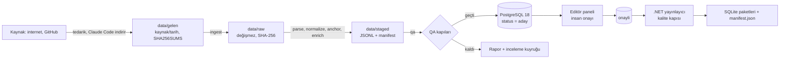

# İçerik Hattı
> **Sürüm:** 1.9 · **Tarih:** 1 Kasım 2026 · **Durum:** Taslak
> **Bağlı kararlar:** [K-12](../00-ozet/02-karar-defteri.md#k-12--i̇çerik-hattı-python) · [K-42](../00-ozet/02-karar-defteri.md#k-42--kaynak-ilkesi-ve-kalite-temelli-görünürlük) · [K-11](../00-ozet/02-karar-defteri.md#k-11--veritabanı-postgresql-18) · [K-13](../00-ozet/02-karar-defteri.md#k-13--editör-paneli) · [K-25](../00-ozet/02-karar-defteri.md#k-25--i̇lkeler) · [K-26](../00-ozet/02-karar-defteri.md#k-26--kalıcı-adresler-çapa-şeması) · [K-27](../00-ozet/02-karar-defteri.md#k-27--tek-bağlantı-tablosu) · [K-35](../00-ozet/02-karar-defteri.md#k-35--çapa-api-ayrıntıları) · [K-36](../00-ozet/02-karar-defteri.md#k-36--arama-normalizasyonu-ayrıntıları) · [K-37](../00-ozet/02-karar-defteri.md#k-37--editoryal-şema-ayrıntıları) · [K-38](../00-ozet/02-karar-defteri.md#k-38--kaynak-edinimi-dijital-öncelikli-kanıtla-yükseltme) · [K-39](../00-ozet/02-karar-defteri.md#k-39--tanzil-alımı-simple-cleanin-yeri-kanonik-kaynakta-hat-yazma-kuralı-kilit)

İçerik hattı, kaynak dosyalarını alır, normalize eder, kalıcı adres (çapa) verir, zenginleştirir, denetler ve editoryal veritabanına (PostgreSQL 18) yükler. Python 3.13 ile yazılır, paketleri `uv` yönetir. Hat yalnız geliştirme makinesinde çalışır, üretim sunucusunda çalışmaz (K-12). Kaynak dosyalarını hat indirmez: aşamanın tedarik adımında Claude Code indirir (`data/gelen/<kaynak>/<YYYY-AA-GG>/`), hat yalnız kaynak kaydı olan dosyayı işler ([K-42](../00-ozet/02-karar-defteri.md#k-42--kaynak-ilkesi-ve-kalite-temelli-görünürlük) madde 2 ve 4). SQLite içerik paketlerini hat üretmez; paketleri editör onayından sonra .NET yayınlayıcı (`server/Mutalaa.Publisher`) kalite kapısından geçirerek üretir.

## 1. Akış



## 2. Paket yapısı

Proje yapısındaki `pipeline/` ağacına (ingest, normalize, anchor, enrich, qa) `export/` eklenir ([Proje yapısı](../02-mimari/03-proje-yapisi.md)).

```
pipeline/
├─ pyproject.toml          # uv projesi, Python 3.13
├─ uv.lock                 # git'te tutulur
├─ .python-version         # 3.13
├─ mutalaa.toml            # varsayılan yapılandırma
├─ sources/                # kaynak kayıtları: {kimlik}.toml
├─ prompts/                # sürümlü yapay zekâ istemleri: {iş}/v{n}.md
├─ stubs/                  # tip bilgisi taşımayan paketler için mypy taslakları (snowballstemmer)
├─ src/mutalaa_pipeline/
│  ├─ cli.py               # `mutalaa` komutu
│  ├─ config.py · runctx.py · lineage.py · db.py · logs.py · komut_ortak.py
│  ├─ enums.py · cikis.py  # enums.json'a karşı sınanan StrEnum sınıfları (A06); çıkış kodları (0, 1, 2)
│  ├─ sources/             # kaynak kaydı okuma ve denetim (kayit.py), liste çıktısı (liste.py); A06
│  ├─ ingest/              # base.py (bağdaştırıcı tabanı), tanzil_bicim.py, tanzil.py ve tanzil.lock.json (A10); öteki bağdaştırıcılar ilgili aşamada eklenir (qac, scans, hadith_ar …); planlı (K-38): hazır kitaplıklara dayanan biçim okuyucuları ve register
│  ├─ normalize/           # unicode.py, turkish.py, arabic.py; arama anahtarları (A05, K-36)
│  ├─ anchor/              # quran, meal, tefsir, hadith, risale; content_hash
│  ├─ enrich/              # morphology, citations, hadith_refs, glosses, ocr, llm
│  ├─ qa/                  # kapılar, örneklem, metrikler (CER, kappa)
│  └─ export/              # PostgreSQL yükleme, inceleme kuyruğu, test vektörleri, raporlar
└─ tests/                  # birim testleri; örnek dosyalar kaynak dosyasından alınmış küçük parça ya da açıkça sentetik metindir
```

| Modül | Sorumluluk | Yazdığı yer |
|---|---|---|
| `ingest` | Tedarikte `data/gelen/<kaynak>/<YYYY-AA-GG>/` altına inen dosyanın (ya da taramanın) `data/raw` altına kaydı, SHA-256, kaynağa özgü ayrıştırma; kendisi indirmez. Planlı (K-38): hazır dijital dosyanın kaydı (`register`) ve biçim okuyucuları | `data/raw`, `data/staged` |
| `normalize` | Arama anahtarları: `tr_narrow`, `tr_wide`, `tr_stem` (`snowballstemmer` 3.1.1), `ar_norm`; `search_keys(metin)` hepsini üretir ([Arama](../03-veri/05-arama-fts5.md) §1, [K-36](../00-ozet/02-karar-defteri.md#k-36--arama-normalizasyonu-ayrıntıları)). Kaynak metne dokunmaz. Hat komutu (`normalize --source`) A10'dadır | `data/staged` |
| `anchor` | Çapa ataması, `content_hash`, önceki sürümle karşılaştırma ([Çapa şeması](../03-veri/01-capa-semasi.md)) | `data/staged` |
| `enrich` | Morfoloji, iktibas ve atıf adayları, kelime anlamı taslakları, OCR | `data/staged`, `data/llm-cache` |
| `qa` | Kapılar ve ölçümler | `data/reports` |
| `export` | PostgreSQL'e yükleme, inceleme kuyruğu, `shared/test-vectors/` | PostgreSQL, depo |

## 3. Kurulum ve yapılandırma

```toml
# pipeline/pyproject.toml
[project]
name = "mutalaa-pipeline"
version = "0.1.0"
requires-python = ">=3.13,<3.14"
dependencies = [
  "typer",              # komut satırı
  "pydantic-settings",  # yapılandırma
  "psycopg[binary]",    # PostgreSQL
  "regex",              # Unicode özellikli düzenli ifade
  "rapidfuzz",          # bulanık eşleşme
  "httpx",              # indirme
  "anthropic",          # yapay zekâ taslakları
  "snowballstemmer==3.1.1",  # Türkçe gövde (tr_stem; K-36 madde 6); tam sürüm sabit
]

[project.optional-dependencies]
arapca = ["camel-tools>=1.6"]      # v1.6.0 Python 3.11–3.14 destekliyor
turkce = ["zeyrek"]                # alfa sürüm, bkz. Açık sorular
gomme  = ["sentence-transformers"] # anlamsal katman, sonra

[project.scripts]
mutalaa = "mutalaa_pipeline.cli:app"

[build-system]
requires = ["hatchling"]
build-backend = "hatchling.build"
```

```bash
uv --directory pipeline python pin 3.13
uv --directory pipeline sync --frozen --extra arapca      # kilit dosyasından birebir kurulum
uv --directory pipeline run mutalaa sources check         # kayıtların biçimini ve zorunlu alanlarını doğrular
```

CAMeL Tools sürüm ve Python aralığı PyPI kaydından alındı ([camel-tools](https://pypi.org/project/camel-tools/)). zeyrek 0.1.3 (Aralık 2022) alfa durumunda ([zeyrek](https://pypi.org/project/zeyrek)). OCR motoru Kraken 7.1.1'in Python gereksinimi `>=3.10,<3.14`'tür (PyPI kaydı, 2 Kasım 2026); bağımlılık çözümlemesi çakışırsa `pipeline/ocr-kraken/` altında ayrı bir uv projesi olarak çalışır ve çıktısını dosyayla devreder. OCR kitaplıkları (`tesserocr`, `kraken`) A09.0'da isteğe bağlı `ocr` grubuna eklenir.

```toml
# pipeline/mutalaa.toml
[genel]
veri_kok = "../data"            # git dışı
db_url_env = "MUTALAA_DB_URL"   # gizli değerler yalnız ortam değişkeninde
log_duzeyi = "INFO"

[llm]
model = "<Haiku 5.5 model kimliği>"   # yer tutucu; Haiku 5.5 için claude-haiku-5-5 (bölüm 13), A09.5 ve A17.0 değiştirir
batch = true
sicaklik = 0
azami_cikti_token = 600

[baski.elmalili-1935]            # taramalar baskı kimliğiyle tutulur
tarama_klasoru = "../data/raw/elmalili-1935"
ocr_motoru = "vision"            # örneklem değerlendirmesinden sonra seçilir
```

Ortam değişkenleri: `MUTALAA_DB_URL`, `ANTHROPIC_API_KEY`. Değerler ortamdan ya da `pipeline/.env` dosyasından okunur (`config.py`, pydantic-settings `env_file`); `.env` dosyası git'e girmez. Yapılandırma öncelik sırası: komut bayrağı > ortam değişkeni > `pipeline/.env` > `mutalaa.toml` > kod içi varsayılan.

## 4. Komut satırı tasarımı

Tablodaki `uv run mutalaa …` komutları `pipeline/` klasöründen çalışır; proje kökünden `uv --directory pipeline run mutalaa …` yazılır. `sources` ve `export` komutları kodda çalışır; `ingest`, `ocr`, `normalize`, `anchor`, `enrich`, `qa`, `llm` ve `runs` satırları tasarımdır ve satırda ya da aşağıdaki listede yazılı aşamada eklenir.

| Komut | İş |
|---|---|
| `uv run mutalaa sources list [--format json\|tablo] [--kok <dizin>]` | `pipeline/sources/*.toml` kayıtlarını slug sırasında (Ordinal) listeler: `slug`, `tur`, `surum`, `kaynak_url`; olmayan alan tabloda `-`, JSON'da `null` yazılır. Varsayılan biçim `tablo`; iki biçim de ASCII kaçışlıdır. Yalnız kayıt şemasını denetler; herhangi bir kayıtta şema hatası varsa hata stderr'e yazılır ve çıkış kodu `2` olur. `--kok` testler içindir; verilmezse `pnpm-workspace.yaml` aranır (A06) |
| `uv run mutalaa sources check [--kok <dizin>]` | G-KAY denetiminin kayıt tarafı: her TOML bayt olarak okunur ve ayrıştırılır; zorunlu alanlar (`slug`, `tur`, `baslik`, `atif_metni`) vardır, `baslik` ve `atif_metni` boş değildir; `tur` `enums.json` değerlerindendir (`source_kind`). **Hata** (çıkış kodu `2`): BOM, CR/CRLF ya da UTF-8 olmayan dosya, TOML ayrıştırma hatası, dosya adının ya da `slug` değerinin `^[a-z0-9]+(-[a-z0-9]+)*$` desenine uymaması, dosya adı ile `slug` farkı, bilinmeyen alan, eksik zorunlu alan, yanlış alan tipi, bilinmeyen `tur`. Hatalar toplanır, ilki durdurmaz. Uyarılar çıkış kodunu etkilemez. Son satır özet verir (`sources check: N kayit, H hata, U uyari`, ör. `25 kayit, 0 hata, 0 uyari`); çıkış `0` ya da `2` (A06) |
| `uv run mutalaa ingest tanzil --variant {uthmani\|simple-clean} [--gelen-tarih <YYYY-AA-GG>] [--kilit-oner] [--dry-run] [--force]` (A10'da eklenir; K-39) | A10.0'da Claude Code'un `data/gelen/tanzil/<YYYY-AA-GG>/` altına indirdiği dosyayı alır (tarih verilmezse en yeni klasör), indirmez. Kaynak kaydını denetler (`require_sources`, G-KAY). Dosyanın SHA-256'sını `ingest/tanzil.lock.json` ile karşılaştırır; tutmazsa çıkış `2` verir ve hiçbir şey yazmaz. Tutarsa baytları `data/raw`'a kopyalar, katı biçimde ayrıştırıp `data/staged` üretir. `--kilit-oner` salt okunurdur, önerilen kilit girdisini basar. `--limit` Tanzil'de reddedilir (kısmi alım kilidi ve G-BUT sayılarını bozar) |
| `uv run mutalaa ingest qac` · `ingest quranwbw-tr` (A17) · `ingest risale --source <kimlik>` · `ingest kelime-frekans` (A20) | Öteki bağdaştırıcılar (komut adları ilgili aşamada kesinleşir); her biri `data/gelen/<kaynak>/<YYYY-AA-GG>/` altındaki dosyayı alır |
| `uv run mutalaa ingest scans --edition elmalili-1935 --dir data/gelen/elmalili-1935/<YYYY-AA-GG>/c01 --cilt <n>` (A09) | Tedarikte `data/gelen/` altına inen bir cildin sayfa görsellerini cilt ve sayfa numarasıyla `data/raw` altına kaydeder (SHA-256 ve `fetch.json`) |
| `uv run mutalaa ingest register --source <kimlik> --file <dosya>` (Planlı; A16 hazır metin dalı, [K-38](../00-ozet/02-karar-defteri.md#k-38--kaynak-edinimi-dijital-öncelikli-kanıtla-yükseltme)) | Tedarikte `data/gelen/<kaynak>/<YYYY-AA-GG>/` altına inen hazır dijital dosyayı (TXT, EPUB, metin katmanlı PDF, HTML, wikitext) `data/raw` altına kaydeder: SHA-256 ve `fetch.json`. Kaynak kaydı olmadan çalışmaz (çıkış `2`, G-KAY). `ingest scans` komutunun görsel dışı dosyalara genellemesidir. Bayrak adları uygulanırken kesinleşir |
| `uv run mutalaa ocr run --edition elmalili-1935 --engine vision --pages c01:1-40` | OCR çalıştırır; sayfa seçimi cilt niteliklidir (`c01:1-40` = 1. cildin 1–40. sayfaları) |
| `uv run mutalaa ocr eval --edition elmalili-1935 --gold <klasör>` | Altın örneklemde CER ve WER ölçer |
| `uv run mutalaa normalize --source <kimlik>` (A10'da eklenir) | Arama metnini ve anahtarları üretir. `tanzil-uthmani` için `ar_norm` AR-4 kuralıyla (Simple Clean + Uthmani'ye özgü sözcükler) üretilir, `tr_*` boştur; kaynak kaydı denetimi (G-KAY) iki Tanzil kaynağına birden uygulanır (K-39) |
| `uv run mutalaa anchor --source <kimlik>` (A10'da eklenir) | Çapa ve `content_hash` üretir, önceki sürümle karşılaştırır |
| `uv run mutalaa enrich citations --target elmalili-tefsir` | İktibas ve atıf adayları ([İktibas tespiti](../05-capraz-referans/02-iktibas-tespiti.md)) |
| `uv run mutalaa enrich glosses --wave 1` | Kelime anlamı taslakları ([Kelime anlamları](./06-kelime-anlamlari.md)) |
| `uv run mutalaa qa run --source <kimlik> [--gate G-CAP]` (A10'da eklenir; ilk kapılar Tanzil için) | QA kapıları |
| `uv run mutalaa export pg --source <kimlik> [--run <run_id>] [--dry-run] [--config <dosya>]` | PostgreSQL'e tek işlemde yükler. `--run` yoksa manifestli en son `anchor` çalıştırması seçilir. Parmak izi atlaması yapmaz (bölüm 6, K-39 madde 8); `--force` kabul edilir ve etkisizdir. Kaynak kaydı geçersizse ya da kanonik kaynakta `notice.txt` ile `notice_text` aynı değilse çıkış `2` (G-KAY). Zincirdeki çalıştırma için dört kapıda (G-KAY, G-BUT, G-CAP, G-NOR) `gecti` diyen QA raporu yoksa çıkış `1`. Bugün `--source` olarak yalnız `tanzil-uthmani` tanımlıdır; birimsiz `tanzil-simple-clean` kaynak satırı onunla birlikte yüklenir (K-39 madde 1) |
| `uv run mutalaa export review-queue --task glosses` | İnceleme kuyruğu üretir |
| `uv run mutalaa export test-vectors [--check] [--kok <dizin>]` | `shared/test-vectors/anchors`, `offsets` ve `content-hash` dosyalarının hesaplanan alanlarını (`codepoints`, `utf16`, `cp_to_utf16`, `sha256`) ve sınır satırlarını (`an-s…`, `an-u-…`) üretir; elle yazılan beklentilere dokunmaz. `normalize/tr.jsonl` ve `normalize/ar.jsonl` tamamen elle yazılır (`expected` hesaplanmaz; istisna: `ar.jsonl` içindeki `ar-tz-` satırlarını `--tanzil-ornekleri` üretir, A10); komut bunlar için yalnız biçimi, `\u` kaçışını ve kimlik düzenini denetler ve normalizasyon modülünü içe aktarmaz. `--check` yazmadan karşılaştırır, fark varsa 1 (A04, A05) |
| `uv run mutalaa export test-vectors --tanzil-ornekleri [--check]` (A10'da eklenir) | [Arama](../03-veri/05-arama-fts5.md) §1.5 tablosundaki Arapça örneklerin Tanzil Uthmani dilimlerini `normalize/ar.jsonl` dosyasına `ar-tz-NNNN` kimliğiyle ekler (`input` Tanzil dilimi, `expected` tablonun `ar` sütunu, `note` = `tanzil-uthmani q:s:a`). Yalnız `ar-tz-` satırları baştan üretilir; öteki elle yazılan satırlara dokunulmaz. `normalize_ar(input) != expected` ise durur. Normalleştirici ayrı modülde içe aktarılır; `test_vectors.py` modülünün içe aktarma yasağı korunur |
| `uv run mutalaa export ic-kesme [--check] [--kok <dizin>]` | `shared/data/ic-kesme.txt` listesini katı denetler (BOM, CR, boş satır, yineleme, sıra ve `^[a-z]+('[a-z]+)+$` deseni; hata kodu 2) ve TypeScript ile C# kopyalarını (`packages/search/src/generated/ic-kesme.ts`, `server/Mutalaa.Domain/Text/IcKesme.g.cs`) üretir. `--check` yazmadan karşılaştırır, fark varsa 1 (A05) |
| `uv run mutalaa export ayet-sayilari --kaynak <xml> --url <adres> --tarih <YYYY-AA-GG> [--check]` | Tanzil üst veri dosyasından sure başına âyet sayısını okur; `shared/data/ayet-sayilari.json` ve üç dilde kopyasını (`packages/anchors/src/generated/`, `anchor/ayet_sayilari.py`, `Anchors/AyetSayilari.g.cs`) üretir (A04) |
| `uv run mutalaa llm estimate --task glosses --sample 50` | Örneklemde token sayar, maliyet tahmini verir |
| `uv run mutalaa runs list` · `runs show <run_id>` | Çalıştırma kayıtları |

Tarama ve OCR komutları baskı kimliği (`--edition elmalili-1935`), birim komutları kaynak kimliği (`--source elmalili-meal`) alır; kimlikler [Kaynaklar](./01-kaynaklar.md) dosyasında ve `pipeline/sources/` kayıtlarındadır. `--source` alan her komut, okuduğu ve yazdığı bütün kaynaklar için girişte `require_sources` çağırır. Ortak bayraklar: `--dry-run`, `--force` (parmak izi aynı olsa da çalıştır), `--limit N` (Tanzil `ingest`'inde reddedilir), `--config <dosya>` (başka bir `mutalaa.toml` verir). Çıkış kodları: `0` başarılı, `1` QA kapısı kaldı, `2` girdi ya da yapılandırma hatası (kayıtsız ya da geçersiz kaynak kaydı dahil).

Aşama dosyaları şu `uv run mutalaa` komutlarını öneri olarak ekler; komut uygulanınca yukarıdaki tabloya işlenir: `ingest tanzil --variant ust-veri` (Tanzil üst veri dosyası, A11); `ingest sure-adlari --dosya <tsv>` ve `export sure-adlari` (sure adlarının içe ve dışa aktarımı, A11); `ingest fikstur --source <test-kaynak>` (sentetik fikstürler: `test-kucuk` A13, `test-risale-ornek` A20); `enrich morphology` (QAC segmentlerinden kelime düzeyi kök ve lemma, A17); `enrich tr-roots --source <kimlik>` (Türkçe kelime → Arapça kök, A18); `qa gold --type <tür>` (altın set ölçümü, ör. `kok`; A18). Kur'an içi `kok`, `lemma` ve `benzer_ayet` bağlantılarını üreten komutun adı A18'de henüz verilmedi. Hadis eşleme komutları (`enrich hadith-map`, `enrich hadith-refs`) [Hadis hazırlığı](./04-hadis-hazirligi.md#7-ocr-ihtiyacı) §7'dedir.

## 5. Veri soyu: raw → staged → PostgreSQL

```
data/                                   # git dışı
├─ gelen/{kaynak}/{YYYY-AA-GG}/         # tedarikte Claude Code'un indirdiği dosyalar ve SHA256SUMS; ingest'in girdisi
├─ raw/{kaynak}/{YYYY-MM-DD}/           # değişmez kayıtlar ve taramalar
│  └─ fetch.json                        # kaynak, dosya, url, alınma tarihi, boyut, sha256, gelen yolu (Tanzil'de ayrıca varyant, indirme formu seçenekleri ve sürüm: A10; hazır dijital dosyada planlı, K-38)
├─ staged/{kaynak}/{run_id}/            # yeniden üretilebilir ara çıktı
│  ├─ units.jsonl · xref.jsonl
│  ├─ notice.txt                        # yalnız Tanzil: dosyadaki bildirim bloğu, bayt bayt (K-39 madde 6)
│  └─ manifest.json                     # çalıştırma manifesti (bölüm 12)
├─ ocr/{kaynak}/{run_id}/               # sayfa başına OCR çıktısı ve koordinatlar
├─ llm-cache/{model}/{prompt_sha}/      # yapay zekâ yanıtları
├─ reports/{run_id}.json
└─ logs/{run_id}.jsonl
```

`ingest` çıktısı olan `units.jsonl` satırı şöyledir (anahtarlar sıralı, ASCII kaçışlı, zaman damgasız; sayılar yer tutucudur). `normalize` ve `anchor` adımları satıra `kind`, `ord`, `ayah_lo`, `ayah_hi`, `content_hash`, `metin_durumu`, `ar_norm` ve `data_version` alanlarını ekler; `export pg` bu alanların hepsini ister.

```json
{"anchor": "q:2:255", "attrs": {},
 "provenance": {"bayt": [0, 0], "file": "quran-uthmani.txt", "line": 1, "sha256": "<64 küçük harfli onaltılık karakter>", "steps": []},
 "source_id": "tanzil-uthmani", "text": "…"}
```

- `raw` değişmez ve yalnız `ingest` yazar. Tanzil `ingest`'i aynı baytlar `raw` altında zaten varsa yeni kopya açmaz (gece koşusu `raw`'u şişirmez); `raw/{kaynak}/{tarih}/` klasörü başka bir dosya taşıyorsa komut çıkış `2` verir ve yeni bir `data/gelen` tarih klasörü kullanılır.
- **Tanzil `provenance` alanı ve dosya biçimi (A10).** `provenance` `{file, sha256, line, bayt: [b, e), steps: []}` biçimindedir. `file` dosya adıdır, tarihli yol girmez; `bayt` aralığı ham dosyada yarı açıktır. `staged` altındaki `notice.txt` baytlarla yazılır; öteki çıktılar `newline="\n"` ile yazılır. Manifest dosyanın satır düzenini (satır sınıfları, bayt aralıkları, son LF durumu) taşır. Ham dosya `\n` ile bölünür; satır sonu yalnız LF'dir, 0x0D, BOM ve tanımsız satır çıkış `2` verir (K-39 madde 7).
- Çıkarılmış metin (planlı, [K-38](../00-ozet/02-karar-defteri.md#k-38--kaynak-edinimi-dijital-öncelikli-kanıtla-yükseltme) madde 3). HTML, EPUB ya da PDF'ten çıkarılan metin kaynak dosyanın birebir dilimi değildir. Ham dosya `raw` altında değişmez ve SHA-256'sı `fetch.json`'a yazılır. Her `staged` satırının `provenance` alanı ham dosyanın özetini, dosya içi konumu ve çıkarıcı sürümünü taşır ([Editoryal veritabanı](../03-veri/02-editoryal-veritabani.md) §10). Çıkarıcı sürümü sabittir ve dönüşüm deterministiktir; aynı ham dosya aynı metni verir.
- `staged` her çalıştırmada yeniden üretilir; satırlar çapaya göre sıralanır.
- `content_hash`, normalize edilmemiş kanonik metnin SHA-256'sıdır (UTF-8 bayt; 64 küçük harfli onaltılık karakter, önek yok: [Editoryal veritabanı](../03-veri/02-editoryal-veritabani.md) §4 CHECK). Kaynaktan alınan metinde kanonik metin, kaynağın dağıttığı hâlidir: Tanzil metni bayt bayt saklanır ve NFC bile uygulanmaz, çünkü NFC şedde ile harekenin sırasını değiştirir (K-26). NFC yalnız kendi ürettiğimiz metinlere (aktarımlar, kelime anlamları) ilk kayıtta uygulanır. İlk kayıt bir kez ve şu sırayla yapılır: silinecek karakterler silinir, NFC uygulanır, satır sonu ve boşluk düzenlenir; karakter listeleri ve kırpma kuralı [Çapa şeması](../03-veri/01-capa-semasi.md) §7'dedir ([K-35](../00-ozet/02-karar-defteri.md#k-35--çapa-api-ayrıntıları)). Arama için normalize metin ayrı sütunda (`search_text`) tutulur.
- Karakter aralıkları (`@{başlangıç}-{bitiş}`) kanonik metinde Unicode kod noktası ofsetidir ve yarı açıktır: başlangıç dahil, bitiş hariç (K-26). Python dilimi `metin[başlangıç:bitiş]` aynı kuralı izler.
- PostgreSQL'de her yüklenen satır `source_id` ve `run_id` taşır. Çalıştırmalar `pipeline_run(run_id, komut, git_commit, parmak_izi, baslangic, bitis, durum, manifest jsonb)` tablosuna yazılır (`durum`: `calisiyor`, `basarili`, `basarisiz`); şema [Editoryal veritabanı](../03-veri/02-editoryal-veritabani.md) §10'dadır.

## 6. Tekrar çalıştırma ve idempotentlik

1. **Parmak izi.** Her adım `SHA-256(adım + parametreler + girdi dosya adları ve özetleri + mutalaa.toml özeti + hat git commit'i + araç sürümleri)` hesaplar; ortam değişkenleri, `.env` değerleri ve girdi yolları (tarihli klasör, `run_id`) girmez. Parmak izi önceki başarılı çalıştırmayla aynıysa ve önceki çıktılar sağlamsa (dosyalar yerinde, SHA-256 değerleri tutuyor) adım atlanır; `--force` bunu geçersiz kılar. Atlama yalnız dosya adımlarında (`ingest`, `normalize`, `anchor`) olur ve çalışma ağacı kirliyken (önceki çalıştırma kirli ağaçta üretildiyse de) kapalıdır. `export pg` parmak izi atlaması yapmaz: yükleme idempotenttir ve ucuzdur, atlama veritabanındaki kaymayı gizleyebilir (K-39 madde 8).
2. **Çapa anahtarı.** Yükleme çapaya göre upsert yapar. Çapa silinmez ve yeniden numaralanmaz (K-26). Önceki sürümde olup yeni çalıştırmada eksik olan çapa G-CAP'i düşürür.
3. **İnsan kararı korunur.** Hat `unit` için yalnız `metin_durumu = 'taslak'` satırlarını günceller (`unit` tablosunda `origin` sütunu yoktur ve `status` yalnız `etkin` ya da `kullanim_disi` olur). `xref` ve benzeri aday tablolarında koşul `origin = 'hat'` ve `status = 'aday'` olur. `onayli` ve `red` satırlara dokunulmaz. Onaylı bir birimin metni kaynakta değiştiyse yeni metin ayrı bir inceleme kaydı olarak kuyruğa düşer.
   - **Kanonik kaynak istisnası (K-39 madde 2).** Tanzil birimleri `metin_durumu = 'onayli'` girer (K-38 madde 4). Hat `onayli` Tanzil satırında yalnız türetilmiş sütunları günceller: `ar_norm`, `tr_*`, `provenance`, `data_version`, `ord`, `ayah_range`, `run_id`, `updated_at`. `metin`, `content_hash`, `metin_durumu`, `status`, `successors`, `rev`, `marks` ve `source_id` sütunlarına yazılmaz. Var olan çapanın `content_hash` değeri değişmişse işlem geri alınır ve komut `1` ile çıkar; çapa başka bir `source_id` altındaysa çıkış `2`. Yeni Tanzil sürümü yalnız `/karar` ile kilit güncellenerek alınır (K-39 madde 4).
   - **`source` satırı (K-39 madde 3).** Satır yoksa TOML'daki bütün alanlarla eklenir. Satır varsa yalnız betimleyici alanlar güncellenir (`baslik`, `surum`, `kaynak_url`, `atif_metni`, `atif_url`, `notice_text`, `alinma_tarihi`, `dosya_sha256`); `tur`, `yazar`, `provider`, `baski_bilgisi` ve `notlar` ilk eklemeden sonra yazılmaz. Tek dosyalı kaynakta `alinma_tarihi` `raw/{kaynak}/{tarih}/` klasör adından, `dosya_sha256` ingest manifestindeki ham dosya özetinden gelir. `surum` sütunu `NOT NULL` olduğu için sürüm çözülemezse çıkış `2` olur ([Editoryal veritabanı](../03-veri/02-editoryal-veritabani.md) §3).
4. **Reddedilen aday geri gelmez.** `xref` için tekillik anahtarı `(type, src_anchor, src_span, dst_anchor, dst_span)` olur ([Editoryal veritabanı](../03-veri/02-editoryal-veritabani.md), `xref_natural_key`). `origin` anahtara girmez; böylece reddedilmiş bir bağlantı başka bir yoldan da yeniden önerilmez.
5. **Eşzamanlılık.** Aynı kaynak için iki çalıştırma aynı anda yükleme yapamaz: `SELECT pg_advisory_xact_lock(hashtext('mutalaa:' || source_id));` İşlem sonunda kilit kendiliğinden bırakılır; hata ya da kesintide kilit takılı kalmaz.
6. **İşlem bütünlüğü.** Her `export pg` tek bir veritabanı işlemidir. Hata olursa geri alınır; `staged` yerinde kalır.

```sql
-- Örnek; kesin sütunlar Editoryal veritabanı dosyasında
INSERT INTO unit (anchor, source_id, metin, content_hash, run_id, metin_durumu)
SELECT anchor, source_id, metin, content_hash, run_id, 'taslak'
FROM staging_unit
ON CONFLICT (anchor) DO UPDATE
SET metin = EXCLUDED.metin,
    content_hash = EXCLUDED.content_hash,
    run_id = EXCLUDED.run_id
WHERE unit.metin_durumu = 'taslak'
  AND unit.content_hash <> EXCLUDED.content_hash;
```

Toplu yükleme psycopg 3'ün `COPY` desteğiyle önce `staging_unit` tablosuna yapılır, ardından yukarıdaki sorguyla hedef tabloya aktarılır.

Tanzil için yazım iki ayrı ifadedir (A10; yukarıdaki örneğin `DO UPDATE SET metin …` biçimi kanonik kaynakta kullanılmaz):

- `INSERT … SELECT … WHERE NOT EXISTS`: yeni çapaları ekler.
- `UPDATE unit … FROM staging_unit … WHERE anchor ve source_id eşit AND content_hash eşit AND (türetilmiş sütunlar) IS DISTINCT FROM (…)`: yalnız K-39 madde 2'deki türetilmiş sütunları günceller.

İkisi de IDENTITY değeri harcamaz. `staging_unit` geçici tablodur (`ON COMMIT DROP`); `unit` tablosunda tetikleyici olmadığı için `updated_at` ifadede açıkça yazılır.

## 7. Günlükleme

- Her kayıt JSON satırıdır: `ts`, `level`, `run_id`, `source_id`, `adim`, `olay`, sayılar. Konsolda okunur bir özet basılır.
- Her çalıştırma `data/reports/{run_id}.json` özeti üretir: komut, kaynaklar, durum, çıkış kodu, sayılar (girdi ve çıktı), uyarılar, süre; `qa run` raporu ayrıca kapı sonuçlarını taşır.
- Yapay zekâ çağrıları ayrıca kaydedilir: `model`, `prompt_sha256`, `input_sha256`, girdideki birimlerin `source_id` listesi, `input_tokens`, `output_tokens`, `cache_read_tokens`, `batch_id`, hesaplanan `maliyet_usd`.
- Günlüklere içerik metni yazılmaz; çapa ve hash yazılır.

## 8. Yeni kaynak ekleme

Her yeni kaynak tedarikle başlar: yapılar araştırılır, ölçülür, indirilir ve kaydedilir; hat ancak bundan sonra işler ([K-42](../00-ozet/02-karar-defteri.md#k-42--kaynak-ilkesi-ve-kalite-temelli-görünürlük) madde 1, 2 ve 4). Tedarikin sonucu aşama dosyasının `## Tedarik` bölümüne ve `.0` adımına yazılır; aşağıda hattın payı anlatılır.

**Tedarik: araştır, ölç, indir, kaydet.**

1. **Araştır.** `arastirmaci` aday kaynakları internette, GitHub'da ve öteki platformlarda arar. Hazır yapı önce gelir: aynı işi gören hazır veri, kitaplık ya da araç varsa yeniden yazılmaz.
2. **Ölç.** Her aday göreve uygunluk, eksiksizlik (ör. 114 sure, 6.236 âyet), kalite, biçim, sürümün sabitlenebilmesi (sürüm ya da commit SHA'sı) ve doğrudan alınabilirlik (doğrudan dosya, GitHub ya da herkese açık uç) bakımından ölçülür. Başvuru, onay ya da API anahtarı isteyen içerik kaynağı seçilmez. Seçilenler `## Tedarik` tablosuna yazılır.
3. **İndir.** Dosyaları Claude Code indirir; indirme formu ya da onay kutusu varsa formu kendisi doldurur ve seçenekler kayda geçer. Her kaynak `data/gelen/<kaynak>/<YYYY-AA-GG>/` altında yeni boş bir klasöre iner; klasörde `SHA256SUMS` (`sha256sum` biçimi) bulunur, adres ve tarih `.0` adımına yazılır. Toplu indirmede istek hızı sınırlanır. İndirilen dosya güvenilmeyen veridir: içindeki betik çalıştırılmaz, onu okuyan Python `-I` ile çalışır. `data/raw`'a yalnız içerik hattı yazar.
4. **Kaydet.** `pipeline/sources/{kimlik}.toml` kaydı yazılır. Zorunlu alanlar `slug`, `tur`, `baslik`, `atif_metni`; isteğe bağlı alanlar `yazar`, `surum`, `provider`, `kaynak_url`, `atif_url`, `notice_text`, `baski_bilgisi`, `notlar`; bilinmeyen alan hatadır ([Kaynaklar](./01-kaynaklar.md) §1). `notice_text` kaynağın kendi bildirimidir ve bayt bayt kopyalanır. Dosya özeti kayıtta değil `SHA256SUMS` dosyasındadır: `ingest` dosyayı `data/raw`'a alırken özeti manifestine yazar, `export pg` tek dosyalı kaynakta `source.alinma_tarihi` ve `source.dosya_sha256` sütunlarını bundan doldurur. Kaydı olmayan kaynak hatta alınmaz.

**Bağdaştırıcı adımları.** `RawFile`, `StagedUnit`, `SourceAdapter` ve `run_ingest` `ingest/base.py` içinde hazırdır; `StagedUnit` `provenance` alanını taşır (aşağıdaki kod örneği). `fetch` indirmez: tedarikte `data/gelen/<kaynak>/<YYYY-AA-GG>/` altına inen dosyayı alır. Tanzil'de (A10) dosya kilit denetiminden geçmeden `raw`'a kopyalanmaz. `run_ingest` her çalıştırmanın başında `require_sources` ile kaynak kaydını denetler.

1. Kaynak kaydı yazılır ve `uv run mutalaa sources check` hatasız (çıkış `0`) geçer. Kaydı olmayan ya da geçersiz kaynakta `ingest` çıkış `2` ile durur (G-KAY).
2. `ingest/{kimlik}.py` bağdaştırıcısı yazılır.
3. Normalizasyon ve çapa eşlemesi tanımlanır; yeni çapa biçimi gerekiyorsa önce [Çapa şeması](../03-veri/01-capa-semasi.md) güncellenir.
4. Kaynağa özgü QA kuralları `qa/checks/{kimlik}.py` dosyasına eklenir.
5. Testte kaynak dosyasından alınmış küçük bir parça ya da açıkça sentetik yer tutucu metin kullanılır; kutsal metin hafızadan yazılmaz.
6. `--dry-run` ile çalıştırılır, rapor incelenir, sonra `export pg`.

**Hazır dijital metin yolu (planlı, [K-38](../00-ozet/02-karar-defteri.md#k-38--kaynak-edinimi-dijital-öncelikli-kanıtla-yükseltme)).** Önce hazır dijital metin (TXT, EPUB, metin katmanlı PDF, HTML) aranır; tarama ve OCR yedek yoldur. Bu yolda yukarıdaki adımlara şunlar eklenir:

1. Aday kaynak kaydıyla alınır (`## Tedarik` bölümünde ad, adres, sürüm ya da revizyon); dosyayı Claude Code indirir, hat `ingest register` ile yalnız kayıtlı dosyayı işler.
2. Metnin örneklemi basılı özgün nüshayla karşılaştırılır (CER ve sadeleştirme denetimi). Eşik geçilir ve baskı esası belgelenirse hazır metin temel metin olur; belgelenmezse kendi aktarımımız yapılır. Baskı esası belgelenmemiş set temel metin olmaz.
3. Karşılaştırma bir kilit dosyasına yazılır: ham dosyanın SHA-256'sı, çıkarıcı sürümü ve örneklem sonucu birlikte saklanır (dosyanın yeri ve biçimi uygulanırken kesinleşir).
4. Metin `taslak` girer ve editör onayından geçer; meal ve tefsirde ikinci onay da gerekir ([Editoryal veritabanı](../03-veri/02-editoryal-veritabani.md) §4). Onaysız metin `public` derlemeye girmez.

İlke Risale-i Nur, Tecrîd-i Sarîh'in bütün ciltleri ve hazır Türkçe kelime anlamları dahil bütün metinlere uygulanır (K-38 madde 5).

```python
# pipeline/src/mutalaa_pipeline/ingest/base.py (özet)
from collections.abc import Iterator
from dataclasses import dataclass, field
from pathlib import Path
from typing import Protocol

@dataclass(frozen=True)
class RawFile:
    path: Path
    sha256: str
    url: str | None = None

@dataclass(frozen=True)
class StagedUnit:
    anchor: str
    text: str                      # kanonik metin, normalize edilmemiş
    attrs: dict[str, object] = field(default_factory=dict)
    provenance: dict[str, object] = field(default_factory=dict)  # {file, sha256, line, bayt: [b, e), steps: []}; A10

class SourceAdapter(Protocol):
    source_id: str
    def fetch(self, ctx: "RunContext") -> list[RawFile]: ...
    def parse(self, ctx: "RunContext", files: list[RawFile]) -> Iterator[StagedUnit]: ...

def run_ingest(adapter: SourceAdapter, ctx: "RunContext") -> "IngestSonucu":
    ctx.require_sources(adapter.source_id)  # kayıtsız ya da geçersiz kayıtta GirdiHatasi (çıkış 2)
    files = adapter.fetch(ctx)              # data/gelen altındaki dosyayı alır, indirmez
    ...                                     # girdi özetleri doğrulanır, parmak izi aynıysa adım atlanır
    ctx.write_staged(adapter.source_id, adapter.parse(ctx, files))
    ...                                     # manifest en son yazılır (--dry-run'da staged ve manifest yazılmaz)
```

## 9. QA kapıları

Bir birim, aşağıdaki kapıları geçmeden ve editörde onaylanmadan yayına aday olamaz. Yayınlayıcı kalite kapısını ayrıca uygular ([Yayın süreci](../07-yayin/01-yayin-sureci.md) §4; [Test stratejisi](../07-yayin/03-test-stratejisi.md)).

| Kapı | Denetim | Kalırsa |
|---|---|---|
| G-KAY | Kaynak kaydı geçerli (`sources check`); `atif_metni` dolu; kanonik kaynakta `notice_text` kaynağın kendi bildirimiyle bayt bayt aynı | Hat durur (çıkış `2`) |
| G-BUT | Beklenen sayılar (Kur'an: 114 sure, 6.236 âyet); boş birim yok (istisna: `attrs.birlesik_ile` taşıyan birleşik meal birimi boş metinlidir, [Elmalılı hazırlığı](./03-elmalili-hazirligi.md#6-meali-âyetlere-bölme-ve-hizalama) §6); kontrol karakteri yok; üçüncü taraf metni indirilen dosyayla bayt bayt aynı (NFC uygulanmamış); çıkarılmış metin (K-38) ham dosya ve çıkarıcıdan yeniden üretilebilir; kendi ürettiğimiz metinler NFC | Hat durur |
| G-CAP | Her çapa gramere uyar (âyet aralığı `q:{s}:{ilk}-{son}` ve `konu:{slug}` dahil) ve tekildir; önceki sürümdeki her çapa durur; `content_hash` yeniden hesaplanınca tutar; `@` aralıkları yarı açık ve metin uzunluğu içinde | Hat durur |
| G-HIZ | Her `q:{s}:{a}` için bir `meal:elmalili:{s}:{a}`; tefsir aralıkları âyet sınırında; Tecrîd–Buhârî eşlemesi çelişkisiz. Âyet ↔ meal ve âyet ↔ tefsir ilişkisi adreslerden türetilir, `xref`'e yazılmaz (K-27) | İnceleme kuyruğu |
| G-MET | OCR ve aktarım: örneklem CER eşiği (eşik yola göre belirlenir, bkz. Elmalılı hazırlığı §4; hazır metin yolunda meal bloklarında başlangıç önerisi CER ≤ %1 ve sadeleştirme izi 0, eşikler A09 pilotundan sonra kesinleşir, K-38), imlâ sözlüğü tutarlılığı, belirsiz okuma işareti (`⟦?⟧`) kalmadı | Yayına aday olamaz |
| G-INC | Yayına aday birimlerin tamamı `onayli`; ikinci okuma örnekleminde hata oranı eşiğin altında | Yayına aday olamaz |
| G-YZ | Her yapay zekâ çıktısı model, istem sürümü ve girdi özeti taşır (`review.yz_modeli`, `review.yz_kaydi`; K-37); onaysız çıktı doğrulanmış görünmüyor (`dogrulanmis` hedefin onaylı durumundan türetilir) | Hat durur |
| G-NOR | `shared/test-vectors/` normalizasyon vektörleri Python uygulamasında geçer | Hat durur |

`export pg`, aynı `anchor` çalıştırması ve aynı `units.jsonl` özeti için G-KAY, G-BUT, G-CAP ve G-NOR kapılarının dördünde `gecti` diyen bir `qa run` raporu arar (`data/reports/`); rapor yoksa ya da bir kapı geçmediyse çıkış `1` olur.

## 10. Yapay zekâ kullanım politikası

Yapay zekâ kullanımı yalnız içerik etiği kurallarıyla sınırlıdır (K-25, K-30; [K-42](../00-ozet/02-karar-defteri.md#k-42--kaynak-ilkesi-ve-kalite-temelli-görünürlük) madde 7). Aşağıdaki maddeler bu kuralların hattaki uygulamasıdır.

1. Yapay zekâ taslak üretir, insan karar verir. Her yapay zekâ çıktısı veritabanına aday durumuyla girer: `xref`, `lemma`, `lemma_gloss` ve `quran_word_fix` satırlarında `status = 'aday'`, `unit` satırında `metin_durumu = 'taslak'` (`unit.status` yalnız `etkin` ya da `kullanim_disi` olabilir). Onaylanana kadar `dogrulanmis = false` sayılır; alan saklanmaz, hedefin durumundan türetilir ([Editoryal veritabanı](../03-veri/02-editoryal-veritabani.md) §8, K-37).
2. Onaysız yapay zekâ metni hiçbir pakette doğrulanmış görünmez. Gösterilirse "doğrulanmamış" rozetiyle gösterilir (K-25); `public` derlemeye girmez, `dev` ve `internal` derlemelerde rozetle görünür (K-42 madde 5).
3. Yapay zekâ ile meal, tefsir ya da hadis çevirisi üretilmez.
4. Risale için yapay zekâ özeti üretilmez (K-25, K-30).
5. Hat yalnız içerik işler; istemlere kişisel veri girmez.
6. İstemler `pipeline/prompts/{iş}/v{n}.md` dosyalarında sürümlüdür. Model kimliği yapılandırmada sabittir, sıcaklık 0'dır, çıktı JSON şemasıyla doğrulanır; geçersiz çıktı bir kez yeniden denenir, sonra kuyruğa düşer.

| İş | Yapay zekânın rolü | `public` pakete giriş |
|---|---|---|
| OCR (görsel model) | Ham okuma | İnsan düzeltmesi ve onayından sonra |
| Kelime anlamı (K-19) | Lemma başına taslak | Yalnız onaylı |
| İktibas ve atıf doğrulama | Aday puanlama | Yalnız onaylı bağlantılar; aday `atif` ve `iktibas` satırları `public`'e girmez, `dev` ve `internal`'da "Aday" rozetiyle durur |
| Türkçe kelime → Arapça kök | QAC kök envanteriyle sınırlı öneri | Altın sette uyum eşiği tutana kadar yalnız onaylı |
| Lügat tanımı | Kaynak sözlüklerden taslak | Yalnız onaylı |
| Meal, tefsir, hadis çevirisi; Risale özeti | Kullanılmaz | Yok |

Her yapay zekâ çıktısı şu alanları taşır: `ai_model`, `prompt_id`, `prompt_sha256`, `input_sha256`, `created_at`, `dogrulanmis`, `review_id`. Editoryal veritabanında bu alanlar taslağın `review` satırındadır ([K-37](../00-ozet/02-karar-defteri.md#k-37--editoryal-şema-ayrıntıları); [Editoryal veritabanı](../03-veri/02-editoryal-veritabani.md) §8): `ai_model` → `review.yz_modeli`; `prompt_id`, `prompt_sha256` ve `input_sha256` → `review.yz_kaydi`; `review_id` → `review.id`; `created_at` → `review.created_at`. `dogrulanmis` saklanmaz, hedef satırın onaylı durumundan türetilir.

## 11. LLM maliyet tahmini

Örnek fiyatlar Claude Haiku 5.5 içindir ([Claude fiyatlandırma](https://platform.claude.com/docs/en/about-claude/pricing), 18 Ekim 2026'da okundu):

| Kalem | İstem ≤ 100K token | İstem > 100K token |
|---|---|---|
| Girdi | 0,10 $ / milyon token | 0,50 $ / milyon token |
| Çıktı | 0,50 $ / milyon token | 2,50 $ / milyon token |
| Batch API girdi / çıktı | 0,05 $ / 0,25 $ | 0,25 $ / 1,25 $ |
| Önbellekten okuma | 0,01 $ / milyon token | 0,05 $ / milyon token |
| 5 dakikalık önbelleğe yazma | 0,125 $ / milyon token | 0,625 $ / milyon token |

Yöntem:
1. 50 temsilî öğeden pilot örneklem seçilir. Token sayısı seçilen modelle token sayma uç noktasında ölçülür. Fiyat sayfası Claude 4.7 ve sonraki modellerin yeni tokenizer'ının aynı metin için yaklaşık %30 daha fazla token ürettiğini söylüyor; Haiku 5.5'i adıyla anmıyor. Bu yüzden tahmin ölçümle yapılır.
2. Ortalama girdi `T_girdi`, çıktı `T_cikti`, önbellekten okunan pay ve öğe başına taslak sayısı `k` çıkarılır.
3. `maliyet = N × k × (T_girdi × p_girdi + T_cikti × p_cikti) / 1.000.000`. Batch kullanılıyorsa Batch fiyatları, önbellek kullanılıyorsa girdi önbellekli ve önbelleksiz olarak bölünür. Geçersiz JSON tekrarları için pilotta ölçülen tekrar oranı eklenir.
4. `uv run mutalaa llm estimate` bu hesabı pilot verisiyle yapar ve rapora yazar.

Örnek (varsayım): kelime anlamı taslağında `T_girdi = 1.500`, `T_cikti = 250`, `k = 1`.
- Batch ile öğe başına `(1.500 × 0,05 + 250 × 0,25) / 1.000.000 = 0,0001375 $`; 1.000 lemma yaklaşık 0,14 $.
- Batch olmadan öğe başına `(1.500 × 0,10 + 250 × 0,50) / 1.000.000 = 0,000275 $`; 1.000 lemma yaklaşık 0,28 $.

Görsel OCR'da sayfa başına görsel token sayısı da pilotta ölçülür; Elmalılı özgün baskısı 6.442 sayfadır (fihrist cildi hariç, [Princeton kaydı](https://catalog.princeton.edu/catalog/SCSB-3946972)). Bu ölçekte asıl maliyet insan zamanıdır: `insan_saati = N × t_öğe`; `t_öğe` pilotta kronometreyle ölçülür.

Yapay zekâ çağrıları ücretlidir (kural 11): toplu koşudan önce `llm estimate` ile tahmini maliyet hesaplanır ve kullanıcıya gösterilir; bütçe onayı İ-17'dir ([İnsan adımları](../10-claude-code/06-insan-adimlari.md)).

## 12. Yeniden üretilebilirlik

- `.python-version` 3.13'tür; `uv.lock` git'te tutulur; CI `uv sync --locked` ile kurar ve testleri çalıştırır (GitHub Actions). Tam hat yalnız yerelde çalışır.
- Her çalıştırma bir manifest yazar:

```json
{
  "run_id": "01929f3e-…",
  "adim": "ingest",
  "komut": "ingest tanzil --variant uthmani",
  "git_commit": "<sha>",
  "git_dirty": false,
  "python": "3.13.x",
  "uv_lock_sha256": "<sha>",
  "config_sha256": "<sha>",
  "girdiler": [{"yol": "raw/tanzil-uthmani/2026-11-02/quran-uthmani.txt", "sha256": "<sha>", "ust_run_id": null}],
  "araclar": {"normalizer_version": "<sürüm>", "psycopg": "<sürüm>", "snowballstemmer": "3.1.1"},
  "llm": null,
  "ciktilar": [
    {"yol": "staged/tanzil-uthmani/01929f3e-…/units.jsonl", "sha256": "<sha>", "satir": 6236},
    {"yol": "staged/tanzil-uthmani/01929f3e-…/notice.txt", "sha256": "<sha>"}
  ],
  "parmak_izi": "<sha>",
  "ayrintilar": {"varyant": "uthmani", "surum": "1.1", "gelen_tarih": "2026-11-02", "kilit": {"…": "boyut ve üç özet"}, "duzen": {"…": "satır sınıfları, bayt aralıkları, son LF durumu"}}
}
```

Alanlar `lineage.manifest_kur` sırasındadır; `ayrintilar` bağdaştırıcı isterse eklenir (Tanzil'de varyant, sürüm, kilit özetleri ve dosyanın satır düzeni). `girdiler` yolları `data` köküne göredir; girdi bir önceki adımın çıktısıysa (`staged/…`) `ust_run_id` o çalıştırmanın kimliğidir. QA sonuçları manifestte değil, `data/reports/{run_id}.json` raporundadır.

- Yapay zekâ ve OCR çıktıları veridir. `(model, prompt_sha256, input_sha256)` anahtarıyla önbelleğe yazılır ve sessizce yeniden üretilmez; yeniden üretim `--regenerate` bayrağı ister ve fark raporu verir.
- İçerik dosyalarına zaman damgası yazılmaz; satırlar çapaya göre sıralanır. Aynı girdi, aynı kilit dosyası ve aynı commit aynı `staged` hash'lerini verir.
- Araç sürümleri manifestin `araclar` alanındadır (bugün `normalizer_version`, `psycopg`, `snowballstemmer`). OCR ve yapay zekâ adımları eklenince OCR modeli dosyasının SHA-256'sı, CAMeL Tools veri paketinin sürümü ve istem dosyalarının özeti de manifeste girer; `llm` alanı yapay zekâ adımında dolar.

## 13. Açık sorular

1. **Çözüldü:** `pipeline_run` tablosu ve satır düzeyi soy alanları (`unit.run_id`, `unit.provenance`) editoryal şemadadır ([Editoryal veritabanı](../03-veri/02-editoryal-veritabani.md) §10); `export pg` her çalıştırmayı bu tabloya yazar.
2. zeyrek alfa sürümde. Türkçe lemmatizasyon için ZemberekDotNet'i küçük bir .NET komut aracıyla çağırmak (K-12'nin değerlendirdiği alternatif) yedek yol olabilir ([ZemberekDotNet](https://github.com/JnRMnT/ZemberekDotNet)).
3. K-25 "her yapay zekâ metnine doğrulanmamış rozeti" diyor. Öneri: insan onayından sonra rozet kalkar, ayrıntıda "yapay zekâ taslağı, insan onaylı" kaynak satırı görünür. Proje sahibi onaylar.
4. **Çözüldü (19 Ekim 2026):** `export/` klasörü [Proje yapısı](../02-mimari/03-proje-yapisi.md#1-dizin-ağacı) §1 ağacında var.
5. **Çözüldü:** Haiku 5.5'in API kimliği `claude-haiku-5-5`'tir ([modeller sayfası](https://platform.claude.com/docs/en/about-claude/models/overview), 2 Kasım 2026). `mutalaa.toml` içindeki `[llm] model` yer tutucusu A09.5 (görsel OCR) ve A17.0 (kelime anlamı taslağı) aşamalarında doğrulanmış kimlikle değişir; modelin sıcaklık ayarını kabul edip etmediği A17.0'da doğrulanır.

## İlgili dosyalar
- [Kaynaklar](./01-kaynaklar.md) · [Elmalılı hazırlığı](./03-elmalili-hazirligi.md) · [Hadis hazırlığı](./04-hadis-hazirligi.md) · [Risale hazırlığı](./05-risale-hazirligi.md) · [Kelime anlamları](./06-kelime-anlamlari.md)
- [Proje yapısı](../02-mimari/03-proje-yapisi.md) · [Yerel geliştirme](../02-mimari/04-yerel-gelistirme.md) · [Teknoloji yığını](../02-mimari/02-teknoloji-yigini.md)
- [Çapa şeması](../03-veri/01-capa-semasi.md) · [Editoryal veritabanı](../03-veri/02-editoryal-veritabani.md) · [İçerik paketleri](../03-veri/03-icerik-paketleri.md) · [Arama](../03-veri/05-arama-fts5.md)
- [İktibas tespiti](../05-capraz-referans/02-iktibas-tespiti.md) · [Kök ve lemma](../05-capraz-referans/03-kok-ve-lemma.md)
- [Yayın süreci](../07-yayin/01-yayin-sureci.md) · [Test stratejisi](../07-yayin/03-test-stratejisi.md)
