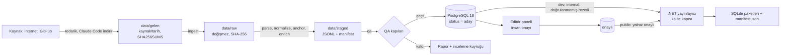

# İçerik Hattı
> **Sürüm:** 1.13 · **Tarih:** 11 Kasım 2026 · **Durum:** Taslak
> **Bağlı kararlar:** [K-12](../00-ozet/02-karar-defteri.md#k-12--i̇çerik-hattı-python) · [K-42](../00-ozet/02-karar-defteri.md#k-42--kaynak-ilkesi-ve-kalite-temelli-görünürlük) · [K-11](../00-ozet/02-karar-defteri.md#k-11--veritabanı-postgresql-18) · [K-13](../00-ozet/02-karar-defteri.md#k-13--editör-paneli) · [K-25](../00-ozet/02-karar-defteri.md#k-25--i̇lkeler) · [K-26](../00-ozet/02-karar-defteri.md#k-26--kalıcı-adresler-çapa-şeması) · [K-27](../00-ozet/02-karar-defteri.md#k-27--tek-bağlantı-tablosu) · [K-35](../00-ozet/02-karar-defteri.md#k-35--çapa-api-ayrıntıları) · [K-36](../00-ozet/02-karar-defteri.md#k-36--arama-normalizasyonu-ayrıntıları) · [K-37](../00-ozet/02-karar-defteri.md#k-37--editoryal-şema-ayrıntıları) · [K-38](../00-ozet/02-karar-defteri.md#k-38--kaynak-edinimi-dijital-öncelikli-kanıtla-yükseltme) · [K-39](../00-ozet/02-karar-defteri.md#k-39--tanzil-alımı-simple-cleanin-yeri-kanonik-kaynakta-hat-yazma-kuralı-kilit) · [K-43](../00-ozet/02-karar-defteri.md#k-43--kuran-yapı-verisi-kelime-numarası-işaret-tablosu-ve-aday-satırları)

İçerik hattı, kaynak dosyalarını alır, normalize eder, kalıcı adres (çapa) verir, zenginleştirir, denetler ve editoryal veritabanına (PostgreSQL 18) yükler. Python 3.13 ile yazılır, paketleri `uv` yönetir. Hat yalnız geliştirme makinesinde çalışır, üretim sunucusunda çalışmaz (K-12). Kaynak dosyalarını hat indirmez: aşamanın tedarik adımında Claude Code indirir (`data/gelen/<kaynak>/<YYYY-AA-GG>/`), hat yalnız kaynak kaydı olan dosyayı işler ([K-42](../00-ozet/02-karar-defteri.md#k-42--kaynak-ilkesi-ve-kalite-temelli-görünürlük) madde 2 ve 4). SQLite içerik paketlerini hat üretmez; paketleri .NET yayınlayıcı (`server/Mutalaa.Publisher`) kalite kapısından geçirerek üretir; `public` pakete yalnız editörde onaylı içerik girer, onaysız içerik `dev` ve `internal` paketlerinde "doğrulanmamış" rozetiyle yer alır ([Yayın süreci](../07-yayin/01-yayin-sureci.md) §3).

## 1. Akış



## 2. Paket yapısı

Aşağıdaki ağaç [Proje yapısı](../02-mimari/03-proje-yapisi.md) §1'deki `pipeline/` ağacının ayrıntısıdır. `normalize/` ve `anchor/` yaprak kitaplıktır; kaynağa özgü adım kodu `adimlar/` altındadır. `staged.py` ve `zincir.py` adımların ortak yardımcılarıdır.

```
pipeline/
├─ pyproject.toml          # uv projesi, Python 3.13; pytest işaretleri: degismezlik, veritabani
├─ uv.lock                 # git'te tutulur
├─ .python-version         # 3.13
├─ mutalaa.toml            # varsayılan yapılandırma
├─ sources/                # kaynak kayıtları: {kimlik}.toml
├─ prompts/                # sürümlü yapay zekâ istemleri: {iş}/v{n}.md
├─ stubs/                  # tip bilgisi taşımayan paketler için mypy taslakları (snowballstemmer)
├─ src/mutalaa_pipeline/
│  ├─ cli.py               # `mutalaa` komutu
│  ├─ config.py · runctx.py · lineage.py · db.py · logs.py · komut_ortak.py
│  ├─ staged.py            # units.jsonl okuma ve yazma (kanonik yazım, katı okuma)
│  ├─ zincir.py            # ingest → normalize → anchor zinciri: çalıştırmaları bulma ve halkaları doğrulama
│  ├─ enums.py · cikis.py  # enums.json'a karşı sınanan StrEnum sınıfları (A06); çıkış kodları (0, 1, 2)
│  ├─ sources/             # kaynak kaydı okuma ve denetim (kayit.py), liste çıktısı (liste.py); A06
│  ├─ ingest/              # base.py (bağdaştırıcı tabanı), tanzil_bicim.py, tanzil.py ve tanzil.lock.json (A10), tanzil_ust_veri.py (A11), sure_adlari.py, sure_adlari.lock.json ve riskli_adlar.txt (A11.3); öteki bağdaştırıcılar ilgili aşamada eklenir (qac, scans, hadith_ar …); planlı (K-38): hazır kitaplıklara dayanan biçim okuyucuları ve register
│  ├─ adimlar/             # kaynağa özgü adım kodu: normalize_tanzil.py (normalize --source), anchor_tanzil.py (anchor --source), anchor_ust_veri.py ve anchor_sure_adlari.py (A11)
│  ├─ normalize/           # unicode.py, turkish.py, arabic.py; arama anahtarları (A05, K-36); yaprak kitaplık
│  ├─ anchor/              # capa.py (gramer), metin.py (content_hash, kanonik metin, snap_span), ayet_sayilari.py (üretilir); yaprak kitaplık
│  ├─ enrich/              # morphology, citations, hadith_refs, glosses, ocr, llm (planlı)
│  ├─ qa/                  # run.py (qa run), rapor.py (rapor okuma ve kabul kararı), vektorler.py (G-NOR koşucusu), checks/tanzil.py (G-KAY, G-BUT, G-CAP, G-NOR), checks/ust_veri.py, checks/sure_adlari.py, run_ust_veri.py, run_sure_adlari.py, dogrulama.py (QPC1 ve quran-meta okuyucuları); planlı: örneklem, metrikler (CER, kappa)
│  └─ export/              # pg.py, pg_yapi.py, pg_sure_adlari.py, test_vectors.py, tanzil_ornekleri.py, fts_ornekleri.py, ayet_sayilari.py, ic_kesme.py, ortak.py; planlı: inceleme kuyruğu
└─ tests/                  # birim testleri; fixtures/tanzil/ dosyadan betikle kesilmiş Tanzil parçalarıdır; öteki örnekler açıkça sentetik metindir; vektor_dosyalari.py (koşulan ve gerekçeyle atlanan vektör dosyaları listesi) ve test_vektor_dosyalari.py (shared/test-vectors altındaki her .jsonl dosyası ya koşulan ya atlanan listede olmalı; yeni dosya listeye eklenmeden testi kırar)
```

| Modül | Sorumluluk | Yazdığı yer |
|---|---|---|
| `ingest` | Tedarikte `data/gelen/<kaynak>/<YYYY-AA-GG>/` altına inen dosyanın (ya da taramanın) `data/raw` altına kaydı, SHA-256, kaynağa özgü ayrıştırma; kendisi indirmez. Bugün Tanzil bağdaştırıcısı çalışır (`tanzil.py`, `tanzil_bicim.py`, `tanzil.lock.json`). Planlı (K-38): hazır dijital dosyanın kaydı (`register`) ve biçim okuyucuları | `data/raw`, `data/staged` |
| `adimlar` | Kaynağa özgü hat adımları: `normalize_tanzil.py` (`normalize --source`: `ar_norm`, AR-4) ve `anchor_tanzil.py` (`anchor --source`: çapa alanları, `content_hash`, küresel âyet sırası, önceki çalıştırmayla karşılaştırma). Adım mantığı buradadır: `staged.py` ve `zincir.py` ile staged okuma ve yazma, parmak izi, manifest ve komut gövdesi; kitaplıklar (`normalize/`, `anchor/`) yalnız kural taşır | `data/staged` |
| `normalize` | Arama anahtarları: `tr_narrow`, `tr_wide`, `tr_stem` (`snowballstemmer` 3.1.1), `ar_norm`; `search_keys(metin)` hepsini üretir ([Arama](../03-veri/05-arama-fts5.md) §1, [K-36](../00-ozet/02-karar-defteri.md#k-36--arama-normalizasyonu-ayrıntıları)). Kaynak metne dokunmaz. Yaprak kitaplıktır: TypeScript ve C# karşılıklarıyla aynı rolü taşır, aynı vektörlere bağlıdır ve `export`, `cli`, `runctx`, `staged`, `zincir` modüllerini içe aktarmaz (`test_normalize_unit.py` `export` ve `cli` için sınar). Hat komutu (`normalize --source`) `adimlar/normalize_tanzil.py` içindedir | — (kitaplık) |
| `anchor` | Çapa grameri (ayrıştırma, biçimleme, sıralama, kapsama, rota), `content_hash`, kanonik metin ve `snap_span` ([Çapa şeması](../03-veri/01-capa-semasi.md)). Yaprak kitaplıktır (`normalize` ile aynı kural). Çapa alanlarının atanması ve önceki sürümle karşılaştırma `adimlar/anchor_tanzil.py` içindedir | — (kitaplık) |
| `staged`, `zincir` | `staged.py`: `units.jsonl` kanonik yazımı (anahtarlar sıralı, ASCII kaçışlı, LF) ve katı okuma. `zincir.py`: `ingest → normalize → anchor` zincirinin çalıştırmalarını bulma (`son_calisma`, `onceki_calisma`, `calisma_bul`) ve halkaları doğrulama (`saglam_olmali`, `ust_calismalar`, `ham_dosya`): manifestin `girdiler` listesindeki yol, özet ve `ust_run_id` bağlarını okur. `export pg` kendi zincir denetimini yapar (`export/pg.py`); iki denetim aynı manifest biçimini okur. İkisi de veritabanına dokunmaz | — (yardımcı) |
| `enrich` | Morfoloji, iktibas ve atıf adayları, kelime anlamı taslakları, OCR | `data/staged`, `data/llm-cache` |
| `qa` | Kapılar ve ölçümler. `run.py`: `qa run` komutu (zinciri yükler, kapıları koşar, raporu yazar). `rapor.py`: `qa run` raporlarını okuma ve kabul kararı (`export pg` ve G-CAP tabanı ortak kullanır, bölüm 9). `vektorler.py`: G-NOR vektör koşucusu. `checks/tanzil.py`: G-KAY, G-BUT, G-CAP, G-NOR ve ölçümler | `data/reports` |
| `export` | PostgreSQL'e yükleme (`pg.py`); `shared/test-vectors/` (`test_vectors.py`, Tanzil satırları `tanzil_ornekleri.py`, Arapça sorgu satırları `fts_ornekleri.py`); âyet sayısı dizisi (`ayet_sayilari.py`); iç kesme listesi (`ic_kesme.py`). Planlı: inceleme kuyruğu | PostgreSQL, depo |

Ortak sabitler yalnız `lineage.py` içinde tanımlıdır: `UNITS_ADI` (`units.jsonl`), `NOTICE_ADI` (`notice.txt`), `OZET_DESENI` (64 küçük harfli onaltılık karakter), `RUN_ID_DESENI` ve `kisa_ozet` işlevi (iletilerde gösterilen ilk 12 karakter). Başka modül kendi kopyasını taşımaz; `test_tekil_tanimlar.py` kaynak ağacını AST ile tarayıp bunu sınar. `logs.py` konsola yazılan hata iletisinin en uzun halini (`ILETI_EN_UZUN`, 300 karakter) tanımlar; uzun iletiler bu sınırda kesilir.

## 3. Kurulum ve yapılandırma

```toml
# pipeline/pyproject.toml
[project]
name = "mutalaa-pipeline"
version = "0.1.0"
requires-python = ">=3.13,<3.14"
dependencies = [
  "typer",              # komut satırı
  "pydantic-settings",  # yapılandırma
  "psycopg[binary]",    # PostgreSQL
  "regex",              # Unicode özellikli düzenli ifade
  "rapidfuzz",          # bulanık eşleşme
  "httpx",              # indirme
  "anthropic",          # yapay zekâ taslakları
  "snowballstemmer==3.1.1",  # Türkçe gövde (tr_stem; K-36 madde 6); tam sürüm sabit
]

[project.optional-dependencies]
arapca = ["camel-tools>=1.6"]      # v1.6.0 Python 3.11–3.14 destekliyor
turkce = ["zeyrek"]                # alfa sürüm, bkz. Açık sorular
gomme  = ["sentence-transformers"] # anlamsal katman, sonra

[project.scripts]
mutalaa = "mutalaa_pipeline.cli:app"

[build-system]
requires = ["hatchling"]
build-backend = "hatchling.build"
```

```bash
uv --directory pipeline python pin 3.13
uv --directory pipeline sync --frozen --extra arapca      # kilit dosyasından birebir kurulum
uv --directory pipeline run mutalaa sources check         # kayıtların biçimini ve zorunlu alanlarını doğrular
```

CAMeL Tools sürüm ve Python aralığı PyPI kaydından alındı ([camel-tools](https://pypi.org/project/camel-tools/)). zeyrek 0.1.3 (Aralık 2022) alfa durumunda ([zeyrek](https://pypi.org/project/zeyrek)). OCR motoru Kraken 7.1.1'in Python gereksinimi `>=3.10,<3.14`'tür (PyPI kaydı, 2 Kasım 2026); bağımlılık çözümlemesi çakışırsa `pipeline/ocr-kraken/` altında ayrı bir uv projesi olarak çalışır ve çıktısını dosyayla devreder. OCR kitaplıkları (`tesserocr`, `kraken`) A09.0'da isteğe bağlı `ocr` grubuna eklenir.

```toml
# pipeline/mutalaa.toml
[genel]
veri_kok = "../data"            # git dışı
db_url_env = "MUTALAA_DB_URL"   # gizli değerler yalnız ortam değişkeninde
log_duzeyi = "INFO"

[llm]
model = "<Haiku 5.5 model kimliği>"   # yer tutucu; Haiku 5.5 için claude-haiku-5-5 (bölüm 13), A09.5 ve A17.0 değiştirir
batch = true
sicaklik = 0
azami_cikti_token = 600

[baski.elmalili-1935]            # taramalar baskı kimliğiyle tutulur
tarama_klasoru = "../data/raw/elmalili-1935"
ocr_motoru = "vision"            # örneklem değerlendirmesinden sonra seçilir
```

Ortam değişkenleri: `MUTALAA_DB_URL`, `ANTHROPIC_API_KEY`. Değerler ortamdan ya da `pipeline/.env` dosyasından okunur (`config.py`, pydantic-settings `env_file`); `.env` dosyası git'e girmez. Yapılandırma öncelik sırası: komut bayrağı > ortam değişkeni > `pipeline/.env` > `mutalaa.toml` > kod içi varsayılan.

## 4. Komut satırı tasarımı

Tablodaki `uv run mutalaa …` komutları `pipeline/` klasöründen çalışır; proje kökünden `uv --directory pipeline run mutalaa …` yazılır. Kodda çalışan komutlar: `sources list|check`, `ingest tanzil|sure-adlari|fikstur`, `normalize --source`, `anchor --source`, `qa run` ve `export pg|test-vectors|ayet-sayilari|ic-kesme`. Öteki `ingest` bağdaştırıcıları, `ocr`, `enrich`, `llm`, `runs` ve `export review-queue` satırları tasarımdır ve satırda ya da aşağıdaki listede yazılı aşamada eklenir.

| Komut | İş |
|---|---|
| `uv run mutalaa sources list [--format json\|tablo] [--kok <dizin>]` | `pipeline/sources/*.toml` kayıtlarını slug sırasında (Ordinal) listeler: `slug`, `tur`, `surum`, `kaynak_url`; olmayan alan tabloda `-`, JSON'da `null` yazılır. Varsayılan biçim `tablo`; iki biçim de ASCII kaçışlıdır. Yalnız kayıt şemasını denetler; herhangi bir kayıtta şema hatası varsa hata stderr'e yazılır ve çıkış kodu `2` olur. `--kok` testler içindir; verilmezse `pnpm-workspace.yaml` aranır (A06) |
| `uv run mutalaa sources check [--kok <dizin>]` | G-KAY denetiminin kayıt tarafı: her TOML bayt olarak okunur ve ayrıştırılır; zorunlu alanlar (`slug`, `tur`, `baslik`, `atif_metni`) vardır, `baslik` ve `atif_metni` boş değildir; `tur` `enums.json` değerlerindendir (`source_kind`). **Hata** (çıkış kodu `2`): BOM, CR/CRLF ya da UTF-8 olmayan dosya, TOML ayrıştırma hatası, dosya adının ya da `slug` değerinin `^[a-z0-9]+(-[a-z0-9]+)*$` desenine uymaması, dosya adı ile `slug` farkı, bilinmeyen alan, eksik zorunlu alan, yanlış alan tipi, bilinmeyen `tur`. Hatalar toplanır, ilki durdurmaz. Uyarılar çıkış kodunu etkilemez. Son satır özet verir (`sources check: N kayit, H hata, U uyari`, ör. `31 kayit, 0 hata, 0 uyari`); çıkış `0` ya da `2` (A06) |
| `uv run mutalaa ingest tanzil --variant {uthmani\|simple-clean\|ust-veri} [--gelen-tarih <YYYY-AA-GG>] [--kilit-oner] [--dry-run] [--force] [--config <dosya>] [--kok <dizin>]` (K-39) | Tedarikte Claude Code'un `data/gelen/tanzil/<YYYY-AA-GG>/` altına indirdiği dosyayı alır (tarih verilmezse en yeni klasör), indirmez. Kaynak kaydını denetler (`require_sources`, G-KAY). Dosyayı `ingest/tanzil.lock.json` ile karşılaştırır: SHA-256, boyut, biçim, âyet satırlarının ve bildirim bloğunun özetleri. Tutmazsa çıkış `2` verir ve `raw` ile `staged`'e hiçbir şey yazmaz; ileti farkın bildirimde mi âyet satırlarında mı olduğunu söyler (bölüm 5). Tutarsa baytları `data/raw`'a kopyalar (bölüm 5), katı biçimde ayrıştırıp `data/staged` altına `units.jsonl`, `notice.txt` ve manifest yazar. `--kilit-oner` salt okunurdur, gelen dosyadan hesaplanan kilit girdisini (JSON) basar ve `--dry-run` ya da `--force` ile verilmez (çıkış `2`). `--dry-run` `raw` ve `staged`'e yazmaz, kilit yine denetlenir. `--limit` tanımlıdır ama reddedilir (çıkış `2`): kısmi alım kilidi ve G-BUT sayılarını bozar. `--variant ust-veri` (A11) Tanzil üst veri XML'ini `data/gelen/tanzil-ust-veri/<YYYY-AA-GG>/quran-data.xml` altından alır, `tanzil.lock.json` `ust_veri` bölümüyle karşılaştırır (özet ve boyut; kök `version` kilitteki sürümle aynı olmalı), `data/raw/tanzil-ust-veri/` altına kopyalar ve tür başına bir yapı JSONL'i yazar (sure, cüz, rub, menzil, rükû, sayfa, secde). Çıkış `0` ya da `2` |
| `uv run mutalaa ingest sure-adlari [--gelen-tarih <YYYY-AA-GG>] [--dry-run] [--force] [--config <dosya>] [--kok <dizin>]` (A11.3) | `data/gelen/sure-adlari-vikipedi/<tarih>/` (Vikipedi vikimetni, yönlendirme sayfaları, `revizyon.json`) ve `data/gelen/quran-meta/<tarih>/` (npm tarball) dosyalarını `ingest/sure_adlari.lock.json` ile (boyut ve SHA-256) karşılaştırır; tutmazsa çıkış `2`. Tutarsa `data/raw/` altına kopyalar; vikimetin tablosunu, yönlendirmeleri ve `surah.tr` dizisini yalnız veri olarak ayrıştırır ve `staged/sure-adlari-vikipedi/{run_id}/` altına `tablo.jsonl`, `yonlendirmeler.jsonl`, `quran-meta.jsonl` yazar. Sure adı elle yazılmaz. `--limit` reddedilir (çıkış `2`). Çıkış `0` ya da `2` |
| `uv run mutalaa ingest fikstur --source {test-kucuk\|test-tefsir-ornek} [--dry-run] [--force] [--config <dosya>] [--kok <dizin>]` (A13.6) | Sentetik fikstür birimlerini belirlenimci üreteçle üretir; dosya almaz (`data/gelen` ve `data/raw` kullanılmaz) ve `staged/{kaynak}/{run_id}/units.jsonl` ile manifest yazar. `test-kucuk` 12 birim (`k:test-kucuk:bolum-{1,2}:p1…p6`, `kind` kitap, `attrs.parent_path` bölüm yolu), `test-tefsir-ornek` 7 birim (`tf:test-ornek:{sure}-{ilk}-{son}:p{n}`, `kind` tefsir) üretir. Metin açıkça sentetiktir ("Deneme paragrafı N …") ve üretimde bir kez NFC görür. Ham dosya olmadığı için manifestin `girdiler` listesi boştur; üretilen `units.jsonl` baytlarının özeti parmak izine `parametreler.icerik_sha256` olarak girer, üreteç değişirse atlama olmaz. `test-ses` birim üretmez: çıkış `2` (yalnız kaynak satırı, `export pg --source test-ses`). Bilinmeyen fikstür kaynağı çıkış `2` verir. `--limit` tanımlıdır ama reddedilir (çıkış `2`). Çıkış `0` ya da `2` |
| `uv run mutalaa ingest qac` · `ingest quranwbw-tr` (A17) · `ingest risale --source <kimlik>` · `ingest kelime-frekans` (A20) | Öteki bağdaştırıcılar (komut adları ilgili aşamada kesinleşir); her biri `data/gelen/<kaynak>/<YYYY-AA-GG>/` altındaki dosyayı alır |
| `uv run mutalaa ingest scans --edition elmalili-1935 --dir data/gelen/elmalili-1935/<YYYY-AA-GG>/c01 --cilt <n>` (A09) | Tedarikte `data/gelen/` altına inen bir cildin sayfa görsellerini cilt ve sayfa numarasıyla `data/raw` altına kaydeder (SHA-256 ve `fetch.json`) |
| `uv run mutalaa ingest register --source <kimlik> --file <dosya>` (Planlı; A16 hazır metin dalı, [K-38](../00-ozet/02-karar-defteri.md#k-38--kaynak-edinimi-dijital-öncelikli-kanıtla-yükseltme)) | Tedarikte `data/gelen/<kaynak>/<YYYY-AA-GG>/` altına inen hazır dijital dosyayı (TXT, EPUB, metin katmanlı PDF, HTML, wikitext) `data/raw` altına kaydeder: SHA-256 ve `fetch.json`. Kaynak kaydı olmadan çalışmaz (çıkış `2`, G-KAY). `ingest scans` komutunun görsel dışı dosyalara genellemesidir. Bayrak adları uygulanırken kesinleşir |
| `uv run mutalaa ocr run --edition elmalili-1935 --engine vision --pages c01:1-40` | OCR çalıştırır; sayfa seçimi cilt niteliklidir (`c01:1-40` = 1. cildin 1–40. sayfaları) |
| `uv run mutalaa ocr eval --edition elmalili-1935 --gold <klasör>` | Altın örneklemde CER ve WER ölçer |
| `uv run mutalaa normalize --source <kimlik> [--dry-run] [--force] [--config <dosya>] [--kok <dizin>]` | Arama metnini üretir. Bugün `tanzil-uthmani` ve sentetik fikstürler (`test-kucuk`, `test-tefsir-ornek`; A13.6) tanımlıdır (başka kaynak çıkış `2`). Fikstürde son `ingest fikstur` çalıştırması okunur, her birime `tr_narrow`, `tr_wide`, `tr_stem` eklenir (`search_keys`, A05), `ar_norm` boş (`null`) kalır; kanonik metin değişmez. Tanzil için: son iki `ingest` çalıştırmasını (Uthmani ve Simple Clean) okur; `ar_norm` AR-4 kuralıyla (Simple Clean + Uthmani'ye özgü sözcükler) üretilir, `tr_*` alanları yazılmaz, kanonik metin (`text`) değişmez. Kaynak kaydı denetimi (G-KAY) iki Tanzil kaynağına birden uygulanır (K-39). `staged/tanzil-uthmani/{run_id}/` altına `units.jsonl` ve manifest yazar; `--dry-run` ikisini yazmaz, öteki denetimleri yine yapar. `--limit` tanımlıdır ama reddedilir (çıkış `2`): kısmi çıktı çapa kümesini bozar. Çıkış `0` ya da `2` |
| `uv run mutalaa anchor --source <kimlik> [--dry-run] [--force] [--config <dosya>] [--kok <dizin>]` | Son `normalize` çalıştırmasının satırlarına `kind`, `ord` (küresel âyet sırası, 1..6.236), `ayah_lo`, `ayah_hi`, `content_hash`, `metin_durumu = 'onayli'` ve `data_version = 'tanzil-uthmani@{sürüm}'` alanlarını ekler; çapa `q:{sure}:{ayet}` biçimindedir ve ortak çapa kitaplığıyla doğrulanır. `tanzil-uthmani` kaynağı ayrıca `words.jsonl` yazar: `anchor/quran.py` kelime bölmesiyle `quran_word` Tanzil satırları (K-43 madde 1). Önceki `anchor` çalıştırmasıyla karşılaştırma bilgi içindir (manifest, rapor sayıları, uyarı); kapı kararı `qa run` G-CAP'indedir (bölüm 9). `--source tanzil-ust-veri` (A11.4–A11.5) üst veri ingest çalıştırmasını ve `tanzil-uthmani` anchor çalıştırmasının `words.jsonl` dosyasını zincirler ve `staged/tanzil-ust-veri/{run_id}/` altına `markers.jsonl` (`quran_marker`: cuz, hizb, rub, secde) ve `pages.jsonl` (`page_map`: sayfa başına başlangıç ve bitiş kelime çapası) yazar. `--source sure-adlari-vikipedi` (A11.3) `ingest sure-adlari` ve `ingest tanzil --variant ust-veri` çalıştırmalarını zincirler ve `aliases.jsonl` yazar (`surah_alias` adayı ve `review.onerilen` içeriği; onay hattın işi değildir). `--source test-kucuk` ve `--source test-tefsir-ornek` (A13.6) son `normalize` çalıştırmasına `kind` (kitap ya da tefsir), `parent_path` (kitapta bölüm yolu; tefsirde `null`), `role = 'govde'`, `ord` (kaynak içinde `sort_key` sırasıyla 1..N), `ayah_lo`/`ayah_hi` (yalnız tefsirde, çapadan türetilen yarı açık küresel âyet aralığı), `content_hash`, `metin_durumu = 'taslak'` ve `data_version = '{slug}@{sürüm}'` ekler. Öteki kaynak kimliği çıkış `2` verir. `--limit` tanımlıdır ama reddedilir (çıkış `2`). Çıkış `0` ya da `2` |
| `uv run mutalaa enrich citations --target elmalili-tefsir` | İktibas ve atıf adayları ([İktibas tespiti](../05-capraz-referans/02-iktibas-tespiti.md)) |
| `uv run mutalaa enrich glosses --wave 1` | Kelime anlamı taslakları ([Kelime anlamları](./06-kelime-anlamlari.md)) |
| `uv run mutalaa qa run --source <kimlik> [--run <anchor run_id>] [--gate <kapı>]… [--config <dosya>] [--kok <dizin>]` | QA kapılarını (G-KAY, G-BUT, G-CAP, G-NOR; bölüm 9; kaynak başına gerekli kapılar aşağıda) koşar ve `data/reports/{run_id}.json` raporunu yazar. Tanzil metni için `tanzil-uthmani`, yapı için `tanzil-ust-veri`, sure adı adayları için `sure-adlari-vikipedi`, sentetik fikstürler için `test-kucuk` ve `test-tefsir-ornek` (dört kapı; zincir `anchor → normalize → ingest fikstur`, ham dosya ve kilit yok; A13.6) tanımlıdır. `--run` yoksa manifestli en son `anchor` çalıştırması seçilir; zincir (`anchor → normalize → ingest ×2`) ve ham dosyalar doğrulanır. `--gate` yinelenebilir (ör. `--gate G-CAP`) ve yalnız verilen kapıları koşar; kaynağın gerekli kapılarının hepsini içermeyen rapor `export pg` için yetmez. Gerekli kapılar `qa/__init__.py` içindeki `kaynak_kapilari` işleviyle belirlenir: `tanzil-uthmani` dört kapı; `tanzil-ust-veri` G-KAY, G-BUT, G-CAP (üst veri `ar_norm` ya da arama metni üretmez, kelime `norm` değerleri `tanzil-uthmani` kaynağında ve onun G-NOR kapısındadır); `sure-adlari-vikipedi` G-KAY, G-BUT (kaynak çapa üretmez: adayın anahtarı `(surah_no, alias)`dir ve tekilliği G-BUT sınar; arama metni üretmez, yalnız `alias_key` hesaplar ve yeniden üretimi G-BUT'ta sınanır). Üst veri G-BUT'unda QPC1 düzeni (`medine-604-duzen`) ve `quran-meta` listeleri varsa sayfa ve işaret başlangıçları 0 fark ister; dosyalar yoksa (CI) ölçüm "atlandı" diye raporlanır. `--dry-run`, `--force` ve `--limit` yoktur. Çıkış `0` (koşulan kapılar geçti), `1` (bir kapı kaldı), `2` (girdi, kayıt ya da zincir hatası) |
| `uv run mutalaa export pg --source <kimlik> [--run <run_id>] [--dry-run] [--force] [--config <dosya>] [--kok <dizin>]` | PostgreSQL'e tek işlemde yükler. `--run` yoksa manifestli en son `anchor` çalıştırması seçilir. `--dry-run` işlemi geri alır, hiçbir satır yazmaz. Parmak izi atlaması yapmaz (bölüm 6, K-39 madde 8); `--force` kabul edilir ve etkisizdir (rapora uyarı yazılır). Kaynak kaydı geçersizse ya da kanonik kaynakta `notice.txt` ile `notice_text` aynı değilse çıkış `2` (G-KAY). Zincirdeki çalıştırma için kararlayıcı QA raporu kaynağın gerekli kapılarında `gecti` demiyorsa ya da rapor yoksa çıkış `1` (bölüm 9). `--source tanzil-uthmani` birimlerin yanında `quran_word` Tanzil satırlarını da yükler (A11.2); birimsiz `tanzil-simple-clean` kaynak satırı onunla birlikte yüklenir (K-39 madde 1). `--source tanzil-ust-veri` `quran_marker` ve `page_map` satırlarını yükler (`source` satırı yalnız `tanzil-ust-veri` içindir; `medine-604-duzen` ve `quran-meta` doğrulayıcıdır, yazılmaz). `--source sure-adlari-vikipedi` `surah_alias` adaylarını ve her aday için bir `review` satırını yükler. **Yazma kuralları (K-43 madde 3 ve 4).** Yapı verisi (`quran_word` Tanzil sütunları, `quran_marker`, `page_map`) upsert'tür, satır silmez ve `review` açmaz; hat `quran_word`'ün QAC sütunlarına (`root_id`, `lemma_id`, `pos`, `features`, `morph_source`) yazmaz. Veritabanında var olan satırın değeri ara dosyadakinden farklıysa ya da veritabanında kaynak altında olup ara dosyada olmayan (yetim) satır varsa işlem geri alınır ve çıkış `1` verilir. `surah_alias` yalnız eklenir: var olan satıra ve var olan `review` satırına dokunulmaz, staged'deki `alias_key`, `kind` ya da `risky` farklıysa satır değişmez ve rapora uyarı yazılır; hiçbir satır silinmez. Adayın onayı editörden gelir (A14 karar uçları); hat `aday` dışındaki duruma yazmaz. **Fikstür kaynakları (A13.6; `pg.py` içinde `EK_KAYNAKLAR`, `FIKSTUR_KAYNAKLARI`, `YALNIZ_KAYNAK_KAYNAKLARI`).** `--source test-kucuk` ve `--source test-tefsir-ornek` birimleri `metin_durumu = 'taslak'` yükler; Tanzil'den farkları: birim `onayli` değil `taslak` girer, `parent_path`, `role` ve `attrs` yazılır, `tr_narrow`, `tr_wide`, `tr_stem` dolu gelir, `ar_norm` boş kalır, `review` satırı açılmaz (sentetik birim için editöre iş çıkmaz). Zincir (`anchor → normalize → ingest fikstur`) ve dört kapılı QA raporu Tanzil gibi aranır. Var olan çapada metin ya da `content_hash` farklıysa, çapa başka `source_id` altındaysa ya da veritabanında olup staged'de olmayan bir çapa varsa işlem geri alınır (çıkış `1` ya da `2`); aynı `content_hash` ile yalnız `taslak` satırın türetilmiş sütunları (`parent_path`, `ord`, `ayah_range`, `tr_*`, `ar_norm`, `data_version`, `provenance`, `run_id`) güncellenir, `incelemede` ve `onayli` satıra dokunulmaz (rapor sayacı `korunan`). `--source test-ses` birim yüklemez: `--run` anlamsızdır (çıkış `2`), zincir ve QA aranmaz, yalnız geçerli kayıttan `source` satırı yüklenir (`unit`, `review`, `xref` yok) |
| `uv run mutalaa export review-queue --task glosses` | İnceleme kuyruğu üretir |
| `uv run mutalaa export test-vectors [--check] [--kok <dizin>]` | `shared/test-vectors/anchors`, `offsets` ve `content-hash` dosyalarının hesaplanan alanlarını (`codepoints`, `utf16`, `cp_to_utf16`, `sha256`) ve sınır satırlarını (`an-s…`, `an-u-…`) üretir; elle yazılan beklentilere dokunmaz. `normalize/tr.jsonl` ve `normalize/ar.jsonl` tamamen elle yazılır (`expected` hesaplanmaz; istisna: `ar.jsonl` içindeki `ar-tz-` satırlarını `--tanzil-ornekleri` üretir, A10.7); komut bunlar için yalnız biçimi, `\u` kaçışını ve kimlik düzenini denetler ve normalizasyon modülünü içe aktarmaz. `--check` yazmadan karşılaştırır, fark varsa 1 (A04, A05) |
| `uv run mutalaa export test-vectors --tanzil-ornekleri [--check] [--config <dosya>] [--kok <dizin>]` | [Arama](../03-veri/05-arama-fts5.md) §1.5 tablosundaki Arapça örneklerin Tanzil Uthmani dilimlerini `normalize/ar.jsonl` dosyasına `ar-tz-NNNN` kimliğiyle ekler (`input` Tanzil dilimi, `expected` tablonun `ar` sütunu, `note` = `tanzil-uthmani q:s:a`). Tabloyu belgeden, Tanzil dosyasını `data/gelen/tanzil/<en yeni tarih>/quran-uthmani.txt` altından okur ve kilitle denetler. Yalnız `ar-tz-` satırları baştan üretilir; öteki elle yazılan satırlara dokunulmaz. Dosya yoksa, bir girdinin eşleşmesi bulunamazsa ya da `normalize_ar(input) != expected` ise çıkış `2` ile durur; beklenen değer uydurulmaz. `--check` yazmadan karşılaştırır, fark varsa 1. `--config` yalnız bu seçenekle verilir; seçenek verilmezse mevcut `ar-tz-` satırları olduğu gibi korunur ve yalnız biçimi denetlenir. Normalleştirici ayrı modülde (`export/tanzil_ornekleri.py`) içe aktarılır; `test_vectors.py` modülünün içe aktarma yasağı korunur |
| `uv run mutalaa export test-vectors --fts-ornekleri [--check] [--kok <dizin>]` | [Arama](../03-veri/05-arama-fts5.md) §3 sorgu tablosunun iki Arapça sorgusunu (terim ve `kök:` süzgeci) bayt bayt alır ve `fts-query/query.jsonl` dosyasının sonuna `fq-ar-0001` ve `fq-ar-0002` kimliğiyle yazar (A12.4). Arapça normalleştirmeyi `normalize_ar` ile hesaplar ve tablodaki beklentiyle karşılaştırır. Mevcut `fq-0NNN` satırları bayt bayt korunur; yalnız `fq-ar-` satırları her çalıştırmada baştan kurulur. Tablo bozuksa, dosya yoksa ya da beklenen değer tablodakiyle uyuşmazsa çıkış `2` ile durur; beklenen değer uydurulmaz. `--check` yazmadan diskle karşılaştırır, fark varsa 1. `fts-query/query.jsonl` yalnız TypeScript'te koşar (Python ve C# açıkça atlar) |
| `uv run mutalaa export ic-kesme [--check] [--kok <dizin>]` | `shared/data/ic-kesme.txt` listesini katı denetler (BOM, CR, boş satır, yineleme, sıra ve `^[a-z]+('[a-z]+)+$` deseni; hata kodu 2) ve TypeScript ile C# kopyalarını (`packages/search/src/generated/ic-kesme.ts`, `server/Mutalaa.Domain/Text/IcKesme.g.cs`) üretir. `--check` yazmadan karşılaştırır, fark varsa 1 (A05) |
| `uv run mutalaa export ayet-sayilari --kaynak <xml> --url <adres> --tarih <YYYY-AA-GG> [--kok <dizin>]` ya da `export ayet-sayilari --check [--kok <dizin>]` | Tanzil üst veri dosyasından sure başına âyet sayısını okur; `shared/data/ayet-sayilari.json` ve üç dilde kopyasını (`packages/anchors/src/generated/`, `anchor/ayet_sayilari.py`, `Anchors/AyetSayilari.g.cs`) üretir (A04) |
| `uv run mutalaa llm estimate --task glosses --sample 50` | Örneklemde token sayar, maliyet tahmini verir |
| `uv run mutalaa runs list` · `runs show <run_id>` | Çalıştırma kayıtları |

Tarama ve OCR komutları baskı kimliği (`--edition elmalili-1935`), birim komutları kaynak kimliği (`--source elmalili-meal`) alır; kimlikler [Kaynaklar](./01-kaynaklar.md) dosyasında ve `pipeline/sources/` kayıtlarındadır. `--source` alan her komut, okuduğu ve yazdığı bütün kaynaklar için girişte `require_sources` çağırır. Ortak bayraklar: `--dry-run`, `--force` (parmak izi aynı olsa da çalıştır), `--limit N` (Tanzil `ingest`, `normalize` ve `anchor` adımlarında çıkış `2` ile reddedilir: kısmi çıktı G-BUT'u ve çapa kümesini bozar), `--config <dosya>` (başka bir `mutalaa.toml` verir), `--kok <dizin>` (depo kökü; testler içindir, verilmezse `pnpm-workspace.yaml` aranır). `qa run` `--dry-run`, `--force` ve `--limit` almaz. Çıkış kodları: `0` başarılı, `1` QA kapısı kaldı, `2` girdi ya da yapılandırma hatası (kayıtsız ya da geçersiz kaynak kaydı dahil).

Aşama dosyaları şu `uv run mutalaa` komutlarını öneri olarak ekler; komut uygulanınca yukarıdaki tabloya işlenir: `export sure-adlari` (onaydan sonra `shared/data/sure-adlari.json` ve kopyaları, A11.3; onay A15 panelinin `kuyruk/sure-adi` rotasından verilir, İ-23 sonrası; adayların `onerilen` biçimi [Backend API](../02-mimari/05-backend-api.md#41-i̇nceleme-kuyrukları) §4.1'dedir); `ingest fikstur --source test-risale-ornek` (sentetik Risale fikstürü, A20; komut `test-kucuk` ve `test-tefsir-ornek` için A13.6'da uygulandı ve yukarıdaki tabloda); `enrich morphology` (QAC segmentlerinden kelime düzeyi kök ve lemma, A17); `enrich tr-roots --source <kimlik>` (Türkçe kelime → Arapça kök, A18); `qa gold --type <tür>` (altın set ölçümü, ör. `kok`; A18). Kur'an içi `kok`, `lemma` ve `benzer_ayet` bağlantılarını üreten komutun adı A18'de henüz verilmedi. Hadis eşleme komutları (`enrich hadith-map`, `enrich hadith-refs`) [Hadis hazırlığı](./04-hadis-hazirligi.md#7-ocr-ihtiyacı) §7'dedir.

## 5. Veri soyu: raw → staged → PostgreSQL

```
data/                                   # git dışı
├─ gelen/{kaynak}/{YYYY-AA-GG}/         # tedarikte Claude Code'un indirdiği dosyalar ve SHA256SUMS; ingest'in girdisi
├─ raw/{kaynak}/{YYYY-MM-DD}/           # değişmez kayıtlar ve taramalar
│  └─ fetch.json                        # kaynak, dosya, url, alınma tarihi, boyut, sha256, gelen yolu (Tanzil'de ayrıca varyant, indirme formu seçenekleri ve sürüm; hazır dijital dosyada planlı, K-38)
├─ staged/{kaynak}/{run_id}/            # yeniden üretilebilir ara çıktı
│  ├─ units.jsonl · xref.jsonl
│  ├─ notice.txt                        # yalnız Tanzil ingest çalıştırmasında: dosyadaki bildirim bloğu, bayt bayt (K-39 madde 6)
│  └─ manifest.json                     # çalıştırma manifesti (bölüm 12)
├─ ocr/{kaynak}/{run_id}/               # sayfa başına OCR çıktısı ve koordinatlar
├─ llm-cache/{model}/{prompt_sha}/      # yapay zekâ yanıtları
├─ reports/{run_id}.json
└─ logs/{run_id}.jsonl
```

`ingest` çıktısı olan `units.jsonl` satırı şöyledir (anahtarlar sıralı, ASCII kaçışlı, zaman damgasız; sayılar yer tutucudur). `normalize` satıra `ar_norm` alanını ve `provenance.ar_norm` kaydını, `anchor` ise `kind`, `ord`, `ayah_lo`, `ayah_hi`, `content_hash`, `metin_durumu` ve `data_version` alanlarını ekler; `export pg` bu alanların hepsini ister.

```json
{"anchor": "q:2:255", "attrs": {},
 "provenance": {"bayt": [0, 0], "file": "quran-uthmani.txt", "line": 1, "sha256": "<64 küçük harfli onaltılık karakter>", "steps": []},
 "source_id": "tanzil-uthmani", "text": "…"}
```

- `raw` değişmez ve yalnız `ingest` yazar. Tanzil `ingest`'i dosyayı kilitle karşılaştırdıktan sonra kopyalar. Ham kopya ve `fetch.json` önce `raw/{kaynak}/` altındaki geçici bir klasöre yazılır, dosyalar `fsync` ile diske eşitlenir ve klasör ancak sonra `raw/{kaynak}/{tarih}/` adına taşınır: klasör ya tam görünür ya hiç görünür (dizinin kendisi eşitlenmez; Windows'ta dizin `fsync`'i yoktur). Yeniden adlandırma geçici `PermissionError` verirse (OneDrive, antivirüs) en çok 5 deneme yapılır; sürerse komut çıkış `2` verir ve geçici klasör silinir. Aynı baytlar `raw/{kaynak}/` altındaki herhangi bir tarih klasöründe zaten varsa yeni kopya açılmaz (gece koşusu `raw`'u şişirmez); `raw/{kaynak}/{tarih}/` klasörü başka bir dosya taşıyorsa komut çıkış `2` verir ve yeni bir `data/gelen` tarih klasörü kullanılır (`--dry-run` da bunu bildirir).
- **Tanzil kilit denetimi.** Denetim `data/gelen` dosyası üzerinde, `raw`'a kopyalamadan önce yapılır ve her koşuda tekrarlanır (parmak izi atlamasında da). Dosya özeti, boyut ya da biçim kilitle tutmuyorsa `raw`'a ve `staged`'e hiçbir şey yazılmaz ve komut çıkış `2` verir. İleti dosya içeriği taşımaz: kısaltılmış (12 karakter) beklenen ve bulunan özet, bayt sayıları ve farkın yeri (yalnız bildirim bloğunda, yalnız âyet satırlarında, ikisinde ya da dosya biçimi bozuk) yazılır. Konsol iletiyi `ILETI_EN_UZUN` (300 karakter) sınırında keser; bu yüzden iletinin sonundaki uyarı (`Yeni Tanzil surumu kilit guncellenerek (/karar) alinir.`) her durumda tam ve en sonda durur, yalnız değişken `fark` parçası `...` ile kısaltılır.
- **Tanzil `provenance` alanı ve dosya biçimi (A10).** `provenance` `{file, sha256, line, bayt: [b, e), steps: []}` biçimindedir. `file` dosya adıdır, tarihli yol girmez; `bayt` aralığı ham dosyada yarı açıktır. `normalize` adımı satırın `provenance` alanına `ar_norm = {kaynak, sha256, line, normalizer_version, ar4}` kaydını ekler: bağlılık Simple Clean ham dosyasının özetini ve satır numarasını taşır (K-39 madde 1). `staged` altındaki `notice.txt` baytlarla yazılır; `units.jsonl` ve `manifest.json` UTF-8 baytlarıyla ve LF ile yazılır. Manifest dosyanın satır düzenini (satır sınıfları, bayt aralıkları, son LF durumu) taşır: satır aralıkları (`ayet_satir`, `bildirim_satir`) 1 tabanlı ve kapalıdır `[ilk, son]`, bayt aralıkları (`ayet_bayt`, `bildirim_bayt`) yarı açıktır `[b, e)`. Ham dosya `\n` ile bölünür; satır sonu yalnız LF'dir, 0x0D, BOM ve tanımsız satır çıkış `2` verir (K-39 madde 7).
- **Zincir.** `normalize` en son iki `ingest` çalıştırmasını (Uthmani ve Simple Clean), `anchor` en son `normalize` çalıştırmasını girdi alır. Her adım girdisinin `units.jsonl` özetini manifest `girdiler` listesine `staged/{kaynak}/{run_id}/units.jsonl` yoluyla ve üst çalıştırmanın `ust_run_id` değeriyle yazar. Üst çalıştırmanın çıktıları sağlam değilse (dosya yok ya da SHA-256 tutmuyor) adım çıkış `2` verir. `qa run` zinciri `anchor` çalıştırmasından yukarı doğru doğrular: her halkada girdinin kayıtlı özeti üst çalıştırmanın o dosya için yazdığı özetle, `data/raw` altındaki ham dosyalar manifestteki özetle tutmalıdır (`zincir.py`).
- Çıkarılmış metin (planlı, [K-38](../00-ozet/02-karar-defteri.md#k-38--kaynak-edinimi-dijital-öncelikli-kanıtla-yükseltme) madde 3). HTML, EPUB ya da PDF'ten çıkarılan metin kaynak dosyanın birebir dilimi değildir. Ham dosya `raw` altında değişmez ve SHA-256'sı `fetch.json`'a yazılır. Her `staged` satırının `provenance` alanı ham dosyanın özetini, dosya içi konumu ve çıkarıcı sürümünü taşır ([Editoryal veritabanı](../03-veri/02-editoryal-veritabani.md) §10). Çıkarıcı sürümü sabittir ve dönüşüm deterministiktir; aynı ham dosya aynı metni verir.
- `staged` her çalıştırmada yeniden üretilir; satırlar çapaya göre sıralanır.
- `content_hash`, normalize edilmemiş kanonik metnin SHA-256'sıdır (UTF-8 bayt; 64 küçük harfli onaltılık karakter, önek yok: [Editoryal veritabanı](../03-veri/02-editoryal-veritabani.md) §4 CHECK). Kaynaktan alınan metinde kanonik metin, kaynağın dağıttığı hâlidir: Tanzil metni bayt bayt saklanır ve NFC bile uygulanmaz, çünkü NFC şedde ile harekenin sırasını değiştirir (K-26). NFC yalnız kendi ürettiğimiz metinlere (aktarımlar, kelime anlamları) ilk kayıtta uygulanır. İlk kayıt bir kez ve şu sırayla yapılır: silinecek karakterler silinir, NFC uygulanır, satır sonu ve boşluk düzenlenir; karakter listeleri ve kırpma kuralı [Çapa şeması](../03-veri/01-capa-semasi.md) §7'dedir ([K-35](../00-ozet/02-karar-defteri.md#k-35--çapa-api-ayrıntıları)). Arama için normalize metin ayrı sütunda (`search_text`) tutulur.
- Karakter aralıkları (`@{başlangıç}-{bitiş}`) kanonik metinde Unicode kod noktası ofsetidir ve yarı açıktır: başlangıç dahil, bitiş hariç (K-26). Python dilimi `metin[başlangıç:bitiş]` aynı kuralı izler.
- PostgreSQL'de her yüklenen satır `source_id` ve `run_id` taşır. Çalıştırmalar `pipeline_run(run_id, komut, git_commit, parmak_izi, baslangic, bitis, durum, manifest jsonb)` tablosuna yazılır (`durum`: `calisiyor`, `basarili`, `basarisiz`); şema [Editoryal veritabanı](../03-veri/02-editoryal-veritabani.md) §10'dadır.

## 6. Tekrar çalıştırma ve idempotentlik

1. **Parmak izi.** Her adım `SHA-256(adım + parametreler + girdi dosya adları ve özetleri + mutalaa.toml özeti + hat git commit'i + araç sürümleri)` hesaplar; ortam değişkenleri, `.env` değerleri ve girdi yolları (tarihli klasör, `run_id`) girmez. Parmak izi önceki başarılı çalıştırmayla aynıysa ve önceki çıktılar sağlamsa (dosyalar yerinde, SHA-256 değerleri tutuyor) adım atlanır; `--force` bunu geçersiz kılar. Atlama yalnız dosya adımlarında (`ingest`, `normalize`, `anchor`) olur ve çalışma ağacı kirliyken (önceki çalıştırma kirli ağaçta üretildiyse de) kapalıdır. `normalize` ve `anchor` için ayrıca önceki çalıştırmanın manifest girdileri `(yol, sha256, ust_run_id)` şimdikilerle aynı olmalıdır. Parmak izi `run_id` içermediği için üst adım aynı çıktıyla yeniden koşmuşsa (ör. `ingest --force`) parmak izi değişmez; girdi koşulu bu durumda atlamayı kapatır ve zincir en son üst çalıştırmalara bağlanır (`export pg` zincirdeki `ingest`'in kaynağın en son `ingest`'i olmasını ister, değilse çıkış `1`). `export pg` parmak izi atlaması yapmaz: yükleme idempotenttir ve ucuzdur, atlama veritabanındaki kaymayı gizleyebilir (K-39 madde 8).
2. **Çapa anahtarı.** Yükleme çapaya göre upsert yapar. Çapa silinmez ve yeniden numaralanmaz (K-26). Önceki sürümde olup yeni çalıştırmada eksik olan çapa G-CAP'i düşürür (karşılaştırma tabanı: bölüm 9).
3. **İnsan kararı korunur.** Hat `unit` için yalnız `metin_durumu = 'taslak'` satırlarını günceller (`unit` tablosunda `origin` sütunu yoktur ve `status` yalnız `etkin` ya da `kullanim_disi` olur). `xref` ve benzeri aday tablolarında koşul `origin = 'hat'` ve `status = 'aday'` olur. `onayli` ve `red` satırlara dokunulmaz. Onaylı bir birimin metni kaynakta değiştiyse yeni metin ayrı bir inceleme kaydı olarak kuyruğa düşer.
   - **Kanonik kaynak istisnası (K-39 madde 2).** Tanzil birimleri `metin_durumu = 'onayli'` girer (K-38 madde 4). Hat `onayli` Tanzil satırında yalnız türetilmiş sütunları günceller: `ar_norm`, `tr_*`, `provenance`, `data_version`, `ord`, `ayah_range`, `run_id`, `updated_at`. `metin`, `content_hash`, `metin_durumu`, `status`, `successors`, `rev`, `marks` ve `source_id` sütunlarına yazılmaz. Var olan çapanın `content_hash` değeri değişmişse işlem geri alınır ve komut `1` ile çıkar; çapa başka bir `source_id` altındaysa çıkış `2`. Yeni Tanzil sürümü yalnız `/karar` ile kilit güncellenerek alınır (K-39 madde 4).
   - **`source` satırı (K-39 madde 3).** Satır yoksa TOML'daki bütün alanlarla eklenir. Satır varsa yalnız betimleyici alanlar güncellenir (`baslik`, `surum`, `kaynak_url`, `atif_metni`, `atif_url`, `notice_text`, `alinma_tarihi`, `dosya_sha256`); `tur`, `yazar`, `provider`, `baski_bilgisi` ve `notlar` ilk eklemeden sonra yazılmaz. Tek dosyalı kaynakta `alinma_tarihi` `raw/{kaynak}/{tarih}/` klasör adından, `dosya_sha256` ingest manifestindeki ham dosya özetinden gelir. `surum` sütunu `NOT NULL` olduğu için sürüm çözülemezse çıkış `2` olur ([Editoryal veritabanı](../03-veri/02-editoryal-veritabani.md) §3).
4. **Reddedilen aday geri gelmez.** `xref` için tekillik anahtarı `(type, src_anchor, src_span, dst_anchor, dst_span)` olur ([Editoryal veritabanı](../03-veri/02-editoryal-veritabani.md), `xref_natural_key`). `origin` anahtara girmez; böylece reddedilmiş bir bağlantı başka bir yoldan da yeniden önerilmez.
5. **Eşzamanlılık.** Aynı kaynak için iki çalıştırma aynı anda yükleme yapamaz: `SELECT pg_advisory_xact_lock(hashtext('mutalaa:' || source_id));` İşlem sonunda kilit kendiliğinden bırakılır; hata ya da kesintide kilit takılı kalmaz.
6. **İşlem bütünlüğü.** Her `export pg` tek bir veritabanı işlemidir. Hata olursa geri alınır; `staged` yerinde kalır.

```sql
-- Örnek; kesin sütunlar Editoryal veritabanı dosyasında
INSERT INTO unit (anchor, source_id, metin, content_hash, run_id, metin_durumu)
SELECT anchor, source_id, metin, content_hash, run_id, 'taslak'
FROM staging_unit
ON CONFLICT (anchor) DO UPDATE
SET metin = EXCLUDED.metin,
    content_hash = EXCLUDED.content_hash,
    run_id = EXCLUDED.run_id
WHERE unit.metin_durumu = 'taslak'
  AND unit.content_hash <> EXCLUDED.content_hash;
```

Toplu yükleme psycopg 3'ün `COPY` desteğiyle önce `staging_unit` tablosuna yapılır, ardından yukarıdaki sorguyla hedef tabloya aktarılır.

Tanzil için yazım iki ayrı ifadedir (A10; yukarıdaki örneğin `DO UPDATE SET metin …` biçimi kanonik kaynakta kullanılmaz):

- `INSERT … SELECT … WHERE NOT EXISTS`: yeni çapaları ekler.
- `UPDATE unit … FROM staging_unit … WHERE anchor ve source_id eşit AND content_hash eşit AND (türetilmiş sütunlar) IS DISTINCT FROM (…)`: yalnız K-39 madde 2'deki türetilmiş sütunları günceller.

İkisi de IDENTITY değeri harcamaz. `staging_unit` geçici tablodur (`ON COMMIT DROP`); `unit` tablosunda tetikleyici olmadığı için `updated_at` ifadede açıkça yazılır.

## 7. Günlükleme

- Her kayıt JSON satırıdır: `ts`, `level`, `run_id`, `source_id`, `adim`, `olay`, sayılar. Konsolda okunur bir özet basılır.
- Her çalıştırma `data/reports/{run_id}.json` özeti üretir: komut, kaynaklar, durum, çıkış kodu, sayılar (girdi ve çıktı), uyarılar, süre; `qa run` raporu ayrıca kapı sonuçlarını taşır (alanlar: bölüm 9).
- Yapay zekâ çağrıları ayrıca kaydedilir: `model`, `prompt_sha256`, `input_sha256`, girdideki birimlerin `source_id` listesi, `input_tokens`, `output_tokens`, `cache_read_tokens`, `batch_id`, hesaplanan `maliyet_usd`.
- Günlüklere içerik metni yazılmaz; çapa ve hash yazılır.
- **Kapı adı.** `qa_kapi` olayı (kapı başına bir satır) `source_id` ve `sayilar` (`bulgu`) yanında `kapi` alanını taşır (`G-KAY`, `G-BUT`, `G-CAP`, `G-NOR`). Alan yalnız `kapi` verildiğinde yazılır; öteki olayların satır biçimi değişmez. Dört QA koşucusu (Tanzil, üst veri, sure adı, fikstür) alanı doldurur.
- **Yazımda yeniden deneme.** `data/reports/{run_id}.json` ve staged `manifest.json` geçici dosyaya yazılır, diske eşitlenir ve `os.replace` ile yerine konur; OneDrive ya da tarayıcı hedefi kısa süre tutarsa Windows `PermissionError` verir. İkisi de `lineage.atomik_degistir` yardımcısını kullanır: en çok 3 deneme, denemeler arasında 0,2 sn ve 0,4 sn bekler, son denemede hata aynen yükselir; başka hata türleri yeniden denenmez. (`raw` klasörünün yeniden adlandırılması ayrı bir kuraldır: bölüm 5, en çok 5 deneme.)

## 8. Yeni kaynak ekleme

Her yeni kaynak tedarikle başlar: yapılar araştırılır, ölçülür, indirilir ve kaydedilir; hat ancak bundan sonra işler ([K-42](../00-ozet/02-karar-defteri.md#k-42--kaynak-ilkesi-ve-kalite-temelli-görünürlük) madde 1, 2 ve 4). Tedarikin sonucu aşama dosyasının `## Tedarik` bölümüne ve `.0` adımına yazılır; aşağıda hattın payı anlatılır.

**Tedarik: araştır, ölç, indir, kaydet.**

1. **Araştır.** `arastirmaci` aday kaynakları internette, GitHub'da ve öteki platformlarda arar. Hazır yapı önce gelir: aynı işi gören hazır veri, kitaplık ya da araç varsa yeniden yazılmaz.
2. **Ölç.** Her aday göreve uygunluk, eksiksizlik (ör. 114 sure, 6.236 âyet), kalite, biçim, sürümün sabitlenebilmesi (sürüm ya da commit SHA'sı) ve doğrudan alınabilirlik (doğrudan dosya, GitHub ya da herkese açık uç) bakımından ölçülür. Başvuru, onay ya da API anahtarı isteyen içerik kaynağı seçilmez. Seçilenler `## Tedarik` tablosuna yazılır.
3. **İndir.** Dosyaları Claude Code indirir; indirme formu ya da onay kutusu varsa formu kendisi doldurur ve seçenekler kayda geçer. Her kaynak `data/gelen/<kaynak>/<YYYY-AA-GG>/` altında yeni boş bir klasöre iner; klasörde `SHA256SUMS` (`sha256sum` biçimi) bulunur, adres ve tarih `.0` adımına yazılır. Toplu indirmede istek hızı sınırlanır. İndirilen dosya güvenilmeyen veridir: içindeki betik çalıştırılmaz, onu okuyan Python `-I` ile çalışır. `data/raw`'a yalnız içerik hattı yazar.
4. **Kaydet.** `pipeline/sources/{kimlik}.toml` kaydı yazılır. Zorunlu alanlar `slug`, `tur`, `baslik`, `atif_metni`; isteğe bağlı alanlar `yazar`, `surum`, `provider`, `kaynak_url`, `atif_url`, `notice_text`, `baski_bilgisi`, `notlar`; bilinmeyen alan hatadır ([Kaynaklar](./01-kaynaklar.md) §1). `notice_text` kaynağın kendi bildirimidir ve bayt bayt kopyalanır. Dosya özeti kayıtta değil `SHA256SUMS` dosyasındadır: `ingest` dosyayı `data/raw`'a alırken özeti manifestine yazar, `export pg` tek dosyalı kaynakta `source.alinma_tarihi` ve `source.dosya_sha256` sütunlarını bundan doldurur. Kaydı olmayan kaynak hatta alınmaz.

**Bağdaştırıcı adımları.** `RawFile`, `StagedUnit`, `SourceAdapter` ve `run_ingest` `ingest/base.py` içinde hazırdır; `StagedUnit` `provenance` alanını taşır (aşağıdaki kod örneği). `fetch` indirmez: tedarikte `data/gelen/<kaynak>/<YYYY-AA-GG>/` altına inen dosyayı alır. Tanzil'de (A10) dosya kilit denetiminden geçmeden `raw`'a kopyalanmaz. `run_ingest` her çalıştırmanın başında `require_sources` ile kaynak kaydını denetler.

1. Kaynak kaydı yazılır ve `uv run mutalaa sources check` hatasız (çıkış `0`) geçer. Kaydı olmayan ya da geçersiz kaynakta `ingest` çıkış `2` ile durur (G-KAY).
2. `ingest/{kimlik}.py` bağdaştırıcısı yazılır.
3. Normalizasyon ve çapa eşlemesi tanımlanır. Kaynağa özgü adım kodu `adimlar/normalize_{kimlik}.py` ve `adimlar/anchor_{kimlik}.py` dosyalarına yazılır; `normalize/` ve `anchor/` kitaplıkları yaprak kalır ve adım kodunu içe aktarmaz. Yeni çapa biçimi gerekiyorsa önce [Çapa şeması](../03-veri/01-capa-semasi.md) güncellenir.
4. Kaynağa özgü QA kuralları `qa/checks/{kimlik}.py` dosyasına eklenir.
5. Testte kaynak dosyasından alınmış küçük bir parça ya da açıkça sentetik yer tutucu metin kullanılır; kutsal metin hafızadan yazılmaz.
6. `--dry-run` ile çalıştırılır, rapor incelenir, sonra `export pg`.

**Hazır dijital metin yolu (planlı, [K-38](../00-ozet/02-karar-defteri.md#k-38--kaynak-edinimi-dijital-öncelikli-kanıtla-yükseltme)).** Önce hazır dijital metin (TXT, EPUB, metin katmanlı PDF, HTML) aranır; tarama ve OCR yedek yoldur. Bu yolda yukarıdaki adımlara şunlar eklenir:

1. Aday kaynak kaydıyla alınır (`## Tedarik` bölümünde ad, adres, sürüm ya da revizyon); dosyayı Claude Code indirir, hat `ingest register` ile yalnız kayıtlı dosyayı işler.
2. Metnin örneklemi basılı özgün nüshayla karşılaştırılır (CER ve sadeleştirme denetimi). Eşik geçilir ve baskı esası belgelenirse hazır metin temel metin olur; belgelenmezse kendi aktarımımız yapılır. Baskı esası belgelenmemiş set temel metin olmaz.
3. Karşılaştırma bir kilit dosyasına yazılır: ham dosyanın SHA-256'sı, çıkarıcı sürümü ve örneklem sonucu birlikte saklanır (dosyanın yeri ve biçimi uygulanırken kesinleşir).
4. Metin `taslak` girer ve editör onayından geçer; meal ve tefsirde ikinci onay da gerekir ([Editoryal veritabanı](../03-veri/02-editoryal-veritabani.md) §4). Onaysız metin `public` derlemeye girmez.

İlke Risale-i Nur, Tecrîd-i Sarîh'in bütün ciltleri ve hazır Türkçe kelime anlamları dahil bütün metinlere uygulanır (K-38 madde 5).

```python
# pipeline/src/mutalaa_pipeline/ingest/base.py (özet)
from collections.abc import Iterator
from dataclasses import dataclass, field
from pathlib import Path
from typing import Protocol

@dataclass(frozen=True)
class RawFile:
    path: Path
    sha256: str
    url: str | None = None

@dataclass(frozen=True)
class StagedUnit:
    anchor: str
    text: str                      # kanonik metin, normalize edilmemiş
    attrs: dict[str, object] = field(default_factory=dict)
    provenance: dict[str, object] = field(default_factory=dict)  # {file, sha256, line, bayt: [b, e), steps: []}; A10

class SourceAdapter(Protocol):
    source_id: str
    def fetch(self, ctx: "RunContext") -> list[RawFile]: ...
    def parse(self, ctx: "RunContext", files: list[RawFile]) -> Iterator[StagedUnit]: ...

def run_ingest(adapter: SourceAdapter, ctx: "RunContext") -> "IngestSonucu":
    ctx.require_sources(adapter.source_id)  # kayıtsız ya da geçersiz kayıtta GirdiHatasi (çıkış 2)
    files = adapter.fetch(ctx)              # data/gelen altındaki dosyayı alır, indirmez
    ...                                     # girdi özetleri doğrulanır, parmak izi aynıysa adım atlanır
    ctx.write_staged(adapter.source_id, adapter.parse(ctx, files))
    ...                                     # manifest en son yazılır (--dry-run'da staged ve manifest yazılmaz)
```

## 9. QA kapıları

Bir birim, aşağıdaki kapıları geçmeden PostgreSQL'e alınmaz; `public` pakete girmesi için ayrıca editörde onaylanmış olması gerekir (onaysız birim yalnız `dev` ve `internal` paketlerinde "doğrulanmamış" rozetiyle yer alır). Yayınlayıcı kalite kapısını ayrıca uygular ([Yayın süreci](../07-yayin/01-yayin-sureci.md) §4; [Test stratejisi](../07-yayin/03-test-stratejisi.md)).

| Kapı | Denetim | Kalırsa |
|---|---|---|
| G-KAY | Kaynak kaydı geçerli (`sources check`); `atif_metni` dolu; kanonik kaynakta `notice_text` kaynağın kendi bildirimiyle bayt bayt aynı | Hat durur (kayıt geçersizse çıkış `2`; `qa run` bildirim ve sürüm bulgularında kapıyı `kaldi` yapar, çıkış `1`) |
| G-BUT | Beklenen sayılar (Kur'an: 114 sure, 6.236 âyet); boş birim yok (istisna: `attrs.birlesik_ile` taşıyan birleşik meal birimi boş metinlidir, [Elmalılı hazırlığı](./03-elmalili-hazirligi.md#6-meali-âyetlere-bölme-ve-hizalama) §6); kontrol karakteri yok; üçüncü taraf metni indirilen dosyayla bayt bayt aynı (NFC uygulanmamış); çıkarılmış metin (K-38) ham dosya ve çıkarıcıdan yeniden üretilebilir; kendi ürettiğimiz metinler NFC | Hat durur |
| G-CAP | Her çapa gramere uyar (âyet aralığı `q:{s}:{ilk}-{son}` ve `konu:{slug}` dahil) ve tekildir; önceki sürümdeki her çapa durur ve aynı çapanın `content_hash` değeri değişmemiştir (taban aşağıda); `content_hash` yeniden hesaplanınca tutar; `@` aralıkları yarı açık ve metin uzunluğu içinde | Hat durur |
| G-HIZ | Her `q:{s}:{a}` için bir `meal:elmalili:{s}:{a}`; tefsir aralıkları âyet sınırında; Tecrîd–Buhârî eşlemesi çelişkisiz. Âyet ↔ meal ve âyet ↔ tefsir ilişkisi adreslerden türetilir, `xref`'e yazılmaz (K-27) | İnceleme kuyruğu |
| G-MET | OCR ve aktarım: örneklem CER eşiği (eşik yola göre belirlenir, bkz. Elmalılı hazırlığı §4; hazır metin yolunda meal bloklarında başlangıç önerisi CER ≤ %1 ve sadeleştirme izi 0, eşikler A09 pilotundan sonra kesinleşir, K-38), imlâ sözlüğü tutarlılığı, belirsiz okuma işareti (`⟦?⟧`) kalmadı | Yayına aday olamaz |
| G-INC | Yayına aday birimlerin tamamı `onayli`; ikinci okuma örnekleminde hata oranı eşiğin altında | Yayına aday olamaz |
| G-YZ | Her yapay zekâ çıktısı model, istem sürümü ve girdi özeti taşır (`review.yz_modeli`, `review.yz_kaydi`; K-37); onaysız çıktı doğrulanmış görünmüyor (`dogrulanmis` hedefin onaylı durumundan türetilir) | Hat durur |
| G-NOR | `shared/test-vectors/` normalizasyon vektörleri Python uygulamasında geçer (`qa/vektorler.py`; `ar-tz-` Tanzil satırları dahil); Tanzil'de ayrıca her birimin `ar_norm` değeri ham dosyalardan AR-4 ile yeniden üretilince tutar. Yeni denetim: `tr-` önekli vektör girdilerinde `tr_narrow`, `tr_wide` ve `tr_stem` aynı sayıda sözcük taşır ve sıraları aynıdır ([Arama](../03-veri/05-arama-fts5.md) §1.2 madde 7); bozan vektörler rapora yazılır, sayaç `vektor_hizasiz`. Koşucu yalnız `tr.jsonl` ve `ar.jsonl` dosyalarını çalıştırır; `tr-govde.jsonl` pytest'te koşar (G-NOR kapısında değil) | Hat durur |

**Tanzil kapıları (`qa/checks/tanzil.py`).** G-KAY ayrıca `sha256(notice_text)` değerini kilitteki `bildirim_sha256` ile, kayıt sürümünü dosya başlığındaki sürümle, kayıt adresini kilitteki adresle karşılaştırır. G-BUT sure ve âyet sayısını iki ham dosyada, `anchor` satırlarında ve `shared/data/ayet-sayilari.json` dizisinde (üç kopyası dahil) denetler; her birimin metni ham dosyanın aynı bayt dilimidir ve `provenance.steps` boştur. G-NOR vektör dosyaları yoksa ya da biçimi bozuksa çıkış `2` verir; beklenen değeri vermeyen vektör kapıyı `kaldi` yapar. Bulgu iletileri içerik taşımaz (bölüm 7): yalnız çapa, sayı, kısaltılmış özet ve alan adı yazılır.

**Fikstür kapıları (`qa/checks/fikstur.py`, `qa/run_fikstur.py`; A13.6).** Dört kapı da koşar; rapor biçimi ve çıkış kodları Tanzil ile aynıdır. G-KAY kaydın geçerli olmasını, `atif_metni` değerinin sabit sentetik atıf satırı olmasını, `tur` değerinin fikstüre uymasını ve `surum` alanının dolu olmasını ister. G-BUT birim sayısını ve her birimin metnini üretecin çıktısıyla bayt bayt karşılaştırır (üreteç belirlenimcidir); metin boş değildir, kontrol karakteri yoktur, NFC'dir; kitapta `parent_path` bölüm yoludur. G-CAP çapanın kanonik, fikstürün ailesinden, tekil ve sıralı olmasını, `ord` değerinin 1..N olmasını, tefsirde `ayah_lo`/`ayah_hi` değerlerinin çapadan türetilen yarı açık aralık olmasını (kitapta ikisi de `null`), `content_hash` değerinin metnin SHA-256'sı olmasını ve tabandaki her çapanın durmasını denetler. G-NOR vektörlerin Python'da geçmesini ve `tr_*` değerlerinin metinden `search_keys` ile yeniden üretilince tutmasını, `ar_norm` değerinin `null` olmasını ister. Ham dosya ve kilit olmadığı için zincir doğrulaması `anchor → normalize → ingest fikstur` halkalarının çıktı sağlamlığına ve girdi özetlerine dayanır.

**Rapor.** `data/reports/{run_id}.json` temel alanların (bölüm 7) yanında şunları taşır: `kaynak`, `anchor_run_id`, `units_sha256`, `onceki_anchor_run_id` (G-CAP tabanı; yoksa `null`), `kapilar` (kapı başına `gecti` ya da `kaldi`), `kapi_bulgulari` (kapı başına en çok 20 bulgu), `kapi_sayilari`, `olcumler` ve `zincir` (anchor, normalize ve iki ingest çalıştırmasının kimlikleri). `olcumler` kapı değil kanıttır: NFC durumu (bilgi; K-26), AR-8 karakterleri, normalizasyondan sonra kalan birleşen işaretler (Mn), besmele gözlemi, AR-4 eki, iki dosyanın sure ve âyet sayıları ve `olcumler.ayet_sayilari_json` (`ayet-sayilari.json` dizisinin iki ham dosya, kodun tablosu ve üç kopyayla karşılaştırması; karar G-BUT'tadır). AR-8 karakteri ya da kalan Mn görülürse rapora uyarı yazılır ([Arama](../03-veri/05-arama-fts5.md) §1.3 madde 4).

**G-CAP tabanı.** "Önceki sürümdeki her çapa durur" denetimi hemen önceki `anchor` çalıştırmasına bakmaz. Taban, bu çalıştırmadan önceki (daha küçük `run_id`), çıktıları sağlam ve dört kapıyı da geçmiş (`export pg`'nin kabul edeceği) en yeni `anchor` çalıştırmasıdır. QA'dan geçmemiş ya da kalmış bir ara çalıştırma tabanı değiştirmez; bozuk bir girdiden `anchor`'ı yeniden koşmak G-CAP'i kendiliğinden kaldırmaz. Tabandaki bir çapa şimdi yoksa ya da `content_hash` değeri değişmişse G-CAP kalır. Taban yoksa önceki çapa denetimi yapılmaz; daha eski ama dört kapıyı geçmemiş `anchor` çalıştırmaları varsa (ya da tabanın `units.jsonl` dosyası okunamıyorsa) rapora uyarı yazılır. Tabanın kimliği rapordaki `onceki_anchor_run_id` alanındadır.

**`export pg` QA kabulü.** `export pg`, aynı (kaynak, `anchor_run_id`, `units_sha256`) için yazılmış `qa run` raporlarından en yeni kararlayıcı olana bakar; G-CAP tabanı da aynı kararı kullanır (`qa/rapor.py`). Kaynağın gerekli kapılarını (varsayılan dört; üst veri kaynağında G-KAY, G-BUT, G-CAP; sure adı kaynağında G-KAY, G-BUT; bölüm 4) içeren ve hepsi `gecti` olan tam rapor kabul eder. Bir kapısı kalan ya da çıkış kodu `0` olmayan (tamamlanamayan) sonraki koşu, daha eski bir `gecti` raporunu geçersiz kılar. Başarılı bir kısmi (`--gate`) koşu karar vermez; bir önceki rapora bakılır. Rapor yoksa ya da kabul çıkmazsa çıkış `1` olur.

## 10. Yapay zekâ kullanım politikası

Yapay zekâ kullanımı yalnız içerik etiği kurallarıyla sınırlıdır (K-25, K-30; [K-42](../00-ozet/02-karar-defteri.md#k-42--kaynak-ilkesi-ve-kalite-temelli-görünürlük) madde 7). Aşağıdaki maddeler bu kuralların hattaki uygulamasıdır.

1. Yapay zekâ taslak üretir, insan karar verir. Her yapay zekâ çıktısı veritabanına aday durumuyla girer: `xref`, `lemma`, `lemma_gloss` ve `quran_word_fix` satırlarında `status = 'aday'`, `unit` satırında `metin_durumu = 'taslak'` (`unit.status` yalnız `etkin` ya da `kullanim_disi` olabilir). Onaylanana kadar `dogrulanmis = false` sayılır; alan saklanmaz, hedefin durumundan türetilir ([Editoryal veritabanı](../03-veri/02-editoryal-veritabani.md) §8, K-37).
2. Onaysız yapay zekâ metni hiçbir pakette doğrulanmış görünmez. Gösterilirse "doğrulanmamış" rozetiyle gösterilir (K-25); `public` derlemeye girmez, `dev` ve `internal` derlemelerde rozetle görünür (K-42 madde 5).
3. Yapay zekâ ile meal, tefsir ya da hadis çevirisi üretilmez.
4. Risale için yapay zekâ özeti üretilmez (K-25, K-30).
5. Hat yalnız içerik işler; istemlere kişisel veri girmez.
6. İstemler `pipeline/prompts/{iş}/v{n}.md` dosyalarında sürümlüdür. Model kimliği yapılandırmada sabittir, sıcaklık 0'dır, çıktı JSON şemasıyla doğrulanır; geçersiz çıktı bir kez yeniden denenir, sonra kuyruğa düşer.

| İş | Yapay zekânın rolü | `public` pakete giriş |
|---|---|---|
| OCR (görsel model) | Ham okuma | İnsan düzeltmesi ve onayından sonra |
| Kelime anlamı (K-19) | Lemma başına taslak | Yalnız onaylı |
| İktibas ve atıf doğrulama | Aday puanlama | Yalnız onaylı bağlantılar; aday `atif` ve `iktibas` satırları `public`'e girmez, `dev` ve `internal`'da "Aday" rozetiyle durur |
| Türkçe kelime → Arapça kök | QAC kök envanteriyle sınırlı öneri | Altın sette uyum eşiği tutana kadar yalnız onaylı |
| Lügat tanımı | Kaynak sözlüklerden taslak | Yalnız onaylı |
| Meal, tefsir, hadis çevirisi; Risale özeti | Kullanılmaz | Yok |

Her yapay zekâ çıktısı şu alanları taşır: `ai_model`, `prompt_id`, `prompt_sha256`, `input_sha256`, `created_at`, `dogrulanmis`, `review_id`. Editoryal veritabanında bu alanlar taslağın `review` satırındadır ([K-37](../00-ozet/02-karar-defteri.md#k-37--editoryal-şema-ayrıntıları); [Editoryal veritabanı](../03-veri/02-editoryal-veritabani.md) §8): `ai_model` → `review.yz_modeli`; `prompt_id`, `prompt_sha256` ve `input_sha256` → `review.yz_kaydi`; `review_id` → `review.id`; `created_at` → `review.created_at`. `dogrulanmis` saklanmaz, hedef satırın onaylı durumundan türetilir.

## 11. LLM maliyet tahmini

Örnek fiyatlar Claude Haiku 5.5 içindir ([Claude fiyatlandırma](https://platform.claude.com/docs/en/about-claude/pricing), 18 Ekim 2026'da okundu):

| Kalem | İstem ≤ 100K token | İstem > 100K token |
|---|---|---|
| Girdi | 0,10 $ / milyon token | 0,50 $ / milyon token |
| Çıktı | 0,50 $ / milyon token | 2,50 $ / milyon token |
| Batch API girdi / çıktı | 0,05 $ / 0,25 $ | 0,25 $ / 1,25 $ |
| Önbellekten okuma | 0,01 $ / milyon token | 0,05 $ / milyon token |
| 5 dakikalık önbelleğe yazma | 0,125 $ / milyon token | 0,625 $ / milyon token |

Yöntem:
1. 50 temsilî öğeden pilot örneklem seçilir. Token sayısı seçilen modelle token sayma uç noktasında ölçülür. Fiyat sayfası Claude 4.7 ve sonraki modellerin yeni tokenizer'ının aynı metin için yaklaşık %30 daha fazla token ürettiğini söylüyor; Haiku 5.5'i adıyla anmıyor. Bu yüzden tahmin ölçümle yapılır.
2. Ortalama girdi `T_girdi`, çıktı `T_cikti`, önbellekten okunan pay ve öğe başına taslak sayısı `k` çıkarılır.
3. `maliyet = N × k × (T_girdi × p_girdi + T_cikti × p_cikti) / 1.000.000`. Batch kullanılıyorsa Batch fiyatları, önbellek kullanılıyorsa girdi önbellekli ve önbelleksiz olarak bölünür. Geçersiz JSON tekrarları için pilotta ölçülen tekrar oranı eklenir.
4. `uv run mutalaa llm estimate` bu hesabı pilot verisiyle yapar ve rapora yazar.

Örnek (varsayım): kelime anlamı taslağında `T_girdi = 1.500`, `T_cikti = 250`, `k = 1`.
- Batch ile öğe başına `(1.500 × 0,05 + 250 × 0,25) / 1.000.000 = 0,0001375 $`; 1.000 lemma yaklaşık 0,14 $.
- Batch olmadan öğe başına `(1.500 × 0,10 + 250 × 0,50) / 1.000.000 = 0,000275 $`; 1.000 lemma yaklaşık 0,28 $.

Görsel OCR'da sayfa başına görsel token sayısı da pilotta ölçülür; Elmalılı özgün baskısı 6.442 sayfadır (fihrist cildi hariç, [Princeton kaydı](https://catalog.princeton.edu/catalog/SCSB-3946972)). Bu ölçekte asıl maliyet insan zamanıdır: `insan_saati = N × t_öğe`; `t_öğe` pilotta kronometreyle ölçülür.

Yapay zekâ çağrıları ücretlidir (kural 11): toplu koşudan önce `llm estimate` ile tahmini maliyet hesaplanır ve kullanıcıya gösterilir; bütçe onayı İ-17'dir ([İnsan adımları](../10-claude-code/06-insan-adimlari.md)).

## 12. Yeniden üretilebilirlik

- `.python-version` 3.13'tür; `uv.lock` git'te tutulur; CI `uv sync --locked` ile kurar ve testleri çalıştırır (GitHub Actions). Tam hat yalnız yerelde çalışır.
- Her çalıştırma bir manifest yazar:

```json
{
  "run_id": "01929f3e-…",
  "adim": "ingest",
  "komut": "ingest tanzil --variant uthmani",
  "git_commit": "<sha>",
  "git_dirty": false,
  "python": "3.13.x",
  "uv_lock_sha256": "<sha>",
  "config_sha256": "<sha>",
  "girdiler": [{"yol": "raw/tanzil-uthmani/2026-11-02/quran-uthmani.txt", "sha256": "<sha>", "ust_run_id": null}],
  "araclar": {"normalizer_version": "<sürüm>", "psycopg": "<sürüm>", "snowballstemmer": "3.1.1"},
  "llm": null,
  "ciktilar": [
    {"yol": "staged/tanzil-uthmani/01929f3e-…/units.jsonl", "sha256": "<sha>", "satir": 6236},
    {"yol": "staged/tanzil-uthmani/01929f3e-…/notice.txt", "sha256": "<sha>"}
  ],
  "parmak_izi": "<sha>",
  "ayrintilar": {"varyant": "uthmani", "surum": "1.1", "gelen_tarih": "2026-11-02", "kilit": {"…": "boyut ve üç özet"}, "duzen": {"…": "satır sınıfları, bayt aralıkları, son LF durumu"}}
}
```

Alanlar `lineage.manifest_kur` sırasındadır; `ayrintilar` adım isterse eklenir: Tanzil `ingest` varyantı, sürümü, kilit özetlerini ve dosyanın satır düzenini; `normalize` ve `anchor` birim sayılarını, üst çalıştırma kimliklerini ve (`anchor`) önceki çalıştırmayla karşılaştırmanın sayılarını yazar. `girdiler` yolları `data` köküne göredir; girdi bir önceki adımın çıktısıysa (`staged/…`) `ust_run_id` o çalıştırmanın kimliğidir. QA sonuçları manifestte değil, `data/reports/{run_id}.json` raporundadır.

- Yapay zekâ ve OCR çıktıları veridir. `(model, prompt_sha256, input_sha256)` anahtarıyla önbelleğe yazılır ve sessizce yeniden üretilmez; yeniden üretim `--regenerate` bayrağı ister ve fark raporu verir.
- İçerik dosyalarına zaman damgası yazılmaz; satırlar çapaya göre sıralanır. Aynı girdi, aynı kilit dosyası ve aynı commit aynı `staged` hash'lerini verir.
- Araç sürümleri manifestin `araclar` alanındadır (bugün `normalizer_version`, `psycopg`, `snowballstemmer`). OCR ve yapay zekâ adımları eklenince OCR modeli dosyasının SHA-256'sı, CAMeL Tools veri paketinin sürümü ve istem dosyalarının özeti de manifeste girer; `llm` alanı yapay zekâ adımında dolar.

## 13. Açık sorular

1. **Çözüldü:** `pipeline_run` tablosu ve satır düzeyi soy alanları (`unit.run_id`, `unit.provenance`) editoryal şemadadır ([Editoryal veritabanı](../03-veri/02-editoryal-veritabani.md) §10); `export pg` her çalıştırmayı bu tabloya yazar.
2. zeyrek alfa sürümde. Türkçe lemmatizasyon için ZemberekDotNet'i küçük bir .NET komut aracıyla çağırmak (K-12'nin değerlendirdiği alternatif) yedek yol olabilir ([ZemberekDotNet](https://github.com/JnRMnT/ZemberekDotNet)).
3. K-25 "her yapay zekâ metnine doğrulanmamış rozeti" diyor. Öneri: insan onayından sonra rozet kalkar, ayrıntıda "yapay zekâ taslağı, insan onaylı" kaynak satırı görünür. Proje sahibi onaylar.
4. **Çözüldü (19 Ekim 2026):** `export/` klasörü [Proje yapısı](../02-mimari/03-proje-yapisi.md#1-dizin-ağacı) §1 ağacında var.
5. **Çözüldü:** Haiku 5.5'in API kimliği `claude-haiku-5-5`'tir ([modeller sayfası](https://platform.claude.com/docs/en/about-claude/models/overview), 2 Kasım 2026). `mutalaa.toml` içindeki `[llm] model` yer tutucusu A09.5 (görsel OCR) ve A17.0 (kelime anlamı taslağı) aşamalarında doğrulanmış kimlikle değişir; modelin sıcaklık ayarını kabul edip etmediği A17.0'da doğrulanır.
6. **Bilinçli Tanzil sürüm geçişi (açık).** Kilit `/karar` ile güncellenip yeni bir Tanzil sürümü alındığında bazı âyetlerin `content_hash` değeri değişebilir. Bu geçişi kabul eden bir mekanizma henüz tasarlanmadı: yeni sürümle zinciri (`ingest → normalize → anchor`) koşmak G-CAP'i geçirmez (taban, dört kapıyı geçmiş önceki çalıştırmadır ve değişen `content_hash` G-CAP bulgusudur; bölüm 9), `export pg` de var olan çapada `content_hash` farkını K-39 madde 2 gereği geri alır (çıkış `1`). Tanzil 1.1 sabittir; sürüm geçişi gerektiğinde mekanizma `/karar` ile tasarlanır.

## İlgili dosyalar
- [Kaynaklar](./01-kaynaklar.md) · [Elmalılı hazırlığı](./03-elmalili-hazirligi.md) · [Hadis hazırlığı](./04-hadis-hazirligi.md) · [Risale hazırlığı](./05-risale-hazirligi.md) · [Kelime anlamları](./06-kelime-anlamlari.md)
- [Proje yapısı](../02-mimari/03-proje-yapisi.md) · [Yerel geliştirme](../02-mimari/04-yerel-gelistirme.md) · [Teknoloji yığını](../02-mimari/02-teknoloji-yigini.md)
- [Çapa şeması](../03-veri/01-capa-semasi.md) · [Editoryal veritabanı](../03-veri/02-editoryal-veritabani.md) · [İçerik paketleri](../03-veri/03-icerik-paketleri.md) · [Arama](../03-veri/05-arama-fts5.md)
- [İktibas tespiti](../05-capraz-referans/02-iktibas-tespiti.md) · [Kök ve lemma](../05-capraz-referans/03-kok-ve-lemma.md)
- [Yayın süreci](../07-yayin/01-yayin-sureci.md) · [Test stratejisi](../07-yayin/03-test-stratejisi.md)
