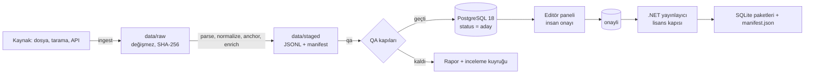

# İçerik Hattı
> **Sürüm:** 1.4 · **Tarih:** 25 Ekim 2026 · **Durum:** Taslak
> **Bağlı kararlar:** [K-12](../00-ozet/02-karar-defteri.md#k-12--i̇çerik-hattı-python) · [K-06](../00-ozet/02-karar-defteri.md#k-06--yayın-kapısı) · [K-11](../00-ozet/02-karar-defteri.md#k-11--veritabanı-postgresql-18) · [K-13](../00-ozet/02-karar-defteri.md#k-13--editör-paneli) · [K-25](../00-ozet/02-karar-defteri.md#k-25--i̇lkeler) · [K-26](../00-ozet/02-karar-defteri.md#k-26--kalıcı-adresler-çapa-şeması) · [K-27](../00-ozet/02-karar-defteri.md#k-27--tek-bağlantı-tablosu) · [K-35](../00-ozet/02-karar-defteri.md#k-35--çapa-api-ayrıntıları) · [K-36](../00-ozet/02-karar-defteri.md#k-36--arama-normalizasyonu-ayrıntıları)

İçerik hattı, kaynak dosyaları alır, normalize eder, kalıcı adres (çapa) verir, zenginleştirir, denetler ve editoryal veritabanına (PostgreSQL 18) yükler. Python 3.13 ile yazılır, paketleri `uv` yönetir. Hat yalnız geliştirme makinesinde çalışır, üretim sunucusunda çalışmaz (K-12). SQLite içerik paketlerini hat üretmez; paketleri editör onayından sonra .NET yayınlayıcı (`server/Mutalaa.Publisher`) lisans kapısından geçirerek üretir.

## 1. Akış



## 2. Paket yapısı

Proje yapısındaki `pipeline/` ağacına (ingest, normalize, anchor, enrich, qa) `export/` eklenir ([Proje yapısı](../02-mimari/03-proje-yapisi.md)).

```
pipeline/
├─ pyproject.toml          # uv projesi, Python 3.13
├─ uv.lock                 # git'te tutulur
├─ .python-version         # 3.13
├─ mutalaa.toml            # varsayılan yapılandırma
├─ sources/                # kaynak kayıtları (TOML) ve tarihli lisans kopyaları
│  └─ licenses/
├─ prompts/                # sürümlü yapay zekâ istemleri: {iş}/v{n}.md
├─ stubs/                  # tip bilgisi taşımayan paketler için mypy taslakları (snowballstemmer)
├─ src/mutalaa_pipeline/
│  ├─ cli.py               # `mutalaa` komutu
│  ├─ config.py · runctx.py · lineage.py · db.py · logs.py
│  ├─ ingest/              # kaynak başına bağdaştırıcı: tanzil, qac, qul, quran_align, scans, hadith_ar
│  ├─ normalize/           # unicode.py, turkish.py, arabic.py; arama anahtarları (A05, K-36)
│  ├─ anchor/              # quran, meal, tefsir, hadith, risale; content_hash
│  ├─ enrich/              # morphology, citations, hadith_refs, glosses, ocr, llm
│  ├─ qa/                  # kapılar, örneklem, metrikler (CER, kappa)
│  └─ export/              # PostgreSQL yükleme, inceleme kuyruğu, test vektörleri, raporlar
└─ tests/                  # birim testleri ve küçük serbest örnek dosyalar
```

| Modül | Sorumluluk | Yazdığı yer |
|---|---|---|
| `ingest` | İndirme ya da tarama kaydı, SHA-256, kaynağa özgü ayrıştırma | `data/raw`, `data/staged` |
| `normalize` | Arama anahtarları: `tr_narrow`, `tr_wide`, `tr_stem` (`snowballstemmer` 3.1.1), `ar_norm`; `search_keys(metin)` hepsini üretir ([Arama](../03-veri/05-arama-fts5.md) §1, [K-36](../00-ozet/02-karar-defteri.md#k-36--arama-normalizasyonu-ayrıntıları)). Kaynak metne dokunmaz. Hat komutu (`normalize --source`) A10'dadır | `data/staged` |
| `anchor` | Çapa ataması, `content_hash`, önceki sürümle karşılaştırma ([Çapa şeması](../03-veri/01-capa-semasi.md)) | `data/staged` |
| `enrich` | Morfoloji, iktibas ve atıf adayları, kelime anlamı taslakları, OCR | `data/staged`, `data/llm-cache` |
| `qa` | Kapılar ve ölçümler | `data/reports` |
| `export` | PostgreSQL'e yükleme, inceleme kuyruğu, `shared/test-vectors/` | PostgreSQL, depo |

## 3. Kurulum ve yapılandırma

```toml
# pipeline/pyproject.toml
[project]
name = "mutalaa-pipeline"
version = "0.1.0"
requires-python = ">=3.13,<3.14"
dependencies = [
  "typer",              # komut satırı
  "pydantic-settings",  # yapılandırma
  "psycopg[binary]",    # PostgreSQL
  "regex",              # Unicode özellikli düzenli ifade
  "rapidfuzz",          # bulanık eşleşme
  "httpx",              # indirme
  "anthropic",          # yapay zekâ taslakları
  "snowballstemmer==3.1.1",  # Türkçe gövde (tr_stem; K-36 madde 6); tam sürüm sabit
]

[project.optional-dependencies]
arapca = ["camel-tools>=1.6"]      # v1.6.0 Python 3.11–3.14 destekliyor
turkce = ["zeyrek"]                # alfa sürüm, bkz. Açık sorular
gomme  = ["sentence-transformers"] # anlamsal katman, sonra

[project.scripts]
mutalaa = "mutalaa_pipeline.cli:app"

[build-system]
requires = ["hatchling"]
build-backend = "hatchling.build"
```

```bash
cd pipeline
uv python pin 3.13
uv sync --frozen --extra arapca      # kilit dosyasından birebir kurulum
uv run mutalaa sources check         # kaynak kayıtlarını ve lisans kopyalarını doğrular
```

CAMeL Tools sürüm ve Python aralığı PyPI kaydından alındı ([camel-tools](https://pypi.org/project/camel-tools/)). zeyrek 0.1.3 (Aralık 2022) alfa durumunda ([zeyrek](https://pypi.org/project/zeyrek)). OCR motoru Kraken'in Python 3.13 uyumu Doğrulanacak; uyumsuzsa `pipeline/ocr-kraken/` altında ayrı bir uv projesi olarak çalışır ve çıktısını dosyayla devreder.

```toml
# pipeline/mutalaa.toml
[genel]
veri_kok = "../data"            # git dışı
db_url_env = "MUTALAA_DB_URL"   # gizli değerler yalnız ortam değişkeninde
log_duzeyi = "INFO"

[llm]
model = "<Haiku 5.5 model kimliği>"   # modeller sayfasından alınır (Doğrulanacak)
batch = true
sicaklik = 0
azami_cikti_token = 600

[baski.elmalili-1935]            # taramalar baskı kimliğiyle tutulur
tarama_klasoru = "../data/raw/elmalili-1935"
ocr_motoru = "vision"            # örneklem değerlendirmesinden sonra seçilir
```

Ortam değişkenleri: `MUTALAA_DB_URL`, `ANTHROPIC_API_KEY`. Değerler ortamdan ya da `pipeline/.env` dosyasından okunur (`config.py`, pydantic-settings `env_file`); `.env` dosyası git'e girmez. Yapılandırma öncelik sırası: komut bayrağı > ortam değişkeni > `pipeline/.env` > `mutalaa.toml` > kod içi varsayılan.

## 4. Komut satırı tasarımı

| Komut | İş |
|---|---|
| `uv run mutalaa sources list` | Kaynakları ve `license_status` değerlerini listeler |
| `uv run mutalaa sources check` | Her kaynakta TOML, lisans kopyası, SHA-256 ve atıf metni var mı (G-LIS) |
| `uv run mutalaa ingest tanzil --variant uthmani` | İndirir, hash'ler, `data/raw`'a yazar, ayrıştırıp `data/staged` üretir |
| `uv run mutalaa ingest qac` · `ingest quran-align` · `ingest qul --resource 75` | Diğer bağdaştırıcılar |
| `uv run mutalaa ingest scans --edition elmalili-1935 --dir <klasör> --cilt <n>` | Bir cildin sayfa görsellerini cilt ve sayfa numarasıyla kaydeder |
| `uv run mutalaa ocr run --edition elmalili-1935 --engine vision --pages c01:1-40` | OCR çalıştırır; sayfa seçimi cilt niteliklidir (`c01:1-40` = 1. cildin 1–40. sayfaları) |
| `uv run mutalaa ocr eval --edition elmalili-1935 --gold <klasör>` | Altın örneklemde CER ve WER ölçer |
| `uv run mutalaa normalize --source <kimlik>` | Arama metnini ve anahtarları üretir |
| `uv run mutalaa anchor --source <kimlik>` | Çapa ve `content_hash` üretir, önceki sürümle karşılaştırır |
| `uv run mutalaa enrich citations --target elmalili-tefsir` | İktibas ve atıf adayları ([İktibas tespiti](../05-capraz-referans/02-iktibas-tespiti.md)) |
| `uv run mutalaa enrich glosses --wave 1` | Kelime anlamı taslakları ([Kelime anlamları](./06-kelime-anlamlari.md)) |
| `uv run mutalaa qa run --source <kimlik> [--gate G-CAP]` | QA kapıları |
| `uv run mutalaa export pg --source <kimlik> [--dry-run]` | PostgreSQL'e yükler |
| `uv run mutalaa export review-queue --task glosses` | İnceleme kuyruğu üretir |
| `uv run mutalaa export test-vectors [--check] [--kok <dizin>]` | `shared/test-vectors/anchors`, `offsets` ve `content-hash` dosyalarının hesaplanan alanlarını (`codepoints`, `utf16`, `cp_to_utf16`, `sha256`) ve sınır satırlarını (`an-s…`, `an-u-…`) üretir; elle yazılan beklentilere dokunmaz. `normalize/tr.jsonl` ve `normalize/ar.jsonl` tamamen elle yazılır (`expected` hesaplanmaz); komut bunlar için yalnız biçimi, `\u` kaçışını ve kimlik düzenini denetler ve normalizasyon modülünü içe aktarmaz. `--check` yazmadan karşılaştırır, fark varsa 1 (A04, A05) |
| `uv run mutalaa export ic-kesme [--check] [--kok <dizin>]` | `shared/data/ic-kesme.txt` listesini katı denetler (BOM, CR, boş satır, yineleme, sıra ve `^[a-z]+('[a-z]+)+$` deseni; hata kodu 2) ve TypeScript ile C# kopyalarını (`packages/search/src/generated/ic-kesme.ts`, `server/Mutalaa.Domain/Text/IcKesme.g.cs`) üretir. `--check` yazmadan karşılaştırır, fark varsa 1 (A05) |
| `uv run mutalaa export ayet-sayilari --kaynak <xml> --url <adres> --tarih <YYYY-AA-GG> [--check]` | Tanzil üst veri dosyasından sure başına âyet sayısını okur; `shared/data/ayet-sayilari.json` ve üç dilde kopyasını (`packages/anchors/src/generated/`, `anchor/ayet_sayilari.py`, `Anchors/AyetSayilari.g.cs`) üretir (A04) |
| `uv run mutalaa llm estimate --task glosses --sample 50` | Örneklemde token sayar, maliyet tahmini verir |
| `uv run mutalaa runs list` · `runs show <run_id>` | Çalıştırma kayıtları |

Tarama ve OCR komutları baskı kimliği (`--edition elmalili-1935`), birim komutları kaynak kimliği (`--source elmalili-meal`) alır; kimlikler [Kaynaklar ve lisans defteri](./01-kaynaklar-ve-lisans-defteri.md) dosyasındadır. Ortak bayraklar: `--dry-run`, `--force` (parmak izi aynı olsa da çalıştır), `--limit N`, `--config <dosya>`. Çıkış kodları: `0` başarılı, `1` QA kapısı kaldı, `2` girdi ya da yapılandırma hatası, `3` lisans kapısı (kaynak `kapali`).

Aşama dosyaları şu `uv run mutalaa` komutlarını öneri olarak ekler; komut uygulanınca bu listeye işlenir (A04'ün `export ayet-sayilari` ve `export test-vectors` komutları ile A05'in `export ic-kesme` komutu uygulandı ve yukarıdaki tabloya işlendi): `ingest tanzil --variant ust-veri` (Tanzil üst veri dosyası, A11); `ingest sure-adlari --dosya <tsv>` ve `export sure-adlari` (sure adlarının içe ve dışa aktarımı, A11); `ingest fikstur --source <test-kaynak>` (sentetik fikstürler: `test-kucuk` A13, `test-risale-ornek` A20); `enrich morphology` (QAC segmentlerinden kelime düzeyi kök ve lemma, A17); `enrich tr-roots --source <kimlik>` (Türkçe kelime → Arapça kök, A18); `qa gold --type <tür>` (altın set ölçümü, ör. `kok`; A18). Kur'an içi `kok`, `lemma` ve `benzer_ayet` bağlantılarını üreten komutun adı A18'de henüz verilmedi. Hadis eşleme komutları (`enrich hadith-map`, `enrich hadith-refs`) [Hadis hazırlığı](./04-hadis-hazirligi.md#7-ocr-ihtiyacı) §7'dedir.

## 5. Veri soyu: raw → staged → PostgreSQL

```
data/                                   # git dışı
├─ raw/{kaynak}/{YYYY-MM-DD}/           # değişmez indirmeler ve taramalar
│  └─ fetch.json                        # url, zaman, boyut, sha256, lisans kopyası
├─ staged/{kaynak}/{run_id}/            # yeniden üretilebilir ara çıktı
│  ├─ units.jsonl · xref.jsonl
│  └─ manifest.json                     # çalıştırma manifesti (bölüm 12)
├─ ocr/{kaynak}/{run_id}/               # sayfa başına OCR çıktısı ve koordinatlar
├─ llm-cache/{model}/{prompt_sha}/      # yapay zekâ yanıtları
├─ reports/{run_id}.json
└─ logs/{run_id}.jsonl
```

```json
{"anchor": "meal:elmalili:2:255", "source_id": "elmalili-meal",
 "text": "…", "content_hash": "<64 küçük harfli onaltılık karakter>",
 "attrs": {"cilt": 1, "sayfa": 0}, "origin": "hat", "ai": false, "run_id": "0192…"}
```

- `raw` değişmez. Aynı adres aynı gün farklı SHA-256 verirse yeni klasör açılır ve uyarı yazılır.
- `staged` her çalıştırmada yeniden üretilir; satırlar çapaya göre sıralanır.
- `content_hash`, normalize edilmemiş kanonik metnin SHA-256'sıdır (UTF-8 bayt; 64 küçük harfli onaltılık karakter, önek yok: [Editoryal veritabanı](../03-veri/02-editoryal-veritabani.md) §4 CHECK). Kaynaktan alınan metinde kanonik metin, kaynağın dağıttığı hâlidir: Tanzil metni bayt bayt saklanır ve NFC bile uygulanmaz, çünkü NFC şedde ile harekenin sırasını değiştirir (K-26). NFC yalnız kendi ürettiğimiz metinlere (aktarımlar, kelime anlamları) ilk kayıtta uygulanır. İlk kayıt bir kez ve şu sırayla yapılır: silinecek karakterler silinir, NFC uygulanır, satır sonu ve boşluk düzenlenir; karakter listeleri ve kırpma kuralı [Çapa şeması](../03-veri/01-capa-semasi.md) §7'dedir ([K-35](../00-ozet/02-karar-defteri.md#k-35--çapa-api-ayrıntıları)). Arama için normalize metin ayrı sütunda (`search_text`) tutulur.
- Karakter aralıkları (`@{başlangıç}-{bitiş}`) kanonik metinde Unicode kod noktası ofsetidir ve yarı açıktır: başlangıç dahil, bitiş hariç (K-26). Python dilimi `metin[başlangıç:bitiş]` aynı kuralı izler.
- PostgreSQL'de her yüklenen satır `source_id` ve `run_id` taşır. Çalıştırmalar için `pipeline_run(run_id, komut, git_commit, parmak_izi, baslangic, bitis, durum, manifest jsonb)` tablosu önerilir; kesin şema [Editoryal veritabanı](../03-veri/02-editoryal-veritabani.md) dosyasında karara bağlanır.

## 6. Tekrar çalıştırma ve idempotentlik

1. **Parmak izi.** Her adım `SHA-256(girdi hash'leri + yapılandırma bölümü + hat git commit'i + araç sürümleri)` hesaplar. Parmak izi önceki başarılı çalıştırmayla aynıysa adım atlanır; `--force` bunu geçersiz kılar.
2. **Çapa anahtarı.** Yükleme çapaya göre upsert yapar. Çapa silinmez ve yeniden numaralanmaz (K-26). Önceki sürümde olup yeni çalıştırmada eksik olan çapa G-CAP'i düşürür.
3. **İnsan kararı korunur.** Hat yalnız `origin = 'hat'` ve `status = 'aday'` satırları günceller. `onayli` ve `red` satırlara dokunmaz. Onaylı bir birimin metni kaynakta değiştiyse yeni metin ayrı bir inceleme kaydı olarak kuyruğa düşer.
4. **Reddedilen aday geri gelmez.** `xref` için tekillik anahtarı `(type, src_anchor, src_span, dst_anchor, dst_span)` olur ([Editoryal veritabanı](../03-veri/02-editoryal-veritabani.md), `xref_natural_key`). `origin` anahtara girmez; böylece reddedilmiş bir bağlantı başka bir yoldan da yeniden önerilmez.
5. **Eşzamanlılık.** Aynı kaynak için iki çalıştırma aynı anda yükleme yapamaz: `SELECT pg_advisory_lock(hashtext('mutalaa:' || source_id));`
6. **İşlem bütünlüğü.** Her `export pg` tek bir veritabanı işlemidir. Hata olursa geri alınır; `staged` yerinde kalır.

```sql
-- Örnek; kesin sütunlar Editoryal veritabanı dosyasında
INSERT INTO unit (anchor, source_id, text, content_hash, run_id, status)
SELECT anchor, source_id, text, content_hash, run_id, 'aday'
FROM staging_unit
ON CONFLICT (anchor) DO UPDATE
SET text = EXCLUDED.text,
    content_hash = EXCLUDED.content_hash,
    run_id = EXCLUDED.run_id
WHERE unit.status = 'aday'
  AND unit.content_hash <> EXCLUDED.content_hash;
```

Toplu yükleme psycopg 3'ün `COPY` desteğiyle önce `staging_unit` tablosuna yapılır, ardından yukarıdaki sorguyla hedef tabloya aktarılır.

## 7. Günlükleme

- Her kayıt JSON satırıdır: `ts`, `level`, `run_id`, `source_id`, `adim`, `olay`, sayılar. Konsolda okunur bir özet basılır.
- Her çalıştırma `data/reports/{run_id}.json` özeti üretir: girdi ve çıktı sayıları, QA sonuçları, uyarılar, süre.
- Yapay zekâ çağrıları ayrıca kaydedilir: `model`, `prompt_sha256`, `input_sha256`, girdideki birimlerin `source_id` listesi, `input_tokens`, `output_tokens`, `cache_read_tokens`, `batch_id`, hesaplanan `maliyet_usd`.
- Günlüklere içerik metni yazılmaz; çapa ve hash yazılır.

## 8. Yeni kaynak ekleme

1. [Kaynaklar ve lisans defteri](./01-kaynaklar-ve-lisans-defteri.md) kontrol listesi tamamlanır; `pipeline/sources/{kimlik}.toml` açılır.
2. `ingest/{kimlik}.py` bağdaştırıcısı yazılır.
3. Normalizasyon ve çapa eşlemesi tanımlanır; yeni çapa biçimi gerekiyorsa önce [Çapa şeması](../03-veri/01-capa-semasi.md) güncellenir.
4. Kaynağa özgü QA kuralları `qa/checks/{kimlik}.py` dosyasına eklenir.
5. Serbest kaynaklar için küçük örnek dosyayla test yazılır. Korumalı kaynaklar için test verisi yapay yer tutucu metindir.
6. `--dry-run` ile çalıştırılır, rapor incelenir, sonra `export pg`.

```python
# pipeline/src/mutalaa_pipeline/ingest/base.py
from dataclasses import dataclass, field
from pathlib import Path
from typing import Iterator, Protocol

@dataclass(frozen=True)
class RawFile:
    path: Path
    sha256: str
    url: str | None

@dataclass(frozen=True)
class StagedUnit:
    anchor: str
    text: str                      # kanonik metin, normalize edilmemiş
    attrs: dict = field(default_factory=dict)

class SourceAdapter(Protocol):
    source_id: str
    def fetch(self, ctx: "RunContext") -> list[RawFile]: ...
    def parse(self, ctx: "RunContext", files: list[RawFile]) -> Iterator[StagedUnit]: ...

def run_ingest(adapter: SourceAdapter, ctx: "RunContext") -> None:
    ctx.require_status(adapter.source_id, allowed={"serbest", "bekliyor", "ic_kullanim"})
    files = adapter.fetch(ctx)              # kapali kaynakta buraya gelinmez (çıkış kodu 3)
    ctx.write_staged(adapter.parse(ctx, files))
```

## 9. QA kapıları

Bir birim, aşağıdaki kapıları geçmeden ve editörde onaylanmadan yayına aday olamaz. Yayınlayıcı lisans kapısını ayrıca uygular ([Yayın kapısı ve Kurul](../07-yayin/01-yayin-kapisi-ve-kurul.md); [Test stratejisi](../07-yayin/03-test-stratejisi.md)).

| Kapı | Denetim | Kalırsa |
|---|---|---|
| G-LIS | Kaynak kaydı, tarihli lisans kopyası ve SHA-256'sı, atıf metni var; durum `kapali` değil | Hat durur |
| G-BUT | Beklenen sayılar (Kur'an: 114 sure, 6.236 âyet); boş birim yok (istisna: `attrs.birlesik_ile` taşıyan birleşik meal birimi boş metinlidir, [Elmalılı hazırlığı](./03-elmalili-hazirligi.md#6-meali-âyetlere-bölme-ve-hizalama) §6); kontrol karakteri yok; üçüncü taraf metni indirilen dosyayla bayt bayt aynı (NFC uygulanmamış); kendi ürettiğimiz metinler NFC | Hat durur |
| G-CAP | Her çapa gramere uyar (âyet aralığı `q:{s}:{ilk}-{son}` ve `konu:{slug}` dahil) ve tekildir; önceki sürümdeki her çapa durur; `content_hash` yeniden hesaplanınca tutar; `@` aralıkları yarı açık ve metin uzunluğu içinde | Hat durur |
| G-HIZ | Her `q:{s}:{a}` için bir `meal:elmalili:{s}:{a}`; tefsir aralıkları âyet sınırında; Tecrîd–Buhârî eşlemesi çelişkisiz. Âyet ↔ meal ve âyet ↔ tefsir ilişkisi adreslerden türetilir, `xref`'e yazılmaz (K-27) | İnceleme kuyruğu |
| G-MET | OCR ve aktarım: örneklem CER eşiği, imlâ sözlüğü tutarlılığı, belirsiz okuma işareti (`⟦?⟧`) kalmadı | Yayına aday olamaz |
| G-INC | Yayına aday birimlerin tamamı `onayli`; ikinci okuma örnekleminde hata oranı eşiğin altında | Yayına aday olamaz |
| G-YZ | Her yapay zekâ çıktısı model, istem sürümü ve `dogrulanmis = false` taşır; onaysız çıktı doğrulanmış işaretlenmemiş; çağrı kayıtlarında `embed_ok = false` bir kaynak yok | Hat durur |
| G-NOR | `shared/test-vectors/` normalizasyon vektörleri Python uygulamasında geçer | Hat durur |
| G-KUR | Kurul kapsamındaki bir birimin metni değiştiyse "yeniden onay gerekebilir" işareti üretildi | Uyarı; yayınlayıcıya bilgi |

## 10. Yapay zekâ kullanım politikası

1. Yapay zekâ taslak üretir, insan karar verir. Her yapay zekâ çıktısı veritabanına `status = 'aday'` ve `dogrulanmis = false` ile girer.
2. Onaysız yapay zekâ metni hiçbir pakette doğrulanmış görünmez. Gösterilirse "doğrulanmamış" rozetiyle gösterilir (K-25).
3. Yapay zekâ ile meal, tefsir ya da hadis çevirisi üretilmez. Meal yayınları Din İşleri Yüksek Kurulu incelemesine açıktır; Arapça metinle gösterilen bir yapay zekâ meali "mealli mushaf" ön onayına girer ve "makine çevirisi" etiketi bu yükümlülüğü kaldırmaz (rapor; [Lexpera, 633](https://www.lexpera.com.tr/mevzuat/kanunlar/diyanet-isleri-baskanligi-kurulus-ve-gorevleri-hakkinda-kanun-633)).
4. Risale için yapay zekâ özeti üretilmez (K-25, K-30).
5. Harici bir yapay zekâ API'sine gönderilecek ya da gömülecek her birimin kaynağında `source.embed_ok` alanına bakılır. Alan `false` ise metin gönderilmez, gömülmez ve komut 3 çıkış koduyla durur. Gömme yerel bir modelle yapılsa da aynı alana tabidir. Korumalı metinler (ör. Risale-i Nur) hukuki onay olmadan `false` taşır. Quran Foundation içeriği `false`'tur; QF şartları içerikten türetilen gömmeleri de kısıtlıyor ([QF Developer Terms](https://api-docs.quran.foundation/legal/developer-terms/)). Değerler [Kaynaklar ve lisans defteri](./01-kaynaklar-ve-lisans-defteri.md) dosyasındadır.
6. Hat yalnız içerik işler; istemlere kişisel veri girmez.
7. İstemler `pipeline/prompts/{iş}/v{n}.md` dosyalarında sürümlüdür. Model kimliği yapılandırmada sabittir, sıcaklık 0'dır, çıktı JSON şemasıyla doğrulanır; geçersiz çıktı bir kez yeniden denenir, sonra kuyruğa düşer.

```python
# pipeline/src/mutalaa_pipeline/enrich/llm.py
class LicenseGateError(RuntimeError):
    exit_code = 3

def require_embed_ok(ctx: "RunContext", source_ids: set[str]) -> None:
    """Harici API çağrısından ya da gömmeden önce çağrılır; çağrı kaydı source_ids'i taşır."""
    yasak = sorted(s for s in source_ids if not ctx.source(s).embed_ok)
    if yasak:
        raise LicenseGateError(f"embed_ok = false olan kaynak: {yasak}")
```

| İş | Yapay zekânın rolü | `public` pakete giriş |
|---|---|---|
| OCR (görsel model) | Ham okuma | İnsan düzeltmesi ve onayından sonra |
| Kelime anlamı (K-19) | Lemma başına taslak | Yalnız onaylı |
| İktibas ve atıf doğrulama | Aday puanlama | Onaylı bağlantılar; onaysız otomatik bağlantılar "Daha fazla (otomatik)" altında rozetle |
| Türkçe kelime → Arapça kök | QAC kök envanteriyle sınırlı öneri | Altın sette uyum eşiği tutana kadar yalnız onaylı |
| Lügat tanımı | Serbest sözlüklerden taslak | Yalnız onaylı |
| Meal, tefsir, hadis çevirisi; Risale özeti | Kullanılmaz | Yok |

Her yapay zekâ çıktısı şu alanları taşır: `ai_model`, `prompt_id`, `prompt_sha256`, `input_sha256`, `created_at`, `dogrulanmis`, `review_id`.

## 11. LLM maliyet tahmini

Örnek fiyatlar Claude Haiku 5.5 içindir ([Claude fiyatlandırma](https://platform.claude.com/docs/en/about-claude/pricing), 18 Ekim 2026'da okundu):

| Kalem | İstem ≤ 100K token | İstem > 100K token |
|---|---|---|
| Girdi | 0,10 $ / milyon token | 0,50 $ / milyon token |
| Çıktı | 0,50 $ / milyon token | 2,50 $ / milyon token |
| Batch API girdi / çıktı | 0,05 $ / 0,25 $ | 0,25 $ / 1,25 $ |
| Önbellekten okuma | 0,01 $ / milyon token | 0,05 $ / milyon token |
| 5 dakikalık önbelleğe yazma | 0,125 $ / milyon token | 0,625 $ / milyon token |

Yöntem:
1. 50 temsilî öğeden pilot örneklem seçilir. Token sayısı seçilen modelle token sayma uç noktasında ölçülür. Fiyat sayfası Claude 4.7 ve sonraki modellerin yeni tokenizer'ının aynı metin için yaklaşık %30 daha fazla token ürettiğini söylüyor; Haiku 5.5'i adıyla anmıyor. Bu yüzden tahmin ölçümle yapılır.
2. Ortalama girdi `T_girdi`, çıktı `T_cikti`, önbellekten okunan pay ve öğe başına taslak sayısı `k` çıkarılır.
3. `maliyet = N × k × (T_girdi × p_girdi + T_cikti × p_cikti) / 1.000.000`. Batch kullanılıyorsa Batch fiyatları, önbellek kullanılıyorsa girdi önbellekli ve önbelleksiz olarak bölünür. Geçersiz JSON tekrarları için pilotta ölçülen tekrar oranı eklenir.
4. `uv run mutalaa llm estimate` bu hesabı pilot verisiyle yapar ve rapora yazar.

Örnek (varsayım): kelime anlamı taslağında `T_girdi = 1.500`, `T_cikti = 250`, `k = 1`.
- Batch ile öğe başına `(1.500 × 0,05 + 250 × 0,25) / 1.000.000 = 0,0001375 $`; 1.000 lemma yaklaşık 0,14 $.
- Batch olmadan öğe başına `(1.500 × 0,10 + 250 × 0,50) / 1.000.000 = 0,000275 $`; 1.000 lemma yaklaşık 0,28 $.

Görsel OCR'da sayfa başına görsel token sayısı da pilotta ölçülür; Elmalılı özgün baskısı 6.442 sayfadır (fihrist cildi hariç, [Princeton kaydı](https://catalog.princeton.edu/catalog/SCSB-3946972)). Bu ölçekte asıl maliyet insan zamanıdır: `insan_saati = N × t_öğe`; `t_öğe` pilotta kronometreyle ölçülür.

## 12. Yeniden üretilebilirlik

- `.python-version` 3.13'tür; `uv.lock` git'te tutulur; CI `uv sync --locked` ile kurar ve testleri çalıştırır (GitHub Actions). Tam hat yalnız yerelde çalışır.
- Her çalıştırma bir manifest yazar:

```json
{
  "run_id": "01929f3e-…",
  "komut": "ingest tanzil --variant uthmani",
  "git_commit": "<sha>",
  "python": "3.13.x",
  "uv_lock_sha256": "<sha>",
  "config_sha256": "<sha>",
  "girdiler": [{"yol": "raw/tanzil-uthmani/2026-10-18/quran-uthmani.txt", "sha256": "<sha>"}],
  "lisans_kopyasi": {"yol": "sources/licenses/tanzil-uthmani-2026-10-18.txt", "sha256": "<sha>"},
  "araclar": {"camel-tools": "1.6.0", "ocr_model_sha256": null},
  "llm": {"model": null, "prompt_sha256": null},
  "ciktilar": [{"yol": "staged/tanzil-uthmani/01929f3e/units.jsonl", "sha256": "<sha>", "satir": 6236}],
  "parmak_izi": "<sha>",
  "qa": {"durum": "gecti", "rapor": "reports/01929f3e.json"}
}
```

- Yapay zekâ ve OCR çıktıları veridir. `(model, prompt_sha256, input_sha256)` anahtarıyla önbelleğe yazılır ve sessizce yeniden üretilmez; yeniden üretim `--regenerate` bayrağı ister ve fark raporu verir.
- İçerik dosyalarına zaman damgası yazılmaz; satırlar çapaya göre sıralanır. Aynı girdi, aynı kilit dosyası ve aynı commit aynı `staged` hash'lerini verir.
- OCR modeli dosyasının SHA-256'sı, CAMeL Tools veri paketinin sürümü ve istem dosyalarının hash'i manifeste girer.

## 13. Açık sorular

1. `pipeline_run` tablosu ve satır düzeyi soy alanları editoryal şemaya eklenecek mi?
2. zeyrek alfa sürümde. Türkçe lemmatizasyon için ZemberekDotNet'i küçük bir .NET komut aracıyla çağırmak (K-12'nin değerlendirdiği alternatif) yedek yol olabilir ([ZemberekDotNet](https://github.com/JnRMnT/ZemberekDotNet)).
3. K-25 "her yapay zekâ metnine doğrulanmamış rozeti" diyor. Öneri: insan onayından sonra rozet kalkar, ayrıntıda "yapay zekâ taslağı, insan onaylı" kaynak satırı görünür. Proje sahibi onaylar.
4. **Çözüldü (19 Ekim 2026):** `export/` klasörü [Proje yapısı](../02-mimari/03-proje-yapisi.md#1-dizin-ağacı) §1 ağacında var.
5. Haiku 5.5 model kimliği Doğrulanacak.

## İlgili dosyalar
- [Kaynaklar ve lisans defteri](./01-kaynaklar-ve-lisans-defteri.md) · [Elmalılı hazırlığı](./03-elmalili-hazirligi.md) · [Hadis hazırlığı](./04-hadis-hazirligi.md) · [Risale hazırlığı](./05-risale-hazirligi.md) · [Kelime anlamları](./06-kelime-anlamlari.md)
- [Proje yapısı](../02-mimari/03-proje-yapisi.md) · [Yerel geliştirme](../02-mimari/04-yerel-gelistirme.md) · [Teknoloji yığını](../02-mimari/02-teknoloji-yigini.md)
- [Çapa şeması](../03-veri/01-capa-semasi.md) · [Editoryal veritabanı](../03-veri/02-editoryal-veritabani.md) · [İçerik paketleri](../03-veri/03-icerik-paketleri.md) · [Arama](../03-veri/05-arama-fts5.md)
- [İktibas tespiti](../05-capraz-referans/02-iktibas-tespiti.md) · [Kök ve lemma](../05-capraz-referans/03-kok-ve-lemma.md)
- [Yayın kapısı ve Kurul](../07-yayin/01-yayin-kapisi-ve-kurul.md) · [Test stratejisi](../07-yayin/03-test-stratejisi.md)
