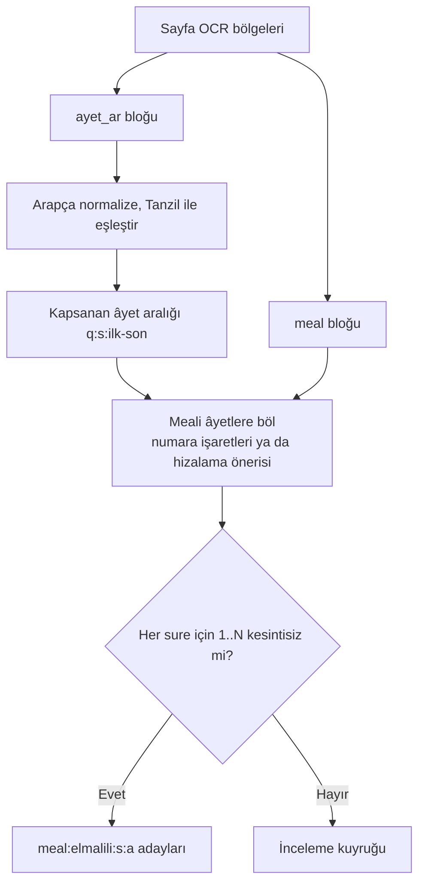

# Elmalılı Hazırlığı
> **Sürüm:** 1.1 · **Tarih:** 19 Ekim 2026 · **Durum:** Taslak
> **Bağlı kararlar:** [K-03](../00-ozet/02-karar-defteri.md#k-03--tefsir-önce-elmalılı-meali) · [K-06](../00-ozet/02-karar-defteri.md#k-06--yayın-kapısı) · [K-12](../00-ozet/02-karar-defteri.md#k-12--i̇çerik-hattı-python) · [K-13](../00-ozet/02-karar-defteri.md#k-13--editör-paneli) · [K-25](../00-ozet/02-karar-defteri.md#k-25--i̇lkeler) · [K-26](../00-ozet/02-karar-defteri.md#k-26--kalıcı-adresler-çapa-şeması)

Bu dosya Elmalılı Muhammed Hamdi Yazır'ın *Hak Dini Kur'an Dili* eserinin özgün baskısından meal ve tefsir metninin nasıl hazırlanacağını anlatır. K-03 gereği önce âyet meali hazırlanır ve `core` paketine `meal:elmalili:{sure}:{ayet}` çapalarıyla girer. Tefsir metni ikinci aşamadır ve `tefsir-elmalili` paketine `tf:elmalili:…` çapalarıyla girer.

## 1. Hukuki çerçeve

> **Hukuki görüş değildir.** Aşağıdaki değerlendirmeler araştırma raporuna dayanır; "çıkarım" ve "Açık soru" işaretli noktalar avukata sorulur.

- **Koruma süresi.** Müellif 1942'de vefat etti; eser 1 Ocak 2013'ten beri serbest ([MKÜ kaydı](https://openaccess.mku.edu.tr/items/1b02bae2-408d-43ea-920d-6c26605c442a), 2026-10-26'da 403 verdi ve dayanak olarak doğrulanamadı (Doğrulanacak); tarih 1942 + 71 hesabıdır, bkz. [lisans defteri](./01-kaynaklar-ve-lisans-defteri.md) §3.3; [FSEK m. 26–27](https://www.wipo.int/wipolex/en/text/499171)).
- **Yazım ve baskı.** Eser Diyanet İşleri Riyâseti ile yapılan bir sözleşmeyle 1926–1938 arasında yazıldı. "1935-1939 yıllarında İstanbul'da dokuz cilt ve 10.000 takım olarak basılmış"; "2000 takımı müellife verilirken geri kalanları ücretsiz dağıtılmıştır" ([Küre](https://kureansiklopedi.com/tr/detay/hak-dini-kuran-dili-2)).
- **Sadeleştirilmiş baskılar kullanılmaz.** Sadeleştirme FSEK m. 6 anlamında işlenme eseridir; sadeleştirenin hakkı sürer (K-03). Tanzil'deki Elmalılı metni de kullanılmaz: baskı esası doğrulanmadı ve Tanzil çevirileri "for non-commercial purposes only" şartı taşıyor ([OPUS](https://opus.nlpl.eu/Tanzil/corpus/version/Tanzil)).
- **Kendi aktarımımız.** FSEK m. 6/8 "İlmi bir araştırma ve çalışma mahsulü olmayan alelade transkripsiyonlarla faksimileleri" işlenme saymıyor. Özgün metnin düz aktarımının yeni bir hak doğurmadığı bu yüzden savunulabilir. Bu bir çıkarımdır; avukat teyit eder. Aynı nedenle başkalarının yaptığı "orijinal metin" aktarımlarını kopyalamak yerine kendi aktarımımızı yaparız.
- **Kurul.** Meal Arapça metinle birlikte gösterildiğinde "mealli mushaf" sayılır ve Kurul onayı gerekir (633 m. 6). Meal yayınları ayrıca Din İşleri Yüksek Kurulu incelemesine açıktır (m. 5/ı) ([Lexpera, 633](https://www.lexpera.com.tr/mevzuat/kanunlar/diyanet-isleri-baskanligi-kurulus-ve-gorevleri-hakkinda-kanun-633)). Onay belirli bir sürüme bağlandığı için meal metni başvurudan önce dondurulur; sonraki her düzeltme yeniden onay gerektirebilir.

## 2. Aşamalar

| Aşama | İş | Çıktı | Faz |
|---|---|---|---|
| 0 | Baskı tespiti ve tarama | Künyesi doğrulanmış sayfa görselleri | Faz 0 · Hazırlık |
| 1 | OCR değerlendirmesi (pilot) | Altın örneklem, CER tablosu, motor seçimi | Faz 0 · Hazırlık |
| 2 | Meal aktarımı ve âyetlere bölme | `meal:elmalili:{s}:{a}` adayları | Faz 1 · İçerik hattı |
| 3 | Editörde inceleme ve QA | Onaylı meal, QA raporu | Faz 1 · İçerik hattı |
| 4 | Sürüm dondurma ve Kurul başvurusu | `elmalili-meal` 1.0.0 | Faz 2–3 |
| 5 | Tefsir metni | `tf:elmalili:…` birimleri | Faz 4 (v1.x); paketin gireceği sürüm [Fazlar](../08-yol-haritasi/01-fazlar.md#6-açık-sorular) §6 soru 4'te açık |

## 3. Kaynak baskının bulunması

**Bilinen künye.** Princeton kütüphane kaydı ilk baskıyı şöyle veriyor: "Hak dini Kur'an dili. : Yeni mealli türkçe tefsir", Matbaai Ebüzziya, İstanbul, [1935–1938], 8 cilt, 6.442 sayfa, seri "T. C. Diyanet işleri reisliği neşriyatından, no. 5" ([kayıt](https://catalog.princeton.edu/catalog/SCSB-3946972)). Dokuzuncu cilt 1939 tarihli fihristtir ([kayıt](https://catalog.princeton.edu/catalog/SCSB-4322432)).

**Yazı türü (Doğrulanacak).** Karar defteri ilk sürümünde özgün baskının Osmanlıca harflerle basıldığını söylüyordu; K-03 düzeltmesi (18 Ekim 2026) bunu geri aldı. Princeton kaydı dili "Turkish" olarak ve künyeyi 1930'ların Latin imlâsıyla veriyor ve baskı 1928 harf değişikliğinden sonra yapıldı; bu yüzden Türkçe metin büyük olasılıkla Latin harfli, âyetler Arapça harflidir (Yol B). Aşama 0'ın ilk işi bir cildin künye sayfası ve birkaç metin sayfasıyla yazı türünü doğrulamaktır. Sonuca göre bölüm 4'teki A ya da B yolu seçilir. K-12'nin gerekçesi (OCR ve Arapça işleme için Python) iki durumda da geçerlidir.

**Tarama nereden bulunur (hepsi Doğrulanacak).**
- Millî Kütüphane, İSAM Kütüphanesi, Diyanet kütüphaneleri ve ilahiyat fakültesi kütüphanelerinin dijital koleksiyonları.
- Internet Archive, HathiTrust ve Vikikaynak. Araştırma Vikikaynak ve Diyanet portallarını kontrol edemedi.
- İkinci el bir takım satın alıp kendimiz taramak. Bu yol üçüncü tarafın tarama şartlarını devreden çıkarır ve görüntü kalitesini bizim kontrolümüze bırakır.

Bir kütüphanenin taraması kullanılacaksa kütüphanenin yeniden kullanım şartı okunur ve lisans defterine kaydedilir. Bedii niteliği olmayan bir fotoğrafın yeni eser doğurmadığı savunulabilir; bu da bir çıkarımdır (araştırma notu, FSEK m. 1/B ve m. 2/3).

**Baskı doğrulama listesi.**
- [ ] Künye sayfası: başlık, cilt numarası, yıl, matbaa ve seri Princeton kaydıyla uyumlu.
- [ ] Cilt başına sayfa sayısı kayıtla uyumlu; toplam 6.442 sayfa (fihrist hariç).
- [ ] Sonraki tıpkı ya da yeni baskı olmadığı doğrulandı.
- [ ] Eksik ya da hasarlı sayfalar listelendi; eksikler ikinci bir nüshadan tamamlanacak.

**Tarama standardı (öneri).** En az 400 dpi gri tonlama, kayıpsız TIFF; küçük puntolu dipnotlar ve harekeli Arapça için 600 dpi denenir. Dosya adı `c{cilt:02d}-s{sayfa:04d}.tif`. Kayıt komutu:

```bash
uv run mutalaa ingest scans --edition elmalili-1935 --dir data/gelen/elmalili-1935/c01 --cilt 1
```

## 4. OCR

İki yol vardır:
- **Yol A (Osmanlıca harfli baskı):** OCR ve ardından Latin harfine aktarım (bölüm 5).
- **Yol B (Latin harfli baskı):** 1930'lar dizgisinin OCR'ı. Metin baskıdaki imlâsıyla aynen alınır; harf çevirisi yoktur.

İki yolda da sayfada Arapça âyet blokları bulunur. Meal için âyet metninin OCR'ı gerekmez, çünkü âyet metni Tanzil'den gelir; âyet bloğu yalnız hangi âyetlerin kapsandığını bulmak için okunur (bölüm 6). Tefsirdeki Arapça alıntılar ise okunur.

| Aday | Yol A | Yol B | Not |
|---|---|---|---|
| Görsel yapay zekâ modeli | Uygun | Uygun | Sayfa görselinden doğrudan metin. Harf çevirisi ayrı adımda yapılır; böylece okuma hatası ile aktarım tercihi ayrı ölçülür |
| Kraken / eScriptorium + Osmanlıca ya da Arapça yazı modeli | Uygun | Uygun | Hazır model, lisans ve Python 3.13 uyumu Doğrulanacak; gerekirse altın sayfalarla ince ayar yapılır |
| Tesseract | Doğrulanacak | Uygun | Türkçe modelin 1930'lar dizgisindeki doğruluğu ölçülür |

**Değerlendirme.**
1. Dokuz cildin hepsinden, sayfa türlerine göre tabakalı 40 sayfalık örneklem seçilir: meal blokları, tefsir düzyazısı, Arapça âyet blokları, dipnotlar, başlıklar.
2. İki kişi örneklemi birbirinden bağımsız yazar; farklar karşılaştırılıp altın metin oluşturulur (`data/gold/elmalili-ocr/`).
3. Her motor için karakter hata oranı hesaplanır: `CER = (S + D + I) / N` (yer değiştirme, silme, ekleme; `N` altın metindeki karakter sayısı; iki taraf NFC). Ayrı raporlanır: Türkçe metin CER'i, Arapça metin CER'i, düzeltme işaretine duyarlı CER (â, î, û hataları) ve satır kaybı oranı. Yol A'da aktarım adımının doğruluğu ayrıca ölçülür.
4. Seçim, sayfa türü başına en düşük CER ve pilot maliyetle yapılır ([İçerik hattı, maliyet](./02-icerik-hatti.md)). Öneri eşiği: insan düzeltmesinden önce meal bloklarında Yol B için CER ≤ %1, Yol A için ≤ %3. Eşikler pilottan sonra güncellenir.

```bash
uv run mutalaa ocr run  --edition elmalili-1935 --engine vision --pages c01:1-40
uv run mutalaa ocr eval --edition elmalili-1935 --gold data/gold/elmalili-ocr/
```

**Görsel model istemi ilkeleri.** Metni aynen yaz; kelimeyi modernleştirme ve düzeltme; okuyamadığın karakteri `⟦?⟧` ile işaretle; her satırı bölge türüyle (`ayet_ar`, `meal`, `tefsir`, `dipnot`, `baslik`, `sayfa_no`) JSON olarak döndür. Sıcaklık 0. Sayfa görselleri telifsiz bir eserin görüntüleri olduğu için `elmalili-meal` ve `elmalili-tefsir` kaynaklarında `embed_ok = true` olur ve görseller yapay zekâ servisine gönderilebilir. Tarama bir kütüphaneden geldiyse kütüphanenin şartı bu değeri belirler ([Kaynaklar ve lisans defteri](./01-kaynaklar-ve-lisans-defteri.md)).

```json
{"cilt": 1, "sayfa": 214, "motor": "vision", "bolgeler": [
  {"tur": "ayet_ar", "kutu": [120, 180, 1480, 420], "satirlar": ["…"]},
  {"tur": "meal", "kutu": [120, 440, 1480, 760], "satirlar": ["…", "… ⟦?⟧ …"]}
]}
```

## 5. Latin harfine aktarım kılavuzu (Yol A)

Hedef okunur bir "alelade transkripsiyon"dur: özgün ifade harf harf Latin yazısına geçer, ifade değişmez. Kılavuz öneridir; düzeltme işaretinin yoğunluğunu proje sahibi onaylar (Açık soru). Arama düzeltme işaretli ve işaretsiz iki anahtarla çalıştığı için bu tercih aramayı bozmaz ([Arama](../03-veri/05-arama-fts5.md)).

| # | Kural | Örnek |
|---|---|---|
| 1 | Kelime ve dizim aynen kalır. Kelime değiştirilmez, eş anlamlısı konmaz, cümle bölünmez ya da birleştirilmez, ek veya kelime eklenmez | |
| 2 | Arapça ve Farsça kökenli kelimelerde imlâda elif, vav ya da ye ile yazılan uzun ünlü â, î, û ile gösterilir; Türkçe kökenli kelimelerde işaret yok | kelâm, ilâhî |
| 3 | Ayın ve hemze kelime içinde ve sonunda kesme işaretiyle gösterilir; kelime başında gösterilmez | Kur'ân, mes'ele |
| 4 | Noktalı ve çizgili akademik harfler (ḥ, ṣ, ż, ẓ, ḳ, ġ) kullanılmaz | |
| 5 | Farsça tamlamada izafet ünlüsü kısa çizgiyle bağlanır | kelâm-ı ilâhî, ehl-i kitâb |
| 6 | Arapça harf-i tarifli kalıplar kesme işareti ve kısa çizgiyle yazılır | Rabbü'l-âlemîn |
| 7 | Atıf vavı ünsüzden sonra "u/ü", ünlüden sonra "vü" yazılır | ilm ü irfân |
| 8 | Arapça cümleler, âyetler ve hadis metinleri aktarılmaz; Arapça harfle, baskıdaki harekeyle kalır ve `lang="ar"` aralık olarak işaretlenir | |
| 9 | "Allah" gibi yerleşik özel ad yazımları proje sözlüğüne göre yazılır | |
| 10 | Noktalama baskıdaki gibidir; editoryal noktalama ayrı katmanda tutulur | |
| 11 | Âyet, cilt ve sayfa numaraları Latin rakamla yazılır | |
| 12 | Okunuşu belirsiz kelime `⟦?⟧` ile işaretlenir; okunuş serbest sözlükle (Redhouse 1890) doğrulanır | |
| 13 | Aynı Osmanlıca yazım her yerde aynı Latin yazımla aktarılır | |

Tutarlılık `pipeline/src/mutalaa_pipeline/normalize/elmalili_imla.tsv` sözlüğüyle sağlanır: `osmanlica_yazim`, `latin_yazim`, `kaynak`, `onaylayan`. Aynı Osmanlıca yazıma iki farklı Latin yazım düşerse G-MET kapısı kalır. Örnek kelimeler editör tarafından doğrulanır.

**Yol B kuralı.** Metin baskıdaki imlâsıyla aynen alınır. Açık dizgi hataları metinde düzeltilmez; ayrı bir "tashih" katmanında `{çapa}@{başlangıç}-{bitiş}` adresiyle (yarı açık aralık: başlangıç dahil, bitiş hariç; K-26), gerekçesiyle ve onaylayanıyla tutulur. Bu kılavuz Yol B'de de, kendi yazdığımız Türkçe metinlerde (kelime anlamları, lügat) Arapça kökenli terimlerin tutarlı yazımı için başvuru olarak kalır.

## 6. Meali âyetlere bölme ve hizalama

Sözleşmeye göre "önce tefsiri yapılacak âyetin veya âyetler grubunun metni altına meâlleri yazılacak, ardından bu bölümün tefsir ve izahına geçilecekti" ([Küre](https://kureansiklopedi.com/tr/detay/hak-dini-kuran-dili-2)). Sayfa düzeni bu yüzden `ayet_ar → meal → tefsir` sırasını izler. Mealde âyet numaralarının nasıl işaretlendiği Doğrulanacak.



1. `ayet_ar` bloğu, iktibas tespitindeki normalizasyonla Tanzil'e eşlenir ve bloğun kapsadığı âyet aralığı bulunur ([İktibas tespiti](../05-capraz-referans/02-iktibas-tespiti.md)). Bu adım meal içindeki numaralar okunamasa da çalışır.
2. Meal bloğu, metindeki âyet işaretlerine göre bölünür. İşaret yoksa cümle sınırları ve âyet sayısıyla bölme önerisi üretilir ve insan onayına düşer.
3. Her sure için meal birimlerinin Tanzil âyet sayısıyla kesintisiz ve sıralı eşleştiği denetlenir (G-HIZ).
4. Birim metni bizim ürettiğimiz aktarımdır; ilk kayıtta NFC'ye çevrilir ve `content_hash` bu metinden hesaplanır (K-26). Her birim `attrs` içinde cilt, sayfa, bölge kutusu ve kaynak satırlarını taşır. Sayfa eşlemesi `page_map` tablosuna `source_id = 'elmalili-meal'`, cilt (`volume`) ve sayfayla yazılır; baskı kimliği `elmalili-1935` bu kaynağın `baski_bilgisi` alanındadır ([Editoryal veritabanı](../03-veri/02-editoryal-veritabani.md#91-page_map-ayah_box-audio_timing) §9.1). Okur "c. 1, s. 214" biçiminde atıf alabilir.

**Sınır durumları (Açık soru; [Çapa şeması](../03-veri/01-capa-semasi.md) ile karara bağlanır).**
- **Birleşik meal.** Bir cümle birden fazla âyeti kapsıyor ve bölünemiyorsa metin ilk âyetin birimine yazılır ve bu birim `kapsam = q:{s}:{ilk}-{son}` özniteliğini taşır (K-26 âyet aralığı). Sonraki âyet birimleri boş metin ve `birlesik_ile = meal:elmalili:{s}:{ilk}` özniteliği taşır. Arayüz bu âyetlerde ortak meali gösterir. Meal çapası âyet başına kalır.
- **Besmele meali.** Fâtiha dışındaki surelerde besmele âyet sayılmaz. Baskıda sure başında besmele meali varsa surenin ilk meal biriminde `besmele_meali` özniteliği olarak tutulur.
- **Numaralandırma farkı.** Baskının âyet sayımı Tanzil'den farklıysa fark `versification_map` tablosunda tutulur; çapalar Tanzil numaralandırmasını izler.
- **Parantez ve dipnot.** Meal içindeki parantezli açıklamalar özgün metnin parçasıdır ve aynen kalır. Dipnot varsa `attrs.dipnotlar` içinde `@{başlangıç}-{bitiş}` adresiyle (yarı açık) tutulur.

## 7. Editör panelinde inceleme

- **Ekran.** Solda sayfa görseli ve bölge kutuları; sağda aktarılmış metin; üstte Tanzil âyet metni ve ilgili meal birimi. Satıra tıklayınca görseldeki satır vurgulanır.
- **Eylemler.** Onayla, Düzelt, Böl, Birleştir, Belirsiz işaretle, Not ekle. İmlâ sözlüğü önerileri ve kural uyarıları satır içinde görünür.
- **Dört göz.** Meal biriminde düzelten kişi ile onaylayan kişi farklıdır.
- **Kayıt.** Her eylem `review` tablosuna yazılır: inceleyen, eylem, önceki `content_hash`, sonraki `content_hash`, zaman, not. Çapa değişmez; yalnız metin ve hash değişir.
- **Durum.** Birim `aday` olarak gelir, onayla `onayli` olur. `red` alan birim yeniden OCR ya da elle aktarım kuyruğuna döner.

## 8. QA ölçütleri ve örneklem

| Ölçüt | Tanım | Hedef (öneri) |
|---|---|---|
| OCR CER | Altın örneklemde, sayfa türüne göre | Motor seçimi için |
| Hizalama bütünlüğü | 6.236 âyetin her biri bir meal birimine ya da `birlesik_ile` bağına sahip | %100 |
| İkinci okuma hata oranı | Rastgele seçilen onaylı âyetlerde ikinci kişinin görselle karşılaştırıp bulduğu hatalı âyet oranı | %95 güvenle < %0,5 |
| İmlâ tutarlılığı | Sözlük çakışması | 0 |
| Belirsiz okuma | Kalan `⟦?⟧` işareti | 0 |
| Sadeleştirme denetimi | Örneklemde modernleştirilmiş ya da değiştirilmiş kelime | 0 |

**Örneklem büyüklüğü.** Örneklemde hiç hata çıkmazsa hata oranının %95 güven üst sınırı yaklaşık `3 / n` olur. Üst sınırı %0,5'in altına indirmek için en az 600 âyet okunur. Örneklem cilt ve sureye göre tabakalanır. Hata bulunursa hata deseni düzeltilir, ilgili bölümler taranır ve yeni bir örneklem çekilir.

## 9. Baskı künyesi, sürüm ve atıf

`source` kayıtları (`elmalili-meal`, `elmalili-tefsir`; baskı kimliği `elmalili-1935`) şu alanları taşır: eser, müellif, baskı yeri ve yılları, matbaa, seri, cilt ve sayfa sayıları, tarama kaynağı (kütüphane, yer numarası, tarama tarihi, kullanım şartı), aktarım kılavuzu sürümü, aktarım sürümü, editörler ve aktarımın lisansı.

- **Sürüm.** Meal veri seti `elmalili-meal` adıyla anlamsal sürüm taşır (1.0.0 ilk onaylı sürüm). Kurul'a sunulan sürüm dondurulur; sonraki düzeltmeler yeni sürüm olur ve G-KUR kapısı yeniden onay ihtiyacını işaretler.
- **Atıf (uygulama).** "Meal: Elmalılı Muhammed Hamdi Yazır, *Hak Dini Kur'an Dili*, İstanbul 1935–1939. Özgün baskıdan Mütâlaa tarafından aktarılmıştır. Sürüm 1.0.0."
- **Atıf (okur alıntısı).** "Elmalılı, *Hak Dini Kur'an Dili*, c. {cilt}, s. {sayfa}; Mütâlaa aktarımı {sürüm}."

## 10. Tefsir metni (ikinci aşama)

- **Çapalar.** Âyete bağlı bölümler `tf:elmalili:{sure}-{ilk}-{son}:p{n}` (aralık `ayet_ar` bloğundan gelir, ör. `tf:elmalili:2-255-257:p3`); âyete bağlı olmayan bölümler `tf:elmalili:{bolum}:p{n}` (ör. `tf:elmalili:mukaddime:p4`). Bölümün âyet ilişkisi adresin kendisinden türetilir (`tf:elmalili:2-255-257:…` ↔ `q:2:255-257`) ve `xref`'e yazılmaz (K-27). Meal ↔ âyet ilişkisi de aynı biçimde adresten gelir.
- **Yöntem.** Meal ile aynı OCR, aktarım ve inceleme yolu. Arapça alıntılar Arapça kalır. Tefsir paragraflarında iktibas ve hadis atıfları tespit edilir ([İktibas tespiti](../05-capraz-referans/02-iktibas-tespiti.md); [Hadis hazırlığı](./04-hadis-hazirligi.md)).
- **Ölçek.** 6.442 sayfa. Öncelik sırası proje sahibiyle belirlenir (ör. önce sık okunan sureler).
- **Kurul.** Tefsir paketinin Kurul kapsamı Açık soru.

## 11. Açık sorular

1. Özgün baskı Latin harfli mi? (K-03 düzeltmesi büyük olasılıkla Latin harfli diyor; Aşama 0'da bir tarama üzerinde doğrulanır.)
2. Tarama hangi kütüphaneden ya da nüshadan alınacak, kullanım şartı ne?
3. Eserin Diyanet sözleşmesiyle yazılmış olması hak durumunu etkiler mi? (Avukat)
4. Aktarımımızın lisansı ne olacak? Eski plan kendi üretimimiz için CC BY-SA öneriyordu (`quran-app-docs/11-icerik-edinim/01-veri-kaynaklari.md`).
5. Düzeltme işaretinin yoğunluğu (kural 2 ve 3) onaylanacak.
6. Birleşik meal ve besmele meali için veri modeli.
7. Kurul başvurusunda meal tek başına mı, Kur'an metniyle birlikte mi onaylanır?
8. Kurul onayı almamış meal `internal` derlemede (davetli test) gösterilebilir mi? Kurul'a sorulur; cevap gelene kadar dış test kullanıcısı alınmaz (K-06).

## İlgili dosyalar
- [Kaynaklar ve lisans defteri](./01-kaynaklar-ve-lisans-defteri.md) · [İçerik hattı](./02-icerik-hatti.md) · [Hadis hazırlığı](./04-hadis-hazirligi.md) · [Kelime anlamları](./06-kelime-anlamlari.md)
- [Çapa şeması](../03-veri/01-capa-semasi.md) · [Editoryal veritabanı](../03-veri/02-editoryal-veritabani.md) · [İçerik paketleri](../03-veri/03-icerik-paketleri.md) · [Arama](../03-veri/05-arama-fts5.md)
- [İktibas tespiti](../05-capraz-referans/02-iktibas-tespiti.md)
- [Okuma deneyimi](../01-urun/02-okuma-deneyimi.md) · [Yayın kapısı ve Kurul](../07-yayin/01-yayin-kapisi-ve-kurul.md) · [Fazlar](../08-yol-haritasi/01-fazlar.md)
