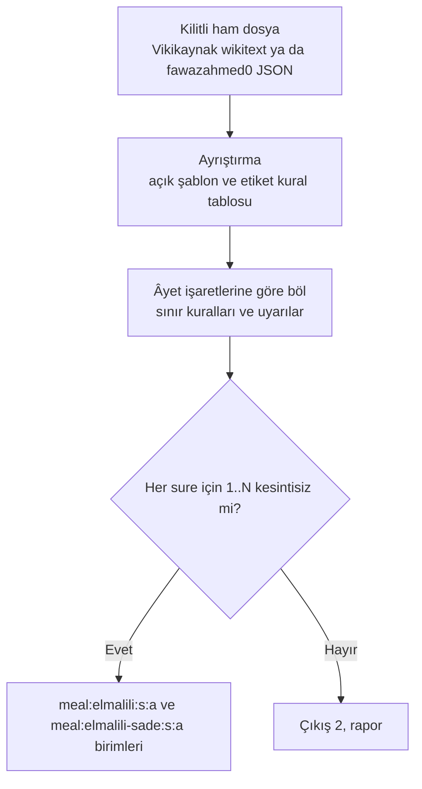

# Elmalılı Hazırlığı
> **Sürüm:** 2.2 · **Tarih:** 12 Kasım 2026 · **Durum:** Taslak
> **Bağlı kararlar:** [K-03](../00-ozet/02-karar-defteri.md#k-03--tefsir-önce-elmalılı-meali) · [K-42](../00-ozet/02-karar-defteri.md#k-42--kaynak-ilkesi-ve-kalite-temelli-görünürlük) · [K-12](../00-ozet/02-karar-defteri.md#k-12--i̇çerik-hattı-python) · [K-13](../00-ozet/02-karar-defteri.md#k-13--editör-paneli) · [K-25](../00-ozet/02-karar-defteri.md#k-25--i̇lkeler) · [K-26](../00-ozet/02-karar-defteri.md#k-26--kalıcı-adresler-çapa-şeması) · [K-38](../00-ozet/02-karar-defteri.md#k-38--kaynak-edinimi-dijital-öncelikli-kanıtla-yükseltme) · [K-49](../00-ozet/02-karar-defteri.md#k-49--elmalılı-mealleri-hazır-metin-yolu-ve-ocrın-proje-sonuna-ertelenmesi)

Bu dosya Elmalılı Muhammed Hamdi Yazır'ın *Hak Dini Kur'an Dili* eserinin meal ve tefsir metninin nasıl hazırlanacağını anlatır. K-03 gereği önce âyet meali hazırlanır ve `core` paketine çapalarıyla girer: orijinal meal `meal:elmalili:{sure}:{ayet}`, güncel (sadeleştirilmiş) meal `meal:elmalili-sade:{sure}:{ayet}` ([K-49](../00-ozet/02-karar-defteri.md#k-49--elmalılı-mealleri-hazır-metin-yolu-ve-ocrın-proje-sonuna-ertelenmesi)). Tefsir metni ikinci aşamadır ve `tefsir-elmalili` paketine `tf:elmalili:…` çapalarıyla girer.

**Metin yolu ([K-49](../00-ozet/02-karar-defteri.md#k-49--elmalılı-mealleri-hazır-metin-yolu-ve-ocrın-proje-sonuna-ertelenmesi)).** Elmalılı mealleri hazır dijital metinle alınır: orijinal meal Vikikaynak "Kur'an" sayfalarından, güncel meal fawazahmed0/quran-api `tur-elmallsadelesti` dosyasından. A09 ölçümü önkoşul değildir. İki meal de baskı esası belgelenmeden `taslak` girer ve iki insan turundan geçer; özgün baskıyla karşılaştırma, "temel metin" sayılması ve OCR proje sonuna ertelendi ([S-15](../08-yol-haritasi/02-sonra-yapilacaklar.md)). Bölüm 3, 4 ve 5 S-15'in başlangıç belgesi olarak korunur. Hazır metin yolu A16'dadır ([A16](../10-claude-code/asamalar/A16-elmalili-meali.md)).

## 1. Kaynak ilkesi ve adaylar

Metin kaynağı; göreve uygunluk, özgün baskıya sadakat, eksiksizlik, biçim ve sürümün sabitlenebilmesi ölçütleriyle seçilir ([K-42](../00-ozet/02-karar-defteri.md#k-42--kaynak-ilkesi-ve-kalite-temelli-görünürlük) madde 1). Başvuru, onay ya da anahtar isteyen kaynak seçilmez; dosyaları Claude Code indirir.

- **Özgün metin esastır; sadeleştirilmiş metin ayrı baskıdır.** Ürün müellifin kendi metnini sunar (K-03). Sadeleştirilmiş metin orijinal meal ve tefsir için temel metin olmaz, çünkü sadeleştirme müellifin ifadesini değiştirir. Sadeleştirilmiş metin yalnız ayrı adlı güncel meal baskısı olarak girer (`meal:elmalili-sade`, kaynak `elmalili-sade-meal`) ve arayüzde "sadeleştirilmiş" etiketiyle görünür; çapa adları başka bir metne verilmez (K-26).
- **Üç metin ailesi ([K-49](../00-ozet/02-karar-defteri.md#k-49--elmalılı-mealleri-hazır-metin-yolu-ve-ocrın-proje-sonuna-ertelenmesi) madde 1).** İnternette "Elmalılı" adıyla dolaşan metinler üç ailedir: O (özgün: Vikikaynak, archive.org EPUB, kuranmeali "Orijinal"), S (sadeleştirilmiş: fawazahmed0 `tur-elmallsadelesti`) ve T ("yeni Elmalılı", 1994–96: Tanzil `tr.yazir`, fawazahmed0 `tur-elmalilihamdiya` ve `tur-elmallsadelesti1`, GitHub `elmalili-meal/kuran`). T ailesi Elmalılı adıyla alınmaz: Johanna Pink'e göre atfı yanlıştır ve metin Ali Fikri Yavuz mealiyle aynıdır. Aile ayrımı 16:43 âyetindeki çeviri farkına dayanır; A16.0 işareti kodla ölçer. Ayrıntı: [Kaynaklar](./01-kaynaklar.md) §3.3.
- **Erişim durumu.** Vikikaynak sayfaları (MediaWiki API ve dump) ve fawazahmed0 dosyası (commit'e sabitli GitHub adresi) doğrudan alınır. Açık Kuran için doğrudan alınabilen bir veri dosyası bulunamadı (`api.acikkuran.com` çözümlenmedi; GitHub deposu sunucu kodudur). Adres, sürüm ve sayımlar [A16](../10-claude-code/asamalar/A16-elmalili-meali.md) `## Tedarik` bölümündedir. Tanık (yalnız QA): archive.org EPUB'ı. YEK 2021 tenkitli metni meal bloklarına ayrılamadığı için kullanılmadı (A37 adayı); A16.0 ölçümünde 114/114 sure ve âyet kümeleri Tanzil'le eşleşti.
- **Baskı esası belgesizdir.** Hazır metnin baskı esası çoğu zaman belirsizdir ve "Elmalılı meali" etiketi 1935 metnini garanti etmez (bölüm 3, Pink). Bu yüzden hazır metin "temel metin" sayılmaz; kaynak kilitlenir, otomatik denetimlerden (kapsam, çapraz tanık, orijinal mealde sadeleştirme taraması) geçer, `taslak` girer ve iki insan turundan geçer; atıf baskı esasının belgesiz olduğunu açıkça yazar. Özgün baskıyla karşılaştırma S-15'tedir.

## 2. Aşamalar

| Aşama | İş | Çıktı | Faz |
|---|---|---|---|
| 0 | Tedarik (A16.0): hazır metin dosyalarının ve tanıkların indirilmesi, ölçüm, kaynak kaydı, revizyon ve SHA-256 kilidi | Kilitli ham dosyalar; ölçüm raporu | Faz 1 · İçerik hattı |
| 1 | Özgün baskı taraması, OCR ve özgün baskıyla karşılaştırma | S-15'e ertelendi (K-49) | Proje sonu |
| 2 | Meal aktarımı ve âyetlere bölme (A16.2 ve A16.3) | `meal:elmalili:{s}:{a}` ve `meal:elmalili-sade:{s}:{a}` taslak birimleri | Faz 1 · İçerik hattı |
| 3 | Yükleme, editörde inceleme ve QA (A16.4–A16.7) | Onaylı meal, QA ve ikinci okuma raporları | Faz 1 · İçerik hattı |
| 4 | Sürüm dondurma ve yayın adımları ([Yayın süreci](../07-yayin/01-yayin-sureci.md) §7) | `elmalili-meal` ve `elmalili-sade-meal` 1.0.0 | Faz 2–3 |
| 5 | Tefsir metni | `tf:elmalili:…` birimleri | Faz 4 (v1.x); paketin gireceği sürüm [Fazlar](../08-yol-haritasi/01-fazlar.md#6-açık-sorular) §6 soru 1'de açık |

## 3. Kaynak baskının bulunması (S-15'e ertelendi)

**Bilinen künye.** Princeton kütüphane kaydı ilk baskıyı şöyle veriyor: "Hak dini Kur'an dili. : Yeni mealli türkçe tefsir", Matbaai Ebüzziya, İstanbul, [1935–1938], 8 cilt, 6.442 sayfa, seri "T. C. Diyanet işleri reisliği neşriyatından, no. 5" ([kayıt](https://catalog.princeton.edu/catalog/SCSB-3946972)). Dokuzuncu cilt 1939 tarihli fihristtir ([kayıt](https://catalog.princeton.edu/catalog/SCSB-4322432)). Küre Ansiklopedi baskıyı şöyle anlatır: "1935-1939 yıllarında İstanbul'da dokuz cilt ve 10.000 takım olarak basılmış" ([Küre](https://kureansiklopedi.com/tr/detay/hak-dini-kuran-dili-2)).

**Bu bölüm S-15'in başlangıç belgesidir ([K-49](../00-ozet/02-karar-defteri.md#k-49--elmalılı-mealleri-hazır-metin-yolu-ve-ocrın-proje-sonuna-ertelenmesi) madde 3).** Elmalılı mealleri hazır metinle alındığı için tarama aşama önkoşulu değildir. İndirilebilir 1935 taraması 11 Kasım 2026'da yeniden arandı (archive.org, HathiTrust yalnız arama, Google Books önizlemesiz) ve bulunamadı.

**Yazı türü (Doğrulanacak).** Karar defteri ilk sürümünde özgün baskının Osmanlıca harflerle basıldığını söylüyordu; K-03 düzeltmesi (18 Ekim 2026) bunu geri aldı. Princeton kaydı dili "Turkish" olarak ve künyeyi 1930'ların Latin imlâsıyla veriyor ve baskı 1928 harf değişikliğinden sonra yapıldı; bu yüzden Türkçe metin büyük olasılıkla Latin harfli, âyetler Arapça harflidir (Yol B). Wikimedia Commons'taki tek fotoğraf (`File:Elmalı 35 baskısı.jpg`, 613×487 piksel) 7. cildin Fihrist başlık sayfasını Latin harfli künyeyle gösteriyor; bu varsayımı destekler. S-15'in ilk işi bir cildin künye sayfası ve birkaç metin sayfasıyla yazı türünü doğrulamaktır (tarama bulunursa); sonuca göre bölüm 4'teki A ya da B yolu seçilir. K-12'nin gerekçesi (OCR ve Arapça işleme için Python) iki durumda da geçerlidir.

**Tarama nereden bulunur (1–2 Kasım 2026 yoklaması; adresler, sürümler ve sayımlar A09 `## Tedarik` bölümündedir; 11 Kasım 2026'da yeniden arandı ve sonuç değişmedi).**
- **archive.org.** Başlık ve yazar sorgularıyla yaklaşık 30 öğe çıkar; 1935–1975 tarihli öğe yoktur. Örnek sayfalarına bakılan öğelerin hiçbiri 1935 ya da ofset taraması değildir. `HakDiniKuranDili` bir dijital metnin sayfa görseli dökümüdür: OCR metninde "3. Baskı, Eser Neşriyat ve Dağıtım, İstanbul 1979" satırı geçer, 8.928 yaprağın hiçbirinde sayfa numarası okunamadı; TDV İA'ya göre 1960 ve 1971 baskıları ilk baskıdan ofsettir, 1979 baskısının tıpkıbasım olduğu kanıtlanmadı. `hak-dini-kuran-dili-cilt-1-elmalili-hamdi-yazir`, `Elmalili0110OrjinalYenda` ve `cilt-6` yeni dizgidir; `hak-dini-kuran-dili-1-6-elmalili-muhammed-hamdi-yazir-yek-yay` YEK 2021 tenkitli metnidir; `hak-dini-kuran-dili-osm-c-1` … `-osmanlica.-c-7` Arap harfli el yazması sayfalarıdır. Sure sure PDF öğelerinin (`ElmaliliKuranTefsiri`, `Elmalili-Tefsiri`; 1938 tarih etiketi yükleyicinin girdisidir) sayfalarına S-15'te bakılır.
- **HathiTrust.** 1935 baskısı (kayıt 102700938, 8 cilt) ve 1960 baskısı (kayıt 007373234, 9 cilt) yalnız arama (search-only) olarak vardır: görüntü yok. Basılı sayfa numaralarını doğrulamaya yarar. Tam metin araması otomatik istekte Cloudflare doğrulamasına takılır; S-15'te `WebFetch` ile denenir, olmazsa künye düzeyinde kalınır.
- **Vikikaynak.** Elmalılı için tarama ya da Index sayfası yok. Meal metni 2007'de kaynaksız girilmiş; baskı esası belirsiz (Doğrulanacak). Tarama kaynağı olamaz; orijinal meal (`meal:elmalili`, kaynak `elmalili-meal`) olarak A16'da alınır (K-49): `Kur'an/<Sure> Suresi` altında 114 sayfa vardır (125 başlığın 11'i yönlendirmedir); âyet işareti `kısım` şablonudur (6.238 işaret, 6.236 benzersiz âyet). Kayıtta sayfa başına Vikikaynak revizyon numarası (`revid`; kayıtta `oldid` olarak da anılır) ve dosya SHA-256'sı kilitlenir; baskı esası belgesizdir ve özgün baskıyla karşılaştırma S-15'tedir.
- **İBB Atatürk Kitaplığı.** 1935 nüshaları var; reprodüksiyon başvuru gerektirdiği için seçilmedi. Millî Kütüphane ve İBB sitelerinde doğrudan indirilebilir bir 1935 kopyası bulunamadı.
- **İSAM ve Diyanet.** İSAM katalogunda 1935 c. 1 ve Eser 1979 takımı var; tam metin yok. Diyanet portalı okunamadı (Doğrulanacak).
- Sahaftan ikinci el bir takım (1935 ya da 1960/1971 ofset) edinip kendimiz taramak (İ-09 `gerekmiyor`; S-15'te `bekliyor` olur). Bu yol görüntü kalitesini bizim kontrolümüze bırakır.

**Sonuç.** Doğrudan alınabilen bir 1935 ya da ofset taraması bulunamadı; bu yüzden tarama, OCR ve özgün baskı sınaması (kimlik ve ofset) S-15'e bırakıldı ([K-49](../00-ozet/02-karar-defteri.md#k-49--elmalılı-mealleri-hazır-metin-yolu-ve-ocrın-proje-sonuna-ertelenmesi) madde 3). S-15 başlarsa görsel kaynağı önce internetteki taramalardır; sayfa numaraları HathiTrust 1935 aramasıyla karşılaştırılır; bulunamazsa sahaftan alınan takım taranır (İ-09). Dosyaları Claude Code indirir: her kaynak `data/gelen/<kaynak>/<YYYY-AA-GG>/` altında yeni boş klasöre iner, klasörde `SHA256SUMS` bulunur, adres ve tarih tedarik adımında kayda geçer. Elmalılı mealleri için bu adım A16.0'dadır ve yalnız hazır metin dosyalarını ve tanıkları indirir.

Tarama bir kütüphaneden ya da arşivden geliyorsa nüshası (yer ya da yer numarası, tarama tarihi) kaynak kaydındaki `baski_bilgisi` alanına, adresi `kaynak_url` alanına yazılır.

**Baskı doğrulama listesi.**
- [ ] Künye sayfası: başlık, cilt numarası, yıl, matbaa ve seri Princeton kaydıyla uyumlu.
- [ ] Cilt başına sayfa sayısı kayıtla uyumlu; toplam 6.442 sayfa (fihrist hariç).
- [ ] Sonraki tıpkı ya da yeni baskı olmadığı doğrulandı. TDV İA 1960 ve 1971 ofset baskılarını anıyor; bu baskıların varlığı ve sayfa düzeninin 1935 ile aynı olup olmadığı ayrıca doğrulanır.
- [ ] Cilt ve yıl farkı çözüldü. TDV İA: "1935–1939, dokuz cilt, Ebüzziyâ Matbaası, 10.000 takım; ofset 1960 ve 1971; fihrist 1982". Princeton: "8 cilt [1935–1938]", 1939 fihrist. YEK 2021 önsözü: 9 cilt (9. cilt fihrist; c. 1: 1935, c. 2–6: 1936, c. 7–9: 1938). BÇ-22 künyeyi taramadan çözecek ve S-15'e bağlıdır; bu not çözüm değildir. Atıf K-03'teki 1935–1939 ile kalır.
- [ ] Eksik ya da hasarlı sayfalar listelendi; eksikler ikinci bir nüshadan tamamlanacak. Bu liste S-15'e bağlıdır.

**Etiket uyarısı (Pink).** Johanna Pink (GloQur, 16 Nisan 2021, [yazı](https://gloqur.de/?p=2195)), basılı 1935 metninin el yazması müsveddeden "with some editorial interventions" ile Latin harfe aktarıldığını yazıyor. Ona göre 1990'lardan beri Elmalılı adıyla satılan bir mealin atfı yanlış. 1994–96 tarihi Pink'in tespiti değil; yazıda "2016'dan sonra ortaya çıkan iddialar" diye geçiyor. Sonuç: "Elmalılı meali" etiketi 1935 metnini garanti etmez; metnin baskı esası künyeyle ve taramayla doğrulanır.

**Tarama standardı (öneri; S-15).** En az 400 dpi gri tonlama, kayıpsız TIFF; küçük puntolu dipnotlar ve harekeli Arapça için 600 dpi denenir. Dosya adı `c{cilt:02d}-s{sayfa:04d}.tif`. Kayıt komutu:

```bash
uv run mutalaa ingest scans --edition elmalili-1935 --dir data/gelen/elmalili-1935/<YYYY-AA-GG>/c01 --cilt 1
```

## 4. OCR (S-15'e ertelendi)

**Bu bölüm S-15'in başlangıç belgesidir ([K-49](../00-ozet/02-karar-defteri.md#k-49--elmalılı-mealleri-hazır-metin-yolu-ve-ocrın-proje-sonuna-ertelenmesi) madde 3).** Elmalılı mealleri hazır metinle alınır; OCR ve özgün baskıyla karşılaştırma proje sonuna bırakıldı. Aşağıdaki yöntem S-15 başlarsa ve tarama bulunursa uygulanır. İki yol vardır:
- **Yol A (Osmanlıca harfli baskı):** OCR ve ardından Latin harfine aktarım (bölüm 5).
- **Yol B (Latin harfli baskı):** 1930'lar dizgisinin OCR'ı. Metin baskıdaki imlâsıyla aynen alınır; harf çevirisi yoktur.

İki yolda da sayfada Arapça âyet blokları bulunur. Meal için âyet metninin OCR'ı gerekmez, çünkü âyet metni Tanzil'den gelir; âyet bloğu yalnız hangi âyetlerin kapsandığını bulmak için okunur (bölüm 6). Tefsirdeki Arapça alıntılar ise okunur.

| Aday | Yol A | Yol B | Not |
|---|---|---|---|
| Görsel yapay zekâ modeli | Uygun | Uygun | Sayfa görselinden doğrudan metin. Harf çevirisi ayrı adımda yapılır; böylece okuma hatası ile aktarım tercihi ayrı ölçülür |
| Kraken / eScriptorium + Osmanlıca ya da Arapça yazı modeli | Uygun | Uygun | Hazır modeller Zenodo'dadır: CATMuS-Print (Latin harfli basılı metin), OpenITI Arapça yazı modeli ve OpenITI Osmanlıca modeli. Kraken 7.1.1 Python 3.13 ile uyumludur. Türkçe Latin harfli 1930'lar dizgisi için hazır model yok; ölçüm yetersizse altın sayfalarla ince ayar yapılır |
| Tesseract 5 | Doğrulanacak | Uygun | `tesserocr` tekeri ve `tessdata_best` dil dosyaları (`tur`, `ara`, `osd`); Türkçe modelin 1930'lar dizgisindeki doğruluğu ölçülür |
| Hazır metin adayı (tefsir: archive.org metin katmanı, YEK 2021 tenkitli metni) | Geçerli değil | Uygun | OCR motoru değil, hazır metindir (K-38). Tefsir metin katmanının kalitesi bilinmiyor; A37.0 örneklemle ölçer |

Motor ve model sürümleri [A09](../10-claude-code/asamalar/A09-elmalili-ocr-pilotu.md) `## Tedarik` bölümündedir (A09 ertelendi; S-15 başlarsa yeniden doğrulanır).

**Özgün baskıyla karşılaştırma (S-15).** Hazır metnin baskı esası belgesizdir; "temel metin" sayılması için özgün baskıdan yazılan altın örneklemle aynı CER formülü ve sadeleştirme izi ölçümü gerekir (K-38 madde 1 ve 2; eşik önerisi: meal bloklarında CER ≤ %1, sadeleştirme izi 0). Tarama yoksa bu ölçüm yapılamaz; bu yüzden [K-49](../00-ozet/02-karar-defteri.md#k-49--elmalılı-mealleri-hazır-metin-yolu-ve-ocrın-proje-sonuna-ertelenmesi) iki mealin yayınını bu ölçüme bağlamaz: meal `taslak` girer, iki insan turundan geçer ve atıf baskı esasının belgesiz olduğunu açıkça yazar.

- **Ölçüm yapılırsa ve eşik geçilirse** hazır metin "temel metin" sayılır ve atıf buna göre güncellenir (`/karar`).
- **Eşik geçilmezse** hazır metin yine `taslak` ve onaylı sürümüyle kalır, ama "temel metin" sayılmaz; özgün baskıdan kendi aktarımımız S-15'te yapılır.

**Değerlendirme.**
1. Dokuz cildin hepsinden, sayfa türlerine göre tabakalı 40 sayfalık örneklem seçilir: meal blokları, tefsir düzyazısı, Arapça âyet blokları, dipnotlar, başlıklar.
2. İki kişi örneklemi birbirinden bağımsız yazar; farklar karşılaştırılıp altın metin oluşturulur (`data/gold/elmalili-ocr/`).
3. Her motor için karakter hata oranı hesaplanır: `CER = (S + D + I) / N` (yer değiştirme, silme, ekleme; `N` altın metindeki karakter sayısı; iki taraf NFC). Ayrı raporlanır: Türkçe metin CER'i, Arapça metin CER'i, düzeltme işaretine duyarlı CER (â, î, û hataları) ve satır kaybı oranı. Yol A'da aktarım adımının doğruluğu ayrıca ölçülür.
4. Seçim, sayfa türü başına en düşük CER ve pilot maliyetle yapılır ([İçerik hattı](./02-icerik-hatti.md) §11). Öneri eşiği: insan düzeltmesinden önce meal bloklarında Yol B için CER ≤ %1, Yol A için ≤ %3. Eşikler pilottan sonra güncellenir.

```bash
uv run mutalaa ocr run  --edition elmalili-1935 --engine vision --pages c01:1-40
uv run mutalaa ocr eval --edition elmalili-1935 --gold data/gold/elmalili-ocr/
```

**Görsel model istemi ilkeleri.** Metni aynen yaz; kelimeyi modernleştirme ve düzeltme; okuyamadığın karakteri `⟦?⟧` ile işaretle; her satırı bölge türüyle (`ayet_ar`, `meal`, `tefsir`, `dipnot`, `baslik`, `sayfa_no`) JSON olarak döndür. Sıcaklık 0. Görsel model ücretlidir: koşudan önce `uv run mutalaa llm estimate` ile sayfa başına maliyet ölçülür ve tahmini maliyet kullanıcıya gösterilir (İ-17 bu yolda gerekir; S-15; [İçerik hattı](./02-icerik-hatti.md) §11). Çıktı ham okumadır ve onaylanana kadar "doğrulanmamış" sayılır.

```json
{"cilt": 1, "sayfa": 214, "motor": "vision", "bolgeler": [
  {"tur": "ayet_ar", "kutu": [120, 180, 1480, 420], "satirlar": ["…"]},
  {"tur": "meal", "kutu": [120, 440, 1480, 760], "satirlar": ["…", "… ⟦?⟧ …"]}
]}
```

## 5. Latin harfine aktarım kılavuzu (Yol A)

Bu bölüm yalnız Osmanlıca harfli bir kaynak çıkarsa gerekir ve S-15'e ertelendi (K-49). Hedef, ifadeyi değiştirmeyen okunur bir aktarımdır: özgün ifade harf harf Latin yazısına geçer, ifade değişmez. Yol B'de iş harf aktarımı değil, yeniden dizgidir: yazı zaten Latin harflidir ve imlâ aynen alınır. Kılavuz öneridir; düzeltme işaretinin yoğunluğunu proje sahibi onaylar (Açık soru). Arama düzeltme işaretli ve işaretsiz iki anahtarla çalıştığı için bu tercih aramayı bozmaz ([Arama](../03-veri/05-arama-fts5.md)).

| # | Kural | Örnek |
|---|---|---|
| 1 | Kelime ve dizim aynen kalır. Kelime değiştirilmez, eş anlamlısı konmaz, cümle bölünmez ya da birleştirilmez, ek veya kelime eklenmez | |
| 2 | Arapça ve Farsça kökenli kelimelerde imlâda elif, vav ya da ye ile yazılan uzun ünlü â, î, û ile gösterilir; Türkçe kökenli kelimelerde işaret yok | kelâm, ilâhî |
| 3 | Ayın ve hemze kelime içinde ve sonunda kesme işaretiyle gösterilir; kelime başında gösterilmez | Kur'ân, mes'ele |
| 4 | Noktalı ve çizgili akademik harfler (ḥ, ṣ, ż, ẓ, ḳ, ġ) kullanılmaz | |
| 5 | Farsça tamlamada izafet ünlüsü kısa çizgiyle bağlanır | kelâm-ı ilâhî, ehl-i kitâb |
| 6 | Arapça harf-i tarifli kalıplar kesme işareti ve kısa çizgiyle yazılır | Rabbü'l-âlemîn |
| 7 | Atıf vavı ünsüzden sonra "u/ü", ünlüden sonra "vü" yazılır | ilm ü irfân |
| 8 | Arapça cümleler, âyetler ve hadis metinleri aktarılmaz; Arapça harfle, baskıdaki harekeyle kalır ve `lang="ar"` aralık olarak işaretlenir | |
| 9 | "Allah" gibi yerleşik özel ad yazımları proje sözlüğüne göre yazılır | |
| 10 | Noktalama baskıdaki gibidir; editoryal noktalama ayrı katmanda tutulur | |
| 11 | Âyet, cilt ve sayfa numaraları Latin rakamla yazılır | |
| 12 | Okunuşu belirsiz kelime `⟦?⟧` ile işaretlenir; okunuş sözlükle (Redhouse 1890) doğrulanır | |
| 13 | Aynı Osmanlıca yazım her yerde aynı Latin yazımla aktarılır | |

Tutarlılık `pipeline/src/mutalaa_pipeline/normalize/elmalili_imla.tsv` sözlüğüyle sağlanır: `osmanlica_yazim`, `latin_yazim`, `kaynak`, `onaylayan`. Aynı Osmanlıca yazıma iki farklı Latin yazım düşerse G-MET kapısı kalır. Örnek kelimeler editör tarafından doğrulanır.

**Yol B kuralı.** Metin baskıdaki imlâsıyla aynen alınır. Açık dizgi hataları metinde düzeltilmez; ayrı bir "tashih" katmanında `{çapa}@{başlangıç}-{bitiş}` adresiyle (yarı açık aralık: başlangıç dahil, bitiş hariç; K-26), gerekçesiyle ve onaylayanıyla tutulur. Bu kılavuz Yol B'de de, kendi yazdığımız Türkçe metinlerde (kelime anlamları, lügat) Arapça kökenli terimlerin tutarlı yazımı için başvuru olarak kalır.

## 6. Meali âyetlere bölme ve hizalama

Küre Ansiklopedi eserin düzenini şöyle anlatır: "önce tefsiri yapılacak âyetin veya âyetler grubunun metni altına meâlleri yazılacak, ardından bu bölümün tefsir ve izahına geçilecekti" ([Küre](https://kureansiklopedi.com/tr/detay/hak-dini-kuran-dili-2)). Hazır metinde âyet işareti Vikikaynak'ta `{{kısım||N}}` şablonudur; fawazahmed0 dosyasında âyet başına bir kayıttır. Bu bölüm hazır metin yolunu anlatır; OCR bölgelerinden bölme (`ayet_ar`, `meal` bölgeleri) S-15'tedir.



1. Ham dosya `data/raw` altına alınır ve değişmez; çıkarıcı deterministiktir. Vikikaynak'ta `mwparserfromhell` ile ayrıştırılır; her şablon ve etiket için açık kural tablosu vardır (at, N'inci parametreyi tut ya da boşluk yap); bilinmeyen şablon ya da etiket çıkış 2 verir. JSON'da âyet kaydı doğrudan alınır.
2. Metin, âyet işaretlerine göre bölünür. Sınır durumları aşağıda (K-49 madde 8) kararlıdır.
3. Her sure için meal birimlerinin Tanzil âyet sayısıyla kesintisiz ve sıralı eşleştiği denetlenir (G-HIZ).
4. Çıkarılmış metin kaynak dosyanın birebir dilimi değildir (K-38 madde 3); ilk kayıt adımları (NFC dahil) ayrıştırmada bir kez uygulanır ve `content_hash` bu metinden hesaplanır (K-26). `provenance` ham dosyanın SHA-256'sını, konumu (Vikikaynak'ta kilitli revizyonun wikitext dizgisinde yarı açık kod noktası aralıklarının listesi ve parça ayırıcısı; JSON'da JSON yolu; bunlar `@` ofseti değildir), çıkarıcı sürümünü ve `mwparserfromhell` sürümünü taşır ([K-49](../00-ozet/02-karar-defteri.md#k-49--elmalılı-mealleri-hazır-metin-yolu-ve-ocrın-proje-sonuna-ertelenmesi) madde 7). Baskı sayfa eşlemesi (`page_map`; `c. 1, s. 214` atfı) baskı görseli gerektirir ve S-15'tedir.

**Sınır durumları ([K-49](../00-ozet/02-karar-defteri.md#k-49--elmalılı-mealleri-hazır-metin-yolu-ve-ocrın-proje-sonuna-ertelenmesi) madde 8; kararlı).**
- **Birleşik meal (aralıklı ve ardışık işaretler).** Vikikaynak'ta `N-M` biçimli bir işaret ya da metin taşımayan ardışık numaralı işaretler (`{{kısım||54}}{{kısım||55}}metin`) tek metni paylaşır. Baş birim metni taşır; `attrs.kapsam = "q:{s}:{ilk}-{son}"` ve `ayah_range` kapsamı örter. İzleyen birim boş metin ve `attrs.birlesik_ile` taşır. Değişmez iki yönlüdür: `birlesik_ile` varsa metin boştur, metin boşsa `birlesik_ile` vardır. İzleyen birimde metin değiştiren karar 422 alır. Meal çapası âyet başına kalır. İlk ölçümde (11 Kasım 2026) 19 baş ve 19 izleyen birim çıktı; uyarı kodu `birlesik_meal`.
- **Ardışık olmayan işaretler aynı metni paylaşırsa** (ör. Şuarâ 67, 103, 174; Sâffât 81, 111, 132) birleşik meal kurulmaz: metin her âyete verilir ve birim `ortak_metin` uyarısı taşır (17 birim). Bölme editörün Düzelt kararıdır.
- **Numarasız parça** (kaynakta numarasız `,` işareti; 3 parça: Sâd 59 ile 60, Secde 28 ile 29, Kasas 47 ile 48 arasında) önceki numaralı âyete tek boşlukla (U+0020) eklenir. **Yinelenen numaralı parçalar** (Nisâ 68) sırasıyla birleştirilir. İkisi görünür varsayılandır: incelemede uyarı taşır (`numarasiz_parca`, `yinelenen_numara`; sıra bozuksa `sira_disi`); parçayı öteki âyete taşımak iki Düzelt ister.
- **Besmele meali** yalnız açık bir işaretle (`{{kısım||besmele}}`; gerçek veride yoktur) alınır; alınırsa `attrs.besmele_meali = {metin, content_hash}` (kanonik) olur, uyarı kodu `besmele_meali` taşır ve incelemede ayrıca gösterilir. Sure 1'de besmele âyettir, sure 9'da besmele yoktur.
- **Sayfa içeriği.** İlk işaretten önceki ve son âyetten sonraki sayfa içeriği metne alınmaz; yalnız rapora (çapa, uzunluk, özet) yazılır. Bu bölge 100 karakterden uzunsa G-BUT kalır (`bolge_sayisi`, `en_uzun_bolge`).
- **Numaralandırma farkı.** Baskının âyet sayısı Tanzil'den farklıysa fark `versification_map` tablosunda tutulur; çapalar Tanzil numaralandırmasını izler.
- **Parantez ve dipnot.** Meal içindeki parantezli açıklamalar metnin parçasıdır ve aynen kalır. Dipnot varsa `attrs.dipnotlar` içinde `@{başlangıç}-{bitiş}` adresiyle (yarı açık) tutulur.

## 7. Editör panelinde inceleme

- **Ekran.** Kuyruk `kuyruk/ocr` rotasındadır (rota adı korunur). Kaynak sekmeleri (orijinal ve sadeleştirilmiş), "ikinci onay bekleyenler" görünümü; ayrıntıda Tanzil âyet metni, meal metni, `onerilen.uyari` kutusu, tanık uyumu gösterimi, birleşik meallerde `attrs.kapsam` ve izleyen birimde baş birime bağlantı, besmele notu. Sayfa görseli ve bölge kutuları yoktur (S-15).
- **Eylemler.** Onayla, Düzelt, Reddet. Böl, Birleştir, Belirsiz işaretle ve Not ekle OCR ile birlikte S-15'e kaldı ([BÇ-54](../10-claude-code/07-belge-celiskileri.md#1-karar-bekleyenler)). Metin yanlışsa Düzelt kullanılır; Reddet gerekçeyle ve birimi kuyruğa geri göndermek için verilir.
- **Dört göz.** Meal biriminde düzelten kişi ile onaylayan kişi farklıdır.
- **Kayıt.** Hat kaydı `eylem = 'oner'`, `koken = 'hat'`, `oneren = 'hat'`; ilk yüklemede `onceki` boş, `onerilen = {metin, content_hash, uyari?: [kod], tanik?: {skor, kapsam, yontem, yontem_surumu, kaynak}}`: `uyari` uyarı kodlarının listesidir (`birlesik_meal`, `ortak_metin`, `numarasiz_parca`, `yinelenen_numara`, `sira_disi`, `besmele_meali`); `tanik.skor` 0..100 arası `rapidfuzz` skorudur, `tanik.kapsam` `[ilk, son]` âyet aralığı ya da `null`, `tanik.yontem` `"rapidfuzz.fuzz.ratio/tr_narrow"`, `tanik.yontem_surumu` `"1"`, `tanik.kaynak` `"elmalili-meal-epub"`; birleşik izleyen birim için `onerilen` NULL'dur (yalnız durum onayı). Anahtar `(unit, 'metin', onerilen.content_hash)`: bu anahtarla herhangi bir durumda kayıt varsa yenisi açılmaz; tek istisna son kaydı `reddedildi` olan taslak birimdir. Çapa değişmez; yalnız metin ve hash değişir ([K-49](../00-ozet/02-karar-defteri.md#k-49--elmalılı-mealleri-hazır-metin-yolu-ve-ocrın-proje-sonuna-ertelenmesi) madde 9).
- **Durum.** Birim `metin_durumu = 'taslak'` olarak gelir; ikinci editörün onayıyla `onayli` olur ([Editoryal veritabanı](../03-veri/02-editoryal-veritabani.md) §8). Reddedilen birim yeniden kuyruğa girer. Hat onaylı ya da düzeltilmiş birimin metnine yazmaz; kaynak sürümü değişirse yeni inceleme açar (K-49 madde 10 ve 11).

## 8. QA ölçütleri ve örneklem

| Ölçüt | Tanım | Hedef |
|---|---|---|
| Hizalama bütünlüğü (G-HIZ) | 6.236 âyetin her biri bir meal birimine ya da `birlesik_ile` bağına sahip; her meal kaynağı için ayrı; sert kapı | %100 |
| Kapsam raporu | Sayfa başına âyet sayısı Tanzil sayısıyla karşılaştırılır; sayfa başı ve sonu içeriği raporlanır | Eksik 0 |
| Çapraz tanık raporu | Orijinal mealde `tr_narrow` üzerinde `rapidfuzz` ile EPUB tanığına uyum (YEK meal bloklarına ayrılamadığı için kullanılmadı; A37 adayı); skor "özgün baskıya sadakat" diye sunulmaz | Rapor; ilk yüklemede inceleme sırası |
| Sadeleştirme taraması | Orijinal mealde, aynı âyette güncel mealle ortak olup tanıkta bulunmayan sözcükler ve şapka ile kesme farkları (veriye dayanır, yapay zekâ yok) | Rapor; iz bulunursa tur 1'de incelenir |
| Tur 1 (İ-11; A16, A18, A19 ve A37'yi bekletmez; `public` yayını ve Faz 1 çıkışı için şart) | Her âyetin iki ayrı kişiyle onayı (K-38'deki 60 âyetlik elle ön denetimi karşılar) | Bütün birimler `onayli`, açık inceleme 0 |
| Tur 2, ikinci okuma hata oranı | Rastgele seçilen onaylı âyetlerde ikinci kişinin bulduğu hatalı âyet oranı; en az 600 âyet, sure grubuna göre tabakalı (cilt S-15'e kalır), sabit tohumla | %95 güvenle < %0,5 (G-INC, `qa sample` raporu) |
| G-MET (CER, imlâ tutarlılığı, `⟦?⟧`) | OCR yolunda | Bu yolda uygulanmaz; S-15 |

**Tur 1 ve ön denetim.** Eskiden önerilen 60 âyetlik elle örneklem, metnin %5'ini etkileyen bir sorunu yaklaşık %95 olasılıkla yakalardı (0,95^60 ≈ 0,046). Tur 1 her âyeti iki kişiyle onayladığı için bu ön denetimi karşılar ([K-49](../00-ozet/02-karar-defteri.md#k-49--elmalılı-mealleri-hazır-metin-yolu-ve-ocrın-proje-sonuna-ertelenmesi) madde 12).

**Örneklem büyüklüğü.** Örneklemde hiç hata çıkmazsa hata oranının %95 güven üst sınırı yaklaşık `3 / n` olur. Üst sınırı %0,5'in altına indirmek için en az 600 âyet okunur. Örneklem sure grubuna göre tabakalanır (cilt tarama ile birlikte S-15'e kalır) ve sabit tohumla seçilir. Hata bulunursa hata deseni düzeltilir, ilgili bölümler taranır ve yeni bir örneklem çekilir. Faz 1 çıkışını yalnız orijinal mealin tur 1 ve tur 2'si bağlar. İki tur A16'nın, A18'in, A19'un ve A37'nin kapanışını ya da başlamasını bekletmez; `public` yayının (A34) ve Faz 1 çıkışının şartıdır. Turlar bitene kadar iki mealin birimleri `taslak` ve "doğrulanmamış" kalır, `onayli` yazılmaz (K-49 madde 12, 12 Kasım 2026).

## 9. Baskı künyesi, sürüm ve atıf

Kaynak kayıtları (`elmalili-meal`, `elmalili-sade-meal`, `elmalili-tefsir`) eseri `baslik`, müellifi `yazar`, kaynak adresini `kaynak_url`, atıf satırını `atif_metni` ve sürümü `surum` alanında taşır. Künyenin geri kalanı `baski_bilgisi` alanındadır: baskı kimliği (`elmalili-1935`), baskı yeri ve yılları, matbaa, seri, cilt ve sayfa sayıları; editörler `review` kayıtlarındadır. Tarama kaynağı alanları S-15 başlarsa dolar.

- **Sürüm.** Meal veri setleri `elmalili-meal` ve `elmalili-sade-meal` adlarıyla anlamsal sürüm taşır (1.0.0 ilk onaylı sürüm). Sürüm dondurma A34'te yapılır; sonraki düzeltmeler yeni sürüm olur. Onaylı birimde sonradan yapılan düzeltme birimi yeniden inceleme ve ikinci onaydan geçirir ([Yayın süreci](../07-yayin/01-yayin-sureci.md) §7.3). Kaynak `surum` alanı `{sürüm}` yer tutucusu kullanmaz; atıf metni sürümü içermez, sürüm `source.surum` alanındadır.
- **Atıf (orijinal meal; [K-49](../00-ozet/02-karar-defteri.md#k-49--elmalılı-mealleri-hazır-metin-yolu-ve-ocrın-proje-sonuna-ertelenmesi) madde 14).** "Meal: Elmalılı Muhammed Hamdi Yazır, Hak Dini Kur'an Dili, İstanbul 1935–1939. Metin Vikikaynak 'Kur'an' sayfalarından alınmıştır."
- **Atıf (güncel meal).** "Meal: Elmalılı Muhammed Hamdi Yazır, sadeleştirilmiş metin (sadeleştiren belirtilmemiş). fawazahmed0/quran-api üzerinden alınmıştır." G-INC geçince iki atfın sonuna "Mütâlaa editörlerince denetlenmiştir." eklenir; bu kaynak kaydında güncellenir ve `core` kaynak özetini değiştirir. Özgün baskıyla karşılaştırıldığı iddia edilmez; bu S-15'tedir.
- **Atıf (okur alıntısı).** "Elmalılı, *Hak Dini Kur'an Dili*, c. {cilt}, s. {sayfa}; Mütâlaa aktarımı {sürüm}." Cilt ve sayfa baskı sayfa eşlemesini (`page_map`) gerektirir; bu S-15'tedir. O zamana kadar okur alıntısı çapayı ve kaynak adını taşır.

## 10. Tefsir metni (ikinci aşama)

- **Çapalar.** Âyete bağlı bölümler `tf:elmalili:{sure}-{ilk}-{son}:p{n}` (aralık `ayet_ar` bloğundan gelir, ör. `tf:elmalili:2-255-257:p3`); âyete bağlı olmayan bölümler `tf:elmalili:{bolum}:p{n}` (ör. `tf:elmalili:mukaddime:p4`). Bölümün âyet ilişkisi adresin kendisinden türetilir (`tf:elmalili:2-255-257:…` ↔ `q:2:255-257`) ve `xref`'e yazılmaz (K-27). Meal ↔ âyet ilişkisi de aynı biçimde adresten gelir.
- **Yöntem.** Meal ile aynı yol: hazır metin, aktarım ve inceleme (hazır metin uygun değilse OCR S-15'e kalır, [K-49](../00-ozet/02-karar-defteri.md#k-49--elmalılı-mealleri-hazır-metin-yolu-ve-ocrın-proje-sonuna-ertelenmesi) madde 3). Arapça alıntılar Arapça kalır. Tefsir paragraflarında iktibas ve hadis atıfları tespit edilir ([İktibas tespiti](../05-capraz-referans/02-iktibas-tespiti.md); [Hadis hazırlığı](./04-hadis-hazirligi.md)).
- **Hazır metin adayları (K-38, K-49).** archive.org `HakDiniKuranDili` metin katmanı (OCR metninde "3. Baskı, Eser Neşriyat ve Dağıtım, İstanbul 1979" satırı geçer; makine OCR çıktısıdır) ve YEK 2021 tenkitli metni A37.0'da küçük bir örneklemle ve otomatik denetimlerle (kapsam, çapraz tanık, sadeleştirme taraması) değerlendirilir. Uygun bulunursa tefsir metni hazır metinden `taslak` olarak alınır ve iki insan turundan geçer; bulunmazsa tefsirin OCR'ı ve özgün baskı taraması S-15'e kalır.
- **Ölçek.** 6.442 sayfa. Öncelik sırası proje sahibiyle belirlenir (ör. önce sık okunan sureler).

## 11. Açık sorular

1. Özgün baskı Latin harfli mi? (K-03 düzeltmesi büyük olasılıkla Latin harfli diyor; tarama olmadan doğrulanamadı. S-15'te, tarama bulunursa bir tarama üzerinde doğrulanır.)
2. Tarama hangi nüshadan alınacak? İnternette indirilebilir 1935 taraması bulunamadı (11 Kasım 2026'da yeniden arandı); S-15 başlarsa kaynak aranır, bulunmazsa sahaftan takım taranır (İ-09 `gerekmiyor`, S-15'te `bekliyor` olur).
3. ~~Hazır metin yolu eşiği geçecek mi, hangi aday geçecek?~~ Çözüldü (2026-11-11): A09 ölçümü önkoşul değildir; Elmalılı mealleri hazır metinle alınır (orijinal: Vikikaynak, güncel: fawazahmed0 `tur-elmallsadelesti`), `taslak` girer ve iki insan turundan geçer. Kaynak: [K-49](../00-ozet/02-karar-defteri.md#k-49--elmalılı-mealleri-hazır-metin-yolu-ve-ocrın-proje-sonuna-ertelenmesi) madde 2.
4. Düzeltme işaretinin yoğunluğu (kural 2 ve 3) onaylanacak. Yalnız Yol A (Osmanlıca harfli kaynak) çıkarsa gerekir; S-15'tedir.
5. ~~Birleşik meal ve besmele meali için veri modeli.~~ Çözüldü (2026-11-11): [K-49](../00-ozet/02-karar-defteri.md#k-49--elmalılı-mealleri-hazır-metin-yolu-ve-ocrın-proje-sonuna-ertelenmesi) madde 8 (birleşik meal `attrs.kapsam` ve `attrs.birlesik_ile`, numarasız ve yinelenen parçalar, besmele meali `attrs.besmele_meali`, sayfa başı ve sonu içeriği). Kaynak: [K-49](../00-ozet/02-karar-defteri.md#k-49--elmalılı-mealleri-hazır-metin-yolu-ve-ocrın-proje-sonuna-ertelenmesi).

## İlgili dosyalar
- [Kaynaklar](./01-kaynaklar.md) · [İçerik hattı](./02-icerik-hatti.md) · [Hadis hazırlığı](./04-hadis-hazirligi.md) · [Kelime anlamları](./06-kelime-anlamlari.md)
- [Çapa şeması](../03-veri/01-capa-semasi.md) · [Editoryal veritabanı](../03-veri/02-editoryal-veritabani.md) · [İçerik paketleri](../03-veri/03-icerik-paketleri.md) · [Arama](../03-veri/05-arama-fts5.md)
- [İktibas tespiti](../05-capraz-referans/02-iktibas-tespiti.md)
- [Okuma deneyimi](../01-urun/02-okuma-deneyimi.md) · [Yayın süreci](../07-yayin/01-yayin-sureci.md) · [Fazlar](../08-yol-haritasi/01-fazlar.md)
