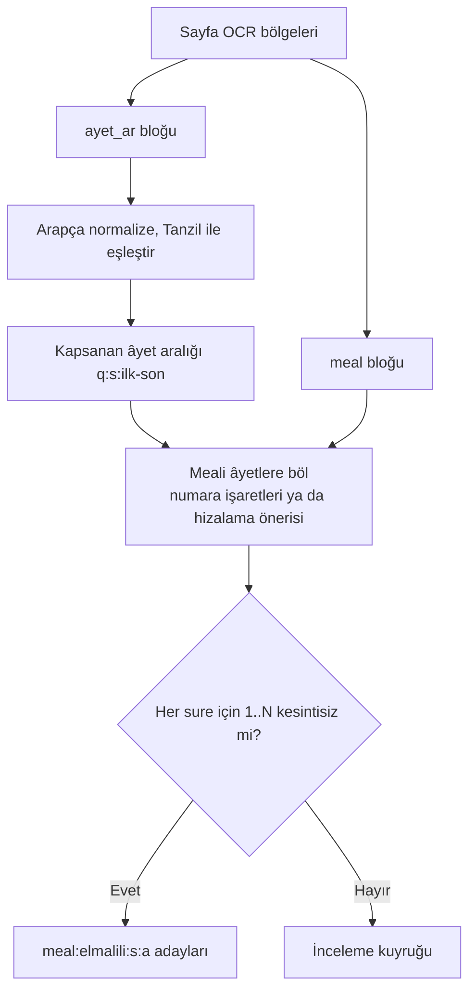

# Elmalılı Hazırlığı
> **Sürüm:** 1.4 · **Tarih:** 1 Kasım 2026 · **Durum:** Taslak
> **Bağlı kararlar:** [K-03](../00-ozet/02-karar-defteri.md#k-03--tefsir-önce-elmalılı-meali) · [K-42](../00-ozet/02-karar-defteri.md#k-42--kaynak-ilkesi-ve-kalite-temelli-görünürlük) · [K-12](../00-ozet/02-karar-defteri.md#k-12--i̇çerik-hattı-python) · [K-13](../00-ozet/02-karar-defteri.md#k-13--editör-paneli) · [K-25](../00-ozet/02-karar-defteri.md#k-25--i̇lkeler) · [K-26](../00-ozet/02-karar-defteri.md#k-26--kalıcı-adresler-çapa-şeması) · [K-38](../00-ozet/02-karar-defteri.md#k-38--kaynak-edinimi-dijital-öncelikli-kanıtla-yükseltme)

Bu dosya Elmalılı Muhammed Hamdi Yazır'ın *Hak Dini Kur'an Dili* eserinin özgün baskısından meal ve tefsir metninin nasıl hazırlanacağını anlatır. K-03 gereği önce âyet meali hazırlanır ve `core` paketine `meal:elmalili:{sure}:{ayet}` çapalarıyla girer. Tefsir metni ikinci aşamadır ve `tefsir-elmalili` paketine `tf:elmalili:…` çapalarıyla girer.

**İki yol (K-38).** Metin iki yoldan biriyle hazırlanır. Hazır metin yolu: internetteki hazır dijital Elmalılı metinleri (Vikikaynak "Kur'an", Tanzil ve Açık Kuran) A09 pilotunda OCR motorlarıyla aynı altın örneklemde ölçülür; eşik geçilir ve tam metin denetimi temiz çıkarsa temel metin olur. OCR yolu (bölüm 4–6): eşik geçilmezse ya da hazır metin alınamazsa aynen sürer. Hazır metin yolu yalnız eşik geçilirse geçerlidir. Her iki yolda da özgün baskının sayfa görselleri gerekir: altın örneklem, özgün baskıya sadakat sınaması ve karşılaştırma bunlara dayanır.

## 1. Kaynak ilkesi ve adaylar

Metin kaynağı; göreve uygunluk, özgün baskıya sadakat, eksiksizlik, biçim ve sürümün sabitlenebilmesi ölçütleriyle seçilir ([K-42](../00-ozet/02-karar-defteri.md#k-42--kaynak-ilkesi-ve-kalite-temelli-görünürlük) madde 1). Başvuru, onay ya da anahtar isteyen kaynak seçilmez; dosyaları Claude Code indirir.

- **Özgün baskı esastır.** Ürün müellifin kendi metnini sunar (K-03). Sadeleştirilmiş baskılar temel metin olmaz, çünkü sadeleştirme müellifin ifadesini değiştirir. Sadeleştirilmiş takımlar (GitHub `elmalili-meal/kuran`, Azim, fawazahmed0 `tur-elmallsadelesti`) aday olamaz.
- **Hazır dijital metin adayları (K-38).** K-03'ün "mevcut bir dijital metni temel almak" seçeneği kontrollü biçimde yeniden değerlendirilir. Meal adayları Vikikaynak "Kur'an" sayfaları, Tanzil `tr.yazir` ve Açık Kuran'daki Elmalılı metnidir; tefsir adayları archive.org metin katmanı ve YEK 2021 tenkitli metnidir. Aday kaynak kaydıyla alınır, revizyon numarası ya da SHA-256 ile kilitlenir, A09 pilotunda OCR motorlarıyla aynı altın örneklemde ölçülür ve yalnız eşiği geçerse temel metin olur; seçimi yalnız bu ölçüm belirler.
- **Erişim durumu.** Vikikaynak sayfaları (MediaWiki API ve dump) ve Tanzil `tr.yazir` dosyası doğrudan alınır. Açık Kuran için doğrudan alınabilen bir veri dosyası 1–2 Kasım 2026 yoklamasında bulunamadı (`api.acikkuran.com` çözümlenmedi; GitHub deposu sunucu kodudur, veri kümesi içermez); erişim yolu bulunursa aynı ölçüme girer. Adres, sürüm ve sayımlar A09 `## Tedarik` bölümündedir.
- **Baskı esası kanıtlanır.** Hazır metnin baskı esası çoğu zaman belirsizdir ve "Elmalılı meali" etiketi 1935 metnini garanti etmez (bölüm 3, Pink). Bu yüzden başkasının "orijinal metin" aktarımı doğrudan temel metin sayılmaz: aktarım ancak kaydedilip özgün baskıyla karşılaştırıldıktan sonra kullanılır; örneklem ölçülür, kaynağı ve baskı esası belgelenir. Belgelenmezse kendi aktarımımızı yaparız (K-38 madde 1). Hazır metin `taslak` girer ve editör onayından geçer; meal ve tefsirde ikinci onay da gerekir.

## 2. Aşamalar

| Aşama | İş | Çıktı | Faz |
|---|---|---|---|
| 0 | Tedarik: baskı tespiti ve tarama; hazır metin adaylarının indirilmesi, kaynak kaydı, revizyon ve SHA-256 kilidi | Künyesi doğrulanmış sayfa görselleri; kilitli aday dosyalar | Faz 0 · Hazırlık |
| 1 | OCR ve hazır metin değerlendirmesi (pilot) | Altın örneklem, CER tablosu, motor ya da hazır metin seçimi (yol kararı) | Faz 0 · Hazırlık |
| 2 | Meal aktarımı ve âyetlere bölme (hazır metin ya da OCR çıktısından) | `meal:elmalili:{s}:{a}` adayları | Faz 1 · İçerik hattı |
| 3 | Editörde inceleme ve QA | Onaylı meal, QA raporu | Faz 1 · İçerik hattı |
| 4 | Sürüm dondurma ve yayın adımları ([Yayın süreci](../07-yayin/01-yayin-sureci.md) §7) | `elmalili-meal` 1.0.0 | Faz 2–3 |
| 5 | Tefsir metni | `tf:elmalili:…` birimleri | Faz 4 (v1.x); paketin gireceği sürüm [Fazlar](../08-yol-haritasi/01-fazlar.md#6-açık-sorular) §6 soru 1'de açık |

## 3. Kaynak baskının bulunması

**Bilinen künye.** Princeton kütüphane kaydı ilk baskıyı şöyle veriyor: "Hak dini Kur'an dili. : Yeni mealli türkçe tefsir", Matbaai Ebüzziya, İstanbul, [1935–1938], 8 cilt, 6.442 sayfa, seri "T. C. Diyanet işleri reisliği neşriyatından, no. 5" ([kayıt](https://catalog.princeton.edu/catalog/SCSB-3946972)). Dokuzuncu cilt 1939 tarihli fihristtir ([kayıt](https://catalog.princeton.edu/catalog/SCSB-4322432)). Küre Ansiklopedi baskıyı şöyle anlatır: "1935-1939 yıllarında İstanbul'da dokuz cilt ve 10.000 takım olarak basılmış" ([Küre](https://kureansiklopedi.com/tr/detay/hak-dini-kuran-dili-2)).

**Yazı türü (Doğrulanacak).** Karar defteri ilk sürümünde özgün baskının Osmanlıca harflerle basıldığını söylüyordu; K-03 düzeltmesi (18 Ekim 2026) bunu geri aldı. Princeton kaydı dili "Turkish" olarak ve künyeyi 1930'ların Latin imlâsıyla veriyor ve baskı 1928 harf değişikliğinden sonra yapıldı; bu yüzden Türkçe metin büyük olasılıkla Latin harfli, âyetler Arapça harflidir (Yol B). Wikimedia Commons'taki tek fotoğraf (`File:Elmalı 35 baskısı.jpg`, 613×487 piksel) 7. cildin Fihrist başlık sayfasını Latin harfli künyeyle gösteriyor; bu varsayımı destekler. Aşama 0'ın ilk işi bir cildin künye sayfası ve birkaç metin sayfasıyla yazı türünü doğrulamaktır. Sonuca göre bölüm 4'teki A ya da B yolu seçilir. K-12'nin gerekçesi (OCR ve Arapça işleme için Python) iki durumda da geçerlidir.

**Tarama nereden bulunur (1–2 Kasım 2026 yoklaması; adresler, sürümler ve sayımlar A09 `## Tedarik` bölümündedir).**
- **archive.org.** Başlık ve yazar sorgularıyla yaklaşık 30 öğe çıkar; 1935–1975 tarihli öğe yoktur. Örnek sayfalarına bakılan öğelerin hiçbiri 1935 ya da ofset taraması değildir. `HakDiniKuranDili` bir dijital metnin sayfa görseli dökümüdür: OCR metninde "3. Baskı, Eser Neşriyat ve Dağıtım, İstanbul 1979" satırı geçer, 8.928 yaprağın hiçbirinde sayfa numarası okunamadı; TDV İA'ya göre 1960 ve 1971 baskıları ilk baskıdan ofsettir, 1979 baskısının tıpkıbasım olduğu kanıtlanmadı. `hak-dini-kuran-dili-cilt-1-elmalili-hamdi-yazir`, `Elmalili0110OrjinalYenda` ve `cilt-6` yeni dizgidir; `hak-dini-kuran-dili-1-6-elmalili-muhammed-hamdi-yazir-yek-yay` YEK 2021 tenkitli metnidir; `hak-dini-kuran-dili-osm-c-1` … `-osmanlica.-c-7` Arap harfli el yazması sayfalarıdır. Sure sure PDF öğelerinin (`ElmaliliKuranTefsiri`, `Elmalili-Tefsiri`; 1938 tarih etiketi yükleyicinin girdisidir) sayfalarına A09.7'de bakılır.
- **HathiTrust.** 1935 baskısı (kayıt 102700938, 8 cilt) ve 1960 baskısı (kayıt 007373234, 9 cilt) yalnız arama (search-only) olarak vardır: görüntü yok. Basılı sayfa numaralarını doğrulamaya yarar. Tam metin araması otomatik istekte Cloudflare doğrulamasına takılır; A09.7'de `WebFetch` ile denenir, olmazsa künye düzeyinde kalınır.
- **Vikikaynak.** Elmalılı için tarama ya da Index sayfası yok. Meal metni 2007'de kaynaksız girilmiş; baskı esası belirsiz (Doğrulanacak). Tarama kaynağı olamaz; K-38'e göre temel metin adayıdır ve A09 pilotunda ölçülür: `Kur'an/<Sure> Suresi` altında 114 sayfa vardır (125 başlığın 11'i yönlendirmedir); âyet işareti `kısım` şablonudur (6.238 işaret, 6.236 benzersiz âyet). Kayıtta sayfa başına Vikikaynak revizyon numarası (`revid`; kayıtta `oldid` olarak da anılır) ve dosya SHA-256'sı kilitlenir; baskı esası pilotta örneklemle sınanır.
- **İBB Atatürk Kitaplığı.** 1935 nüshaları var; reprodüksiyon başvuru gerektirdiği için seçilmedi. Millî Kütüphane ve İBB sitelerinde doğrudan indirilebilir bir 1935 kopyası bulunamadı.
- **İSAM ve Diyanet.** İSAM katalogunda 1935 c. 1 ve Eser 1979 takımı var; tam metin yok. Diyanet portalı okunamadı (Doğrulanacak).
- Sahaftan ikinci el bir takım (1935 ya da 1960/1971 ofset) edinip kendimiz taramak (İ-09). Bu yol görüntü kalitesini bizim kontrolümüze bırakır.

**Sonuç.** K-38'e göre görsel kaynağı önce internetteki taramalardır; sayfa numaraları HathiTrust 1935 aramasıyla karşılaştırılır ve kimlik ile ofset sınamasından (A09.7) geçerse kullanılır. Yoklamada doğrudan alınabilen bir 1935 ya da ofset taraması bulunamadı; sınama bunu doğrularsa görsel kaynağı sahaftan alınan takımın taranmasıdır (İ-09 `bekliyor` olur). Dosyaları Claude Code indirir: her kaynak `data/gelen/<kaynak>/<YYYY-AA-GG>/` altında yeni boş klasöre iner, klasörde `SHA256SUMS` bulunur, adres ve tarih tedarik adımında (A09.0, A16.0) kayda geçer. Taramalar `ingest scans` ile `data/raw` altına alınır.

Tarama bir kütüphaneden ya da arşivden geliyorsa nüshası (yer ya da yer numarası, tarama tarihi) kaynak kaydındaki `baski_bilgisi` alanına, adresi `kaynak_url` alanına yazılır.

**Baskı doğrulama listesi.**
- [ ] Künye sayfası: başlık, cilt numarası, yıl, matbaa ve seri Princeton kaydıyla uyumlu.
- [ ] Cilt başına sayfa sayısı kayıtla uyumlu; toplam 6.442 sayfa (fihrist hariç).
- [ ] Sonraki tıpkı ya da yeni baskı olmadığı doğrulandı. TDV İA 1960 ve 1971 ofset baskılarını anıyor; bu baskıların varlığı ve sayfa düzeninin 1935 ile aynı olup olmadığı ayrıca doğrulanır.
- [ ] Cilt ve yıl farkı çözüldü. TDV İA: "1935–1939, dokuz cilt, Ebüzziyâ Matbaası, 10.000 takım; ofset 1960 ve 1971; fihrist 1982". Princeton: "8 cilt [1935–1938]", 1939 fihrist. YEK 2021 önsözü: 9 cilt (9. cilt fihrist; c. 1: 1935, c. 2–6: 1936, c. 7–9: 1938). BÇ-22 künyeyi taramadan çözecek; bu not çözüm değildir.
- [ ] Eksik ya da hasarlı sayfalar listelendi; eksikler ikinci bir nüshadan tamamlanacak.

**Etiket uyarısı (Pink).** Johanna Pink (GloQur, 16 Nisan 2021, [yazı](https://gloqur.de/?p=2195)), basılı 1935 metninin el yazması müsveddeden "with some editorial interventions" ile Latin harfe aktarıldığını yazıyor. Ona göre 1990'lardan beri Elmalılı adıyla satılan bir mealin atfı yanlış. 1994–96 tarihi Pink'in tespiti değil; yazıda "2016'dan sonra ortaya çıkan iddialar" diye geçiyor. Sonuç: "Elmalılı meali" etiketi 1935 metnini garanti etmez; metnin baskı esası künyeyle ve taramayla doğrulanır.

**Tarama standardı (öneri).** En az 400 dpi gri tonlama, kayıpsız TIFF; küçük puntolu dipnotlar ve harekeli Arapça için 600 dpi denenir. Dosya adı `c{cilt:02d}-s{sayfa:04d}.tif`. Kayıt komutu:

```bash
uv run mutalaa ingest scans --edition elmalili-1935 --dir data/gelen/elmalili-1935/<YYYY-AA-GG>/c01 --cilt 1
```

## 4. OCR

İki yol vardır:
- **Yol A (Osmanlıca harfli baskı):** OCR ve ardından Latin harfine aktarım (bölüm 5).
- **Yol B (Latin harfli baskı):** 1930'lar dizgisinin OCR'ı. Metin baskıdaki imlâsıyla aynen alınır; harf çevirisi yoktur.

İki yolda da sayfada Arapça âyet blokları bulunur. Meal için âyet metninin OCR'ı gerekmez, çünkü âyet metni Tanzil'den gelir; âyet bloğu yalnız hangi âyetlerin kapsandığını bulmak için okunur (bölüm 6). Tefsirdeki Arapça alıntılar ise okunur.

| Aday | Yol A | Yol B | Not |
|---|---|---|---|
| Görsel yapay zekâ modeli | Uygun | Uygun | Sayfa görselinden doğrudan metin. Harf çevirisi ayrı adımda yapılır; böylece okuma hatası ile aktarım tercihi ayrı ölçülür |
| Kraken / eScriptorium + Osmanlıca ya da Arapça yazı modeli | Uygun | Uygun | Hazır modeller Zenodo'dadır: CATMuS-Print (Latin harfli basılı metin), OpenITI Arapça yazı modeli ve OpenITI Osmanlıca modeli. Kraken 7.1.1 Python 3.13 ile uyumludur. Türkçe Latin harfli 1930'lar dizgisi için hazır model yok; ölçüm yetersizse altın sayfalarla ince ayar yapılır |
| Tesseract 5 | Doğrulanacak | Uygun | `tesserocr` tekeri ve `tessdata_best` dil dosyaları (`tur`, `ara`, `osd`); Türkçe modelin 1930'lar dizgisindeki doğruluğu ölçülür |
| Hazır metin adayı (meal: Vikikaynak "Kur'an", Tanzil `tr.yazir`, Açık Kuran; tefsir: archive.org metin katmanı, YEK 2021 tenkitli metni) | Geçerli değil | Uygun | OCR motoru değil, hazır metindir (K-38). Aynı altın örneklemde ve aynı CER ile ölçülür. Tefsir metin katmanının kalitesi bilinmiyor |

Motor ve model sürümleri A09 `## Tedarik` bölümündedir.

**Hazır metin adayının ölçümü (K-38).** Aday kaynak kaydıyla alınır; revizyon numarası ve SHA-256 kilitlenir. Altın örneklemin meal blokları, hazır metindeki karşılıklarıyla aynı CER formülüyle karşılaştırılır; ek olarak sadeleştirme izi sayılır (modernleştirilmiş ya da değiştirilmiş kelime). Başlangıç önerisi: meal bloklarında CER ≤ %1 ve sadeleştirme izi 0. Eşik pilottan sonra kesinleşir.

- **Eşik geçilirse** ve tam metin denetimi temiz çıkarsa (bölüm 8) hazır metin temel metin olur; iki düzeltme turu yapılır ve metin `taslak` girer.
- **Eşik geçilmezse** hazır metin yolu geçerli olmaz; OCR yolu (bölüm 4–6) aynen sürer.

**Değerlendirme.**
1. Dokuz cildin hepsinden, sayfa türlerine göre tabakalı 40 sayfalık örneklem seçilir: meal blokları, tefsir düzyazısı, Arapça âyet blokları, dipnotlar, başlıklar.
2. İki kişi örneklemi birbirinden bağımsız yazar; farklar karşılaştırılıp altın metin oluşturulur (`data/gold/elmalili-ocr/`).
3. Her motor için karakter hata oranı hesaplanır: `CER = (S + D + I) / N` (yer değiştirme, silme, ekleme; `N` altın metindeki karakter sayısı; iki taraf NFC). Ayrı raporlanır: Türkçe metin CER'i, Arapça metin CER'i, düzeltme işaretine duyarlı CER (â, î, û hataları) ve satır kaybı oranı. Yol A'da aktarım adımının doğruluğu ayrıca ölçülür.
4. Seçim, sayfa türü başına en düşük CER ve pilot maliyetle yapılır ([İçerik hattı](./02-icerik-hatti.md) §11). Öneri eşiği: insan düzeltmesinden önce meal bloklarında Yol B için CER ≤ %1, Yol A için ≤ %3. Eşikler pilottan sonra güncellenir.

```bash
uv run mutalaa ocr run  --edition elmalili-1935 --engine vision --pages c01:1-40
uv run mutalaa ocr eval --edition elmalili-1935 --gold data/gold/elmalili-ocr/
```

**Görsel model istemi ilkeleri.** Metni aynen yaz; kelimeyi modernleştirme ve düzeltme; okuyamadığın karakteri `⟦?⟧` ile işaretle; her satırı bölge türüyle (`ayet_ar`, `meal`, `tefsir`, `dipnot`, `baslik`, `sayfa_no`) JSON olarak döndür. Sıcaklık 0. Görsel model ücretlidir: koşudan önce `uv run mutalaa llm estimate` ile sayfa başına maliyet ölçülür ve tahmini maliyet kullanıcıya gösterilir (İ-17; [İçerik hattı](./02-icerik-hatti.md) §11). Çıktı ham okumadır ve onaylanana kadar "doğrulanmamış" sayılır.

```json
{"cilt": 1, "sayfa": 214, "motor": "vision", "bolgeler": [
  {"tur": "ayet_ar", "kutu": [120, 180, 1480, 420], "satirlar": ["…"]},
  {"tur": "meal", "kutu": [120, 440, 1480, 760], "satirlar": ["…", "… ⟦?⟧ …"]}
]}
```

## 5. Latin harfine aktarım kılavuzu (Yol A)

Hedef, ifadeyi değiştirmeyen okunur bir aktarımdır: özgün ifade harf harf Latin yazısına geçer, ifade değişmez. Yol B'de iş harf aktarımı değil, yeniden dizgidir: yazı zaten Latin harflidir ve imlâ aynen alınır. Kılavuz öneridir; düzeltme işaretinin yoğunluğunu proje sahibi onaylar (Açık soru). Arama düzeltme işaretli ve işaretsiz iki anahtarla çalıştığı için bu tercih aramayı bozmaz ([Arama](../03-veri/05-arama-fts5.md)).

| # | Kural | Örnek |
|---|---|---|
| 1 | Kelime ve dizim aynen kalır. Kelime değiştirilmez, eş anlamlısı konmaz, cümle bölünmez ya da birleştirilmez, ek veya kelime eklenmez | |
| 2 | Arapça ve Farsça kökenli kelimelerde imlâda elif, vav ya da ye ile yazılan uzun ünlü â, î, û ile gösterilir; Türkçe kökenli kelimelerde işaret yok | kelâm, ilâhî |
| 3 | Ayın ve hemze kelime içinde ve sonunda kesme işaretiyle gösterilir; kelime başında gösterilmez | Kur'ân, mes'ele |
| 4 | Noktalı ve çizgili akademik harfler (ḥ, ṣ, ż, ẓ, ḳ, ġ) kullanılmaz | |
| 5 | Farsça tamlamada izafet ünlüsü kısa çizgiyle bağlanır | kelâm-ı ilâhî, ehl-i kitâb |
| 6 | Arapça harf-i tarifli kalıplar kesme işareti ve kısa çizgiyle yazılır | Rabbü'l-âlemîn |
| 7 | Atıf vavı ünsüzden sonra "u/ü", ünlüden sonra "vü" yazılır | ilm ü irfân |
| 8 | Arapça cümleler, âyetler ve hadis metinleri aktarılmaz; Arapça harfle, baskıdaki harekeyle kalır ve `lang="ar"` aralık olarak işaretlenir | |
| 9 | "Allah" gibi yerleşik özel ad yazımları proje sözlüğüne göre yazılır | |
| 10 | Noktalama baskıdaki gibidir; editoryal noktalama ayrı katmanda tutulur | |
| 11 | Âyet, cilt ve sayfa numaraları Latin rakamla yazılır | |
| 12 | Okunuşu belirsiz kelime `⟦?⟧` ile işaretlenir; okunuş sözlükle (Redhouse 1890) doğrulanır | |
| 13 | Aynı Osmanlıca yazım her yerde aynı Latin yazımla aktarılır | |

Tutarlılık `pipeline/src/mutalaa_pipeline/normalize/elmalili_imla.tsv` sözlüğüyle sağlanır: `osmanlica_yazim`, `latin_yazim`, `kaynak`, `onaylayan`. Aynı Osmanlıca yazıma iki farklı Latin yazım düşerse G-MET kapısı kalır. Örnek kelimeler editör tarafından doğrulanır.

**Yol B kuralı.** Metin baskıdaki imlâsıyla aynen alınır. Açık dizgi hataları metinde düzeltilmez; ayrı bir "tashih" katmanında `{çapa}@{başlangıç}-{bitiş}` adresiyle (yarı açık aralık: başlangıç dahil, bitiş hariç; K-26), gerekçesiyle ve onaylayanıyla tutulur. Bu kılavuz Yol B'de de, kendi yazdığımız Türkçe metinlerde (kelime anlamları, lügat) Arapça kökenli terimlerin tutarlı yazımı için başvuru olarak kalır.

## 6. Meali âyetlere bölme ve hizalama

Küre Ansiklopedi eserin düzenini şöyle anlatır: "önce tefsiri yapılacak âyetin veya âyetler grubunun metni altına meâlleri yazılacak, ardından bu bölümün tefsir ve izahına geçilecekti" ([Küre](https://kureansiklopedi.com/tr/detay/hak-dini-kuran-dili-2)). Sayfa düzeni bu yüzden `ayet_ar → meal → tefsir` sırasını izler. Mealde âyet numaralarının nasıl işaretlendiği Doğrulanacak.



1. `ayet_ar` bloğu, iktibas tespitindeki normalizasyonla Tanzil'e eşlenir ve bloğun kapsadığı âyet aralığı bulunur ([İktibas tespiti](../05-capraz-referans/02-iktibas-tespiti.md)). Bu adım meal içindeki numaralar okunamasa da çalışır.
2. Meal bloğu, metindeki âyet işaretlerine göre bölünür. İşaret yoksa cümle sınırları ve âyet sayısıyla bölme önerisi üretilir ve insan onayına düşer.
3. Her sure için meal birimlerinin Tanzil âyet sayısıyla kesintisiz ve sıralı eşleştiği denetlenir (G-HIZ).
4. Birim metni bizim ürettiğimiz aktarımdır; ilk kayıtta NFC'ye çevrilir ve `content_hash` bu metinden hesaplanır (K-26). Hazır dijital dosyadan çıkarılan metin de aynı ilk kayıt adımlarından geçer; ham dosya `data/raw` altında değişmez ve `provenance` ham dosyanın özetini, dosya içi konumunu ve çıkarıcı sürümünü taşır (K-38 madde 3). Her birim `attrs` içinde cilt, sayfa, bölge kutusu ve kaynak satırlarını taşır. Sayfa eşlemesi `page_map` tablosuna `source_id = 'elmalili-meal'`, cilt (`volume`) ve sayfayla yazılır; baskı kimliği `elmalili-1935` bu kaynağın `baski_bilgisi` alanındadır ([Editoryal veritabanı](../03-veri/02-editoryal-veritabani.md#91-page_map-ayah_box-audio_timing) §9.1). Okur "c. 1, s. 214" biçiminde atıf alabilir.

**Sınır durumları (Açık soru; [Çapa şeması](../03-veri/01-capa-semasi.md) ile karara bağlanır).**
- **Birleşik meal.** Bir cümle birden fazla âyeti kapsıyor ve bölünemiyorsa metin ilk âyetin birimine yazılır ve bu birim `kapsam = q:{s}:{ilk}-{son}` özniteliğini taşır (K-26 âyet aralığı). Sonraki âyet birimleri boş metin ve `birlesik_ile = meal:elmalili:{s}:{ilk}` özniteliği taşır. Arayüz bu âyetlerde ortak meali gösterir. Meal çapası âyet başına kalır.
- **Besmele meali.** Fâtiha dışındaki surelerde besmele âyet sayılmaz. Baskıda sure başında besmele meali varsa surenin ilk meal biriminde `besmele_meali` özniteliği olarak tutulur.
- **Numaralandırma farkı.** Baskının âyet sayımı Tanzil'den farklıysa fark `versification_map` tablosunda tutulur; çapalar Tanzil numaralandırmasını izler.
- **Parantez ve dipnot.** Meal içindeki parantezli açıklamalar özgün metnin parçasıdır ve aynen kalır. Dipnot varsa `attrs.dipnotlar` içinde `@{başlangıç}-{bitiş}` adresiyle (yarı açık) tutulur.
- **Hazır metinde âyet işaretleri.** Vikikaynak sayfalarında âyet işareti `kısım` şablonudur. A16.8 ön ölçümüne göre (1 Kasım 2026) iki âyetin tek parçada geldiği iki işaret (Tekvîr 8-9, Mutaffifîn 4-5) birleşik meal adayıdır; numara taşımayan üç işaretin (Sâd 59 ile 60, Secde 28 ile 29 ve Kasas 47 ile 48 arasında) hangi âyete ait olduğu A16.8'de karara bağlanır; Nisâ sayfasında 68 numaralı işaret iki kez geçer; sayfa işareti yoktur, sayfa eşlemesi özgün baskı görselinden kurulur.

## 7. Editör panelinde inceleme

- **Ekran.** Solda sayfa görseli ve bölge kutuları; sağda aktarılmış metin; üstte Tanzil âyet metni ve ilgili meal birimi. Satıra tıklayınca görseldeki satır vurgulanır.
- **Eylemler.** Onayla, Düzelt, Böl, Birleştir, Belirsiz işaretle, Not ekle. İmlâ sözlüğü önerileri ve kural uyarıları satır içinde görünür.
- **Dört göz.** Meal biriminde düzelten kişi ile onaylayan kişi farklıdır.
- **Kayıt.** Her eylem `review` tablosuna yazılır: inceleyen, eylem, önceki `content_hash`, sonraki `content_hash`, zaman, not. Çapa değişmez; yalnız metin ve hash değişir.
- **Durum.** Birim `metin_durumu = 'taslak'` olarak gelir; ikinci editörün onayıyla `onayli` olur ([Editoryal veritabanı](../03-veri/02-editoryal-veritabani.md) §8). Reddedilen birim yeniden OCR ya da elle aktarım kuyruğuna döner.

## 8. QA ölçütleri ve örneklem

| Ölçüt | Tanım | Hedef (öneri) |
|---|---|---|
| OCR CER | Altın örneklemde, sayfa türüne göre | Motor seçimi için |
| Hazır metin CER ve sadeleştirme izi | Altın örneklemde hazır metnin meal blokları (bölüm 4) | CER ≤ %1, sadeleştirme izi 0 (başlangıç önerisi) |
| Hazır metin tam denetimi | 6.236 âyetin kapsamı ve sadeleştirme taraması otomatik; 60 rastgele âyet elle | Eksik 0, iz 0 (başlangıç önerisi; pilottan sonra kesinleşir) |
| Hizalama bütünlüğü | 6.236 âyetin her biri bir meal birimine ya da `birlesik_ile` bağına sahip | %100 |
| İkinci okuma hata oranı | Rastgele seçilen onaylı âyetlerde ikinci kişinin görselle karşılaştırıp bulduğu hatalı âyet oranı | %95 güvenle < %0,5 |
| İmlâ tutarlılığı | Sözlük çakışması | 0 |
| Belirsiz okuma | Kalan `⟦?⟧` işareti | 0 |
| Sadeleştirme denetimi | Örneklemde modernleştirilmiş ya da değiştirilmiş kelime | 0 |

**Hazır metin denetimi.** Elle okunan 60 âyetlik örneklem, metnin %5'ini etkileyen bir sorunu yaklaşık %95 olasılıkla yakalar (0,95^60 ≈ 0,046). Bu, hazır metnin temel metin olup olmayacağını belirleyen ön denetimdir; ikinci okuma hata oranı ölçütünü (aşağıda) değiştirmez. Sadeleştirme denetimi iki yolda da vardır.

**Örneklem büyüklüğü.** Örneklemde hiç hata çıkmazsa hata oranının %95 güven üst sınırı yaklaşık `3 / n` olur. Üst sınırı %0,5'in altına indirmek için en az 600 âyet okunur. Örneklem cilt ve sureye göre tabakalanır. Hata bulunursa hata deseni düzeltilir, ilgili bölümler taranır ve yeni bir örneklem çekilir.

## 9. Baskı künyesi, sürüm ve atıf

Kaynak kayıtları (`elmalili-meal`, `elmalili-tefsir`; baskı kimliği `elmalili-1935`) eseri `baslik`, müellifi `yazar`, tarama adresini `kaynak_url`, atıf satırını `atif_metni` ve aktarım sürümünü `surum` alanında taşır. Künyenin geri kalanı `baski_bilgisi` alanındadır: baskı kimliği, baskı yeri ve yılları, matbaa, seri, cilt ve sayfa sayıları, tarama kaynağı (nüsha ya da kütüphane, yer numarası, tarama tarihi) ve aktarım kılavuzu sürümü; editörler `review` kayıtlarındadır.

- **Sürüm.** Meal veri seti `elmalili-meal` adıyla anlamsal sürüm taşır (1.0.0 ilk onaylı sürüm). Sürüm dondurma A34'te yapılır; sonraki düzeltmeler yeni sürüm olur. Onaylı birimde sonradan yapılan düzeltme birimi yeniden inceleme ve ikinci onaydan geçirir ([Yayın süreci](../07-yayin/01-yayin-sureci.md) §7.3).
- **Atıf (uygulama, OCR yolu).** "Meal: Elmalılı Muhammed Hamdi Yazır, *Hak Dini Kur'an Dili*, İstanbul 1935–1939. Özgün baskıdan Mütâlaa tarafından aktarılmıştır. Sürüm 1.0.0."
- **Atıf (uygulama, hazır metin yolu).** "Meal: Elmalılı Muhammed Hamdi Yazır, *Hak Dini Kur'an Dili*, İstanbul 1935–1939. {X} kaynağından alınmış, Mütâlaa tarafından özgün baskıyla karşılaştırılıp düzeltilmiştir. Sürüm 1.0.0." `{X}` kaynağın adı ve revizyonudur (K-38 madde 2).
- **Atıf (okur alıntısı).** "Elmalılı, *Hak Dini Kur'an Dili*, c. {cilt}, s. {sayfa}; Mütâlaa aktarımı {sürüm}."

## 10. Tefsir metni (ikinci aşama)

- **Çapalar.** Âyete bağlı bölümler `tf:elmalili:{sure}-{ilk}-{son}:p{n}` (aralık `ayet_ar` bloğundan gelir, ör. `tf:elmalili:2-255-257:p3`); âyete bağlı olmayan bölümler `tf:elmalili:{bolum}:p{n}` (ör. `tf:elmalili:mukaddime:p4`). Bölümün âyet ilişkisi adresin kendisinden türetilir (`tf:elmalili:2-255-257:…` ↔ `q:2:255-257`) ve `xref`'e yazılmaz (K-27). Meal ↔ âyet ilişkisi de aynı biçimde adresten gelir.
- **Yöntem.** Meal ile aynı yol: hazır metin ya da OCR, aktarım ve inceleme. Arapça alıntılar Arapça kalır. Tefsir paragraflarında iktibas ve hadis atıfları tespit edilir ([İktibas tespiti](../05-capraz-referans/02-iktibas-tespiti.md); [Hadis hazırlığı](./04-hadis-hazirligi.md)).
- **Hazır metin adayları (K-38).** archive.org `HakDiniKuranDili` metin katmanı (OCR metninde "3. Baskı, Eser Neşriyat ve Dağıtım, İstanbul 1979" satırı geçer) ve YEK 2021 tenkitli metni A09'da tefsir düzyazısı sayfalarının küçük bir örneğinde aynı CER ve sadeleştirme izi ölçümüyle sınanır; kalıcı karar A37'dedir. Eşik geçilirse tefsir metni hazır metinden `taslak` olarak alınır ve özgün baskı görseliyle karşılaştırılır; geçilmezse OCR yolu sürer.
- **Ölçek.** 6.442 sayfa. Öncelik sırası proje sahibiyle belirlenir (ör. önce sık okunan sureler).

## 11. Açık sorular

1. Özgün baskı Latin harfli mi? (K-03 düzeltmesi büyük olasılıkla Latin harfli diyor; Aşama 0'da bir tarama üzerinde doğrulanır.)
2. Tarama hangi nüshadan alınacak? İnternetteki taramalar A09.7 kimlik ve ofset sınamasına girer; geçmezse sahaftan takım taranır (İ-09).
3. Hazır metin yolu eşiği geçecek mi, hangi aday geçecek? Yol A09.9'da ölçümle seçilir ve `/karar` ile yazılır (K-38).
4. Düzeltme işaretinin yoğunluğu (kural 2 ve 3) onaylanacak.
5. Birleşik meal ve besmele meali için veri modeli.

## İlgili dosyalar
- [Kaynaklar](./01-kaynaklar.md) · [İçerik hattı](./02-icerik-hatti.md) · [Hadis hazırlığı](./04-hadis-hazirligi.md) · [Kelime anlamları](./06-kelime-anlamlari.md)
- [Çapa şeması](../03-veri/01-capa-semasi.md) · [Editoryal veritabanı](../03-veri/02-editoryal-veritabani.md) · [İçerik paketleri](../03-veri/03-icerik-paketleri.md) · [Arama](../03-veri/05-arama-fts5.md)
- [İktibas tespiti](../05-capraz-referans/02-iktibas-tespiti.md)
- [Okuma deneyimi](../01-urun/02-okuma-deneyimi.md) · [Yayın süreci](../07-yayin/01-yayin-sureci.md) · [Fazlar](../08-yol-haritasi/01-fazlar.md)
