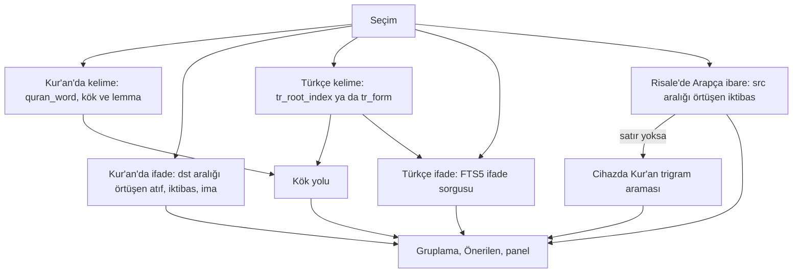

# Bağlantı Modeli

> **Sürüm:** 1.1 · **Tarih:** 19 Ekim 2026 · **Durum:** Taslak
> **Bağlı kararlar:** [K-27](../00-ozet/02-karar-defteri.md#k-27--tek-bağlantı-tablosu) · [K-26](../00-ozet/02-karar-defteri.md#k-26--kalıcı-adresler-çapa-şeması) · [K-06](../00-ozet/02-karar-defteri.md#k-06--yayın-kapısı) · [K-05](../00-ozet/02-karar-defteri.md#k-05--risale-i-nur-ve-lisansı-bekleyen-içerik) · [K-15](../00-ozet/02-karar-defteri.md#k-15--hesap-ve-senkron-v1xte) · [K-25](../00-ozet/02-karar-defteri.md#k-25--i̇lkeler)

Bu dosya bağlantıların veri modelini, puanlamasını, yayın kuralını, seçim çözümleme akışlarını, **Bağlantılar** panelinin sözleşmesini ve geri dönüş yığınını tanımlar. Ayrıntılar: [iktibas tespiti](./02-iktibas-tespiti.md), [kök ve lemma](./03-kok-ve-lemma.md), [anlamsal katman](./04-anlamsal-katman.md).

## 1. İlkeler

- **Katmanlar güvenilirliğe göre sıralanır.** Eski plan seviyeleri gecikmeye göre kuruyordu (kök < 50 ms, konu < 500 ms, yapay zekâ ~3 s; `quran-app-docs/05-cross-ref/01-genel-bakis.md`). Burada bağlantılar içerik hattında önceden hesaplanır ve paketle cihaza iner; kelimeye dokunmak indeksli bir sorgudur.
- **Her bağlantı kendini açıklar:** tür, puan, güven, kanıt, durum, lisans (K-27). Ekranda gerekçe çipi ve güven etiketi görünür.
- **İki uçta aralık tutulur.** Blue Letter Bible'da yalnız ilk kelime eşleştiği için kullanıcılar bağlantının hangi ifadeye ait olduğunu göremiyordu; 2024'te 66.000'den fazla TSK girdisi tüm ifadeyi eşleyecek biçimde güncellendi ([BLB](https://blogs.blueletterbible.org/blb/2024/11/19/updated-tsk/)).
- **İnsan onayı isteyen türler onaysız mağazaya çıkmaz;** makine önerileri rozet taşır (K-25). Panel çevrimdışı çalışır.

## 2. Katmanlar

| Katman | Bağlantı | Üretim | `xref.type` | Faz |
|---|---|---|---|---|
| 1 · Deterministik | Âyet ↔ meal | Çapa grameri | yok (çapadan türetilir) | v1 |
| 1 · Deterministik | Âyet ↔ tefsir aralığı | Tefsir çapasındaki aralık | yok (çapadan türetilir) | v1, tefsir paketiyle |
| 1 · Deterministik | Açık atıf | Türkçe referans grameri + insan onayı | `atif` | v1 |
| 1 · Deterministik | İktibas | n-gram indeksi + hizalama + bağlam + insan onayı | `iktibas` | v1 |
| 2 · Sözlüksel | Kök, lemma | QAC + Türkçe→kök sözlüğü | `kok`, `lemma` | v1 |
| 2 · Sözlüksel | İfade, konkordans | FTS5 ifade sorgusu, KWIC | yok (sorgu anında) | v1 |
| 2 · Küratörlü | Benzer âyet | Kendi n-gram indeksimiz; lisans netleşirse QUL, QurSim | `benzer_ayet` | v1, kısmen |
| 2 · Küratörlü | İma | Editör; dil modeli aday önerir | `ima` | v1, editör girdikçe |
| 2 · Küratörlü | Konu | Atıf dizini ve kök kümelerinden tohum + editör | `konu` | v1.x |
| 3 · Olasılıksal | Anlamsal komşu | Önceden hesaplanmış gömmeler | `anlamsal` | v1.x |
| 3 · Canlı | Serbest metinli anlamsal arama | Çevrimiçi servis | yok | Sonra |

Tablo araştırma raporunun katman tablosunu izler; `ima` ve `konu` satırlarının yeri bu dosyanın önerisidir.

## 3. Yapısal bağlantılar

`meal:elmalili:2:255` her zaman `q:2:255`'in mealidir. `tf:elmalili:2-255-257:p3` Bakara 255–257'yi açıklayan bölümün üçüncü paragrafıdır. Bu bağları `packages/anchors` çapadan türetir; `xref`'e yazılmaz. Cihazdaki paket şeması tefsir birimleri için ayrıştırılmış aralık sütunları taşır; âyet küresel sırayla (1..6236) yazılır ([İçerik paketleri §3.2](../03-veri/03-icerik-paketleri.md#32-metin-paketleri)):

```sql
-- Bakara 255'i kapsayan tefsir paragrafları; 2:255 küresel sırada 262'dir
SELECT anchor FROM unit WHERE kind = 'tefsir' AND 262 BETWEEN ayah_first AND ayah_last ORDER BY ord;
```

Numaralandırma Tanzil'in 6.236 âyetlik düzenidir. Elmalılı'nınki ayrılırsa dönüşüm tablosu gerekir (Doğrulanacak; benzeri: STEP'in TVTMS tablosu, [STEPBible-Data](https://github.com/STEPBible/STEPBible-Data)).

## 4. `xref` tablosu

Bu tablo editoryal veritabanındadır (PostgreSQL); kesin DDL [Editoryal veritabanı §7](../03-veri/02-editoryal-veritabani.md#7-xref-ve-xref_vote)'dedir. Cihazdaki karşılığı `xref_idx`'tir (bölüm 13).

```sql
CREATE TYPE xref_type   AS ENUM ('atif','iktibas','ima','kok','lemma','konu','benzer_ayet','anlamsal');
CREATE TYPE xref_status AS ENUM ('aday','onayli','red');
CREATE TYPE xref_origin AS ENUM ('hat','editor','kullanici_oyu');

CREATE TABLE xref (
  id uuid PRIMARY KEY DEFAULT uuidv7(),
  src_anchor text COLLATE "C" NOT NULL, src_span int4range,
  dst_anchor text COLLATE "C" NOT NULL, dst_span int4range,
  type xref_type NOT NULL,
  score real NOT NULL CHECK (score BETWEEN 0 AND 1),
  confidence real NOT NULL CHECK (confidence BETWEEN 0 AND 1),
  evidence jsonb NOT NULL DEFAULT '{}',
  origin xref_origin NOT NULL,
  status xref_status NOT NULL DEFAULT 'aday',
  votes_up integer NOT NULL DEFAULT 0, votes_down integer NOT NULL DEFAULT 0,
  data_version text NOT NULL,
  license license_status NOT NULL,          -- editoryal veritabanındaki enum
  CONSTRAINT xref_natural_key UNIQUE NULLS NOT DISTINCT (type, src_anchor, src_span, dst_anchor, dst_span)
);
CREATE INDEX xref_src ON xref (src_anchor, type);
CREATE INDEX xref_dst ON xref (dst_anchor, type);
CREATE INDEX xref_queue ON xref (type, confidence DESC) WHERE status = 'aday';
```

1. **Uçlar birim düzeyindedir** (âyet, paragraf, hadis); kelime ve karakter ayrıntısı aralıktadır. `q:2:255:3-7` seçimi `dst_anchor = 'q:2:255'`, `dst_span = '[3,8)'` olur.
2. **Aralık yarı açıktır.** Metin biriminde kanonik metindeki Unicode kod noktası ofsetidir (kanonik metin: kaynağın dağıttığı hâli, kendi ürettiğimiz metinlerde NFC; [K-26](../00-ozet/02-karar-defteri.md#k-26--kalıcı-adresler-çapa-şeması)) (çapadaki `@başlangıç-bitiş` sayıları); Kur'an biriminde QAC/QUL kelime konumudur. NULL birimin tamamıdır. UTF-16 dönüşümünü `packages/anchors` yapar.
3. **Doğal anahtar tektir.** Hat aynı satırı günceller; `id`, `status` ve editör satırları korunur:
   ```sql
   INSERT INTO xref AS x (src_anchor, src_span, dst_anchor, dst_span, type, score, confidence, evidence, origin, status, data_version, license)
   VALUES ($1,$2,$3,$4,$5,$6,$7,$8,'hat','aday',$9,$10)
   ON CONFLICT ON CONSTRAINT xref_natural_key DO UPDATE
   SET score = EXCLUDED.score, confidence = EXCLUDED.confidence, evidence = EXCLUDED.evidence,
       data_version = EXCLUDED.data_version, license = EXCLUDED.license
   WHERE x.origin = 'hat';
   ```
   Yeni çalışmada üretilmeyen `aday` satır silinir; `onayli` satır silinmez, "yeniden doğrula" kaydıyla `review` kuyruğuna düşer.
4. **Yön.** `atif`, `iktibas`, `ima` atıf yapan metinden âyete ya da hadise gider; "Bu âyet Risale'de nerede geçiyor?" `dst_anchor` indeksiyle çözülür. `kok`, `lemma`, `anlamsal` kaynak birimden komşuya, birim başına ilk N satırdır. Simetrik `benzer_ayet` kaynakları (QurSim) tek satırdır, sorgu iki sütuna bakar. `konu` birimden konu düğümüne gider.
5. **Lisans en kısıtlayıcı değerdir:** `max(src kaynağı, dst kaynağı, bağlantı verisinin kaynağı)`, sıra `serbest < bekliyor < ic_kullanim < kapali`. Sorunlu çıkan bir veri seti tek sorguyla kapanır.
6. **Uç metni değişirse** satır yeniden doğrulanır. `evidence.src_hash`/`dst_hash` uç birimin `content_hash` değerinin ilk 16 hanesidir. Özet değişince hat eski aralık metnini yeni metinde arar; tek eşleşmede ofseti kaydırır, yoksa satırı kuyruğa düşürüp yayından çıkarır.

Başlıca `evidence` anahtarları: `iktibas` → `matched_words`, `coverage`, `identity`, `phrase_freq`, `context`, `index`, `alternatives`, `position`; `kok`/`lemma` → `shared` [{`root`, `idf`, `src_word`, `dst_word`}], `etymological_only`, `lexicon_status`; `benzer_ayet` → `subtype` (`sozluksel`/`alim`/`mutesabih`); `anlamsal` → `model`, `cosine`, `calibrated`; hepsi → `src_hash`, `dst_hash`, `source_id`.

## 5. Bağlantı türleri

| Tür | Tanım | Örnek (biçim örneği) |
|---|---|---|
| `atif` | Âyete ya da hadise adı ve numarasıyla açık gönderme | `tf:elmalili:2-255-257:p3@40-63` "(Bakara Sûresi, 255)" → `q:2:255` |
| `iktibas` | Âyet metninin Arapça olarak aynen ya da küçük yazım farkıyla alıntısı; tam ya da kısmi | Risale paragrafındaki وَاِنْ مِنْ شَىْءٍ اِلَّا يُسَبِّحُ بِحَمْدِهٖ → `q:17:44` + kelime aralığı |
| `ima` | Lafzı vermeden âyetin manasına işaret | Başlığı bir âyetin manası olan bölüm → o âyet, `origin = 'editor'` |
| `kok` | İki birimin aynı Arapça kökten kelime taşıması | "sabır" geçen `rn:…:p4` ↔ `q:2:153` (بِٱلصَّبْرِ, ٱلصَّٰبِرِينَ), kök ص ب ر |
| `lemma` | Aynı Arapça lemmanın paylaşılması; kökten dar ve kesin | Türkçe "şükür" ← شُكْر |
| `benzer_ayet` | Ortak ifade, âlim listesi ya da müteşâbih kaydı | QUL Similar Ayah: 1:1 → 27:30, 59:22, 1:3, 41:2 ([QUL](https://qul.tarteel.ai/resources/ayah-theme/74)) |
| `konu` | Birimin bir konu düğümüne bağlanması | `q:2:255` → `konu:tevhid` |
| `anlamsal` | Gömme benzerliğiyle önerilen komşu | `rn:…:p4` → `q:…`, kalibre puan 0,72 |

- **İma.** Risale'de âyetler çoğu zaman başlık olur ve pek çok âyet metni verilmeden açıklanır ([RİNAP](https://rinap.uskudar.edu.tr/uploads/site/6/content/files/risale-i-nurun-tefsirdeki-yeri-compressed.pdf)). Sözlüksel tespit bunları bulamaz; imayı editör girer, dil modeli yalnız `aday` önerir.
- **Benzer âyet.** QUL 4.001 benzer âyet ve 5.277 müteşâbih kaydı, QurSim âlim kaynaklı 7.600'den fazla çift sunar ([QUL](https://qul.tarteel.ai/resources); [QurSim](https://aclanthology.org/L12-1051/)). Kaynak bazında lisans yoktur ([QUL SSS](https://qul.tarteel.ai/faq)); bu satırlar `license = 'bekliyor'` ile girer ve iç derlemede kalır. Mağaza için sözlüksel benzer âyetleri Tanzil metninde kendi n-gram indeksimizle hesaplamayı öneriyorum ([02 §5](./02-iktibas-tespiti.md)). Raporun "sözlüksel benzerlik" ve "âlim kaynaklı ilişki" türleri `evidence.subtype` değerleridir.
- **Konu (v1.x).** QUL'un 2.512 başlıklı konu dizini (ontoloji başlıkları QAC'den, tematik başlıklar Clear Quran çevirisinden) hazır kaynaktır ([QUL konular](https://qul.tarteel.ai/resources/ayah-topics/45)); Clear Quran başlıkları telifli olabilir (Doğrulanacak). Eski planın beş küratörlük, 15–25 bin $'lık taksonomisi yerine konular atıf dizini ve kök kümelerinden tohumlanır, Risale'ye özgü kavramlar (haşir delilleri, esmâ tecellileri, ene ve zerre) dil modeli önerisi ve editör onayıyla eklenir (rapor). Yalnız birim → konu satırı saklanır; aynı konuyu paylaşan birimler sorgu anında bulunur.

## 6. Puanlama

`score` tür içindeki bağ gücüdür ve sıralar. `confidence` doğru olma olasılığıdır; etiketi ve yayın eşiğini belirler. Sabitler başlangıç değeridir ve altın setlerle kalibre edilir.

```text
atif        score = 1,0; confidence ayrıştırma kalitesinden (02 §3)
iktibas     n eşleşen kelime, N âyetin kelime sayısı, e düzenleme, f dizinin geçtiği âyet sayısı
            score = (0,5 + 0,5·n/N) · min(1, n/7) · n/(n+e) · 1/f     (bağlam tek hedef seçerse f = 1)
kok         idf_n(r) = ln(6236/df(r)) / ln(6236)      df: r kökünü taşıyan âyet sayısı
            birim-birim  score(A,B) = Σ idf_n(r ∈ K(A)∩K(B)) / Σ idf_n(r ∈ K(A))
            tek kelime   score = idf_n(r) · (aynı lemma ? 1 : 0,8) · (yalnızca etimolojik ? 0,5 : 1)
lemma       kok ile aynı, lemma sıklığıyla
benzer_ayet sözlüksel min(1, ortak/7)·(0,5 + 0,5·kapsama); QUL score/100; QurSim derecesi 0–1'e (ölçek Doğrulanacak)
konu        score(A,B|T) = w(A,T)·w(B,T)·idf_n(T)     w: 1,0 doğrudan, 0,5 dolaylı
anlamsal    score = confidence = kalibre(kosinüs), grup çifti başına izotonik eşleme (04 §6)
```

Rapor iktibası kapsama × uzunlukla puanlar ve kalıp ifadeye indirim uygular. Kapsama 0,5–1'e yumuşatılır, çünkü uzun âyetten alınan yedi kelimelik parça saf kapsamayla sıfıra yakın puan alırdı. Kalıp indirimini `1/f` yapar. Örneğin 18 âyette geçen تَجْرِي مِن تَحْتِهَا الْأَنْهَارُ خَالِدِينَ bağlamsız her hedefte 1/18 alır ([QUL](https://qul.tarteel.ai/morphology_phrases?page=61)). IDF, ق و ل gibi yaygın köklerin öne geçmesini önler.

| Etiket | Koşul | Görünüm |
|---|---|---|
| Onaylı | `status = 'onayli'` | açık |
| Yüksek güven | otomatik, `confidence ≥ 0,90` | açık |
| Orta güven | otomatik, `0,70 ≤ confidence < 0,90` | açık |
| Düşük güven | otomatik, `0,50 ≤ confidence < 0,70` | "Daha fazla (otomatik)" altında katlı |
| Makine önerisi | `type = 'anlamsal'` | her zaman katlı |
| Aday | onay isteyen türde `aday`; yalnız iç derleme | açık, rozetli |

`status = 'red'` ya da `confidence < 0,50` gösterilmez. Tablodaki adlar sınıf adıdır; ekranda yazılan etiket ve rozet görünümü [Okuma deneyimi §8](../01-urun/02-okuma-deneyimi.md#8-bağlantılar-paneli)'dedir (Onaylı "kesin", Yüksek güven "yüksek", Orta güven "orta", Düşük güven "düşük").

## 7. "Önerilen" listesi

Liste v1.x'te gelir; v1 panelinde yalnız esere göre gruplar vardır ([Okuma deneyimi §8](../01-urun/02-okuma-deneyimi.md#8-bağlantılar-paneli); kapsam tablosunda yer almayan özellik v1'de değildir, [Kapsam §4.6](../01-urun/01-kapsam-ve-fazlar.md#46-bağlantılar)). Panelin başında en çok beş öğe durur. Her tür kendi `score` sırasıyla dizilir; sıralar ağırlıklı RRF ile birleşir: `RRF(d) = Σ w_t / (60 + sıra_t(d))`, sıra 1'den başlar. Azure AI Search aynı formülü k ≈ 60 önerisiyle kullanır ve ağırlık katkıyı çarpar ([MS Learn](https://learn.microsoft.com/en-us/azure/search/hybrid-search-ranking)). Başlangıç ağırlıkları: `atif`, `iktibas` 1,0 · `ima` 0,8 · `benzer_ayet`, `konu` 0,6 · `lemma` 0,5 · `kok`, FTS5 ifadesi 0,4 · `anlamsal` katılmaz.

- Sonuçlar gösterim birimine indirgenir: âyet, paragraf ya da hadis. Aynı birim birden çok türden gelirse katkılar toplanır, bütün gerekçe çipleri görünür.
- Katlı öğeler, seçimin kendi birimi ve yapısal sonuçlar katılmaz. Eşitlikte onaylı öğe, sonra okuma sırası önce gelir.
- Örnek: atıf listesinde 1., kök listesinde 3. olan paragraf 1,0/61 + 0,4/63 ≈ 0,0227; yalnız kök listesinde 1. olan 0,4/61 ≈ 0,0066 alır. Hesap cihazda `packages/reader-core` içinde yapılır.

## 8. Yayın kuralı ve insan onayı

| Tür | Mağaza (`public`) koşulu |
|---|---|
| `atif`, `iktibas`, `ima`, `konu` | İnsan onayı: `status = 'onayli'` |
| `kok`, `lemma` | `confidence ≥ 0,50` ve Türkçe taraftaki sözlük girdisi onaylı |
| `benzer_ayet` | `confidence ≥ 0,50` ve bağlantı verisinin lisansı serbest |
| `anlamsal` | v1.x derlemesi, `confidence ≥ 0,50`, "Makine önerisi" rozeti |

Her türde ek koşul `license = 'serbest'` ve iki ucun paketinin derlemede bulunmasıdır (K-06). İç derleme `red` dışındaki her satırı "Aday" rozetiyle görür. Risale kaynağı bugün mağaza paketine girmediği için (K-05) Risale uçlu satırlar mağaza derlemesinden düşer.

```sql
SELECT x.* FROM xref x                                     -- Mutalaa.Publisher
WHERE x.license = 'serbest' AND x.status <> 'red'
  AND NOT EXISTS (SELECT 1 FROM review r WHERE r.xref_id = x.id AND r.state = 'acik')
  AND CASE WHEN x.type IN ('atif','iktibas','ima','konu') THEN x.status = 'onayli'
           WHEN x.type IN ('kok','lemma') THEN x.confidence >= 0.5
                AND coalesce(x.evidence->>'lexicon_status','onayli') = 'onayli'
           WHEN x.type = 'benzer_ayet' THEN x.confidence >= 0.5
           WHEN x.type = 'anlamsal' THEN x.confidence >= 0.5 AND $1   -- $1: v1.x derlemesi
      END;
```

## 9. Seçim çözümleme akışları



| Seçim | Çözüm |
|---|---|
| Kur'an'da Arapça kelime `q:S:A:W` | `quran_word` → kök ve lemma (düzeltme katmanıyla). Önce aynı lemma, sonra aynı kök geçen âyetler. `tr_root_index` ile kökü taşıyan meal, tefsir ve Risale birimleri. `xref_idx`'te `dst_start`–`dst_end` aralığı W'yi kapsayan iktibaslar. |
| Kur'an'da Arapça ifade `q:S:A:i-j` | `xref_idx`'te `dst_anchor = 'q:S:A'` ve `dst_start`–`dst_end` aralığı i–j kelimeleriyle örtüşen `atif`, `iktibas`, `ima` (bölüm 13). Aynı normalize ifadenin geçtiği diğer âyetler (cihazdaki Kur'an trigram tablosu) ve `benzer_ayet`. Kökler IDF sırasıyla "Kökler" alt grubunda. |
| Türkçe kelime (meal, tefsir, Risale) | Ofseti kapsayan `tr_root_index` satırı varsa kök oradan gelir (hat bağlamla çözmüştür). Yoksa normalize edilir: `tr_form` → Türkçe lemma → kök; birden çok kök çıkarsa kart seçim ister. Sonra kök yolu ve lemma biçimleriyle FTS5 konkordansı; kökü olmayan kelimede yalnız konkordans. |
| Türkçe ifade | Normalize FTS5 ifade sorgusu bütün `ATTACH` paketlerde, bm25 ve `snippet()` ile KWIC. İzafet zinciri ("rahmet-i İlâhiye") parçalanır, kökler "Kökler" alt grubuna girer. |
| Risale'de ya da tefsirde Arapça ibare | `xref_idx`'te `src_start`–`src_end` aralığı seçimle örtüşen `iktibas`/`atif` → âyet; kart âyet adresini, Arapça âyeti, Elmalılı mealini, "Âyete git" ve "Karşılaştır" eylemlerini gösterir. Satır yoksa cihazdaki Kur'an trigram tablosunda aranır, sonuç "otomatik eşleşme" çipiyle katlı gelir. Kur'an'da yoksa yüklü hadis paketleri aranır; hadiste kart `h:` adresini ve varsa Türkçesini gösterir. Yine yoksa kart "Kaynak bulunamadı" der ve Bağlantılar paneline geçiş sunar. Kartın metinleri [Okuma deneyimi §12](../01-urun/02-okuma-deneyimi.md#12-risale-i-nur-okuyucu)'dedir. |

Normalizasyon ve FTS5: [arama](../03-veri/05-arama-fts5.md). Eski plandaki kök sorgusu Kur'an içi sonuçları dışarıda bırakıyordu (`source_type != 'quran'`); kelime kartının "bu kökten geçen diğer âyetler" düğmesi tam bunları istediği için burada dahil edilir (rapor).

## 10. "Bağlantılar" paneli: arayüz sözleşmesi

- **Kap.** Telefonda modal olmayan tek alt sayfa (@gorhom/bottom-sheet, K-29), %40 ve %90 tutunma noktası ([Mobil ekranlar §4](../01-urun/03-mobil-ekranlar.md#4-alt-sayfalar-ve-pencereler)), görünür "Kapat" düğmesi. Alt sayfalar üst üste açılmaz; yeni sorgu içeriği değiştirir ve yığına girer ([NN/g](https://www.nngroup.com/articles/bottom-sheet/)). Tablette (≥ 900 px) yan panel, masaüstünde üçüncü sütun (rapor).
- **Başlık.** Seçim özeti (`صَبْر · kök ص ب ر` ya da "rahmet-i İlâhiye"), kırıntı satırı, "Kapat".
- **Gruplar sabit sırayla:** Önerilen (v1.x, §7), Kur'an, Meal, Tefsir, Hadis, Risale-i Nur, Kitaplar. Grup adları [Okuma deneyimi §8](../01-urun/02-okuma-deneyimi.md#8-bağlantılar-paneli)'den gelir. Boş grup gizlenir. Başlıkta toplam sayı, ilk üç öğe açık, sonra "Tümünü göster (N)". Her grubun sonunda katlı "Daha fazla (otomatik) · N".
- **Öğe.** Eser rozeti, okunur adres, en çok iki satır parça (eşleşen aralık vurgulu), en çok iki gerekçe çipi ve "+N", güven etiketi. Dokunma hedefe atlar ve aralığı vurgular. Uzun basma: "Aç", "Bağlantıyı kopyala", "Not ekle"; v1.x'te "Yararlı", "Yararsız", "Hata bildir".
- **Durumlar.** Gruplar bağımsız yüklenir. Derlemede olup yüklü olmayan paket için "Risale-i Nur paketi yüklü değil · İndir" satırı Depolama ekranına götürür; derlemede olmayan içerik görünmez.
- **Erişilebilirlik.** 44×44 pt hedef, metinli etiket, Arapça boyut ayarı. Ekran okuyucu "Sözler, 10. Söz, 3. Hakikat, 4. paragraf. Doğrudan iktibas yüzde 100. Kesin." okur.

| Kaynak | Gerekçe çipi |
|---|---|
| Yapısal | âyetin meali · âyeti açıklayan bölüm |
| `atif` · `iktibas` · `ima` | açık atıf (Bakara 255) · doğrudan iktibas %100 · kısmi iktibas %40 · âyete işaret |
| `kok` · `lemma` | aynı kök ص ب ر (gerekirse "· yalnızca etimolojik") · aynı kelime صَبْر |
| `benzer_ayet` | ortak ifade · 5 kelime · ilişkili âyet (âlim listesi) · müteşâbih |
| `konu` · `anlamsal` | konu: Haşir · anlamca yakın |
| FTS5 · cihaz araması | aynı ifade · otomatik eşleşme |

| Çapa | Okunur adres |
|---|---|
| `q:2:255` · `q:2:255:3-7` | Bakara 255 · Bakara 255, 3–7. kelimeler |
| `meal:elmalili:2:255` | Elmalılı meali › Bakara 255 |
| `tf:elmalili:2-255-257:p3` · `tf:elmalili:mukaddime:p4` | Hak Dini Kur'an Dili › Bakara 255–257 ¶3 · Hak Dini Kur'an Dili › Mukaddime ¶4 |
| `rn:sozler:soz-10:hakikat-3:p4` | Sözler › 10. Söz › 3. Hakikat ¶4 |
| `h:tecrid:15` · `ht:naim:tecrid:15` | Tecrîd-i Sarîh › 15 · Tecrîd-i Sarîh (Ahmed Naim) › 15 |

Adres slug'dan türetilmez. `readableAddress(anchor)` paketteki birim başlıklarını üstten alta birleştirir; sure adları `core` paketindeki `sure` tablosunun kanonik yazımını kullanır (kaynağı `shared/data/sure-adlari.json`; [Çapa şeması §12](../03-veri/01-capa-semasi.md#12-sure-adları-ve-insan-yazımları)). Öğe modeli: `{ xrefId?, type, dstAnchor, dstSpan?, address, a11yLabel, workBadge, snippet: {text, marks}, reason, score, label, folded, approved }`.

## 11. Geri dönüş yığını

Davranış [Okuma deneyimi §9](../01-urun/02-okuma-deneyimi.md#9-atla-ve-dön) ve [Mobil ekranlar §8](../01-urun/03-mobil-ekranlar.md#8-gezinme-kuralları), durumun yeri [Mobil mimari §5](../06-mobil/01-mobil-mimari.md#5-durum-yönetimi) dosyasındadır; bu bölüm onları özetler. Her atlamadan önce `{ rota, çapa, ofset, seçim, biçim, gerekçe }` yığına itilir. Panelde "Bakara 255 › Kök: ح ي ي › Âl-i İmrân 2" gibi bir kırıntı izi görünür. Okuma konumu başlangıçtan farklı olduğu sürece "↩ Okuduğun yere dön (Bakara 255)" çipi kalır (rapor).

```ts
// Tipler ve saf işlevler packages/reader-core'da; durum Zustand useReader deposunda, bellekte (Mobil mimari §5)
type ReadingLocation = { anchor: string; offsetRatio: number;   // birim içinde 0–1; yazı boyutu ve döndürmeye dayanıklı
  view: 'mushaf-a'|'mushaf-b'|'mushaf-c'|'meal'|'tefsir'|'risale'|'hadis'; page?: number };
type PanelQuery = { kind: 'word'|'selection'; anchor: string; span?: [number, number] }
  | { kind: 'root'; rootId: number } | { kind: 'lemma'; lemmaId: number } | { kind: 'phrase'; text: string; lang: 'tr'|'ar' };
// Atlama kaydı: rota, çapa + ofset + biçim (location), seçim ve o anki panel sorgusu, gerekçe (label)
type BackStackEntry = { id: string; at: number; route: string; location: ReadingLocation;
  selection?: PanelQuery; label: string };
interface BackStackState { origin: BackStackEntry | null; entries: BackStackEntry[] }   // en çok 12 kayıt
type PanelStack = PanelQuery[];   // panelin iç yığını (kelime → kök → lemma); panel kapanınca silinir
```

- **Atlama:** bulunulan konum yığına itilir; zincirin ilk kaydı köken olur. Telefonda alt sayfa en alçak noktaya iner. Derinlik en çok 12 adımdır; aşılınca köken korunur, en eski ara kayıt düşer.
- **Geri:** Android geri tuşu önce alt sayfayı kapatır, sonra seçimi temizler, sonra yığında bir adım geri gider (Mobil ekranlar §8 kural 3). Panelin iç adımları ayrı yığındadır; panel kapanınca silinir, atlama yığını kalır (kural 10). **Okuduğun yere dön** kökene gider ve yığını temizler; **Burada kal** zinciri bitirir.
- Yığın kalıcı değildir; bellekte durur. Zincir açıkken `reading_position` yazılmaz, "Burada kal" yazar (Okuma deneyimi §9 kural 4–5). Konum kaydı derin bağlantıya çevrilir (`mutalaa://q/2/255`).

## 12. Geri bildirim oyları ve inceleme kuyruğu (v1.x)

Oy hesap ister ve v1.x'te gelir (K-15). Menü "Yararlı", "Yararsız" ve nedenli "Hata bildir" (`yanlis_ayet`, `iktibas_degil`, `kok_yanlis`, `alakasiz`) sunar; OpenBible da bağlantılarını topluluk oyuyla puanlar ([HF openbible](https://huggingface.co/datasets/NuBerea/openbible)). Sunucu tablosu önerisi: `xref_vote(xref_id, account_hash, vote, reason, data_version, created_at)`; `account_hash = HMAC-SHA256(sunucu sırrı, hesap kimliği)`. Gece işi oyları `votes_up`/`votes_down` sayaçlarına işler; etki sonraki paket sürümünde cihaza ulaşır.

- `n = up + down ≥ 5` ise grup içi sıra `score · (0,8 + 0,4 · wilson(up, n))` olur (Wilson alt sınırı, z = 1,96).
- Kuyruk: onaylı satırda `n ≥ 5` ve `wilson(down, n) ≥ 0,30` → "yeniden incele"; aday satırda `n ≥ 5` ve `wilson(up, n) ≥ 0,70` → "onay adayı"; en az iki `yanlis_ayet` ya da `iktibas_degil` → yüksek öncelik. Kullanıcının doğruladığı cihaz eşleşmesi `origin = 'kullanici_oyu'`, `status = 'aday'` ile yeni satır olur.
- Oy durumu kendiliğinden değiştirmez; kararı editör verir. Hesap silinince oylar silinir. Oy sayısı ve katkı sıralaması gösterilmez (K-25). Bkz. [KVKK](../07-yayin/02-kvkk-ve-gizlilik.md).

## 13. Paketleme ve cihazda sorgu

Satır yerleşimi [İçerik paketleri §4](../03-veri/03-icerik-paketleri.md#4-bağlantıların-paketlere-dağılımı)'tedir: iki ucu `core` içindeyse `core`; bir ucu Risale ise `risale-dizin` (kitap paketi silinse de bağlantı kalır, ATTACH sınırı); bir ucu `core`, öbür ucu isteğe bağlı P'deyse P; iki ucu farklı isteğe bağlı paketlerdeyse bağımlı (`depends_on`) olan paket, bağımlılık yoksa `pack_id` değeri alfabetik olarak sonra gelen paket.

```sql
-- Cihazdaki paket tablosu (İçerik paketleri §3.2); yayıncı görünüm kuralını önceden hesaplar
CREATE TABLE xref_idx (id TEXT PRIMARY KEY, src_anchor TEXT NOT NULL, src_start INTEGER, src_end INTEGER,
  dst_anchor TEXT NOT NULL, dst_start INTEGER, dst_end INTEGER, type TEXT NOT NULL, score REAL NOT NULL,
  confidence REAL NOT NULL, approved INTEGER NOT NULL, folded INTEGER NOT NULL, evidence TEXT NOT NULL,
  data_version TEXT NOT NULL);
CREATE INDEX xref_idx_src ON xref_idx (src_anchor, type);
CREATE INDEX xref_idx_dst ON xref_idx (dst_anchor, type);
-- Bakara 255'in 3–7. kelimeleriyle örtüşen Risale atıf ve iktibasları; bağlı her paket için UNION ALL
SELECT src_anchor, src_start, src_end, score, approved, folded, evidence FROM p_risale_dizin.xref_idx
WHERE dst_anchor = 'q:2:255' AND type IN ('atif','iktibas','ima')
  AND (dst_start IS NULL OR (dst_start < 8 AND dst_end > 3));
```

Hedef: ilk grup orta seviye Android'de 100 ms, bütün gruplar 300 ms altında (öneri); FTS5 50 ms altında (K-17). `shared/test-vectors/` çapa → okunur adres, RRF sırası ve yayın süzgeci için sabit örnekler taşır; ölçüm [test stratejisinde](../07-yayin/03-test-stratejisi.md).

## 14. Açık sorular

1. **Çözüldü (19 Ekim 2026):** K-27'nin "İstisna" satırı âyet ↔ meal ve âyet ↔ tefsir aralığı bağlarının çapadan türetildiğini ve `xref`'e yazılmadığını söyler ([K-27](../00-ozet/02-karar-defteri.md#k-27--tek-bağlantı-tablosu)).
2. **Çözüldü (19 Ekim 2026):** K-26 ve [Çapa şeması §1–§2](../03-veri/01-capa-semasi.md#1-birim-türleri) `konu:{slug}` ve âyet aralığı `q:2:255-257` biçimlerini taşır. Âyet aralığı birim olmadığı için `xref` ucu olmaz; aralık atıfları âyet başına satıra bölünür ve `evidence.group` ile bağlanır ([Editoryal veritabanı §7](../03-veri/02-editoryal-veritabani.md#7-xref-ve-xref_vote)).
3. **Çözüldü (19 Ekim 2026):** `@başlangıç-bitiş` yarı açıktır: başlangıç dahil, bitiş hariç ([K-26](../00-ozet/02-karar-defteri.md#k-26--kalıcı-adresler-çapa-şeması)).
4. **Çözüldü (19 Ekim 2026):** `xref.license` `license_status` kümesini tutar ([Editoryal veritabanı §7](../03-veri/02-editoryal-veritabani.md#7-xref-ve-xref_vote)).
5. Risale bağlantıları metin olmadan "dizin" olarak mağaza derlemesinde gösterilebilir mi? Rapor önerir ve avukat görüşü ister; hukuki görüş değildir.
6. Kurul onayı bağlantı verisini ve Risale içindeki satır içi meal kartını kapsar mı? [Yayın kapısı](../07-yayin/01-yayin-kapisi-ve-kurul.md) ile netleşmeli.
7. Konu düğümü tabloları editoryal veritabanında yok (ED-6, v1.x). **Kısmen çözüldü (19 Ekim 2026):** `xref_vote` [Editoryal veritabanı §7](../03-veri/02-editoryal-veritabani.md#7-xref-ve-xref_vote) ve [Backend API](../02-mimari/05-backend-api.md) §5'te; `tr_root_index` ve `tr_form` Editoryal veritabanı §6 ile [İçerik paketleri §3.2–§3.3](../03-veri/03-icerik-paketleri.md#32-metin-paketleri)'tedir.

## İlgili dosyalar
- [İktibas tespiti](./02-iktibas-tespiti.md) · [Kök ve lemma](./03-kok-ve-lemma.md) · [Anlamsal katman](./04-anlamsal-katman.md)
- [Karar defteri](../00-ozet/02-karar-defteri.md) · [Sözlük](../00-ozet/03-sozluk.md)
- [Okuma deneyimi](../01-urun/02-okuma-deneyimi.md) · [Mobil ekranlar](../01-urun/03-mobil-ekranlar.md) · [Tasarım sistemi](../01-urun/04-tasarim-sistemi.md)
- [Çapa şeması](../03-veri/01-capa-semasi.md) · [Editoryal veritabanı](../03-veri/02-editoryal-veritabani.md) · [İçerik paketleri](../03-veri/03-icerik-paketleri.md) · [Kullanıcı verisi](../03-veri/04-kullanici-verisi-ve-senkron.md) · [Arama](../03-veri/05-arama-fts5.md)
- [Mobil mimari](../06-mobil/01-mobil-mimari.md) · [Yayın kapısı](../07-yayin/01-yayin-kapisi-ve-kurul.md) · [KVKK](../07-yayin/02-kvkk-ve-gizlilik.md) · [Test stratejisi](../07-yayin/03-test-stratejisi.md) · [Kaynakça](../09-kaynakca.md)
