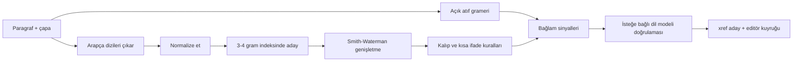

# İktibas ve Atıf Tespiti

> **Sürüm:** 1.1 · **Tarih:** 19 Ekim 2026 · **Durum:** Taslak
> **Bağlı kararlar:** [K-27](../00-ozet/02-karar-defteri.md#k-27--tek-bağlantı-tablosu) · [K-05](../00-ozet/02-karar-defteri.md#k-05--risale-i-nur-ve-lisansı-bekleyen-içerik) · [K-04](../00-ozet/02-karar-defteri.md#k-04--hadis-kaynakları) · [K-12](../00-ozet/02-karar-defteri.md#k-12--i̇çerik-hattı-python) · [K-13](../00-ozet/02-karar-defteri.md#k-13--editör-paneli) · [K-25](../00-ozet/02-karar-defteri.md#k-25--i̇lkeler)

Bu dosya Risale-i Nur ve tefsir metinlerindeki âyet iktibaslarının ve açık atıfların bulunmasını tanımlar. Çıktı `xref` tablosuna `type = 'atif'` ve `type = 'iktibas'` satırlarıdır ([bağlantı modeli](./01-baglanti-modeli.md)). İş Python 3.13 içerik hattında, `pipeline/enrich/` altında, çevrimdışı çalışır (K-12). Her satır editör panelinde onaylanmadan mağazaya çıkmaz (K-13). Metni verilmeden yapılan imalar sözlüksel tespitle bulunamaz; onları editör `ima` olarak girer.

Girdiler: Risale-i Nur (K-05 gereği yalnız iç derleme), Elmalılı tefsiri (transkripsiyon bitince), sonra hadis Arapça metinleri. Dizin üretmek için Risale metnini işlemenin hukuki durumu bir fikri haklar avukatıyla doğrulanmalıdır (rapor). Hukuki görüş değildir.

## 1. Hat akışı



Rapor beş adımı sıralar: açık referansları küçük bir gramerle ayrıştırmak, Arapça dizileri normalize edip n-gram indeksinde aramak, eşleşmeleri hizalamayla genişletip kapsamayı ölçmek, kısa ve kalıp ifadeleri bağlamla ayırmak ve insan onayı.

## 2. Açık Türkçe atıf grameri

| Biçim | Örnek | Not |
|---|---|---|
| Parantezli ad, virgül, numara | (Bakara Sûresi, 255) | rapordaki örnek |
| Ad, iki nokta, numara | Âl-i İmrân: 7 | rapordaki örnek |
| "Sûre-i" önekli | Sûre-i Bakara, 255 | araştırma notu |
| Ad ve sure/âyet numarası | Bakara 2/255 | olası biçim; örneklemde doğrulanacak |
| Yalnız numara | (2:255), [2/255] | ad yoksa yalnız parantez içinde kabul edilir |
| Sıra sayısıyla | Bakara Sûresinin 255. âyeti | |
| Aralık, liste | Bakara, 255-257 · Bakara, 255, 257 | âyet başına satır + `evidence.group` |
| Adlandırılmış âyet | Âyetü'l-Kürsî | editör onaylı ayrı liste |
| Arapça | البقرة: ٢٥٥ | eski plandaki desen |

Gramer, İncil Pasaj Referans Ayrıştırıcısı'nın yolunu izler: kitap adları regex ile en uzundan başlayarak eşlenir, ardından bir gramer pasajı ayrıştırır ([Bible Passage Reference Parser](https://github.com/openbibleinfo/Bible-Passage-Reference-Parser)).

```ebnf
atif    = [ "(" | "[" ] , sure , ayirici , ayetler , [ ")" | "]" ] ;
sure    = [ "Sûre-i " ] , SURE_ADI , [ " Sûresi" | " sûresi" | " Sûresinin" ] | SURE_NO ;
ayirici = ":" | "," | "/" | " " ;
ayetler = aralik , { "," , aralik } ;
aralik  = SAYI , [ ( "-" | "–" ) , SAYI ] , [ ". âyet" , [ "i" | "ler" ] ] ;
```

`SURE_ADI` alternatifleri `surah_alias` tablosundan uzunluk sırasıyla derlenir:

```sql
CREATE TABLE surah_alias (            -- kesin DDL: Editoryal veritabanı §6
  surah_no  smallint NOT NULL CHECK (surah_no BETWEEN 1 AND 114),
  alias     text NOT NULL,             -- görüldüğü gibi: 'Âl-i İmrân'
  alias_key text NOT NULL,             -- geniş anahtar (Arama §1.2): 'al i imran'
  kind      text NOT NULL,             -- kanonik | yazim | arapca | diger_ad
  risky     boolean NOT NULL DEFAULT false,
  status    xref_status NOT NULL DEFAULT 'aday',
  PRIMARY KEY (surah_no, alias)
);
```

Varyant tablosu planı:
- **Kanonik ad** `surah_alias` tablosundaki `kind = 'kanonik'` satırıdır; onaylı satırlar `shared/data/sure-adlari.json` dosyasına dışa aktarılır ([Editoryal veritabanı §6](../03-veri/02-editoryal-veritabani.md#6-türkçe--kök-indeksi-ve-sure-adları); [Çapa şeması §12](../03-veri/01-capa-semasi.md#12-sure-adları-ve-insan-yazımları)). Âyet sayıları Tanzil üst verisinden gelir (toplam 6.236).
- **Üretilen yazımlar:** şapkalı ve şapkasız (Âl-i İmrân, Al-i İmran, Âli İmrân), noktalı ve noktasız I (OCR hataları için), "Sûre-i X", "X Sûresi", "Sûretü'l-X", Arapça (البقرة, سورة البقرة). Editör her satırı onaylar.
- **Diğer adlar** örnekleri editör doğrular: Tevbe/Berâe, İsrâ/Benî İsrâîl, Mü'min/Ğâfir, Fussılet/Hâ-Mîm Secde, İnsân/Dehr.
- **Riskli adlar:** ortak kelime ya da özel isim olan sure adları (Nûr, Fecr, Asr, Leyl, Şems, Kamer, Hac, Kalem, Nahl, Neml, Fil, Tîn, Rûm, Kadr, Nasr ve Yûnus, Hûd, Yûsuf, İbrâhîm, Meryem, Muhammed, Nûh). Bunlar yalnız parantez, "Sûre/sûresi" ya da "âyet" kelimesiyle kabul edilir; "Risale-i Nur" böylece elenir. Bible parser da ham metinde "she is 2 cool" ifadesini Isaiah 2 okuduğu için aynı uyarıyı yapar.

Doğrulama ve güven:
1. Sure 1–114, âyet 1 ile o surenin âyet sayısı arasında olmalı; aralık dışı eşleşme atılır ve günlüğe yazılır.
2. ±200 karakter içinde bir Arapça dizi aynı âyete hizalanırsa `consistent_quote = true` olur ve güven 0,99'a çıkar. Başka âyete hizalanırsa satır "tutarsız" işaretlenir, güven 0,30'a iner ve kuyruğun başına gider. Neden numaralandırma farkı ya da OCR hatası olabilir.
3. Başlangıç güvenleri: parantez ya da anahtar kelimeli güvenli ad 0,95; çıplak "Ad: SAYI" 0,85; güçlü ipuçlu riskli ad 0,85; adlandırılmış âyet 0,90. Eski planın sabit değerleri (Kur'an 0,85, hadis 0,80, 0,6 altı gizli) bu kalibre değerlerle değişir (`quran-app-docs/04-okuma/03-risale-i-nur-okuyucu.md`).

## 3. Arapça dizilerin çıkarılması

Türkçe ana metindeki en uzun Arapça harf dizileri toplanır. Ofsetler kanonik metindeki kod noktası ofsetleridir (K-26: kaynak metin dağıtıldığı hâliyle, kendi ürettiğimiz metin NFC); Python `str` indeksleri doğrudan bu değeri verir.

```python
import regex as re
AR = r"؀-ۿݐ-ݿࢠ-ࣿﭐ-﷿ﹰ-"
AR_RUN = re.compile(rf"[{AR}](?:[{AR}\s‌‍]*[{AR}])?")

def arabic_runs(text: str):
    for m in AR_RUN.finditer(text):
        yield m.start(), m.end(), m.group()   # yalnız Latin noktalama ve en çok 3 karakter boşlukla ayrılan diziler sonra birleştirilir
```

Her dizi `position` taşır: `baslik` (birim başlık), `dipnot` ya da `metin`. Süs parantezi (﴾ ﴿, U+FD3E–FD3F) bulunması ayrıca işaretlenir.

## 4. Ortak normalizasyon

Kurallar [arama dosyasındaki](../03-veri/05-arama-fts5.md) Arapça normalizasyonla aynıdır ve `shared/test-vectors/` ile kilitlenir. Rapordaki tarif ([IAJIT 2022](https://www.ccis2k.org/iajit/images/Year2022/No.4/20568.pdf)):
1. NFC (yalnız eşleştirme kopyasında; kanonik metin değişmez).
2. Harekeler (U+064B–065F), üstte küçük elif (U+0670), Kur'an işaretleri (U+06D6–06ED) ve tatvil (U+0640) silinir.
3. أ إ آ ٱ → ا, ى → ي, ة → ه.

Eşleştirmeye özgü iki ek adım: ؤ → و ve ئ → ي; tek başına ء silinir. Noktalama ve rakam boşluğa döner.

| Girdi | Anahtar | Not |
|---|---|---|
| ٱلرَّحْمَٰنِ (Uthmani) | الرحمن | imlâî ile aynı |
| ٱلْكِتَٰبُ (Uthmani) | الكتب | imlâî الكتاب ile ayrışır |
| ٱلصَّلَوٰةَ (Uthmani) | الصلوه | imlâî الصلاة → الصلاه |
| شَىْءٍ | شي | ى → ي, ء silinir |

Örnekler Uthmani resmin imlâî yazımdan ayrıldığını gösterir. Kitaplardaki alıntılar çoğunlukla imlâî yazıldığı için Kur'an iki biçimde indekslenir (rapor).

## 5. N-gram indeksi ve aday üretimi

- **Kaynaklar:** Tanzil Uthmani (kelime numarası QAC/QUL konumuyla aynı) ve Tanzil Simple Clean (imlâî). İkisi de normalize edilir.
- **Küresel konum:** kelimeler mushaf sırasıyla 0'dan numaralanır (77.429 kelime, [QAC SSS](https://corpus.quran.com/faq.jsp)). n-gramlar âyet sınırını aşabilir; ardışık âyet alıntıları böylece tek diyagonalde kalır.
- **n = 3 ve 4;** kayıt: n-gram → küresel konum listesi. İki biçim ve iki n için yaklaşık 310 bin kayıt bellekte durur (tahmin).
- **İmlâî → Uthmani konum eşlemesi** (`imlai_word_map(surah, ayah, imlai_pos, uthmani_pos)`): âyetteki kelime sayıları eşitse birebir, değilse âyet içi hizalamayla (Doğrulanacak).
- **Tam âyet karması:** normalize âyet metni → âyet listesi. n'den kısa âyetlerin tam alıntısını yakalar.
- İndeks hatta kalır, pakete girmez. Cihazdaki geri dönüş araması `core` paketindeki Kur'an trigram tablosunu kullanır.

```python
def seeds(span_keys, index, n):
    by_diag = defaultdict(list)                       # d = küresel konum - dizideki konum
    for i in range(len(span_keys) - n + 1):
        for g in index[n].get(tuple(span_keys[i:i + n]), ()):
            by_diag[g - i].append(i)
    for d, hits in by_diag.items():
        if (n == 4 and hits) or (n == 3 and len(hits) >= 2):
            yield d, min(hits), max(hits) + n         # hizalama penceresi: ±5 kelime genişletilir
```

## 6. Smith-Waterman genişletme ve kapsama

passim önce aday çiftleri bulur, sonra Smith-Waterman ile hizalar ([KITAB passim](https://kitab-project.org/methods/text-reuse)). Burada hizalama kelime düzeyindedir ve 1–2 düzenlemeye dayanır (araştırma notu).

```python
def sw(a, b, match=2, fuzzy=1, miss=-2, gap=-2, sim=80):
    H = [[0] * (len(b) + 1) for _ in range(len(a) + 1)]; best = (0, 0, 0)
    for i in range(1, len(a) + 1):
        for j in range(1, len(b) + 1):
            s = match if a[i-1] == b[j-1] else fuzzy if fuzz.ratio(a[i-1], b[j-1]) >= sim else miss
            H[i][j] = max(0, H[i-1][j-1] + s, H[i-1][j] + gap, H[i][j-1] + gap)
            if H[i][j] > best[0]: best = (H[i][j], i, j)
    return traceback(H, best)   # ana metin ofsetleri, küresel kelime konumları, düzenleme sayısı
```

- Hizalanan küresel konumlar âyet sınırlarında bölünür; her âyet için ayrı satır yazılır ve satırlar `evidence.group` ile bağlanır.
- Her satır şunları kaydeder: `matched_words` (n), `ayah_words` (N), `coverage = n/N`, `identity = n/(n+e)`, `edits`, `index` (`uthmani`/`imlai`) ve `phrase_freq` (f, eşleşen normalize dizinin geçtiği farklı âyet sayısı).
- Puan formülü bağlantı modelindedir ([01 §6](./01-baglanti-modeli.md)). Parametreler başlangıç değeridir; geliştirme bölümünde ayarlanır.

## 7. Kısa ve kalıp ifadeler

En büyük yanlış pozitif kaynağı kısa ve kalıplaşmış ifadelerdir. QUL 5.641 tekrarlanan ifade listeler. Örneğin تَجْرِي مِن تَحْتِهَا الْأَنْهَارُ خَالِدِينَ 18 âyette, altı kelimelik uzantısı 15 âyette geçer ([QUL](https://qul.tarteel.ai/morphology_phrases?page=61)). f değerini kendi indeksimiz hesaplar. Lisansı belirtilmeyen QUL listesi yalnız iç denetimde kullanılır.

| Durum | Kural |
|---|---|
| n < 4, bağlam sinyali yok | Satır üretilmez; istatistiğe yazılır |
| n < 4, bağlam sinyali var | `aday`, düşük ön güven |
| Dizi kalıp listesinde (besmele, hamdele, "إن الله على كل شيء قدير" vb.) | Otomatik satır yok; editör elle ekleyebilir |
| f > 1 ve bağlam tek hedef seçiyor | O hedef tutulur, diğerleri `evidence.alternatives` |
| f > 1 ve bağlam yok | En çok 3 hedef `aday`, her biri 1/f özgüllükle; editör seçer |

Kalıp listesi `pipeline/enrich/` altında editör onaylı bir dosyadır; girdileri normalize anahtar olarak tutulur.

## 8. Bağlam sinyalleri ve güven

| Sinyal | Tanım | Başlangıç etkisi |
|---|---|---|
| Açık atıf | Aynı cümlede ya da ±200 karakterde aynı âyete atıf | güven ≥ 0,95 |
| Komşu âyet | Aynı paragrafta aynı sureden en çok 3 âyet uzaklıkta başka iktibas | +0,15 |
| Meal benzerliği | Diziyi izleyen en çok 300 karakter Türkçe metinle adayın Elmalılı meali arasında lemma örtüşmesi ≥ 0,5 | +0,15 |
| Kur'an ipucu | Yakında "âyet", "âyet-i kerîme", "sırrınca", "fermanıyla", "nassı" | +0,10 |
| Ters ipucu | Yakında "hadîs", "hadîs-i şerif", "duâ", "münâcât" | −0,20 |
| Konum | Başlık ya da süs parantezi | +0,10 |

İpucu listeleri adaydır ve altın sette ölçülür. İlk ölçümden sonra elle verilen etkiler bir lojistik regresyonla değişir: özellikler n, kapsama, kimlik, log f ve sinyallerdir; çıktı kalibre `confidence` olur. Risale'de âyetlerin başlık olarak kullanılması bilinen bir özelliktir ([RİNAP](https://rinap.uskudar.edu.tr/uploads/site/6/content/files/risale-i-nurun-tefsirdeki-yeri-compressed.pdf)).

## 9. İsteğe bağlı dil modeli doğrulaması

NeurIPS 2025'te sunulan karma yaklaşımda bir dil modeli kasıtlı referansları işaretler, kurallar doğrular. Hedef, kasıtlı referansı tesadüfi sözcük örtüşmesinden ayırmaktır ([NeurIPS 2025](https://neurips.cc/virtual/2025/133031)). Burada model yalnız gri bölgede çalışır: `0,40 ≤ confidence < 0,80` adaylar ve sinyalli kısa diziler.

```json
{ "girdi": { "paragraf": "…", "dizi": "…", "adaylar": [{ "capa": "q:17:44", "arapca": "…", "meal": "…" }] },
  "cikti": { "kasitli": true, "hedef": "q:17:44", "gerekce": "kısa", "guven": 0.86 } }
```

- `hedef` yalnız aday listesinden ya da `null` olabilir. Liste dışı çıktı atılır.
- Sonuç `evidence.llm` alanına yazılır; durum `aday` kalır ve kararı editör verir.
- Maliyet tahmini: Claude Haiku 5.5 milyon girdi tokenı 0,10 $, çıktı 0,50 $ ([fiyat](https://platform.claude.com/docs/en/about-claude/pricing)). 20 bin aday × 1.000 girdi ve 80 çıktı tokenı yaklaşık 2,8 $ eder. Aday sayısı varsayımdır.
- Risale metninin bir API'ye gönderilmesi hukuken netleşmeden bu adım yalnız Elmalılı ve serbest metinlerde çalışır (Açık soru).

## 10. Altın set ve ölçüm

- **Örneklem:** 300–500 paragraf, tabakalı (rapor). Öneri: Sözler, Mektubat, Lem'alar, Şuâlar, Mesnevî-i Nuriye ve İşârâtü'l-İ'câz'dan 70'er, Elmalılı'dan 60 paragraf (toplam 480). Her kitapta Arapçasız (yanlış pozitif ölçümü), kısa Arapçalı ve uzun Arapçalı paragraflar ile başlık paragrafları yer alır.
- **Tohum:** Sözler'in sonundaki basılı fihrist (s. 827 ve 836). Fihrist kaydı her zaman bir âyete karşılık gelmez; bir kayıt için "Kur'an'da bu metinle herhangi bir âyet bulunamamıştır" notu düşülmüştür ([RİNAP](https://rinap.uskudar.edu.tr/uploads/site/6/content/files/risale-i-nurun-tefsirdeki-yeri-compressed.pdf)).
- **Etiketleme:** iki kişi bağımsız etiketler: dizi sınırı, sınıf (`iktibas_tam`, `iktibas_kismi`, `iktibas_uyarlanmis`, `atif`, `ima`, `hadis`, `dua_kalip`, `diger_arapca`), hedef âyet ve kelime aralığı. Üçüncü kişi ayrışmaları çözer. Sınıf ve hedef için Cohen's κ raporlanır.
- **Bölme:** %40 geliştirme (ayar), %60 test (dondurulmuş).
- **Ölçütler:** dizi düzeyinde (aynı hedef âyet ve ofset IoU ≥ 0,5) ve âyet düzeyinde ((paragraf, âyet) çiftleri) kesinlik, duyarlılık, F1. Uzun (≥ 4 kelime) ve kısa (< 4 kelime) iktibaslar ve atıflar ayrı raporlanır (rapor).

| Kesit | Altın | Bulunan | DP | YP | YN | Kesinlik | Duyarlılık | F1 |
|---|---|---|---|---|---|---|---|---|
| Uzun iktibas, dizi düzeyi | | | | | | | | |
| Kısa iktibas, dizi düzeyi | | | | | | | | |
| Atıf | | | | | | | | |
| Âyet düzeyi, kitap kitap | | | | | | | | |

Hedefler [Kapsam ve fazlar](../01-urun/01-kapsam-ve-fazlar.md#8-v1-başarı-ölçütleri) §8'deki B-03'tür (İ-22 onayına kadar öneri); tür başına kapı eşikleri [Test stratejisi](../07-yayin/03-test-stratejisi.md#4-i̇çerik-hattı-altın-set-değerlendirmesi) §4'tedir. Hedef tutmazsa toplu onay açılmaz. Rapor `data/reports/` altında JSON üretilir ([Test stratejisi](../07-yayin/03-test-stratejisi.md) §4) ve yayın notuna eklenir.

## 11. Hazır araçlar

| Araç | Lisans, sürüm | Yaklaşım | Değerlendirme sorusu |
|---|---|---|---|
| [ijaza](https://pypi.org/project/ijaza/) | MIT, 2.0.0 (8 Mart 2026) | Tam, normalize, kısmi, bulanık kademeli eşleşme; etiketsiz alıntı bulur; 6.236 âyet, Uthmani + sade | Risale'den çıkarılan dizilerde kesinlik ve duyarlılık |
| [passim](https://kitab-project.org/methods/text-reuse) | Doğrulanacak | Aday çift + Smith-Waterman; 300 kelimelik kilometre taşları | Yöntem kaynağı; Risale ↔ Elmalılı metin yeniden kullanımı için de denenebilir |
| [QDetect](https://fount.aucegypt.edu/faculty_journal_articles/2523) | "Açık kaynak" deniyor, depo bulunamadı | MSA ve lehçede âyet tespiti | Depo bulunursa |
| [quran-search-in-text](https://pypi.org/project/quran-search-in-text/0.0.9/) | MIT, 0.0.9 (Kas 2024); 0.1.3 mevcut | Paragraf paragraf tarar, âyet adresi ve HTML bağlantı üretir | Hızlı taban çizgisi |
| [quran-verse-detection](https://github.com/topics/quran-verse-detection) | Doğrulanacak | Âyet metninden sure ve âyet | Tam âyet tanıma |

Hiçbiri Osmanlıca-Türkçe bir ana metin için tasarlanmadı (rapor). Karar kuralı: ijaza ve quran-search-in-text geliştirme bölümünde bizim çıkardığımız dizilerle koşulur. ijaza hedefleri tutarsa `pipeline/enrich/` içinde sarılır ve normalizasyon, bağlam ve kalıp katmanları bizde kalır. Tutmazsa §5–6'daki eşleştirici yazılır ve gerekirse ijaza'nın normalizasyonu kullanılır.

## 12. Editör iş akışı

- **Kuyruk sırası:** önce tutarsız atıflar, sonra toplu onaya uygun yüksek güvenli gruplar, en son gri bölge.
- **Kart:** paragraf ve vurgulu dizi, aday âyet (Arapça + Elmalılı meali, eşleşen kelimeler vurgulu), kanıt özeti ("kapsama %40 · 7 kelime · Kur'an'da 1 âyette · açık atıf yok · meal benzerliği 0,62"), alternatifler.
- **Eylemler:** Onayla, Reddet, Hedefi değiştir, Aralığı düzelt, "İma olarak işaretle" (yeni `ima` satırı, `origin = 'editor'`), "Kalıp listesine ekle".
- **Toplu onay:** n ≥ 7, kapsama 1, f = 1 ve tutarlı açık atıf ya da güven ≥ 0,95 olan sınıf için editör rastgele %10 örneklemi inceler. Örneklemde tek hata çıkarsa toplu onay iptal edilir ve satırlar tek tek incelenir. Kararlar `review` tablosuna yazılır.

## 13. Hadis atıfları

Aynı gramer motoru `collection_alias` tablosuyla hadis atıflarını ayrıştırır. Eski plandaki desenler korunur: "Buhârî, Îmân 12", "Müslim, Salât: 65". Hedef `h:{koleksiyon}:{no}` çapasıdır (`h:buhari:52`, `h:tecrid:15`); koleksiyon kısa adları [hadis hazırlığı](../04-icerik/04-hadis-hazirligi.md) dosyasında kesinleşir.

- "Kitap + kitap içi numara" biçimi bir uyum tablosu ister: kitap adı ve kitap içi numara → koleksiyon numarası. Numaralandırma sistemleri baskıdan baskıya değişebilir (Doğrulanacak). Çözülemeyen atıf `evidence.unresolved = true` ile metin olarak gösterilir, bağlantı taşımaz.
- Arapça hadis alıntıları aynı n-gram ve hizalama motoruyla hadis metinlerine karşı aranır. Rivayet farkları çok olduğu için eşikler ayrı ayarlanır; iş hadis paketleri hazır olunca başlar (K-04).

## 14. Açık sorular

1. Risale kaynağındaki açık atıflar müellif metninde mi, yayıncı dipnotunda mı? Yayıncı dipnotu ayrıca korunabilir; bu yüzden `position = 'dipnot'` ayrı tutulur.
2. Risale'deki Arapça ibarelerin yazımı Uthmani'ye mi imlâî'ye mi yakın? Altın sette `index` dağılımıyla ölçülür.
3. Tanzil Uthmani ve Simple Clean metinlerinde âyet başına kelime sayısı eşit mi?
4. Elmalılı'nın âyet numaralandırması Tanzil ile aynı mı?
5. Tek başına hemzenin silinmesi arama normalizasyonuna da alınsın mı? [Arama](../03-veri/05-arama-fts5.md) dosyasıyla ortak karar gerekir.
6. Risale metnini dizin için işlemek ve bir dil modeli API'sine göndermek hukuken uygun mu? Hukuki görüş değildir.
7. passim ve quran-verse-detection lisansları ile QUL tekrar listesinin lisansı doğrulanacak.

## İlgili dosyalar
- [Bağlantı modeli](./01-baglanti-modeli.md) · [Kök ve lemma](./03-kok-ve-lemma.md) · [Anlamsal katman](./04-anlamsal-katman.md)
- [Karar defteri](../00-ozet/02-karar-defteri.md) · [Sözlük](../00-ozet/03-sozluk.md)
- [Çapa şeması](../03-veri/01-capa-semasi.md) · [Editoryal veritabanı](../03-veri/02-editoryal-veritabani.md) · [Arama](../03-veri/05-arama-fts5.md)
- [İçerik hattı](../04-icerik/02-icerik-hatti.md) · [Elmalılı hazırlığı](../04-icerik/03-elmalili-hazirligi.md) · [Hadis hazırlığı](../04-icerik/04-hadis-hazirligi.md) · [Risale hazırlığı](../04-icerik/05-risale-hazirligi.md)
- [Yayın kapısı](../07-yayin/01-yayin-kapisi-ve-kurul.md) · [Test stratejisi](../07-yayin/03-test-stratejisi.md) · [Kaynakça](../09-kaynakca.md)
