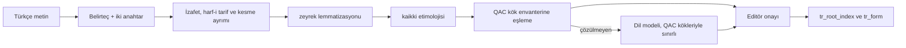

# Kök ve Lemma Katmanı

> **Sürüm:** 1.1 · **Tarih:** 19 Ekim 2026 · **Durum:** Taslak
> **Bağlı kararlar:** [K-19](../00-ozet/02-karar-defteri.md#k-19--kuran-kelime-anlamları) · [K-27](../00-ozet/02-karar-defteri.md#k-27--tek-bağlantı-tablosu) · [K-06](../00-ozet/02-karar-defteri.md#k-06--yayın-kapısı) · [K-12](../00-ozet/02-karar-defteri.md#k-12--i̇çerik-hattı-python) · [K-13](../00-ozet/02-karar-defteri.md#k-13--editör-paneli) · [K-25](../00-ozet/02-karar-defteri.md#k-25--i̇lkeler)

Bu dosya Kur'an kelimelerinin kök ve lemma verisini, Türkçe kelimeyi Arapça köke bağlayan hattı ve kelime kartıyla kök gezgininin ihtiyaç duyduğu veriyi tanımlar. Bağlantı türleri `kok` ve `lemma`, puanlama ve panel kuralları [bağlantı modelindedir](./01-baglanti-modeli.md). Türkçe kelime anlamlarının yazımı [kelime anlamları](../04-icerik/06-kelime-anlamlari.md) dosyasındadır (K-19).

## 1. Kaynak veri

- **QAC v0.4** (1 Mayıs 2011) Kur'an'daki 77.429 kelimenin tamamını etiketler. Morfolojik etiketlerin doğruluğu yaklaşık %99 olarak tahmin ediliyor ve veri hâlâ düzeltiliyor ([QAC sürüm notları](https://corpus.quran.com/releasenotes.jsp); [QAC SSS](https://corpus.quran.com/faq.jsp)).
- **Sayı farkları:** Wikipedia 77.430 kelime, QUL "dilbilgisi ve morfoloji" başlığında 77.432 öğe verir ([Wikipedia](https://en.wikipedia.org/wiki/Quranic_Arabic_Corpus); [QUL](https://qul.tarteel.ai/resources)). Fark büyük olasılıkla kelime bölmeden gelir; içe aktarma bunu âyet âyet denetler (§3).
- **QUL SQLite dosyaları:** lemma kaynağı `lemmas(id, text, text_clean, words_count, uniq_words_count)` ve `word_lemmas(lemma_id, word_location)` tablolarını taşır; konum `2:3:5` biçimindedir ([QUL lemma](https://qul.tarteel.ai/resources/morphology/75)). Morfoloji paketlerinde `sure:âyet:kelime` anahtarı, kök, lemma, gövde ve POS bulunur. QUL etiketlerin farklı kaynak veri setleri arasında kararlı sayılmamasını söyler ([QUL eğitimi](https://qul.tarteel.ai/docs/tutorial-morphology-end-to-end)). Bu yüzden tek envanter olarak QAC v0.4 seçilir. QUL dışa aktarımı lisansı netleşene kadar yalnız karşılaştırma için kullanılır.
- **QAC Version 2** geliştiriliyor. POS etiketleri yapay zekâyla üretilip uzmanlarca doğrulanmış, kod GPL-3.0; standart veri setleri ve API hedef olarak duruyor ama yayımlanmadı ([kaisdukes/quranic-corpus](https://github.com/kaisdukes/quranic-corpus)).
- Kur'an'da bir kökün bütün geçişleri bu tablodan cihazda üretilir; ayrı bir mu'cem gerekmez (rapor).

## 2. Lisans çelişkisi ve eylem

| Kaynak | İfade |
|---|---|
| [QAC indirme sayfası](https://corpus.quran.com/download/) | GNU GPL. "Permission is granted to copy and distribute verbatim copies of this file, but CHANGING IT IS NOT ALLOWED." Kaynak belirtilir ve corpus.quran.com bağlantısı verilirse veri "any website or application" içinde kullanılabilir. |
| [QAC SSS](https://corpus.quran.com/faq.jsp) | "You do not use the data for commercial purposes"; araştırma yayınında atıf. |
| [QUL SSS](https://qul.tarteel.ai/faq) | Ticari projelerde kullanılabilir, ama her kaynağın lisansı ayrı okunmalı. İncelenen kaynak sayfalarında lisans alanı yok. |

Hukuki görüş değildir. Eylemler:
1. **QAC'ye yazılır** (rapor ve brif). Sorular aşağıdaki taslakta. Cevap [kaynaklar ve lisans defterine](../04-icerik/01-kaynaklar-ve-lisans-defteri.md) ve `source` satırına işlenir.
2. **Tarteel'e yazılır;** QUL'un morfoloji ve lemma dışa aktarımları için kaynak bazında şart sorulur.
3. **Ara durum:** QAC kaynağı `license_status = 'bekliyor'` taşır. QAC'den türeyen alanlar (`root_id`, `lemma_id`, `pos`) yalnız iç derlemelerde görünür. Mağaza derlemesinde kelime kartı metni ve sesi gösterir; kök, lemma ve anlam satırları cevap gelene kadar kapalıdır (Açık soru 1).
4. **B planı:** QAC ticari olmayan kullanım ya da yalnız aynen dağıtım şartında ısrar ederse üç yol var. (a) Dosya ayrı bir pakette aynen dağıtılır ve tablolar cihazda ilk açılışta kurulur (avukata sorulur). (b) Kendi etiketlerimizi CAMeL Tools (MIT) ve editör onayıyla üretiriz; Kur'an Arapçasındaki başarısı Doğrulanacak. (c) QAC Version 2'nin açık veri setleri beklenir.

```text
Subject: Licensing question: Quranic Arabic Corpus morphology in a free reading app

Dear Dr. Dukes,
We are building "Mütâlaa", a free, ad-free Qur'an reading and study app in Turkish.
1. The download page licenses the morphology file under the GNU GPL and allows use "in any website
   or application" with credit and a link; the FAQ says "You do not use the data for commercial
   purposes". Which terms apply to a free app that may accept donations?
2. May we convert the unchanged values into our own SQLite tables and ship them with credit,
   given the "verbatim copies" clause?
3. We keep our corrections in a separate layer and never edit your file. May we ship that layer,
   and would you like to receive the corrections?
4. What credit line do you prefer?
```

## 3. İçe aktarma ve tablolar

1. QAC v0.4 morfoloji dosyası indirilir, `data/` altında SHA-256 ile saklanır ve hiç değiştirilmez.
2. Segment düzeyindeki kayıtlar kelime düzeyine toplanır; kök ve lemma gövde segmentinden gelir. Alan biçimi indirilen dosyadan doğrulanır.
3. Her âyetin kelime sayısı Tanzil Uthmani metniyle karşılaştırılır (durak işaretleri hariç). Farklar editöre liste olarak gider. `q:{sure}:{ayet}:{kelime}` numarası QAC/QUL konumudur (çapa şeması).
4. `root`, `lemma` ve `quran_word` kurulur, onaylı düzeltmeler uygulanır (§4), sayılar ve IDF hesaplanır (§7).

Bu katmanın ihtiyaç duyduğu alanlar (kesin DDL [editoryal veritabanında](../03-veri/02-editoryal-veritabani.md)):

| Tablo | Alanlar |
|---|---|
| `root` | `id`, `letters` ('ص ب ر'), `letters_bw` (QAC Buckwalter), `occurrences` (kelime), `ayah_count`, `idf_q` |
| `lemma` | `id`, `lang` ('ar' / 'tr'), `text`, `text_clean`, `root_id`, `occurrences`, `qac_ref`; Türkçe satırda ek olarak `ar_lemma_id`, `etymological_only`, `origin` (`kaikki`/`llm`/`editor`), `status`, `freq` |
| `quran_word` | `anchor`, `surah`, `ayah`, `word`, `text_uthmani`, `root_id`, `lemma_id`, `pos`, `features` (jsonb), `source_id` |

`root.id` ve `lemma.id` çapalar gibi kalıcıdır ve yeniden numaralanmaz. Türkçe anlamlar (K-19), `xref.evidence` ve v1.x kelime defteri (`vocab`) bu kimliklere bağlıdır. `qac_ref` ileride QAC Version 2'ye geçişte eşleme sağlar.

## 4. Düzeltme katmanı

QAC dosyası değiştirilmez; düzeltmeler ayrı bir katmanda tutulur (rapor).

```sql
CREATE TABLE quran_word_fix (
  id         uuid PRIMARY KEY DEFAULT uuidv7(),
  anchor     text NOT NULL,                                    -- 'q:2:255:3'
  field      text NOT NULL CHECK (field IN ('root_id','lemma_id','pos','features')),
  qac_value  text,                                             -- QAC'deki değer, kanıt için
  new_value  text NOT NULL,
  reason     text NOT NULL,                                    -- sözlük, tefsir, QAC v2 vb.
  status     xref_status NOT NULL DEFAULT 'aday',
  editor     text,
  created_at timestamptz NOT NULL DEFAULT now(),
  UNIQUE (anchor, field)
);
```

Derleme QAC tabanını okur ve yalnız `status = 'onayli'` düzeltmeleri üstüne uygular. Künye "QAC v0.4 + Mütâlaa düzeltmeleri (N adet)" yazar. Düzeltme listesi QAC kabul ederse geri gönderilir.

## 5. Türkçe kelime → Arapça kök hattı



**1. Belirteç ve anahtarlar.** Görüntülenen metin değişmez. Rapor iki Türkçe anahtar ister: düzeltme işaretleri silinmiş geniş anahtar ve âlem/alem, hâlâ/hala çiftlerini ayıran dar anahtar.

```python
def tr_lower(s: str) -> str:            # Python'da 'İ'.lower() 'i̇' verir; önce elle çevrilir
    return s.replace('I', 'ı').replace('İ', 'i').lower()

def keys(token: str) -> tuple[str, str]:
    # Kurallar Arama (03-veri/05) §2 ile aynıdır; uygulama packages/search ve mutalaa_pipeline.normalize'dan gelir.
    narrow = tr_lower(unicodedata.normalize('NFC', token)).replace('’', "'").replace('‘', "'")
    folded = unicodedata.normalize('NFD', narrow.replace('ı', 'i'))
    wide = unicodedata.normalize('NFC', ''.join(c for c in folded if not 0x0300 <= ord(c) <= 0x036F))
    return wide, narrow   # geniş anahtar â î û ile ç ğ ö ş ü'yü de katlar
```

Bu fonksiyon yalnız gösterim içindir. Tek doğru tanım [Arama](../03-veri/05-arama-fts5.md) dosyasındaki dar ve geniş anahtar kurallarıdır; Python, TypeScript ve C# uygulamaları `shared/test-vectors/` ile kilitlenir.

**2. Ön bölme.** Rapor, "rahmet-i İlâhiye" ya da "esmâ-i hüsnâ" gibi izafet zincirlerinin ve "el-", "-ül" gibi Arapça eklerin lemmatizasyondan önce ayrılmasını ister.

```python
IZAFET = re.compile(r"(\p{L}+(?:'\p{L}+)?)-(i|ı|u|ü|yi|yı|yu|yü)\s+(\p{L}+)")  # rahmet-i İlâhiye
TARIF  = re.compile(r"(\p{L}+?)(ü|u|i|ı)?'l-(\p{L}+)")                          # Âyetü'l-Kürsî
EL     = re.compile(r"\b(el|er|es|eş|en|et|ed|ez)-(\p{L}+)")                    # el-Kur'ân, er-Rahmân
```

Kesme işaretinde iki durum ayrılır. "Kur'ân", "Mü'min" gibi iç kesmeli kelimeler bir listeyle korunur. Sondaki kesmeden sonra gelen Türkçe ek ayrılır ("Kur'ân'ın" → "Kur'ân" + "ın"). Kurallar `shared/test-vectors/` örnekleriyle sınanır.

**3. Lemmatizasyon.** zeyrek, Zemberek'in kısmi Python taşıması; MIT, 0.1.3 (Aralık 2022), alfa ([PyPI](https://pypi.org/project/zeyrek)). Sürüm sabitlenir ve Risale örneklemiyle gerileme testi yapılır. zeyrek'in tanımadığı biçim için önce `tr_form` sözlüğüne, sonra kural tabanlı ek soymaya, en son dil modeline gidilir. ZemberekDotNet (Apache-2.0, .NET Standard 2.1) K-12'de değerlendirilen .NET seçeneğidir; topluluğu küçüktür: 18 yıldız, 103 işleme, etiketli sürüm yok ([ZemberekDotNet](https://github.com/JnRMnT/ZemberekDotNet)).

**4. Etimoloji.** Wiktionary'nin kaikki/wiktextract dökümleri etimoloji zincirini ve çoğu zaman Arapça kök harflerini verir. Örneğin "ehlî" maddesi Osmanlıca اهلی üzerinden Arapça أَهْلِيّ'ye gider ve kök ء ه ل'dir ([kaikki](https://kaikki.org/dictionary/Turkish/meaning/e/eh/ehlî.html)). Kelime başına JSONL indirilebilir. Türkçe Vikisözlük çıkarımı `tr-extract.jsonl` 674,4 MB (gzip 42,0 MB) tutar. kaikki lisans belirtmez, Ylonen (LREC 2022) atfı ve bağlantı ister ([kaikki ham veri](https://kaikki.org/dictionary/rawdata.html)). Wiktionary metninin lisansı Doğrulanacak. Bu yüzden yalnız eşleme ve madde bağlantısı saklanır, sözlük metni saklanmaz. Etimoloji alanlarının adları JSONL şemasından doğrulanır.

**5. QAC envanterine eşleme.** Kök harfleri normalize edilir (hemze biçimleri ء'ye, elif biçimleri ا'ya) ve QAC kök listesinde aranır. Arapça etimon ayrıca QAC `lemma.text_clean` ile eşlenir; şükür ← شُكْر gibi belirli bir türev isim lemma düzeyinde bağlanır (araştırma notu).

**6. Dil modeli toplu işlemi.** Çözülmeyen lemmalar için aday kökler ünsüz iskeletinden üretilir. Türkçe ünsüzler Arapça aday kümelere eşlenir; zayıf harfler (ع ء و ي) herhangi bir yere eklenebilir. Yalnız QAC envanterinde bulunan en çok 20 aday modele verilir.

| Türkçe | Arapça adaylar | Türkçe | Arapça adaylar |
|---|---|---|---|
| s | س ص ث | t | ت ط |
| z | ز ذ ض ظ | k | ق ك |
| h | ح ه خ | d | د ض |
| g, ğ | غ ك ج / غ ع | kesme, ünlü başı | ع ء |

Örnekler: "sabır" → s b r → ص ب ر; "ilim" → l m, başa ع eklenir → ع ل م.

```json
{ "girdi": { "tr_lemma": "sabır", "baglamlar": ["…", "…"], "aday_kokler": ["ص ب ر", "س ب ر"] },
  "cikti": { "kok": "ص ب ر", "ar_lemma": "صَبْر", "etimon": "صبر", "guven": 0.93,
             "yalniz_etimolojik": false, "not": "kısa gerekçe" } }
```

- `kok` aday listesinden ya da "YOK" olmalı; `ar_lemma` o kökün QAC lemmalarından olmalı. Aksi çıktı atılır.
- Protokoldeki gibi üç model ya da istem çeşitlemesi oy verir. Üçü ayrışırsa öğe editör kuyruğunun başına gider ([protocols.io](https://www.protocols.io/view/llm-assisted-expert-annotation-for-systematic-lite-4r3l2dw5jg1y/v1.pdf)).
- Maliyet tahmini: Claude Haiku 5.5 ile (girdi 0,10 $/M, çıktı 0,50 $/M) 15 bin lemma × 600 girdi ve 80 çıktı tokenı tek geçişte yaklaşık 1,5 $ eder. Lemma sayısı varsayımdır; diğer modellerin fiyatı burada yok.

**7. Editör onayı.** Kuyruk külliyattaki sıklığa göre dizilir: sabır, şükür, rahmet, tevhid, nur, hikmet gibi yüksek sıklıklı lemmalar önce gelir. Zipf yasası gereği birkaç bin lemma token'ların çoğunu kapsar (araştırma notu). Kart üç KWIC satırı, önerilen kökü ve Arapça lemmayı, o kökün Kur'an'daki örneklerini Elmalılı mealiyle ve "yalnızca etimolojik" anahtarını gösterir. Kararlar `review` tablosuna yazılır.

**8. İndeks üretimi.** Onaylı bir köke bağlanan her Türkçe token için `tr_root_index(root_id, anchor, span_start, span_end, tr_lemma_id, etymological_only)` satırı yazılır. Ofsetler NFC kod noktasıdır. Biçim sözlüğü `tr_form(key_wide, key_narrow, tr_lemma_id, freq)` cihazda dokunulan kelimenin lemmasını bulur ([01 §9](./01-baglanti-modeli.md)).

## 6. "Yalnızca etimolojik" işareti

Türkçedeki anlamı Kur'an'daki anlamından kaymış kelimeler "yalnızca etimolojik" diye ayrıca etiketlenir (rapor). İşaret `(tr_lemma, kök)` çiftindedir. Editör gerekirse tek bir geçişi `tr_root_index` satırında değiştirir. Örnekleri editör doğrular:
- **hayvan:** Türkçede canlı varlık; kök ح ي ي, Kur'an'daki الحيوان hayat anlamında kullanılır.
- **ihtiyar:** Türkçede yaşlı; Arapça ihtiyâr "seçme", kök خ ي ر.
- **rahat:** kök ر و ح, rûh ile aynı kök.

Panelde bu sonuçlar "aynı kök … · yalnızca etimolojik" çipiyle katlı alt grupta durur. Puanları yarıya iner ve Önerilen listesine girmez ([01 §6–7](./01-baglanti-modeli.md)).

## 7. Kalite ölçümü ve IDF

- **Altın set:** 300–500 Türkçe lemma → kök çifti, sıklık bandına (yüksek, orta, düşük) ve kaynağa (meal, tefsir, Risale) göre tabakalı (rapor).
- **Ölçütler:** atanan kökün kesinliği; duyarlılık, yani Arapça kökenli lemmaların kök alan payı; iki editör arasında ve model ile editör arasında Cohen's κ; "yalnızca etimolojik" etiketinde uyum.
- **Kural:** model-insan uyumu insan-insan düzeyine (protokolde κ ≈ 0,6) ulaşmadan otomatik etiketleme denetimsiz çalışmaz. Protokolde insan-insan κ 0,60 ± 0,24, model çoğunluğu-insan κ 0,57 ± 0,08 çıktı ([protocols.io](https://www.protocols.io/view/llm-assisted-expert-annotation-for-systematic-lite-4r3l2dw5jg1y/v1.pdf)).

IDF, ق و ل gibi çok yaygın köklerin nadir köklerin önüne geçmesini önler (rapor):

```text
idf_q(r)  = ln(6236 / ayah_count(r))       root.idf_q; lemma için aynı formül
idf_n(r)  = idf_q(r) / ln(6236)            0–1 arası; birim-birim kok skoru ve "Kökler" sırası
df_p(r)   = r kökünü taşıyan paket birimi sayısı (paket üst verisi); hedef birim sırasında tf·idf
idf_n(r) < 0,2 olan kökler birim-birim kok satırı üretmez (öneri; altın setle ayarlanır)
```

## 8. Cihaz verisi, kelime kartı ve kök gezgini

| Paket | Tablolar | Boyut |
|---|---|---|
| `core` | `quran_word` (Tanzil'den kelime bölmesi ve metin) | Kelime tablosu 77,4 bin satır (boyut tahmini için araştırma notu) |
| `kelime-kok` (`bekliyor`, K-06 uygulama notu) | QAC kaynaklı `root`, `lemma`, kelime–kök/lemma eşlemesi (`word_morph`); Türkçe kelime anlamları (`lemma_gloss`; `public`'te yalnız onaylılar); `tr_form`; Elmalılı meali için `tr_root_index` | Morfoloji verisi ~2–4 MB (tahmin, araştırma notu) |
| `tefsir-elmalili`, `risale-dizin` | Kendi birimleri için `tr_root_index`; Risale kitap paketleri bu tabloyu taşımaz | Risale ~1,9 milyon kelime (7.550 sayfa × ~250 kelime, tahmin); Arapça kökenli payı ölçülmeden boyut verilemez |

Tabloların kesin şeması [İçerik paketleri §3.2–§3.3](../03-veri/03-icerik-paketleri.md#33-kelime-kok)'tedir. `kelime-kok` kurulu değilse kelime kartı Arapça kelimeyi, konumunu ve eylemleri gösterir; Türkçe anlam, kök ve lemma bu paketle gelir. Anlamların QAC'den bağımsız olarak `core`'a taşınması İçerik paketleri IP-6'dır (Açık soru).

```sql
-- Kelime kartı: core (main) + kelime-kok (p_kelime_kok)
SELECT w.anchor, w.text_uthmani, m.pos, m.features,
       r.letters AS root, r.occurrences AS root_count,
       l.text AS lemma, l.occurrences AS lemma_count, g.anlam_kisa AS gloss_tr, g.status AS gloss_status
FROM quran_word w
LEFT JOIN p_kelime_kok.word_morph m  ON m.anchor = w.anchor
LEFT JOIN p_kelime_kok.root r        ON r.id = m.root_id
LEFT JOIN p_kelime_kok.lemma l       ON l.id = m.lemma_id
LEFT JOIN p_kelime_kok.lemma_gloss g ON g.lemma_id = m.lemma_id   -- K-19 anlamları (Kelime anlamları)
WHERE w.anchor = :anchor;

-- Kök gezgini: lemmalar, Kur'an geçişleri, Türkçe geçişler
SELECT l.id, l.text, COUNT(*) AS n FROM p_kelime_kok.word_morph m JOIN p_kelime_kok.lemma l ON l.id = m.lemma_id
WHERE m.root_id = :root GROUP BY l.id ORDER BY n DESC;

SELECT w.anchor, w.ayah_index, w.word, w.text_uthmani
FROM p_kelime_kok.word_morph m JOIN quran_word w ON w.anchor = m.anchor
WHERE m.root_id = :root AND (:lemma IS NULL OR m.lemma_id = :lemma)
ORDER BY w.ayah_index, w.word LIMIT :n OFFSET :m;

SELECT anchor, span_start, span_end, tr_lemma_id, etymological_only FROM p_risale_dizin.tr_root_index
WHERE root_id = :root ORDER BY etymological_only, anchor;      -- tr_root_index taşıyan her bağlı paket için UNION ALL
```

```ts
export interface WordCard {
  anchor: string; textUthmani: string;
  gloss?: { text: string; status: 'onayli' | 'taslak' };   // taslak yalnız iç derlemede, "doğrulanmamış" rozetiyle (K-25)
  root?: { id: number; letters: string; occurrences: number };   // "Bu kök Kur'an'da N yerde geçer"
  lemma?: { id: number; text: string; occurrences: number };
  morphology: string;                                    // QAC POS → Türkçe etiket, editör onaylı eşleme tablosu
  audio?: { reciter: string; startMs: number; endMs: number };   // yalnız kelime zamanlaması olan hafızda
}
export interface RootExplorer {
  root: { id: number; letters: string; occurrences: number; ayahCount: number; idf: number };
  lemmas: Array<{ id: number; text: string; gloss?: string; occurrences: number }>;
  quran: { total: number; page: Array<{ anchor: string; text: string; lemmaId: number }> };
  corpora: Array<{ group: 'mealler' | 'tefsirler' | 'hadis' | 'risale'; total: number;
                   etymologicalOnly: number; page: Array<{ anchor: string; span: [number, number]; trLemma: string }> }>;
  relatedTr: Array<{ text: string; occurrences: number }>;   // sabır, sabretmek, sâbir, musâbere
}
```

Kelime kartı raporun tarifini izler: büyük puntoyla Arapça kelime, Türkçe anlam, kök ve "Bu kök Kur'an'da N yerde geçer", kısa morfoloji satırı ve kelime sesi. Eylemler "Kökü incele", "Âyetin tefsiri", "Kopyala" ve "Not/Vurgu ekle"dir. Kart genişletilince aynı alt sayfa Bağlantılar paneline dönüşür ve kelime sorgusunu gösterir. Kök gezgini lemma ve sure süzgeci taşır, mushaf sırası ya da sıklığa göre dizilir.

## 9. Kur'an dışı Arapça

Hadis metinleri ile Risale ve tefsirdeki Kur'an dışı Arapça ibareler CAMeL Tools ile çözümlenir: MIT, 1.6.0 (8 Haziran 2026), Python 3.11–3.14 ([PyPI](https://pypi.org/project/camel-tools/)). İş yalnız hatta yapılır (K-12); eski planın çalışma anındaki gRPC morfoloji servisi kalkar. Kökler QAC envanterinde varsa ona eşlenir. Satırlar `origin = 'camel'` taşır ve örneklem doğruluğu ölçülene kadar mağaza derlemesine girmez.

## 10. Açık sorular

1. ~~Brif `core` paketine kök, lemma ve Türkçe anlam koyar.~~ Çözüldü: K-06 uygulama notu QAC verisini ayrı `kelime-kok` paketine taşıdı. Açık kalan: Türkçe kelime anlamları QAC lemma kimliklerine bağlıdır; QAC cevabı olumsuz olursa anlamların hangi kimliklere bağlanacağı [Kelime anlamları](../04-icerik/06-kelime-anlamlari.md) dosyasındaki yedek plana göre belirlenir (İçerik paketleri IP-6).
2. **Çözüldü (19 Ekim 2026):** Türkçe lemmalar `lemma` tablosunda `lang = 'tr'` satırıdır; `tr_root_index`, `tr_form` ve `quran_word_fix` [Editoryal veritabanı §5–§6](../03-veri/02-editoryal-veritabani.md#6-türkçe--kök-indeksi-ve-sure-adları) ve [İçerik paketleri §3.2–§3.3](../03-veri/03-icerik-paketleri.md#32-metin-paketleri)'tedir.
3. zeyrek'in Python 3.13 ile çalışması ve Osmanlıca kelime dağarcığındaki kapsaması ölçülmedi.
4. Wiktionary kaynaklı eşlemelerin lisans durumu doğrulanacak (kaikki lisans belirtmiyor). Hukuki görüş değildir.
5. QAC dosyasının segment biçimi ve QUL kök kaynağının numarası indirilen dosyalardan doğrulanacak.

## İlgili dosyalar
- [Bağlantı modeli](./01-baglanti-modeli.md) · [İktibas tespiti](./02-iktibas-tespiti.md) · [Anlamsal katman](./04-anlamsal-katman.md)
- [Karar defteri](../00-ozet/02-karar-defteri.md) · [Sözlük](../00-ozet/03-sozluk.md)
- [Editoryal veritabanı](../03-veri/02-editoryal-veritabani.md) · [İçerik paketleri](../03-veri/03-icerik-paketleri.md) · [Arama](../03-veri/05-arama-fts5.md)
- [Kaynaklar ve lisans defteri](../04-icerik/01-kaynaklar-ve-lisans-defteri.md) · [İçerik hattı](../04-icerik/02-icerik-hatti.md) · [Kelime anlamları](../04-icerik/06-kelime-anlamlari.md)
- [Mobil ekranlar](../01-urun/03-mobil-ekranlar.md) · [Yayın kapısı](../07-yayin/01-yayin-kapisi-ve-kurul.md) · [Kaynakça](../09-kaynakca.md)
