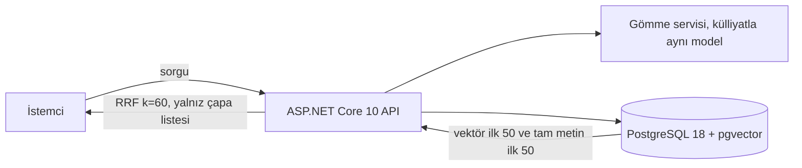

# Anlamsal Katman

> **Sürüm:** 1.0 · **Tarih:** 18 Ekim 2026 · **Durum:** Taslak
> **Bağlı kararlar:** [K-27](../00-ozet/02-karar-defteri.md#k-27--tek-bağlantı-tablosu) · [K-11](../00-ozet/02-karar-defteri.md#k-11--veritabanı-postgresql-18) · [K-06](../00-ozet/02-karar-defteri.md#k-06--yayın-kapısı) · [K-20](../00-ozet/02-karar-defteri.md#k-20--barındırma) · [K-25](../00-ozet/02-karar-defteri.md#k-25--i̇lkeler)

Bu dosya güvenilirlik sıralamasının son katmanını tanımlar: gömme vektörleriyle bulunan anlamsal komşular (`xref.type = 'anlamsal'`). Katman sonraki fazdadır. Önce komşular sunucuda bir kez hesaplanıp tablo olarak gönderilir, serbest metinli anlamsal arama daha sonra çevrimiçi gelir. "Kaynaklara sor" [sonra yapılacaklar](../08-yol-haritasi/02-sonra-yapilacaklar.md) listesindedir.

## 1. Gerekçe ve faz

Kur'an soru-cevap görevinde yalnız BM25 kullanan sistem MAP@10'da 0,0904'te kalırken ince ayarlı Arapça kodlayıcılardan oluşan bir topluluk 0,3128'e çıkıyor ([arXiv 2508.06971](https://arxiv.org/html/2508.06971v2); görev: [Qur'an QA 2023](https://aclanthology.org/2023.arabicnlp-1.76)). Anlamsal katman bu yüzden gereklidir. Rapor onu canlı bir servis olarak kurmaz. Her çapa için en yakın N komşu bir kez hesaplanır ve tablo olarak cihaza gider; atlama çevrimdışı ve model çalıştırmadan olur.

| Adım | Faz |
|---|---|
| Alan test seti ve model seçimi | Faz 4 · v1.x başı |
| Komşuların hesaplanıp paketlenmesi, "Makine önerisi" rozeti | Faz 4 · v1.x |
| Oylarla eşik ayarı ([01 §12](./01-baglanti-modeli.md)) | Faz 4 · v1.x |
| Sunucuda serbest metinli anlamsal arama (pgvector) | Faz 5 · Web ya da sonrası (öneri) |
| Cihazda isteğe bağlı anlamsal paket | Sonra |

## 2. Lisans sınırları

- **Quran Foundation içeriği hiçbir zaman gömülmez.** QF şartları (son güncelleme 11 Ekim 2026) içeriğin bir haftadan uzun önbelleğe alınmasını yasaklar, çevrimdışı kopyayı Content Sync API'lerine bırakır, hazır veritabanı dağıtımına izin vermez ve içerikten türetilen gömme vektörlerini aynı kısıtlara bağlar ([QF Developer Terms](https://api-docs.quran.foundation/legal/developer-terms/)). Kur'an metni Tanzil'den, meal ve tefsir kendi transkripsiyonumuzdan gelir; QF'den alınan hiçbir metin gömme hattına girmez.
- **Kaynak kapısı** gömme adımında koşar ve CI'da bir testle kilitlenir:

  ```python
  def embeddable(src: Source) -> bool:            # pipeline/enrich
      if src.provider == "quran_foundation":       # QF şartları gömmeleri de bağlar
          return False
      return src.license_status in ("serbest", "bekliyor", "ic_kullanim") and src.embed_ok
  ```

  `embed_ok` yeni bir alandır ve hukuki onayı tutar. Risale metnini işlemenin hukuki durumu netleşene kadar Risale için `false` kalır (Açık soru 1). Hukuki görüş değildir.
- **Model lisansı:** Qwen3-Embedding Apache-2.0, BGE-M3 MIT. jina-embeddings-v3 CC BY-NC 4.0 olduğu için kullanılmaz ([wz-it](https://wz-it.com/en/blog/best-embedding-models-german/)).
- Komşu satırının `license` değeri iki ucun en kısıtlayıcısıdır; mağaza süzgeci [bağlantı modelindedir](./01-baglanti-modeli.md).

## 3. Model seçimi

| Model | Lisans | Boyut | Vektör | Bağlam | MMTEB | Not |
|---|---|---|---|---|---|---|
| Qwen3-Embedding-0.6B | Apache-2.0 | 0,6B | 1.024 | 32.768 | 64,3 | Talimata duyarlı, MRL 32 boyuta kadar |
| Qwen3-Embedding-4B | Apache-2.0 | 4B | 2.560 | 32.768 | 69,5 | |
| Qwen3-Embedding-8B | Apache-2.0 | 7,6B | 4.096 | 32.768 | 70,6 | |
| BGE-M3 | MIT | 568M | 1.024 | 8.192 | 59,6 | Yoğun, seyrek ve ColBERT çıktısı tek geçişte |
| Gemini Embedding 2 (API) | ticari | | 128–3.072 | 8.192 | | Önizleme 10 Mart 2026; 0,20 $/M token, toplu 0,10 $ |

Kaynaklar: [wz-it](https://wz-it.com/en/blog/best-embedding-models-german/) (MMTEB, 24 Mayıs 2025 itibarıyla), [vast.ai](https://vast.ai/model/qwen3-embedding) (talimat etkisi tipik olarak %1–5, MRL, eşlik eden Qwen3-Reranker), [HF](https://huggingface.co/mlboydaisuke/bge-m3-ExecuTorch) (BGE-M3), [tokencost](https://tokencost.app/blog/gemini-embedding-2-pricing) (Gemini).

Karar kuralı:
1. Adaylar Qwen3-Embedding-0.6B, Qwen3-Embedding-4B, BGE-M3 yoğun ve BGE-M3 yoğun + seyrek. Taban çizgisi BM25'tir.
2. Model fiyata göre seçilmez. Alan test setinin test bölümündeki MAP@10 belirler (rapor).
3. İlk iki model arasındaki fark 0,02'den küçükse daha küçük ve ucuz olan seçilir.
4. Vektör boyutu pgvector sınırına uymalıdır: indekslenebilir `vector` en çok 2.000, `halfvec` en çok 4.000 boyut ([pgvector 0.8.7](https://pgxn.org/dist/vector)). 8B modelin 4.096 boyutu MRL ile kesilir; 4B modelin 2.560 boyutu `halfvec` ister.
5. TR-MTEB (26 veri seti, 6 görev türü) ve Arapça liderlik tabloları genel bir kontrol sağlar, ama kararı vermez ([TR-MTEB](https://research.itu.edu.tr/en/publications/tr-mteb-a-comprehensive-benchmark-and-embedding-model-suite-for-t/); [Arabic RAG Leaderboard](https://huggingface.co/blog/Navid-AI/arabic-rag-leaderboard)).

## 4. Alan test seti ve değerlendirme

| Sorgu türü | Adet (öneri) | Hedef | Pozitif kaynağı |
|---|---|---|---|
| Türkçe kavram, soru ya da Risale ifadesi | 150 | Risale, meal ve tefsir paragrafları, âyetler | Havuzlanmış yargı |
| Âyet → paragraf | 100 | Risale ve tefsir paragrafları | Onaylı `atif`/`iktibas` + editör `ima` kayıtları + havuzlanmış yargı |
| Arapça ya da Türkçe ifade → âyet | 50 | Âyetler | Havuzlanmış yargı |

- **Havuzlama:** her sistemin ilk 20 sonucu birleştirilir ve 0/1/2 ölçeğiyle yargılanır. Sorguların %20'sini iki kişi yargılar ve Cohen's κ raporlanır.
- **Yanlılık:** onaylı atıf ve iktibaslar sözcük örtüşmesine dayanır ve BM25'i kayırır. İma kayıtları ve havuz yargıları bu etkiyi dengeler.
- **Bölme:** %40 geliştirme (kalibrasyon ve eşik), %60 test (dondurulmuş).
- **Ölçütler:** MAP@10 (literatürle karşılaştırma için), nDCG@10, Recall@50, P@5; sorgu türü başına ayrı.
- **Yayın eşiği (öneri):** komşular ancak âyet → paragraf türünde P@5 ≥ 0,60 ve MAP@10 BM25'in üstündeyse paketlenir.
- Model ya da veri değişince test bölümü yeniden koşulur ve sonuç yayın notuna girer ([test stratejisi](../07-yayin/03-test-stratejisi.md)).

## 5. Gömme hattı

- **Birimler:** âyetler (6.236), tefsir paragrafları, Risale paragrafları, sonra hadis. Uzun paragraflar cümle sınırından en çok 512 tokenlık pencerelere bölünür. Her pencere `{çapa}@{başlangıç}-{bitiş}` ile adreslenir.
- **Âyet metni:** üç seçenek geliştirme bölümünde denenir: yalnız Arapça, yalnız Elmalılı meali, Arapça + meal.
- **Talimat:** Qwen3 sorgu tarafında görev talimatı alır; biçim model kartından doğrulanır.
- **Sürüm:** her vektör `model@revizyon` ve birimin `content_hash` değerini taşır. Yeni sürümde yalnız özeti değişen birimler yeniden gömülür. Model değişirse bütün vektörler, komşular ve kalibrasyon yeniden hesaplanır ve test yeniden koşulur.

## 6. Komşuların önceden hesaplanması

```python
for block in batches(units, 4096):                              # vektörler L2-normalize; kosinüs = iç çarpım
    sims = block.vecs @ all_vecs.T
    drop_trivial(sims, block)                                   # kendisi, aynı bölümde ±2 paragraf, yapısal kardeşler
    for src, cands in topk(sims, per_group=5, total=10):        # gruplar: Kur'an, tefsir, Risale, hadis
        for dst, cos in cands:
            p = calibrators[(group(src), group(dst))](cos)      # izotonik regresyon, geliştirme yargılarıyla
            if p >= 0.5 and not stronger_link(src, dst):        # atif, iktibas, ima, benzer_ayet varsa yazılmaz
                emit_xref(type="anlamsal", src=src, dst=dst, score=p, confidence=p,
                          evidence={"model": MODEL, "cosine": round(cos, 4), "calibrated": round(p, 3)})
```

- Kosinüs değeri model ve külliyat çifti arasında karşılaştırılamaz; kalibrasyon grup çifti başına yapılır ve `confidence` kalibre olasılıktır.
- Satırlar `origin = 'hat'`, `status = 'aday'` ile yazılır. Tek tek insan onayı beklenmez. Yayın kuralı ve paket yerleşimi [bağlantı modelindedir](./01-baglanti-modeli.md).
- **Boyut tahmini:** 100 bin çapa için 10'ar komşu 1 milyon satır ve satır başına ~12 bayt ile ~12 MB ham veri eder; SQLite ek yükü ve indekslerle ~20–30 MB (rapor ve araştırma notu, tahmin). 12 bayt tamsayı kimlik varsayar. Paket içi `xref` metin çapa taşıdığı için gerçek boyut ölçülür; büyük çıkarsa anlamsal komşular için tamsayı kimlikli sıkıştırılmış bir tablo kullanılır (Açık soru 5).

## 7. Arayüzde gösterim

- Her sonuç "Makine önerisi" rozeti ve "anlamca yakın" gerekçe çipi taşır. Bu, yapay zekâ çıktısına rozet koyma ilkesini uygular (K-25).
- Sonuçlar her zaman "Daha fazla (otomatik)" altında katlıdır ve Önerilen listesine girmez ([01 §7](./01-baglanti-modeli.md)).
- Rozete dokununca kısa bir açıklama çıkar: "Bu bağlantıyı bir model anlam yakınlığına göre önerdi; editör denetiminden geçmedi."
- Eski plan her sonuç için Claude Sonnet ile "neden alakalı?" cümlesi üretiyordu (`quran-app-docs/05-cross-ref/04-seviye-3-semantik.md`). Bu adım çıkarıldı: sorgu başına maliyet ekliyordu ve dayanaksız metin riski taşıyordu.
- v1.x oyları eşikleri ve grup içi sırayı besler; "Yararsız" oranı yüksek grup çiftlerinde eşik yükseltilir.

## 8. Çevrimiçi serbest metinli anlamsal arama (sonra)



```sql
CREATE EXTENSION IF NOT EXISTS vector;
CREATE TABLE embedding (
  anchor text NOT NULL, chunk smallint NOT NULL DEFAULT 0, span int4range,
  model text NOT NULL, content_hash text NOT NULL, v halfvec(1024) NOT NULL,
  PRIMARY KEY (anchor, chunk, model)
);
CREATE INDEX embedding_hnsw ON embedding USING hnsw (v halfvec_cosine_ops);

-- Karma arama: vektör ve tam metin sıraları RRF ile (unit_search: sunucu tam metin tablosu, ad öneri)
WITH sem AS (SELECT anchor, row_number() OVER (ORDER BY d) AS r
             FROM (SELECT anchor, v <=> $1 AS d FROM embedding WHERE model = $2 ORDER BY d LIMIT 50) s),
     lex AS (SELECT anchor, row_number() OVER (ORDER BY rank DESC) AS r
             FROM (SELECT anchor, ts_rank_cd(tsv, q) AS rank
                   FROM unit_search, websearch_to_tsquery('turkish', $3) q
                   WHERE tsv @@ q ORDER BY rank DESC LIMIT 50) s)
SELECT anchor, sum(1.0 / (60 + r)) AS rrf
FROM (SELECT anchor, r FROM sem UNION ALL SELECT anchor, r FROM lex) t
GROUP BY anchor ORDER BY rrf DESC LIMIT 20;
```

- pgvector HNSW ve IVFFlat indeksleri, ikili nicemleme ve tam metinle RRF birleştirmesi sunar. PostgreSQL'in Snowball `turkish` ve `arabic` yapılandırmaları tam metin tarafını kurar ([pgvector](https://pgxn.org/dist/vector); [PostgreSQL](https://www.postgresql.org/docs/19/textsearch-psql.html)). Yönetilen hizmetlerde eklenti desteği değişebildiği için (Neon pg_search'ü 21 Eylül 2026'da kaldırdı) çekirdek pgvector ve tsvector tercih edilir (araştırma notu).
- **API yalnız çapa listesi döndürür.** İstemci metni yüklü paketten okur. Paket yüklü değilse adres ve "İndir" görünür. Sunucu istemcinin derleme türüne göre süzer; mağaza istemcisi yalnız `serbest` kaynakların çapalarını alır (K-06).
- **Sorgu genişletme:** Osmanlıca ağırlıklı dağarcıkta yoğun modeller zorlanabilir. Tam metin tarafı kök katmanıyla genişletilir: "sabır" → ص ب ر → sabr, sâbir, musâbere (rapor). Sonuç gerekçe çipleri "aynı kök" ya da "anlamca yakın" gösterir.
- **Yeniden sıralama** başlangıçta kullanılmaz. Cohere'de 1.000 arama yaklaşık 2 $ tutar ve günde 10 bin sorgu ayda yaklaşık 600 $ eder ([apicostcalc](https://apicostcalc.com/cohere-vs-voyage-vs-jina-rerank-cost-calculator.html)). Gerekirse kendi barındırdığımız bir model denenir; Qwen3-Reranker ve bge-reranker-v2-m3 lisansları Doğrulanacak.
- **KVKK:** sorgu metni hesap kimliğiyle kaydedilmez; yalnız toplu sayaç tutulur, istek sınırı uygulanır. Sunucu konumu ve yurt dışı aktarım [KVKK dosyasına](../07-yayin/02-kvkk-ve-gizlilik.md) ve barındırma kararına (K-20) bağlıdır.
- **Gömme servisi:** sorgu, külliyatla aynı modelle gömülmelidir. Seçenekler: kendi sunucumuzda küçük model (Qwen3-0.6B ya da BGE-M3, CPU gecikmesi ölçülecek) ya da API. API yolu külliyatın da aynı API ile gömülmesini ve metnin üçüncü tarafa gitmesini gerektirir (Açık soru 4).

## 9. Cihazda isteğe bağlı seçenek

- **Model:** EmbeddingGemma (4 Eylül 2025) 308M parametrelidir, 100'den fazla dili destekler, nicemlemeyle 200 MB'tan az RAM kullanır. Bağlamı 2K token, vektörü 768 boyuttur; MRL ile 512, 256 ve 128'e iner. EdgeTPU'da 256 token 15 ms'nin altında gömülür; çalışma zamanları transformers.js, llama.cpp, MLX ve LiteRT'dir ([Google](https://developers.googleblog.com/introducing-embeddinggemma/)). Kullanım şartları, indirme boyutu ve React Native bağlayıcısı Doğrulanacak.
- **Vektör araması:** expo-sqlite `withSQLiteVecExtension` ile sqlite-vec'i paketler ([Expo SQLite](https://docs.expo.dev/versions/v58.0.0/sdk/sqlite.md)); kullanılan SDK sürümünde doğrulanır.
- Cihazdaki sorgu ile paket vektörleri aynı modelden gelmelidir. Bu yüzden ayrı bir paket gerekir (ad önerisi `anlamsal-cihaz`); kullanıcı Depolama ekranından isteyerek indirir. BGE-M3'ün cihaz dışa aktarımı fp16'da ~1,1 GB tuttuğu için bu yolda kullanılmaz ([HF](https://huggingface.co/mlboydaisuke/bge-m3-ExecuTorch)).

| 100 bin parça için vektör biçimi | Boyut (tahmin, araştırma notu) |
|---|---|
| 1.024 boyut float32 | 400 MB, uygulamada kullanılamaz |
| int8 | 100 MB |
| 1.024 bit ikili | 12,8 MB |
| MRL 256 boyut int8 | 25,6 MB |

## 10. Maliyet

| Kalem | Tahmin | Not |
|---|---|---|
| Külliyatın gömülmesi | Kur'an, 3–5 meal, Elmalılı, bir Arapça tefsir ve Risale ~10–20 milyon token; API fiyatıyla birkaç dolar | Rapor tahmini; kendi makinemizde açık modelin donanım maliyeti Doğrulanacak |
| Komşu hesabı | 100 bin × 100 bin iç çarpım, bloklar hâlinde CPU'da | Süre ölçülecek |
| Sunucu vektörleri | 100 bin × 1.024 × 2 bayt (`halfvec`) ≈ 205 MB + HNSW | Tahmin |
| Çevrimiçi sorgu gömmesi | Ayda 300 bin sorgu × 20 token = 6 milyon token ≈ 1,2 $ (API fiyatıyla) | Tahmin |
| Eski plan L3 | Sorgu başına ~0,014 $, ayda 50 bin sorguda ~700 $ | Önceden hesaplamayla gerek kalmaz |

## 11. Açık sorular

1. Risale metnini gömmek ve gerekirse bir API'ye göndermek hukuken uygun mu? Hukuki görüş değildir.
2. EmbeddingGemma kullanım şartları ve React Native çalışma zamanı doğrulanacak.
3. Qwen3-Reranker ve bge-reranker-v2-m3 lisansları doğrulanacak.
4. Gömme servisi nerede çalışacak (K-20)? .NET içinde ONNX ile mi, ayrı Python servisiyle mi? Doğrulanacak.
5. Paragraf sayıları bilinmiyor; 100 bin çapa varsayımı tahmindir. Komşu tablosunun paket içi biçimi ölçümden sonra [içerik paketleri](../03-veri/03-icerik-paketleri.md) dosyasıyla kararlaştırılır.
6. `embedding` tablosu ve `source.embed_ok` alanı editoryal veritabanına eklenmeli.

## İlgili dosyalar
- [Bağlantı modeli](./01-baglanti-modeli.md) · [İktibas tespiti](./02-iktibas-tespiti.md) · [Kök ve lemma](./03-kok-ve-lemma.md)
- [Karar defteri](../00-ozet/02-karar-defteri.md) · [Genel mimari](../02-mimari/01-genel-mimari.md) · [Backend API](../02-mimari/05-backend-api.md)
- [Editoryal veritabanı](../03-veri/02-editoryal-veritabani.md) · [İçerik paketleri](../03-veri/03-icerik-paketleri.md) · [Arama](../03-veri/05-arama-fts5.md)
- [Kaynaklar ve lisans defteri](../04-icerik/01-kaynaklar-ve-lisans-defteri.md) · [KVKK](../07-yayin/02-kvkk-ve-gizlilik.md) · [Test stratejisi](../07-yayin/03-test-stratejisi.md)
- [Fazlar](../08-yol-haritasi/01-fazlar.md) · [Sonra yapılacaklar](../08-yol-haritasi/02-sonra-yapilacaklar.md) · [Kaynakça](../09-kaynakca.md)
