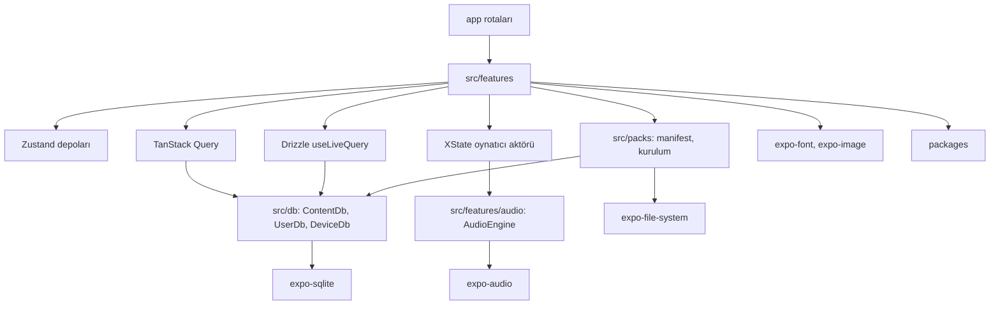
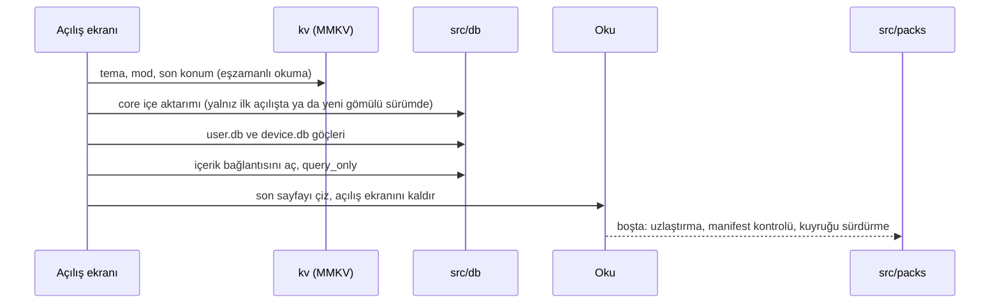

# Mobil mimari

> **Sürüm:** 1.1 · **Tarih:** 19 Ekim 2026 · **Durum:** Taslak
> **Bağlı kararlar:** [K-06](../00-ozet/02-karar-defteri.md#k-06--yayın-kapısı) · [K-07](../00-ozet/02-karar-defteri.md#k-07--mushaf-görünümü-üç-seçenek) · [K-09](../00-ozet/02-karar-defteri.md#k-09--mobil-teknoloji) · [K-15](../00-ozet/02-karar-defteri.md#k-15--hesap-ve-senkron-v1xte) · [K-17](../00-ozet/02-karar-defteri.md#k-17--arama-sqlite-fts5) · [K-21](../00-ozet/02-karar-defteri.md#k-21--i̇çerik-dağıtımı) · [K-26](../00-ozet/02-karar-defteri.md#k-26--kalıcı-adresler-çapa-şeması) · [K-28](../00-ozet/02-karar-defteri.md#k-28--ses) · [K-29](../00-ozet/02-karar-defteri.md#k-29--mobil-arayüz-kitaplıkları) · [K-30](../00-ozet/02-karar-defteri.md#k-30--eski-plandan-çıkarılanlar)

Bu dosya Expo uygulamasının iç yapısını tanımlar: klasörler, rotalar, durum yönetimi, veri erişimi, üç mushaf modunun çizimi, sağdan sola sayfalayıcı, performans bütçeleri, derleme türleri, hata yönetimi, hata izleme, erişilebilirlik ve dil. Ses ayrıntısı [Ses sistemi](./02-ses-sistemi.md), paket indirme ve silme ayrıntısı [Depolama yöneticisi](./03-depolama-yoneticisi.md) dosyasındadır. Ekranların görünüşü [Mobil ekranlar](../01-urun/03-mobil-ekranlar.md), okuma akışı [Okuma deneyimi](../01-urun/02-okuma-deneyimi.md) dosyasında anlatılır.

Kod örnekleri yön gösterir. Kitaplık API adları ilgili belgelerden alındı; belgede okunmayan imzalar "Doğrulanacak" diye işaretlidir.

---

## 1. Temel ilkeler

1. **Çevrimdışı önce.** Uygulama ilk açılıştan itibaren gömülü `core` paketiyle internetsiz çalışır. Ağ yalnız manifest, paket ve ses için kullanılır.
2. **İçerik salt okunur, kullanıcı verisi ayrı.** İçerik paketleri değişmeyen dosyalardır. Kullanıcının yazdığı her şey ayrı veritabanında durur ve içeriğe yalnız çapa ile bağlanır ([K-26](../00-ozet/02-karar-defteri.md#k-26--kalıcı-adresler-çapa-şeması)).
3. **Lisans kapısı istemcide de çalışır.** Yayınlayıcı her derleme türü için ayrı manifest üretir. Uygulama aynı kuralı ikinci kez uygular ([K-06](../00-ozet/02-karar-defteri.md#k-06--yayın-kapısı)).
4. **Tek oynatıcı.** Ses tek bir durum makinesinden yönetilir ([K-28](../00-ozet/02-karar-defteri.md#k-28--ses)).
5. **Kişisel veri ve okuma içeriği telemetriye girmez** (bölüm 12).
6. **Mod değişse de veri kopmaz.** Üç mushaf modu aynı çapaları kullanır; vurgu ve notlar her modda görünür ([K-07](../00-ozet/02-karar-defteri.md#k-07--mushaf-görünümü-üç-seçenek)).

## 2. Platform ve sürümler

| Konu | Değer | Kaynak |
|---|---|---|
| Başlangıç SDK | Expo SDK 57 (30 Haziran 2026; React Native 0.86, React 19.2) | [Expo SDK 57](https://expo.dev/changelog/sdk-57) |
| Hedef SDK | SDK 58 kararlı çıkınca (beta 15 Eylül 2026; React Native 0.88 RC) | [Expo SDK 58 beta](https://expo.dev/changelog/sdk-58-beta) |
| Mimari | Yalnız Yeni Mimari (React Native 0.82'den beri) | [RN 0.82](https://reactnative.dev/blog/2025/10/08/react-native-0.82) |
| JS motoru | Hermes V1 (SDK 56'dan beri varsayılan) | [Expo SDK 56](https://expo.dev/changelog/sdk-56) |
| Asgari iOS | 16.4; iPhone 7, 6s ve ilk SE desteklenmez | [Expo SDK 56](https://expo.dev/changelog/sdk-56) |
| Asgari Android | Doğrulanacak (araştırmada bulunamadı) | — |
| Yama alt sınırı | `expo@57.0.17` ve üstü. 57.0.9 Hermes V1 bellek gerilemesini, 57.0.17 geliştirme açılış süresi gerilemesini düzeltti | [Expo SDK 57](https://expo.dev/changelog/sdk-57) |
| Çalıştırma | Geliştirme derlemesi (dev client); Expo Go kullanılmaz | [K-09](../00-ozet/02-karar-defteri.md#k-09--mobil-teknoloji) |

Arayüz kitaplıkları [K-29](../00-ozet/02-karar-defteri.md#k-29--mobil-arayüz-kitaplıkları) ile sabittir: NativeWind v4 (v5 hâlâ ön sürüm ve "üretim için değil", [NativeWind v5](https://www.nativewind.dev/v5/getting-started/installation)), React Native Reusables (alt sayfa bileşeni yok, [RN Reusables](https://github.com/founded-labs/react-native-reusables)), @gorhom/bottom-sheet 5.2.x (Reanimated 4 ve Gesture Handler ≥ 2.16.1 ister, [package.json](https://github.com/gorhom/react-native-bottom-sheet/blob/master/package.json)), Reanimated 4. Eski plandaki expo-av, WatermelonDB, react-native-track-player ve react-native-fs kullanılmaz ([K-30](../00-ozet/02-karar-defteri.md#k-30--eski-plandan-çıkarılanlar)).

### 2.1 SDK 58 geçişinde bizi etkileyen değişiklikler

Kaynak: [Expo SDK 58 beta](https://expo.dev/changelog/sdk-58-beta).

| Değişiklik | Etkisi | Yapılacak |
|---|---|---|
| expo-audio kilit ekranında oynatma listesi | Kesintisiz liste motoru açılabilir | [Ses sistemi](./02-ses-sistemi.md), bölüm 4 |
| expo-sqlite libSQL desteği kaldırıldı | Kullanmıyoruz | — |
| expo-sqlite `NativeArrayBuffer` yerine `ArrayBuffer` | Mushaf A font BLOB okuma kodu etkilenir | Font önbelleği testleri yeniden koşulur |
| Expo Router yerel sekmeler kararlı | Mini oynatıcı yerleşimi yeniden denenir | Doğrulanacak |
| Geliştirme araçları Node.js 22.13+, 24.3+ ya da 26+ ister (kararlı sürüm 15 Ekim 2026; [SDK 58](https://expo.dev/changelog/sdk-58)) | Geliştirme ortamı | [Yerel geliştirme](../02-mimari/04-yerel-gelistirme.md) |
| expo-sqlite için ajan becerisi (`npx @expo/agent-cli skills:sync`) | Yapay zekâ destekli geliştirmede kullanılır | İsteğe bağlı |

## 3. Klasör yapısı

Uygulama tek depodaki `apps/mobile` klasöründedir ([Proje yapısı](../02-mimari/03-proje-yapisi.md)).

```
apps/mobile/
├─ app.config.ts            derleme türüne göre ad, kimlik, eklentiler (bölüm 10)
├─ eas.json                 derleme ve güncelleme profilleri
├─ metro.config.js          .db varlık uzantısı, Sentry
├─ assets/
│  ├─ db/core-<sürüm>.db    gömülü çekirdek paket (içerik hattından derlemeye kopyalanır)
│  ├─ fonts/                Literata, IBM Plex Sans, Amiri Quran, Amiri, Noto Naskh Arabic
│  └─ images/
├─ app/                     Expo Router rotaları; yalnız ekran ve yönlendirme
└─ src/
   ├─ features/
   │  ├─ reader/            Oku: Mushaf A/B/C, sayfalayıcı, seçim, kelime kartı, takip
   │  ├─ crossref/          Bağlantılar paneli, geri dönüş yığını
   │  ├─ audio/             expo-audio motoru, mini oynatıcı, Dinleme sayfası
   │  ├─ search/            Ara sekmesi
   │  ├─ library/           Kütüphane: tefsir, hadis, Risale gezinmesi
   │  ├─ notebook/          Defterim: yer imi, vurgu, not, hatim
   │  ├─ settings/          Ayarlar ekranları ve tercih deposu
   │  ├─ storage/           Depolama ekranı, indirme kuyruğu
   │  └─ onboarding/        İlk açılış
   ├─ db/                   bağlantılar, ATTACH yöneticisi, device.db Drizzle şeması, göçler (user.db şeması packages/content-schema'da)
   ├─ packs/                manifest istemcisi, görünürlük kuralı, kurulum, doğrulama, uzlaştırma
   └─ lib/                  i18n, hata türleri, telemetri, kv (MMKV), ağ, biçimlendirme, bayraklar
```

Her özellik klasörü aynı iç düzeni izler:

```
src/features/reader/
├─ index.ts        dışa açık API; diğer özellikler yalnız buradan alır
├─ components/     MushafPage, AyahText, SelectionBar …
├─ mushaf-a/       font önbelleği, satır düzeni, isabet testi
├─ mushaf-b/       sayfa görseli, ayah_box katmanı
├─ mushaf-c/       Unicode metin, kelime parçaları
├─ pager/          sağdan sola sayfalayıcı
├─ hooks/
├─ store.ts        Zustand okuyucu deposu
└─ queries.ts      TanStack Query anahtarları ve sorgu fonksiyonları
```

Kurallar:
- `app/` iş mantığı tutmaz. Rota dosyası bir özellik bileşenini çağırır.
- Özellikler birbirini yalnız `index.ts` üzerinden kullanır.
- Bağımlılık yönü `app → features → (db, packs, lib) → packages/*` şeklindedir. Ters yön ESLint `import/no-restricted-paths` kuralıyla engellenir.
- Platformdan bağımsız mantık `packages/*` içinde durur; web sonra aynı kodu kullanır.

| Paylaşılan paket | Mobildeki görevi |
|---|---|
| `packages/anchors` | Çapa ayrıştırma, biçimlendirme, doğrulama; derin bağlantı çözümü |
| `packages/content-schema` | Paket tablo tipleri; kullanıcı veritabanının Drizzle şeması |
| `packages/search` | Türkçe ve Arapça normalleştirme, FTS5 sorgu kurucu ([Arama](../03-veri/05-arama-fts5.md)) |
| `packages/reader-core` | Sayfa, satır, kelime modelleri; seçim aralığı hesabı; sayfa ↔ âyet eşlemesi; içerik sorguları |
| `packages/player` | XState oynatıcı makinesi ve motor arayüzü ([Ses sistemi](./02-ses-sistemi.md)) |
| `packages/ui-tokens` | Renk, tip ölçeği ve boşluk jetonları ([Tasarım sistemi](../01-urun/04-tasarim-sistemi.md)) |



## 4. Rotalar (Expo Router)

```
app/
├─ _layout.tsx                         kök: sağlayıcılar, açılış kapısı, hata sınırı
├─ +not-found.tsx
├─ (tabs)/
│  ├─ _layout.tsx                      beş sekme + mini oynatıcı
│  ├─ oku/index.tsx
│  ├─ kutuphane/index.tsx
│  ├─ kutuphane/tefsir/[sure]/[ayet].tsx
│  ├─ kutuphane/hadis/[koleksiyon]/[no].tsx
│  ├─ kutuphane/risale/[kitap]/[...bolum].tsx
│  ├─ ara/index.tsx
│  ├─ defterim/index.tsx
│  ├─ ayarlar/index.tsx
│  ├─ ayarlar/gorunum.tsx              tema, yazı boyutları
│  ├─ ayarlar/mushaf.tsx               mushaf modu, sayfa çevirme yönü
│  ├─ ayarlar/hafiz.tsx
│  ├─ ayarlar/depolama/index.tsx       Depolama yöneticisi
│  ├─ ayarlar/depolama/[packId].tsx    paket ya da hafız ayrıntısı
│  ├─ ayarlar/kaynaklar.tsx            kaynaklar ve lisanslar
│  └─ ayarlar/kurul.tsx                Kurul onay bilgisi
├─ not/[id].tsx                        not düzenleyici; kök düzeyinde tam ekran modal
├─ [...capa].tsx                       derin bağlantı, tek yakalayıcı rota: mutalaa://q/2/255, mutalaa://q/2/255/3-7 …
└─ onboarding/index.tsx
```

Ağacın tamamı ve eklemeleri (Fihrist, Oku içindeki tefsir, hatim modalı, diğer çapa türlerinin derin bağlantıları) [Mobil ekranlar §2](../01-urun/03-mobil-ekranlar.md#2-rota-ağacı) dosyasındadır. Not düzenleyici kök düzeyinde modal olduğu için okuyucudan açılınca sekme değişmez.

- **Kök sağlayıcı sırası:** `GestureHandlerRootView` → `SafeAreaProvider` → tema (NativeWind değişkenleri) → `QueryClientProvider` → `DbGate` (veritabanları ve göçler hazır olmadan ekran çizilmez) → `BottomSheetModalProvider` → `Stack`.
- **Derin bağlantı:** Kök düzeyindeki tek yakalayıcı rota `[...capa].tsx` yolu `fromRoute` ile çapaya çevirir (`q/2/255/3-7` → `q:2:255:3-7`) ve `packages/anchors` ile doğrular; karakter aralığı `?aralik=` sorgusundadır ([Çapa şeması §11](../03-veri/01-capa-semasi.md#11-packagesanchors-api)). Derin bağlantı bir atlamadır: bulunulan konum önce geri dönüş yığınına başlangıç olarak yazılır, sonra hedef okuyucu deposuna yazılır ve `router.replace('/oku')` çağrılır. Geçersiz ya da aralık dışı adres en yakın âyete yuvarlanmaz; Oku sekmesi açılır ve "Bağlantı geçersiz" uyarısı görünür. Diğer çapa türlerinin (`tf/…`, `rn/…`, `h/…`) çözümü aynı rotaya, hedef ekranlarıyla eklenir; biçim Çapa şemasının önerisidir ve MM-14 kapanınca kesinleşir ([Mobil ekranlar §7](../01-urun/03-mobil-ekranlar.md#7-derin-bağlantılar)). Web gelince `/kuran/2/255` aynı çözücüye bağlanır.
- **Hata sınırı:** Her sekme grubu Expo Router'ın `ErrorBoundary` dışa aktarımını kullanır. Ekranda "Yeniden dene" ve "Okumaya dön" düğmeleri bulunur.
- **Mini oynatıcı** sekme çubuğunun üstünde durur. SDK 56'da Expo Router react-navigation bağımlılığını bıraktı ([Expo SDK 56](https://expo.dev/changelog/sdk-56)); `Tabs` için özel sekme çubuğu yöntemi Doğrulanacak. SDK 58'deki yerel sekmelerle yerleşim yeniden denenir.
- **Alt sayfalar:** Tek bir `SheetHost` aynı anda tek alt sayfa açar. Yeni sayfa eskisinin yerini alır, üst üste yığılmaz ve her sayfada görünür bir "Kapat" düğmesi bulunur ([NN/g](https://www.nngroup.com/articles/bottom-sheet/)). Bağlantılar panelinin kendi iç geri yığını vardır.
- **Çip yuvası:** Okuyucu ekranının altında, mini oynatıcının hemen üstünde tek bir `ChipSlot` bulunur. Atlama zinciri açıkken (`useReader` geri dönüş yığını boş değilken) yuvayı "↩ Okuduğun yere dön" ve "Burada kal" tutar. Zincir yokken, takip kapalıysa ve çalan âyet ekranda değilse "Okunan âyete dön" çıkar ([Ses sistemi](./02-ses-sistemi.md), bölüm 7). İki çip hiçbir zaman birlikte görünmez ([Okuma deneyimi §9](../01-urun/02-okuma-deneyimi.md#9-atla-ve-dön)).

## 5. Durum yönetimi

[K-29](../00-ozet/02-karar-defteri.md#k-29--mobil-arayüz-kitaplıkları) dört araç belirler. Her durum tek bir yerde yaşar.

| Durum | Yer | Kalıcılık | Örnek |
|---|---|---|---|
| Tercihler | Zustand `useSettings` + MMKV; senkrona girenler ayrıca `user.db` `setting` | Kalıcı | Tema, mushaf modu, yazı boyutları, hafız |
| Okuyucunun geçici durumu | Zustand `useReader` | Bellek | Açık sayfa, seçim, geri dönüş yığını |
| Okuma konumu | `user.db` `reading_position` (cihaz başına) + MMKV kopyası; atlama zinciri açıkken yazılmaz | Kalıcı | Son âyet ve sayfa |
| İçerik sorguları | TanStack Query; anahtar paket sürümünü içerir | Bellek önbelleği | Sayfanın âyetleri, meal, tefsir paragrafı |
| Kullanıcı verisi listeleri | Drizzle `useLiveQuery` | `user.db` | Vurgular, notlar, yer imleri |
| Manifest | TanStack Query; son bilinen kopya MMKV'de | Kalıcı | Paket kataloğu |
| İndirme kuyruğu | `device.db` `download_job` (kaynak) + Zustand (ekran) | Kalıcı | İlerleme, duraklatma |
| Oynatıcı | XState aktörü (uygulama boyunca tek) | Bellek; ses tercihleri MMKV'de | Çalan âyet, tekrar sayacı |
| Çalma ilerlemesi | Zustand `usePlayback` (100 ms'de bir yazılır) | Bellek | Kelime vurgusu |

Hangi ayarların senkrona girdiği [Kullanıcı verisi ve senkron](../03-veri/04-kullanici-verisi-ve-senkron.md) dosyasında belirlenir. Cihaza özgü ayarlar (Yalnız Wi-Fi, otomatik temizlik) yalnız MMKV'de durur.

```ts
// src/features/settings/store.ts
import { create } from 'zustand';
import { persist, createJSONStorage } from 'zustand/middleware';
import { kvStorage } from '@/lib/kv'; // MMKV üzerinde getItem/setItem/removeItem sarmalayıcısı

export type MushafRender = 'A' | 'B' | 'C';
export type ReadingLayout = 'mushaf' | 'mushaf_meal' | 'ayet_ayet';
export type TurnDirection = 'rtl' | 'ltr';

type Settings = {
  theme: 'sistem' | 'kagit' | 'ahar' | 'gece';   // sistem: açıkta Kâğıt, koyuda Gece
  mushafRender: MushafRender;
  readingLayout: ReadingLayout;
  turnDirection: TurnDirection;
  arabicScale: number;   // 1 = varsayılan; Türkçeden ayrı ayar
  turkishScale: number;
  reciterId: string | null;
  update: (patch: Partial<Omit<Settings, 'update'>>) => void;
};

export const useSettings = create<Settings>()(
  persist(
    (set) => ({
      theme: 'sistem',
      mushafRender: 'C',            // indirme gerektirmez (bölüm 7.4)
      readingLayout: 'mushaf_meal', // varsayılan biçim Mushaf + Meal (Okuma deneyimi §2)
      turnDirection: 'rtl',
      arabicScale: 1,
      turkishScale: 1,
      reciterId: null,
      update: (patch) => set(patch),
    }),
    { name: 'ayarlar', version: 1, storage: createJSONStorage(() => kvStorage) },
  ),
);
```

MMKV örneğini oluşturma API'si kitaplık sürümüne göre değişebilir (Doğrulanacak). Bu yüzden MMKV yalnız `src/lib/kv.ts` içinden kullanılır.

```ts
// src/lib/query.ts
import { QueryClient, onlineManager, focusManager } from '@tanstack/react-query';
import { AppState } from 'react-native';
import { network } from '@/lib/network';

onlineManager.setEventListener((setOnline) => network.subscribe((s) => setOnline(s.isConnected)));
AppState.addEventListener('change', (s) => focusManager.setFocused(s === 'active'));

export const queryClient = new QueryClient({
  defaultOptions: { queries: { retry: 2, staleTime: 5 * 60_000 } },
});

// İçerik sorguları ağ beklemez ve paket sürümü değişene kadar bayatlamaz.
export const contentQuery = { networkMode: 'always', staleTime: Infinity, gcTime: 10 * 60_000 } as const;

export const qk = {
  manifest: (flavor: string) => ['manifest', flavor] as const,
  page: (page: number, coreVersion: string) => ['page', page, coreVersion] as const,
  pageMeal: (page: number, coreVersion: string) => ['pageMeal', page, coreVersion] as const,
};
```

Oynatıcı aktörü kökte bir kez oluşur ve gezinmeden etkilenmez. Bileşenler `@xstate/react` `useSelector` ile yalnız ihtiyaç duydukları alanı okur. Ayrıntı [Ses sistemi](./02-ses-sistemi.md) dosyasında.

## 6. Veri erişimi

### 6.1 Veritabanı dosyaları

| Dosya | İçerik | Bağlantı | Yazma | Konum |
|---|---|---|---|---|
| `core-<sürüm>.db` ve ATTACH edilen metin paketleri | Kur'an, meal, bağlantı indeksleri; `tefsir-elmalili`, `hadis-*`, `risale-*`, `kelime-kok` (QAC kaynaklı kök ve lemma ile Türkçe kelime anlamları; bugün yalnız `dev`) | Tek içerik bağlantısı | Yok (`PRAGMA query_only`) | `Paths.document/mutalaa/packs/` |
| `mushaf-a-cuz-NN`, `mushaf-b`, `ses-{hafiz}` paketleri | Font, görsel, ses dizini, zamanlama | Paket başına ayrı salt okunur bağlantı (LRU) | Yok | Aynı |
| `user.db` | `bookmark`, `highlight`, `note`, `reading_position`, `hatim`, `hatim_page`, `collection`, `setting` | Drizzle | Var; WAL | `Paths.document/mutalaa/db/` |
| `device.db` | `installed_pack`, `download_job`, `audio_file` | Drizzle | Var; WAL | Aynı |

`device.db` cihaza özgü kayıtları tutar. Senkrona girmez ve yedekten geri dönüldüğünde diskle uzlaştırılır ([Depolama yöneticisi](./03-depolama-yoneticisi.md)). Kullanıcı veritabanı v1'den itibaren senkrona hazır şemayla kurulur ([K-15](../00-ozet/02-karar-defteri.md#k-15--hesap-ve-senkron-v1xte)).

expo-sqlite iki yerde bizi doğrudan etkiler. `openDatabaseAsync(databaseName, options, directory)` özel bir klasörde veritabanı açar. `enableFTS` yapılandırma seçeneği varsayılan olarak açıktır ve Android ile iOS'ta FTS5'i etkinleştirir. Web derlemesinde FTS yoktur ([expo-sqlite](https://docs.expo.dev/versions/v58.0.0/sdk/sqlite.md)).

### 6.2 Açılış sırası



Gömülü `core` paketi için expo-sqlite'ın `SQLiteProvider` `assetSource` özelliği kullanılabilir. Bu özellik paket içindeki veritabanını yerel dosyaya aktarır; `forceOverwrite` varsayılan olarak kapalıdır ([expo-sqlite](https://docs.expo.dev/versions/v58.0.0/sdk/sqlite.md)). Dosya adı sürüm taşır (`core-2026.10.0.db`). Yeni ikili yeni bir ad getirdiği için eski kopya üzerine yazma sorunu doğmaz; eskisi uzlaştırmada silinir. Üç veritabanını tek sağlayıcıyla yönetmek yerine `expo-asset` ile elle kopyalamak daha sade olabilir. Seçim Doğrulanacak. `.db` uzantısı Metro varlık listesine eklenir.

### 6.3 İçerik bağlantısı ve ATTACH yöneticisi

Metin paketleri tek bağlantıda ATTACH edilir, böylece arama ve bağlantı sorguları paketler arasında birlikte çalışır ([Sözlük](../00-ozet/03-sozluk.md)). expo-sqlite belgesi ATTACH ile açılan şemaların değişiklik olaylarında ayrı adla göründüğünü yazar ([expo-sqlite](https://docs.expo.dev/versions/v58.0.0/sdk/sqlite.md)).

```ts
// src/db/content.ts
import * as SQLite from 'expo-sqlite';
import { Mutex } from '@/lib/mutex';

// SQLite'ın varsayılan ATTACH sınırı 10'dur; expo-sqlite derlemesindeki değer Doğrulanacak.
// Gerekirse yapılandırmadaki customBuildFlags ile yükseltilir.
const MAX_ATTACHED = 8;

type Attached = { alias: string; path: string; lastUsed: number };

export class ContentDb {
  private db!: SQLite.SQLiteDatabase;
  private attached = new Map<string, Attached>();
  private lock = new Mutex();

  async open(coreFile: string, dir: string) {
    this.db = await SQLite.openDatabaseAsync(coreFile, { useNewConnection: true }, dir);
    // query_only ATTACH'ı engellememeli; Doğrulanacak.
    await this.db.execAsync('PRAGMA query_only = ON;');
  }

  /** Paketi bağlar ve SQL'de kullanılacak şema adını döndürür. */
  async ensure(packId: string, path: string): Promise<string> {
    return this.lock.run(async () => {
      const hit = this.attached.get(packId);
      if (hit?.path === path) { hit.lastUsed = Date.now(); return hit.alias; }
      if (hit) await this.detachLocked(packId);
      if (this.attached.size >= MAX_ATTACHED) await this.detachLocked(this.leastRecent());
      const alias = 'p_' + packId.replace(/[^a-z0-9]/g, '_');   // tanımlayıcı bağlanamaz, temizlenir
      await this.db.runAsync(`ATTACH DATABASE ? AS ${alias}`, path); // dosya yolu parametredir
      this.attached.set(packId, { alias, path, lastUsed: Date.now() });
      return alias;
    });
  }

  /** Paket güncellenince ya da silinince çağrılır. Süren sorgular bitmeden DETACH yapılmaz. */
  async detach(packId: string) { return this.lock.run(() => this.detachLocked(packId)); }

  async all<T>(sql: string, params: SQLite.SQLiteBindParams = []): Promise<T[]> {
    return this.lock.shared(() => this.db.getAllAsync<T>(sql, params));
  }

  private async detachLocked(packId: string) {
    const a = this.attached.get(packId);
    if (!a) return;
    await this.db.execAsync(`DETACH DATABASE ${a.alias}`);
    this.attached.delete(packId);
  }

  private leastRecent(): string {
    return [...this.attached.entries()].sort((x, y) => x[1].lastUsed - y[1].lastUsed)[0][0];
  }
}
```

- Mushaf ve ses paketleri ATTACH edilmez. Aramaya ve birleştirmeye girmedikleri için kendi salt okunur bağlantılarıyla, en fazla birkaç tane açık tutularak (LRU) kullanılır.
- Risale kitap başına paket olduğunda (`risale-{kitap}`) metin paketi sayısı ATTACH sınırını aşabilir. Arama bu durumda paketleri gruplar hâlinde sorgulayıp sonuçları birleştirir. Bu maliyet Açık soru; [Arama](../03-veri/05-arama-fts5.md) dosyasıyla birlikte ölçülecek.
- İçerik sorguları `packages/reader-core` içinde parametreli SQL olarak yazılır. Drizzle'ın SQLite tablo tanımında ATTACH şema öneki desteği görünmüyor (Doğrulanacak); bu yüzden Drizzle yalnız `user.db` ve `device.db` için kullanılır.
- Salt okunur açmanın daha sıkı yolu URI biçimli dosya adıdır (`mode=ro`, `immutable=1`). expo-sqlite derlemesinde URI desteği Doğrulanacak.

### 6.4 Kullanıcı ve cihaz veritabanı

```ts
// src/db/user.ts
import { openDatabaseSync } from 'expo-sqlite';
import { drizzle } from 'drizzle-orm/expo-sqlite';
import * as schema from '@mutalaa/content-schema/user';
import { DB_DIR } from './paths';

const sqlite = openDatabaseSync('user.db', { enableChangeListener: true }, DB_DIR);
sqlite.execSync('PRAGMA journal_mode = WAL; PRAGMA foreign_keys = ON;');
export const userDb = drizzle(sqlite, { schema });
```

- `useLiveQuery` canlı sorgu için `enableChangeListener: true` ister. `useMigrations` göç kapısı tablo eksikliği çökmelerini önler. `.sql` göçleri Babel ve Metro ayarı ister ([React Native Relay](https://reactnativerelay.com/article/building-offline-first-react-native-apps-2026-expo-sqlite-drizzle-orm-sync-strategies)).
- Yazmalar işlem (transaction) içinde ve hazırlanmış deyimlerle yapılır. Bir karşılaştırmaya göre WAL ve toplu işlem, kitaplık seçiminden daha çok fark yaratır ([PowerSync](https://powersync.com/blog/react-native-database-performance-comparison)); expo-sqlite belgesi de yeni veritabanlarında WAL önerir.
- `device.db` aynı kalıpla açılır. Şeması [Depolama yöneticisi](./03-depolama-yoneticisi.md) dosyasındadır.
- Kullanıcı kaydı içeriğe çapa ve `content_hash` ile bağlanır. Okuma konumu her sayfa değişiminde değil, sayfa durduktan 1 saniye sonra yazılır. Atlama zinciri açıkken (`useReader` geri dönüş yığını boş değilken) `reading_position` ve MMKV kopyası yazılmaz. "Burada kal" zinciri bitirir ve bulunulan yeri yazar; "↩ Okuduğun yere dön" başlangıca döner ([Okuma deneyimi §9](../01-urun/02-okuma-deneyimi.md#9-atla-ve-dön)).

## 7. Mushaf çizimi

Üç çizim yolu [K-07](../00-ozet/02-karar-defteri.md#k-07--mushaf-görünümü-üç-seçenek) ile karara bağlıdır. Okuma düzeni ayrı bir eksendir: "Mushaf", "Mushaf + Meal" ve "Âyet âyet". Bu üçlü Quran.com'un üç okuma tercihinden alınmıştır ([QuranReader.ts](https://github.com/quran/quran.com-frontend-next/blob/production/types/QuranReader.ts)). Âyet âyet düzeni her zaman Mod C'nin Unicode metnini kullanır; Quran.com da âyet âyet ve meal modlarında tek bir Unicode font kullanır.

| | A · Medine düzeni | B · Türk hattı | C · Akan Unicode |
|---|---|---|---|
| Kaynak | `mushaf-a-cuz-{01..30}`: QPC sayfa fontları + satır düzeni | `mushaf-b`: sayfa görselleri + `ayah_box` | `core`: Tanzil metni |
| Font ya da görsel | Sayfa başına QPC V2 fontu, ihtiyaç anında yüklenir | expo-image | Amiri Quran (OFL); izin alınırsa KFGQPC Hafs |
| Kelime seçimi | Var (glif başına) | Yok | Var (kelime parçası başına) |
| Âyet vurgusu | Kelime glifleri üzerinden | `ayah_box` katmanı | Metin parçası zemini |
| Ekran okuyucu | Paralel Unicode katmanı | Âyet başına etiket | Doğrudan metin |
| Kullanılabilirlik | Paket ve lisans gelince | Lisans gelince | Her zaman |

Ortak sözleşme:

```ts
// packages/reader-core/src/render.ts
export type AyahAnchor = `q:${number}:${number}`;
export type WordAnchor = `q:${number}:${number}:${number}`;

export interface HighlightInput {
  activeAyah?: AyahAnchor;        // sesle okunan âyet
  activeWord?: WordAnchor;        // yalnız zamanlaması olan hafızlarda
  selection?: { from: WordAnchor; to: WordAnchor };
  user: { anchor: string; color: string; label: string }[]; // vurgular; renk tek başına anlam taşımaz
}

export interface MushafRenderer {
  readonly mode: 'A' | 'B' | 'C';
  isAvailable(page: number): Promise<boolean>; // paket cihazda mı
  prefetch(page: number): Promise<void>;       // font ya da görseli ısıtır
}
```

**Kelime kartı ve `kelime-kok` paketi.** QAC kaynaklı kök ve lemma verisi ile Türkçe kelime anlamları `core` paketinde değil, ayrı `kelime-kok` paketindedir ([İçerik paketleri §1](../03-veri/03-icerik-paketleri.md#1-paket-listesi), §3.3). Paket `bekliyor` durumunda olduğu için bugün yalnız `dev` derlemede görünür ([K-06](../00-ozet/02-karar-defteri.md#k-06--yayın-kapısı)). Kart iki durumda da çalışır:
- Paket varsa Arapça kelime, Türkçe anlam, kök, lemma, "Bu kök Kur'an'da N yerde geçer" satırı ve "Kökü incele" görünür.
- Paket yoksa (`internal`, `public`) Arapça kelime, konumu ve eylemler görünür. Türkçe anlam, kök satırı, sıklık ve "Kökü incele" boşluk bırakmadan gizlenir; eksiklik uyarısı gösterilmez. Anlamların QAC'den bağımsız olarak `core`'a taşınması İçerik paketleri IP-6'dır (Açık soru).

Kök ve lemma türündeki bağlantılar (`kok`, `lemma`) ve Ara sekmesindeki kök araması da aynı veriden türediği için yalnız paket varken görünür. Bu bağlantıların `core` yerine `kelime-kok` ile dağıtılması [İçerik paketleri](../03-veri/03-icerik-paketleri.md) ile uyumlanmalı.

### 7.1 Mod A · Medine düzeni

**Paket içeriği (öneri).** Her `mushaf-a-cuz-NN` paketi o cüzün sayfa fontlarını ve satır düzenini taşır. Fontlar SQLite içinde BLOB olarak durursa paket tek dosya, tek sha256 ve tek indirme olur. Biçim [İçerik paketleri](../03-veri/03-icerik-paketleri.md) dosyasında kesinleşir.

```sql
-- mushaf-a-cuz-NN içinde (öneri)
CREATE TABLE page_font (page INTEGER PRIMARY KEY, format TEXT NOT NULL, data BLOB NOT NULL, sha256 TEXT NOT NULL);
CREATE TABLE page_line (
  page INTEGER NOT NULL, line INTEGER NOT NULL,
  line_type TEXT NOT NULL,            -- 'ayet' | 'sure_adi' | 'besmele'
  centered INTEGER NOT NULL DEFAULT 0,
  sure INTEGER,                       -- sure_adi satırı için
  PRIMARY KEY (page, line)
);
CREATE TABLE glyph_word (
  page INTEGER NOT NULL, line INTEGER NOT NULL, pos INTEGER NOT NULL,
  anchor TEXT,                        -- q:{sure}:{ayet}:{kelime}; âyet sonu işaretinde NULL
  ayah TEXT NOT NULL,                 -- q:{sure}:{ayet}
  glyph TEXT NOT NULL,                -- QPC kod noktası
  is_ayah_end INTEGER NOT NULL DEFAULT 0,
  PRIMARY KEY (page, line, pos)
);
```

**Lisans ve kaynak.** QPC sayfa fontlarının üst verisi yalnız "All rights reserved" der ([QCF_P001](https://raw.githubusercontent.com/mustafa0x/qpc-fonts/f93bf5f3/mushaf-woff2/QCF_P001.woff2)). Quran Foundation geliştirici şartları, Developer Console hesabı olan ve atıf yapan geliştiricinin fontları uygulamaya gömmesine izin verir. Aynı şartlar API içeriğini en fazla bir hafta önbelleğe almaya izin verir ve hazır veritabanı dağıtımını yasaklar ([QF Developer Terms](https://api-docs.quran.foundation/legal/developer-terms/)). Buradan iki Açık soru çıkar (hukuki görüş değildir):
- Fontları kendi depomuzdan cüz paketi olarak indirmek "uygulamaya gömme" sayılır mı?
- Satır düzeni verisinin kaynağı ne olacak? QF sayfa düzeni API'sinden gelirse ([QF page layout](https://api-docs.quran.foundation/docs/tutorials/fonts/page-layout/)) önbellek ve hazır veritabanı kısıtları çevrimdışı paketle çelişir. QUL düzen verisinde çoğu kaynakta lisans alanı yoktur ([QUL SSS](https://qul.tarteel.ai/faq)).

Kurul'un Medine düzenli fontlara bakışı da belirsizdir. Rapor, mushaf çizim yönteminin bu cevap gelmeden kesinleşmemesini önerir ([Yayın kapısı ve Kurul](../07-yayin/01-yayin-kapisi-ve-kurul.md)).

**Font yükleme.** Quran.com her sayfa için çalışma anında ayrı bir font yükler ([fontFaceHelper.ts](https://github.com/quran/quran.com-frontend-next/blob/production/src/utils/fontFaceHelper.ts)). Uygulama aynı yolu expo-font ile izler:

```ts
// src/features/reader/mushaf-a/fontCache.ts
// expo-file-system adları "latest" belgesinden; SDK 57'de varlıkları Doğrulanacak.
import * as Font from 'expo-font';
import { File, Directory, Paths } from 'expo-file-system';
import { resolveCuzPack, openPackDb } from '@/db/packs';
import { PackMissingError } from '@/lib/errors';

const MAX_ACTIVE = 12;                         // ölçümle ayarlanır
const active = new Map<string, number>();      // aile adı → son kullanım
const fontDir = new Directory(Paths.cache, 'mutalaa', 'qpc'); // sistem bu klasörü temizleyebilir; sorun değil

/** Aynı aile adı ikinci kez yüklenmez; paket sürümü bu yüzden ada girer. */
export function familyName(page: number, packVersion: string): string {
  return `QPC_P${String(page).padStart(3, '0')}_${packVersion.replace(/[^0-9a-z]/gi, '')}`;
}

export async function ensurePageFont(page: number): Promise<string> {
  const pack = await resolveCuzPack(page);     // sayfa → mushaf-a-cuz-NN, sürüm, yol
  const family = familyName(page, pack.version);
  if (Font.isLoaded(family)) { active.set(family, Date.now()); return family; }

  const file = new File(fontDir, `${family}.ttf`);
  if (!file.exists) {
    const db = await openPackDb(pack);         // ayrı salt okunur bağlantı
    const row = await db.getFirstAsync<{ data: Uint8Array }>(
      'SELECT data FROM page_font WHERE page = ?', page);
    if (!row) throw new PackMissingError(pack.packId);
    fontDir.create({ intermediates: true, idempotent: true });
    file.write(row.data);
  }
  await Font.loadAsync({ [family]: file.uri }); // file:// kaynağı Doğrulanacak
  active.set(family, Date.now());
  trimActive();
  return family;
}

function trimActive() {
  while (active.size > MAX_ACTIVE) {
    const [oldest] = [...active.entries()].sort((a, b) => a[1] - b[1])[0];
    active.delete(oldest);
    // expo-font'ta belgelenmiş bir boşaltma yöntemi yok. Doğrulanacak.
  }
}

/** Okuma yönünde iki, geride bir sayfa ısıtılır. */
export function prefetchAround(page: number) {
  for (const p of [page + 1, page + 2, page - 1]) if (p >= 1 && p <= 604) void ensurePageFont(p);
}
```

expo-font belgesi üç şeyi açık bırakır ([expo-font](https://docs.expo.dev/versions/latest/sdk/font/), 18 Ekim 2026'da okundu):
1. **Biçim.** Örnekler yalnız TTF ve OTF kullanır; yerel platformlarda woff2 desteği Doğrulanacak. Brifteki "~3 MB/cüz" tahmini woff2 boyutuna dayanır (V2 tam set 93,2 MB, [Quran.com font klasörü](https://github.com/quran/quran.com-frontend-next/tree/production/public/fonts/quran/hafs)). Aynı klasörde Unicode Hafs fontu woff2'de 87.760, TTF'de 242.368 bayttır (yaklaşık 2,8 kat). TTF dağıtılırsa cüz paketleri belirgin büyüyebilir. Gerçek boyut Açık soru.
2. **Boşaltma.** Belgede boşaltma yöntemi yok, yalnız `ERR_UNLOAD` hata kodu geçiyor. LRU disk önbelleğini ve etkin kümeyi sınırlar. Kayıtlı fontların belleği ise ancak boşaltma çalışırsa sınırlanır. Prototipte 604 sayfa baştan sona çevrilip bellek ölçülür. Bütçe aşılırsa Mod A için `@shopify/react-native-skia` ile çizim değerlendirilir. Bu yeni bir bağımlılıktır ve karar defterine girmesi gerekir (Açık soru).
3. **Yerel dosya kaynağı.** `loadAsync` uzak ve yerel kaynak kabul eder; `file://` kullanımı açıkça yazılmamış (Doğrulanacak).

**Satır düzeni.** Her satır bir `View` içinde ayrı `Text` kelimelerinden oluşur. Kelimeler mantıksal sırayla verilir ve satır `flexDirection: 'row-reverse'` ile sağdan sola dizilir; uygulama arayüzü soldan sağa kaldığı için `I18nManager` çevrilmez. Glif metni `allowFontScaling={false}` ile çizilir; büyütme sayfa yakınlaştırmasıyla yapılır. Tam satırların iki yana yaslanması (`space-between`) ile ortalanmış satırların davranışı prototipte QPC V2 ile ölçülür (Doğrulanacak).

**Kelime isabet testi.** İç içe olmayan her `Text` `onLayout` ile kendi dikdörtgenini bildirir. Dikdörtgenler sayfa koordinatına çevrilip paylaşılan bir değerde tutulur. Dokunma arayüz iş parçacığında çözülür. İsabet alanı satır yüksekliğinin tamamına ve en az 44 pt genişliğe büyütülür ([Apple HIG Erişilebilirlik](https://developer.apple.com/design/human-interface-guidelines/accessibility)).

```ts
// src/features/reader/mushaf-a/hitTest.ts
export type WordBox = { anchor: string; x: number; w: number; lineTop: number; lineBottom: number };
const MIN_TARGET = 44;

export function hitTest(boxes: WordBox[], px: number, py: number): string | null {
  'worklet';
  let best: string | null = null;
  let bestDx = Number.POSITIVE_INFINITY;
  for (let i = 0; i < boxes.length; i++) {
    const b = boxes[i];
    if (py < b.lineTop || py > b.lineBottom) continue;
    const pad = Math.max(0, (MIN_TARGET - b.w) / 2);
    if (px < b.x - pad || px > b.x + b.w + pad) continue;
    const dx = Math.abs(px - (b.x + b.w / 2));
    if (dx < bestDx) { bestDx = dx; best = b.anchor; }
  }
  return best;
}
```

```tsx
// src/features/reader/mushaf-a/useWordGestures.ts (özet)
const boxes = useSharedValue<WordBox[]>([]);
const tap = Gesture.Tap().onEnd((e) => {
  const a = hitTest(boxes.value, e.x, e.y);
  if (a) runOnJS(openWordCard)(a);
});
const hold = Gesture.LongPress().minDuration(350).onStart((e) => {
  const a = hitTest(boxes.value, e.x, e.y);
  if (a) runOnJS(beginSelection)(a);
});
const drag = Gesture.Pan().activateAfterLongPress(350).onUpdate((e) => {
  const a = hitTest(boxes.value, e.x, e.y);
  if (a) runOnJS(extendSelection)(a);   // durum yalnız kelime değişince güncellenir
});
export const gesture = Gesture.Exclusive(Gesture.Simultaneous(hold, drag), tap);
// Reanimated 4'te JS'e geri çağırma API'si (runOnJS ya da react-native-worklets karşılığı) Doğrulanacak.
```

Kelime aralığı seçimi ilk kelimeye uzun basıp parmağı son kelimeye sürükleyerek yapılır. Jest gerektirmeyen bir "Seç" düğmesi de vardır: başlangıç kelimesine, sonra bitiş kelimesine dokunulur. Apple her işlevin birden fazla etkileşimle erişilebilir olmasını ister ([Apple HIG Erişilebilirlik](https://developer.apple.com/design/human-interface-guidelines/accessibility)). Seçim `q:2:255:3-7` biçiminde çapaya dönüşür.

**Paralel Unicode katmanı.** Glif kodları kelimeyle ilgisiz sunum biçimi kod noktalarıdır (örneğin U+FB51; [sample-verse.json](https://github.com/quran/quran.com-frontend-next/blob/production/src/utils/sample-verse.json)). Bu yüzden:
- Glif katmanı ekran okuyucudan gizlenir (`aria-hidden`).
- Her âyet için, ölçülen kelime dikdörtgenlerinin birleşiminden hesaplanan görünmez erişilebilir öğeler sayfanın üstüne konur: Türkçe adres etiketi ("Bakara Sûresi, 255. âyet") ve Arapça Unicode metin. iOS'ta `accessibilityLanguage="ar"` kullanılır; Android'de dil geçişi Doğrulanacak.
- Kopyalama seçilen çapaların Tanzil Unicode metnini kopyalar. Arama sonuçları ve kullanıcı vurguları kelime çapasıyla glife eşlenir.

**Tecvid renkleri (V4).** COLRv1 renkli fonttur. QUL, V4'ün düzeltme okuması bitene kadar kapalı olduğunu yazar ([QUL glif fontları](https://qul.tarteel.ai/docs/glyph-based)). Yerel metin motorlarında COLRv1 desteği Doğrulanacak. Özellik `tecvidRenkleri` bayrağıyla kapalı kalır (bölüm 10).

### 7.2 Mod B · Türk hattı

`mushaf-b` paketi sayfa görsellerini ve `ayah_box` kayıtlarını taşır. Koordinatlar görsel piksel uzayındadır; bir âyet satır başına bir kutu olmak üzere birden fazla kutu taşır. Yaklaşım Quran for Android'den alınmıştır; onun veri biçimi bu çalışmada doğrulanmadı.

```tsx
// src/features/reader/mushaf-b/MushafImagePage.tsx (özet)
type Box = { ayah: AyahAnchor; seq: number; x: number; y: number; w: number; h: number };

export function MushafImagePage({ page, uri, imgW, imgH, boxes, active, onAyahPress }: Props) {
  const { width } = useWindowDimensions();
  const scale = width / imgW;
  const tokens = useThemeTokens();
  return (
    <Pressable onPress={(e) => {
      const { locationX: x, locationY: y } = e.nativeEvent;
      const hit = boxes.find((b) => x >= b.x * scale && x <= (b.x + b.w) * scale
                                  && y >= b.y * scale && y <= (b.y + b.h) * scale);
      if (hit) onAyahPress(hit.ayah);
    }}>
      <Image source={{ uri }} style={{ width, height: imgH * scale }} contentFit="contain"
             tintColor={tokens.pageInk} accessibilityIgnoresInvertColors />
      {boxes.filter((b) => b.ayah === active).map((b) => (
        <View key={`${b.ayah}:${b.seq}`} pointerEvents="none" style={{
          position: 'absolute', left: b.x * scale, top: b.y * scale,
          width: b.w * scale, height: b.h * scale,
          backgroundColor: tokens.audioHighlight, borderBottomWidth: 2, borderColor: tokens.accent,
        }} />
      ))}
    </Pressable>
  );
}
```

- **Tema.** Brif koyu temada görüntünün ters çevrilmesini ister. İki yol var. Birincisi, sayfalar saydam zeminli mürekkep maskesi olarak paketlenir ve expo-image `tintColor` ile temanın metin rengine boyanır; renkli tezhip bu yolda tek renge iner. İkincisi, renk ters çevirme filtresi kullanılır; React Native `filter` desteği platforma göre Doğrulanacak. Görsel biçimi lisanslı kaynağa bağlı olduğu için Açık soru.
- **Seçim.** Kelime seçimi yoktur ([K-07](../00-ozet/02-karar-defteri.md#k-07--mushaf-görünümü-üç-seçenek)). Kelime aralığına yapılmış kullanıcı vurguları bu modda âyet kutusunun kenarında bir işaretle gösterilir.
- **Yakınlaştırma.** Kıstırma ile yakınlaştırma kutu katmanını da aynı dönüşümle büyütür. Taranmış görseller tema, seçim ve net yakınlaştırma özelliklerini kaybeder ([araştırma raporu](../09-kaynakca.md)).
- **Bellek.** Aynı anda en fazla üç çözülmüş sayfa tutulur (açık sayfa ve iki komşu).

### 7.3 Mod C · Akan Unicode

Mod C sayfa sınırlarını korur ve satırları akıtır. Sayfa, Medine sayfasındaki âyetlerden oluşur; büyük yazı boyutunda sayfa kendi içinde dikey kayar.

```tsx
// src/features/reader/mushaf-c/AyahFlow.tsx (özet)
<Text selectable style={{   // uzun basış işletim sisteminin seçimini açar
  fontFamily: 'AmiriQuran', writingDirection: 'rtl', textAlign: 'justify',
  fontSize: base * arabicScale, lineHeight: base * arabicScale * 2.1,   // 2,0–2,3 aralığı
}}>
  {words.map((w) => (
    <Text key={w.anchor}
      onPress={() => openWordCard(w.anchor)}   // kısa dokunuş: kelime kartı; uzun basışa uygulama seçimi bağlanmaz
      style={w.anchor === activeWord ? styles.activeWord : w.ayah === activeAyah ? styles.activeAyah : undefined}>
      {w.text}{' '}
    </Text>
  ))}
</Text>
// styles.activeAyah: zemin tonu; styles.activeWord: zemin + alt çizgi. Renk tek başına anlam taşımaz.
```

- **Font.** Amiri Quran (OFL) expo-font yapılandırma eklentisiyle derleme anında gömülür; belge bunu çalışma anında yüklemekten daha verimli bulur ([expo-font](https://docs.expo.dev/versions/latest/sdk/font/)). Amiri Quran test edilen 65 Kur'an kod noktasının 53'ünü içerir; eksikler saygı işaretleri ve Hafs dışı hareke işaretleridir. Türkçe Latin harfi içermez, bu yüzden Türkçe metinde kullanılmaz ([google/fonts: Amiri Quran](https://github.com/google/fonts/tree/main/ofl/amiriquran)). KFGQPC Hafs yalnız yazılı izinle girer.
- **Seçim.** Uzun basış uygulama seçimi başlatmaz; işletim sisteminin seçim tutamaçlarını açar (`selectable`) ve sistemin "Kopyala" menüsü her durumda çalışır. React Native `Text` seçilen aralığın ofsetini bildirmez (Doğrulanacak, MM-15); eylem çubuğu için yerel bir seçim köprüsü ya da salt okunur metin alanı gerekir. Köprü hazır olana kadar aralık üst çubuktaki "Seç" düğmesiyle kurulur: başlangıç kelimesine, sonra bitiş kelimesine dokunulur. Kısa dokunuş kelime kartını açar; `selectable` paragraf içinde `onPress` parçalarının sorunsuz çalışması Doğrulanacak. Aynı kural meal, tefsir ve Risale metinlerinde geçerlidir ([Okuma deneyimi §3](../01-urun/02-okuma-deneyimi.md#3-seçim)).
- **Ekran okuyucu.** Paragraf tek öğe olarak okunur. Ekran okuyucu kullanıcılarına her âyetin ayrı öğe olduğu "Âyet âyet" düzeni önerilir (bölüm 13).
- **Âyet sonu işareti.** U+06DD fontun kapsamındadır. Rakamla birleşik çizimi Doğrulanacak.

### 7.4 Mod seçimi ve eksik paket

- Varsayılanlar [Okuma deneyimi §2](../01-urun/02-okuma-deneyimi.md#2-okuma-biçimleri) ile kesinleşti: çizim yolu C (indirme gerektirmez), okuma biçimi Mushaf + Meal (`mushaf_meal`). Tanıtım ekranı, paket derlemede görünüyorsa Mod A'yı Wi-Fi ile indirmeyi önerir.
- Mod A seçiliyken cüz paketi yoksa sayfa Mod C ile çizilir ve üstte "Bu cüzün Medine düzeni indirilmedi · İndir" şeridi görünür. Okuma hiçbir zaman beklemez.
- Mod B'nin paketi derleme türünde görünmüyorsa seçenek listede yer almaz.
- Ekran okuyucu açılınca "Erişilebilir metin modu" önerilir (bölüm 13).

## 8. Sağdan sola sayfalayıcı

Quran for Android sayfalayıcıyı ters çevirir: sonraki sayfa soldan gelir ve tablette yatayda [sayfa 2][sayfa 1] düzeni kullanılır ([QuranInfo.kt](https://github.com/quran/quran_android/blob/main/common/data/src/main/java/com/quran/data/core/QuranInfo.kt)). Diyanet ise sağ ok tuşunu "sonraki sayfa"ya bağlar. Bu yüzden "Sayfa çevirme yönü" ayarı bulunur. Mushafta varsayılan sağdan sola, meal ve Risale kitaplarında soldan sağadır ([araştırma notu 04](../09-kaynakca.md)).

```ts
// src/features/reader/pager/mapping.ts
export const PAGE_COUNT = 604;
export type TurnDirection = 'rtl' | 'ltr';

// Uygulama arayüzü soldan sağadır. Sağdan sola düzende veri ters sıralanır.
export const pageToIndex = (page: number, dir: TurnDirection) =>
  dir === 'rtl' ? PAGE_COUNT - page : page - 1;
export const indexToPage = (index: number, dir: TurnDirection) =>
  dir === 'rtl' ? PAGE_COUNT - index : index + 1;
// rtl: sayfa 1 → indeks 603; sağa kaydırınca indeks 602 → sayfa 2.
```

```tsx
// src/features/reader/pager/MushafPager.tsx (özet)
const INDICES = Array.from({ length: PAGE_COUNT }, (_, i) => i);

<FlatList
  ref={listRef}
  data={INDICES}
  horizontal
  pagingEnabled
  initialScrollIndex={pageToIndex(startPage, dir)}
  getItemLayout={(_, i) => ({ length: width, offset: width * i, index: i })}
  windowSize={3}
  initialNumToRender={1}
  maxToRenderPerBatch={2}
  removeClippedSubviews
  keyExtractor={(i) => String(i)}
  onScrollBeginDrag={() => player.send({ type: 'USER_SCROLLED' })}
  onMomentumScrollEnd={(e) =>
    setPage(indexToPage(Math.round(e.nativeEvent.contentOffset.x / width), dir))}
  renderItem={({ index }) => <MushafPage page={indexToPage(index, dir)} />}
/>
```

- **Kitaplık seçimi.** Çekirdek `FlatList` ile başlanır. Orta seviye Android'de 60 fps tutmazsa `react-native-pager-view` ya da FlashList denenir. Bu kitaplıkların güncel sürümleri araştırmada doğrulanmadı; seçim prototip ölçümüyle yapılır (Doğrulanacak).
- **Düğmeler.** Her zaman görünen, etiketli "Önceki sayfa" ve "Sonraki sayfa" düğmeleri bulunur. Sağdan sola düzende "Sonraki sayfa" solda durur; Apple gezinme kontrollerinin okuma yönüne göre çevrilmesini önerir ([Apple HIG RTL](https://developer.apple.com/design/human-interface-guidelines/right-to-left)).
- **Yön değişimi.** Ayar değişince liste yeni `initialScrollIndex` ile yeniden kurulur; açık sayfa korunur.
- **Konum koruma.** Ekran döndüğünde ya da panel kapandığında tam konum (âyet ve ofset) geri yüklenir. Feyzü'l-Furkân kullanıcılarının en belirgin şikâyeti okurken yerin kaybolmasıdır ([App Store](https://apps.apple.com/app/id378448713)).
- **Tablet.** v1'de 900 px ve üstü yatay ekran açık kitaptır: öğe tek mushaf sayfasıdır ve sağda durur, solda o sayfanın meali ya da tefsiri vardır ([Okuma deneyimi §4](../01-urun/02-okuma-deneyimi.md#4-ekran-düzenleri)). Çift mushaf sayfası [s2][s1] v1.x'tedir ([Kapsam §4.1](../01-urun/01-kapsam-ve-fazlar.md#41-kuran-okuyucu)); gelince eşleme QuranInfo.kt'deki çift sayfa kuralını izler.
- **Hareketi Azalt** açıkken düğmeyle ve takip moduyla yapılan çevirmeler `scrollToIndex({ animated: false })` kullanır.
- **Takip modu.** Kullanıcı sürüklemeye başlayınca oynatıcıya `USER_SCROLLED` gider ve takip kapanır ([Ses sistemi](./02-ses-sistemi.md)). Programla yapılan kaydırma `onScrollBeginDrag` tetiklemez.

## 9. Performans bütçeleri

| Ölçüt | Bütçe | Kaynak |
|---|---|---|
| Sayfa çevirme | 60 fps; referans orta seviye Android'de çevirme başına en fazla 2 düşen kare (p95) | Öneri. Risale okuma uygulaması kullanıcıları yeni Android sürümlerinde yavaş sayfa geçişinden yakınıyor ([Kimola](https://kimola.com/reports/unlock-insights-risale-i-nur-reading-program-feedback-report-google-play-tr-154638)) |
| Sonraki sayfa | Çevirmeden önce hazır (±2 sayfa font ya da görsel ısıtma) | Öneri |
| Soğuk açılış (son okunan sayfa görünür) | iPhone 12'de < 1,5 s; düşük seviye Android'de < 2,5 s | Eski plan `quran-app-docs/10-operasyon/04-performance.md`. Aynı planın genel mimarisi "TTI < 3 s" der; sıkı olan seçildi |
| Arama | Orta seviye Android'de < 50 ms | [K-17](../00-ozet/02-karar-defteri.md#k-17--arama-sqlite-fts5) |
| Kelime kartı açılışı | < 100 ms | Öneri |
| Bellek | Ortalama < 200 MB | Eski plan `quran-app-docs/02-mimari/01-genel-mimari.md` |
| Uygulama ikilisi | < 30 MB (React Native ve yerel modüller) + gömülü `core` | Eski plan; `core` boyutu Açık soru |

"Orta seviye Android" referans cihazı [Test stratejisi](../07-yayin/03-test-stratejisi.md) dosyasında adıyla belirlenir (Açık soru). Ölçüm yalnız sürüm (release) derlemesinde yapılır.

Uygulama kuralları:
- Sayfa bileşeni `React.memo` ile sarılır. Veri çizimden önce sorgudan gelir; ses ilerlemesi sayfa özelliklerine girmez.
- Kelime vurgusu dar abonelikle çalışır: her ilerleme adımında yalnız durumu değişen iki kelime yeniden çizilir.
- Font ve görsel ısıtma boşta yapılır; momentum kaydırması sırasında JS işi başlatılmaz.
- Soğuk açılışta MMKV'den eşzamanlı okunan tema ve son konum ilk kareyi çizer. Fontlar derlemeye gömülüdür. Manifest kontrolü, uzlaştırma ve kuyruk ilk kareden sonra başlar.
- Mod A'da etkin font kümesi, Mod B'de çözülmüş görsel penceresi ve SQLite önbellek boyutu (`PRAGMA cache_size`) bellek bütçesine göre ayarlanır.

## 10. Derleme türleri ve özellik bayrakları

| | `dev` | `internal` | `public` |
|---|---|---|---|
| Kullanıcılar | Yalnız ekip | Davetli test kullanıcıları | Herkes |
| Dağıtım | Geliştirme derlemesi | EAS iç dağıtım | Mağaza |
| Görünen lisans durumları | `serbest`, `bekliyor`, `ic_kullanim` | Yalnız `serbest` | Yalnız `serbest` (gerekiyorsa Kurul onaylı) |
| Paket deposu | Yerel SeaweedFS, S3 arayüzü (K-21; Doğrulanacak) | Canlı S3 uyumlu depo | Canlı S3 uyumlu depo (öneri Cloudflare R2) |
| Uygulama kimliği | `….dev` | `….internal` | Ana kimlik |
| Derin bağlantı şeması | `mutalaa-dev` | `mutalaa-internal` | `mutalaa` |
| EAS Update kanalı | `development` | `internal` | `production` |
| Sentry | Kapalı | Açık | Açık |
| Geliştirici menüsü | Var | Var | Yok |

`kapali` içerik hiçbir derlemeye girmez. `bekliyor` ve `ic_kullanim` içerik yalnız ekip içi `dev` derlemede görünür; Risale metni de bu yüzden yalnız `dev`'dedir ([K-06](../00-ozet/02-karar-defteri.md#k-06--yayın-kapısı), [K-05](../00-ozet/02-karar-defteri.md#k-05--risale-i-nur-ve-lisansı-bekleyen-içerik)). Kurul onayı bekleyen Kur'an metni, meal ve sesin kapalı testte gösterilip gösterilemeyeceği Kurul'a sorulacak (Açık soru). Cevap gelene kadar dış test kullanıcısı alınmaz ve `internal` derleme Kurul kuralını `public` gibi uygular. Üç derleme ayrı uygulama kimliğiyle kurulur; böylece yalnız `dev`'de görünen paketler diğer sürümlerin veri alanına girmez. Kimlikler yer tutucudur; alan adı kararı [Sonra yapılacaklar](../08-yol-haritasi/02-sonra-yapilacaklar.md) listesindedir.

```ts
// app.config.ts (özet)
import type { ExpoConfig, ConfigContext } from 'expo/config';

type Flavor = 'dev' | 'internal' | 'public';
const flavor = (process.env.APP_FLAVOR ?? 'dev') as Flavor;
const APP_ID = { dev: 'app.mutalaa.dev', internal: 'app.mutalaa.internal', public: 'app.mutalaa' }[flavor];
const SCHEME = { dev: 'mutalaa-dev', internal: 'mutalaa-internal', public: 'mutalaa' }[flavor];

export default ({ config }: ConfigContext): ExpoConfig => ({
  ...config,
  name: flavor === 'public' ? 'Mütâlaa' : `Mütâlaa ${flavor}`,
  slug: 'mutalaa',
  scheme: SCHEME,
  ios: { bundleIdentifier: APP_ID, supportsTablet: true },
  android: { package: APP_ID },
  runtimeVersion: { policy: 'fingerprint' },
  plugins: [
    'expo-router',
    ['expo-audio', { enableBackgroundPlayback: true, microphonePermission: false, recordAudioAndroid: false }],
    ['expo-sqlite', { enableFTS: true }],
    ['expo-font', { fonts: ['./assets/fonts/AmiriQuran-Regular.ttf' /* , Literata, IBM Plex Sans, Amiri, Noto Naskh Arabic */] }],
    '@sentry/react-native/expo',
  ],
  extra: { flavor, manifestUrl: process.env.MANIFEST_URL, sentryDsn: process.env.SENTRY_DSN },
});
```

expo-audio eklentisinde mikrofon izni kapatılır; uygulama ses kaydetmez. `false` değeri izni ve kaydı devre dışı bırakır ([expo-audio](https://docs.expo.dev/versions/latest/sdk/audio/)).

```json
{
  "build": {
    "development": { "developmentClient": true, "distribution": "internal", "channel": "development", "env": { "APP_FLAVOR": "dev" } },
    "internal": { "distribution": "internal", "channel": "internal", "env": { "APP_FLAVOR": "internal" } },
    "production": { "channel": "production", "autoIncrement": true, "env": { "APP_FLAVOR": "public" } }
  }
}
```

```ts
// src/packs/visibility.ts
import type { Flavor } from '@/lib/env';
export type LicenseStatus = 'serbest' | 'bekliyor' | 'ic_kullanim' | 'kapali';

export function isPackVisible(
  p: {
    pack_id: string; license_status: LicenseStatus; kurul_gerekli: boolean;
    kurul_onay: { onay_no: string; onay_tarihi: string; onayli_surum: string; icerik_ozeti: string } | null;
  },
  flavor: Flavor,
): boolean {
  if (p.license_status === 'kapali') return false;          // hiçbir derlemede
  if (flavor === 'dev') return true;                        // serbest, bekliyor, ic_kullanim (yalnız ekip)
  if (p.license_status !== 'serbest') return false;         // internal ve public: yalnız serbest
  // public: gerekiyorsa Kurul onayı şart. internal: Kurul'un kapalı test cevabı gelene kadar aynı kural.
  return !p.kurul_gerekli || Boolean(p.kurul_onay);
}
```

Manifest paket başına `kurul_gerekli` taşır ve her zaman imzalıdır ([K-06](../00-ozet/02-karar-defteri.md#k-06--yayın-kapısı)). Uygulama imzayı gömülü açık anahtarla doğrular. `public` derleme imzasız ya da imzası tutmayan manifesti reddeder ve son geçerli manifestle sürer; bu kesin kuraldır ([Depolama yöneticisi](./03-depolama-yoneticisi.md), bölüm 5).

```ts
// src/lib/flags.ts
type Rule = boolean | 'paket';   // 'paket': ilgili paket görünürse açık
const MATRIX = {
  mushafA:           { dev: 'paket', internal: 'paket', public: 'paket' },
  mushafB:           { dev: 'paket', internal: 'paket', public: 'paket' },
  kelimeKok:         { dev: 'paket', internal: 'paket', public: 'paket' },   // paket `bekliyor`: bugün yalnız dev
  tecvidRenkleri:    { dev: true,  internal: false,   public: false },   // V4 doğrulanmadı
  mealSesi:          { dev: true,  internal: false,   public: false },   // v1.x
  hesapVeSenkron:    { dev: false, internal: false,   public: false },   // v1.x (K-15)
  tasarimVitrini:    { dev: true,  internal: true,    public: false },
  gelistiriciMenusu: { dev: true,  internal: true,    public: false },
} as const satisfies Record<string, Record<Flavor, Rule>>;
```

Kurallar:
- Bayraklar derleme anında sabitlenir. v1'de uzaktan bayrak servisi yoktur.
- EAS Update yalnız JavaScript taşır. Gömülü `core` veritabanı EAS Update ile değiştirilmez; yeni içerik ya yeni ikiliyle ya da yayın kapısından geçen manifest güncellemesiyle gelir. Kurul onayı içerik sürümüne bağlı olduğu için bu kural zorunludur ([araştırma raporu](../09-kaynakca.md); [Lexpera 633](https://www.lexpera.com.tr/mevzuat/kanunlar/diyanet-isleri-baskanligi-kurulus-ve-gorevleri-hakkinda-kanun-633)).
- Kütüphane sekmesi Elmalılı tefsiri, hadis ve Risale bölümlerini paket görünürlüğüne göre gösterir.

## 11. Hata ve çevrimdışı davranış

```ts
// src/lib/errors.ts
export type AppError =
  | { kind: 'offline' }
  | { kind: 'http'; status: number; url: string }
  | { kind: 'integrity'; packId: string; expected: string; actual: string }
  | { kind: 'storage_full'; neededBytes: number; freeBytes: number }
  | { kind: 'pack_missing'; packId: string; anchor?: string }
  | { kind: 'license_blocked'; packId: string }
  | { kind: 'manifest_invalid'; reason: 'imzasiz' | 'imza_gecersiz' | 'bicim' }
  | { kind: 'db'; op: string; cause: unknown }
  | { kind: 'audio'; code: string }
  | { kind: 'unknown'; cause: unknown };
```

| Tür | Kullanıcıya | Sentry | Yeniden deneme |
|---|---|---|---|
| `offline` | "İnternet bağlantısı yok. İndirilen içerik okunabilir." | Hayır | Bağlantı gelince otomatik |
| `http` 5xx | "Sunucuya ulaşılamadı. Biraz sonra yeniden denenecek." | Hayır (sayaç) | Geri çekilmeli |
| `http` 404 (paket) | "Bu paket artık dağıtılmıyor." | Evet | Manifest yenilenir |
| `integrity` | "Dosya doğrulanamadı. Yeniden indirilecek." | Evet | Bir kez baştan |
| `storage_full` | "Yer yetersiz." + temizlik önerisi | Hayır | Yer açılınca |
| `pack_missing` | "Bu içerik cihazda yok. İndir" | Hayır | Kullanıcı başlatır |
| `license_blocked` | "Bu içerik bu sürümde yok." | Hayır | Yok |
| `manifest_invalid` | Gösterilmez; son geçerli katalog kullanılır | Evet | Sonraki denetimde |
| `db`, `unknown` | "Bir sorun oluştu." + "Yeniden dene" | Evet | Kullanıcı başlatır |
| `audio` | [Ses sistemi](./02-ses-sistemi.md) | Evet (kodla) | Âyeti atla ya da yeniden dene |

| Özellik | Çevrimdışı davranış |
|---|---|
| Kur'an ve Elmalılı meali (`core`) | Tam |
| Mushaf A | İndirilen cüzlerde tam; diğer sayfalar Mod C ile |
| Mushaf B | İndirildiyse tam |
| Tefsir, hadis, Risale | İndirildiyse tam; değilse "İndir" kartı |
| Arama | Cihazdaki paketlerde tam |
| Bağlantılar paneli | Hedef paketi cihazda olanlar açılır; diğerleri "paket gerekli" etiketi taşır |
| Ses | İndirilen sure ve cüzlerde tam; akış yok |
| Manifest ve güncelleme | Son bilinen katalog gösterilir; kontrol bağlantı gelince |

Ağ durumu tek bir `src/lib/network.ts` modülünden okunur. Bağlantı türü (Wi-Fi, hücresel) ve ölçülü bağlantı bilgisi için `expo-network` ya da `@react-native-community/netinfo` kullanılır; seçim Doğrulanacak.

## 12. Hata izleme (Sentry) ve gizlilik

Sentry yalnız çökme ve hata kaydı için kullanılır. Kullanıcı kimliği, cihaz adı, IP, okunan âyet, arama sorgusu, not metni ve ekran görüntüsü gönderilmez. Rapor analitikte kişisel veri bulunmamasını önerir ([araştırma raporu](../09-kaynakca.md)). Okuma alışkanlığı kişinin dinî inancını gösterebilir. KVKK bu tür veriyi özel nitelikli sayar (m. 6; Doğrulanacak, [KVKK ve gizlilik](../07-yayin/02-kvkk-ve-gizlilik.md)). Hukuki görüş değildir.

```ts
// src/lib/telemetry.ts
import * as Sentry from '@sentry/react-native';
import { flavor, sentryDsn } from '@/lib/env';

const DROP = new Set(['console', 'ui.input', 'touch']);

if (flavor !== 'dev') {
  Sentry.init({
    dsn: sentryDsn,
    environment: flavor,
    sendDefaultPii: false,
    attachScreenshot: false,
    attachViewHierarchy: false,
    tracesSampleRate: flavor === 'public' ? 0 : 0.2,  // mağazada başarım izi yok
    beforeBreadcrumb(b) {
      if (DROP.has(b.category ?? '')) return null;
      if (b.category === 'navigation') return { ...b, data: { to: routeTemplate(b.data?.to) } }; // parametre atılır
      if (b.category === 'http' || b.category === 'fetch') return { ...b, data: { url: stripQuery(b.data?.url) } };
      return b;
    },
    beforeSend(event) {
      delete event.user;
      delete event.server_name;
      if (event.contexts?.device) delete event.contexts.device.name;
      event.extra = pick(event.extra, ['errorKind', 'packId', 'packVersion']);
      return event;
    },
  });
}
// Kırıntı veri alanlarının adları Sentry React Native sürümüne göre Doğrulanacak.
```

- Oturum tekrarı (session replay) eklenmez.
- Sentry'nin proje ayarında IP saklama kapatılır (Doğrulanacak).
- Sentry yurt dışında veri işleyen bir hizmettir. KVKK 9. madde kapsamında standart sözleşme ve 5 iş günü içinde Kurum'a bildirim gerekebilir ([EY Türkiye](https://www.ey.com/tr_tr/insights/law/kvkk-degisikliginin-yurt-disi-veri-aktarimina-etkisi); [Cottgroup](https://cottgroup.com/tr/blog/kvkk-gdpr/item/standart-sozlesme-bildirim-yukumlulugu-ve-yaptirimlari)). Hukuki görüş değildir; ayrıntı [KVKK ve gizlilik](../07-yayin/02-kvkk-ve-gizlilik.md) dosyasında.

## 13. Erişilebilirlik uygulaması

Kurallar [Tasarım sistemi](../01-urun/04-tasarim-sistemi.md) dosyasından ve Apple'ın sayılarından gelir ([Apple HIG Erişilebilirlik](https://developer.apple.com/design/human-interface-guidelines/accessibility)).

| Gereksinim | Uygulama |
|---|---|
| Ekran okuyucu ile mushaf | `AccessibilityInfo.isScreenReaderEnabled()` ve `screenReaderChanged` dinlenir. Açıksa bir kez "Erişilebilir metin modu" (Âyet âyet + Unicode) önerilir. Mod A'da glif katmanı `aria-hidden`, âyet başına Türkçe etiket ve `ar` dilli metin |
| Dil | Arayüz Türkçe. Arapça öğelerde iOS `accessibilityLanguage="ar"`; Android karşılığı Doğrulanacak |
| Okuma sırası | Âyet öğeleri görsel sırayla değil âyet sırasıyla dizilir |
| Özel eylemler | Âyet öğesinde `accessibilityActions`: "Dinle", "Meali oku", "Tefsir", "Vurgula", "Bağlantılar". "Tefsir" yalnız tefsir paketi kuruluyken görünür (tefsir v1.x) ([Okuma deneyimi §13](../01-urun/02-okuma-deneyimi.md#13-erişilebilirlik)) |
| Dokunma hedefi | 44×44 pt. Glif kelimelerinde isabet alanı genişletilir; "Âyet seç" modu büyük hedef verir |
| Her jestin düğmesi | Sayfa çevirme için ‹ › düğmeleri, alt sayfalarda "Kapat", listelerde kaydırarak silmenin yanında "Sil" düğmesi |
| Yazı boyutu | Arayüz metni işletim sistemi ölçeğini izler (`maxFontSizeMultiplier` ile sınırlı). Okuma metni uygulama ayarı × sistem ölçeği ile en az %200'e çıkar. Arapça ve Türkçe ayrı ayarlanır. Glif sayfası `allowFontScaling={false}` ile yakınlaştırmayla büyür |
| Büyük yazıda düzen | Sistem erişilebilirlik boyutlarında çok sütunlu düzen tek sütuna iner |
| Hareketi Azalt | `AccessibilityInfo.isReduceMotionEnabled()`. Sayfa çevirme ve takip kaydırması animasyonsuz; alt sayfa geçişleri solma |
| Renk | Vurgu zemin + alt çizgi; renk adları etiketli ("Önemli", "Ezber"); depolama çubuğu bölümleri yazıyla da verilir |
| Duyurular | Sayfa değişince `announceForAccessibility("Sayfa 42, Bakara Sûresi")`, en fazla saniyede bir |
| Sağdan sola ve soldan sağa | Arayüz soldan sağa. Arapça bloklar sağdan sola. Türkçe paragraf içindeki her Arapça dizi ayrı `Text` parçası olarak `writingDirection: 'rtl'` alır ([W3C](https://www.w3.org/International/articles/inline-bidi-markup/)) |

VoiceOver ve TalkBack ile elle denetim listesi [Test stratejisi](../07-yayin/03-test-stratejisi.md) dosyasındadır.

## 14. Dil: Türkçe arayüz, i18n'e hazır metinler

v1 arayüzü yalnız Türkçedir. Bütün metinler anahtarla çağrılır, böylece ikinci dil eklemek kod değiştirmez.

```ts
// src/lib/i18n/tr.ts
export const tr = {
  'tab.oku': 'Oku',
  'tab.kutuphane': 'Kütüphane',
  'tab.ara': 'Ara',
  'tab.defterim': 'Defterim',
  'tab.ayarlar': 'Ayarlar',
  'reader.nextPage': 'Sonraki sayfa',
  'reader.prevPage': 'Önceki sayfa',
  'reader.cuzMissing': 'Bu cüzün Medine düzeni indirilmedi',
  'audio.returnToCurrent': 'Okunan âyete dön',
  'error.offline': 'İnternet bağlantısı yok. İndirilen içerik okunabilir.',
} as const;
export type MessageKey = keyof typeof tr;

// src/lib/i18n/index.ts
export function t(key: MessageKey, params?: Record<string, string | number>): string {
  let s: string = tr[key];
  for (const [k, v] of Object.entries(params ?? {})) s = s.split(`{${k}}`).join(String(v));
  return s;
}
```

- Türkçede sayıdan sonra çoğul eki gelmez ("3 sure"). v1 için çoğul kuralı gerekmez. İkinci dil eklenirken `i18next` gibi bir kitaplığa aynı anahtarlarla geçilir. Ortak paket (`packages/i18n`) web geldiğinde açılır.
- Büyük-küçük harf dönüşümü Türkçe kurala göre yapılır. Hermes'te `toLocaleLowerCase('tr')` davranışı Doğrulanacak. Güvenli yol açık eşlemedir; arama normalleştirmesi de aynı yolu izlemeli ve `shared/test-vectors` Hermes üzerinde koşulmalıdır ([Arama](../03-veri/05-arama-fts5.md)).

```ts
export const trLower = (s: string) => s.replace(/İ/g, 'i').replace(/I/g, 'ı').toLowerCase();
export const trUpper = (s: string) => s.replace(/i/g, 'İ').replace(/ı/g, 'I').toUpperCase();
```

- Sayı ve boyutlar Türkçe biçimdedir: "12,4 MB", "1.204 âyet". Hermes'te `Intl` kapsamı Doğrulanacak; boyut ve göreli tarih ("dün", "3 gün önce") için küçük yerel biçimlendiriciler yazılır.
- Arayüz fontu IBM Plex Sans, Türkçe gövde Literata, metin içi Arapça Amiri ya da Noto Naskh Arabic ([Tasarım sistemi](../01-urun/04-tasarim-sistemi.md)).

## 15. Açık sorular ve doğrulanacaklar

| No | Konu | Tür | Nerede kapanır |
|---|---|---|---|
| MM-1 | QPC fontlarını cüz paketi olarak dağıtmak QF şartlarında "gömme" sayılır mı; Kurul'un Medine fontlarına bakışı | Açık soru | [Yayın kapısı ve Kurul](../07-yayin/01-yayin-kapisi-ve-kurul.md) |
| MM-2 | Mod A satır düzeni verisinin kaynağı ve lisansı | Açık soru | [Kaynaklar ve lisans defteri](../04-icerik/01-kaynaklar-ve-lisans-defteri.md) |
| MM-3 | expo-font yerelde woff2 kabul ediyor mu; TTF ile cüz paketi boyutu | Doğrulanacak | Prototip |
| MM-4 | expo-font ile font boşaltma; 604 sayfalık bellek ölçümü; gerekirse Skia | Doğrulanacak / Açık soru | Prototip, karar defteri |
| MM-5 | ATTACH sınırı ve Risale kitap paketleriyle arama | Doğrulanacak | [Arama](../03-veri/05-arama-fts5.md) |
| MM-6 | `PRAGMA query_only` ile ATTACH; URI dosya adı desteği | Doğrulanacak | Prototip |
| MM-7 | Mod B görsel biçimi (maske ve `tintColor` ya da ters çevirme filtresi) | Açık soru | Lisans gelince |
| MM-8 | Manifestte "Kurul onayı gerekli" alanı | Kapandı: `kurul_gerekli` ve manifest imzası (K-06) | [İçerik paketleri](../03-veri/03-icerik-paketleri.md) |
| MM-9 | Mini oynatıcının Expo Router sekmeleriyle yerleşimi (SDK 57 ve 58) | Doğrulanacak | Prototip |
| MM-10 | Sayfalayıcı kitaplığı (FlatList, pager-view, FlashList) | Doğrulanacak | Prototip ölçümü |
| MM-11 | Hermes'te Türkçe büyük-küçük harf ve `Intl` | Doğrulanacak | Birim testi |
| MM-12 | Asgari Android sürümü; referans orta seviye cihaz | Açık soru | [Test stratejisi](../07-yayin/03-test-stratejisi.md) |
| MM-13 | İlk açılıştaki varsayılan mod | Kapandı: C ve Mushaf + Meal | [Okuma deneyimi §2](../01-urun/02-okuma-deneyimi.md#2-okuma-biçimleri) |
| MM-14 | Çapa türlerinin derin bağlantı biçimi (öneri: [Çapa şeması §11](../03-veri/01-capa-semasi.md#11-packagesanchors-api) `toRoute` ve tek yakalayıcı rota; [Mobil ekranlar §7](../01-urun/03-mobil-ekranlar.md#7-derin-bağlantılar) ona uyar) | Açık soru | [Çapa şeması](../03-veri/01-capa-semasi.md) |
| MM-15 | Mod C ve Türkçe metinde yerel seçimin ofsetini almak (seçim köprüsü ya da salt okunur metin alanı) | Doğrulanacak | Prototip; [Okuma deneyimi](../01-urun/02-okuma-deneyimi.md) OD-2 |

## İlgili dosyalar

- [Ses sistemi](./02-ses-sistemi.md) · [Depolama yöneticisi](./03-depolama-yoneticisi.md)
- [Okuma deneyimi](../01-urun/02-okuma-deneyimi.md) · [Mobil ekranlar](../01-urun/03-mobil-ekranlar.md) · [Tasarım sistemi](../01-urun/04-tasarim-sistemi.md)
- [Genel mimari](../02-mimari/01-genel-mimari.md) · [Teknoloji yığını](../02-mimari/02-teknoloji-yigini.md) · [Proje yapısı](../02-mimari/03-proje-yapisi.md) · [Yerel geliştirme](../02-mimari/04-yerel-gelistirme.md)
- [Çapa şeması](../03-veri/01-capa-semasi.md) · [İçerik paketleri](../03-veri/03-icerik-paketleri.md) · [Kullanıcı verisi ve senkron](../03-veri/04-kullanici-verisi-ve-senkron.md) · [Arama (FTS5)](../03-veri/05-arama-fts5.md)
- [Bağlantı modeli](../05-capraz-referans/01-baglanti-modeli.md)
- [Yayın kapısı ve Kurul](../07-yayin/01-yayin-kapisi-ve-kurul.md) · [KVKK ve gizlilik](../07-yayin/02-kvkk-ve-gizlilik.md) · [Test stratejisi](../07-yayin/03-test-stratejisi.md)
- [Karar defteri](../00-ozet/02-karar-defteri.md) · [Sözlük](../00-ozet/03-sozluk.md) · [Kaynakça](../09-kaynakca.md)
