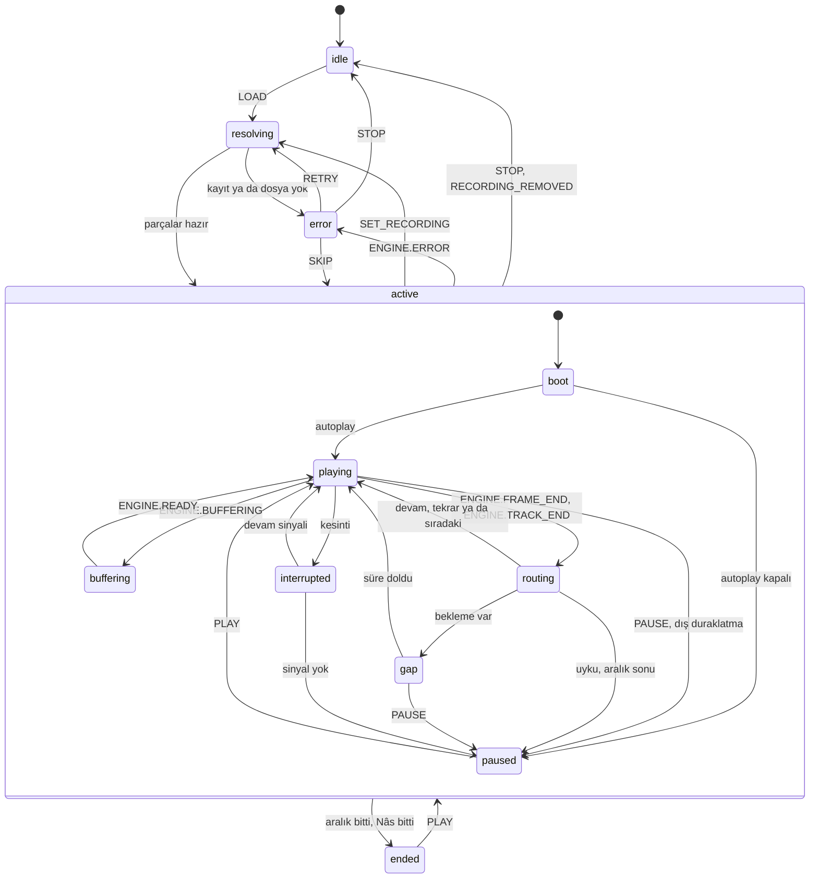

# Ses sistemi

> **Sürüm:** 2.0 · **Tarih:** 30 Ekim 2026 · **Durum:** Taslak
> **Bağlı kararlar:** [K-41](../00-ozet/02-karar-defteri.md#k-41--ses-sistemi-hazır-kayıtlar-ayna-ve-çevrimiçi-öncelikli-dinleme) · [K-40](../00-ozet/02-karar-defteri.md#k-40--ses-kaynağı-hazır-dijital-tilavet-kaynakları) · [K-28](../00-ozet/02-karar-defteri.md#k-28--ses) · [K-18](../00-ozet/02-karar-defteri.md#k-18--depolama-yöneticisi-v1de) · [K-21](../00-ozet/02-karar-defteri.md#k-21--i̇çerik-dağıtımı) · [K-30](../00-ozet/02-karar-defteri.md#k-30--eski-plandan-çıkarılanlar)

Bu dosya tilavetin nereden geldiğini, nasıl çalındığını ve cihazda nasıl saklandığını tanımlar. Kaynak, okuyucu ve teknoloji seçiminin dayanağı [Ses kaynağı araştırması](./04-ses-kaynak-arastirmasi.md) dosyasındadır; karar [K-41](../00-ozet/02-karar-defteri.md#k-41--ses-sistemi-hazır-kayıtlar-ayna-ve-çevrimiçi-öncelikli-dinleme). [K-28](../00-ozet/02-karar-defteri.md#k-28--ses) expo-audio ile XState'i seçer; react-native-track-player v5 ticari kullanım için ücretli, expo-av ve react-native-fs kullanılmaz ([K-30](../00-ozet/02-karar-defteri.md#k-30--eski-plandan-çıkarılanlar)). Mini oynatıcı ve Dinleme sayfasının görünüşü [Mobil ekranlar](../01-urun/03-mobil-ekranlar.md) dosyasındadır.

**1.1'den farkı (30 Ekim 2026).** Önceki tasarım âyet başına dosya (EveryAyah düzeni), `ses-{hafiz}` paketi, tek oynatıcılı `SteppedEngine` ve hafız izinleri üzerine kuruluydu; tamamen bırakıldı. Yeni tasarım: okuyucunun kaydına ait 114 sure dosyası, dosya içinde âyet kareleri, kendi depomuzdan sunulan ayna, çevrimiçi öncelikli dinleme ve isteğe bağlı kalıcı indirme.

## 1. Kapsam

| v1 | Sonra |
|---|---|
| 7 okuyucu, 9 kayıt ([§3.2](#32-okuyucular-ve-kayıtlar)); indirmeden çevrimiçi dinleme | Yeni kayıtlar katalog sürümüyle (araştırma §4.3) |
| Âyet, aralık, sure, sayfa ve cüz çalma; kesintisiz dinleme ve sonraki sureye geçiş; Nâs kuralı | Kelime takibi (`kelimeTakibi` bayrağı, §6) |
| Her âyeti ×N, aralığı ×N; âyet arası bekleme; 0,75–1,5 hız | Kur'an + meal dönüşümü (v1.x, §8) |
| Arka planda ve kilit ekranında çalma; kilit ekranında sonraki/önceki sure | Quran Foundation bağdaştırıcısı (v1.x, §12) |
| Âyet vurgusu, takip modu ve çip; uyku zamanlayıcısı | Kelime telaffuz sesi (Açık soru) |
| Tek sure ve kaydın tamamını indirme; çevrimdışı çalma; otomatik kaynak seçimi | iOS yedekten dışlama için yerel modül (SK-7) |

## 2. expo-audio (SDK 58): verdikleri ve sınırları

Sürüm `expo-audio` ~58.0.10 ([bundledNativeModules sdk-58](https://github.com/expo/expo/blob/sdk-58/packages/expo/bundledNativeModules.json); [expo-audio v58](https://docs.expo.dev/versions/v58.0.0/sdk/audio/); [CHANGELOG](https://github.com/expo/expo/blob/sdk-58/packages/expo-audio/CHANGELOG.md)). Okuma 30 Ekim 2026.

| Konu | Belgedeki durum | Kullanım |
|---|---|---|
| Arka plan | Eklentinin `enableBackgroundPlayback` seçeneği Android'de `mediaPlayback` ön plan hizmeti, iOS'ta `UIBackgroundModes: audio` ekler | Açık |
| Kilit ekranı | `setActiveForLockScreen(active, metadata?, options?)`, `updateLockScreenMetadata`, `clearLockScreenControls`; aynı anda tek oynatıcı ya da liste denetler; `interruptionMode` `doNotMix` ya da `doNotMixPersistent` olmalı | Her çalmada açılır |
| Kilit ekranında sonraki/önceki | Yalnız `AudioPlaylist` ile (58.0.0: "Support lockscreen controls with playlists"). Tek `AudioPlayer`'da düğme görünmez, olay gelmez ([#43538](https://github.com/expo/expo/issues/43538)). Listede düğme yerel `next()`/`previous()` çağırır; JS'e `trackChanged` gelir | Sonraki/önceki **sure** |
| Android'de süre | Kilit ekranı denetimi yoksa ses arka planda yaklaşık 3 dakika sonra durur | Kilit ekranı her iki motorda açılır |
| Oynatma listesi | `createAudioPlaylist`; `add`, `insert`, `remove`, `clear`, `next`, `previous`, `skipTo`, `seekTo`, `loop` (`none/single/all`); `trackChanged`, `playlistStatusUpdate`; "gapless playback support" | `PlaylistEngine` |
| Hız | Oynatıcıda `setPlaybackRate(rate, pitchCorrectionQuality?)` ve `shouldCorrectPitch`; listede yalnız yazılabilir `playbackRate`, perde denetimi yok | 0,75–1,5; listede perde cihazda ölçülür (SK-2) |
| Konumlanma | `seekTo(seconds, toleranceBefore?, toleranceAfter?)` Promise döndürür; toleranslar yalnız iOS'ta | Kare başına konumlanma |
| Durum | `playbackStatusUpdate`: `currentTime`, `duration`, `didJustFinish`, `isBuffering`, `playing`; `updateInterval` varsayılanı 500 ms | 100 ms; kare sınırı ayrı zamanlayıcıyla (§4.3) |
| Kaynak | `AudioSource`: `{ uri, headers?, name? }`; uzak adres ve yerel `file://` aynı yolla | Akış ve yerel dosya |
| Ön yükleme | `preload`, `clearPreloadedSource`, `getPreloadedSources` | `SingleEngine` sonraki sureyi ön yükler |
| Oturum | `keepAudioSessionActive` (Android desteği 58.0.0) | Açık |
| Bilinen sorunlar | Listeye kilit ekranı açıldıktan sonra `add()` Android'de çöküyor ([#52192](https://github.com/expo/expo/issues/52192)); React ağacı sökülünce bileşene bağlı oynatıcı kapanıyor ([#49906](https://github.com/expo/expo/issues/49906)); kulaklık ya da Bluetooth ayrılınca çalma duraklıyor | Liste kilit ekranından önce tam kurulur; oynatıcı modül düzeyindedir |

```ts
// apps/mobile/src/features/audio/session.ts
import { setAudioModeAsync } from 'expo-audio';

export const configureAudioSession = () =>
  setAudioModeAsync({
    playsInSilentMode: true,                 // iOS sessiz düğmesi açıkken de çalar
    shouldPlayInBackground: true,
    interruptionMode: 'doNotMixPersistent',  // kilit ekranı için şart; uzun dinlemede kalıcı odak
  });
```

`doNotMix` geçici, `doNotMixPersistent` kalıcı özel odak ister; ikincisinde öteki uygulamalar kendiliğinden devam etmez. Seçim cihazda doğrulanır (SS-4).

## 3. Ses verisi

### 3.1 Kayıt modeli

- **Okuyucu** birden çok **kayıt** taşır (murattal, mücevved, muallim). Kayıt kimliği `{okuyucu}-{tarz}` biçimindedir: ASCII, küçük harf (ör. `alafasy-murattal`).
- Kayıt **114 sure dosyasıdır**. Âyetler dosya içinde **karedir**: `[startMs, endMs)`, yarı açık. Sure dosyasının 1. âyetten önceki kısmı istiâze ya da besmele **özel bölütüdür**; QUD `specials.json` ve zamanlamadan gelir. Fâtiha'da besmele 1. âyettir; Tevbe'de besmele yoktur.
- Model olgun Kur'an uygulamalarının "dosya × kare" desenidir (quran_android, quran-ios): âyet başına dosyalı kayıt da bu modele girer (her dosya tek kare), ama v1 kataloğunda yoktur.
- Zamanlaması olmayan kayıtta sure tek karedir; âyete dayalı işlevler (âyetten başlatma, âyet tekrarı, âyet vurgusu) kapalı gösterilir. v1 kayıtlarının hepsinde tam âyet zamanlaması vardır.

### 3.2 Okuyucular ve kayıtlar

Seçim ölçütü: birbirinden bağımsız en az üç platformda üst sıralarda olmak, Hafs an Âsım 114 sure tam kayıt ve aynı dosyaya bağlı tam âyet zamanlaması ([araştırma §4](./04-ses-kaynak-arastirmasi.md#4-okuyucuların-seçimi)).

| Kayıt | Okuyucu | Dosya kaynağı | Zamanlama |
|---|---|---|---|
| `alafasy-murattal` | Mishary Rashid Alafasy | MP3Quran | QUD (âyet, kelime) |
| `maher-murattal` | Maher Al-Muaiqly | Tarteel CDN | QUD (âyet, kelime) |
| `sudais-murattal` | Abdul Rahman Al-Sudais | Tarteel CDN | QUD (âyet, kelime) |
| `ghamdi-murattal` | Saad Al-Ghamdi | Tarteel CDN | QUD (âyet, kelime) |
| `abdulbasit-murattal` | Abdul Basit Abdul Samad | Tarteel CDN | QUD (âyet, kelime) |
| `abdulbasit-mucevved` | Abdul Basit Abdul Samad | Tarteel CDN | QUD (âyet, kelime) |
| `husary-murattal` | Mahmoud Khalil Al-Husary | MP3Quran | QUD (âyet, kelime) |
| `minshawi-murattal` | Mohamed Siddiq El-Minshawi | MP3Quran | QUD (âyet, kelime) |
| `minshawi-mucevved` | Mohamed Siddiq El-Minshawi | MP3Quran | QUD (âyet, kelime) |

Yedek âyet zamanlaması MP3Quran `ayat_timing` uçlarıdır (aynı MP3Quran dosyasına bağlıysa). Kimlikler ve kaynak adresleri araştırma §4.3'tedir.

### 3.3 Ayna

İçerik hattı her kaydın sure dosyalarını kaynaktan (MP3Quran CDN, Tarteel CDN) **bir kez** alır, `data/raw/ses/{kayit}/{tarih}/{sss}.mp3` altına yazar ve ölçer: bayt, sha256, süre, bit hızı türü (CBR ya da VBR). Zamanlamanın son âyet bitişi dosya süresini aşamaz; aşarsa ya da süre QUD'un ölçtüğünden 2 saniyeden fazla farklıysa o sure kayıttan düşer ve rapora yazılır. Yayınlayıcı dosyaları içerik deposuna değişmez ve sürümlü adresle koyar:

```
audio/{kayit}/{dosya_surumu}/{sss}.mp3
```

`dosya_surumu` dosyaların sha256 listesinden türeyen kısa özettir; kaynakta bir dosya değişirse yeni sürüm açılır, eski adres silinmez (eski indirmeler bozulmaz). Uygulama üçüncü taraf ses sunucusuna bağlanmaz; ASP.NET arka ucu ses baytlarını iletmez. Gerekçe ve bedel: [araştırma §5.2](./04-ses-kaynak-arastirmasi.md#52-ayna-dosyalar-kendi-içerik-depomuzdan).

### 3.4 Paketler

| Paket | Tablolar | İnişi |
|---|---|---|
| `ses-katalog` | `okuyucu(id, ad, ad_ar, sira)`, `kayit(id, okuyucu_id, tarz, rivayet, zamanlama, zamanlama_surumu, dosya_surumu, bit_hizi_kbps, bit_hizi_turu, toplam_bayt)`, `kayit_sure(kayit_id, sure, url, bayt, sha256, sure_ms)` | Manifestle kendiliğinden; küçük |
| `ses-zaman-{kayit}` | `ayet_zaman(anchor, start_ms, end_ms)`, `kelime_zaman(anchor, kelime_no, start_ms, end_ms)`, `ozel_bolut(sure, tur, start_ms, end_ms)` | Kayıt ilk seçildiğinde kendiliğinden (yaklaşık 1 MB); sonra çevrimdışı |

Tablo ve sütun adları A27.2'de [İçerik paketleri](../03-veri/03-icerik-paketleri.md) §3.5 ile kesinleşir. `zamanlama` değeri `kelime`, `ayet` ya da `yok`tur. Ses dosyaları paketlerin içinde değildir.

## 4. Motor katmanı

Makine expo-audio'yu doğrudan çağırmaz; `packages/player` içindeki arayüzü çağırır. Web sonra aynı arayüzü `HTMLAudioElement` ile uygular.

### 4.1 Arayüz

```ts
// packages/player/src/engine.ts (taslak; adlar A27.3'te kesinleşir)
export type AyahAnchor = `q:${number}:${number}`;
export type EngineFrame = {
  kind: 'ayet' | 'besmele' | 'istiaze';
  anchor: AyahAnchor | null;      // özel bölütte null
  startMs: number; endMs: number; // dosya içinde, yarı açık
};
export type EngineTrack = {
  recording: string;              // 'alafasy-murattal'
  sure: number;                   // 1..114
  uri: string;                    // yerel dosya ya da ayna adresi (§11)
  frames: EngineFrame[];          // zamanlama yoksa tek kare: dosyanın tamamı
  title: string; artist: string;  // "Bakara", okuyucu adı
};
export type EngineEvent =
  | { type: 'ENGINE.TRACK_START'; track: number; remote: boolean } // remote: kilit ekranından
  | { type: 'ENGINE.FRAME_END'; track: number; frame: number }
  | { type: 'ENGINE.TRACK_END'; track: number }
  | { type: 'ENGINE.BUFFERING' } | { type: 'ENGINE.READY' }
  | { type: 'ENGINE.EXTERNAL_PAUSE' }
  | { type: 'ENGINE.INTERRUPTED' } | { type: 'ENGINE.INTERRUPTION_END'; shouldResume: boolean }
  | { type: 'ENGINE.ERROR'; track: number; code: string };

export interface AudioEngine {
  readonly lockScreenTrackControls: boolean;               // PlaylistEngine: true
  load(tracks: EngineTrack[], at: { track: number; frame: number }, opts: { rate: number }): Promise<void>;
  seekFrame(track: number, frame: number): Promise<void>;   // karenin başına; çalma durumu değişmez
  watchFrameEnd(track: number, frame: number): void;        // o karenin sonunda FRAME_END ister
  play(): void; pause(): void; stop(): void;
  setRate(rate: number): void;
  setVolume(volume: number): void;
  subscribe(listener: (e: EngineEvent) => void): () => void;
}
```

Çalma ilerlemesi makineye olay olarak girmez. Motor konumu 100 ms'de bir `usePlayback` deposuna (`{ track, positionMs }`) yazar; âyet vurgusu ve takip oradan okur ([Mobil mimari](./01-mobil-mimari.md), bölüm 5).

### 4.2 İki gerçekleme

| Motor | Ne zaman | Nasıl |
|---|---|---|
| `PlaylistEngine` | Varsayılan | `AudioPlaylist`; her sure bir parça; kesintisiz sure geçişi; kilit ekranında sonraki/önceki sure. Liste çalma aralığının surelerinden kilit ekranı açılmadan önce tam kurulur (#52192). Kayıt değişince liste baştan kurulur |
| `SingleEngine` | Yedek: hız 1 değilken listede perde bozulursa (SK-2), listede boşluk ya da çökme ölçülürse (SK-3) | Tek `AudioPlayer`; sure değişiminde `replace()` ve ardından açık `play()`; sonraki sure `preload()` ile hazır; kilit ekranı açık ama sonraki/önceki yok |

Seçim `apps/mobile/src/features/audio/engine/index.ts` içinde tek bir kuralla yapılır; makine motoru bilmez. İki motor da modül düzeyinde tek örnektir, bileşen ömrüne bağlanmaz.

### 4.3 Kare sınırı

- Âyet sonu sabit aralıklı sorguyla değil, **zamanlayıcıyla** yakalanır: `kalan = (frame.endMs − positionMs) ÷ rate`; `setTimeout(max(50, kalan))`. Tetiklenince konum yeniden okunur; sınıra 150 ms'den uzaksa yeniden kurulur, değilse `ENGINE.FRAME_END` gönderilir. Desen quran_android ve quran-ios'tadır.
- Zamanlayıcı yalnız makine `watchFrameEnd` istediğinde kurulur: âyet tekrarı, bekleme, aralık sonu ve uyku "aralık bitince" için. Bunların hiçbiri yoksa dosya kesintisiz çalar; kare değişimi yalnız vurgu içindir.
- Âyet tekrarı ve aralık başına dönüş `seekFrame` ile yapılır. VBR MP3'te Android konumlanması sapabilir (SK-1); bit hızı türü katalogdadır, cihazda ölçülür.
- Arka planda JS zamanlayıcılarının sürdüğü varsayılır; cihazda doğrulanır (SS-3).

## 5. Oynatıcı durum makinesi

Makine `packages/player` içindedir ve XState v5 API'siyle yazılır (sürüm `package.json`'da kilitlenir). Quran.com da tekrar mantığını XState aktöründe tutar: ayarlar `repeatRange`, `repeatEachVerse` ve `delayMultiplier`'dır, bekleme `verseDuration × delayMultiplier` ile hesaplanır ([repeatMachine.ts](https://github.com/quran/quran.com-frontend-next/blob/production/src/xstate/actors/repeatMachine/repeatMachine.ts)).

### 5.1 Bağlam

| Alan | Varsayılan | Anlamı |
|---|---|---|
| `recording` | Son seçilen | `{ id, reciterName, timing: 'kelime' \| 'ayet' \| 'yok' }` |
| `range` | — | `{ scope: 'ayet' \| 'aralik' \| 'sure' \| 'sayfa' \| 'cuz', from, to }`; uçlar `q:2:255` biçiminde |
| `tracks`, `pos` | — | Çözülmüş parçalar (`EngineTrack[]`) ve çalan konum `{ track, frame }` |
| `repeatEach`, `repeatEachDone` | 1, 0 | Her âyetin çalınma sayısı (1 = tekrarsız) |
| `repeatRange`, `repeatRangeDone` | 1, 0 | Aralığın çalınma sayısı (0 = sınırsız) |
| `delayMultiplier` | 0 | 0, 0,5, 1, 1,5 ya da 2; bekleme = âyet süresi ÷ hız × çarpan |
| `autoNextSurah` | true | Aralık bitince ya da sure kapsamında sure bitince sonraki sure çalar |
| `repeatQuran` | false | Nâs bitince Fâtiha'dan devam eder; kapalıysa çalma durur |
| `mealAlternation` | `kapali` | `kapali`, `her_ayet`, `sure_sonu`, `sayfa_sonu` (v1.x) |
| `follow` | true | Okuyucu çalan âyeti izler |
| `rate` | 1 | 0,75–1,5 |
| `sleep` | null | `{ mode: 'dakika', endsAt }` (15, 30, 60 dk) ya da `{ mode: 'aralik_sonu' }` |
| `pending`, `autoplay`, `error` | — | Kare bitince uygulanacak adım; yüklemede çalmaya başla; son hata kodu |

Tekrar, bekleme, hız, sonraki sure, tam tekrar ve takip tercihleri MMKV'de saklanır.

### 5.2 Olaylar

- Çalma: `LOAD { recordingId, range, startAt?, autoplay? }`, `PLAY`, `PAUSE`, `TOGGLE`, `STOP`, `NEXT_AYAH`, `PREV_AYAH`, `NEXT_SURAH`, `PREV_SURAH`, `SEEK_AYAH { anchor }`.
- Ayar: `SET_RATE`, `SET_REPEAT`, `SET_DELAY`, `SET_AUTO_NEXT`, `SET_REPEAT_QURAN`, `SET_MEAL_ALTERNATION`, `SET_SLEEP`, `SET_RECORDING` (parçalar aynı âyetten yeniden çözülür).
- Okuyucu: `USER_SCROLLED` (takip kapanır), `RETURN_TO_CURRENT` (takip açılır).
- Depolama: `RECORDING_REMOVED { recordingId }` (kayıt katalogdan kalktı ya da dosyalar silindi; çalma durur).
- Hata ekranı: `RETRY`, `SKIP`. Motor: `ENGINE.*` (bölüm 4).

### 5.3 Durumlar



`ENGINE.TRACK_START` ile `remote: true` gelirse (kilit ekranından sonraki ya da önceki sure) makine konumu o surenin ilk karesine taşır, tekrar sayaçlarını sıfırlar ve takip açıksa okuyucu o sureye gider.

### 5.4 Kare bitince karar

Kararı saf bir fonksiyon verir; motorsuz test edilir.

```ts
// packages/player/src/decide.ts (taslak)
export type Pos = { track: number; frame: number };
export type Step =
  | { type: 'continue' }                       // aynı dosyada sıradaki kare; konumlanma yok
  | { type: 'replay' }                         // aynı kareye seekFrame
  | { type: 'jump'; to: Pos; restart?: boolean };   // başka kareye ya da sureye
export type NextStep =
  | Step
  | { type: 'gap'; ms: number; then: Step }
  | { type: 'pause'; then: Step }              // uyku: aralık bitince dur
  | { type: 'end' };

export function decideAfterFrame(c: PlayerContext, frameDurationMs: number): NextStep {
  const isAyah = c.tracks[c.pos.track].frames[c.pos.frame].kind === 'ayet';
  let step: Step | null = null;

  if (isAyah && c.repeatEachDone + 1 < c.repeatEach) step = { type: 'replay' };
  else {
    const next = nextPos(c);                   // aralık içinde sıradaki kare; aralık sonunda null
    if (next) step = next.track === c.pos.track && next.frame === c.pos.frame + 1
      ? { type: 'continue' } : { type: 'jump', to: next };
    else if (c.repeatRange === 0 || c.repeatRangeDone + 1 < c.repeatRange)
      step = { type: 'jump', to: firstPos(c), restart: true };
    else if (c.autoNextSurah) step = nextSurahStart(c);   // Nâs'tan sonra repeatQuran kapalıysa null
  }
  if (!step) return { type: 'end' };
  if (c.sleep?.mode === 'aralik_sonu' && step.type === 'jump' && step.restart) return { type: 'pause', then: step };
  if (isAyah && c.delayMultiplier > 0) {
    return { type: 'gap', ms: Math.round((frameDurationMs / c.rate) * c.delayMultiplier), then: step };
  }
  return step;
}
```

- Bekleme her âyet karesinden sonra, tekrarlar dahil uygulanır; hıfz çalışan kullanıcı aradaki sessizlikte âyeti kendisi tekrar eder. Özel bölütlerden ve meal öğelerinden sonra bekleme ve tekrar yoktur.
- `nextSurahStart`: sonraki surenin ilk karesi (istiâze ya da besmele bölütü varsa o). 114'ten sonra `repeatQuran` açıksa Fâtiha'nın başı, kapalıysa `null` (çalma durur).
- Sure içinde `continue` dosyanın kesintisiz akmasıdır; `PlaylistEngine` sure sonunu kendisi geçer, makine yalnız konumu günceller.
- Örnek test: `repeatEach: 2`, `delayMultiplier: 1`, `rate: 1`, 10 saniyelik âyette ilk karar `{ type: 'gap', ms: 10000, then: { type: 'replay' } }`; ikinci karar sıradaki kareye `continue` içeren bir beklemedir.

### 5.5 Makine

Makine `createPlayerMachine(engine, resolveTracks, saved)` fabrikasıyla kurulur; eylemler motoru kapanış (closure) üzerinden çağırır. Kök durum `fromCallback` ile motor olaylarına abone olur, `resolving` `fromPromise` ile parçaları çözer. Ayar ve takip olayları kökte işlenir.

- `active` girişinde motor parçaları yükler ve kilit ekranını açar. `playing` girişinde ve her karar sonrasında, `pending` kararı kare sonu gerektiriyorsa `watchFrameEnd` çağrılır.
- `applyStep` saf bir atamadır: `replay` `repeatEachDone`, `restart` `repeatRangeDone` sayacını artırır; `jump` ve `continue` `pos`'u değiştirir; uyku adımından sonra `sleep` temizlenir. XState v5'te bir geçişin eylemleri sırayla çalıştığı için `positionEngine` güncel `pos`'u görür; `continue`'da konumlanma yapılmaz.
- Tamponda 20 saniye kalınırsa `error` (`buffering_timeout`). `ended` durumunda `PLAY` aralığı baştan başlatır. `error` durumunda `RETRY` parçaları yeniden çözer, `SKIP` sonraki âyete ya da sureye geçer.
- Parça çözücü kaydın katalog satırını, `core`'daki âyet listesini, `ses-zaman-{kayit}` karelerini ve her sure için kaynağı (§11) döndürür. Kaynak yoksa `not_downloaded` koduyla `error` durumuna geçilir ve "Bu sure indirilmedi · İndir" düğmesi çıkar.
- Aktör uygulama kökünde, modül düzeyinde bir kez oluşur; testler sahte motorla koşulur ([Test stratejisi](../07-yayin/03-test-stratejisi.md)).

## 6. Vurgu: âyet ve kelime

- **Âyet vurgusu** bütün v1 kayıtlarında çalışır. `usePlayback` konumu `ayet_zaman` dizisinde ikili aramayla âyete çevrilir; okuyucuya giden çapa vurgulanır: Mushaf A'da âyetin glifleri, Mushaf B'de `ayah_box` kutuları, Mushaf C'de metin parçaları ([Mobil mimari](./01-mobil-mimari.md), bölüm 7).
- **Kelime takibi** `kelimeTakibi` bayrağıyla sonra açılır. QUD kelime numarası âyet içinde 1 tabanlıdır ve QPC/DigitalKhatt kelime bölünmesine göredir; Tanzil kelime çapalarıyla (A11, A17) eşlemesi içerik hattında doğrulanır, eşleşmeyen âyette kelime vurgusu yapılmaz (SK-5). Mushaf B'de kelime kutusu olmadığı için yalnız âyet vurgusu vardır.
- **Görünüm.** Âyette zemin tonu, kelimede zemin ile alt çizgi; renk tek başına anlam taşımaz. Hareketi Azalt açıkken yumuşak kaydırma yerine doğrudan atlanır.
- `packages/player/src/timing.ts`: `activeFrameAt(frames, tMs)` ve `activeWordAt(segments, tMs)` ikili aramayla çalışır. `currentTime` ortam zamanı olduğu için hız değişse de bölütler geçerlidir. Vurgu gecikmesi 100 ms güncelleme ile zamanlama sapmasının toplamıdır; her güncellemede yalnız durumu değişen bileşen yeniden çizilir.

## 7. Takip modu ve "Okunan âyete dön" çipi

- Takip açıkken çalan âyet değişince okuyucu o âyete gider: mushafta sayfa çevrilir, Âyet âyet düzeninde liste kayar. Sure değişince okuyucu yeni sureye geçer.
- Kullanıcı elle kaydırmaya ya da sayfa çevirmeye başlayınca `USER_SCROLLED` gider ve takip kapanır. Programla yapılan kaydırma `onScrollBeginDrag` tetiklemez.
- Okuyucunun tek çip yuvasında atlama zinciri önceliklidir ([Okuma deneyimi §9](../01-urun/02-okuma-deneyimi.md#9-atla-ve-dön)). Zincir yokken, takip kapalıysa ve çalan âyet ekranda değilse "Okunan âyete dön · Bakara 255" çıkar; tefsir görünümünde bu çip "Etkin âyete git" olur. Dokunmak `RETURN_TO_CURRENT` gönderir.
- Atlama başlarken okuyucu `USER_SCROLLED` gönderir; takip kapanır ve çalan âyet atlama hedefini ezmez. Zincir açıkken çalan âyete Dinleme sayfasındaki "Okunan âyete git" düğmesiyle gidilir; bu geçiş atlama sayılır ve yığına yazılır.

```ts
// apps/mobile/src/features/reader/hooks/useFollowPlayback.ts
export function useFollowPlayback(
  goTo: (a: AyahAnchor, animated: boolean) => void,
  isOnScreen: (a: AyahAnchor) => boolean,
) {
  const anchor = usePlayback((s) => s.activeAyah);   // konumdan türetilen çalan âyet
  const follow = useSelector(playerActor, (s) => s.context.follow);
  const playing = useSelector(playerActor, (s) => s.matches({ active: 'playing' }));
  const chainActive = useReader((s) => s.returnStack.length > 0);   // tek çip yuvasında zincir önce gelir
  const reduceMotion = useReduceMotion();
  useEffect(() => { if (follow && anchor && !chainActive) goTo(anchor, !reduceMotion); }, [anchor, follow, chainActive]);
  return {
    showAudioChip: playing && !follow && !chainActive && anchor !== undefined && !isOnScreen(anchor),
    anchor,
  };
}
```

İki çip hiçbir zaman birlikte görünmez; zincir bitince yuva ses çipine geçer. Yuva bileşeni (`ChipSlot`) [Mobil mimari](./01-mobil-mimari.md) bölüm 4'te tanımlıdır.

## 8. Kur'an + meal dönüşümü (v1.x)

Diyanet'in dinleme modu meali âyet, sure ya da sayfa sonunda okutur ve meal seslendireni okuyucudan ayrı seçtirir ([Diyanet](https://kuran.diyanet.gov.tr/mushaf)).

| `mealAlternation` | Sıra |
|---|---|
| `her_ayet` | K1, M1, K2, M2 … |
| `sure_sonu` | Surenin Kur'an kareleri, ardından aynı surenin meal öğeleri |
| `sayfa_sonu` | Sayfanın Kur'an kareleri, ardından aynı sayfanın meal öğeleri |

- Meal öğeleri ayrı dosyalardır (her biri tek kare); bu kip açıkken `SingleEngine` kullanılır. Tekrar ve bekleme yalnız Kur'an karelerine uygulanır; meal bir kez okunur.
- Meal sesi kaydı gerekir; seslendiren ve paket Açık sorudur. Özellik `mealSesi` bayrağıyla kapalıdır.

## 9. Uyku zamanlayıcısı

- Seçenekler [Okuma deneyimi §10](../01-urun/02-okuma-deneyimi.md#10-sesli-takip)'dan gelir: 15, 30 ve 60 dakika; "aralık bitince".
- Dakika seçeneği makinenin dışında küçük bir zamanlayıcıdır. Süre dolunca `engine.setVolume` ile ses 5 saniyede kısılır, `PAUSE` gönderilir, ses düzeyi geri gelir. "Aralık bitince" `decideAfterFrame` içinde çözülür (bölüm 5.4).
- Durunca konum sonraki âyetin başına alınır; "Devam" oradan başlar.

## 10. Kesintiler ve ses odağı

| Durum | Belgedeki davranış | Makinenin tepkisi |
|---|---|---|
| Kulaklık ya da Bluetooth ayrıldı | Çalma duraklar (Android'de listeler için de, 58.0.0) | `ENGINE.EXTERNAL_PAUSE` → `paused`; kendiliğinden devam yok |
| Telefon araması, başka uygulamanın sesi | `doNotMix*` ile odak kaybı; ayrı kesinti olayı yok, `playing: false` gelir | `interrupted`; devam sinyali varsa `playing`, yoksa `paused`. Ayrım cihazda doğrulanır (SS-4) |
| iOS medya servisi sıfırlandı | `mediaServicesDidReset` | `buffering` → `playing` |
| iOS sessiz düğmesi | `playsInSilentMode: true` | Çalma sürer |
| Ağ koptu (akışta) | Tampon biter, `isBuffering` | `buffering`; 20 sn sonra `error` (`network`); yerel dosya varsa çözücü ona geçer |
| Okuyucu ön dinlemesi | Kilit ekranının tek sahibi olabilir | Ana çalma duraklar; ön dinleme ayrı oynatıcıda, kilit ekranı almadan çalar |

Apple sesin denetimsiz ve kendiliğinden çalmamasını ister ([Apple HIG Erişilebilirlik](https://developer.apple.com/design/human-interface-guidelines/accessibility)); uygulama açılışta kendiliğinden çalmaz.

## 11. Kaynak seçimi, akış, indirme ve önbellek

- **Otomatik kaynak seçimi.** Her sure için sırayla: (1) `device.db` `audio_file` içinde doğrulanmış yerel dosya (`kayit`, `sure`, `dosya_surumu` eşleşmeli); (2) bağlantı varsa `kayit_sure.url` (ayna) akışı; (3) bağlantı yoksa `not_downloaded`. Kullanıcı seçim yapmaz. Kayıt değişince başka kaydın dosyası kullanılmaz.
- **Akış.** Ayna adresleri değişmezdir; expo-audio dosyayı akışla çalar. Akışta sonraki sure `preload()` (yalnız `SingleEngine`) ya da liste ön tamponu ile hazırlanır. "Hücresel veride akışla dinle" ayrı bir ayardır (128 kbps ≈ 0,96 MB/dakika); "Yalnız Wi-Fi ile indir" ayarı akışı bağlamaz, ayar ekranı bunu yazar.
- **İndirme.** Birimler: tek sure ve kaydın tamamı (114 sure). İşler [Depolama yöneticisi](./03-depolama-yoneticisi.md) §4 kuyruğunda (`download_job`, A29) çalışır; ses için ikinci kuyruk yoktur. Her dosya `File.createDownloadTask` ile `tmp/<iş>.part` dosyasına iner (ilerleme, duraklatma, sürdürme, iptal, `savable()`); bitince boyut `kayit_sure.bayt` ile ve `file.digest('SHA-256')` `kayit_sure.sha256` ile karşılaştırılır; tutarsa `Paths.document/mutalaa/audio/{kayit}/{dosya_surumu}/{sss}.mp3` altına taşınır ve `audio_file` satırı yazılır. Android sürdürmesi `If-Range` göndermediği için değişmez adres şarttır; sunucu 200 dönerse dosya baştan yazılır.
- **Boyut.** Arayüz kaydın ve surenin boyutunu katalogdaki ölçülmüş değerden gösterir; kaydın tamamı için toplam ve cihazdaki boş alan indirmeden önce gösterilir.
- **Çevrimdışı.** Bağlantı yokken yalnız indirilmiş sureler çalınabilir görünür; öteki sureler "İndirilmedi" etiketiyle gri durur. Kaydın bütün sureleri inmişse kayıt "Cihazda" rozetini taşır.
- **Katalog güncellemesi.** Yeni `dosya_surumu` gelirse eski dosyalar çalınmaya devam eder; Depolama ekranı "Güncelleme var" gösterir, Wi-Fi'da sabitlenmiş kayıtlar kendiliğinden güncellenir ([Depolama yöneticisi](./03-depolama-yoneticisi.md)).
- **Kelime telaffuz sesi.** QF kelime seslerini herkese açık CDN varlığı olarak sunar; v1'e girmesi Açık soru.

## 12. Kaynaklar, görünürlük ve atıf

- **Kaynaklar.** Dosyalar MP3Quran ve Tarteel CDN'inden içerik hattıyla bir kez alınır; zamanlama QUD v4.0.0 (CC BY 4.0) ve MP3Quran'dan gelir ([araştırma §3](./04-ses-kaynak-arastirmasi.md#3-kaynakların-karşılaştırılması)). EveryAyah, QuranicAudio ve kopyaları kullanılmaz.
- **Görünürlük.** Proje sahibinin kararıyla ses kaynaklarının lisans ve izin durumu bu yapının tasarımını, geliştirmesini ve derlemelerdeki görünürlüğünü kısıtlamaz ([K-41](../00-ozet/02-karar-defteri.md#k-41--ses-sistemi-hazır-kayıtlar-ayna-ve-çevrimiçi-öncelikli-dinleme) madde 10). `ses-katalog` ve `ses-zaman-*` paketleri bütün derleme türlerinde görünür. Kurul başvurusu uygulamanın genel yayın sürecidir (A34). Hukuki görüş değildir.
- **Kaldırma.** Bir kayıt katalogdan kalkarsa çalma durur (`RECORDING_REMOVED`), kayıt listeden çıkar, dosyaları silinmek üzere işaretlenir ve açıklama bir kez gösterilir ([Depolama yöneticisi](./03-depolama-yoneticisi.md) DY-3). Notlar ve vurgular etkilenmez.
- **Atıf.** Ayarlar › Kaynaklar ve lisanslar ekranında her kayıt için okuyucu adı ve dosya kaynağı (MP3Quran, Tarteel); zamanlama için "Zamanlama: Quranic Universal Audio (QUD), CC BY 4.0" ve MP3Quran. Kesin metin A32'de yazılır.
- **Quran Foundation (v1.x).** Bağdaştırıcı arka uçtadır: belirteç ve `client_secret` sunucuda; URL ve zamanlama Content Sync kurallarıyla (en az 7 günde bir eşitleme). Prelive yalnız Fâtiha ve Bakara'yı taşır; tam veri production erişimiyle gelir ([araştırma §3.5](./04-ses-kaynak-arastirmasi.md#35-quran-foundation-content-api)).

## 13. Açık sorular ve doğrulanacaklar

| No | Konu | Tür |
|---|---|---|
| SS-1 | expo-audio imzaları ve kilit ekranı seçenekleri | Kapandı (30 Ekim 2026): SDK 58 belgesi ve kaynak kodu (§2) |
| SS-2 | Kilit ekranında sonraki/önceki | Kapandı (30 Ekim 2026): tek oynatıcıda yok (#43538); listede var, JS'e `trackChanged` gelir |
| SS-3 | Listede boşluk süresi, kare zamanlayıcısının arka planda sürmesi | Doğrulanacak (cihaz, kullanıcı); araştırma SK-3 |
| SS-4 | `doNotMix` ile `doNotMixPersistent` farkı; kesinti sonrası devam | Doğrulanacak (cihaz, kullanıcı) |
| SS-5 | Bit hızı ve VBR konumlanma | Bit hızı katalogda ölçülür (A27.2); VBR sapması cihazda ölçülür (SK-1) |
| SS-6 | Zamanlama biçimi ve dizin tabanı | QUD âyet satırı `[ref, start_ms, end_ms, canonical, silence_after_ms]`, kelime `[word_idx (1 tabanlı), start_ms, end_ms]`; kelime eşlemesi SK-5 |
| SS-7 | Kelime takibi kapsamı | v1 kayıtlarının hepsinde QUD kelime zamanlaması var; açılış SK-5'e bağlı |
| SS-8 | Meal ses paketi ve seslendiren | Açık soru |
| SS-9 | Takip çipi ile Bağlantılar dönüş çipinin önceliği | Kapandı: tek çip yuvası, zincir önceliklidir ([Okuma deneyimi §9](../01-urun/02-okuma-deneyimi.md#9-atla-ve-dön)) |
| SS-10 | Kaynak izinlerinin yeri; QF akışı | Kapandı (30 Ekim 2026): K-41 madde 10; QF v1.x bağdaştırıcısı |
| SS-11 | Listede perde düzeltmesi (0,75–1,5 hız) | Doğrulanacak (cihaz); araştırma SK-2 |
| SS-12 | Besmele ve istiâze bölütünün kaynaklara göre sınırı | A27.2; araştırma SK-6 |

## İlgili dosyalar

- [Ses kaynağı araştırması](./04-ses-kaynak-arastirmasi.md) · [Mobil mimari](./01-mobil-mimari.md) · [Depolama yöneticisi](./03-depolama-yoneticisi.md)
- [Okuma deneyimi](../01-urun/02-okuma-deneyimi.md) · [Mobil ekranlar](../01-urun/03-mobil-ekranlar.md) · [Tasarım sistemi](../01-urun/04-tasarim-sistemi.md)
- [Çapa şeması](../03-veri/01-capa-semasi.md) · [Editoryal veritabanı](../03-veri/02-editoryal-veritabani.md) · [İçerik paketleri](../03-veri/03-icerik-paketleri.md)
- [Kaynaklar ve lisans defteri](../04-icerik/01-kaynaklar-ve-lisans-defteri.md) · [Kök ve lemma](../05-capraz-referans/03-kok-ve-lemma.md)
- [Yayın kapısı ve Kurul](../07-yayin/01-yayin-kapisi-ve-kurul.md) · [Test stratejisi](../07-yayin/03-test-stratejisi.md)
- [A27 aşaması](../10-claude-code/asamalar/A27-ses-sistemi.md) · [Karar defteri](../00-ozet/02-karar-defteri.md) · [Kaynakça](../09-kaynakca.md)
