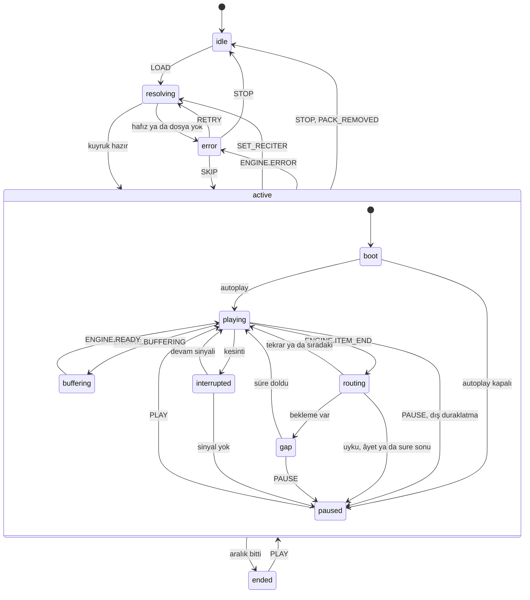

# Ses sistemi

> **Sürüm:** 1.1 · **Tarih:** 19 Ekim 2026 · **Durum:** Taslak
> **Bağlı kararlar:** [K-28](../00-ozet/02-karar-defteri.md#k-28--ses) · [K-06](../00-ozet/02-karar-defteri.md#k-06--yayın-kapısı) · [K-18](../00-ozet/02-karar-defteri.md#k-18--depolama-yöneticisi-v1de) · [K-21](../00-ozet/02-karar-defteri.md#k-21--i̇çerik-dağıtımı) · [K-30](../00-ozet/02-karar-defteri.md#k-30--eski-plandan-çıkarılanlar)

Bu dosya tilavetin çalınmasını tanımlar. [K-28](../00-ozet/02-karar-defteri.md#k-28--ses) expo-audio ile XState'i seçer. react-native-track-player v5 ticari kullanım için lisans istiyor, v4 ise donduruldu ([RNTP](https://github.com/doublesymmetry/react-native-track-player)); eski plandaki expo-av ve react-native-fs de kullanılmaz ([K-30](../00-ozet/02-karar-defteri.md#k-30--eski-plandan-çıkarılanlar)). expo-audio bilgileri "latest" belgesinden alındı; belgenin önerdiği sürüm ~58.0.9 ([expo-audio](https://docs.expo.dev/versions/latest/sdk/audio/)). SDK 57'deki karşılıklar Doğrulanacak. Mini oynatıcı ve Dinleme sayfasının görünüşü [Mobil ekranlar](../01-urun/03-mobil-ekranlar.md) dosyasındadır.

## 1. Kapsam

Rapor Dinleme sayfası için ön dinlemeli hafız seçici, aralık seçimi, "her âyeti ×N" ve "aralığı ×N" tekrarı, âyet süresiyle orantılı bekleme çarpanı, 0,75–1,5 perde düzeltmeli hız, Kur'an + meal dönüşümü ve uyku zamanlayıcısı önerir ([araştırma raporu](../09-kaynakca.md); [Quran.com repeatMachine](https://github.com/quran/quran.com-frontend-next/blob/production/src/xstate/actors/repeatMachine/repeatMachine.ts); [Diyanet](https://kuran.diyanet.gov.tr/mushaf)).

| v1 | Sonra |
|---|---|
| Âyet, aralık, sure, sayfa ve cüz çalma; her âyeti ×N, aralığı ×N; bekleme çarpanı; 0,75–1,5 hız | Kesintisiz liste motoru (SDK 58, bölüm 4) |
| Arka planda ve kilit ekranında çalma; âyet vurgusu; zamanlaması olan hafızda kelime vurgusu; takip modu ve çip | Kur'an + meal dönüşümü (Faz 4 · v1.x, bölüm 8) |
| Uyku zamanlayıcısı; sure ve cüz indirme ([Depolama yöneticisi](./03-depolama-yoneticisi.md)) | Kelime telaffuz sesi (Açık soru, bölüm 11) |

## 2. expo-audio: verdikleri ve sınırları

| Konu | Belgedeki durum | Kullanım |
|---|---|---|
| Arka plan | `enableBackgroundPlayback` eklenti seçeneği Android'de medya oynatma ön plan hizmeti ve kilit ekranı kontrolleri, iOS'ta audio arka plan modu ekler | Açık |
| Kilit ekranı | `setActiveForLockScreen(active, metadata, options)`, `updateLockScreenMetadata`, `clearLockScreenControls`. "Only one player can control the lock screen at a time." `interruptionMode` `doNotMix` ya da `doNotMixPersistent` olmalı | Motorun tek oynatıcısında; her âyette üst veri güncellenir |
| Android'de süre | Kilit ekranı kontrolü yoksa ses arka planda yaklaşık 3 dakika sonra durur (işletim sistemi sınırı) | Her çalmada kilit ekranı açılır |
| Hız | `setPlaybackRate(rate, pitchCorrectionQuality?)`, `shouldCorrectPitch`; Android 0,1–2,0, iOS 0,0–2,0 | 0,75–1,5, perde düzeltmeli |
| Oynatma listesi | `createAudioPlaylist`; next, previous, skipTo; döngü `none/single/all`; `trackChanged`; "gapless playback support". Kilit ekranında liste SDK 58 ile gelir ([Expo SDK 58 beta](https://expo.dev/changelog/sdk-58-beta)) | SDK 58 sonrası |
| Durum güncellemesi | `updateInterval` varsayılan 500 ms; `playbackStatusUpdate` içinde `didJustFinish`, `isBuffering`, `playing`, `currentTime` | 100 ms |
| Aralık döngüsü | Yok; oynatıcıda yalnız `loop` var | Tekrar mantığı XState'te |

```ts
// apps/mobile/src/features/audio/session.ts
import { setAudioModeAsync } from 'expo-audio';

export const configureAudioSession = () =>
  setAudioModeAsync({
    playsInSilentMode: true,                 // iOS sessiz düğmesi açıkken de çalar
    shouldPlayInBackground: true,
    interruptionMode: 'doNotMixPersistent',  // kilit ekranı için şart
  });
```

Belgeye göre `doNotMix` geçici, `doNotMixPersistent` kalıcı özel odak ister. Uzun dinleme için kalıcı odak uygun görünüyor; fark cihazda denenir (Doğrulanacak).

## 3. Ses verisi biçimi

| Ölçüt | Âyet başına dosya | Sure başına dosya + zaman damgası |
|---|---|---|
| Tekrar ve aralık | Kuyruk âyet listesidir; sınır dosya sonudur | Sınır ilerleme olayından yakalanır; 100 ms güncellemeyle sonraki âyete taşma olabilir (çıkarım) |
| Âyet arası bekleme | Dosya sonunda doğal | Zaman damgasında duraklatma gerekir |
| Kesintisiz dinleme | Liste motoru ister | Doğal |
| Dosya sayısı | Hafız başına 6.236 | 114 |
| İndirme ve sürdürme | Âyet, sure ya da cüz; dosya düzeyinde sürdürme | Sure düzeyinde; bayt aralığıyla sürdürme |
| Kelime zamanlaması | quran-align bu düzendeki EveryAyah dosyalarına hizalı | QF API sure dosyası için âyet `timestamps` ve isteğe bağlı `segments` verir ([QF ses](https://api-docs.quran.foundation/docs/sdk/audio/)) |

Rapora göre âyet başına dosyalar ve oynatma listesi "âyeti 3 kez tekrarla" ya da "2:255–2:257 aralığını tekrarla" gibi işlevleri basitleştirir; sure başına tek dosya ise bant genişliği açısından daha iyidir ([araştırma raporu](../09-kaynakca.md)).

**Karar önerisi:** v1 âyet başına dosya kullanır. Cihazdaki yol EveryAyah düzenini izler: `audio/{hafiz}/{sss}{aaa}.mp3` ([Depolama yöneticisi §3](./03-depolama-yoneticisi.md#3-dosya-düzeni-ve-atomik-kurulum)). Paketteki dosya kaydı (`audio_timing.file`) ve sure başına indirme birimi (`audio_part`) [İçerik paketleri §3.5](../03-veri/03-icerik-paketleri.md#35-mushaf-ve-ses-paketleri)'tedir. Bir veri seti bu düzende hafız başına yaklaşık 6,24 bin satır ve 64 kbps MP3 listeler ([quranlab/quran-audio](https://huggingface.co/datasets/quranlab/quran-audio)). 64 kbps saatte 28,8 MB eder; bir tam tilavet kabaca 0,5–1,5 GB tutar (araştırma notu tahmini). Bit hızı Açık soru.

## 4. Motor katmanı

Makine expo-audio'yu doğrudan çağırmaz; `packages/player` içindeki arayüzü çağırır. Web sonra aynı arayüzü `HTMLAudioElement` ile uygular.

```ts
// packages/player/src/engine.ts
export type EngineItem = {
  kind: 'quran' | 'meal'; anchor: `q:${number}:${number}`;
  uri: string;                // yerel dosya ya da akış adresi
  durationMs: number | null;  // ses dizininden
  title: string; artist: string;   // "Bakara · 255", hafız adı
};
export type EngineEvent =
  | { type: 'ENGINE.ITEM_START'; index: number }
  | { type: 'ENGINE.ITEM_END'; index: number; durationMs: number }
  | { type: 'ENGINE.BUFFERING' } | { type: 'ENGINE.READY' }
  | { type: 'ENGINE.EXTERNAL_PAUSE' }                     // sistem durdurdu
  | { type: 'ENGINE.INTERRUPTED' } | { type: 'ENGINE.INTERRUPTION_END'; shouldResume: boolean }
  | { type: 'ENGINE.ERROR'; index: number; code: string };

export interface AudioEngine {
  readonly gapless: boolean;
  load(items: EngineItem[], start: number, opts: { rate: number }): Promise<void>;
  seekItem(index: number): Promise<void>;  // öğenin başına konumlanır, çalmaz
  play(): void; pause(): void; stop(): void;
  setRate(rate: number): void;
  setVolume(volume: number): void;
  subscribe(listener: (e: EngineEvent) => void): () => void;
}
```

Çalma ilerlemesi makineye olay olarak girmez. Motor konumu 100 ms'de bir `usePlayback` deposuna yazar; kelime vurgusu oradan okur ([Mobil mimari](./01-mobil-mimari.md), bölüm 5).

| Motor | Ne zaman | Nasıl |
|---|---|---|
| `SteppedEngine` | v1 (SDK 57); tekrar, bekleme ya da meal açıkken her zaman | Tek `AudioPlayer`; her öğede `replace()`; kilit ekranı aynı oynatıcıda |
| `PlaylistEngine` | SDK 58'de; tekrar 1, bekleme 0, meal kapalıyken | `AudioPlaylist` ile kesintisiz çalma; kilit ekranı listede |

SDK 57'de kilit ekranı oynatma listesiyle çalışmaz. Kilit ekranı olmadan Android sesi yaklaşık 3 dakika sonra keser. Bu yüzden v1 tek oynatıcılı `SteppedEngine` ile çıkar; yerel dosyalarda âyetler arası boşluk ölçülür (Doğrulanacak).

```ts
// apps/mobile/src/features/audio/engine/stepped.ts (özet)
import { createAudioPlayer, type AudioStatus } from 'expo-audio';

export function createSteppedEngine(onProgress: (i: number, ms: number) => void): AudioEngine {
  const player = createAudioPlayer(null, { updateInterval: 100 });   // imza Doğrulanacak
  player.shouldCorrectPitch = true;
  let items: EngineItem[] = [], index = -1, wantPlaying = false;
  const bus = createEmitter<EngineEvent>();

  player.addListener('playbackStatusUpdate', (s: AudioStatus) => {
    onProgress(index, Math.round(s.currentTime * 1000));
    if (s.didJustFinish) { wantPlaying = false; bus.emit({ type: 'ENGINE.ITEM_END', index, durationMs: Math.round(s.duration * 1000) }); }
    else if (s.isBuffering) bus.emit({ type: 'ENGINE.BUFFERING' });
    else if (wantPlaying && !s.playing) { wantPlaying = false; bus.emit({ type: 'ENGINE.EXTERNAL_PAUSE' }); } // sezgi; Doğrulanacak
  });

  async function seekItem(i: number) {
    index = i;
    player.replace({ uri: items[i].uri });
    player.updateLockScreenMetadata({ title: items[i].title, artist: items[i].artist, albumTitle: 'Mütâlaa' });
    bus.emit({ type: 'ENGINE.ITEM_START', index: i });
  }

  return {
    gapless: false,
    async load(next, start, { rate }) {
      items = next;
      await seekItem(start);
      player.setPlaybackRate(rate);
      player.setActiveForLockScreen(true, { title: next[start].title, artist: next[start].artist },
        { showNextTrack: true, showPreviousTrack: true, showSeekForward: false, showSeekBackward: false });
    },
    seekItem,
    play: () => { wantPlaying = true; player.play(); },
    pause: () => { wantPlaying = false; player.pause(); },
    stop: () => { wantPlaying = false; player.pause(); player.clearLockScreenControls(); },
    setRate: (r) => player.setPlaybackRate(r),
    setVolume: (v) => { player.volume = v; },
    subscribe: bus.subscribe,
  };
}
```

Doğrulanacaklar: `replace()` sonrasında kilit ekranı bağının sürmesi ve kilit ekranındaki "sonraki/önceki" düğmelerinin JS'e olay olarak ulaşması (belgede yazmıyor). İleri ve geri sarma düğmeleri âyet düzeyinde anlamlı olmadığı için kapalıdır.

## 5. Oynatıcı durum makinesi

Makine `packages/player` içindedir ve XState v5 API'siyle yazılır (sürüm `package.json`'da kilitlenir). Quran.com da tekrar mantığını XState aktöründe tutar: ayarlar `repeatRange`, `repeatEachVerse` ve `delayMultiplier`'dır, bekleme `verseDuration × delayMultiplier` ile hesaplanır ([repeatMachine.ts](https://github.com/quran/quran.com-frontend-next/blob/production/src/xstate/actors/repeatMachine/repeatMachine.ts)).

### 5.1 Bağlam

| Alan | Varsayılan | Anlamı |
|---|---|---|
| `reciter` | Son seçilen | `{ id, name, hasWordTiming }` |
| `range` | — | `{ scope: 'ayet' \| 'aralik' \| 'sure' \| 'sayfa' \| 'cuz', from, to }`; uçlar `q:2:255` biçiminde |
| `queue`, `index` | — | Çözülmüş kuyruk (`EngineItem[]`) ve çalan öğe |
| `repeatEach`, `repeatEachDone` | 1, 0 | Her âyetin çalınma sayısı (1 = tekrarsız) |
| `repeatRange`, `repeatRangeDone` | 1, 0 | Aralığın çalınma sayısı (0 = sınırsız) |
| `delayMultiplier` | 0 | 0, 0,5, 1, 1,5 ya da 2; bekleme = süre ÷ hız × çarpan |
| `mealAlternation` | `kapali` | `kapali`, `her_ayet`, `sure_sonu`, `sayfa_sonu` (v1.x) |
| `follow` | true | Okuyucu çalan âyeti izler |
| `rate` | 1 | 0,75–1,5 |
| `sleep` | null | `{ mode: 'dakika', endsAt }` (15, 30, 60 dk) ya da `{ mode: 'aralik_sonu' }`; seçenekler bölüm 9 |
| `pending`, `autoplay`, `error` | — | Öğe bitince uygulanacak adım; yüklemede çalmaya başla; son hata kodu |

Tekrar, bekleme, hız ve takip tercihleri MMKV'de saklanır.

### 5.2 Olaylar

- Çalma: `LOAD { reciterId, range, startAt?, autoplay? }`, `PLAY`, `PAUSE`, `TOGGLE`, `STOP`, `NEXT_AYAH`, `PREV_AYAH`, `SEEK_AYAH { anchor }` (arayüz ve kilit ekranı).
- Ayar: `SET_RATE`, `SET_REPEAT`, `SET_DELAY`, `SET_MEAL_ALTERNATION`, `SET_SLEEP`, `SET_RECITER` (kuyruk aynı âyetten yeniden çözülür).
- Okuyucu: `USER_SCROLLED` (takip kapanır), `RETURN_TO_CURRENT` (takip açılır).
- Depolama: `PACK_REMOVED { packId }` (hafızın paketi silindiyse durur).
- Hata ekranı: `RETRY`, `SKIP`. Motor: `ENGINE.*` (bölüm 4).

### 5.3 Durumlar



### 5.4 Öğe bitince karar

Kararı saf bir fonksiyon verir; motorsuz test edilir.

```ts
// packages/player/src/decide.ts
export type Step = { type: 'replay' } | { type: 'advance'; index: number; restart?: boolean };
export type NextStep =
  | Step
  | { type: 'gap'; ms: number; then: Step }
  | { type: 'pause'; then: Step }          // uyku: aralık bitince dur
  | { type: 'end' };

export function decideAfterItem(c: PlayerContext, durationMs: number): NextStep {
  const item = c.queue[c.index];
  const isQuran = item.kind === 'quran';
  let step: Step | null = null;

  if (isQuran && c.repeatEachDone + 1 < c.repeatEach) step = { type: 'replay' };
  else if (c.index + 1 < c.queue.length) step = { type: 'advance', index: c.index + 1 };
  else if (c.repeatRange === 0 || c.repeatRangeDone + 1 < c.repeatRange) step = { type: 'advance', index: 0, restart: true };
  if (!step) return { type: 'end' };

  // aralık yeniden başlayacakken dur; tekrar kalmadıysa çalma zaten 'end' ile biter
  if (c.sleep?.mode === 'aralik_sonu' && step.type === 'advance' && step.restart) return { type: 'pause', then: step };

  if (isQuran && c.delayMultiplier > 0) {
    return { type: 'gap', ms: Math.round((durationMs / c.rate) * c.delayMultiplier), then: step };
  }
  return step;
}
```

Bekleme her Kur'an öğesinden sonra, tekrarlar dahil uygulanır; hıfz çalışan kullanıcı aradaki sessizlikte âyeti kendisi tekrar eder. Meal öğelerinden sonra bekleme yoktur. Örnek test: `repeatEach: 2`, `delayMultiplier: 1`, `rate: 1` ve 10 saniyelik âyette ilk karar `{ type: 'gap', ms: 10000, then: { type: 'replay' } }`, ikinci karar sıradaki âyete ilerleyen bir beklemedir.

### 5.5 Makine

Makine `createPlayerMachine(engine, resolveQueue, saved)` fabrikasıyla kurulur; eylemler motoru kapanış (closure) üzerinden çağırır. Kök durum `fromCallback` ile motor olaylarına abone olur, `resolving` `fromPromise` ile kuyruğu çözer. Ayar olayları ve takip olayları kökte işlenir. Çekirdek `active` durumu:

```ts
// packages/player/src/machine.ts (özet)
active: {
  entry: 'load',                         // motor kuyruğu yükler, kilit ekranını açar
  initial: 'boot',
  on: {
    'ENGINE.ERROR': { target: 'error', actions: 'storeError' },
    SET_RECITER: { target: 'resolving', actions: 'storeReciter' },
    PACK_REMOVED: { guard: 'affectsReciter', target: 'idle', actions: 'stop' },
    NEXT_AYAH: { target: '.playing', reenter: true, actions: ['stepNext', 'positionEngine'] },
    SEEK_AYAH: { target: '.playing', reenter: true, actions: ['seekAnchor', 'positionEngine'] },
  },
  states: {
    boot: { always: [{ guard: 'autoplay', target: 'playing' }, { target: 'paused' }] },
    playing: {
      entry: 'play',
      on: {
        PAUSE: 'paused', TOGGLE: 'paused', 'ENGINE.EXTERNAL_PAUSE': 'paused',
        'ENGINE.BUFFERING': 'buffering', 'ENGINE.INTERRUPTED': 'interrupted',
        'ENGINE.ITEM_END': { target: 'routing', actions: 'decide' },   // pending = decideAfterItem(...)
      },
    },
    routing: {
      always: [
        { guard: 'pendingEnd', target: '#player.ended' },
        { guard: 'pendingGap', target: 'gap' },
        { guard: 'pendingPause', target: 'paused', actions: ['applyStep', 'positionEngine'] },
        { target: 'playing', actions: ['applyStep', 'positionEngine'] },
      ],
    },
    gap: {
      entry: 'pause',
      after: { gap: { target: 'playing', actions: ['applyStep', 'positionEngine'] } },  // delays.gap = pending.ms
      on: { PAUSE: 'paused', PLAY: { target: 'playing', actions: ['applyStep', 'positionEngine'] } },
    },
    paused: { entry: 'pause', on: { PLAY: 'playing', TOGGLE: 'playing' } },
    buffering: { on: { 'ENGINE.READY': 'playing', PAUSE: 'paused' }, after: { 20000: '#player.error' } },
    interrupted: { on: { 'ENGINE.INTERRUPTION_END': [{ guard: 'shouldResume', target: 'playing' }, { target: 'paused' }] } },
  },
},
```

- `applyStep` saf bir atamadır. `replay` `repeatEachDone`, `restart` `repeatRangeDone` sayacını artırır; `advance` `index`'i değiştirir; uyku adımından sonra `sleep` temizlenir. XState v5'te bir geçişin eylemleri sırayla çalıştığı için `positionEngine` güncel `index`'i görür.
- `ended` durumunda `PLAY` aralığı baştan başlatır. `error` durumunda `RETRY` kuyruğu yeniden çözer, `SKIP` sonraki âyete geçer.
- Kuyruk çözücü hafızın görünürlüğünü (bölüm 12), âyet listesini (`core` eşlemeleri), yerel dosyayı ya da izinli akış adresini döndürür. İkisi de yoksa `not_downloaded` koduyla `error` durumuna geçilir ve "Bu sureyi indir" düğmesi çıkar.
- Aktör uygulama kökünde bir kez oluşur; testler sahte motorla koşulur ([Test stratejisi](../07-yayin/03-test-stratejisi.md)).

## 6. Vurgu: âyet ve kelime

- **Âyet vurgusu** her hafızda çalışır. Çalan öğenin çapası okuyucuya gider: Mushaf A'da âyetin glifleri, Mushaf B'de `ayah_box` kutuları, Mushaf C'de metin parçaları vurgulanır ([Mobil mimari](./01-mobil-mimari.md), bölüm 7).
- **Kelime vurgusu** yalnız zamanlama verisi olan hafızlarda çalışır, diğerlerinde âyet düzeyinde kalır ([araştırma raporu](../09-kaynakca.md)). Mushaf B'de kelime kutusu olmadığı için yalnız âyet vurgusu vardır.
- **Görünüm.** Âyette zemin tonu, kelimede zemin ile alt çizgi; renk tek başına anlam taşımaz. Hareketi Azalt açıkken yumuşak kaydırma yerine doğrudan atlanır.

quran-align zamanlamaları CC BY 4.0 lisanslıdır, kelimelerin %98,5–99,9'unu ortalama 73 ms'nin altında sapmayla hizalar ve yalnız hizalandığı EveryAyah dosyaları için geçerlidir. Biçimi `{surah, ayah, segments:[[word_start_index, word_end_index, start_msec, end_msec], …]}`; kelimeler Tanzil `quran-uthmani.txt` metnine göre bölünür ([quran-align](https://raw.githubusercontent.com/cpfair/quran-align/master/README.md)). İçerik hattı veriyi kelime çapalarına çevirip `audio_timing` tablosuna yazar; `ses-{hafiz}` paketi bu tabloyu taşır.

Doğrulanacaklar: quran-align dizinlerinin başlangıç değeri ve bitişin aralığa dahil olup olmadığı; Tanzil bölünmesinin QAC/QUL konum numaraları ve QPC glif kelimeleriyle örtüşmesi ([Kök ve lemma](../05-capraz-referans/03-kok-ve-lemma.md)); yeniden kodlanan dosyalarda zamanlamanın kayması (çıkarım; yeniden ölçülmeden `hasWordTiming` açılmaz). İzni alınacak Türk hafızlar için hazır zamanlama yoktur; kendi hizalamamız yapılana kadar vurgu âyet düzeyinde kalır (Açık soru).

`packages/player/src/timing.ts` içindeki `activeWordAt(segments, tMs)` çalan kelimeyi `{ kelime, startMs, endMs }` dizisinde ikili aramayla bulur. `currentTime` ortam zamanı olduğu için hız değişse de bölütler geçerlidir. Vurgu gecikmesi 100 ms güncelleme aralığı ile hizalama sapmasının toplamıdır; her güncellemede yalnız durumu değişen kelime bileşenleri yeniden çizilir.

## 7. Takip modu ve "Okunan âyete dön" çipi

- Takip açıkken çalan âyet değişince okuyucu o âyete gider: mushafta sayfa çevrilir, Âyet âyet düzeninde liste kayar.
- Kullanıcı elle kaydırmaya ya da sayfa çevirmeye başlayınca `USER_SCROLLED` gider ve takip kapanır. Programla yapılan kaydırma `onScrollBeginDrag` tetiklemez.
- Okuyucunun tek çip yuvasında atlama zinciri önceliklidir ([Okuma deneyimi §9](../01-urun/02-okuma-deneyimi.md#9-atla-ve-dön)). Zincir yokken, takip kapalıysa ve çalan âyet ekranda değilse "Okunan âyete dön · Bakara 255" çıkar; tefsir görünümünde bu çip "Etkin âyete git" olur. Dokunmak `RETURN_TO_CURRENT` gönderir.
- Atlama başlarken okuyucu `USER_SCROLLED` gönderir; takip kapanır ve çalan âyet atlama hedefini ezmez. Zincir açıkken çalan âyete Dinleme sayfasındaki "Okunan âyete git" düğmesiyle gidilir; bu geçiş atlama sayılır ve yığına yazılır.

```ts
// apps/mobile/src/features/reader/hooks/useFollowPlayback.ts
export function useFollowPlayback(
  goTo: (a: AyahAnchor, animated: boolean) => void,
  isOnScreen: (a: AyahAnchor) => boolean,
) {
  const anchor = useSelector(playerActor, (s) => s.context.queue[s.context.index]?.anchor);
  const follow = useSelector(playerActor, (s) => s.context.follow);
  const playing = useSelector(playerActor, (s) => s.matches({ active: 'playing' }));
  const chainActive = useReader((s) => s.returnStack.length > 0);   // tek çip yuvasında zincir önce gelir
  const reduceMotion = useReduceMotion();
  useEffect(() => { if (follow && anchor && !chainActive) goTo(anchor, !reduceMotion); }, [anchor, follow, chainActive]);
  return {
    showAudioChip: playing && !follow && !chainActive && anchor !== undefined && !isOnScreen(anchor),
    anchor,
  };
}
```

İki çip hiçbir zaman birlikte görünmez; zincir bitince yuva ses çipine geçer. Yuva bileşeni (`ChipSlot`) [Mobil mimari](./01-mobil-mimari.md) bölüm 4'te tanımlıdır.

## 8. Kur'an + meal dönüşümü (v1.x)

Diyanet'in dinleme modu meali âyet, sure ya da sayfa sonunda okutur ve meal seslendireni hafızdan ayrı seçtirir ([Diyanet](https://kuran.diyanet.gov.tr/mushaf)).

| `mealAlternation` | Kuyruk |
|---|---|
| `her_ayet` | K1, M1, K2, M2 … |
| `sure_sonu` | Surenin Kur'an öğeleri, ardından aynı surenin meal öğeleri |
| `sayfa_sonu` | Sayfanın Kur'an öğeleri, ardından aynı sayfanın meal öğeleri |

- Tekrar ve bekleme yalnız Kur'an öğelerine uygulanır; meal bir kez okunur.
- Meal sesi kaydı gerekir. Elmalılı metni serbesttir, seslendirenin icrası ayrı haktır; rapor uygulamaya özel seslendirmeyi çıkarım olarak önerir ([araştırma raporu](../09-kaynakca.md)).
- Açık sorular: meal ses paketi, seslendiren sözleşmesi, sesli mealin Kurul durumu ([Yayın kapısı ve Kurul](../07-yayin/01-yayin-kapisi-ve-kurul.md); hukuki görüş değildir). Özellik `mealSesi` bayrağıyla kapalıdır.

## 9. Uyku zamanlayıcısı

- Seçenekler kullanıcının gördüğü listedir ve [Okuma deneyimi §10](../01-urun/02-okuma-deneyimi.md#10-sesli-takip)'dan gelir: 15, 30 ve 60 dakika; "aralık bitince".
- Dakika seçeneği makinenin dışında küçük bir zamanlayıcıdır. Süre dolunca `engine.setVolume` ile ses 5 saniyede kısılır, `PAUSE` gönderilir, ses düzeyi geri gelir. "Aralık bitince" `decideAfterItem` içinde çözülür (bölüm 5.4).
- Durunca konum sonraki âyete alınır; "Devam" oradan başlar. Arka planda çalarken JS zamanlayıcılarının sürdüğü varsayılır (Doğrulanacak).

## 10. Kesintiler ve ses odağı

| Durum | Belgedeki davranış | Makinenin tepkisi |
|---|---|---|
| Kulaklık ya da Bluetooth ayrıldı | "audio automatically stops" | `ENGINE.EXTERNAL_PAUSE` → `paused`; kendiliğinden devam yok |
| Telefon araması, başka uygulamanın sesi | `doNotMix*` ile Android odak kaybı bildirilir; `mixWithOthers` ile bildirilmez | `interrupted`; devam sinyali varsa `playing`, yoksa `paused`. Sinyalin JS'e ulaşması Doğrulanacak |
| iOS medya servisi sıfırlandı | `mediaServicesDidReset`; oynatıcı yeniden yüklenip sürdürmeyi dener | `buffering` → `playing` |
| iOS sessiz düğmesi | `playsInSilentMode: true` | Çalma sürer |
| Hafız ön dinlemesi, kelime sesi | Kilit ekranının tek sahibi olabilir | Ana çalma duraklar; ön dinleme ayrı oynatıcıda, kilit ekranı almadan çalar |

Kaynak: [expo-audio](https://docs.expo.dev/versions/latest/sdk/audio/). Apple sesin denetimsiz ve kendiliğinden çalmamasını ister ([Apple HIG Erişilebilirlik](https://developer.apple.com/design/human-interface-guidelines/accessibility)); uygulama açılışta kendiliğinden çalmaz.

## 11. İndirme, akış ve önbellek

- **Ses paketi.** `ses-{hafiz}` küçük bir dizin paketidir; tabloları (`audio_timing`, `audio_part`) [İçerik paketleri §3.5](../03-veri/03-icerik-paketleri.md#35-mushaf-ve-ses-paketleri)'tedir. Dosyalar sure ya da cüz bazında `audio/{hafiz}/` altına iner, sha256 ile doğrulanır ve `device.db` `audio_file` tablosuna yazılır. Kuyruk, Yalnız Wi-Fi kuralı ve silme [Depolama yöneticisi](./03-depolama-yoneticisi.md) dosyasındadır.
- **Akış.** Dosya yoksa, hafızın lisansı izin veriyorsa ve bağlantı varsa ses akışla çalar. Sonraki iki âyet `Paths.cache` altına ön yüklenir; sistem bu klasörü yer azalınca silebilir ([Expo FileSystem](https://docs.expo.dev/versions/latest/sdk/filesystem/), 18 Ekim 2026'da okundu).
- **Hücresel veri.** "Hücresel veride akışla dinle" ayrı bir ayardır (64 kbps ≈ 0,48 MB/dakika). Yalnız Wi-Fi ayarı indirmeleri bağlar, akışı bağlamaz; ayar ekranı bunu yazar.
- **Eksik dosya.** Feyzü'l-Furkân kullanıcıları "ses dosyası eksik" hatası aldıklarını yazıyor ([App Store](https://apps.apple.com/app/id378448713)). Kuyruk çözülürken her öğenin kaynağı denetlenir; eksikse çalmadan önce "Bu sure indirilmedi · İndir" gösterilir.
- **Kelime telaffuz sesi.** QF kelime seslerini herkese açık CDN varlığı olarak sunar; kullanım QF şartlarına bağlıdır ([QF ses](https://api-docs.quran.foundation/docs/sdk/audio/); [QF Developer Terms](https://api-docs.quran.foundation/legal/developer-terms/)). v1'e girmesi Açık soru.

## 12. Hafız lisans kapısı

- **Hukuki durum.** Yaygın kıraat kaynakları açık lisans vermiyor; telif okuyucudadır ve okuyucu kaydın kaldırılmasını isteyebilir ([AlQuran Cloud](https://alquran.cloud/terms-and-conditions)). 633 sayılı Kanun m. 6 sesli Kur'an'ı Kurul onayına bağlar ([Lexpera 633](https://www.lexpera.com.tr/mevzuat/kanunlar/diyanet-isleri-baskanligi-kurulus-ve-gorevleri-hakkinda-kanun-633)). Rapor yazılı izinli 3–5 hafızla başlamayı ve sesi ücretli katmana koymamayı önerir. Hukuki görüş değildir.
- **Görünürlük.** Hafız seçici yalnız `ses-{hafiz}` paketi derleme türünde görünen hafızları listeler. `internal` ve `public` derlemede bu `serbest` lisans ve Kurul onayı demektir; `bekliyor` ya da `ic_kullanim` hafızlar yalnız ekip içi `dev` derlemede duyulur (`isPackVisible`, [Mobil mimari](./01-mobil-mimari.md), bölüm 10).
- **Kaldırma isteği.** Lisansı `kapali` olan paket manifeste yazılmaz ([P-01](../02-mimari/05-backend-api.md#103-kapı-kontrolleri)); hafızın paketi manifestten kalkarsa (genel kural [Depolama yöneticisi](./03-depolama-yoneticisi.md) DY-3) çalma durur (`PACK_REMOVED`), hafız listeden çıkar, dosyaları silinir ve "Bu hafızın kayıtları hak sahibinin isteğiyle kaldırıldı" açıklaması bir kez gösterilir. Notlar ve vurgular etkilenmez.
- **Atıf.** Hafız adı, kayıt kaynağı ve quran-align atfı (Collin Fair, CC BY 4.0) Ayarlar › Kaynaklar ve lisanslar ekranında yer alır.
- **QF akışı.** QF kimlik bilgileri arka uçta kalmalıdır ve içerik QF şartlarına tabidir. QF kaynağı ayrı bir bağdaştırıcının arkasında durur; arka uç vekili ve Kurul durumu netleşmeden açılmaz (Açık soru).
- Hafız başına akış, indirme ve önbellek izinlerinin manifestte mi, ses dizin paketinde mi taşınacağı Açık soru.

## 13. Açık sorular ve doğrulanacaklar

| No | Konu | Tür |
|---|---|---|
| SS-1 | SDK 57'de expo-audio karşılıkları (`createAudioPlayer` imzası, kilit ekranı seçenekleri) | Doğrulanacak |
| SS-2 | `replace()` sonrasında kilit ekranı bağı; "sonraki/önceki" olaylarının JS'e ulaşması | Doğrulanacak |
| SS-3 | `SteppedEngine` âyet arası boşluk süresi; liste motoruna geçiş ölçütü | Doğrulanacak |
| SS-4 | `doNotMix` ile `doNotMixPersistent` farkı; kesinti sonrası devam sinyali | Doğrulanacak |
| SS-5 | Ses bit hızı | Açık soru |
| SS-6 | quran-align dizin tabanı, kelime eşlemesi, yeniden kodlamanın etkisi | Doğrulanacak |
| SS-7 | Türk hafızlar için kelime zamanlaması | Açık soru |
| SS-8 | Meal ses paketi, seslendiren sözleşmesi, sesli mealin Kurul durumu | Açık soru |
| SS-9 | Takip çipi ile Bağlantılar dönüş çipinin önceliği | Kapandı: tek çip yuvası, zincir önceliklidir ([Okuma deneyimi §9](../01-urun/02-okuma-deneyimi.md#9-atla-ve-dön)) |
| SS-10 | Hafız başına izin alanlarının yeri; QF akışı | Açık soru |

## İlgili dosyalar

- [Mobil mimari](./01-mobil-mimari.md) · [Depolama yöneticisi](./03-depolama-yoneticisi.md)
- [Okuma deneyimi](../01-urun/02-okuma-deneyimi.md) · [Mobil ekranlar](../01-urun/03-mobil-ekranlar.md) · [Tasarım sistemi](../01-urun/04-tasarim-sistemi.md)
- [Çapa şeması](../03-veri/01-capa-semasi.md) · [Editoryal veritabanı](../03-veri/02-editoryal-veritabani.md) · [İçerik paketleri](../03-veri/03-icerik-paketleri.md)
- [Kaynaklar ve lisans defteri](../04-icerik/01-kaynaklar-ve-lisans-defteri.md) · [Kök ve lemma](../05-capraz-referans/03-kok-ve-lemma.md)
- [Yayın kapısı ve Kurul](../07-yayin/01-yayin-kapisi-ve-kurul.md) · [Test stratejisi](../07-yayin/03-test-stratejisi.md)
- [Karar defteri](../00-ozet/02-karar-defteri.md) · [Kaynakça](../09-kaynakca.md)
