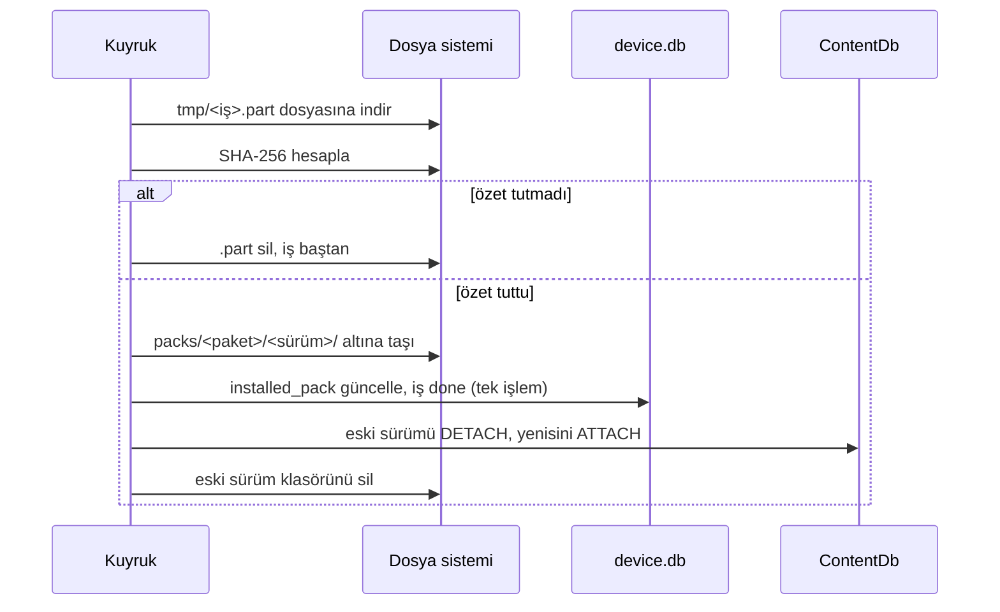
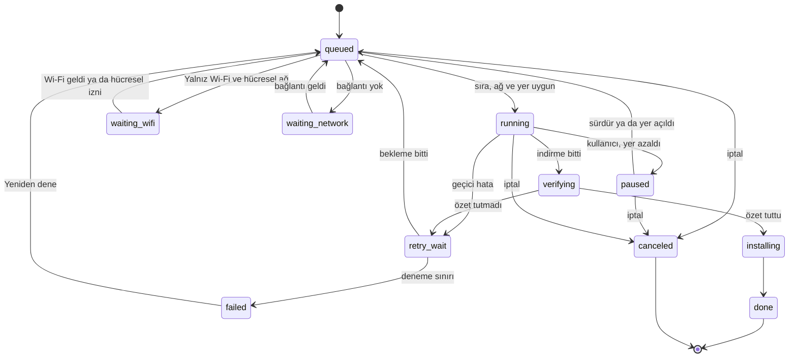
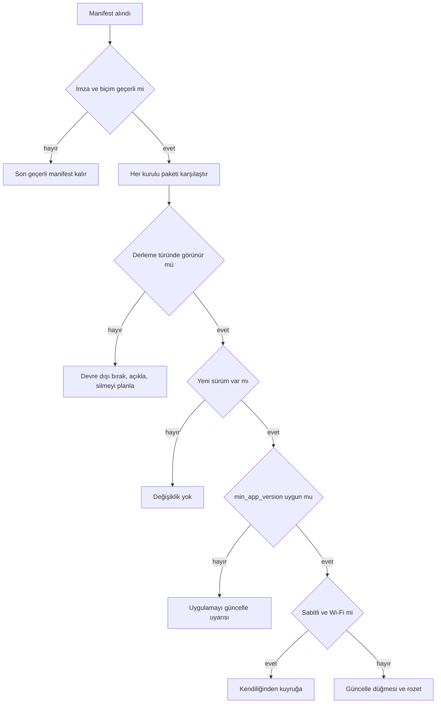

# Depolama yöneticisi

> **Sürüm:** 1.1 · **Tarih:** 19 Ekim 2026 · **Durum:** Taslak
> **Bağlı kararlar:** [K-18](../00-ozet/02-karar-defteri.md#k-18--depolama-yöneticisi-v1de) · [K-21](../00-ozet/02-karar-defteri.md#k-21--i̇çerik-dağıtımı) · [K-06](../00-ozet/02-karar-defteri.md#k-06--yayın-kapısı) · [K-26](../00-ozet/02-karar-defteri.md#k-26--kalıcı-adresler-çapa-şeması) · [K-15](../00-ozet/02-karar-defteri.md#k-15--hesap-ve-senkron-v1xte) · [K-28](../00-ozet/02-karar-defteri.md#k-28--ses)

[K-18](../00-ozet/02-karar-defteri.md#k-18--depolama-yöneticisi-v1de) proje sahibinin önerisidir (18 Ekim 2026): Ayarlar › Depolama ekranı v1'de bulunur; paket listesi, boyut, sürüm, tek dokunuşla silme, hafız başına ses silme, yalnız Wi-Fi ile indirme ve duraklatılabilir indirme kuyruğu içerir. Bu dosya ekranı, yerel tabloları, kuyruğu, eşikleri, otomatik temizliği, manifest güncellemelerini ve kenar durumları tanımlar. Kod `src/features/storage` ve `src/packs` içindedir ([Mobil mimari](./01-mobil-mimari.md)). Paket biçimleri [İçerik paketleri](../03-veri/03-icerik-paketleri.md) dosyasında kesinleşir.

## 1. Ekran: Ayarlar › Depolama

```
+--------------------------------------------+
| < Ayarlar              Depolama            |
+--------------------------------------------+
| 1,42 GB kullanılıyor - Cihazda 18,6 GB boş |
| [#############=======----..]               |
| Ses 1,12 GB, Mushaf 186 MB, Metin 74 MB,   |
| Çekirdek 38 MB, Önbellek 22 MB             |
+--------------------------------------------+
| INDIRME AYARLARI                           |
| Yalnız Wi-Fi ile indir             [ açık ]|
| Kullanılmayan sesleri otomatik sil[kapalı] |
+--------------------------------------------+
| INDIRME KUYRUGU (2)     [Tümünü duraklat]  |
| Hafız 1 - Bakara  %62  18/29 MB            |
|                     [Duraklat] [İptal]     |
| Mushaf A - 5. cüz   Wi-Fi bekleniyor       |
|                  [Hücresel veriyle indir]  |
+--------------------------------------------+
| METIN PAKETLERI                            |
| Çekirdek: Kur'an ve Elmalılı meali [kilit] |
|   38 MB - 2026.10.0 - uygulamayla gelir    |
| Elmalılı Tefsiri         [Sabitle] [Sil]   |
|   21,4 MB - 2026.10.2 - son kullanım: dün  |
|   Güncelleme var (+1,2 MB)     [Güncelle]  |
+--------------------------------------------+
| MUSHAF                                     |
| Mushaf A - 12/30 cüz - 41 MB             > |
+--------------------------------------------+
| HAFIZ SESLERI                              |
| Hafız 1 - 1,02 GB - 41 sure              > |
| Hafız 2 - 96 MB - 3 sure                 > |
+--------------------------------------------+
| ÖNBELLEK - 22 MB                [Temizle]  |
+--------------------------------------------+
```

Değerler örnektir. Görünüş ayrıntısı [Mobil ekranlar](../01-urun/03-mobil-ekranlar.md) dosyasındadır.

| Bölüm | İçerik | Kural |
|---|---|---|
| Kullanım çubuğu | Toplam kullanım, cihazdaki boş alan, kategoriler: Çekirdek, Metin, Mushaf, Ses, Önbellek | Kategoriler yazıyla da listelenir; renk tek başına anlam taşımaz |
| İndirme ayarları | "Yalnız Wi-Fi ile indir" (varsayılan açık), "Kullanılmayan sesleri otomatik sil" (varsayılan kapalı) | Cihaza özgü; MMKV'de |
| İndirme kuyruğu | İş başına ilerleme, Duraklat, Sürdür, İptal; "Tümünü duraklat"; Wi-Fi bekleyen işte "Hücresel veriyle indir" | Kuyruk boşsa bölüm gizlenir |
| Metin paketleri | Ad, boyut, sürüm, son kullanım, Sabitle, Sil, varsa Güncelle | `core` kilitli |
| Mushaf | Mushaf A için 30 cüzlük ızgara (indirildi, iniyor, yok), "Tümünü indir"; Mushaf B satırı | Lisansla görünür |
| Hafız sesleri | Hafız başına boyut ve sure sayısı; ayrıntıda sure listesi, sure başına ve hafız başına silme | K-18 |
| Önbellek | Çıkarılmış fontlar, ön yüklenen sesler, yarım dosyalar; "Temizle" | Kullanıcı verisine dokunmaz |

- Boyutlar 1000 tabanlı ve Türkçe biçimde gösterilir ("12,4 MB"). İşletim sistemi ekranlarıyla küçük fark olabilir.
- Son kullanım göreli yazılır: "bugün", "dün", "3 gün önce", "hiç açılmadı".
- Yalnız derleme türünde görünen paketler listelenir ([Mobil mimari](./01-mobil-mimari.md), bölüm 10).

### 1.1 Tek dokunuşla silme

- "Sil"e tek dokunuş paketi `pending_delete` durumuna alır. Satır "Silindi · Geri al" olur ve çubuk boşalacak alanı hemen gösterir.
- "Geri al" ekrandan çıkılana kadar durur, zamanlayıcıyla kaybolmaz. Apple görünümlerin zamanla kapanması yerine açık eylemle kapanmasını önerir ([Apple HIG Erişilebilirlik](https://developer.apple.com/design/human-interface-guidelines/accessibility)).
- Dosyalar ekrandan çıkınca ya da uygulama arka plana geçince silinir. Paket kullanılıyorsa önce bırakılır: ses `PACK_REMOVED` ile durur ([Ses sistemi](./02-ses-sistemi.md)), metin paketi DETACH edilir.
- Onay yalnız toplu silmede ("Tüm indirmeleri sil", "Bu hafızın tüm sesleri") ve başka paketi etkileyen silmede istenir.
- `core` silinemez; satırda kilit simgesi ve "Uygulamayla gelir, silinemez" yazar. İndirilmiş bir `core` güncellemesi silinebilir; uygulama gömülü sürüme döner.

### 1.2 Sabitleme

Sabitlenen paket ya da hafız otomatik temizliğe ve yer önerilerine girmez; güncellemeleri Wi-Fi'da kendiliğinden iner. Elle silme yine tek dokunuşla yapılır.

### 1.3 Erişilebilirlik ve metinler

- Çubuk `accessibilityRole="progressbar"` ve yazılı bir `accessibilityValue` taşır ("1,42 GB kullanılıyor, 18,6 GB boş").
- Her "Sil" düğmesinin etiketi paket adını ve boyutunu içerir ("Elmalılı Tefsiri paketini sil, 21,4 MB").
- Kuyruk ilerlemesi en fazla yüzde 25'lik adımlarla duyurulur. Bütün eylemler düğmedir; kaydırarak silme zorunlu değildir.

| Anahtar | Metin |
|---|---|
| `storage.total` | {used} kullanılıyor · Cihazda {free} boş |
| `storage.autoClean.hint` | {days} gündür dinlenmeyen sure sesleri silinir. Sabitlenen hafızlar korunur. |
| `storage.deleted` | Silindi · Geri al |
| `storage.core.locked` | Uygulamayla gelir, silinemez. |
| `storage.queue.waitingWifi` | Wi-Fi bekleniyor |
| `storage.queue.useCellular` | Hücresel veriyle indir |
| `storage.low.warn` | Bu indirmeden sonra cihazda {free} kalacak. Devam edilsin mi? |
| `storage.low.block` | Yer yetersiz. Bu indirme için {need} boş alan gerekli. |
| `storage.integrity` | Dosya doğrulanamadı. Yeniden indiriliyor. |
| `storage.update` | {count} paket için güncelleme var ({size}). |
| `storage.needsApp` | Bu güncelleme için uygulamanın yeni sürümü gerekiyor. |
| `storage.licenseRemoved` | Bu içerik hak sahibinin isteğiyle kaldırıldı. Notların ve vurguların korunur. |
| `storage.missing` | Bu içerik cihazda yok · İndir |

## 2. Yerel tablolar (`device.db`)

Bu tablolar `user.db` içinde durmaz. Cihaza özgüdür, senkrona girmez ve diskten yeniden kurulabilir ([Mobil mimari](./01-mobil-mimari.md), bölüm 6). Drizzle şeması bu DDL'i izler; göçler drizzle-kit ile üretilir. Zamanlar epoch milisaniyedir.

```sql
CREATE TABLE installed_pack (
  pack_id           TEXT PRIMARY KEY,           -- 'core', 'tefsir-elmalili', 'mushaf-a-cuz-05', 'ses-{hafiz}'
  kind              TEXT NOT NULL,              -- core | tefsir | hadis | risale | kelime_kok | mushaf_a | mushaf_b | ses
  version           TEXT NOT NULL,
  sha256            TEXT NOT NULL,              -- doğrulanan dosyanın özeti (ses için dizin dosyası)
  size_bytes        INTEGER NOT NULL,           -- manifestteki boyut
  disk_bytes        INTEGER NOT NULL,           -- diskte kapladığı; ses için inen dosyalar dahil
  license_status    TEXT NOT NULL,              -- serbest | bekliyor | ic_kullanim | kapali (son manifest)
  kurul_gerekli     INTEGER NOT NULL DEFAULT 0, -- manifestten (K-06)
  kurul_onay        TEXT,
  min_app_version   TEXT,
  depends_on        TEXT NOT NULL DEFAULT '[]', -- JSON dizi
  path              TEXT NOT NULL,              -- packs/ altına göreli
  source            TEXT NOT NULL,              -- embedded | download
  state             TEXT NOT NULL,              -- active | pending_delete | disabled | broken
  state_reason      TEXT,                       -- license | app_version | missing_file | integrity
  pinned            INTEGER NOT NULL DEFAULT 0,
  installed_at      INTEGER NOT NULL,
  last_used_at      INTEGER,
  available_version TEXT,                       -- manifestte daha yeni sürüm varsa
  available_bytes   INTEGER
);

CREATE TABLE download_job (
  id              TEXT PRIMARY KEY,             -- UUIDv7
  pack_id         TEXT NOT NULL,
  target_version  TEXT NOT NULL,
  scope           TEXT NOT NULL DEFAULT '',     -- ses için '{"sure":2}' ya da '{"cuz":3}'
  url             TEXT NOT NULL,
  expected_sha256 TEXT,
  expected_bytes  INTEGER,
  temp_path       TEXT,
  resume_data     TEXT,                         -- DownloadTask.savable() çıktısı
  bytes_done      INTEGER NOT NULL DEFAULT 0,
  files_total     INTEGER,
  files_done      INTEGER,
  state           TEXT NOT NULL,                -- bölüm 4
  pause_reason    TEXT,                         -- user | storage | app_update
  allow_cellular  INTEGER NOT NULL DEFAULT 0,
  priority        INTEGER NOT NULL DEFAULT 0,   -- kullanıcı > güncelleme > ön yükleme
  attempts        INTEGER NOT NULL DEFAULT 0,
  integrity_fails INTEGER NOT NULL DEFAULT 0,
  next_retry_at   INTEGER,
  last_error      TEXT,
  created_at      INTEGER NOT NULL,
  updated_at      INTEGER NOT NULL,
  UNIQUE (pack_id, target_version, scope)       -- aynı iş iki kez açılmaz
);

CREATE TABLE audio_file (
  reciter        TEXT NOT NULL,                 -- ses-{hafiz} paketindeki hafız kısa adı
  sure           INTEGER NOT NULL,
  ayet           INTEGER NOT NULL,
  bytes          INTEGER NOT NULL,
  sha256         TEXT NOT NULL,
  pack_version   TEXT NOT NULL,
  downloaded_at  INTEGER NOT NULL,
  last_played_at INTEGER,
  PRIMARY KEY (reciter, sure, ayet)
);
CREATE INDEX audio_file_played ON audio_file (reciter, last_played_at);
```

- Sure ve cüz toplamları `audio_file` ile `core`'daki âyet-cüz eşlemesinden sorguyla hesaplanır.
- `last_used_at` paket başına saatte en fazla bir kez, `last_played_at` sure başına toplu yazılır.
- Ayarlar › Kurul onay bilgisi ekranı `installed_pack.kurul_onay` alanını okur.

## 3. Dosya düzeni ve atomik kurulum

```
Paths.document/mutalaa/
├─ db/user.db, db/device.db
├─ packs/<pack_id>/<sürüm>/pack.db        her sürüm ayrı klasörde
├─ audio/<hafiz>/<sss><aaa>.mp3
└─ tmp/<iş_id>.part
Paths.cache/mutalaa/
├─ qpc/        Mod A için çıkarılmış sayfa fontları
└─ prefetch/   akışta ön yüklenen sesler
```

Belge klasörünü sistem silmez; önbellek klasörünü yer azalınca silebilir ([Expo FileSystem](https://docs.expo.dev/versions/latest/sdk/filesystem/), 18 Ekim 2026'da okundu). Paketler bu yüzden belge klasöründedir. Taşıma ve silmenin atomik olup olmadığı belgede yazmıyor; kurulum bu yüzden sürüm klasörü, tek veritabanı işlemi ve açılıştaki uzlaştırmayla çökmelere dayanıklı kurulur.



Açılıştaki uzlaştırma (ilk kareden sonra, boşta):
1. Dosyası olmayan `installed_pack` satırı `broken` (`missing_file`) olur; Depolama "Yeniden indir" önerir.
2. Kaydı olmayan sürüm klasörü (yarım kurulum) silinir.
3. İşe bağlı olmayan `.part` dosyası ve 7 günden uzun duraklatılmış işin yarım dosyası silinir.
4. `running` işler `queued` olur; `resume_data` korunur.
5. `pending_delete` paketler silinir.
6. Gömülü `core` sürümü değiştiyse içe aktarılır; indirilmiş `core` daha yeniyse o kalır.
7. Dosyası olmayan `audio_file` satırı ve satırı olmayan ses dosyası silinir.

## 4. İndirme kuyruğu



- **Sıra.** Önce öncelik, sonra oluşturulma zamanı. Aynı anda bir paket işi çalışır; ses işinde dosyalar üçerli paralel iner.
- **Yalnız Wi-Fi.** Ayar açıkken hücresel ağdaki iş `waiting_wifi` olur. "Hücresel veriyle indir" o iş için `allow_cellular` açar ve boyutu gösterir. Ölçülü Wi-Fi bilgisinin kaynağı Doğrulanacak ([Mobil mimari](./01-mobil-mimari.md), bölüm 11).
- **Yer.** Başlamadan önce ve her 10 MB'ta bir denetlenir (bölüm 6).
- **Sürdürme.** Expo FileSystem `File.createDownloadTask` (`onProgress` ile) ve `DownloadTask` üzerinde `pause()`, `pauseAsync()`, `resumeAsync()`, `savable()`, `fromSavable()` sunar. iOS'ta `sessionType` varsayılan olarak `'background'`'dır ve aktarım uygulama askıya alınınca sürebilir; JS `DownloadTask` nesnesi uygulama kapanınca geri yüklenmez ([Expo FileSystem](https://docs.expo.dev/versions/latest/sdk/filesystem/)). Bu yüzden duraklatmada ve arka plana geçişte `savable()` çıktısı `resume_data` sütununa yazılır. HTTP aralık isteği belgede geçmiyor; SDK 57'de API'nin varlığıyla birlikte Doğrulanacak.
- **Ses işleri** dosya düzeyinde sürer. Biten her dosya hemen `audio_file` tablosuna yazılır; kesilen iş kaldığı dosyadan devam eder.
- **Arka plan.** v1'de indirme uygulama öndeyken sürer. Android'de arka planda indirme ve iOS'ta uygulama kapandıktan sonra tamamlama v1.x'te değerlendirilir (Açık soru).
- **Hata türleri.** Bağlantı kopması, zaman aşımı, 5xx ve 429 geçicidir. 404 ve 410 manifestin yenilenmesini tetikler. İki kez tutmayan özet kalıcı hatadır.

```ts
// src/features/storage/queue/backoff.ts
const BASE = 5_000, MAX = 10 * 60_000, MAX_ATTEMPTS = 6;

/** Sonraki deneme zamanı; null ise iş 'failed' olur. */
export function nextRetryAt(attempts: number, now = Date.now()): number | null {
  if (attempts >= MAX_ATTEMPTS) return null;
  const exp = Math.min(MAX, BASE * 2 ** attempts);
  return now + Math.round(exp * (0.8 + Math.random() * 0.4));   // ±%20 sapma
}
// Yaklaşık 5, 10, 20, 40, 80, 160 saniye; altıncı denemeden sonra 'failed'.
```

## 5. Bütünlük doğrulaması

- `await new File(tempPath).digest('SHA-256')` küçük harfli onaltılık özet döndürür ([Expo FileSystem](https://docs.expo.dev/versions/latest/sdk/filesystem/)). Manifestteki `sha256` küçük harfe çevrilip karşılaştırılır.
- Ses dosyaları ses dizinindeki özetle, dizin dosyası manifestteki özetle doğrulanır.
- Özet tutmazsa `.part` silinir, `integrity_fails` artar ve iş sürdürme kullanılmadan baştan iner. İkinci kez tutmazsa manifest yenilenir; özet değiştiyse yeni özetle bir kez daha denenir, değişmediyse iş `failed` olur. Sentry'ye yalnız paket kimliği, sürüm ve bayt sayısı gider.
- Doğrulanmamış dosya hiçbir zaman ATTACH edilmez ve çalınmaz.
- Manifest her zaman imzalıdır ([K-06](../00-ozet/02-karar-defteri.md#k-06--yayın-kapısı)). Uygulama imzayı gömülü açık anahtarla doğrular. `public` derleme imzasız ya da imzası tutmayan manifesti reddeder ve son geçerli manifestle sürer; bu kesin kuraldır. Yerel yayınlayıcı ayrı bir geliştirme anahtarıyla imzalar, `public` ikili yalnız üretim açık anahtarını taşır (öneri). Algoritma ve anahtar yönetimi [İçerik paketleri](../03-veri/03-icerik-paketleri.md) dosyasında kesinleşir.

## 6. Düşük depolama eşikleri

Boş alan `Paths.availableDiskSpace` ile okunur. Değerler öneridir; ölçümle ayarlanır.

| Durum | Koşul | Davranış |
|---|---|---|
| Normal | İndirmeden sonra ≥ 1 GB boş | Sessiz |
| Uyarı | İndirmeden sonra 300 MB – 1 GB | Başlamadan önce `storage.low.warn` onayı; Depolama'da uyarı şeridi |
| Engel | İndirmeden sonra < 300 MB | İndirme başlamaz; temizlik önerileri açılır |
| Kritik | Cihazda < 100 MB | Bütün işler `paused` (`storage`). "Notlarının kaydı için yer aç" uyarısı çıkar, çünkü `user.db` yazamazsa not kaybolur |

- Güncellemede eski ve yeni sürüm bir süre birlikte durur; gereken yer yeni sürümün boyutudur.
- Temizlik önerisi sırası: önbellek; sabitlenmemiş seslerden en uzun süredir dinlenmeyen sureler; sabitlenmemiş paketlerden en uzun süredir kullanılmayanlar. `core` ve sabitlenenler önerilmez.
- iOS'un bildirdiği boş alanla Ayarlar uygulamasındaki değer farklı olabilir (Doğrulanacak).

## 7. Kullanılmayan seslerin otomatik temizliği

Araştırma notu ses için Wi-Fi'ı varsayılan yapan ve en uzun süredir kullanılmayanı önce silen bir depolama ekranı önerir ([araştırma notları](../09-kaynakca.md)).

- Varsayılan kapalıdır. Açılınca süre seçilir: 30, 60 ya da 90 gün (varsayılan 90).
- Günde en fazla bir kez, ilk kareden sonra boşta çalışır.
- Son dinlenmesi (hiç dinlenmediyse indirilmesi) süreden eski sureleri bütün olarak siler; yarım sure bırakmaz.
- Sabitlenmiş hafızları, çalma kuyruğundaki âyetleri ve son 7 günde inenleri korur.
- Sonuç Depolama ekranında yazar ("Son otomatik temizlik: 12 Ekim, 310 MB"). Bildirim gönderilmez.

## 8. Manifest güncellemeleri

Manifest uygulama öne geldiğinde en fazla 6 saatte bir, Depolama ekranı açılınca ve kullanıcı istediğinde ETag ile koşullu istenir. Son geçerli kopya MMKV'de durur; çevrimdışıyken "Son denetim: 3 gün önce" yazar.



- Görünmez olan paket (`kapali`; `internal` ve `public` derlemede `serbest` olmayan ya da gerekli Kurul onayı bulunmayan) `disabled` (`license`) olur. İçerik gizlenir, ses durur, dosyalar silinmek üzere işaretlenir ve `storage.licenseRemoved` bir kez gösterilir. Notlar ve vurgular kalır ([K-06](../00-ozet/02-karar-defteri.md#k-06--yayın-kapısı)).
- Manifestten tamamen kalkan paketin ne olacağı Açık soru (DY-3). `public` derlemede ihtiyatla devre dışı bırakılması önerilir. Lisansı `kapali` olan paket bu yolla kalkar, çünkü Yayınlayıcı onu manifeste yazmaz (P-01).
- `min_app_version` uymuyorsa paket indirilmez; mağaza bağlantılı `storage.needsApp` gösterilir.
- `kurul_onay` değişen güncellemede satır "Kurul onaylı yeni sürüm" der.
- Sürüm biçimi ve karşılaştırması [İçerik paketleri](../03-veri/03-icerik-paketleri.md) dosyasında kesinleşir (Açık soru). Daha düşük sürüme dönüş yalnız yayınlayıcının açık işaretiyle yapılır.
- **Çapa denetimi.** Güncellemeden sonra o paketteki çapalara bağlı vurgu ve notların `content_hash` değeri yeni birimle karşılaştırılır. Değişenler Defterim'de "Metin güncellendi, vurgunun yerini kontrol et" etiketi alır ([Çapa şeması](../03-veri/01-capa-semasi.md); [K-26](../00-ozet/02-karar-defteri.md#k-26--kalıcı-adresler-çapa-şeması)).

## 9. Kenar durumlar

| Durum | Davranış |
|---|---|
| Not ya da vurgunun bağlı olduğu paket silindi | Kullanıcı verisi silinmez; kayıtlar çapayla bağlıdır ([Kullanıcı verisi ve senkron](../03-veri/04-kullanici-verisi-ve-senkron.md)). Defterim kaydı adresiyle listeler, içerik yerine `storage.missing` gösterir. Yeniden inince `content_hash` denetimi yapılır. Adresin okunur adı paket yokken de görünmeli: `core` eser ve bölüm başlıklarını taşır ya da kullanıcı kaydı etiket saklar (Açık soru) |
| Kullanılan paket silindi | Önce ses durur (`PACK_REMOVED`) ve DETACH yapılır, sonra dosya silinir. DETACH başarısızsa silme sonraki açılışa kalır |
| Paketin bağımlısı var (`depends_on`) | Onay penceresi bağımlıları listeler; onaylanırsa hepsi silinir |
| İndirme sürerken mağaza güncellemesi | Süreç kapanır. Açılışta `device.db` göçleri kuyruktan önce çalışır, `running` işler `resume_data` ile sürer. Manifest yeniden okunur; hedef sürüm değiştiyse ya da `min_app_version` uymuyorsa yarım dosya silinir ve iş yeni sürümle kurulur |
| İndirme sürerken EAS Update | Güncelleme sonraki soğuk açılışta uygulanır; indirme varken `reloadAsync()` çağrılmaz |
| sha256 tutmadı | Bölüm 5 |
| Sunucu aralık isteğini desteklemedi ya da nesne değişti | Yarım dosya atılır, iş baştan iner |
| 404 ya da 410 | Manifest yenilenir; paket yoksa iş "Bu paket artık dağıtılmıyor" ile iptal edilir |
| İndirirken yer bitti | İş `paused` (`storage`); yarım dosya kalır, yer açılınca sürer |
| Wi-Fi'dan hücresele geçiş | İş `waiting_wifi`; Wi-Fi gelince kendiliğinden sürer |
| Sistem önbelleği temizledi | Fontlar paketten yeniden çıkarılır; ön yüklemeler yeniden iner |
| Yedekten yeni cihaza dönüş, iOS uygulama boşaltma | Uzlaştırma eksik dosyaları `broken` yapar; "Yeniden indir" önerilir |
| Mushaf A cüzü silindi, kullanıcı o sayfada | Sayfa Mod C ile çizilir, şerit "İndir" önerir |
| `dev`, `internal` ve `public` aynı cihazda | Ayrı uygulama kimlikleri, ayrı veri alanları ([Mobil mimari](./01-mobil-mimari.md), bölüm 10) |

Yeniden indirilebilir paketlerin iCloud yedeğinden dışlanması için Expo FileSystem belgesinde bir ayar yok. Gerekli olup olmadığı ve nasıl yapılacağı Açık soru.

## 10. Test senaryoları

- **Birim:** geri çekilme süreleri, görünürlük kuralı, eşik hesabı, otomatik temizlik seçimi, sahte dosya sistemiyle uzlaştırma.
- **Cihaz:** indirme ortasında uygulamayı öldürme; uçak modu; Wi-Fi'dan hücresele geçiş; bozuk dosya; dolmak üzere disk (küçük depolamalı Android öykünücüsü); kurulu bir paketi manifestten çıkaran manifest (Yayınlayıcı `kapali` paketi manifeste hiç yazmaz, [P-01](../02-mimari/05-backend-api.md#103-kapı-kontrolleri); beklenen davranış DY-3 ile kesinleşir, o zamana kadar bölüm 8'deki öneri sınanır) ve `min_app_version` artıran manifest; not bağlı paketi silip yeniden indirme.
- **Erişilebilirlik:** VoiceOver ve TalkBack ile Depolama ekranı.

Ayrıntı [Test stratejisi](../07-yayin/03-test-stratejisi.md) dosyasındadır.

## 11. Açık sorular ve doğrulanacaklar

| No | Konu | Tür |
|---|---|---|
| DY-1 | Manifest imzası | Kapandı: her zaman imzalı (K-06); algoritma ve anahtar yönetimi İçerik paketleri'nde |
| DY-2 | Paket biçimleri: Mushaf A font BLOB'u, ses dizini, sıkıştırma | Açık soru |
| DY-3 | Sürüm biçimi, düşük sürüme dönüş, manifestten kalkan paket | Açık soru |
| DY-4 | Arka planda indirme (Android; iOS'ta kapanış sonrası tamamlama) | Açık soru |
| DY-5 | iCloud yedeğinden dışlama | Açık soru |
| DY-6 | Eşik değerleri; iOS'ta `availableDiskSpace` doğruluğu | Doğrulanacak |
| DY-7 | Kullanıcı kaydında okunur etiket ve `content_hash` saklanması | Açık soru |
| DY-8 | Ölçülü Wi-Fi algılama | Doğrulanacak |
| DY-9 | SDK 57'de `createDownloadTask` ve `digest` varlığı; aralık isteğiyle sürdürme | Doğrulanacak |

## İlgili dosyalar

- [Mobil mimari](./01-mobil-mimari.md) · [Ses sistemi](./02-ses-sistemi.md)
- [Mobil ekranlar](../01-urun/03-mobil-ekranlar.md) · [Tasarım sistemi](../01-urun/04-tasarim-sistemi.md)
- [Çapa şeması](../03-veri/01-capa-semasi.md) · [İçerik paketleri](../03-veri/03-icerik-paketleri.md) · [Kullanıcı verisi ve senkron](../03-veri/04-kullanici-verisi-ve-senkron.md)
- [Yayın kapısı ve Kurul](../07-yayin/01-yayin-kapisi-ve-kurul.md) · [KVKK ve gizlilik](../07-yayin/02-kvkk-ve-gizlilik.md) · [Test stratejisi](../07-yayin/03-test-stratejisi.md)
- [Karar defteri](../00-ozet/02-karar-defteri.md) · [Kaynakça](../09-kaynakca.md)
