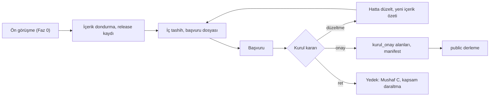

# Yayın kapısı ve Kurul onayı

> **Sürüm:** 1.1 · **Tarih:** 19 Ekim 2026 · **Durum:** Taslak
> **Bağlı kararlar:** [K-06](../00-ozet/02-karar-defteri.md#k-06--yayın-kapısı) · [K-05](../00-ozet/02-karar-defteri.md#k-05--risale-i-nur-ve-lisansı-bekleyen-içerik) · [K-07](../00-ozet/02-karar-defteri.md#k-07--mushaf-görünümü-üç-seçenek) · [K-21](../00-ozet/02-karar-defteri.md#k-21--i̇çerik-dağıtımı) · [K-27](../00-ozet/02-karar-defteri.md#k-27--tek-bağlantı-tablosu)

> **Hukuki görüş değildir.** Bu dosya araştırma raporundaki mevzuat ve lisans bulgularını mühendislik kurallarına çevirir. Mağaza yayınından önce Kurul'un yazılı cevabı ve bir fikri haklar avukatının görüşü alınır.

Bu dosya `Mutalaa.Publisher` içindeki lisans kapısını, **Kaynaklar ve lisanslar** ile **Kurul onay bilgisi** ekranlarını ve Mushafları İnceleme ve Kıraat Kurulu onayı için iş planını tanımlar.

## 1. Dayanak

| Konu | Bulgu | Kaynak |
|---|---|---|
| Onay şartı | 633 sayılı Kanun m. 6: Kurul'un "onay ve mührü bulunmayan mushaflar, cüzler halindeki mushaflar, mealli mushaflar ile sesli, görüntülü ve elektronik ortamda hazırlanan Kur'an-ı Kerimler basılamaz ve yayımlanamaz." | [Lexpera, 633](https://www.lexpera.com.tr/mevzuat/kanunlar/diyanet-isleri-baskanligi-kurulus-ve-gorevleri-hakkinda-kanun-633) |
| Yürürlük | Hüküm 7549 sayılı Kanunla geldi, 4 Haziran 2025'te yürürlüğe girdi. Kural 2018'den beri kararnamede vardı. | [Yeni Akit](https://www.yeniakit.com.tr/haber/diyanete-yeni-yetki-yururluge-girdi-sakincali-kuran-meallerini-toplayip-imha-edebilecek-1937002.html), [Memurlar.net, 2018](https://www.memurlar.net/haber/761684/diyanetten-kur-an-i-kerim-ve-meallere-yakin-takip.html) |
| Yaptırım | Mahkeme onaysız internet yayınında içeriğin çıkarılmasına ve/veya erişimin engellenmesine karar verebilir. İki haftalık itiraz engeli durdurmaz. | [Karar](https://www.karar.com/guncel-haberler/duzenleme-mecliste-yasalasti-diyanet-kuran-i-kerim-meali-1963979) |
| Sürüme bağlılık | 2022 yönetmeliği dijital eserlerin onaylanmasını öngörür. Onaylanmış eserin içeriği değiştirilemez. | [Memurlar.net, 2022](https://www.memurlar.net/haber/1045766/kur-an-i-kerim-basim-ve-yayim-kriterleri-hakkinda-yonetmelik-resmi-gazete-de-yayimlandi.html) |
| Ücret | Döner sermaye yönetmeliği "dijital dini yayınların inceletilmesi" için ücret öngörür; tutar bilinmiyor. | [Memurlar.net](https://www.memurlar.net/haber/850408) |
| Meal incelemesi | Din İşleri Yüksek Kurulu meal yayınlarını inceleyebilir; aykırı yayın toplatılabilir ya da erişime kapatılabilir (m. 5/ı). | Lexpera, 633 |

Telif ekseni bundan ayrıdır. Tanzil metni değiştirilemez, QPC sayfa fontları "All rights reserved" der, Risale-i Nur 31 Aralık 2030'a kadar korunur. Kaynak bazındaki durum [Kaynaklar ve lisans defteri](../04-icerik/01-kaynaklar-ve-lisans-defteri.md) dosyasındadır. Kapı iki ekseni birlikte uygular.

## 2. Kapının girdileri

### 2.1 Lisans durumu

`source.license_status` dört değer alır; anlamlar ve başlangıç durumları [K-06](../00-ozet/02-karar-defteri.md#k-06--yayın-kapısı)'dan gelir. Kaynak başına kesin değer lisans defterindedir.

| Değer | Anlamı | Örnek |
|---|---|---|
| `serbest` | Kamu malı, açık lisanslı ya da yazılı izni olan içerik. | Tanzil metni (şartlarıyla); özgün baskıdan OCR ve düzeltmeyle hazırlanan Elmalılı metnimiz |
| `bekliyor` | İzin ya da açıklama istendi, cevap bekleniyor. | QAC'den türeyen kök ve lemma, ayrı `kelime-kok` paketinde (§2.4) |
| `ic_kullanim` | Hukukçu görüşüyle yalnız ekip içinde işlenebilen içerik. | Risale-i Nur metni, hukukçu görüşü olumlu gelirse |
| `kapali` | Hiçbir derlemede kullanılmaz ve işlenmez. | Risale-i Nur metni (hukukçu görüşüne kadar); Tecrîd'in Kâmil Miras ciltleri (1 Ocak 2028'e kadar); kaldırma talebi gelen kayıt |

### 2.2 Kurul alanları ve içerik özeti

`source` tablosu Kurul için `kurul_gerekli`, `kurul_onay` (onay no ve onaylı içerik sürümü), `kurul_onay_tarihi` ve `kurul_onay_ozeti` alanlarını taşır ([Editoryal veritabanı](../03-veri/02-editoryal-veritabani.md)). Kur'an metni, Arapça metinle birlikte gösterilen meal (mealli mushaf) ve Kur'an sesi `kurul_gerekli` taşır; sınırdaki türler [§7.1](#71-neyin-onaya-ihtiyacı-olabilir) tablosundadır.

İçerik özeti editoryal veritabanındaki tanımı izler: kaynağın etkin birimleri `anchor` sırasıyla (`COLLATE "C"`) dizilir, her satır için `anchor + "\t" + content_hash + "\n"` yazılır, özet bu dizginin SHA-256'sıdır; ses ve fontta dosya yolu ve dosya özeti kullanılır. Onay bu özete bağlanır. SQLite dosyasının özeti indeks yeniden üretildiğinde içerik değişmeden de değişebilir; bu yüzden onay için kullanılmaz.

### 2.3 Paketin ve bağlantının durumu

Paketin durumu, içindeki kaynakların en kısıtlayıcısıdır: `serbest` < `bekliyor` < `ic_kullanim` < `kapali`. `bekliyor` ile `ic_kullanim` kapıda aynı davranır. Kaynak kaydı olmayan içerik hiçbir pakete girmez.

`xref` satırı kendi `license` sütununu taşır ([K-27](../00-ozet/02-karar-defteri.md#k-27--tek-bağlantı-tablosu)). Publisher bir bağlantıyı üç koşul birlikte sağlanırsa pakete koyar: kaynak çapanın eseri o derlemede görünür; hedef çapanın eseri görünür ya da bağlantı lisans defterinde ayrı kaydı olan bir dizine aittir; bağlantının `license` değeri o derlemeye izin verir. Ayrı kayıt kuralı Risale atıf dizini içindir (`risale-atif-dizini`); dizin metinle birlikte hukukçu görüşüne kadar `kapali` durumundadır ([Kaynaklar ve lisans defteri](../04-icerik/01-kaynaklar-ve-lisans-defteri.md#2-özet-tablo) §2; §2.4).

### 2.4 Telif ve işleme açık soruları

Hukuki görüş değildir. Sorular fikri haklar avukatına gider; cevaplar lisans defterine işlenir.

1. **Açık soru:** Telifli Risale metni atıf dizini, gömme vektörleri ve altın set üretmek için içeride işlenebilir mi? Rapor dizin için metni işlemenin hukuki durumunun avukatla doğrulanmasını istiyor. Görüş gelene kadar metin `kapali` kalır ve işlenmez; görüş olumluysa `ic_kullanim` olur ([K-05](../00-ozet/02-karar-defteri.md#k-05--risale-i-nur-ve-lisansı-bekleyen-içerik)).
2. **Açık soru:** Risale metni harici bir dil modeli API'sine gönderilebilir mi? Cevap gelene dek API adımları yalnız Elmalılı ve serbest metinlerde çalışır, Risale için gömme kapalı kalır ([İktibas tespiti](../05-capraz-referans/02-iktibas-tespiti.md), [Anlamsal katman](../05-capraz-referans/04-anlamsal-katman.md)).
3. **Açık soru:** Metin içermeyen Risale atıf dizini public derlemede yer alabilir mi? Rapor riskini düşük görüyor, ama bunu çıkarım olarak sunuyor.
4. **QAC.** İndirme sayfası GPL ve uygulamada kullanım izni veriyor, SSS "ticari amaçla kullanmamak" şartı koyuyor ([QAC indirme](https://corpus.quran.com/download/), [QAC SSS](https://corpus.quran.com/faq.jsp)). K-06 uygulama notu gereği QAC'den türeyen kök ve lemma `core` dışında, ayrı `kelime-kok` paketinde tutulur ve QAC'den yazılı açıklık gelene dek `bekliyor` kalır. Bu sürede `internal` ve `public` derlemede kelime kartının kök, lemma ve anlam satırları kapalıdır ([Kök ve lemma](../05-capraz-referans/03-kok-ve-lemma.md)).

## 3. Derleme türleri ve görünürlük

| `license_status` | `dev` (yalnız ekip; yerel SeaweedFS) | `internal` (davetli test kullanıcıları; EAS iç dağıtım) | `public` (App Store, Google Play) |
|---|---|---|---|
| `serbest` | Evet | Evet | Evet; Kurul gerektiren içerikte yalnız onaylı sürüm |
| `bekliyor` | Evet | Hayır | Hayır |
| `ic_kullanim` | Evet | Hayır | Hayır |
| `kapali` | Hayır | Hayır | Hayır |

Tablo K-06'yı izler (güncelleme 18 Ekim 2026). `kapali` içerik hiçbir derlemeye girmez ve içerik hattında da işlenmez. `dev` derlemede `bekliyor` ve `ic_kullanim` içerik "Yalnız ekip" şeridi taşır (öneri). Yerel depo SeaweedFS'in S3 arayüzüdür ([K-21](../00-ozet/02-karar-defteri.md#k-21--i̇çerik-dağıtımı)). EAS profilleri [Mobil mimari](../06-mobil/01-mobil-mimari.md) dosyasının 10. bölümündedir: `development`, `internal` ve `production` profilleri `APP_FLAVOR` ile `dev`, `internal` ve `public` türünü taşır. Her profilin ayrı güncelleme kanalı ve manifest adresi (`internal/manifest.json`, `public/manifest.json`) vardır; bir JS güncellemesi türler arasında geçemez.

**K-05 ve K-06 güncellemesi.** `internal` derleme davetli test kullanıcılarına gider ve yalnız `serbest` içerik görür. Dış test kullanıcısına dağıtımın FSEK anlamında çoğaltma ve yayma sayılabileceği risk böylece kapanır. Risale metni yalnız ekip içi `dev` derlemede, o da hukukçu görüşü olumluysa görünür.

**Açık soru (iç test ve 633 m. 6).** Onaysız Kur'an metninin, mealin ya da sesin kapalı bir test grubuna dağıtılmasının "yayımlama" sayılıp sayılmadığı bilinmiyor. Kurul ön görüşmesinde sorulur; cevap gelene kadar dış test kullanıcısı alınmaz (K-06). Cevap gelene kadar uygulama `internal` derlemede de Kurul kuralını `public` gibi uygular: `kurul_gerekli` olup `kurul_onay` taşımayan paket gösterilmez ([Mobil mimari](../06-mobil/01-mobil-mimari.md) §10). Publisher kapısında Kurul kuralı (P-04) yalnız `public` derlemededir; böyle bir paket `internal` manifestine girer.

## 4. Publisher kuralları

1. `release` kaydını ve `source` tablosunu okur.
2. Her paket adayının durumunu hesaplar. Pakete giren kaynaklardan biri `kurul_gerekli` ise paketin `kurul_gerekli` değeri `true` olur.
3. Kapıdan geçen paketi SQLite olarak üretir; içine `pack_meta` (kimlik, sürüm, derleme türü, Kurul içerik özetleri) ve `pack_source` (`source_id`, `license_status`) yazar. Paket dosyası böylece manifestten bağımsız denetlenir.
4. `xref` satırlarını §2.3'teki üç koşulla süzer.
5. Manifesti yazar, imzalar (§4.2) ve derleme türünün önekine yükler.
6. Giren ve girmeyen her paketi gerekçesiyle listeleyen kapı raporunu (JSON) `release` kaydına bağlar.

```csharp
public static class LicenseGate   // LicenseStatus sırası: Serbest < Bekliyor < IcKullanim < Kapali
{
    static bool Allowed(BuildFlavor f, LicenseStatus s) =>
        f == BuildFlavor.Dev ? s != LicenseStatus.Kapali : s == LicenseStatus.Serbest;   // internal ve public: yalnız serbest

    public static GateResult Check(PackCandidate pack, BuildFlavor flavor)
    {
        if (pack.Sources.Count == 0)
            return GateResult.Reject(LicenseStatus.Kapali, $"{pack.PackId}: kaynak kaydı yok");

        var status = pack.Sources.Max(s => s.LicenseStatus);
        if (!Allowed(flavor, status))
            return GateResult.Reject(status, $"{pack.PackId}: {status} durumu {flavor} derlemesine giremez");

        if (flavor == BuildFlavor.Public)
            foreach (var s in pack.Sources.Where(s => s.KurulGerekli))
            {
                if (s.KurulOnayOzeti is null) return GateResult.Reject(status, $"{s.Slug}: Kurul onayı yok");
                if (s.KurulOnayOzeti != s.IcerikOzeti) return GateResult.Reject(status, $"{s.Slug}: içerik onaylı sürümden farklı");
            }

        return GateResult.Accept(status);
    }
}
```

Kurul kuralının ihlali (P-04: onay yok ya da içerik onaylı sürümden farklı) paketi kapı raporunda "girmedi" yapar ve `public` derlemeyi durdurur: manifest yayımlanmaz, Publisher `2` çıkış koduyla biter ([Backend API](../02-mimari/05-backend-api.md) §10.3).

### 4.1 Manifest girişi

```json
{
  "pack_id": "core", "version": "2026.11.0", "sha256": "<dosya özeti>", "size_bytes": 0,
  "license_status": "serbest", "kurul_gerekli": true,
  "kurul_onay": { "onay_no": "<onay no>", "onay_tarihi": "<YYYY-AA-GG>",
                  "onayli_surum": "core@2026.11.0", "icerik_ozeti": "<içerik özeti>" },
  "min_app_version": "1.0.0", "depends_on": [],
  "url": "<PublicBaseUrl>/packs/public/core/2026.11.0/core-2026.11.0.db"
}
```

Paket sürümü CalVer `YYYY.M.N` biçimindedir; `min_app_version` uygulamanın sürümüdür. `kurul_gerekli` K-06 uygulama notuyla manifest alanlarına eklendi; Publisher değeri pakete giren kaynaklardan türetir. `kurul_onay` bir nesnedir, onay yoksa `null`; Publisher onu `source.kurul_onay`, `kurul_onay_tarihi` ve `kurul_onay_ozeti` sütunlarından kurar. Onaylı içerik özeti paketin `pack_meta` tablosunda da durur. Manifest düzeyindeki alanlar (`signature` dahil) ve kesin biçim [İçerik paketleri](../03-veri/03-icerik-paketleri.md) §5'tedir.

### 4.2 Manifest imzası

- Publisher her derleme türünün manifestini imzalar. İmza ayrı bir dosyada değil, manifestin içinde, manifest düzeyindeki `signature: {alg, kid, value}` alanında durur (K-06 uygulama notu; [İçerik paketleri](../03-veri/03-icerik-paketleri.md) §5, [Backend API](../02-mimari/05-backend-api.md) §10.5). İmza girdisi, `signature` alanı çıkarılmış manifestin kanonik JSON biçimidir. Algoritma önerisi Ed25519; algoritma, kanonikleştirme ve kitaplıklar Doğrulanacak (İçerik paketleri IP-7).
- Özel anahtar depoda ve CI günlüklerinde bulunmaz. Her derleme türünün (`dev`, `internal`, `public`) anahtarı ayrıdır.
- Açık anahtar uygulama ikilisine gömülür; `kid` anahtar değişimine izin verir, uygulama geçerli ve sıradaki iki anahtarı taşır (öneri).
- İmza her derleme türünde zorunludur. Publisher imzasız manifest yayımlamaz, `verify` onu reddeder. Uygulama hiçbir derlemede imzasız ya da imzası doğrulanmayan manifesti okumaz; son geçerli manifestle ve kurulu paketlerle çalışmayı sürdürür. `public` derlemede bu kural gevşetilmez. `dev` manifesti de yerel Publisher'ın geliştirme anahtarıyla imzalanır.
- Manifest imzası K-06 uygulama notuyla karara bağlandı; [Depolama yöneticisi](../06-mobil/03-depolama-yoneticisi.md) ve Genel mimari dosyalarındaki Açık soru bu notla kapanır.

### 4.3 Uygulamadaki ikinci kontrol

Uygulama `internal` ve `public` derlemede `license_status` değeri `serbest` olmayan girişi atlar. Kurul kuralı yalnız manifestteki `kurul_gerekli` alanından gelir; uygulama onu paket kimliğinden ya da türünden çıkarmaz (Mobil mimari MM-8). `kurul_gerekli` olup `kurul_onay` taşımayan paket `public` derlemede, Kurul'un kapalı test cevabı gelene kadar `internal` derlemede de gösterilmez (§3). İndirilmiş bir paketin `pack_source` tablosu izin dışı bir durum gösterirse paket açılmaz.

**Çözüldü (19 Ekim 2026):** Bu kurallar [Mobil mimari](../06-mobil/01-mobil-mimari.md) §10'daki `isPackVisible` işlevinde uygulanmıştır; `kurul_onay` orada nesne tipindedir.

## 5. "Public derleme hiçbir zaman `ic_kullanim`, `bekliyor`, `kapali` içermez" testi

Test her public sürümde zorunludur ve üç katmanda çalışır:

1. **Birim (xUnit).** Durum × derleme türü matrisinin her hücresi; onaysız, onaylı ve onaydan sonra değişmiş Kurul kaynağı; kaynak kaydı olmayan paket; `kurul_gerekli` değerinin kaynaklardan türetilmesi.
2. **Bütünleşik.** Her durumdan birer kaynak taşıyan fikstür veritabanından üç derleme üretilir; `internal` ve `public` çıktısında yalnız `serbest` kaynak bulunur. İmzasız ve bozuk imzalı manifest public derlemede reddedilir.
3. **Yapıt taraması (CI).** Public manifest, imzası, public önekteki bütün nesneler ve gömülü `core` paketi açılır. Her `pack_source` kaydı `serbest` olmalı, Kurul kaynaklarında hesaplanan özet `kurul_onay_ozeti` ile aynı olmalı, manifestte olmayan nesne bulunmamalı. Adım Publisher'ın `verify --flavor public` alt komutuyla çalışır (öneri); aynı tarama `internal` manifestinde de koşar.

Birim testleri `[Theory]` ile `bekliyor`, `ic_kullanim` ve `kapali` durumlarında `BuildFlavor.Public` ve `BuildFlavor.Internal` için, `kapali` durumunda `BuildFlavor.Dev` için de `LicenseGate.Check(...).Accepted` değerinin `false` olduğunu doğrular. Test planının tamamı [Test stratejisi](./03-test-stratejisi.md) dosyasındadır.

## 6. Kaynaklar ve lisanslar ekranı

Ayarlar › Kaynaklar ve lisanslar çevrimdışı açılır. Her içerik kaynağını (ad, sürüm, lisans, zorunlu atıf, kaynak bağlantısı, tam bildirim metni), fontları, hafızları, açık kaynak yazılım lisanslarını ve yapay zekâ taslağıyla hazırlanıp insan onayından geçen içerik notunu ([K-19](../00-ozet/02-karar-defteri.md#k-19--kuran-kelime-anlamları)) listeler. Veri koddan gelmez: Publisher `source.atif_metni` ve ilgili alanlardan her pakete bir `attribution` tablosu yazar (`source_id`, `title`, `version`, `license_name`, `license_url`, `source_url`, `required_credit`, `notice_text`). Ekran `core` ile kurulu paketlerin tablolarını birleştirir. Atıf değişirse paket sürümü artar.

| Kaynak | Şart ve ekranda gösterilen | Dayanak |
|---|---|---|
| Tanzil metni (Uthmani, Simple Clean) | Aynen dağıtım, değiştirmek yasak. "Tanzil Project" atfı, tanzil.net bağlantısı, telif bildiriminin tam metni | [Tanzil metni, OpenITI kopyası](https://raw.githubusercontent.com/OpenITI/0025AH/master/data/0001Quran/0001Quran.Mushaf/0001Quran.Mushaf.Tanzil001-ara1.mARkdown) |
| Elmalılı meali (kendi düzeltilmiş metnimiz) | Eser 1 Ocak 2013'ten beri serbest. Künye, kaynak baskı, OCR ve düzeltme yöntemi; düzeltilmiş metnin lisansı Açık soru | [MKÜ kaydı](https://openaccess.mku.edu.tr/items/1b02bae2-408d-43ea-920d-6c26605c442a) |
| QPC sayfa fontları (Mushaf A) | Developer Console hesabı ve erişilebilir bir yerde QF atfı | [QF Developer Terms](https://api-docs.quran.foundation/legal/developer-terms/) |
| QAC morfolojisi (`kelime-kok` paketi) | Atıf ve corpus.quran.com bağlantısı; paket `bekliyor` (§2.4) | [QAC indirme](https://corpus.quran.com/download/) |
| quran-align zamanlamaları | CC BY 4.0; Collin Fair atfı, lisans adı ve bağlantısı | [quran-align](https://raw.githubusercontent.com/cpfair/quran-align/master/README.md) |
| KFGQPC Hafs (izin alınırsa) | Değiştirme ve satış yasak, telif alanı yazılı onay istiyor; EULA metni | [font dosyası](https://raw.githubusercontent.com/mustafa0x/qpc-fonts/f93bf5f3/various-woff2/UthmanicHafs1%20Ver09.woff2) |
| Öteki fontlar | Amiri Quran, Literata, Noto Naskh Arabic OFL; IBM Plex Sans ve Amiri lisansı font dosyasından okunur (Doğrulanacak) | [google/fonts: Amiri Quran](https://github.com/google/fonts/tree/main/ofl/amiriquran) |
| Hafız kayıtları | Her hafızdan yazılı izin; hafız adı ve kayıt kaynağı | [AlQuran Cloud](https://alquran.cloud/terms-and-conditions) |

Açık kaynak yazılım lisansları derlemede bağımlılık meta verisinden üretilir. CI izin listesi dışındaki lisansı kırar; react-native-track-player v5'in ticari lisansa geçmesi bu denetimin nedenini gösterir ([RNTP](https://github.com/doublesymmetry/react-native-track-player)).

**Kurul onay bilgisi.** Ayarlar › Kurul onay bilgisi her onayın numarasını, tarihini, onaylı sürümünü, kapsadığı paketleri ve `pack_meta` içindeki içerik özetinin ilk 12 karakterini gösterir. Onay bekleyen paket bu ekranda listelenmez ([Mobil ekranlar](../01-urun/03-mobil-ekranlar.md) §3.2); Kurul'un kapalı test cevabı gelene kadar böyle bir paket `internal` derlemede zaten görünmez (§3). Onay bilgisinin biçimi (numara, QR, mühür görseli) Açık soru; mevcut uygulamaların onayı nasıl gösterdiği bulunamadı.

## 7. Kurul planı

### 7.1 Neyin onaya ihtiyacı olabilir

| İçerik | Yeri | Değerlendirme |
|---|---|---|
| Kur'an metni (Tanzil) | `core`, bütün modlar | Muhtemelen gerekir ("elektronik ortamda hazırlanan Kur'an-ı Kerim") |
| Arapça metinle birlikte Elmalılı meali | `core`, Mushaf + Meal | Muhtemelen gerekir ("mealli mushaf"); ayrıca m. 5/ı incelemesi |
| Hafız kayıtları | `ses-{hafiz}` | Muhtemelen gerekir ("sesli ... Kur'an-ı Kerim") |
| QPC sayfa fontları (Medine düzeni) | `mushaf-a-cuz-*` | Gerekir; fontun kabulü Açık soru. Basılı mushafta "Kurul'un uygun gördüğü yazı tipleri" şartı var ([Cumhuriyet](https://www.cumhuriyet.com.tr/turkiye/resmi-gazetede-yayimlandi-diyanetten-kuran-karari-1998786)) |
| Türk hattı görselleri | `mushaf-b` | Gerekir; hat lisansı da gerekir |
| Unicode font (Amiri Quran ya da KFGQPC Hafs) | `core`, Mushaf C | Gerekir; fontun kabulü Açık soru |
| Kur'an metninin yanında gösterilen bağlantı ve dizin verisi | Bağlantılar alt sayfası, kök kartı | Açık soru |
| Türkçe kelime anlamları (K-19) | Kelime kartı | Açık soru |
| Tefsir, hadis ve Risale içindeki âyetler, satır içi meal kartı | `tefsir-*`, `hadis-*`, `risale-*` | Açık soru |

### 7.2 Adımlar



1. **Ön görüşme (Faz 0).** Kurul'a yazılı görüşme talebi gider. İletişim kanalı Doğrulanacak; araştırma notlarında geçen `mushaflariinceleme.diyanet.gov.tr` adresi araştırma sırasında hata verdi. Görüşmeye bir sayfalık ürün tanımı, üç mushaf modunun ekran görüntüleri (varsa; uygulama ekranları Faz 2'den önce yoktur, o zaman tasarım vitrini görselleri ya da görüşmede gösterim; görsel uydurulmaz), kaynaklar, sürüm dondurma yaklaşımı ve §7.5'teki sorular götürülür.
2. **İçerik dondurma.** Kurul kaynakları için bir `release` kaydı açılır: içerik özetleri, Tanzil dosya özeti, Elmalılı metin sürümü, ses dosyası listesi.
3. **İç tashih ve başvuru dosyası.** Tanzil'le bayt bayt eşitlik raporu, hafız başına âyet-dosya listesi, izin belgeleri, test raporları, ekran görüntüleri ve Kurul'un istediği biçimde bir derleme ya da metin dökümü (biçim Açık soru) hazırlanır. Mealin düzeltme turları bu adımdan önce kapanır, çünkü onaydan sonraki düzeltme yeniden onay gerektirebilir. Basılı mushafta üretimi onaya kadar bir hafızın izlemesi kuralı var; dijital iş için de bir hafızın kaydı ve metni baştan sona kontrol etmesi önerilir.
4. **İnceleme.** Kurul düzeltme isterse düzeltme elle yapılmaz; içerik hattından geçer, testler çalışır, yeni içerik özeti üretilir.
5. **Onayı sabitleme.** Onay numarası, tarih ve onaylı özet `source.kurul_onay`, `kurul_onay_tarihi` ve `kurul_onay_ozeti` alanlarına yazılır. Publisher onayı public manifestin `kurul_onay` alanına ve paketin `pack_meta` tablosuna koyar. Depoda onaylı sürüm bir etiketle işaretlenir (öneri: `kurul/<onay-no>`).

### 7.3 Değişiklik yönetimi

| Değişiklik | Yeniden onay (değerlendirme) |
|---|---|
| Kur'an metninde herhangi bir bayt değişikliği, Tanzil güncellemesi dahil | Muhtemelen gerekir |
| Meal düzeltmesi (yazım dahil); yeni hafız ya da değişen kayıt | Muhtemelen gerekir |
| Ses kodlaması, vurgu zamanlaması, font sürümü, sayfa düzeni verisi | Açık soru |
| Kur'an içeriğine dokunmayan arayüz ve hata düzeltmeleri | Beklenmez (Doğrulanacak) |

- Kurul kaynağındaki bir birimin `content_hash`'i değişirse içerik özeti değişir ve public derleme durur. Düzeltme `internal` derlemede yaşar.
- Düzeltmeler biriktirilir ve bir "onay treni" olarak birlikte başvurulur. Acil hata için hızlı yol olup olmadığı Açık soru.
- Tanzil kullanıcıdan güncellemeleri izlemesini istiyor; yeni Tanzil sürümü yalnız bir onay treniyle alınır.
- Kullanıcı onaylı sürümde kalır. EAS Update içerik taşımaz; içerik yalnız paketle gelir.
- Onay geri çekilirse ya da onaylı içerikte hata bulunursa kaynak `kapali` olur ya da paket önceki onaylı sürüme döner. `core` uygulamaya gömülü olduğu için `core` değişikliği yeni bir uygulama sürümü ister.

### 7.4 Yedek plan

Kurul Medine düzenli fontları kabul etmezse Mushaf A public derlemeye girmez ve Mushaf C (sayfa sınırlarına sadık, satırları akan Unicode metin) kalır. Bu K-07'yi değiştirmez; yalnız public derlemedeki mod listesini daraltır. Rapor mushaf çizim yönteminin bu cevap gelmeden kesinleşmemesini öneriyor.

### 7.5 Bilinmeyenler

1. **Açık soru:** Mobil uygulama "elektronik ortamda hazırlanan Kur'an-ı Kerim" sayılıyor mu; başvuru hangi birime ve hangi belgelerle yapılır? Yönetmeliğin tam metni okunamadı.
2. **Açık soru:** İnceleme ücreti ve süresi.
3. **Açık soru:** Onayın birimi uygulama mı, paket mi, içerik sürümü mü? Web sürümü (Faz 5) ayrı başvuru ister mi?
4. **Açık soru:** Medine düzenli QPC fontları ve Amiri Quran gibi Unicode fontlar kabul ediliyor mu?
5. **Açık soru:** Onay, Kur'an metninin yanında gösterilen bağlantı ve dizin verisini (Bağlantılar alt sayfası, kök kartı) da kapsıyor mu? §7.1'deki öteki sınır türler (kelime anlamları; tefsir, hadis ve Risale içindeki âyetler; arama sonuçlarındaki âyet parçaları) aynı soruyla sorulur.
6. **Açık soru:** Her hafız kaydı ayrı mı onaylanır; kodlama ve zamanlama değişikliği yeniden onay ister mi?
7. **Açık soru:** Kapalı test grubuna dağıtım yayım sayılır mı?
8. **Açık soru:** Onay bilgisi uygulamada nasıl gösterilir? Yönetmelik onaylı eserlerin QR kodlarının değiştirilemeyeceğini söylüyor.
9. **Açık soru:** Basılı mushaf kuralı "Mealsiz eserlerde, çerçeve içinde Türkçe karakter yer almayacak" der (Cumhuriyet). Mushaf A ve C sayfasındaki Türkçe arayüz öğeleri (sure adı, sayfa numarası) için dijital karşılığı ne?
10. **Açık soru:** Başvuruyu gerçek kişi mi, tüzel kişi mi yapar?

### 7.6 Yurt dışı mağazalar

Uygulamanın yurt dışındaki mağazalardan dağıtılması Türkiye vitrinini erişim engelinden korumaz. Public derleme bu yüzden her ülkede aynı kapıdan geçer. Kurul onayını beklerken uygulamayı yalnız yurt dışı vitrinlerde yayımlamak bu planda yer almaz.

## İlgili dosyalar

- [KVKK ve gizlilik](./02-kvkk-ve-gizlilik.md) · [Test stratejisi](./03-test-stratejisi.md)
- [Kaynaklar ve lisans defteri](../04-icerik/01-kaynaklar-ve-lisans-defteri.md) · [İçerik hattı](../04-icerik/02-icerik-hatti.md) · [Elmalılı hazırlığı](../04-icerik/03-elmalili-hazirligi.md)
- [Çapa şeması](../03-veri/01-capa-semasi.md) · [Editoryal veritabanı](../03-veri/02-editoryal-veritabani.md) · [İçerik paketleri](../03-veri/03-icerik-paketleri.md)
- [Bağlantı modeli](../05-capraz-referans/01-baglanti-modeli.md) · [İktibas tespiti](../05-capraz-referans/02-iktibas-tespiti.md) · [Kök ve lemma](../05-capraz-referans/03-kok-ve-lemma.md) · [Anlamsal katman](../05-capraz-referans/04-anlamsal-katman.md)
- [Mobil mimari](../06-mobil/01-mobil-mimari.md) · [Depolama yöneticisi](../06-mobil/03-depolama-yoneticisi.md) · [Genel mimari](../02-mimari/01-genel-mimari.md)
- [Fazlar](../08-yol-haritasi/01-fazlar.md) · [Sonra yapılacaklar](../08-yol-haritasi/02-sonra-yapilacaklar.md) · [Riskler](../08-yol-haritasi/03-riskler.md) · [Kaynakça](../09-kaynakca.md)
