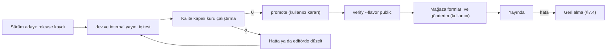

# Yayın süreci

> **Sürüm:** 1.6 · **Tarih:** 9 Kasım 2026 · **Durum:** Taslak
> **Bağlı kararlar:** [K-46](../00-ozet/02-karar-defteri.md#k-46--yayın-kaydı-içerik-özetleri-ve-fikstürler) · [K-45](../00-ozet/02-karar-defteri.md#k-45--manifest-imzası-ve-kanonik-json) · [K-42](../00-ozet/02-karar-defteri.md#k-42--kaynak-ilkesi-ve-kalite-temelli-görünürlük) · [K-41](../00-ozet/02-karar-defteri.md#k-41--ses-sistemi-hazır-kayıtlar-ayna-ve-çevrimiçi-öncelikli-dinleme) · [K-21](../00-ozet/02-karar-defteri.md#k-21--i̇çerik-dağıtımı) · [K-27](../00-ozet/02-karar-defteri.md#k-27--tek-bağlantı-tablosu) · [K-38](../00-ozet/02-karar-defteri.md#k-38--kaynak-edinimi-dijital-öncelikli-kanıtla-yükseltme) · [K-25](../00-ozet/02-karar-defteri.md#k-25--i̇lkeler) · [K-19](../00-ozet/02-karar-defteri.md#k-19--kuran-kelime-anlamları) · [K-39](../00-ozet/02-karar-defteri.md#k-39--tanzil-alımı-simple-cleanin-yeri-kanonik-kaynakta-hat-yazma-kuralı-kilit)

Bu dosya `Mutalaa.Publisher` içindeki kalite kapısını, derleme türlerini ve görünürlük kurallarını, **Kaynaklar** ekranını ve yayın adımlarını (iç test, `promote`, mağaza formları, geri alma) tanımlar. Görünürlük editoryal kaliteye bağlıdır: onaylı içerik her derlemeye girer, onaysız birim ve yapay zekâ taslağı yalnız iç derlemelere "doğrulanmamış" işaretiyle girer ([K-42](../00-ozet/02-karar-defteri.md#k-42--kaynak-ilkesi-ve-kalite-temelli-görünürlük) madde 5).

## 1. Akış

İçerik hattı birimleri PostgreSQL'e `aday` olarak yazar; editör onayıyla `onayli` olur. Yayınlayıcı sırayla şunları yapar: kilit, tek tutarlı anlık görüntü, kalite kapısı, paket özeti (`content_digest`), SQLite + FTS5 paketi, sha256, imzalı manifest ve depoya yükleme (paketler, sonra manifest geçmişi, en son `manifest.json`). Adımların ayrıntısı [Backend API](../02-mimari/05-backend-api.md) §10.2'dedir. Bu dosya kapının kurallarını (§4), derleme türlerini (§3), Kaynaklar ekranını (§6) ve yayın adımlarını (§7) tutar.

## 2. Kapının girdileri

### 2.1 Kaynak kaydı ve atıf

Her içerik kaynağının bir kaydı vardır: `pipeline/sources/{kimlik}.toml` dosyası ve `source` tablosundaki satırı ([Kaynaklar](../04-icerik/01-kaynaklar.md); [Editoryal veritabanı](../03-veri/02-editoryal-veritabani.md)). Kayıt kaynağın adını, adresini, sürümünü, atıf satırını (`atif_metni`, `atif_url`) ve kaynağın kendi bildirimini (`notice_text`, bayt bayt) taşır ([K-42](../00-ozet/02-karar-defteri.md#k-42--kaynak-ilkesi-ve-kalite-temelli-görünürlük) madde 4). İndirilen dosyanın özeti `data/gelen/<kaynak>/<YYYY-AA-GG>/SHA256SUMS` dosyasındadır; `export pg` tek dosyalı kaynakta onu `source.dosya_sha256` ve `source.alinma_tarihi` sütunlarına yazar. Kaydı olmayan içerik hiçbir pakete girmez (P-01). İçerik hattının G-KAY kapısı kaydın geçerli olmasını, `atif_metni`'nin dolu olmasını ve kanonik kaynakta `notice_text`'in kaynağın kendi bildirimiyle bayt bayt aynı olmasını denetler ([İçerik hattı](../04-icerik/02-icerik-hatti.md)). Yayınlayıcı atıf alanlarını pakete aynen yazar (P-11); Ayarlar › Kaynaklar ekranı onları gösterir (§6).

### 2.2 İçerik özeti

İki özet vardır ([K-46](../00-ozet/02-karar-defteri.md#k-46--yayın-kaydı-içerik-özetleri-ve-fikstürler) madde 1). **Kaynak özeti** editoryal veritabanındaki tanımı izler: kaynağın etkin birimleri `anchor` sırasıyla (`COLLATE "C"`) dizilir, her satır için `anchor + "\t" + content_hash + "\n"` yazılır, özet bu dizginin SHA-256'sıdır; birimi olmayan kaynakta (`tanzil-ust-veri`) yapı satırları kanonik JSON satırı olarak yazılır; ses ve fontta dosya yolu ve dosya özeti kullanılır. Derleme türünden bağımsızdır ve `release.ozetler.kaynaklar` içinde durur ([Editoryal veritabanı](../03-veri/02-editoryal-veritabani.md) §10). `promote` ile `public`'e geçen yayında kaynak özetleri iç kanalda test edilen yayınla aynıdır (P-14). **Paket özeti** (`pack_meta.content_digest`, `release.ozetler.paketler`) pakete yazılan her satırın RFC 8785 JSON dizisinden ve `schema_version`, `normalizer_version` ve `flavor` başlık satırlarından hesaplanır ([İçerik paketleri](../03-veri/03-icerik-paketleri.md) §6); `version`, `built_at`, `data_version` ve `content_digest` özete girmez. Özeti güncel yayınla aynı olan paket yeni sürüm almaz, önceki sürüm manifestte kalır. SQLite dosyasının özeti indeks yeniden üretildiğinde içerik değişmeden de değişebilir; bu yüzden karşılaştırmada kullanılmaz.

### 2.3 Birimin, paketin ve bağlantının durumu

Birimin görünürlüğü onay durumundan gelir. `metin_durumu = onayli` birim her derlemeye girer. `taslak` ve `incelemede` birim ile onaysız yapay zekâ taslağı `public`'e girmez, iç derlemelere "doğrulanmamış" rozetiyle girer (P-08, P-10). Hazır ve çıkarılmış metinler `taslak` girer (`onayli` ile giriş yalnız Tanzil gibi kanonik başvuru kaynakları içindir); editör onayından, meal ve tefsirde ikinci onaydan geçmeden `public`'e girmezler ([K-38](../00-ozet/02-karar-defteri.md#k-38--kaynak-edinimi-dijital-öncelikli-kanıtla-yükseltme) madde 4).

`xref` satırı kendi `status` değerini taşır ([K-27](../00-ozet/02-karar-defteri.md#k-27--tek-bağlantı-tablosu)): `onayli` her derlemeye girer, `red` hiçbir pakete girmez. `aday` satır türe göre ayrılır: insan onayı isteyen türde (`atif`, `iktibas`, `ima`, `konu`) yalnız `dev` ve `internal`'a girer; otomatik türlerde (`kok`, `lemma`, `benzer_ayet`, `anlamsal`) `confidence ≥ 0,50` ile her derlemeye girer, `< 0,50` hiçbir derlemeye girmez ([Bağlantı modeli](../05-capraz-referans/01-baglanti-modeli.md#8-yayın-kuralı-ve-insan-onayı) §8). Yayınlayıcı bağlantıyı ayrıca iki koşul birlikte sağlanırsa pakete koyar: kaynak çapanın eseri o derlemede görünür; hedef çapanın eseri görünür ya da bağlantı [Kaynaklar](../04-icerik/01-kaynaklar.md) belgesinde ayrı kaydı olan bir dizine aittir (P-07). Ayrı kayıt kuralı Risale atıf dizini içindir (`risale-atif-dizini`); hedef böyle bir dizindeyse hedefin görünürlüğü aranmaz. `public` için üç ek koşul vardır: bağlantıda açık `review` yoktur; `kok` ve `lemma` için `evidence.lexicon_status` onaylıdır (alan yoksa onaylı sayılır); `anlamsal` v1'de girmez. Pakette `xref_idx.approved` = (`status = onayli`) ve `folded` = `anlamsal` ya da (otomatik tür, onaysız ve `confidence < 0,70`) olarak önceden hesaplanır. Paketteki `unit.approved` birimin `metin_durumu = onayli` olup olmadığını taşır ve "doğrulanmamış" rozetinin kaynağıdır ([İçerik paketleri](../03-veri/03-icerik-paketleri.md) §3.2).

## 3. Derleme türleri ve görünürlük

Görünürlük editoryal kaliteye bağlıdır ([K-42](../00-ozet/02-karar-defteri.md#k-42--kaynak-ilkesi-ve-kalite-temelli-görünürlük) madde 5). Süzme kaynak ve birim düzeyinde yapılır; aynı paket kimliği derleme türüne göre farklı içerik taşıyabilir. Derleme türü (`BuildFlavor`) `Mutalaa.Domain/Releases` altındadır.

| İçerik | `dev` (ekip) | `internal` (davetli test) | `public` (mağaza) |
|---|---|---|---|
| Onaylı birim, onaylı bağlantı | var | var | var |
| Onaysız birim, onaysız yapay zekâ taslağı | "doğrulanmamış" rozetiyle | "doğrulanmamış" rozetiyle | yok |
| Aday bağlantı (onay isteyen tür) | var | var | yok |
| `red` bağlantı | yok | yok | yok |
| `test-` önekli kaynak | var | yalnız uçtan uca fikstürler (`test-kucuk`, `test-ses`) | yok |

İnsan onayı isteyen türler `atif`, `iktibas`, `ima` ve `konu`dur. Otomatik bağlantı türleri (`kok`, `lemma`, `benzer_ayet`, `anlamsal`) `confidence ≥ 0,50` eşiğiyle `public`'e de girer ([Bağlantı modeli](../05-capraz-referans/01-baglanti-modeli.md#8-yayın-kuralı-ve-insan-onayı) §8).

`dev` derleme yalnız ekibe gider ve yerel depodan beslenir; yerel depo SeaweedFS'in S3 arayüzüdür ([K-21](../00-ozet/02-karar-defteri.md#k-21--i̇çerik-dağıtımı)). `internal` derleme EAS iç dağıtımla davetli test kullanıcılarına gider; onaysız birimler orada "doğrulanmamış" rozetiyle, onay isteyen türdeki aday bağlantılar `approved = 0` ile görünür ([İçerik paketleri](../03-veri/03-icerik-paketleri.md) §7). `public` derleme mağazalara gider ve yalnız onaylı birim taşır; bağlantılarda yukarıdaki kural geçerlidir. EAS profilleri [Mobil mimari](../06-mobil/01-mobil-mimari.md) dosyasının 10. bölümündedir: `development`, `internal` ve `production` profilleri `APP_FLAVOR` ile `dev`, `internal` ve `public` türünü taşır. Her profilin ayrı güncelleme kanalı ve manifest adresi (`internal/manifest.json`, `public/manifest.json`) vardır; bir JS güncellemesi türler arasında geçemez. Manifest her derleme türünde imzalıdır (§4.2).

## 4. Yayınlayıcı kalite kapısı kuralları

1. `release` kaydını ve `source` tablosunu okur.
2. Her paket adayını ve kaynağı aşağıdaki kurallara göre değerlendirir. Önceki yayının paketlerindeki her çapanın anlık görüntüde bulunduğunu, etkin ya da yönlendirmeli (`successors` dolu) olduğunu da doğrular ([Çapa şeması](../03-veri/01-capa-semasi.md) §6); bulunmazsa yayın reddedilir (kural kodu yoktur).
3. Kapıdan geçen paketi SQLite olarak üretir; içine `pack_meta` (kimlik, sürüm, derleme türü, `content_digest`), `pack_source` (`source_id`) ve `attribution` (kaynak kaydındaki atıf alanları, aynen) yazar. Paket dosyası böylece manifestten bağımsız denetlenir.
4. `xref` satırlarını §2.3'teki koşullarla süzer.
5. Manifesti yazar, imzalar (§4.2) ve derleme türünün önekine yükler.
6. Giren ve girmeyen her paketi gerekçesiyle listeleyen kapı raporunu (JSON) `release` kaydına bağlar.

| Kod | Kural | Derleme |
|---|---|---|
| P-01 | Kaynak kaydı olmayan içerik hiçbir pakete girmez | Hepsi |
| P-07 | Bağlantı: kaynak eser görünür; hedef eser görünür ya da ayrı kayıtlı bir dizine ait; `red` hiç girmez; insan onayı isteyen türün (`atif`, `iktibas`, `ima`, `konu`) `aday` satırı yalnız `dev` ve `internal`'a girer, otomatik türler (`kok`, `lemma`, `benzer_ayet`, `anlamsal`) `confidence ≥ 0,50` ile her derlemeye girer; `public` için ek koşullar §2.3'tedir | Hepsi |
| P-08 | Onaysız yapay zekâ taslağı `public`'e girmez; iç derlemelere "doğrulanmamış" işaretiyle girer | public |
| P-09 | `quran_word_fix`, `tr_root_index` ve `tr_form` satırlarından yalnız onaylılar uygulanır | Hepsi |
| P-10 | Yalnız `metin_durumu = onayli` birimler `public`'e girer | public |
| P-11 | Tanzil birimlerinin `content_hash` değeri ham dosyadan yeniden hesaplananla aynı; her kaynağın `atif_metni` ve `atif_url` değeri pakete aynen yazılır | Hepsi |
| P-12 | Slug'ı `test-` ile başlayan kaynak `public`'e girmez; `internal`'a yalnız uçtan uca fikstürler (`test-kucuk`, `test-ses`) girer | public, internal |
| P-13 | `depends_on` döngüsüz; her bağımlılık aynı manifestte | Hepsi |
| P-14 | Terfide içerik özetleri iç kanalda test edilen yayınla aynı | public |

Kural kodları sabittir; yeniden numaralanmaz. Kapı raporu her paket ve kaynak için "girdi" ya da "girmedi" kararını kural koduyla yazar. `public` kuru çalıştırması (`publish --flavor public --dry-run`) 0 ile biter; kuru çalıştırma `release` satırı yazmaz, raporu stdout'a ve `data/reports/publisher/` altına yazar.

**Kapı sonuç türleri** ([K-46](../00-ozet/02-karar-defteri.md#k-46--yayın-kaydı-içerik-özetleri-ve-fikstürler) madde 7):

| Tür | Kurallar | Sonuç |
|---|---|---|
| Süzme | P-07, P-08, P-09, P-10, P-12 | İçerik pakete alınmaz, rapora "girmedi" ve kural kodu yazılır; derleme sürer |
| Bütünlük | P-01, P-11, P-13, P-14 (ve çapa sürekliliği) | Yayın reddedilir; satır `basarisiz` olur, çıkış kodu `2` |

- P-08, P-10'dan önce gelir: yapay zekâ taslağı P-08 koduyla girmez.
- P-09 yalnız durum sütunu olan tablolara uygulanır (`quran_word_fix`, `lemma_gloss`: yalnız `onayli` satır). Durum sütunu olmayan `tr_root_index` ve `tr_form` yalnız onaylı veri taşır; bağlı Türkçe lemma onaylıysa girer.
- P-01 kaynak kayıt dosyasının (`pipeline/sources/{slug}.toml`), `source` satırının ve dolu `atif_metni` değerinin varlığına bakar. P-11 Tanzil `content_hash` değerini ham dosyadan yeniden hesaplar, `notice_text` değerini ham bildirim bloğuyla bayt bayt karşılaştırır ve pakete yazılan `attribution` satırının `source` satırıyla aynı olduğunu paketten geri okuyarak doğrular. P-13 önceki sürümden taşınan paketleri de sayar.
- Verisi hiç olmayan paket (`kelime-kok`, QAC gelene kadar) aday sayılmaz; rapora kural kodu olmadan "girmedi · icerik-yok" yazılır ve kapı reddetmez.
- `BuildFlavor` ayrıştırılamazsa kapı `public` gibi davranır. Kapı bir yayını reddederse Yayınlayıcı `2` çıkış koduyla biter ve manifest yayımlanmaz ([Backend API](../02-mimari/05-backend-api.md) §10.1, §10.3).

### 4.1 Manifest girişi

```json
{
  "pack_id": "core", "version": "2026.11.0", "sha256": "<dosya özeti>", "size_bytes": 0,
  "min_app_version": "1.0.0", "depends_on": [],
  "url": "<PublicBaseUrl>/packs/public/core/2026.11.0/core-2026.11.0.db",
  "schema_version": 1, "title": "Kur'an ve Elmalılı meali", "bundled": true
}
```

Paket sürümü CalVer `YYYY.M.N` biçimindedir; `min_app_version` uygulamanın sürümüdür. Kaynak ve atıf bilgisi manifestte değil, paketin `pack_source` ve `attribution` tablolarında durur; içerik özeti paketin `pack_meta.content_digest` alanındadır. Manifest düzeyindeki alanlar (`signature` dahil) ve kesin biçim [İçerik paketleri](../03-veri/03-icerik-paketleri.md) §5'tedir.

### 4.2 Manifest imzası

- Yayınlayıcı her derleme türünün manifestini imzalar. İmza ayrı bir dosyada değil, manifestin içinde, manifest düzeyindeki `signature: {alg, kid, value}` alanında durur ([K-21](../00-ozet/02-karar-defteri.md#k-21--i̇çerik-dağıtımı); [İçerik paketleri](../03-veri/03-icerik-paketleri.md) §5, [Backend API](../02-mimari/05-backend-api.md) §10.5). Algoritma Ed25519'dur (`NSec.Cryptography` 26.4.0); imza girdisi, `signature` alanı çıkarılmış manifestin RFC 8785 (JCS) baytlarıdır (`MackySoft.Json.Canonicalization` 0.1.0). `kid` `{derleme}-{YYYY}-{n}` biçimindedir; `value` 64 baytın base64'üdür ([K-45](../00-ozet/02-karar-defteri.md#k-45--manifest-imzası-ve-kanonik-json)).
- Özel anahtar (32 baytlık tohum) depoda ve CI günlüklerinde bulunmaz; yalnız `dotnet user-secrets` ya da konteyner ortam değişkeninde durur. Her derleme türünün (`dev`, `internal`, `public`) anahtarı ayrıdır. Depodaki imzalı örnek manifestler RFC 8032 §7.1 TEST 1 test anahtarıyla imzalanır (`kid` `test-` ile başlar; anahtar herkese açıktır ve gizli değildir).
- Açık anahtar uygulama ikilisine gömülür; `kid` anahtar değişimini sağlar, uygulama geçerli ve sıradaki iki anahtarı taşır (öneri).
- İmza her derleme türünde zorunludur. Yayınlayıcı imzasız manifest yayımlamaz, `verify` onu reddeder. Uygulama hiçbir derlemede imzasız ya da imzası doğrulanmayan manifesti okumaz; son geçerli manifestle ve kurulu paketlerle çalışmayı sürdürür. `public` derlemede bu kural gevşetilmez. `dev` manifesti de yerel Yayınlayıcı'nın `dev` anahtarıyla imzalanır (`keys generate --flavor dev`).

### 4.3 Uygulamadaki ikinci kontrol

Uygulama kapıyı ikinci kez uygular. Manifest paket satırı kaynak bilgisi taşımadığı için kontrol, indirilen paket dosyasının kendi üst verisiyle yapılır: `pack_meta.flavor` uygulamanın derleme türüyle aynı olmalıdır; `dev` dışındaki derlemelerde `pack_source` içinde `test-` önekli kaynak bulunan paket açılmaz, `internal`'da yalnız `test-kucuk` ve `test-ses` bu kuralın dışındadır (P-12). Birimin onay durumu paket üretilirken Yayınlayıcı'da uygulanır (P-08, P-10). Manifest imzası her derlemede doğrulanır (§4.2). Bu kurallar [Mobil mimari](../06-mobil/01-mobil-mimari.md) §10'daki `isPackVisible` işlevinde uygulanır.

## 5. "Public derleme onaysız birim, yapay zekâ taslağı, onay isteyen türde aday bağlantı ve test- kaynağı içermez" testi

Test her public sürümde zorunludur ve üç katmanda çalışır:

1. **Birim (xUnit).** Görünürlük matrisinin her hücresi (derleme türü × içerik); P-01 ve P-07…P-14 kurallarının her biri için geçen ve kalan fikstür; onaylı ve onaysız birim; yapay zekâ taslağı; onaylı bağlantı, onay isteyen türde ve otomatik türde (`confidence` eşiğinin altı ve üstü) aday bağlantı, `red` bağlantı; kaynak kaydı olmayan paket; `test-` önekli kaynağın `internal` ve `public` davranışı.
2. **Bütünleşik.** Her durumdan birer örnek taşıyan fikstür veritabanından üç derleme üretilir. `public` çıktısında onaysız birim, yapay zekâ taslağı, onay isteyen türde aday bağlantı ve `test-` önekli kaynak bulunmaz; `internal` çıktısında `test-` önekli kaynak olarak yalnız `test-kucuk` ve `test-ses` bulunur. İmzasız ve bozuk imzalı manifest her derlemede reddedilir.
3. **Yapıt taraması (CI).** Public manifest, imzası, public önekteki bütün nesneler ve gömülü `core` paketi açılır. Her paketin `pack_meta.flavor` değeri `public` olmalı; her `pack_source` kaydı bir kaynak kaydına denk gelmeli ve `test-` ile başlamamalı; terfide içerik özetleri iç kanalda test edilen yayınla aynı olmalı (P-14); manifestte olmayan nesne bulunmamalı. Adım Yayınlayıcı'nın `verify --flavor public --embedded-core <yol>` alt komutuyla çalışır; aynı tarama `internal` manifestinde de koşar.

Birim testleri `[Theory]` ile derleme türü × içerik matrisinin her hücresini doğrular; örneğin `BuildFlavor.Public` için onaysız birim, yapay zekâ taslağı, onay isteyen türde aday bağlantı ve `test-` önekli kaynak reddedilir. Test planının tamamı [Test stratejisi](./03-test-stratejisi.md) dosyasındadır.

## 6. Kaynaklar ekranı

Ayarlar › Kaynaklar çevrimdışı açılır ve iki bölüm gösterir ([Mobil mimari](../06-mobil/01-mobil-mimari.md) §4).

**İçerik kaynakları.** Her içerik kaynağını (ad, sürüm, atıf satırı, kaynak bağlantısı, varsa kaynağın kendi bildirimi), fontları, ses kayıtlarını (okuyucu, dosya kaynağı, zamanlama kaynağı) ve yapay zekâ taslağıyla hazırlanıp insan onayından geçen içerik notunu ([K-19](../00-ozet/02-karar-defteri.md#k-19--kuran-kelime-anlamları)) listeler. Veri koddan gelmez: Yayınlayıcı kaynak kaydındaki `atif_metni`, `atif_url` ve `notice_text` alanlarından her pakete bir `attribution` tablosu yazar (`source_id`, `title`, `version`, `source_url`, `required_credit`, `notice_text`; [İçerik paketleri](../03-veri/03-icerik-paketleri.md) §3.1). Ekran `core` ile kurulu paketlerin tablolarını birleştirir. Atıf değişirse paket sürümü artar.

| Kaynak | Ekranda gösterilen | Kayıt ya da bağlantı |
|---|---|---|
| Tanzil metni (Uthmani, Simple Clean) | "Tanzil Project" atfı, tanzil.net bağlantısı, Tanzil'in kendi bildirimi (`notice_text`, bayt bayt) | `tanzil-uthmani`, `tanzil-simple-clean`; [Tanzil indirme sayfası](https://tanzil.net/download/) |
| Elmalılı meali (kendi düzeltilmiş metnimiz) | Künye, kaynak baskı ve yöntem: OCR ve düzeltme ya da belgelenmiş hazır metnin özgün baskıyla karşılaştırılıp düzeltilmesi ([K-38](../00-ozet/02-karar-defteri.md#k-38--kaynak-edinimi-dijital-öncelikli-kanıtla-yükseltme)) | `elmalili-meal` |
| QPC sayfa yazı tipleri ve düzen verisi (Mushaf A) | Kaynak adı ve bağlantısı, atıf satırı | `qpc-v1-font`, `qpc-v2-font`, `qpc-v4-font`, `medine-604-duzen` |
| QAC morfolojisi (`kelime-kok` paketi) | Atıf ve corpus.quran.com bağlantısı | `qac-morfoloji`; [QAC indirme](https://corpus.quran.com/download/) |
| Mushaf C yazı tipleri (KFGQPC Hafs, Amiri Quran) | Yazı tipi adı, sürüm, kaynak bağlantısı | `kfgqpc-hafs-font`, `amiri-quran-font` |
| Arayüz yazı tipleri | Literata, Noto Naskh Arabic, IBM Plex Sans ve Amiri: yazı tipi adı, sürüm, kaynak bağlantısı | [google/fonts](https://github.com/google/fonts/tree/main/ofl/amiriquran) |
| Ses kayıtları | Okuyucu adı, dosya kaynağı (MP3Quran, Tarteel CDN) ve zamanlama kaynağı (QUD) atfı; dosyalar kendi aynamızdan çalar ([K-41](../00-ozet/02-karar-defteri.md#k-41--ses-sistemi-hazır-kayıtlar-ayna-ve-çevrimiçi-öncelikli-dinleme)) | Kayıtlar A27'de açılır; [Ses kaynağı araştırması](../06-mobil/04-ses-kaynak-arastirmasi.md) |

**Açık kaynak yazılım.** Derlemede `scripts/ci/list-licenses.mjs --json` çıktısından üretilen bağımlılık listesi (paket adı, sürüm, paketin bildirdiği lisans) gösterilir. CI bağımlılıkları yalnız listeler; hiçbir lisans derlemeyi durdurmaz ([K-42](../00-ozet/02-karar-defteri.md#k-42--kaynak-ilkesi-ve-kalite-temelli-görünürlük) madde 6; [Teknoloji yığını](../02-mimari/02-teknoloji-yigini.md#3-kitaplık-notları-ve-bağımlılık-listesi) §3).

## 7. Yayın adımları

`public` derleme, iç testte sınanmış yayının terfisidir. Mağaza hesapları, mağaza konsollarındaki form girişi ve mağazaya gönderim (`eas submit`) kullanıcı işidir (İ-15); Claude Code içeriği, komutları ve kontrol listelerini hazırlar. İç test A33'te, mağaza hazırlığı A34'te yürür ([Aşama haritası](../10-claude-code/04-asama-haritasi.md)).

### 7.1 Adımlar



1. **Sürüm adayı.** Yayınlayıcı bir `release` kaydı açar (sürüm verilmezse `YYYY.M.N` olarak atanır; [Backend API](../02-mimari/05-backend-api.md) §10.5) ve paketleri tek bir tutarlı anlık görüntüden üretir. `public` içeriği yalnız onaylı birimlerden oluşur (P-10).
2. **İç test.** `dev` ve `internal` yayınlanır (`publish --flavor dev`, `publish --flavor internal`); `internal` EAS iç dağıtımla davetli test kullanıcılarına gider. Maestro akışları, performans ve erişilebilirlik ölçümleri bu derlemede koşar ([Test stratejisi](./03-test-stratejisi.md) §9–§11).
3. **Kuru çalıştırma.** `publish --flavor public --dry-run` 0 ile bitmelidir. Kapı reddederse kapı raporu nedeni kural koduyla yazar; düzeltme hattan ya da editör panelinden geçer ve iç test yinelenir. Elle düzeltme yapılmaz; içerik hattından geçer, testler çalışır, yeni içerik özeti üretilir.
4. **Terfi.** `promote --surum <s> --to public` `yayinlandi` durumundaki `internal` yayını `public` için üretir ve yükler (`release.talep = terfi`, `kaynak_release_id`); yalnız kullanıcı kararıyla çalışır. P-14 kaynak özetlerini karşılaştırır. Ardından `verify --flavor public --embedded-core <yol>` her public sürümde zorunludur; yapıt taraması (§5) yeşil olmalıdır.
5. **Mağaza hazırlığı.** Uygulama mağazaya gömülü `core` paketiyle çıkar (EAS derlemesi); içerik güncellemeleri `public` manifestle gelir. Formlar, gizlilik sayfası ve mağaza metni §7.2'ye göre hazırlanır.

`public` derleme bütün ülkelerde ve vitrinlerde aynı kapıdan geçer; ülkeye göre ayrı paket ya da manifest yoktur.

### 7.2 Mağaza formları ve gizlilik sayfası

Mağazaların teknik yayın şartları şunlardır: App Privacy ve Veri güvenliği formları ([Gizlilik](./02-gizlilik.md) §2.6), erişilebilir bir gizlilik politikası sayfası (metin: [Gizlilik](./02-gizlilik.md) §2.5; sayfa için alan adı: S-08, İ-18), hesap açılan sürümde uygulama içi hesap silme ve Google Play için silme bağlantısı ([Gizlilik](./02-gizlilik.md) §3.6) ve asgari sürüm bilgisi (iOS 16.4; R-11). Mağaza metni ertelenmiş özellikleri vaat etmez ve resmî kurum çağrışımı taşımaz (R-12). Beyanlar her sürümde uygulamanın gerçek davranışıyla karşılaştırılır. Form girişi ve gönderim kullanıcı işidir (İ-15); hata raporlama ayarlarını (IP saklamanın kapatılması) kullanıcı yapar (İ-27) ve beyanlar bu ayarla uyumlu olmalıdır.

### 7.3 Değişiklik yönetimi

| Değişiklik | Yol |
|---|---|
| Kur'an metni (Tanzil güncellemesi dahil), meal düzeltmesi, ses kaydı, font sürümü, sayfa düzeni verisi, ses kodlaması | Hattan geçer; birimin `content_hash` ve paketin `content_digest` değeri değişir; yeni paket sürümü iç kanalda sınanır, `promote` ile `public`'e geçer |
| Arayüz ve hata düzeltmeleri (içeriğe dokunmayan) | EAS Update (yalnız JavaScript); içerik özetini değiştirmez |

- Kanonik metin hiçbir yerde elle düzeltilmez. Yeni Tanzil sürümü kilit dosyası güncellenerek ve `/karar` ile alınır ([K-39](../00-ozet/02-karar-defteri.md#k-39--tanzil-alımı-simple-cleanin-yeri-kanonik-kaynakta-hat-yazma-kuralı-kilit) madde 4).
- Kullanıcı yayınlanmış sürümde kalır. EAS Update içerik taşımaz; içerik yalnız paketle gelir. Gömülü `core` EAS Update ile değişmez; yeni içerik yeni ikiliyle ya da imzalı manifestle gelir.
- Düzeltmeler biriktirilip tek bir yayın olarak terfi edebilir; aynı yol her düzeltme için geçerlidir.

### 7.4 Geri alma

- JavaScript hatası: EAS Update ile önceki sürüme dönülür.
- İçerik hatası: `rollback --flavor <f> --to <surum>` yeni bir `release` satırı açar (`talep = geri_alma`), önceki yayının paketlerini yeni sürümle imzalı bir manifestte yayımlar ve uygulama ona iner ([İçerik paketleri](../03-veri/03-icerik-paketleri.md) §6). Düzeltme hattan geçer ve yeni sürümle yayımlanır.
- Gömülü `core` hatası: yeni uygulama sürümü.

## İlgili dosyalar

- [Gizlilik](./02-gizlilik.md) · [Test stratejisi](./03-test-stratejisi.md)
- [Kaynaklar](../04-icerik/01-kaynaklar.md) · [İçerik hattı](../04-icerik/02-icerik-hatti.md) · [Elmalılı hazırlığı](../04-icerik/03-elmalili-hazirligi.md)
- [Çapa şeması](../03-veri/01-capa-semasi.md) · [Editoryal veritabanı](../03-veri/02-editoryal-veritabani.md) · [İçerik paketleri](../03-veri/03-icerik-paketleri.md)
- [Bağlantı modeli](../05-capraz-referans/01-baglanti-modeli.md) · [Kök ve lemma](../05-capraz-referans/03-kok-ve-lemma.md)
- [Mobil mimari](../06-mobil/01-mobil-mimari.md) · [Depolama yöneticisi](../06-mobil/03-depolama-yoneticisi.md) · [Genel mimari](../02-mimari/01-genel-mimari.md) · [Backend API](../02-mimari/05-backend-api.md)
- [Fazlar](../08-yol-haritasi/01-fazlar.md) · [Sonra yapılacaklar](../08-yol-haritasi/02-sonra-yapilacaklar.md) · [Riskler](../08-yol-haritasi/03-riskler.md) · [Kaynakça](../09-kaynakca.md)
