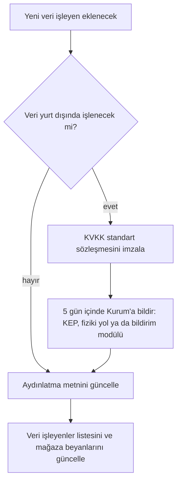

# KVKK ve gizlilik

> **Sürüm:** 1.1 · **Tarih:** 19 Ekim 2026 · **Durum:** Taslak
> **Bağlı kararlar:** [K-15](../00-ozet/02-karar-defteri.md#k-15--hesap-ve-senkron-v1xte) · [K-16](../00-ozet/02-karar-defteri.md#k-16--senkron-çakışma-çözümü) · [K-20](../00-ozet/02-karar-defteri.md#k-20--barındırma) · [K-25](../00-ozet/02-karar-defteri.md#k-25--i̇lkeler)

> **Hukuki görüş değildir.** KVKK bulguları araştırma raporundan ve raporun dayandığı hukuk bürosu ve danışmanlık özetlerinden gelir. v1 mağazaya çıkmadan ve v1.x'te hesap açılmadan önce bir avukat bu dosyayı inceler.

## 1. Özet

| | v1 (hesapsız) | v1.x (hesaplı) |
|---|---|---|
| Kullanıcı verisi | Yalnız cihazda | Cihazda ve senkron sunucusunda |
| Sunucuya giden kişisel veri | Yok; hata raporu kişisel veri içermez | E-posta ya da giriş kimliği, kullanıcının kendi kayıtları |
| Yurt dışına aktarım | Hata raporu ve içerik indirme için Açık soru | Her yurt dışı veri işleyen için standart sözleşme ve bildirim |
| Reklam ve izleme | Yok ([K-25](../00-ozet/02-karar-defteri.md#k-25--i̇lkeler)) | Yok |
| Bilgilendirme | Gizlilik metni | Hesap açılmadan önce aydınlatma metni |
| Silme | Verilerimi sil ya da uygulamayı silmek | Hesabımı sil |

Rapor en ucuz önlemi veriyi en aza indirmek olarak koyuyor: hesapsız yerel kullanım varsayılan, hesapta yalnız e-posta ve kullanıcının notları, analitikte kişisel veri yok. Eski plandaki KVKK, aydınlatma metni ve hesap silme tasarımı korunur; tek sağlayıcılı sözleşme yaklaşımı her veri işleyeni kapsayacak şekilde genişletilir (`quran-app-docs/09-guvenlik/01-kvkk-uyumluluk.md`). Eski dosyadaki Azure, yapay zekâ sorgu kaydı ve çocuk modu maddeleri geçersizdir ([K-30](../00-ozet/02-karar-defteri.md#k-30--eski-plandan-çıkarılanlar)).

## 2. v1: hesapsız sürüm

### 2.1 Veri envanteri

| Veri | Yer | Cihazdan çıkar mı |
|---|---|---|
| `bookmark`, `highlight`, `note`, `collection` | Cihazdaki kullanıcı veritabanı (expo-sqlite) | Hayır |
| `reading_position`, `hatim`, `hatim_page` | Aynı | Hayır; ilerleme varsayılan olarak gizli |
| `setting`, hafif tercihler | Kullanıcı veritabanı, MMKV | Hayır |
| Son aramalar | Cihazda | Hayır; sunucuya gönderilmez. v1 özelliğidir ([Kapsam §4.7](../01-urun/01-kapsam-ve-fazlar.md#47-arama)). "Verilerimi sil" ve uygulamayı silmek onları da siler (§2.7); Ara ekranındaki ayrı silme düğmesinin yeri Mobil ekranlar'da henüz tanımlı değil (A28) |
| İndirilen paketler ve ses | Uygulama dizini | Hayır; Ayarlar › Depolama'dan silinir ([K-18](../00-ozet/02-karar-defteri.md#k-18--depolama-yöneticisi-v1de)) |
| Paket ve ses indirme istekleri | İçerik deposu ve CDN | İstek IP adresini ve cihaz bilgisini sağlayıcıya ulaştırır (§2.4) |
| Çökme raporu | Hata raporlama servisi (Sentry) | Evet, kişisel veri ayıklanmış olarak (§2.2) |

Kullanıcı veritabanı v1'den itibaren senkrona hazır şemayla kurulur ([K-15](../00-ozet/02-karar-defteri.md#k-15--hesap-ve-senkron-v1xte)). Bu, v1'de hiçbir kaydın cihazdan çıkmasını gerektirmez. Öneri: kullanıcının notları kaybolmasın diye kullanıcı veritabanı işletim sisteminin cihaz yedeğine açık kalır, paketler ve ses boyut nedeniyle yedekten hariç tutulur. Expo yapılandırma ayrıntısı Doğrulanacak.

### 2.2 Kişisel veri içermeyen hata raporu

1. Kullanıcı kimliği, e-posta ya da kalıcı cihaz kimliği gönderilmez.
2. Not metni, vurgulanan metin, arama sorgusu ve okunan yer olaya ve iz kayıtlarına (breadcrumb) girmez.
3. Servis tarafında IP adresi saklama kapatılır. Proje ayarındaki seçeneğin adı Doğrulanacak.
4. Olayın ortam etiketi derleme türüdür (`internal`, `public`); ekip içi `dev` derlemede hata raporlama başlatılmaz.
5. Ayarlar › İlerleme ve gizlilik'te "Hata raporlarını gönder" anahtarı bulunur ([Mobil ekranlar §6](../01-urun/03-mobil-ekranlar.md#6-ayarlar-ağacı)). Varsayılan değeri Açık soru; öneri açık, gizlilik metninde yazılı ve tek dokunuşla kapanabilir.
6. Servisin veri bölgesi Doğrulanacak.

Uygulama kodu [Mobil mimari §12](../06-mobil/01-mobil-mimari.md#12-hata-izleme-sentry-ve-gizlilik) dosyasındadır (`src/lib/telemetry.ts`); bu belge ilkeyi tutar. `sendDefaultPii` kapalıdır; ekran görüntüsü, görünüm hiyerarşisi ve oturum tekrarı eklenmez. `beforeSend` kullanıcı, sunucu adı ve cihaz adı alanlarını siler; `extra` içinde yalnız teknik alanlar (`errorKind`, `packId`, `packVersion`) kalır, serbest metin taşıyabilecek her alan düşer. Girdi, konsol ve dokunuş kırıntıları atılır; gezinme ve ağ kırıntılarından parametreler çıkarılır. Bu teknik alanlar kişisel veri değildir; kullanıcıyı tanımlayan hiçbir alan gönderilmez.

Ayıklama kuralları birim testiyle kilitlenir: fikstür bir olay içine not metni konur, `beforeSend` sonrasında bulunmamalıdır ([Test stratejisi](./03-test-stratejisi.md)).

### 2.3 Reklam, izleme ve analitik

- Reklam yok ([K-25](../00-ozet/02-karar-defteri.md#k-25--i̇lkeler)). Rapor bu kategoride reklamı itibar riski olarak görüyor; örnek Muslim Pro'nun yoğun reklam geçmişi ve 2020'deki konum verisi paylaşımı tartışması ([Islamtics](https://islamtics.com/?p=21176)).
- v1'de üçüncü taraf analitik ya da izleme SDK'sı yoktur. Kullanım sayıları mağaza konsollarının toplu verisinden okunur.
- Uygulama izleme yapmadığı için App Tracking Transparency izni istenmez.
- CI'daki bağımlılık denetimi bilinen reklam ve izleme SDK'larını bir yasak listesiyle kırar (öneri).

### 2.4 İçerik indirme ve CDN kayıtları

Paket ve ses indirme isteği, her internet isteği gibi cihazın IP adresini içerik deposuna ve CDN'e ulaştırır. Önerilen depo Cloudflare R2'dir ([K-21](../00-ozet/02-karar-defteri.md#k-21--i̇çerik-dağıtımı)); rapordaki bütün aday sağlayıcılar veriyi yurt dışında tutuyor. Sağlayıcının erişim kayıtlarının KVKK açısından nasıl değerlendirileceği ve standart sözleşme gerekip gerekmediği Açık soru; avukata sorulur. Tasarım kuralları: indirme adresine kullanıcıya özgü parametre eklenmez, kendi erişim günlüğümüz açılmaz (öneri).

### 2.5 Gizlilik metni (v1 taslağı)

> **Gizlilik**
> Mütâlaa hesap istemez. Yer imleriniz, vurgularınız, notlarınız ve okuma ilerlemeniz yalnız bu cihazda saklanır; biz bunları göremeyiz.
> Uygulamada reklam ve izleme yoktur.
> İçerik paketlerini ve sesleri indirirken cihazınız içerik sunucusuna bir istek gönderir. Bu istek, her internet isteği gibi IP adresinizi içerir. İsteğe size özgü bir bilgi eklemeyiz.
> Uygulama çökerse kişisel veri içermeyen teknik bir hata raporu gönderilir. Bunu Ayarlar › İlerleme ve gizlilik'ten kapatabilirsiniz.
> Ayarlar › İlerleme ve gizlilik › Verilerimi sil ile ya da uygulamayı silerek cihazdaki bütün verinizi silebilirsiniz.
> Veri sorumlusu: <ad ya da unvan>. İletişim: <adres>.

Veri sorumlusunun gerçek kişi mi tüzel kişi mi olacağı Açık soru ([Sonra yapılacaklar](../08-yol-haritasi/02-sonra-yapilacaklar.md)). Mağazalar bir gizlilik politikası bağlantısı ister (güncel kural Doğrulanacak); sayfa alan adı seçimine bağlıdır.

### 2.6 Mağaza gizlilik beyanları (v1)

| Mağaza | Alan | Beyan (öneri) |
|---|---|---|
| App Store, App Privacy | Toplanan veri | Tanılama › Çökme verisi; kimlikle ilişkilendirilmez, izleme için kullanılmaz |
| App Store | İzleme | Yok |
| Google Play, Veri güvenliği | Toplanan veri | Uygulama bilgileri ve performans › Kilitlenme günlükleri, tanılama |
| Google Play | Paylaşılan veri | Yok; hata raporlama servisi hizmet sağlayıcı sayılır (Doğrulanacak) |
| Google Play | Güvenlik uygulamaları | Aktarım şifreli (HTTPS) |

Form alanlarının güncel adları ve tanımları Doğrulanacak. Beyanlar her sürümde uygulamanın gerçek davranışıyla karşılaştırılır; bağımlılık eklendiğinde beyan yeniden gözden geçirilir.

### 2.7 v1'de silme ve dışa aktarma

- **Verilerimi sil:** kullanıcı veritabanını, ayarları ve son aramaları siler. Paketlere dokunmaz; paketler Depolama ekranından silinir.
- **Verilerimi dışa aktar (öneri):** bütün kullanıcı tablolarını tek bir JSON dosyasına yazar ve işletim sisteminin paylaşım sayfasıyla verir. Çapalar kalıcı olduğu için ([K-26](../00-ozet/02-karar-defteri.md#k-26--kalıcı-adresler-çapa-şeması)) dosya sonraki sürümlerde ve v1.x hesabına içe aktarmada geçerli kalır. Telefon kaybında not kaybını da azaltır.

## 3. v1.x: hesaplı sürüm

### 3.1 Ne değişir

Hesap ASP.NET Core Identity ile açılır. Google ile giriş sunulursa Apple ile Giriş de sunulur. Senkron sunucusu giden kutusu, `server_seq` ile imleçli değişiklik akışı ve idempotent işlem kimlikleriyle çalışır ([K-16](../00-ozet/02-karar-defteri.md#k-16--senkron-çakışma-çözümü)). Hesap isteğe bağlıdır; uygulama hesapsız tam çalışmaya devam eder.

### 3.2 Veri envanteri ve en aza indirme

| Veri | Amaç | Not |
|---|---|---|
| E-posta ya da Apple/Google giriş kimliği | Hesap | Ad, telefon, doğum tarihi istenmez |
| Parola özeti | E-postayla giriş | Identity'nin özet biçimi |
| Senkron edilen kullanıcı tabloları | Cihazlar arası senkron | Satırlar `id`, `hlc`, `updated_at`, `deleted_at`, `base_version`, `device_id` taşır |
| `device_id` | Senkron birleştirme | Rastgele üretilir, donanım kimliği kullanılmaz (öneri) |
| Güvenlik günlükleri (IP, zaman, olay) | Kötüye kullanımı önleme | Saklama süresi Açık soru; içerik metni günlüğe yazılmaz |

Toplanmayanlar: konum, kişiler, reklam kimliği, okuma alışkanlığı analizi. Sunucu, kullanıcı kayıtlarının içeriğini hiçbir analizde kullanmaz.

### 3.3 KVKK yükümlülükleri

| Yükümlülük | Uygulama | Durum |
|---|---|---|
| Aydınlatma | Hesap açılmadan önce aydınlatma metni gösterilir (§3.8) | Eski plan iskeleti arındırılarak kullanılır |
| Hukuki sebep | Hesap ve senkron için sözleşmenin ifası (m. 5/2-c); güvenlik günlükleri için meşru menfaat (m. 5/2-f); pazarlama yok | Eski plandan; Doğrulanacak |
| Yurt dışına aktarım | Her yurt dışı veri işleyenle standart sözleşme ve Kurum'a bildirim (§3.4) | [EY Türkiye](https://www.ey.com/tr_tr/insights/law/kvkk-degisikliginin-yurt-disi-veri-aktarimina-etkisi), [Cottgroup](https://cottgroup.com/tr/blog/kvkk-gdpr/item/standart-sozlesme-bildirim-yukumlulugu-ve-yaptirimlari) |
| VERBİS | Kayıt yükümlülüğünün doğup doğmadığı belirlenir; değerlendirme yazılı tutulur | Doğrulanacak; eski plan kaydı zorunlu sayıp eşik veriyor, araştırma bu eşikleri doğrulamadı |
| İlgili kişi başvuruları | Uygulama içi form ve e-posta | Yanıt süresi 30 gün (m. 13, Doğrulanacak); eski plandaki "7 gün" araştırma notunda doğrulanacak olarak işaretli |
| Veri ihlali | İhlal prosedürü ve bildirim | Eski plan 72 saat yazıyor; Doğrulanacak |
| Saklama ve imha | Saklama süreleri ve silme akışı (§3.6) | Süreler Açık soru |

### 3.4 Yurt dışına aktarım

7499 sayılı Kanun (12 Mart 2024) ve 10 Temmuz 2024 tarihli yönetmelikle yurt dışına aktarım m. 9'a bağlandı. 1 Eylül 2024'ten beri açık rıza yalnız arızi aktarımda geçerli ([EY Türkiye](https://www.ey.com/tr_tr/insights/law/kvkk-degisikliginin-yurt-disi-veri-aktarimina-etkisi)). Düzenli aktarımda her veri işleyenle standart sözleşme imzalanır ve sözleşme 5 iş günü içinde Kurum'a bildirilir. Bildirim KEP, fiziki yol ya da Standart Sözleşme Bildirim Modülü ile yapılır. Bildirim yapmamanın 2026 cezası 90.308–1.806.377 TL ([Cottgroup](https://cottgroup.com/tr/blog/kvkk-gdpr/item/standart-sozlesme-bildirim-yukumlulugu-ve-yaptirimlari)). Kaynaklardan biri "5 gün" diyor; rapor daha katı okumanın esas alınmasını öneriyor, bu yüzden takvim 5 takvim günü üzerinden kurulur. Türk hukuk çevreleri yurt dışında barındırılan bulut hizmetlerini değişiklikten en çok etkilenen alanlar arasında sayıyor ([Hukukçular Evi](https://hukukcularevi.com/danismanlik/veri-merkezi-bulut-hizmet-sozlesmeleri-veri-lokalizasyonu/)).

| Veri işleyen adayı | İşlediği veri | Konum |
|---|---|---|
| Barındırma (API ve PostgreSQL) | Hesap, senkron verisi | Seçilecek (§3.7) |
| Yedek deposu | Veritabanı yedeği | Seçilecek |
| E-posta gönderimi | E-posta adresi | Seçilecek |
| Hata raporlama | Teknik olay | Doğrulanacak |
| İçerik deposu ve CDN | IP adresi | Yurt dışı (R2 önerisi) |
| Apple ve Google ile giriş | Giriş kimliği | Sağlayıcının rolü Açık soru |

Sağlayıcıların imzalı KVKK standart sözleşmesi sunup sunmadığı ve bir yeterlilik kararı olup olmadığı araştırmada bulunamadı (Doğrulanacak).

### 3.5 Özel nitelikli veri sorusu

Eski plan, dini görüşün özel nitelikli veri olduğunu (m. 6) ve uygulamanın kullanımından dini görüş çıkarılabileceğini not ediyor (`quran-app-docs/09-guvenlik/01-kvkk-uyumluluk.md`). Mütâlaa'da notlar, vurgular ve okuma ilerlemesi doğrudan dini metinlere bağlıdır. Bu kayıtların sunucuda tutulmasının özel nitelikli veri işleme sayılıp sayılmadığı ve hangi şartla yapılabileceği **Açık soru**. Avukat cevabına kadar tasarım şu önlemleri alır:

- Senkron isteğe bağlıdır; kullanıcı açar.
- Okuma ilerlemesi ve hatim senkronu ayrı bir anahtarla açılır (öneri).
- Sunucu kayıt içeriğini işlemez; yalnız saklar ve eşler.
- Uçtan uca şifreli notlar ertelenmiş bir seçenek olarak durur.

### 3.6 Silme ve dışa aktarma

1. Ayarlar › Hesabım › Hesabımı sil. Kullanıcı kimliğini yeniden doğrular.
2. Hesap silme işareti alır. Bekleme süresi Açık soru; eski plan 30 gün öneriyordu.
3. Kalıcı silme kullanıcının bütün satırlarını, yumuşak silme işaretli satırları (`deleted_at`), değişiklik akışı kayıtlarını ve oturumları kapsar. Senkron için tutulan silme işaretleri de bu adımda gider.
4. Yedekler saklama süresi dolunca kendiliğinden düşer. Yedek saklama süresi Açık soru.
5. Kullanıcıya onay e-postası gider. Cihazdaki verinin kalıp kalmayacağını kullanıcı seçer.

Dışa aktarma v1'deki JSON biçimini kullanır ve sunucudaki kayıtları da içerir. Hesap açılan uygulamalarda mağazalar uygulama içi hesap silme ve Google Play'de bir silme bağlantısı istiyor (güncel kural metni Doğrulanacak).

### 3.7 Barındırma konumu kararı

[K-20](../00-ozet/02-karar-defteri.md#k-20--barındırma) veri konumu kararının hesaplar geldiğinde KVKK nedeniyle yeniden ele alınmasını istiyor. Karar burada verilmez; ölçütler şunlardır.

| Seçenek | KVKK etkisi | Maliyet (rapor) | İşletme yükü |
|---|---|---|---|
| Yurt dışı sunucu (ör. Hetzner) + R2 | m. 9: standart sözleşme ve bildirim | ASP.NET Core 10 + Postgres, Hetzner + R2: 1 bin MAU'da ~6–7 €, 10 bin MAU'da ~6–20 € | Yedek, yama, izleme, TLS geliştiricide |
| Yurt içi barındırma | Ana veri için aktarım yok; yardımcı servisler (e-posta, hata raporu, CDN) yurt dışındaysa m. 9 sürer | Araştırılmadı | Araştırılmadı |

Hetzner fiyatı 15 Haziran 2026 zammından sonra CX23 için ayda 5,49 € ([PrivateDevOps](https://privatedevops.com/news/hetzner-june-2026-cloud-price-increase-what-to-do)). Seçim [Sonra yapılacaklar](../08-yol-haritasi/02-sonra-yapilacaklar.md) listesindeki "Canlı barındırma seçimi" maddesinde yapılır.

### 3.8 Aydınlatma metni iskeleti

1. Veri sorumlusu ve iletişim
2. İşlenen veriler (§3.2 tablosu)
3. Amaçlar ve hukuki sebepler
4. Aktarımlar: veri işleyenler, ülkeler, standart sözleşme
5. Saklama süreleri
6. Haklar (m. 11) ve başvuru yolu, Kurul'a şikâyet hakkı
7. Hesabı silme ve verileri dışa aktarma yolu

## 4. Kontrol listeleri

**Faz 3 öncesi (v1):**

- [ ] Gizlilik metni uygulama içinden ve mağaza sayfasından erişilebilir.
- [ ] Hata raporunda kişisel veri yok; IP saklama kapalı; ayıklama testleri yeşil.
- [ ] Bağımlılık denetiminde reklam ve izleme SDK'sı yok.
- [ ] App Store ve Google Play beyanları uygulamanın davranışıyla aynı.
- [ ] Verilerimi sil ve dışa aktar E2E testleri yeşil.
- [ ] Veri sorumlusu ve iletişim adresi belli.
- [ ] CDN erişim kayıtları sorusu ve hata raporu sorusu avukata soruldu.

**Faz 4 öncesi (v1.x):**

- [ ] Barındırma konumu seçildi; veri işleyenler listesi tamam.
- [ ] Her yurt dışı veri işleyenle standart sözleşme imzalandı ve 5 gün içinde bildirildi.
- [ ] Aydınlatma metni yayında; hesap açma akışında gösteriliyor.
- [ ] Özel nitelikli veri sorusu yanıtlandı; gerekiyorsa açık rıza akışı tasarlandı.
- [ ] VERBİS değerlendirmesi yazılı.
- [ ] Hesap silme uçtan uca test edildi; silme işaretleri ve akış kayıtları da siliniyor.
- [ ] Mağaza beyanları hesap verileriyle güncellendi.

## 5. Açık sorular

1. Hata raporu ve CDN erişim kayıtları yurt dışına aktarım sayılır mı?
2. Hata raporu anahtarının varsayılan değeri.
3. Veri sorumlusu gerçek kişi mi tüzel kişi mi?
4. Notlar, vurgular ve okuma ilerlemesi özel nitelikli veri mi?
5. Saklama süreleri: güvenlik günlükleri, silme bekleme süresi, yedekler.
6. Apple ve Google ile girişte sağlayıcıların rolü.
7. VERBİS kayıt yükümlülüğü (Doğrulanacak).
8. ~~Arama geçmişi tutulacak mı?~~ **Çözüldü (19 Ekim 2026):** son aramalar v1 özelliğidir ve yalnız cihazda tutulur ([Kapsam §4.7](../01-urun/01-kapsam-ve-fazlar.md#47-arama)); sunucuya gönderim yoktur (§2.1).

## İlgili dosyalar

- [Yayın kapısı ve Kurul](./01-yayin-kapisi-ve-kurul.md) · [Test stratejisi](./03-test-stratejisi.md)
- [Kullanıcı verisi ve senkron](../03-veri/04-kullanici-verisi-ve-senkron.md) · [Backend API](../02-mimari/05-backend-api.md) · [Yerel geliştirme](../02-mimari/04-yerel-gelistirme.md)
- [Mobil mimari](../06-mobil/01-mobil-mimari.md) · [Depolama yöneticisi](../06-mobil/03-depolama-yoneticisi.md) · [Mobil ekranlar](../01-urun/03-mobil-ekranlar.md)
- [Fazlar](../08-yol-haritasi/01-fazlar.md) · [Sonra yapılacaklar](../08-yol-haritasi/02-sonra-yapilacaklar.md) · [Riskler](../08-yol-haritasi/03-riskler.md)
- [Kaynakça](../09-kaynakca.md) · [Karar defteri](../00-ozet/02-karar-defteri.md)
