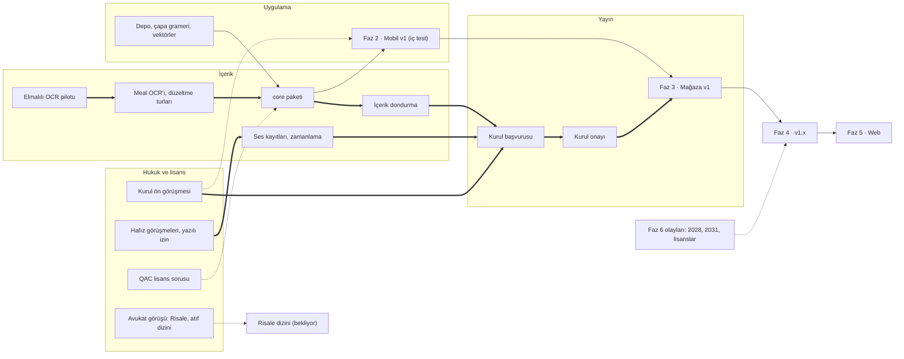

# Fazlar

> **Sürüm:** 1.2 · **Tarih:** 27 Ekim 2026 · **Durum:** Taslak
> **Bağlı kararlar:** [K-08](../00-ozet/02-karar-defteri.md#k-08--platform-sırası) · [K-05](../00-ozet/02-karar-defteri.md#k-05--risale-i-nur-ve-lisansı-bekleyen-içerik) · [K-06](../00-ozet/02-karar-defteri.md#k-06--yayın-kapısı) · [K-15](../00-ozet/02-karar-defteri.md#k-15--hesap-ve-senkron-v1xte) · [K-30](../00-ozet/02-karar-defteri.md#k-30--eski-plandan-çıkarılanlar) · [K-38](../00-ozet/02-karar-defteri.md#k-38--kaynak-edinimi-dijital-öncelikli-kanıtla-yükseltme)

Claude Code ile yürütmek için fazlar A00–A40 aşamalarına bölündü: [Aşama haritası](../10-claude-code/04-asama-haritasi.md) ([K-31](../00-ozet/02-karar-defteri.md#k-31--geliştirme-aracı-claude-code)).

Bu plan takvim tarihi vermez. Fazlar engellerin kapanma sırasına göre dizilir; rapor yol haritasının telif ve mevzuat takvimine göre çizilmesini öneriyor. Süre ve büyüklük ifadelerinin hepsi tahmindir. Eski 24 aylık plan (`quran-app-docs/13-yol-haritasi/01-24-aylik-plan.md`) bu ürün için geçersizdir ([K-30](../00-ozet/02-karar-defteri.md#k-30--eski-plandan-çıkarılanlar)). Rapor web okuyucuyu mobilden önce öneriyordu; [K-08](../00-ozet/02-karar-defteri.md#k-08--platform-sırası) mobili öne aldı ve bu plan K-08'i izler.

## 1. Genel bakış

| Faz | Amaç | Ana çıktı | Göreli büyüklük (tahmin) |
|---|---|---|---|
| Faz 0 · Hazırlık | En pahalı belirsizlikleri kod öncesi açmak, ortak temeli kurmak | Lisans defteri, çapa grameri ve vektörler, Kurul ön görüşmesi, OCR pilotu | Küçük–orta |
| Faz 1 · İçerik hattı | Hattan editoryal veritabanına, oradan ilk `core` paketine uçtan uca akış | `core` paketi, editör paneli, Publisher | Büyük |
| Faz 2 · Mobil v1 (iç test) | Bütün v1 ekranları çevrimdışı; önce ekip, Kurul izin verirse davetli test kullanıcıları | `dev` ve `internal` derleme | Büyük |
| Faz 3 · Mağaza v1 | Kurul onaylı içerikle mağaza yayını | `public` derleme | İş küçük, bekleme belirsiz |
| Faz 4 · v1.x | Hesap, senkron, KVKK, ek paketler | Hesaplı sürüm | Orta |
| Faz 5 · Web | Âyet ve sayfa başına adres, arama motorunda görünürlük | Next.js sitesi | Orta |
| Faz 6 · Takvime bağlı | Hak süreleri dolunca ve lisanslar geldikçe içerik açmak | Olay bazlı paket sürümleri | Olay bazlı |

## 2. Akış

Kalın oklar kritik yoldur. Kesikli oklar yan bağımlılıktır.

## 3. Fazların ayrıntısı

### Faz 0 · Hazırlık

**Amaç.** Rapor şu belirsizliklerin kod yazılmadan kapatılmasını istiyor: Kurul'un dijital eser başvuru usulü ve Medine düzenli fontlara bakışı, Risale haklarını bugün kimin kullandığı, metin içermeyen atıf dizininin hukuki durumu, Elmalılı'nın kaynak baskısı ve en az iki Türk hafızın izni.

**İşler**
- Kurul'a ön görüşme talebi ve soru listesi ([Yayın kapısı ve Kurul](../07-yayin/01-yayin-kapisi-ve-kurul.md)).
- Fikri haklar avukatına sorular (hukuki görüş değildir): Risale haklarını bugün kim kullanıyor; telifli metin dizin, gömme ve altın set için içeride işlenebilir ve harici bir dil modeli API'sine gönderilebilir mi; metinsiz atıf dizini mağaza derlemesinde yer alabilir mi ([Yayın kapısı ve Kurul](../07-yayin/01-yayin-kapisi-ve-kurul.md), §2.4).
- QAC'ye yazılı lisans sorusu (S-15). Cevap gelene dek QAC'den türeyen kök ve lemma ayrı `kelime-kok` paketinde `bekliyor` durumunda kalır ([K-06](../00-ozet/02-karar-defteri.md#k-06--yayın-kapısı)).
- KFGQPC'ye Hafs fontu için yazılı izin talebi; QF Developer Console hesabı ve şartların okunması.
- En az iki Türk hafızla görüşme ([Sonra yapılacaklar](./02-sonra-yapilacaklar.md), S-07).
- Lisans defteri v1: v1 kaynaklarının hepsi `license_status` taşır ([Kaynaklar ve lisans defteri](../04-icerik/01-kaynaklar-ve-lisans-defteri.md)).
- Elmalılı özgün baskısının (İstanbul 1935–1938, 6.442 sayfa) tarama envanteri ve OCR pilotu. Türkçe metnin Latin harfli, âyetlerin Arapça harfli olduğu bir tarama nüshasında doğrulanır ([K-03](../00-ozet/02-karar-defteri.md#k-03--tefsir-önce-elmalılı-meali) düzeltmesi); karakter hata oranı ölçülür. Pilotta kayıtlı hazır metin adayları da aynı örneklemde ölçülür ([K-38](../00-ozet/02-karar-defteri.md#k-38--kaynak-edinimi-dijital-öncelikli-kanıtla-yükseltme)); hazır metin yolu yalnız eşik geçilirse seçilir.
- Tek depo iskeleti, Docker Compose (`postgres:18`, `api`, `editor`, SeaweedFS S3 deposu; [K-21](../00-ozet/02-karar-defteri.md#k-21--i̇çerik-dağıtımı)), GitHub Actions.
- `packages/anchors` ve `shared/test-vectors/`; Python, TypeScript ve C# uygulamaları.
- Expo hesabı (İ-15). EAS projesi ve `development`, `internal`, `production` profilleri Faz 0'da değil, Faz 2'de mobil iskeletle birlikte kurulur (A21); derleme türü `APP_FLAVOR` ile `dev`, `internal`, `public` değerini alır ([Mobil mimari](../06-mobil/01-mobil-mimari.md), bölüm 10).

**Çıkış ölçütleri**
- Kurul'a talep gitti; cevap ya da takip tarihi kayıtlı.
- Lisans defterinde v1 kaynaklarının durumu dolu.
- Vektör testleri üç dilde CI'da yeşil.
- OCR yöntemi ya da hazır metin yolu ölçümle seçildi ve yazıldı.
- Yerel ortam tek komutla kalkıyor.

**Bağımlılık.** Yok.

### Faz 1 · İçerik hattı

**Amaç.** Python hattından editoryal veritabanına, editör onayından Publisher'a ve ilk `core` paketine uçtan uca akış ([İçerik hattı](../04-icerik/02-icerik-hatti.md)).

**İşler**
- Tanzil Uthmani ve Simple Clean alımı; değişmezlik testleri.
- Elmalılı meali: A09 yol kararına göre ya kontrollü hazır metin (`taslak` giriş, özgün baskıyla karşılaştırma) ya da 1930'ların dizgisine ve imlasına uygun OCR; iki yolda da iki düzeltme turu; `meal:elmalili:{sure}:{ayet}` ([Elmalılı hazırlığı](../04-icerik/03-elmalili-hazirligi.md)).
- `quran_word`: QAC'den türeyen kök ve lemma `core` dışında, `kelime-kok` paketinde ve QAC cevap verene dek `bekliyor` ([Kök ve lemma](../05-capraz-referans/03-kok-ve-lemma.md)); Türkçe lemma anlamları yapay zekâ taslağı ve insan onayıyla ([K-19](../00-ozet/02-karar-defteri.md#k-19--kuran-kelime-anlamları)).
- `page_map` (Medine 604 sayfa); Mushaf A için QF şartlarıyla cüz başına QPC font paketleri.
- `xref`: âyet ↔ meal, Kur'an içi kök ve lemma, lisansı teyit edilirse benzer âyet.
- Arama: `search_text`, FTS5, önek indeksi, trigram tablosu ([Arama](../03-veri/05-arama-fts5.md)).
- Editör paneli: iktibas, kök etiketi, kelime anlamı ve metin düzeltme kuyrukları; lisans durumu yönetimi.
- Publisher: lisans kapısı, paket başına `kurul_gerekli` alanı, imzalı manifestler, yerel S3 deposuna (SeaweedFS) yayın.
- Altın setler ve değerlendirme raporları.
- Faz 2'yi bloklamayan uzun işler: Risale çapaları, âyet atıf dizini ve baskı sayfa eşlemesi; metin hukukçu görüşüne kadar `kapali`, görüş olumluysa yalnız `dev` derlemede `ic_kullanim`; dizin ve harici API adımı da bu görüşe bağlı ([K-05](../00-ozet/02-karar-defteri.md#k-05--risale-i-nur-ve-lisansı-bekleyen-içerik)); Tecrîd'in Arapça metni ve Naim kısmı `serbest` ([Kaynaklar ve lisans defteri](../04-icerik/01-kaynaklar-ve-lisans-defteri.md#2-özet-tablo) §2), Kütüb-i Sitte Arapça metni kaynak belgesi netleşene dek `bekliyor`, Kâmil Miras ciltleri 1 Ocak 2028'e kadar `kapali` ([K-04](../00-ozet/02-karar-defteri.md#k-04--hadis-kaynakları), [K-06](../00-ozet/02-karar-defteri.md#k-06--yayın-kapısı)); Elmalılı tefsir metninin OCR'ı ya da ölçümü geçerse hazır metin adayı ([K-03](../00-ozet/02-karar-defteri.md#k-03--tefsir-önce-elmalılı-meali), [K-38](../00-ozet/02-karar-defteri.md#k-38--kaynak-edinimi-dijital-öncelikli-kanıtla-yükseltme)).

**Çıkış ölçütleri**
- `core` paketi aynı girdiyle aynı içerik özetini üretiyor.
- Değişmezlik ve kapı testleri yeşil; public manifest yalnız `serbest` paket içeriyor.
- Mealin 6.236 âyeti iki düzeltme turundan geçti; kalan hata oranı ölçüldü.
- v1 bağlantı türleri altın set kapılarını geçti ([Test stratejisi](../07-yayin/03-test-stratejisi.md)).

**Bağımlılık.** Faz 0 (çapa grameri, lisans defteri, OCR yöntemi ya da hazır metin yolu); QAC cevabı (kök ve lemma); QF hesabı (Mushaf A).

### Faz 2 · Mobil v1 (iç test)

**Amaç.** Expo uygulamasının bütün v1 ekranları çevrimdışı çalışır. Test önce ekip içinde `dev` derlemeyle yapılır. Kurul kapalı teste izin verirse `internal` derleme EAS iç dağıtımla davetli test kullanıcılarına gider ve yalnız `serbest` içerik taşır ([K-06](../00-ozet/02-karar-defteri.md#k-06--yayın-kapısı)).

**İşler**
- Tasarım vitrini: bileşenler üç temada ve üç yazı boyutunda, ekranlardan önce (rapor önerisi).
- Oku: Mushaf A ve C, meal modları, kelime kartı, Bağlantılar alt sayfası, geri dönüş yığını, mini oynatıcı. Mushaf B lisans gelince.
- Kütüphane, Ara, Defterim, Ayarlar (Depolama, Kaynaklar ve lisanslar, Kurul onay bilgisi) ([Mobil ekranlar](../01-urun/03-mobil-ekranlar.md)).
- Paket indirme, özet doğrulama, atomik değiştirme ([Depolama yöneticisi](../06-mobil/03-depolama-yoneticisi.md)).
- Ses: expo-audio ve XState. SDK 57'de tek oynatıcılı motor, SDK 58'den sonra kesintisiz oynatma listesi ([Riskler](./03-riskler.md), R-20); izinli hafız kaydı ya da `ses-test` fikstürü ([Ses sistemi](../06-mobil/02-ses-sistemi.md)).
- Kişisel veri içermeyen hata raporu ([KVKK ve gizlilik](../07-yayin/02-kvkk-ve-gizlilik.md)).
- Maestro akışları, performans ve erişilebilirlik ölçümleri; ekipten ve izin varsa davetli test kullanıcılarından geri bildirim.

**Çıkış ölçütleri**
- Maestro akışları iOS ve Android'de yeşil.
- Arama orta seviye Android referans cihazında 50 ms altı (p95 < 50 ms; [K-17](../00-ozet/02-karar-defteri.md#k-17--arama-sqlite-fts5)); sayfa çevirme bütçesi tutuyor.
- Erişilebilirlik kontrol listesi tamam.
- İç test süresince kritik hata yok; çökmesiz oturum eşiği Açık soru.

**Bağımlılık.** Faz 1 `core` paketi; davetli test kullanıcılarının paket indirebilmesi için canlı içerik deposu (S-03); dış test için Kurul ön görüşmesinin cevabı. Cevap gelene kadar dış test kullanıcısı alınmaz (K-06).

### Faz 3 · Mağaza v1

**Amaç.** App Store ve Google Play'de herkese açık sürüm.

**İşler.** Kurul başvurusu ve onayı; onaylı sürümün manifeste sabitlenmesi; mağaza adı ve alan adı kontrolü (S-08); gizlilik metni ve mağaza beyanları; Kaynaklar ve lisanslar ekranının son hâli; ertelenmiş özellikleri vaat etmeyen mağaza metni; sürüm kontrol listesi.

**Çıkış ölçütleri.** Kurul onayı alındı ve public paketlerin içerik özetleri onaylı özetlerle aynı; public yapıt taraması yeşil; uygulama iki mağazada yayında.

**Bağımlılık.** Kurul onayı (kritik yol); ses yayına girecekse hafız izinleri ve sesin Kurul onayı; canlı içerik deposu; gizlilik metni için alan adı. QAC cevap vermediyse `kelime-kok` paketi `bekliyor` kalır ve kelime kartı kök, lemma ve anlam satırları kapalı çıkar.

### Faz 4 · v1.x

**Amaç.** İsteğe bağlı hesap, cihazlar arası senkron, KVKK yükümlülükleri ve hazır olan ek paketler.

**İşler.** ASP.NET Core Identity; Google ile girişle birlikte Apple ile Giriş; senkron (giden kutusu, `server_seq`, idempotent işlem kimlikleri, HLC birleştirme) ([Kullanıcı verisi ve senkron](../03-veri/04-kullanici-verisi-ve-senkron.md)); hesap silme ve dışa aktarma; KVKK işleri; barındırma konumu kararı; kelime defteri (`vocab`); hazırsa Elmalılı tefsir paketi; lisans gelirse Mushaf B ve ek hafızlar; "makine önerisi" rozetli anlamsal katman (S-10).

**Çıkış ölçütleri.** [K-16](../00-ozet/02-karar-defteri.md#k-16--senkron-çakışma-çözümü) birleştirme kuralları testlerle doğrulandı; iki cihazda değişen not iki sürüm olarak korunuyor; hesap silme uçtan uca test edildi; KVKK kontrol listesi tamam; avukat incelemesi yapıldı.

**Bağımlılık.** Faz 3; barındırma seçimi; standart sözleşmeler.

### Faz 5 · Web

**Amaç.** Next.js 16 ile her âyete ve sayfaya ayrı adres ve arama motorunda görünürlük ([K-14](../00-ozet/02-karar-defteri.md#k-14--web)).

**İşler.** Rapordaki rota önerisi: `/kuran/[sure]/[ayet]` (6.236 sayfa), `/mushaf/[sayfa]` (604 sayfa), meal ve tefsir rotaları, ileride Risale; `ensureStatic` ile sayfaların statik kalması. expo-sqlite'ın web derlemesinde FTS olmadığı için arama sunucuda ya da Orama ile yapılır. Hesapla senkron ve paylaşılan paketler (`anchors`, `search`, `reader-core`, `ui-tokens`).

**Çıkış ölçütleri.** `mutalaa://q/2/255` ile `/kuran/2/255` aynı çapaya gider; vektör testleri web derlemesinde de yeşil; Kurul'un web kapsamı netleşti.

**Bağımlılık.** Faz 3; hesap web'de istenirse Faz 4; web için Kurul cevabı (Açık soru).

### Faz 6 · Takvime bağlı

| Olay | Tarih | Etki | Kaynak |
|---|---|---|---|
| Tecrîd-i Sarîh'in Kâmil Miras ciltleri serbest | 1 Ocak 2028 | Ciltler `kapali` durumundan `serbest`e geçer; Türkçe Tecrîd tamamlanır | [Küre: Miras](https://kureansiklopedi.com/tr/detay/miras-kamil) |
| Risale-i Nur serbest | 1 Ocak 2031 | `risale-{kitap}` paketleri `serbest` olur; kaynak müellif tashihli 1956–1960 baskıları, asıl nüsha karşılaştırma metni | [TDV İslâm Ansiklopedisi](https://islamansiklopedisi.org.tr/risale-i-nur-kulliyati) |
| Çantay meali serbest | 1 Ocak 2035 | Ek meal; mealli gösterim Kurul onayı ister | [Küre: Çantay](https://kureansiklopedi.com/tr/detay/cantay-hasan-basri) |
| Bilmen meal-tefsiri serbest | 1 Ocak 2042 | Ek meal ve tefsir; Kurul onayı ister | [Küre: Bilmen](https://kureansiklopedi.com/tr/detay/bilmen-omer-nasuhi) |
| Lisanslar | Tarihsiz | Diyanet meali, Türk hattı, ek hafızlar, Risale lisansı | [Sonra yapılacaklar](./02-sonra-yapilacaklar.md) |

Her olay aynı yolu izler: lisans defteri güncellenir, `license_status` değişir, içerik Kurul kapsamındaysa onay treni başlar, Publisher yeni paket sürümünü yayımlar. Risale 2031'den sonra da kelimesi kelimesine, kısaltılmadan ve sadeleştirilmeden yayımlanır ([K-25](../00-ozet/02-karar-defteri.md#k-25--i̇lkeler)). Koruma süresi kuralı FSEK m. 26–27'den gelir ([FSEK, WIPO Lex](https://www.wipo.int/wipolex/en/text/499171)).

## 4. Kritik yol

| Zincir | Neden kritik | Erken uyarı | Kısaltma yolu |
|---|---|---|---|
| **Kurul süreci:** ön görüşme → dondurma → başvuru → onay | Başvuru usulü, ücret ve süre bilinmiyor. `core` Kur'an metnini ve meali taşıdığı için public derleme onaysız çıkamaz. | Ön görüşme talebine cevap gelmemesi; font sorusuna olumsuz cevap | Ön görüşme Faz 0'ın ilk işidir; başvuru dosyası Faz 2 ile paralel hazırlanır; düzeltme turları başvurudan önce kapanır |
| **Elmalılı OCR kalitesi:** pilot → OCR → düzeltme → `core` | 6.442 sayfalık özgün baskıda Türkçe metin büyük olasılıkla Latin harfli, âyetler Arapça harfli; iş 1930'ların dizgisine ve imlasına uygun OCR ve düzeltmedir ([K-03](../00-ozet/02-karar-defteri.md#k-03--tefsir-önce-elmalılı-meali) düzeltmesi, [K-12](../00-ozet/02-karar-defteri.md#k-12--i̇çerik-hattı-python)). Güvenilir dijital özgün baskı bulunamadı. Onaydan sonraki düzeltme yeniden onay demektir. | Tarama nüshasında Latin harfin doğrulanamaması; pilotta yüksek hata oranı; düzeltme hızının planın gerisinde kalması | Yöntem pilotla seçilir; Türkçe ve Arapça kısımlar için OCR ayrı ayarlanır (öneri); düzeltme kuyruğu editör panelindedir; tefsir metni meal yolundan ayrılır |
| **Hafız izinleri:** görüşme → izin → kayıt ve zamanlama → Kurul | Popüler kıraat kaynaklarının hiçbiri açık lisans vermiyor; Türk hafızlar için açık kaynak yok ([AlQuran Cloud](https://alquran.cloud/terms-and-conditions)). quran-align zamanlamaları yalnız hizalandığı EveryAyah dosyaları için geçerli ([quran-align](https://raw.githubusercontent.com/cpfair/quran-align/master/README.md)). | İzin reddi; yeni kayıtlar için zamanlama yönteminin bulunamaması | Rapor 3–5 okuyucuyla başlamayı öneriyor; QF akışı şartlarıyla seçenek olarak durur |

İkincil bağımlılıklar: QAC cevabı (kök ve lemma katmanı), KFGQPC izni (Mushaf C fontu; yedek Amiri Quran), QF hesabı (Mushaf A fontları).

## 5. Sıra ve paralellik

- Faz 0'daki hukuk işleri bekleme içerir. Bekleme süresi teknik işle doldurulur.
- Faz 1'deki Risale, hadis ve tefsir hatları uzun koşar ve Faz 2'yi bloklamaz.
- Kurul başvuru dosyası Faz 2 ile paralel hazırlanır.
- Faz 4 ve Faz 5 kısmen paralel yürüyebilir.
- Faz 6 olayları herhangi bir fazın ortasında gelebilir.
- Her faz çıkış ölçütleriyle kapanır. Ölçüte girmeyen istek [Sonra yapılacaklar](./02-sonra-yapilacaklar.md) listesine gider.

## 6. Açık sorular

1. Sesin izni ya da onayı gecikirse Mağaza v1 sessiz mi çıkar?
2. İç test dağıtımı Kurul açısından yayım sayılır mı? Cevap gelene kadar dış test kullanıcısı alınmaz (K-06).
3. Web için ayrı Kurul onayı gerekir mi?
4. Elmalılı tefsir paketi hangi faza girer? K-03 tefsir metnini ikinci aşamaya koyuyor; bu plan paketi kalite kapısını geçtiği ilk sürüme bağlar.
5. Hadis paketleri ne zaman public olur? Arapça veri setlerinin kaynak belgeleri zayıf ([Hadis hazırlığı](../04-icerik/04-hadis-hazirligi.md)).
6. Çökmesiz oturum eşiği ve referans cihazlar.

## İlgili dosyalar

- [Kapsam ve fazlar](../01-urun/01-kapsam-ve-fazlar.md) · [Sonra yapılacaklar](./02-sonra-yapilacaklar.md) · [Riskler](./03-riskler.md)
- [Yayın kapısı ve Kurul](../07-yayin/01-yayin-kapisi-ve-kurul.md) · [KVKK ve gizlilik](../07-yayin/02-kvkk-ve-gizlilik.md) · [Test stratejisi](../07-yayin/03-test-stratejisi.md)
- [Kaynaklar ve lisans defteri](../04-icerik/01-kaynaklar-ve-lisans-defteri.md) · [Risale hazırlığı](../04-icerik/05-risale-hazirligi.md) · [Proje yapısı](../02-mimari/03-proje-yapisi.md)
- [Kaynakça](../09-kaynakca.md) · [Karar defteri](../00-ozet/02-karar-defteri.md)
