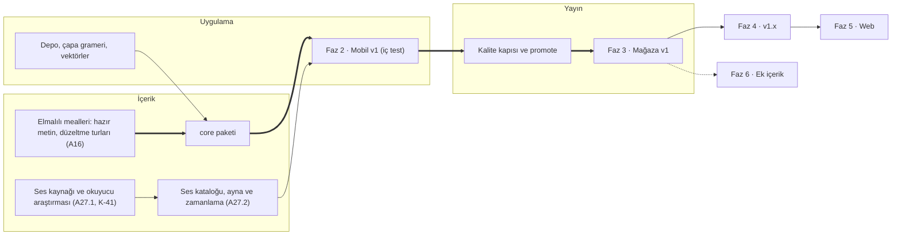

# Fazlar

> **Sürüm:** 1.7 · **Tarih:** 12 Kasım 2026 · **Durum:** Taslak
> **Bağlı kararlar:** [K-08](../00-ozet/02-karar-defteri.md#k-08--platform-sırası) · [K-42](../00-ozet/02-karar-defteri.md#k-42--kaynak-ilkesi-ve-kalite-temelli-görünürlük) · [K-15](../00-ozet/02-karar-defteri.md#k-15--hesap-ve-senkron-v1xte) · [K-30](../00-ozet/02-karar-defteri.md#k-30--eski-plandan-çıkarılanlar) · [K-38](../00-ozet/02-karar-defteri.md#k-38--kaynak-edinimi-dijital-öncelikli-kanıtla-yükseltme) · [K-41](../00-ozet/02-karar-defteri.md#k-41--ses-sistemi-hazır-kayıtlar-ayna-ve-çevrimiçi-öncelikli-dinleme) · [K-49](../00-ozet/02-karar-defteri.md#k-49--elmalılı-mealleri-hazır-metin-yolu-ve-ocrın-proje-sonuna-ertelenmesi) · [K-50](../00-ozet/02-karar-defteri.md#k-50--yapay-zekâ-işlerinin-proje-sonuna-ertelenmesi-hazır-anlam-adayları-qac-sözlüğü-ve-kelime-anlamı-görünürlüğü)

Claude Code ile yürütmek için fazlar A00–A40 aşamalarına bölündü: [Aşama haritası](../10-claude-code/04-asama-haritasi.md) ([K-31](../00-ozet/02-karar-defteri.md#k-31--geliştirme-aracı-claude-code)).

Bu plan takvim tarihi vermez. Fazlar bağımlılık sırasına göre dizilir. Süre ve büyüklük ifadelerinin hepsi tahmindir. Eski 24 aylık plan (`quran-app-docs/13-yol-haritasi/01-24-aylik-plan.md`) bu ürün için geçersizdir ([K-30](../00-ozet/02-karar-defteri.md#k-30--eski-plandan-çıkarılanlar)). Rapor web okuyucuyu mobilden önce öneriyordu; [K-08](../00-ozet/02-karar-defteri.md#k-08--platform-sırası) mobili öne aldı ve bu plan K-08'i izler.

## 1. Genel bakış

| Faz | Amaç | Ana çıktı | Göreli büyüklük (tahmin) |
|---|---|---|---|
| Faz 0 · Hazırlık | Ortak temeli kurmak; Elmalılı için hazır metin yolunu seçmek (OCR en pahalı belirsizlikti; K-49 onu proje sonuna erteledi) | Kaynak kayıtları ve ortak enum şeması, çapa grameri ve vektörler, editoryal veritabanı, CI | Küçük–orta |
| Faz 1 · İçerik hattı | Hattan editoryal veritabanına, oradan ilk `core` paketine uçtan uca akış | `core` paketi, editör paneli, Publisher | Büyük |
| Faz 2 · Mobil v1 (iç test) | Bütün v1 ekranları çevrimdışı; önce ekip, sonra davetli test kullanıcıları | `dev` ve `internal` derleme | Büyük |
| Faz 3 · Mağaza v1 | Kalite kapısından geçmiş içerikle mağaza yayını | `public` derleme | Küçük |
| Faz 4 · v1.x | Hesap, senkron, gizlilik işleri, ek paketler | Hesaplı sürüm | Orta |
| Faz 5 · Web | Âyet ve sayfa başına adres, arama motorunda görünürlük | Next.js sitesi | Orta |
| Faz 6 · Ek içerik | Çekirdek v1'e ve v1.x'e girmeyen ek içeriği paket olarak eklemek | Mushaf B, ek paketler | Orta |

## 2. Akış

Kalın oklar kritik yoldur. Kesikli oklar yan bağımlılıktır.

## 3. Fazların ayrıntısı

### Faz 0 · Hazırlık

**Amaç.** Ortak temeli (depo, kaynak kayıtları, çapa grameri, editoryal veritabanı, CI) kurmak. Elmalılı'nın özgün baskısından metin çıkarmanın (OCR) kalitesi en pahalı belirsizlikti; [K-49](../00-ozet/02-karar-defteri.md#k-49--elmalılı-mealleri-hazır-metin-yolu-ve-ocrın-proje-sonuna-ertelenmesi) bunu proje sonuna erteledi ve Elmalılı mealleri hazır metinle alınır ([S-15](./02-sonra-yapilacaklar.md)). Ses için hazır kayıtlar kullanılır ([K-40](../00-ozet/02-karar-defteri.md#k-40--ses-kaynağı-hazır-dijital-tilavet-kaynakları), [K-41](../00-ozet/02-karar-defteri.md#k-41--ses-sistemi-hazır-kayıtlar-ayna-ve-çevrimiçi-öncelikli-dinleme)).

**İşler**
- Kaynak kayıtları ve ortak enum şeması (A06): v1 kaynaklarının hepsi `pipeline/sources/{kimlik}.toml` kaydı taşır ([Kaynaklar](../04-icerik/01-kaynaklar.md)).
- Ses kaynağı ve okuyucu araştırması (A27.1, 30 Ekim 2026; [Ses kaynağı araştırması](../06-mobil/04-ses-kaynak-arastirmasi.md)). Hazır kayıtlar kullanılır (K-40, K-41).
- Elmalılı için metin yolu: hazır metin ([K-49](../00-ozet/02-karar-defteri.md#k-49--elmalılı-mealleri-hazır-metin-yolu-ve-ocrın-proje-sonuna-ertelenmesi)). Özgün baskının (İstanbul 1935–1939) taraması, OCR pilotu (A09) ve karakter hata oranı ölçümü ertelendi ve [S-15](./02-sonra-yapilacaklar.md)'e taşındı; bu iş Faz 0'ı bekletmez.
- Tek depo iskeleti, Docker Compose (`postgres:18`, `api`, `editor`, SeaweedFS S3 deposu; [K-21](../00-ozet/02-karar-defteri.md#k-21--i̇çerik-dağıtımı)), GitHub Actions.
- `packages/anchors` ve `shared/test-vectors/`; Python, TypeScript ve C# uygulamaları.
- Expo hesabı (İ-15). EAS projesi ve `development`, `internal`, `production` profilleri Faz 0'da değil, Faz 2'de mobil iskeletle birlikte kurulur (A21); derleme türü `APP_FLAVOR` ile `dev`, `internal`, `public` değerini alır ([Mobil mimari](../06-mobil/01-mobil-mimari.md), bölüm 10).

**Çıkış ölçütleri**
- Kaynak kayıtları geçerli: `uv run mutalaa sources check` hatasız biter.
- Vektör testleri üç dilde CI'da yeşil.
- Elmalılı için hazır metin yolu K-49 ile seçildi ve yazıldı (OCR ve A09 ertelendi; S-15).
- Yerel ortam tek komutla kalkıyor.

**Bağımlılık.** Yok.

### Faz 1 · İçerik hattı

**Amaç.** Python hattından editoryal veritabanına, editör onayından Publisher'a ve ilk `core` paketine uçtan uca akış ([İçerik hattı](../04-icerik/02-icerik-hatti.md)).

**İşler**
- Tanzil Uthmani ve Simple Clean alımı; değişmezlik testleri.
- Elmalılı mealleri (A16, K-49): orijinal (`meal:elmalili`) ve sadeleştirilmiş (`meal:elmalili-sade`, arayüzde "sadeleştirilmiş" etiketli) meal hazır metinle alınır, `taslak` girer ve iki düzeltme turundan geçer ([Elmalılı hazırlığı](../04-icerik/03-elmalili-hazirligi.md)). Özgün baskıyla karşılaştırma S-15'tedir.
- `quran_word`: QAC'den türeyen kök ve lemma (`qac-morfoloji`) ayrı ve isteğe bağlı `kelime-kok` paketindedir ve bütün derlemelerde yer alır ([Kök ve lemma](../05-capraz-referans/03-kok-ve-lemma.md)); Türkçe lemma anlamları için hazır kaynak (QuranWBW) her lemmaya aday verir ve editör düzeltip onaylar; yapay zekâ taslağı v1'de yoktur, [S-16](../08-yol-haritasi/02-sonra-yapilacaklar.md#s-16--yapay-zekâ-ile-taslak-üretimi-kelime-anlamı-türkçe-lemma--kök-gri-bölge-doğrulaması-lügat-kök-anlamı)'dadır ([K-19](../00-ozet/02-karar-defteri.md#k-19--kuran-kelime-anlamları), [K-50](../00-ozet/02-karar-defteri.md#k-50--yapay-zekâ-işlerinin-proje-sonuna-ertelenmesi-hazır-anlam-adayları-qac-sözlüğü-ve-kelime-anlamı-görünürlüğü)).
- `page_map` (Medine 604 sayfa); Mushaf A için cüz başına QPC font paketleri (yazı tipleri ve düzen verisi GitHub ya da QUL'dan alınır).
- `xref`: âyet ↔ meal, Kur'an içi kök ve lemma, benzer âyet.
- Arama: `search_text`, FTS5, önek indeksi, trigram tablosu ([Arama](../03-veri/05-arama-fts5.md)).
- Editör paneli: iktibas, kök etiketi, kelime anlamı ve metin düzeltme kuyrukları.
- Publisher: kalite kapısı (P-01, P-07…P-14), imzalı manifestler, yerel S3 deposuna (SeaweedFS) yayın.
- Altın setler ve değerlendirme raporları.
- Faz 2'yi bloklamayan uzun işler: Risale altyapısı ve metni (A20): paragraf çapaları, metinli atıf dizini ve lügat; kaynak A20'de araştırmayla seçilir ve Risale kelimesi kelimesine, kısaltılmadan ve sadeleştirilmeden yayımlanır ([K-25](../00-ozet/02-karar-defteri.md#k-25--i̇lkeler)). Hadis hatları (A19): Tecrîd-i Sarîh tamamı (Naim ve Kâmil Miras ciltleri) ve Kütüb-i Sitte'nin Arapça metni ([K-04](../00-ozet/02-karar-defteri.md#k-04--hadis-kaynakları)). Elmalılı tefsir metni: uygun hazır metin adayı varsa o (yoksa OCR ve özgün baskı taraması S-15'e kalır; [K-03](../00-ozet/02-karar-defteri.md#k-03--tefsir-önce-elmalılı-meali), [K-38](../00-ozet/02-karar-defteri.md#k-38--kaynak-edinimi-dijital-öncelikli-kanıtla-yükseltme)).

**Çıkış ölçütleri**
- `core` paketi aynı girdiyle aynı içerik özetini üretiyor.
- Değişmezlik ve kalite kapısı testleri yeşil; `public` manifest onaysız birim, yapay zekâ taslağı, insan onayı isteyen türde aday bağlantı ve `test-` önekli kaynak içermiyor.
- Orijinal mealin 6.236 âyeti iki düzeltme turundan geçti (tur 1 her âyetin iki kişiyle onayı, tur 2 en az 600 âyetlik ikinci okuma); kalan hata oranı ölçüldü. Sadeleştirilmiş mealin turları fazı bekletmez; bir meal kaynağı G-INC geçmeden `public`'e çıkmaz (K-49). Bu turlar A16'nın kapanışını ve A18, A19 ile A37'nin ilerlemesini bekletmez; Faz 1 çıkışının ve `public` yayının şartıdır (K-49 madde 12).
- v1 bağlantı türleri altın set kapılarını geçti ([Test stratejisi](../07-yayin/03-test-stratejisi.md)).

**Bağımlılık.** Faz 0 (çapa grameri, kaynak kayıtları, Elmalılı için hazır metin yolu).

### Faz 2 · Mobil v1 (iç test)

**Amaç.** Expo uygulamasının bütün v1 ekranları çevrimdışı çalışır. Test önce ekip içinde `dev` derlemeyle yapılır; sonra `internal` derleme EAS iç dağıtımla davetli test kullanıcılarına gider ve onaylı içeriğin yanında onaysız birimleri "doğrulanmamış" rozetiyle gösterir ([K-42](../00-ozet/02-karar-defteri.md#k-42--kaynak-ilkesi-ve-kalite-temelli-görünürlük) madde 5).

**İşler**
- Tasarım vitrini: bileşenler üç temada ve üç yazı boyutunda, ekranlardan önce (rapor önerisi).
- Oku: Mushaf A ve C, meal modları, kelime kartı, Bağlantılar alt sayfası, geri dönüş yığını, mini oynatıcı.
- Kütüphane, Ara, Defterim, Ayarlar (Depolama, Kaynaklar) ([Mobil ekranlar](../01-urun/03-mobil-ekranlar.md)).
- Paket indirme, özet doğrulama, atomik değiştirme ([Depolama yöneticisi](../06-mobil/03-depolama-yoneticisi.md)).
- Ses ([K-41](../00-ozet/02-karar-defteri.md#k-41--ses-sistemi-hazır-kayıtlar-ayna-ve-çevrimiçi-öncelikli-dinleme)): 7 okuyucu, 9 kayıt; sure dosyası ve QUD zamanlaması; dosyalar kendi depomuzdaki aynadan; indirmeden çevrimiçi dinleme, sure ya da kaydın tamamını kalıcı indirme. expo-audio ve XState; SDK 58'de `AudioPlaylist` ile kilit ekranında sonraki/önceki sure ([Riskler](./03-riskler.md), R-20; [Ses sistemi](../06-mobil/02-ses-sistemi.md)). Sırası: araştırma (A27.1, tamam), katalog ve ayna (A27.2), mobil geliştirme (A27.3–A27.8), cihaz testi (A27.9, kullanıcı).
- Kişisel veri içermeyen hata raporu ([Gizlilik](../07-yayin/02-gizlilik.md)).
- Maestro akışları, performans ve erişilebilirlik ölçümleri; ekipten ve davetli test kullanıcılarından geri bildirim.

**Çıkış ölçütleri**
- Maestro akışları iOS ve Android'de yeşil.
- Arama orta seviye Android referans cihazında 50 ms altı (p95 < 50 ms; [K-17](../00-ozet/02-karar-defteri.md#k-17--arama-sqlite-fts5)); sayfa çevirme bütçesi tutuyor.
- Erişilebilirlik kontrol listesi tamam.
- İç test süresince kritik hata yok; çökmesiz oturum eşiği Açık soru.

**Bağımlılık.** Faz 1 `core` paketi; davetli test kullanıcılarının paket indirebilmesi için canlı içerik deposu (S-03).

### Faz 3 · Mağaza v1

**Amaç.** App Store ve Google Play'de herkese açık sürüm.

**İşler.** İç testte kalite kapısından geçen yayının `promote` ile `public` için üretilmesi (kullanıcı kararı); mağaza adı ve alan adı kontrolü (S-08); gizlilik metni ve mağaza beyanları; Kaynaklar ekranının son hâli; ertelenmiş özellikleri vaat etmeyen mağaza metni; sürüm kontrol listesi. Mağazaya gönderimi kullanıcı yapar ([Yayın süreci](../07-yayin/01-yayin-sureci.md) §7).

**Çıkış ölçütleri.** `public` kuru çalıştırması 0 ile bitiyor; terfide içerik özetleri iç kanalda test edilen yayınla aynı (P-14); public yapıt taraması yeşil; uygulama iki mağazada yayında.

**Bağımlılık.** Faz 2 (iç test); canlı içerik deposu; gizlilik metni için alan adı.

### Faz 4 · v1.x

**Amaç.** İsteğe bağlı hesap, cihazlar arası senkron, hesaplı sürümün gizlilik işleri ve hazır olan ek paketler.

**İşler.** ASP.NET Core Identity; Google ile girişle birlikte Apple ile Giriş; senkron (giden kutusu, `server_seq`, idempotent işlem kimlikleri, HLC birleştirme) ([Kullanıcı verisi ve senkron](../03-veri/04-kullanici-verisi-ve-senkron.md)); hesap silme ve dışa aktarma; gizlilik metninin hesap bölümü ve veri işleyenler listesi; barındırma konumu kararı; kelime defteri (`vocab`); hazırsa Elmalılı tefsir paketi (A37); ek okuyucu kayıtları (katalog sürümüyle); "makine önerisi" rozetli anlamsal katman (S-10).

**Çıkış ölçütleri.** [K-16](../00-ozet/02-karar-defteri.md#k-16--senkron-çakışma-çözümü) birleştirme kuralları testlerle doğrulandı; iki cihazda değişen not iki sürüm olarak korunuyor; hesap silme uçtan uca test edildi; gizlilik kontrol listesi tamam ([Gizlilik](../07-yayin/02-gizlilik.md) §4).

**Bağımlılık.** Faz 3; barındırma seçimi.

### Faz 5 · Web

**Amaç.** Next.js 16 ile her âyete ve sayfaya ayrı adres ve arama motorunda görünürlük ([K-14](../00-ozet/02-karar-defteri.md#k-14--web)).

**İşler.** Rapordaki rota önerisi: `/kuran/[sure]/[ayet]` (6.236 sayfa), `/mushaf/[sayfa]` (604 sayfa), meal ve tefsir rotaları, Risale; `ensureStatic` ile sayfaların statik kalması. expo-sqlite'ın web derlemesinde FTS olmadığı için arama sunucuda ya da Orama ile yapılır. Hesapla senkron ve paylaşılan paketler (`anchors`, `search`, `reader-core`, `ui-tokens`).

**Çıkış ölçütleri.** `mutalaa://q/2/255` ile `/kuran/2/255` aynı çapaya gider; vektör testleri web derlemesinde de yeşil.

**Bağımlılık.** Faz 3; hesap web'de istenirse Faz 4.

### Faz 6 · Ek içerik

**Amaç.** Çekirdek v1'e ve v1.x'e girmeyen ek içeriği yeni paket sürümleri olarak eklemek.

**İşler**
- Mushaf B: Türk hattı sayfa görselleriyle açılır (A40; önkoşul yalnız A24). Sayfa görselleri ve `ayah_box` verisi A40'ın tedarik adımında araştırılır.
- Ek paketler: [Sonra yapılacaklar](./02-sonra-yapilacaklar.md) listesinden seçilen kitaplar (S-02), güncel dilli meal (S-05), diğer tefsir ve mealler (S-09), sesli meal (S-13), OCR ve özgün baskı taraması (S-15) ve ek okuyucu kayıtları (katalog sürümüyle).

**Çıkış ölçütleri.** Her ek paket aynı yolu izler: kaynak kaydı (`pipeline/sources/{kimlik}.toml`) açılır, içerik hattından geçer, editör onayıyla `onayli` olur, kalite kapısından geçer ve yeni paket sürümüyle yayımlanır.

**Bağımlılık.** Mushaf B için A24; ek paketler için Faz 1 (içerik hattı ve Publisher).

## 4. Kritik yol

| Zincir | Neden kritik | Erken uyarı | Kısaltma yolu |
|---|---|---|---|
| **Elmalılı mealleri:** hazır metin → `taslak` giriş → iki düzeltme turu → `core` | Meal `core`'un parçasıdır; iki meal de hazır metinle girer (K-49) ama baskı esasları belgesizdir. İki düzeltme turu insan emeğidir (2×6.236 âyet, iki onay ve iki ikinci okuma); ikinci editör onayı tamamlanmayan âyet `public`'e girmez (P-10) ve bir meal kaynağı G-INC geçmeden `public`'e çıkmaz. OCR ve özgün baskıyla karşılaştırma S-15'e ertelendi. | Hazır metinde sistematik sadeleştirme ya da baskı farkı; çapraz tanık raporunda düşük uyum; düzeltme hızının planın gerisinde kalması | Tur 1 kuyruğu tanık skoruna göre sıralanır; yalnız orijinal mealin turları Faz 1'i bağlar; düzeltme kuyruğu editör panelindedir; tefsir metni meal yolundan ayrılır |
| **Ses kaynağı:** araştırma → katalog ve ayna → oynatıcı → cihaz testi | Kapandı (30 Ekim 2026): hazır kayıtlar ve QUD zamanlaması kullanılır (K-40, K-41). Kalan risk teknik: kaynakta dosya değişmesi, VBR konumlanma ([Ses kaynağı araştırması](../06-mobil/04-ses-kaynak-arastirmasi.md) §7) | Ayna dosyası sha256 ile tutmazsa içerik hattı durur | Ayna değişmez sürümlü adres kullanır; MP3Quran yedek âyet zamanlaması |

İkincil bağımlılıklar: Mushaf A'nın QPC yazı tiplerinin ve düzen verisinin tedariki (A26); Mushaf C yazı tipinin seçimi (KFGQPC Hafs ya da Amiri Quran, görsel kaliteye göre; A24).

## 5. Sıra ve paralellik

- Bekleyen bir insan adımı yalnız kendisine bağlı alt adımı bekletir; aşamanın kalanı ve öteki aşamalar sürer ([K-42](../00-ozet/02-karar-defteri.md#k-42--kaynak-ilkesi-ve-kalite-temelli-görünürlük) madde 3, [İnsan adımları](../10-claude-code/06-insan-adimlari.md)).
- Faz 1'deki Risale, hadis ve tefsir hatları uzun koşar ve Faz 2'yi bloklamaz.
- Faz 4 ve Faz 5 kısmen paralel yürüyebilir.
- Faz 6 işleri önkoşulları tamamlandıktan sonra herhangi bir fazın ortasında yürüyebilir.
- Her faz çıkış ölçütleriyle kapanır. Ölçüte girmeyen istek [Sonra yapılacaklar](./02-sonra-yapilacaklar.md) listesine gider.

## 6. Açık sorular

1. Elmalılı tefsir paketi hangi faza girer? K-03 tefsir metnini ikinci aşamaya koyuyor; bu plan paketi kalite kapısını geçtiği ilk sürüme bağlar.
2. Hadis paketleri ne zaman public olur? Arapça veri setlerinin kaynak belgeleri zayıf ([Hadis hazırlığı](../04-icerik/04-hadis-hazirligi.md)).
3. Çökmesiz oturum eşiği ve referans cihazlar.

## İlgili dosyalar

- [Kapsam ve fazlar](../01-urun/01-kapsam-ve-fazlar.md) · [Sonra yapılacaklar](./02-sonra-yapilacaklar.md) · [Riskler](./03-riskler.md)
- [Yayın süreci](../07-yayin/01-yayin-sureci.md) · [Gizlilik](../07-yayin/02-gizlilik.md) · [Test stratejisi](../07-yayin/03-test-stratejisi.md)
- [Kaynaklar](../04-icerik/01-kaynaklar.md) · [Risale hazırlığı](../04-icerik/05-risale-hazirligi.md) · [Proje yapısı](../02-mimari/03-proje-yapisi.md)
- [Kaynakça](../09-kaynakca.md) · [Karar defteri](../00-ozet/02-karar-defteri.md)
