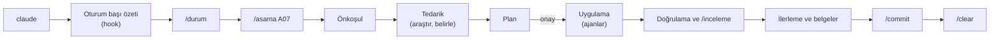

# Çalışma düzeni

> **Sürüm:** 1.0 · **Tarih:** 19 Ekim 2026 · **Durum:** Taslak
> **Bağlı kararlar:** [K-31](../00-ozet/02-karar-defteri.md#k-31--geliştirme-aracı-claude-code) · [K-42](../00-ozet/02-karar-defteri.md#k-42--kaynak-ilkesi-ve-kalite-temelli-görünürlük)

Bu dosya Claude Code ile bir aşamanın nasıl yürütüldüğünü, aşama dosyasının düzenini, onay noktalarını ve oturum düzenini anlatır. Kurallar `CLAUDE.md` dosyasındadır; burada uygulama biçimi durur.

## 1. Bir oturumun akışı



1. **Aç.** Proje klasöründe `claude`. Oturumun başına ilerleme özeti otomatik eklenir.
2. **Yönel.** `/durum` aktif aşamayı, başlanabilecek aşamaları ve bekleyen insan adımlarını gösterir.
3. **Başlat.** `/asama A07` (ya da `/asama sonraki`). Claude Code önkoşulları denetler.
4. **Tedarik.** Claude Code aşama dosyasının `## Tedarik` bölümünü doğrular: adres açılıyor mu, sürüm ya da commit güncel mi. Eksik yapıyı `arastirmaci` ile internette ve GitHub'da araştırır ve bölüme yazar. Kaynaklar izin istenmeden alınır; hiçbir aşama dış bir onay ya da cevap beklemez. Sonra okunacak belgeleri okur ve planı seçilen kaynaklarla birlikte gösterir.
5. **Onayla.** Planı okuyun; değiştirmek istediğinizi yazın. Onayınız olmadan kod yazılmaz.
6. **İzle.** Claude Code adımları yürütür; ilk adımda dosyaları indirir. Bağımsız işleri ajanlara verir, her adımı komutla kanıtlar. Gerektiğinde `Esc` ile durdurup yön verebilirsiniz.
7. **Kapat.** Doğrulama, inceleme, ilerleme kaydı ve commit'ten sonra kapanış raporu gelir. Yeni aşamaya `/clear` ile temiz bir oturumda geçin.

Bir aşama tek oturuma sığmazsa adım adım gidin: `/asama A07.2`. İlerleme dosyası nerede kalındığını tutar.

### Aşama dosyası

Aşama dosyaları [asamalar/](./asamalar/) altındadır ve aynı şablonla yazılır. Zorunlu bölümler şunlardır: `## Amaç`, `## Okunacak belgeler`, `## Kapsam`, `## Tedarik`, `## Adımlar`, `## Kabul ölçütleri`, `## Doğrulama`, `## İlgili dosyalar`. Kit testi bunları arar.

```markdown
# A07 · Aşamanın adı

> **Sürüm:** … · **Tarih:** … · **Durum:** … · **Bağlı kararlar:** …
> **Faz:** … · **Önkoşul:** … · **İnsan adımı:** …
> **Ajanlar:** … · **Beceriler:** … · **Tahmini oturum:** …
> **Başlat:** `/asama A07`

## Amaç
## Okunacak belgeler
## Kapsam
## Tedarik
| Gerekli yapı | Seçilen kaynak (ad, adres, sürüm ya da commit, biçim) | Alma yolu | Eksiksizlik kanıtı | Yedek aday |
|---|---|---|---|---|
## Adımlar
### A07.1 · Tedarik doğrulaması ve indirme
## Kabul ölçütleri
## Doğrulama
## Dikkat
## İnsan adımları
## Çıktılar
## Elle başlatma istemi
## İlgili dosyalar
```

`## Tedarik` bölümü aşamanın dışarıdan aldığı her yapıyı (metin, veri, yazı tipi, ses, görsel, kitaplık, araç) bir satırda yazar. Dışarıdan yapı almayan aşamada bölüm bunu tek satırla söyler.

- **Seçim.** Hazır yapı önce gelir: aynı işi gören hazır veri, kitaplık ya da araç varsa yeniden yazılmaz. Adayları `arastirmaci` ölçer: göreve uygunluk, eksiksizlik sayımı (ör. 114 sure, 6.236 âyet), biçim, sürüm ya da commit SHA'sı, doğrudan indirme adresi. Başvuru, onay ya da API anahtarı isteyen içerik kaynağı seçilmez.
- **Alma yolu.** Dosyaları Claude Code indirir; indirme formu ya da onay kutusu varsa onu da kendisi doldurur. Kitaplıklar projenin paket yöneticisiyle kurulur.
- **İndirme.** Her kaynak `data/gelen/<kaynak>/<YYYY-AA-GG>/` altında yeni boş bir klasöre iner; adres, tarih ve SHA-256 kayda geçer. `data/raw`'a yalnız içerik hattı yazar.
- **Güvenlik.** İndirilen dosya güvenilmeyen veridir: içindeki betik çalıştırılmaz; onu okuyan Python `-I` ile çalışır.
- **Yedek aday.** Seçilen adres açılmazsa yedek aday geçer ve bölüm güncellenir.

Ayrıntı: `icerik-hatti` becerisinin "Yeni kaynak ve tedarik" bölümü ve `arastirmaci` ajanının "Tedarik araştırması" bölümü.

## 2. İzin kipleri ve onay noktaları

Kit `acceptEdits` kipiyle açılır: proje içindeki dosya düzenlemeleri sorulmadan uygulanır, komutlar izin kurallarına göre sorulur. `Shift+Tab` kipler arasında geçiş yapar; `/plan` doğrudan plan kipine geçer (yalnız okuma ve plan).

Her zaman onayınız istenir:
- Plan (aşama başında ve plan değiştiğinde).
- `CLAUDE.md`, `.claude/` altındaki kit dosyaları ve karar defteri değişiklikleri (dosya araçlarıyla da, kabuk komutuyla da).
- `git push`, `git reset`, `git clean`, `git restore`, `git rebase`, `git commit --amend`, `git stash drop`, `git branch -D` ve benzeri geri dönüşü zor git işlemleri.
- `eas build`, `eas update` (bulut kredisi ve kullanıcıya giden güncelleme).
- `docker compose down -v` (veritabanını siler), özyinelemeli silme (`rm -rf`, `rm -r` …).
- `dotnet user-secrets` (sırlar proje dışında saklanır), `uv python install`, küresel araç kurulumları.
- Proje klasörünün dışını gösteren komutlar; satır içi kod (`node -e`, `python -c`) ve tek başına `node <betik>`.

Hiç yapılmaz: `eas submit` (mağazaya gönderim sizin işinizdir), zorla push, paket yayımlama (`npm publish`, `dotnet nuget push`), `.env` ve anahtar dosyalarını okumak ya da yazmak, `data/raw` içine elle yazmak.

Bu korumaların sınırı: Claude Code'un çalıştırdığı programlar (testler, `uv run`, `dotnet run`, `pnpm` betikleri) işletim sistemi düzeyinde sınırlanmaz; ayrıntı [Kurulum §7](./01-kurulum.md#7-klasör-sınırı-neyi-engeller-neyi-engellemez).

"Evet, bir daha sorma" seçtiğiniz kurallar `.claude/settings.local.json` dosyasına yazılır ve yalnız sizin bilgisayarınızda geçerlidir.

## 3. Bağlam ve hafıza

- Proje bilgisi yalnız depodaki dosyalardadır: `CLAUDE.md`, kurallar, belgeler, ilerleme dosyası. Otomatik hafıza kapalıdır; bir şeyin hatırlanmasını istiyorsanız ilgili belgeye ya da karar defterine yazdırın.
- Aşama dosyaları yalnız gereken belge bölümlerini okutur. Büyük işleri ajanlara bölmek ana oturumun bağlamını küçük tutar.
- `/context` bağlamın doluluğunu gösterir. Dolarsa `/compact` özetler; aşama değişirken `/clear` daha temizdir.
- Oturum başı hook'u `/clear` ve `/compact` sonrasında da ilerleme özetini yeniden ekler.

## 4. Geri alma

- `/rewind` (ya da `Esc` iki kez) konuşmayı ve Claude Code'un yaptığı dosya değişikliklerini önceki bir noktaya geri alır.
- Kalıcı geri dönüş noktası git commit'idir; her aşama en az bir commit'le kapanır.
- Veritabanında yıkıcı işlemden önce `scripts/backup-db.ps1` ile yedek alınır.

## 5. Ajanlarla çalışma

- Ana oturum yönetir; ajanlar iş yapar ve rapor verir. Geliştirici ajanlar başka ajan başlatamaz (`disallowedTools: Agent`).
- Bağımsız işler paralel çalışır: ör. A04'te çapa grameri TypeScript'te `web-gelistirici`, C#'ta `sunucu-gelistirici`, Python'da `hat-gelistirici` tarafından aynı anda yazılır; vektörler üçünü bağlar.
- Denetçi ajanlar (`inceleyici`, `metin-denetcisi`, `arayuz-denetcisi`, `arastirmaci`) dosya değiştirmez: dosya yazma araçları yoktur; Bash'i yalnız okuma ve test için kullanırlar (bu bir talimattır, kabuk komutu teknik olarak engellenmez).
- Bir ajanı adıyla da çağırabilirsiniz: "inceleyici ajanıyla son değişiklikleri incele".

## 6. Commit ve dallar

- `/inceleme` → bulguları düzeltme → `/commit`. Mesajlar İngilizce Conventional Commits biçimindedir ([Proje yapısı](../02-mimari/03-proje-yapisi.md) §6), kit değişiklikleri `kit` kapsamıyla yazılır.
- A08'e kadar çalışma `main` üzerinde yürür ve aşama sonunda `git push origin main` onayınızla yapılır (depo özel `karasaid379-hue/mutalaa`, remote ekli; zorla push yok). A08'den sonra kısa ömürlü dallarla çalışılır (`feat/…`, `fix/…`, `docs/…`, `chore/…`): aşama dalı, PR ve squash ([Proje yapısı](../02-mimari/03-proje-yapisi.md) §6); push ve birleştirme sizin onayınızla yapılır. Çelişki kaydı: [BÇ-27](./07-belge-celiskileri.md).
- Paralel ve deneysel iş için ileri seçenek: `claude --worktree <ad>` ayrı bir git çalışma ağacında oturum açar.

## 7. Kararlar, belgeler, insan adımları

- Yeni karar: `/karar <konu>`. Karar defteri değişmeden kod ya da belge karara aykırı değişmez.
- Kod belgeden saptıysa ya da "Doğrulanacak" çözüldüyse: `/belge-esitle`.
- Claude Code'un yapamadığı iş (hesap, altyapı, editör emeği): [İnsan adımları](./06-insan-adimlari.md). Bekleyen bir insan adımı yalnız kendisine bağlı alt adımı bekletir; aşamanın kalanı sürer ve Claude Code devam için sormaz. Adımı bitirince durumu Claude Code'a söyleyin; dosyayı günceller.

## 8. Model, çaba ve kullanım

- `/model` modeli, `/effort` düşünme çabasını değiştirir. Plan, mimari ve inceleme gibi ağır işlerde güçlü model ve yüksek çaba; rutin düzeltmelerde daha hızlı model yeterlidir.
- `/usage` oturumun kullanımını ve plan sınırlarını gösterir. Kullanım sınırına takılan bir ajan, sınır yenilenince kaldığı yerden devam ettirilebilir.

## 9. Örnek oturum

```text
> /durum
Aktif: yok · Son tamamlanan: A06 · Başlanabilir: A03, A05 · Öneri: /asama A03

> /asama A03
(önkoşullar tamam; tedarik: postgres:18 ve SeaweedFS imajlarının sürümü arastirmaci ile doğrulandı; plan: docker-compose.yml, .env.example, infra/local/s3.example.json, üç betik)
> Plan uygun, devam et.
(adımlar, docker compose up -d, sağlık denetimi, Range isteği testi, inceleme)
Kabul ölçütleri: [x] postgres healthy … [x] anonim okuma … [x] yedek ve geri yükleme denendi
Commit: chore(infra): add local docker compose stack
Sıradaki: A05 · Yeni oturum için /clear, sonra /asama A05.
```

## İlgili dosyalar

- [Claude Code rehberi](./README.md) · [Kurulum](./01-kurulum.md) · [Ajanlar, beceriler ve kurallar](./03-ajanlar-beceriler-kurallar.md) · [Aşama haritası](./04-asama-haritasi.md) · [İlerleme](./05-ilerleme.md)
