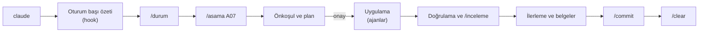

# Çalışma düzeni

> **Sürüm:** 1.1 · **Tarih:** 27 Ekim 2026 · **Durum:** Taslak
> **Bağlı kararlar:** [K-31](../00-ozet/02-karar-defteri.md#k-31--geliştirme-aracı-claude-code)

Bu dosya Claude Code ile bir aşamanın nasıl yürütüldüğünü, onay noktalarını ve oturum düzenini anlatır. Kurallar `CLAUDE.md` dosyasındadır; burada uygulama biçimi durur.

## 1. Bir oturumun akışı



1. **Aç.** Proje klasöründe `claude`. Oturumun başına ilerleme özeti otomatik eklenir.
2. **Yönel.** `/durum` aktif aşamayı, başlanabilecek aşamaları ve bekleyen insan adımlarını gösterir.
3. **Başlat.** `/asama A07` (ya da `/asama sonraki`). Claude Code önkoşulları denetler, okunacak belgeleri okur, planı gösterir.
4. **Onayla.** Planı okuyun; değiştirmek istediğinizi yazın. Onayınız olmadan kod yazılmaz.
5. **İzle.** Claude Code adımları yürütür, bağımsız işleri ajanlara verir, her adımı komutla kanıtlar. Gerektiğinde `Esc` ile durdurup yön verebilirsiniz.
6. **Kapat.** Doğrulama, inceleme, ilerleme kaydı ve commit'ten sonra kapanış raporu gelir. Yeni aşamaya `/clear` ile temiz bir oturumda geçin.

Bir aşama tek oturuma sığmazsa adım adım gidin: `/asama A07.2`. İlerleme dosyası nerede kalındığını tutar.

## 2. İzin kipleri ve onay noktaları

Kit `acceptEdits` kipiyle açılır: proje içindeki dosya düzenlemeleri sorulmadan uygulanır. Proje içindeki bütün terminal ve git komutları da onaysızdır (K-31, 27 Ekim 2026 güncellemesi; [CLAUDE.md](../../CLAUDE.md) kural 11). `Shift+Tab` kipler arasında geçiş yapar; `/plan` doğrudan plan kipine geçer (yalnız okuma ve plan).

Onay yalnız bunlarda istenir:
- Plan (aşama başında ve plan değiştiğinde), karar ve kapsam değişikliği (ekleme, çıkarma, güncelleme).
- Ücretli işler: `eas build`, `eas update` ve `mobile-v*` etiketi itmek (ücretli derleme başlatır; hook sorar), ücretli bulut ya da API çağrısı. Claude Code tahmini maliyeti söyler.
- Web erişimi: `WebFetch` ve `WebSearch` her seferinde sorulur (kaynak doğrulamada `arastirmaci` da).
- Proje dışına yazan araç kurulumları: `git config --global`, `dotnet tool install -g`, `uv tool install`, `uv python install`.
- Proje klasörünün dışını gösteren yollar (hook sorar).
- Nadir git işleri: `git filter-branch`, `git filter-repo`, `git update-ref`, `git gc`, `git reflog expire`, `git commit --no-verify` (hook sorar).

Onaysız yapılanlar: `git push`, `git reset`, `git clean` (`-x` hariç), `git restore`, `git rebase`, `git commit --amend`, `git stash drop`, `git branch -D`, `rm -r`, `dotnet user-secrets` (`list` hariç), satır içi kod (`node -e`, `python -c`), `curl`; `CLAUDE.md`, kit dosyaları ve karar defteri düzenlemesi. Karar defteri yine yalnız `/karar` ile değişir (yordam kuralı; teknik engel yok). `.claude/` Claude Code'un yerleşik korumalı yoludur: oradaki yazma, hook'tan bağımsız olarak Claude Code'un kendi onayını isteyebilir ve yalnız `bypassPermissions` kipinde kalkar ([izin kipleri](https://code.claude.com/docs/en/permission-modes), "Protected paths", okuma 2026-10-27).

Hiç yapılmaz (kesin yasak; `deny` kuralları ve klasör bekçisi hook'u reddeder):
- Zorla push (`--force`, `-f`, `--force-with-lease`, `+refspec`, `--mirror`) ve `main` dalını uzakta silmek; `git clean -x` ve `-X`.
- `data/raw`, `data/gold` ve `data/backups` klasörlerini ve üst klasörlerini silmek (okumak ve `data/backups`'a yazmak serbest); `data/raw` içine yazmak.
- Gizli değer dosyalarına (`.env`, `.env.*` [`.env.example` hariç], `infra/local/s3.json`, `*.pem`, `*.key`, `*.p12`, `*.keystore`, `*.jks`) kabuktan erişmek; argümansız `env`, `printenv`, `set`; `dotnet user-secrets list` (gizli değer yazar).
- `eas submit` (mağazaya gönderim sizin işinizdir); `npm publish`, `pnpm publish`, `yarn publish`, `dotnet nuget push` (`npx`, `pnpm exec`, `pnpm dlx` sarmalayıcılarıyla da).
- Yedeksiz veri silme: `docker compose down -v`, `docker volume rm` ve `prune`, `dotnet ef database drop`, `DROP SCHEMA` ve `DROP DATABASE`. Aynı komut satırında önce `powershell.exe -NoProfile -ExecutionPolicy Bypass -File scripts/backup-db.ps1` bulunmalıdır; yoksa hook reddeder.
- Denetçi ajanların (`inceleyici`, `metin-denetcisi`, `lisans-denetcisi`, `arayuz-denetcisi`, `arastirmaci`) `.tmp/` dışına yazması ve git'i değiştirmesi.

Bu korumaların sınırı: Claude Code'un çalıştırdığı programlar (testler, `uv run`, `dotnet run`, `pnpm` betikleri) işletim sistemi düzeyinde sınırlanmaz; ayrıntı [Kurulum §7](./01-kurulum.md#7-klasör-sınırı-neyi-engeller-neyi-engellemez).

Onay sorulan işlerde "Evet, bir daha sorma" seçtiğiniz kurallar `.claude/settings.local.json` dosyasına yazılır ve yalnız sizin bilgisayarınızda geçerlidir.

## 3. Bağlam ve hafıza

- Proje bilgisi yalnız depodaki dosyalardadır: `CLAUDE.md`, kurallar, belgeler, ilerleme dosyası. Otomatik hafıza kapalıdır; bir şeyin hatırlanmasını istiyorsanız ilgili belgeye ya da karar defterine yazdırın.
- Aşama dosyaları yalnız gereken belge bölümlerini okutur. Büyük işleri ajanlara bölmek ana oturumun bağlamını küçük tutar.
- `/context` bağlamın doluluğunu gösterir. Dolarsa `/compact` özetler; aşama değişirken `/clear` daha temizdir.
- Oturum başı hook'u `/clear` ve `/compact` sonrasında da ilerleme özetini yeniden ekler.

## 4. Geri alma

- `/rewind` (ya da `Esc` iki kez) konuşmayı ve Claude Code'un yaptığı dosya değişikliklerini önceki bir noktaya geri alır.
- Kalıcı geri dönüş noktası git commit'idir; her aşama en az bir commit'le kapanır.
- Veritabanında yıkıcı işlemden önce `scripts/backup-db.ps1` ile yedek alınır; yedeksiz komutu hook reddeder (§2).

## 5. Ajanlarla çalışma

- Ana oturum yönetir; ajanlar iş yapar ve rapor verir. Geliştirici ajanlar başka ajan başlatamaz (`disallowedTools: Agent`).
- Bağımsız işler paralel çalışır: ör. A04'te çapa grameri TypeScript'te `web-gelistirici`, C#'ta `sunucu-gelistirici`, Python'da `hat-gelistirici` tarafından aynı anda yazılır; vektörler üçünü bağlar.
- Denetçi ajanlar (`inceleyici`, `metin-denetcisi`, `lisans-denetcisi`, `arayuz-denetcisi`, `arastirmaci`) dosya değiştirmez: dosya yazma araçları yoktur; Bash'i yalnız okuma ve test için kullanırlar. Klasör bekçisi hook'u, hook girdisindeki `agent_type` alanına bakarak bu ajanların `.tmp/` dışına yazmasını ve git'i değiştirmesini engeller.
- Bir ajanı adıyla da çağırabilirsiniz: "inceleyici ajanıyla son değişiklikleri incele".

## 6. Commit ve dallar

- `/inceleme` → bulguları düzeltme → `/commit`. Mesajlar İngilizce Conventional Commits biçimindedir ([Proje yapısı](../02-mimari/03-proje-yapisi.md) §6), kit değişiklikleri `kit` kapsamıyla yazılır.
- A08'e kadar çalışma `main` üzerinde yürüdü ve aşama sonunda `git push origin main` onaysız yapıldı (depo özel `karasaid379-hue/mutalaa`, remote ekli; zorla push yok). A08'den itibaren `main`'e doğrudan push yoktur; kısa ömürlü dallarla çalışılır (`feat/…`, `fix/…`, `docs/…`, `chore/…`): aşama dalı, PR ve squash ([Proje yapısı](../02-mimari/03-proje-yapisi.md) §6). Dalı itmek onaysızdır; PR'ı birleştirmek sizdedir (`gh` kurulu değil). Çelişki kaydı: [BÇ-27](./07-belge-celiskileri.md).
- Paralel ve deneysel iş için ileri seçenek: `claude --worktree <ad>` ayrı bir git çalışma ağacında oturum açar.

## 7. Kararlar, belgeler, insan adımları

- Yeni karar: `/karar <konu>`. Karar defteri değişmeden kod ya da belge karara aykırı değişmez.
- Kod belgeden saptıysa ya da "Doğrulanacak" çözüldüyse: `/belge-esitle`.
- Claude Code'un yapamadığı iş: [İnsan adımları](./06-insan-adimlari.md). Yazışma taslağı için `/yazisma <muhatap>`. Cevap gelince durumu Claude Code'a söyleyin; dosyayı günceller.

## 8. Model, çaba ve kullanım

- `/model` modeli, `/effort` düşünme çabasını değiştirir. Plan, mimari ve inceleme gibi ağır işlerde güçlü model ve yüksek çaba; rutin düzeltmelerde daha hızlı model yeterlidir.
- `/usage` oturumun kullanımını ve plan sınırlarını gösterir. Kullanım sınırına takılan bir ajan, sınır yenilenince kaldığı yerden devam ettirilebilir.

## 9. Örnek oturum

```text
> /durum
Aktif: yok · Son tamamlanan: A06 · Başlanabilir: A03, A05 · Öneri: /asama A03

> /asama A03
(önkoşullar tamam; plan: docker-compose.yml, .env.example, infra/local/s3.example.json, üç betik; SeaweedFS doğrulaması arastirmaci'ya)
> Plan uygun, devam et.
(adımlar, docker compose up -d, sağlık denetimi, Range isteği testi, inceleme)
Kabul ölçütleri: [x] postgres healthy … [x] anonim okuma … [x] yedek ve geri yükleme denendi
Commit: chore(infra): add local docker compose stack
Sıradaki: A05 · Yeni oturum için /clear, sonra /asama A05.
```

## İlgili dosyalar

- [Claude Code rehberi](./README.md) · [Kurulum](./01-kurulum.md) · [Ajanlar, beceriler ve kurallar](./03-ajanlar-beceriler-kurallar.md) · [Aşama haritası](./04-asama-haritasi.md) · [İlerleme](./05-ilerleme.md)
