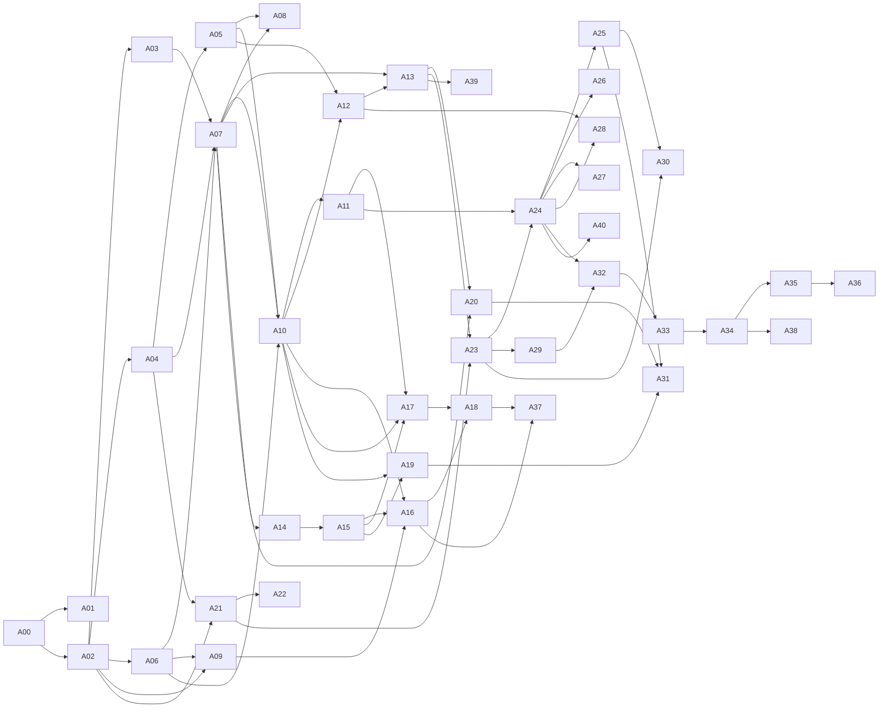

# Aşama haritası

> **Sürüm:** 1.1 · **Tarih:** 27 Ekim 2026 · **Durum:** Taslak
> **Bağlı kararlar:** [K-08](../00-ozet/02-karar-defteri.md#k-08--platform-sırası) · [K-31](../00-ozet/02-karar-defteri.md#k-31--geliştirme-aracı-claude-code) · [K-38](../00-ozet/02-karar-defteri.md#k-38--kaynak-edinimi-dijital-öncelikli-kanıtla-yükseltme)

Bu dosya [Fazlar](../08-yol-haritasi/01-fazlar.md) planını Claude Code'un yürütebileceği aşamalara böler. Her aşamanın kendi dosyası vardır ve `/asama <no>` ile başlatılır. Bir aşama tek oturumda bitmek zorunda değildir; aşama dosyasındaki adımlar (`A07.1`, `A07.2` …) tek oturumluk iştir. Aşamaların durumu [İlerleme](./05-ilerleme.md) dosyasında, Claude Code'un yapamadığı işler [İnsan adımları](./06-insan-adimlari.md) dosyasındadır.

## 1. Aşamalar

| No | Aşama | Faz | Önkoşul | İnsan adımı |
|---|---|---|---|---|
| [A00](./asamalar/A00-ortam-ve-depo.md) | Ortam, klasör ve depo hazırlığı | 0 | — | İ-01 |
| [A01](./asamalar/A01-yazisma-paketi.md) | Hukuk ve izin yazışma paketi | 0 | A00 | İ-02 … İ-08 (gönderim) |
| [A02](./asamalar/A02-tek-depo-iskeleti.md) | Tek depo iskeleti (pnpm + Turborepo, .NET çözümü, uv) | 0 | A00 | — |
| [A03](./asamalar/A03-yerel-altyapi.md) | Yerel altyapı: Docker Compose, PostgreSQL 18, SeaweedFS | 0 | A02 | İ-01 (Docker Desktop) |
| [A04](./asamalar/A04-capa-ve-test-vektorleri.md) | Çapa grameri ve ortak test vektörleri | 0 | A02 | — |
| [A05](./asamalar/A05-arama-normalizasyonu.md) | Arama normalizasyonu (TS, C#, Python) | 0 | A04 | — |
| [A06](./asamalar/A06-lisans-defteri-ve-enumlar.md) | Lisans defteri v1 ve ortak enum şeması | 0 | A02 | — |
| [A07](./asamalar/A07-editoryal-veritabani.md) | Editoryal veritabanı (EF Core 10 + PostgreSQL 18) | 0 | A03, A04, A06 | — |
| [A08](./asamalar/A08-ci-is-akislari.md) | CI iş akışları (GitHub Actions) | 0 | A05, A07 | İ-16 |
| [A09](./asamalar/A09-elmalili-ocr-pilotu.md) | Elmalılı OCR pilotu ve yol seçimi (OCR motorları ve hazır metin adayları, K-38) | 0 | A02, A06 | İ-09, İ-10, İ-17, İ-29 |
| [A10](./asamalar/A10-tanzil-alimi.md) | Tanzil alımı ve değişmezlik testleri | 1 | A05, A06, A07 | — |
| [A11](./asamalar/A11-kuran-yapisi-ve-sayfa-eslemesi.md) | Kur'an yapısı: sure adları, cüz, secde, sayfa eşlemesi | 1 | A10 | İ-23 |
| [A12](./asamalar/A12-arama-indeksi-ve-paket-semasi.md) | Arama indeksi ve paket şeması | 1 | A05, A10 | — |
| [A13](./asamalar/A13-yayinlayici-ve-yayin-kapisi.md) | Yayınlayıcı ve yayın kapısı (ilk `dev` `core`) | 1 | A07, A12 | — |
| [A14](./asamalar/A14-api-editor-uclari.md) | API editör uçları | 1 | A07 | — |
| [A15](./asamalar/A15-editor-paneli.md) | Editör paneli | 1 | A14 | — |
| [A16](./asamalar/A16-elmalili-meali.md) | Elmalılı meali: hazır metin ya da OCR (A09 yol kararına göre), düzeltme kuyruğu, iki tur | 1 | A09, A10, A15 | İ-09, İ-11, İ-17 |
| [A17](./asamalar/A17-kelime-katmani.md) | Kelime katmanı: `quran_word`, `kelime-kok`, anlam taslakları | 1 | A10, A11 (A11.2), A15 | İ-04, İ-12, İ-17 |
| [A18](./asamalar/A18-baglantilar-ve-altin-setler.md) | Bağlantılar (`xref`) ve altın setler | 1 | A16, A17 | İ-12, İ-13 |
| [A19](./asamalar/A19-hadis-hatlari.md) | Hadis hatları | 1 | A10, A15 | İ-11, İ-14, İ-25 |
| [A20](./asamalar/A20-risale-altyapisi.md) | Risale altyapısı (metinsiz) | 1 | A07, A13 | İ-03, İ-24, İ-28 |
| [A21](./asamalar/A21-mobil-iskelet.md) | Mobil iskelet | 2 | A02, A04 | İ-15 |
| [A22](./asamalar/A22-tasarim-vitrini.md) | Tasarım vitrini ve `ui-tokens` | 2 | A21 | İ-22 (durdurmaz) |
| [A23](./asamalar/A23-cihaz-veri-katmani.md) | Cihaz veri katmanı | 2 | A13, A21 | — |
| [A24](./asamalar/A24-okuyucu-mushaf-c.md) | Okuyucu: Mushaf C, okuma biçimleri, sayfalayıcı | 2 | A23, A11 (A11.2, A11.4–A11.6) | — |
| [A25](./asamalar/A25-secim-kelime-karti-baglantilar.md) | Seçim, kelime kartı, Bağlantılar paneli, geri dönüş | 2 | A24 | — |
| [A26](./asamalar/A26-mushaf-a.md) | Mushaf A (Medine düzeni) | 2 | A24 | İ-06 |
| [A27](./asamalar/A27-ses-sistemi.md) | Ses sistemi | 2 | A24 | İ-07 (yayın için) |
| [A28](./asamalar/A28-arama-ekrani.md) | Arama ekranı | 2 | A12, A24 | — |
| [A29](./asamalar/A29-kutuphane-ve-depolama.md) | Kütüphane ve Depolama yöneticisi | 2 | A23 | — |
| [A30](./asamalar/A30-defterim-ve-ilerleme.md) | Defterim, hatim ve yedekleme | 2 | A23, A25 | — |
| [A31](./asamalar/A31-hadis-ve-risale-okuyuculari.md) | Hadis ve Risale okuyucuları | 2 | A25, A19, A20 | — |
| [A32](./asamalar/A32-ayarlar-erisilebilirlik-oz-test.md) | Ayarlar, ilk açılış, erişilebilirlik, kaynaklar, öz test | 2 | A24, A29 | İ-27 |
| [A33](./asamalar/A33-uctan-uca-test-ve-ic-dagitim.md) | Uçtan uca testler, performans, iç dağıtım | 2 | A24 … A32 | İ-02, İ-21 |
| [A34](./asamalar/A34-magaza-yayini.md) | Mağaza v1 yayın hazırlığı | 3 | A33 | İ-03, İ-15, İ-18, İ-19, İ-27 |
| [A35](./asamalar/A35-hesap-ve-kvkk.md) | Hesap ve KVKK | 4 | A34 | İ-03, İ-20 |
| [A36](./asamalar/A36-senkron.md) | Senkron ve bağlantı oyları | 4 | A35 | İ-03, İ-20 (canlıya açılış) |
| [A37](./asamalar/A37-elmalili-tefsir-paketi.md) | Elmalılı tefsir paketi | 4 | A16, A18 | İ-11, İ-17 |
| [A38](./asamalar/A38-web.md) | Web (Next.js) | 5 | A34 | Kurul'un web görüşü (İ-02; gerekirse İ-19), İ-18 |
| [A39](./asamalar/A39-takvim-ve-lisans-olaylari.md) | Takvim ve lisans olayları (tekrar kullanılabilir yordam) | 6 | A13 | olaya göre: İ-03, İ-19 |
| [A40](./asamalar/A40-mushaf-b.md) | Mushaf B (Türk hattı) | 6 | A24 | lisans (S-04), İ-03, İ-19 |

Faz numaraları: 0 Hazırlık, 1 İçerik hattı, 2 Mobil v1 (iç test), 3 Mağaza v1, 4 v1.x, 5 Web, 6 Takvime bağlı ([Fazlar](../08-yol-haritasi/01-fazlar.md)).

## 2. Bağımlılıklar

A33'ün önkoşulu A24 ile A32 arasındaki bütün aşamalardır; grafikte yalnız A32 gösterildi. Önkoşulda parantez içinde adım yazılıysa (ör. "A11 (A11.2)") o aşamanın yalnız bu adımlarının bitmiş olması yeter; `/asama` ve `/durum` bunu ilerleme notundan okur.

## 3. Kritik yol ve paralellik

- **Hukuk önce başlar.** A01'deki yazışmalar Faz 0'ın ilk işidir; Kurul ön görüşmesi ve avukat görüşü haftalar sürebilir. Bekleme süresi teknik aşamalarla doldurulur ([Fazlar](../08-yol-haritasi/01-fazlar.md) §5).
- **Mobil uzun içerik işlerini beklemez.** A13 ilk `dev` `core` paketini Tanzil metni, A11'in yapı verisi (kelime bölmesi, sayfa eşlemesi, cüz ve secde) ve açıkça sentetik `test-` fikstürleriyle üretir. Mobil aşamaları (A21 sonrası) buna dayanır. Meal (A16), kelime katmanı (A17), bağlantılar (A18) ve hadis (A19) hazır oldukça paketler yeniden yayımlanır.
- **İnsan beklemesi olan aşamalar yarıda bırakılabilir.** A09, A11, A16, A17, A18, A19, A20 araç ve kuyruğu kurup insan turunu ya da insan verisini bekler; bu sürede başka aşamaya geçilir. İlerleme dosyasında durum `engelli` olur; Not sütununa biten adımlar ve beklenen insan adımı yazılır (ör. "A16.1–A16.3 tamam; İ-11 bekleniyor"). A11'de sure adları (A11.3) İ-23'ü ve A14'ün karar uçlarını bekler; A17 ve A24 yalnız A11'in yapı adımlarına dayanır.
- **Paralel yürütülebilecek gruplar** (önkoşulları tamamsa): A03 ile A04 ile A06; A14 ile A12; A22 ile A23; A26, A27, A28, A29 birbirinden bağımsızdır.
- **Önerilen sıra:** A00 → A01 → A02 → A04 → A06 → A03 → A05 → A07 → A10 → A11 (A11.3 hariç) → A12 → A13 → A21 → A22 → A23 → A24 → A25 → (A28, A29, A30, A27) → A14 → A15 → A11.3 (sure adları) → A09 → A16 → A17 → A18 → A19 → A20 → A26 → A31 → A32 → A33 → A08 (GitHub hazır olunca daha önce) → A34. Bu sıra bir öneridir; `/durum` başlanabilecek aşamaları önkoşula göre listeler.

## 4. Fazların çıkış ölçütleriyle eşleşme

| Faz çıkış ölçütü ([Fazlar](../08-yol-haritasi/01-fazlar.md)) | Aşama |
|---|---|
| Kurul'a talep gitti; lisans defteri dolu | A01, A06 |
| Vektör testleri üç dilde CI'da yeşil | A04, A05, A08 |
| OCR yöntemi ya da hazır metin yolu ölçümle seçildi | A09 |
| Yerel ortam tek komutla kalkıyor | A03 |
| `core` aynı girdiyle aynı içerik özetini üretiyor; kapı testleri yeşil | A10, A13 |
| Meal iki düzeltme turundan geçti | A16 |
| Bağlantı türleri altın set kapılarını geçti | A18 |
| Maestro akışları yeşil; arama p95 < 50 ms (K-17); erişilebilirlik tamam | A28, A32, A33 |
| Kurul onayı; public yapıt taraması yeşil; mağazada yayında | A34 |

## İlgili dosyalar

- [Claude Code rehberi](./README.md) · [İlerleme](./05-ilerleme.md) · [İnsan adımları](./06-insan-adimlari.md) · [Çalışma düzeni](./02-calisma-duzeni.md)
- [Fazlar](../08-yol-haritasi/01-fazlar.md) · [Kapsam ve fazlar](../01-urun/01-kapsam-ve-fazlar.md) · [Karar defteri](../00-ozet/02-karar-defteri.md)
